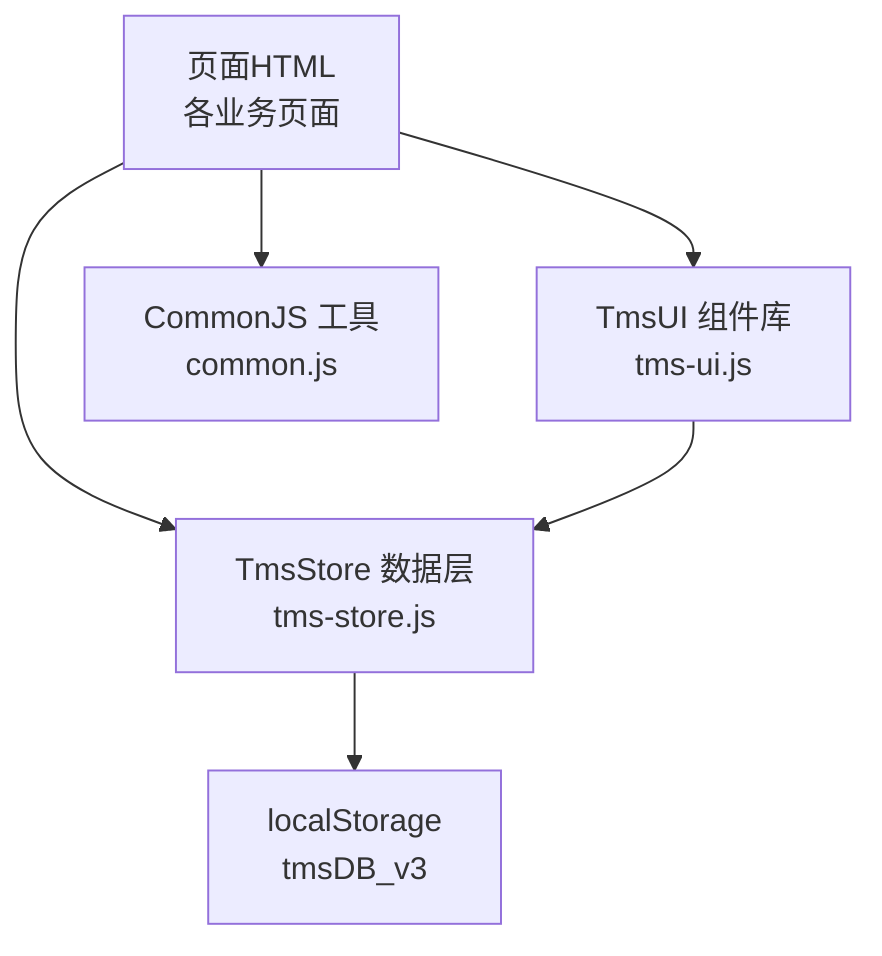
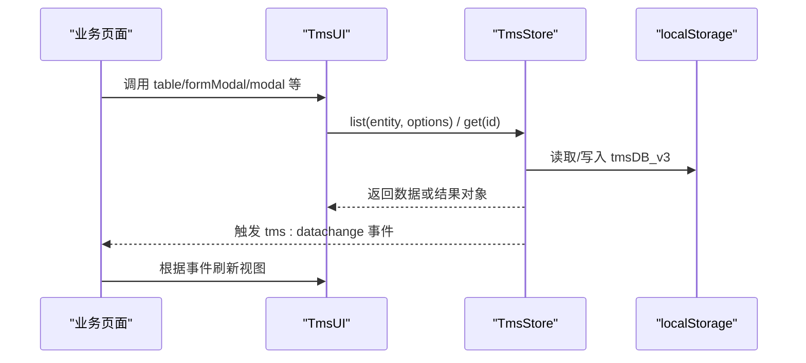
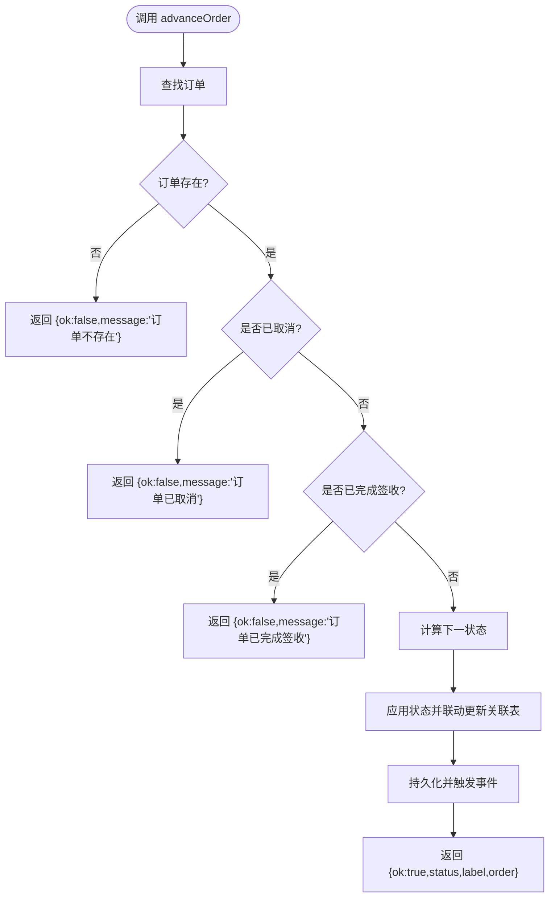
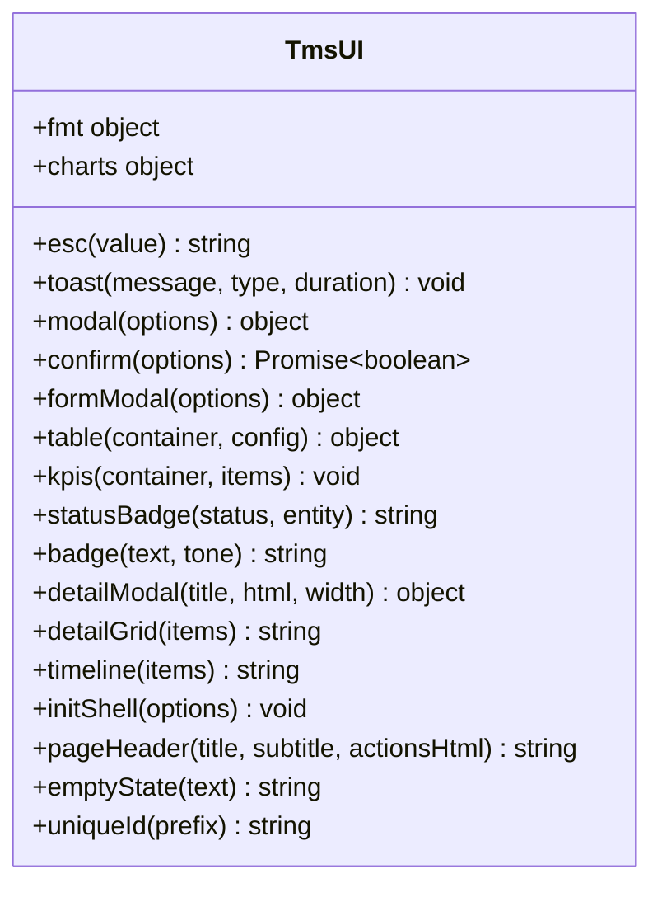
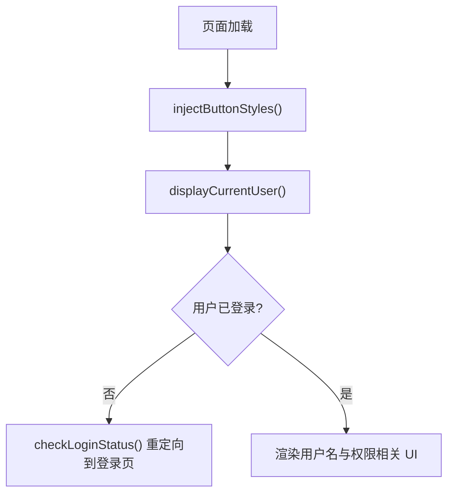
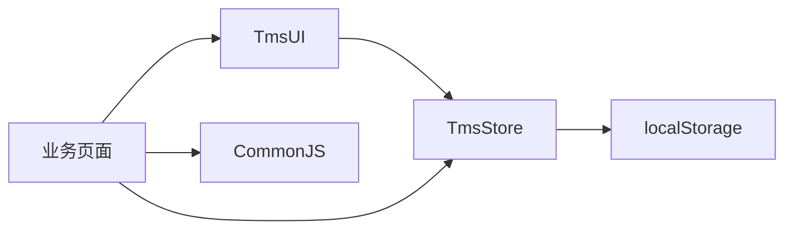

# API参考文档

<cite>
**本文引用的文件**   
- [tms-store.js](file://tms-store.js)
- [tms-ui.js](file://tms-ui.js)
- [common.js](file://common.js)
</cite>

## 目录
1. [引言](#引言)
2. [项目结构](#项目结构)
3. [核心组件](#核心组件)
4. [架构总览](#架构总览)
5. [详细组件分析](#详细组件分析)
6. [依赖关系分析](#依赖关系分析)
7. [性能与优化建议](#性能与优化建议)
8. [故障排查指南](#故障排查指南)
9. [版本兼容性与迁移指南](#版本兼容性与迁移指南)
10. [结论](#结论)

## 引言
本文件为 TMS 系统的 API 参考文档，覆盖以下三类公共接口：
- TmsStore 数据层 API：基于 localStorage 的轻量业务数据库，提供订单、运单、运输、异常、扫描、财务等实体的增删改查、状态流转、统计聚合与事件订阅。
- TmsUI UI 组件 API：提供列表、搜索/筛选/分页、表单弹窗、确认框、Toast、SVG 图表、页面外壳等通用能力。
- CommonJS 工具函数 API：提供全局工具函数，如哈希、订单号/运单号生成、登录鉴权、用户信息与积分管理等。

目标读者包括系统集成开发者、前端页面开发者与二次扩展开发者。文档强调准确性、可操作性和可扩展性，并提供最佳实践、性能优化与调试技巧。

## 项目结构
仓库采用“按功能域 + 共享库”的组织方式：
- 共享数据层：tms-store.js
- 共享 UI 组件库：tms-ui.js
- 通用工具与登录流程：common.js
- 各角色页面（客户端、网点、分拣员、承运商、管理员等）通过引入上述共享脚本复用能力

图示来源
- [tms-store.js:1-12](file://tms-store.js#L1-L12)
- [tms-ui.js:1-8](file://tms-ui.js#L1-L8)
- [common.js:1-10](file://common.js#L1-L10)

章节来源
- [tms-store.js:1-12](file://tms-store.js#L1-L12)
- [tms-ui.js:1-8](file://tms-ui.js#L1-L8)
- [common.js:1-10](file://common.js#L1-L10)

## 核心组件
- TmsStore：暴露 window.TmsStore，提供 list/get/create/update/remove/subscribe/reset 等基础 CRUD，以及 createOrder/cancelOrder/advanceOrder 等业务方法；维护种子数据、计费引擎、路由与轨迹、状态机与关联实体同步。
- TmsUI：暴露 window.TmsUI，提供 toast/modal/confirm/formModal/table/kpis/charts/detailModal/detailGrid/timeline/initShell/pageHeader/emptyState/uniqueId 等 UI 能力。
- CommonJS：暴露 window 上的通用函数，如 hashCode/generateOrderId/generateWaybillNumber/login/checkLoginStatus/logout/getCurrentUser/displayCurrentUser/saveUserProfile/getUserProfile/updateUserProfile/initUserPoints/getUserPointsBalance/addUserPoints/deductUserPoints/getUserPointsHistory。

章节来源
- [tms-store.js:1-12](file://tms-store.js#L1-L12)
- [tms-ui.js:756-779](file://tms-ui.js#L756-L779)
- [common.js:366-382](file://common.js#L366-L382)

## 架构总览
TMS 系统采用“页面 + 共享库”的轻量架构：
- 页面负责视图与交互编排
- TmsUI 提供统一 UI 组件与样式前缀 tms-，避免冲突
- TmsStore 作为唯一数据源，变更时触发 tms:datachange 事件，UI 组件可订阅刷新
- CommonJS 提供跨页面工具与登录态管理

图示来源
- [tms-store.js:237-244](file://tms-store.js#L237-L244)
- [tms-ui.js:523-535](file://tms-ui.js#L523-L535)

## 详细组件分析

### TmsStore 数据层 API
TmsStore 是 TMS 的核心数据层，封装了本地持久化、种子数据初始化、CRUD、状态机、计费引擎、路由与轨迹、统计聚合等能力。所有页面通过 window.TmsStore 访问。

#### 公共接口概览
- 基础查询
  - list(entity, options): 返回列表、总数、分页信息
  - get(entity, id): 获取单条记录
- 基础修改
  - create(entity, data): 创建记录并持久化
  - update(entity, id, patch): 更新记录并持久化
  - remove(entity, id): 删除记录并持久化
- 事件与生命周期
  - subscribe(fn): 订阅数据变化回调，返回取消订阅函数
  - reset(): 重置本地存储并重新初始化
- 业务方法
  - createOrder(data, options): 创建订单，可选自动入库
  - cancelOrder(orderId, reason): 取消订单
  - advanceOrder(orderId, actor): 推进订单到下一状态
  - createException/processException/resolveException: 异常处理流程
  - calcFreight(params, cards): 运费试算
  - planRoute(order, database): 规划路由与计划段
  - buildTraces(order, progression, statusIndex, rng): 生成轨迹明细

#### 数据结构与复杂度
- 列表查询 list：时间复杂度 O(n)，空间复杂度 O(n)（过滤与排序后切片）
- 状态推进 advanceOrder：O(1) 查找 + 多表联动更新，整体 O(n) 取决于关联表大小
- 计费 calcFreight：O(1) 计算，依赖运价卡匹配策略

#### 错误处理
- 找不到记录：get 返回 null；update/remove 返回 null/false
- 非法状态推进：advanceOrder 返回 {ok:false,message:...}
- 本地存储异常：readDb/persist 内部 try/catch 容错

#### 使用示例路径
- 列表与分页：[tms-store.js:1194-1248](file://tms-store.js#L1194-L1248)
- 创建/更新/删除：[tms-store.js:1255-1295](file://tms-store.js#L1255-L1295)
- 事件订阅：[tms-store.js:1297-1302](file://tms-store.js#L1297-L1302)
- 订单创建与推进：[tms-store.js:1499-1535](file://tms-store.js#L1499-L1535), [tms-store.js:1486-1497](file://tms-store.js#L1486-L1497)
- 异常处理：[tms-store.js:1563-1612](file://tms-store.js#L1563-L1612)
- 计费引擎：[tms-store.js:327-383](file://tms-store.js#L327-L383)
- 路由与轨迹：[tms-store.js:387-460](file://tms-store.js#L387-L460)

图示来源
- [tms-store.js:1486-1497](file://tms-store.js#L1486-L1497)
- [tms-store.js:1425-1484](file://tms-store.js#L1425-L1484)

章节来源
- [tms-store.js:1-12](file://tms-store.js#L1-L12)
- [tms-store.js:1194-1302](file://tms-store.js#L1194-L1302)
- [tms-store.js:1486-1535](file://tms-store.js#L1486-L1535)
- [tms-store.js:1563-1612](file://tms-store.js#L1563-L1612)
- [tms-store.js:327-383](file://tms-store.js#L327-L383)
- [tms-store.js:387-460](file://tms-store.js#L387-L460)

### TmsUI UI 组件 API
TmsUI 提供统一的 UI 组件与工具，所有类名前缀为 tms-，避免与页面原有样式冲突。

#### 公共接口概览
- 基础工具
  - esc(value): 转义 HTML
  - fmt: 日期/金额/数字/百分比格式化
  - uniqueId(prefix): 生成唯一 ID
- 提示与弹窗
  - toast(message, type, duration): 显示 Toast
  - modal(options): 打开模态框，返回 {el, close, body}
  - confirmDialog(options): 返回 Promise<boolean>
  - formModal(options): 表单弹窗，支持字段校验与异步提交
- 列表与表格
  - table(container, config): 渲染列表、搜索、筛选、分页、排序、行点击、工具栏按钮
- 图表与 KPI
  - kpis(container, items): 渲染 KPI 卡片
  - charts.line/bar/donut(container, options): SVG 折线/柱状/环形图
- 详情与时间线
  - detailModal(title, html, width): 详情弹窗
  - detailGrid(items): 详情网格
  - timeline(items): 时间线
- 页面外壳
  - initShell(options): 导航高亮、子菜单展开、退出登录绑定、异常待办角标
  - pageHeader(title, subtitle, actionsHtml): 页面头部
  - emptyState(text): 空状态占位

#### 配置项与参数说明
- table(config)
  - entity: 实体名，用于从 TmsStore.list 拉取数据
  - rows: 直接传入数组或函数返回数组
  - columns: [{key, label, render, width, sortable}]
  - actions: [{label, className, onClick(row), show(row)}]
  - search/searchFields/searchPlaceholder: 搜索配置
  - filters: [{key, label, options}]
  - pageSize/defaultSort/toolbar/emptyText/onRowClick/rowClass
- formModal(options)
  - fields: [{key, label, type, options, required, placeholder, value, help, min, max, step, rows, checkboxLabel}]
  - onSubmit(values, modal): 返回 false 或抛错保持弹窗打开；支持 Promise

#### 使用示例路径
- Toast/Modal/Confirm/FormModal：[tms-ui.js:84-285](file://tms-ui.js#L84-L285)
- Table 组件：[tms-ui.js:301-542](file://tms-ui.js#L301-L542)
- KPI/Charts：[tms-ui.js:546-678](file://tms-ui.js#L546-L678)
- Detail/Timeline：[tms-ui.js:682-697](file://tms-ui.js#L682-L697)
- Shell/Header/Empty：[tms-ui.js:701-754](file://tms-ui.js#L701-L754)

图示来源
- [tms-ui.js:756-779](file://tms-ui.js#L756-L779)

章节来源
- [tms-ui.js:84-285](file://tms-ui.js#L84-L285)
- [tms-ui.js:301-542](file://tms-ui.js#L301-L542)
- [tms-ui.js:546-678](file://tms-ui.js#L546-L678)
- [tms-ui.js:682-754](file://tms-ui.js#L682-L754)
- [tms-ui.js:756-779](file://tms-ui.js#L756-L779)

### CommonJS 工具函数 API
CommonJS 提供跨页面的通用工具与登录态管理，所有函数挂载到 window 上。

#### 公共接口概览
- 字符串与编号
  - hashCode(str): 简单哈希
  - generateOrderId(origin, userId): 生成订单号
  - generateWaybillNumber(orderId): 生成运单号
- 页面样式注入
  - injectButtonStyles(): 注入统一按钮样式
- 登录与权限
  - login(): 登录并跳转
  - checkLoginStatus(requiredRole): 检查登录态与角色
  - logout(): 退出登录
  - getCurrentUser(): 获取当前用户
  - displayCurrentUser(): 显示用户名
- 用户资料与积分
  - saveUserProfile(profileData)/getUserProfile()/updateUserProfile(updates)
  - initUserPoints()/getUserPointsBalance()/addUserPoints(amount, description)/deductUserPoints(amount, description)/getUserPointsHistory()

#### 使用示例路径
- 编号生成：[common.js:3-50](file://common.js#L3-L50)
- 样式注入：[common.js:52-133](file://common.js#L52-L133)
- 登录与鉴权：[common.js:135-218](file://common.js#L135-L218)
- 用户资料与积分：[common.js:272-363](file://common.js#L272-L363)
- 全局导出：[common.js:366-382](file://common.js#L366-L382)

图示来源
- [common.js:132-133](file://common.js#L132-L133)
- [common.js:221-270](file://common.js#L221-L270)
- [common.js:176-199](file://common.js#L176-L199)

章节来源
- [common.js:3-50](file://common.js#L3-L50)
- [common.js:52-133](file://common.js#L52-L133)
- [common.js:135-218](file://common.js#L135-L218)
- [common.js:272-363](file://common.js#L272-L363)
- [common.js:366-382](file://common.js#L366-L382)

## 依赖关系分析
- TmsUI 依赖 TmsStore：table 组件在 entity 模式下调用 TmsStore.list 获取数据，并在数据变化时自动刷新。
- TmsStore 依赖 localStorage：以 tmsDB_v3 键值存储结构化数据，包含版本控制与元数据计数器。
- CommonJS 独立于 TmsStore/TmsUI，但被页面与 TmsUI.initShell 调用以展示当前用户与退出登录。

图示来源
- [tms-ui.js:317-358](file://tms-ui.js#L317-L358)
- [tms-store.js:220-234](file://tms-store.js#L220-L234)
- [common.js:132-133](file://common.js#L132-L133)

章节来源
- [tms-ui.js:317-358](file://tms-ui.js#L317-L358)
- [tms-store.js:220-234](file://tms-store.js#L220-L234)
- [common.js:132-133](file://common.js#L132-L133)

## 性能与优化建议
- 列表与分页
  - 优先使用 TmsStore.list 的分页参数（pageSize/page），减少 DOM 渲染量
  - 对大数据集，建议在服务端或更高层做过滤与排序，避免全量内存处理
- 事件订阅
  - 使用 TmsStore.subscribe 时注意及时取消订阅，避免内存泄漏
  - 在输入框聚焦时，TmsUI.table 会跳过刷新以避免干扰用户输入
- 本地存储
  - 频繁写操作会触发 localStorage 序列化开销，建议批量更新后统一 persist
  - 合理设置 pageSize，避免单次渲染过多节点
- 图表渲染
  - 使用 TmsUI.charts 的 SVG 渲染，避免引入重型图表库；数据量大时可降采样或分片渲染

章节来源
- [tms-ui.js:523-535](file://tms-ui.js#L523-L535)
- [tms-store.js:1194-1248](file://tms-store.js#L1194-L1248)
- [tms-store.js:1297-1302](file://tms-store.js#L1297-L1302)

## 故障排查指南
- 数据未刷新
  - 检查是否正确订阅 tms:datachange 事件或使用 TmsStore.subscribe
  - 确认 TmsUI.table 的 entity 配置与 TmsStore 实体名一致
- 表单提交失败
  - 检查 formModal.onSubmit 返回值与异常抛出逻辑
  - 查看必填字段校验与错误提示元素
- 登录态异常
  - 检查 localStorage 中 tmsUser 是否存在且格式正确
  - 确认 checkLoginStatus 的角色校验逻辑是否符合预期
- 本地存储损坏
  - 使用 TmsStore.reset 重置数据，或清理 localStorage 中的 tmsDB_v3

章节来源
- [tms-ui.js:237-285](file://tms-ui.js#L237-L285)
- [tms-store.js:220-244](file://tms-store.js#L220-L244)
- [common.js:176-218](file://common.js#L176-L218)

## 版本兼容性与迁移指南
- 数据版本
  - TmsStore 使用 DB_VERSION=3，键名为 tmsDB_v3；升级时需确保旧数据迁移逻辑兼容
- 实体命名
  - 新增实体需在 create 的 prefixMap 中注册 ID 前缀，保证 ID 生成规则一致
- UI 组件
  - 所有类名使用 tms- 前缀，避免与页面样式冲突；升级时不要移除该约定
- CommonJS
  - 登录与用户信息函数挂载到 window，升级时需保持全局导出不变

章节来源
- [tms-store.js:16-17](file://tms-store.js#L16-L17)
- [tms-store.js:1258-1266](file://tms-store.js#L1258-L1266)
- [tms-ui.js:1-8](file://tms-ui.js#L1-L8)
- [common.js:366-382](file://common.js#L366-L382)

## 结论
本文档系统化梳理了 TMS 系统的三类公共 API：TmsStore 数据层、TmsUI 组件库与 CommonJS 工具函数。通过明确的接口定义、流程图与依赖关系图，帮助开发者快速理解并集成系统能力。建议在实际使用中遵循分页与事件订阅的最佳实践，关注本地存储的性能影响，并按版本兼容性要求平滑迁移。