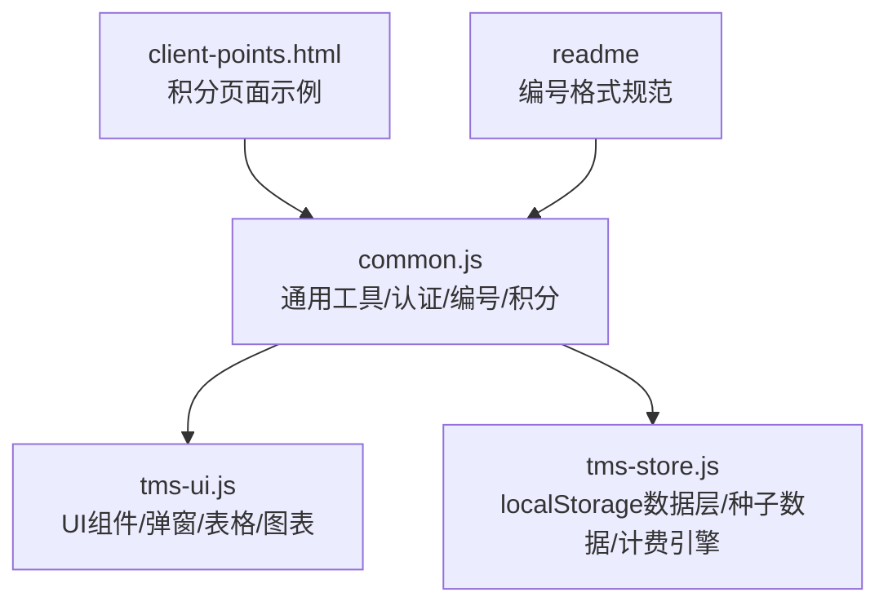
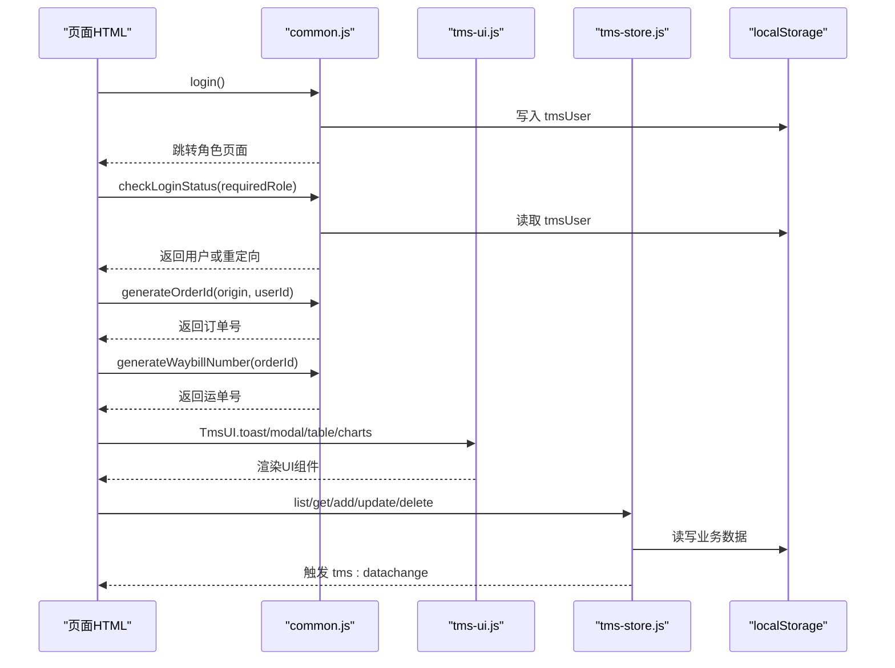
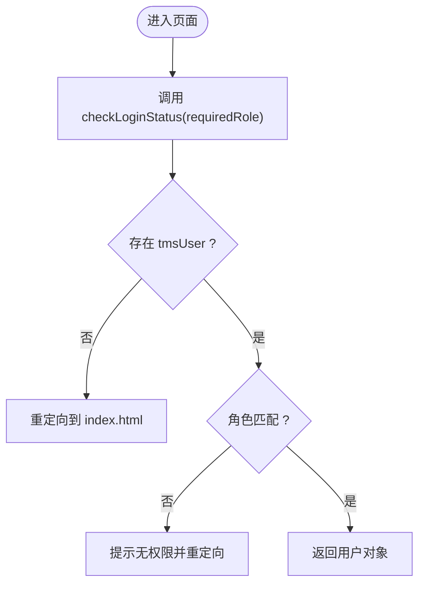
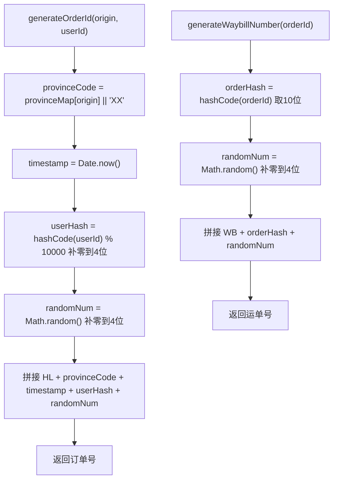
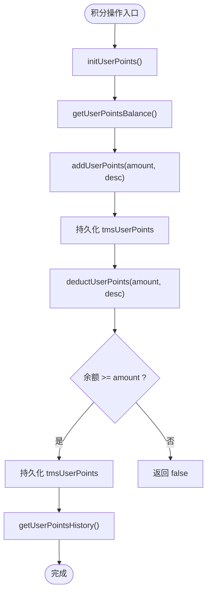
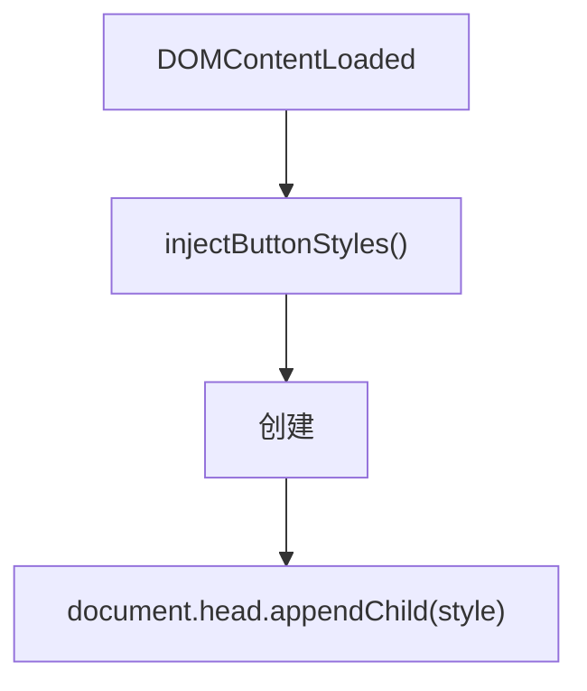
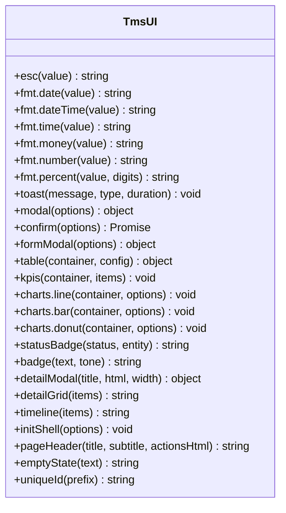
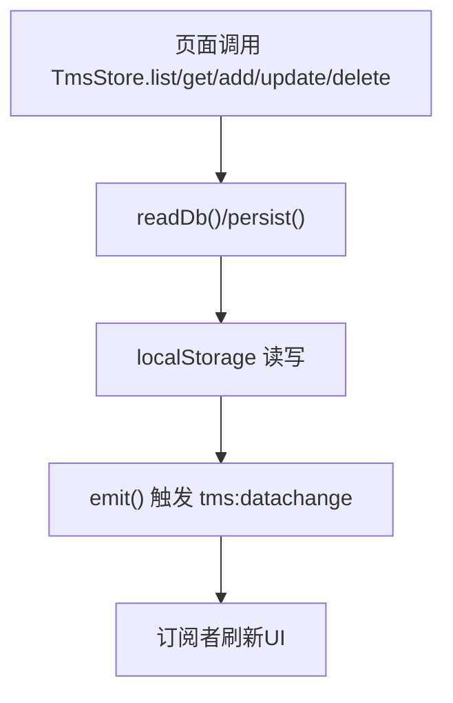
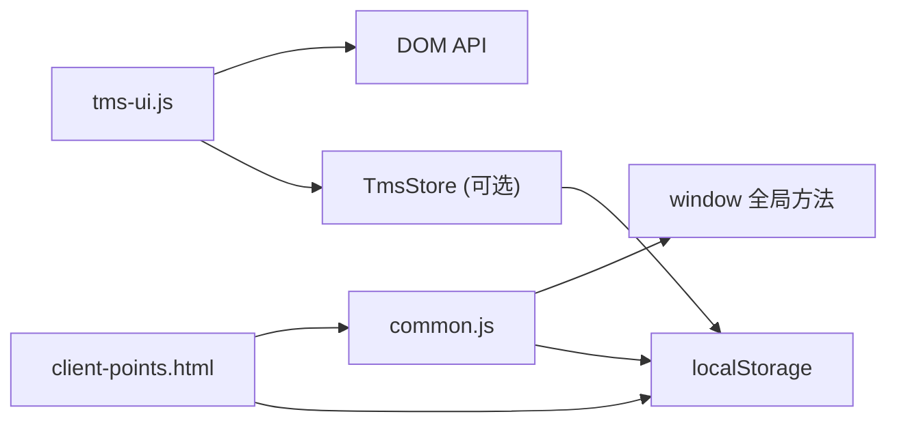

# CommonJS工具库API

<cite>
**本文引用的文件**   
- [common.js](file://common.js)
- [tms-ui.js](file://tms-ui.js)
- [tms-store.js](file://tms-store.js)
- [client-points.html](file://client-points.html)
- [readme](file://readme)
</cite>

## 目录
1. [简介](#简介)
2. [项目结构](#项目结构)
3. [核心组件](#核心组件)
4. [架构总览](#架构总览)
5. [详细组件分析](#详细组件分析)
6. [依赖关系分析](#依赖关系分析)
7. [性能与可维护性建议](#性能与可维护性建议)
8. [故障排查指南](#故障排查指南)
9. [结论](#结论)

## 简介
本文件为 TMS 前端 CommonJS 风格工具库的 API 文档，聚焦以下能力：
- 用户认证相关接口：登录、权限检查、角色管理、当前用户信息获取与展示。
- 订单号与运单号生成器：订单号、运单号的生成规则、格式与使用方式。
- 用户积分系统：积分查询、增减操作、历史记录读取等。
- 按钮样式注入机制与配置说明。
- 通用工具函数签名与用法说明。
- 错误处理与异常处理策略。
- 浏览器本地存储交互方法与数据持久化策略。

该工具库以浏览器全局对象暴露方法为主，配合页面 HTML 与共享 UI/数据层共同工作。

## 项目结构
仓库中与该工具库直接相关的核心文件如下：
- common.js：通用工具函数、认证流程、订单号/运单号生成、按钮样式注入、用户积分基础逻辑。
- tms-ui.js：共享 UI 组件库（Toast、弹窗、表格、图表、页面外壳等），提供统一交互体验。
- tms-store.js：基于 localStorage 的轻量业务数据库，提供实体增删改查、状态流转、统计聚合等。
- client-points.html：客户积分页面示例，演示积分余额、历史与兑换流程。
- readme：订单号与运单号标准格式的简要说明。

**图示来源**
- [common.js:1-383](file://common.js#L1-L383)
- [tms-ui.js:1-781](file://tms-ui.js#L1-L781)
- [tms-store.js:1-800](file://tms-store.js#L1-L800)
- [client-points.html:483-678](file://client-points.html#L483-L678)
- [readme:1-2](file://readme#L1-L2)

**章节来源**
- [common.js:1-383](file://common.js#L1-L383)
- [tms-ui.js:1-781](file://tms-ui.js#L1-L781)
- [tms-store.js:1-800](file://tms-store.js#L1-L800)
- [client-points.html:483-678](file://client-points.html#L483-L678)
- [readme:1-2](file://readme#L1-L2)

## 核心组件
本节概述工具库对外暴露的主要能力与职责边界：
- 认证与会话：login、checkLoginStatus、logout、getCurrentUser、displayCurrentUser。
- 编号生成：generateOrderId、generateWaybillNumber、hashCode。
- 用户资料：saveUserProfile、getUserProfile、updateUserProfile。
- 积分系统：initUserPoints、getUserPointsBalance、addUserPoints、deductUserPoints、getUserPointsHistory。
- UI 增强：injectButtonStyles（按钮样式注入）、TmsUI（弹窗、表格、图表、Toast等）。
- 数据层：TmsStore（实体CRUD、订阅事件、统计聚合、计费引擎、路由规划等）。

**章节来源**
- [common.js:135-383](file://common.js#L135-L383)
- [tms-ui.js:756-779](file://tms-ui.js#L756-L779)
- [tms-store.js:1-12](file://tms-store.js#L1-L12)

## 架构总览
下图展示了工具库在浏览器环境中的整体交互关系：HTML 页面调用 common.js 提供的认证与编号生成方法；TmsUI 提供统一的 UI 组件；TmsStore 作为数据层通过 localStorage 持久化业务数据，并向页面广播变更事件。

**图示来源**
- [common.js:135-218](file://common.js#L135-L218)
- [common.js:23-50](file://common.js#L23-L50)
- [tms-ui.js:86-156](file://tms-ui.js#L86-L156)
- [tms-store.js:220-244](file://tms-store.js#L220-L244)

## 详细组件分析

### 用户认证与权限管理
- 登录验证
  - 方法：login
  - 行为：从表单元素读取用户名、密码与选中角色；校验必填项；将用户信息写入 localStorage 的 tmsUser；根据角色跳转到对应页面。
  - 输入：无（从DOM读取）
  - 输出：页面跳转
  - 异常：未选择角色或未填写用户名/密码时弹出提示并中止。
- 权限检查
  - 方法：checkLoginStatus(requiredRole)
  - 行为：从 localStorage 读取 tmsUser；若不存在则重定向到登录页；若角色不匹配则提示无权限并重定向；否则返回用户对象。
  - 输入：requiredRole（可选）
  - 输出：用户对象或 undefined（已重定向）
  - 异常：JSON解析失败会抛出异常（需调用方捕获）。
- 退出登录
  - 方法：logout
  - 行为：确认后删除 tmsUser 并跳转登录页。
- 当前用户信息
  - 方法：getCurrentUser
  - 行为：从 localStorage 读取并解析 tmsUser，返回用户对象或 null。
  - 异常：JSON解析失败会抛出异常。
- 显示当前用户名
  - 方法：displayCurrentUser
  - 行为：更新多个可能的用户名显示元素；若未找到则尝试创建；返回用户对象或 null。
- 角色管理
  - 角色定义与权限映射由 tms-store.js 中的 ROLES 与 PERMISSIONS 常量提供，供管理员端页面进行角色与权限的增删改查。
  - 权限代码如 user:manage、role:manage、permission:manage 等用于细粒度控制。

**图示来源**
- [common.js:176-199](file://common.js#L176-L199)

**章节来源**
- [common.js:135-218](file://common.js#L135-L218)
- [tms-store.js:144-164](file://tms-store.js#L144-L164)

### 订单号与运单号生成器
- 订单号生成
  - 方法：generateOrderId(origin, userId = 'guest')
  - 规则：HL + 发货省份首字母 + 时间戳 + 4位用户ID哈希值 + 4位随机数字。
  - 输入：origin（发货城市/省份，映射到首字母）、userId（用户标识）
  - 输出：字符串订单号
  - 复杂度：O(n)（n为userId长度）
- 运单号生成
  - 方法：generateWaybillNumber(orderId)
  - 规则：WB + 10位订单号哈希值 + 4位随机数。
  - 输入：orderId（订单号）
  - 输出：字符串运单号
  - 复杂度：O(m)（m为orderId长度）
- 哈希函数
  - 方法：hashCode(str)
  - 行为：对字符串进行简单哈希计算，返回绝对值整数。
  - 复杂度：O(n)

**图示来源**
- [common.js:23-50](file://common.js#L23-L50)
- [readme:1-2](file://readme#L1-L2)

**章节来源**
- [common.js:23-50](file://common.js#L23-L50)
- [readme:1-2](file://readme#L1-L2)

### 用户积分系统
- 初始化积分数据
  - 方法：initUserPoints()
  - 行为：若 localStorage 中不存在 tmsUserPoints，则创建初始余额与空历史并持久化。
  - 输出：pointsData 对象（balance、history）
- 查询积分余额
  - 方法：getUserPointsBalance()
  - 行为：读取并返回 balance；若不存在则先初始化。
- 增加积分
  - 方法：addUserPoints(amount, description)
  - 行为：累加 balance，并在 history 头部插入一条 earn 记录；持久化后返回新余额。
- 扣除积分
  - 方法：deductUserPoints(amount, description)
  - 行为：若余额足够则扣减并在 history 头部插入 spend 记录；持久化后返回 true；否则返回 false。
- 查询积分历史
  - 方法：getUserPointsHistory()
  - 行为：返回 history 数组。

**图示来源**
- [common.js:300-363](file://common.js#L300-L363)

**章节来源**
- [common.js:297-363](file://common.js#L297-L363)
- [client-points.html:483-678](file://client-points.html#L483-L678)

### 按钮样式注入机制与配置
- 注入机制
  - 方法：injectButtonStyles()
  - 行为：动态创建 <style> 标签，注入统一按钮样式类（.btn、.btn-primary、.btn-secondary、.btn-success、.btn-danger、.btn-warning、.btn-sm、.btn-lg、.btn-group），并追加到 document.head。
  - 自动触发：DOMContentLoaded 事件监听器自动调用 injectButtonStyles()。
- 配置选项
  - 当前实现为固定样式集，未暴露配置参数；如需扩展可在注入前修改样式内容或扩展类名。

**图示来源**
- [common.js:52-133](file://common.js#L52-L133)

**章节来源**
- [common.js:52-133](file://common.js#L52-L133)

### 通用工具函数与UI组件
- 通用工具
  - esc(value)：转义HTML特殊字符，防止XSS。
  - pad(n)：数字补零到两位。
  - fmt：日期、时间、金额、数字、百分比格式化。
  - uniqueId(prefix)：生成唯一ID。
- UI组件
  - toast(message, type, duration)：显示消息提示。
  - modal(options)：打开模态框。
  - confirmDialog(options)：确认对话框，返回 Promise。
  - formModal(options)：表单弹窗，支持字段校验与异步提交。
  - table(container, config)：通用数据表格，支持搜索、筛选、排序、分页。
  - charts.line/bar/donut：SVG图表绘制。
  - initShell(pageOptions)：页面外壳初始化，绑定导航、登出、当前用户显示等。
  - pageHeader(title, subtitle, actionsHtml)、emptyState(text)：页面头与空状态。

**图示来源**
- [tms-ui.js:12-82](file://tms-ui.js#L12-L82)
- [tms-ui.js:86-156](file://tms-ui.js#L86-L156)
- [tms-ui.js:163-285](file://tms-ui.js#L163-L285)
- [tms-ui.js:301-542](file://tms-ui.js#L301-L542)
- [tms-ui.js:546-678](file://tms-ui.js#L546-L678)
- [tms-ui.js:682-779](file://tms-ui.js#L682-L779)

**章节来源**
- [tms-ui.js:12-82](file://tms-ui.js#L12-L82)
- [tms-ui.js:86-156](file://tms-ui.js#L86-L156)
- [tms-ui.js:163-285](file://tms-ui.js#L163-L285)
- [tms-ui.js:301-542](file://tms-ui.js#L301-L542)
- [tms-ui.js:546-678](file://tms-ui.js#L546-L678)
- [tms-ui.js:682-779](file://tms-ui.js#L682-L779)

### 数据层与本地存储交互
- 数据键与版本
  - DB_KEY：'tmsDB_v3'
  - DB_VERSION：3
- 读写与持久化
  - readDb()：从 localStorage 读取并校验版本，失败返回 null。
  - persist()：序列化 db 并写入 localStorage，同时触发事件。
  - emit()：派发 tms:datachange 自定义事件，通知订阅者。
- 订阅机制
  - listeners 数组保存回调；数据变更后依次调用，容错处理避免单个监听器错误影响整体。
- 业务实体
  - 包含订单、运单、运输、分拣、扫描、异常、财务、工单、理赔、应收应付、账单、费率卡、路线、员工、车辆、仓库库存、运力、电子围栏、策略、地址、时效规则、改单记录、考核指标等。
- 计费引擎
  - calcFreight(params, cards)：根据重量/体积/保价/到付/折扣等要素计算费用明细。
- 路由与轨迹
  - buildRoutes()/findRoute()/planRoute()：构建多段路由并计划各段截止时间。
  - buildTraces(order, progression, statusIndex, rng)：根据订单阶段生成轨迹节点与超时/偏差标记。

**图示来源**
- [tms-store.js:220-244](file://tms-store.js#L220-L244)

**章节来源**
- [tms-store.js:16-77](file://tms-store.js#L16-L77)
- [tms-store.js:220-244](file://tms-store.js#L220-L244)
- [tms-store.js:278-383](file://tms-store.js#L278-L383)
- [tms-store.js:387-460](file://tms-store.js#L387-L460)

## 依赖关系分析
- common.js 依赖浏览器 DOM 与 localStorage，向 window 暴露全局方法。
- tms-ui.js 封装 UI 组件，依赖 DOM 与 TmsStore（当表格绑定实体时）。
- tms-store.js 依赖 localStorage 与浏览器事件模型，提供统一数据访问与事件广播。
- client-points.html 依赖 common.js 的认证与积分方法，以及 localStorage 直接存取积分数据。

**图示来源**
- [common.js:366-383](file://common.js#L366-L383)
- [tms-ui.js:756-779](file://tms-ui.js#L756-L779)
- [tms-store.js:220-244](file://tms-store.js#L220-L244)
- [client-points.html:483-678](file://client-points.html#L483-L678)

**章节来源**
- [common.js:366-383](file://common.js#L366-L383)
- [tms-ui.js:756-779](file://tms-ui.js#L756-L779)
- [tms-store.js:220-244](file://tms-store.js#L220-L244)
- [client-points.html:483-678](file://client-points.html#L483-L678)

## 性能与可维护性建议
- 编号生成
  - hashCode 为 O(n)，在高并发场景下建议引入服务端生成或分布式序列以避免冲突。
  - 随机数部分使用 Math.random，不具备强随机性；生产环境建议使用更安全的随机源。
- 本地存储
  - localStorage 同步阻塞，大量写入可能影响主线程性能；建议批量合并写入或使用 IndexedDB。
  - JSON.parse/JSON.stringify 频繁调用会带来开销；可对热点数据做内存缓存。
- UI 组件
  - 表格渲染在大数据量时应启用虚拟滚动或后端分页；当前实现为前端分页。
  - SVG 图表在数据点较多时需考虑性能优化（采样、降维）。
- 认证与权限
  - 当前角色校验仅基于 localStorage，安全性较弱；应结合后端鉴权与令牌机制。
  - 建议在 TmsStore 中统一管理权限与角色，并提供 isAuthorized(code) 等方法。

[本节为通用建议，不直接分析具体文件]

## 故障排查指南
- 登录失败
  - 现象：登录后未跳转或提示无权限。
  - 排查：检查表单元素 ID 是否正确；确认 role-btn.active 是否存在；查看 localStorage 中 tmsUser 是否写入成功。
  - 参考：[common.js:135-174](file://common.js#L135-L174)
- 权限检查异常
  - 现象：页面加载即重定向到登录页。
  - 排查：确认 requiredRole 传入正确；检查 tmsUser.role 是否与 requiredRole 匹配；查看 JSON 解析是否抛错。
  - 参考：[common.js:176-199](file://common.js#L176-L199)
- 积分不足
  - 现象：兑换礼品失败。
  - 排查：确认 getUserPointsBalance 返回值；检查 deductUserPoints 是否返回 false；查看 tmsUserPoints 数据结构。
  - 参考：[common.js:338-356](file://common.js#L338-L356), [client-points.html:643-674](file://client-points.html#L643-L674)
- 编号生成异常
  - 现象：订单号/运单号不符合预期。
  - 排查：确认 origin 是否在 provinceMap 中；检查 userId 与 orderId 输入；查看 hashCode 结果是否符合预期。
  - 参考：[common.js:23-50](file://common.js#L23-L50), [readme:1-2](file://readme#L1-L2)
- 样式未注入
  - 现象：按钮样式不生效。
  - 排查：确认 DOMContentLoaded 事件触发；检查 injectButtonStyles 是否执行；查看 head 中是否存在 style 标签。
  - 参考：[common.js:52-133](file://common.js#L52-L133)
- 数据层事件未触发
  - 现象：页面未响应数据变更。
  - 排查：检查 TmsStore.subscribe 是否注册；查看 emit 是否被调用；确认监听器内是否有异常。
  - 参考：[tms-store.js:237-244](file://tms-store.js#L237-L244)

**章节来源**
- [common.js:135-199](file://common.js#L135-L199)
- [common.js:338-356](file://common.js#L338-L356)
- [common.js:52-133](file://common.js#L52-L133)
- [client-points.html:643-674](file://client-points.html#L643-L674)
- [tms-store.js:237-244](file://tms-store.js#L237-L244)

## 结论
本工具库围绕认证、编号生成、积分系统与通用 UI/数据层构建了前端常用能力集合。其优势在于简洁易用、覆盖常见场景；不足之处在于安全与性能方面仍依赖浏览器本地能力，适合演示与原型开发。在生产环境中建议：
- 将认证与权限校验迁移至后端，前端仅做最小化校验与展示。
- 使用更安全与稳定的编号生成服务。
- 将 localStorage 替换为 IndexedDB 或后端存储，提升容量与性能。
- 完善错误处理与日志上报，提升可观测性与可维护性。

[本节为总结性内容，不直接分析具体文件]