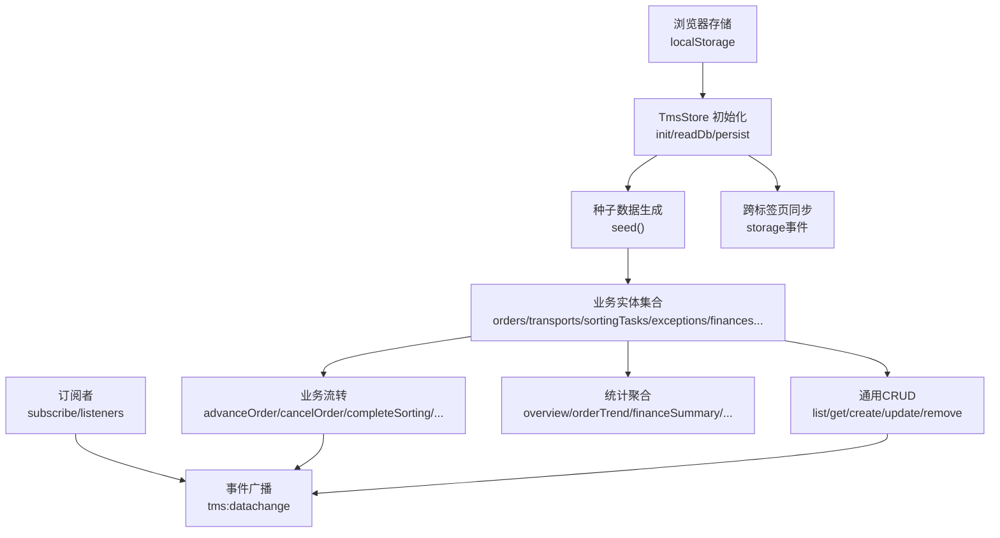
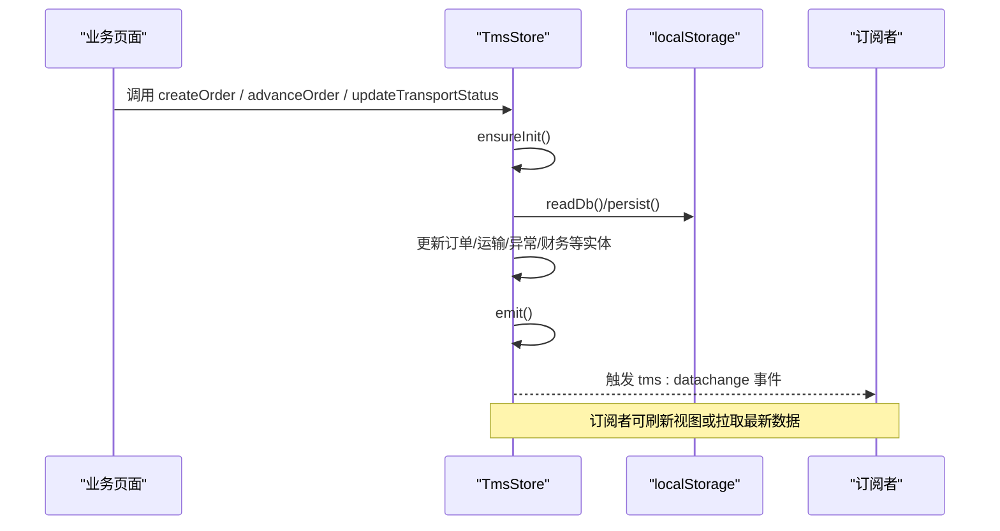
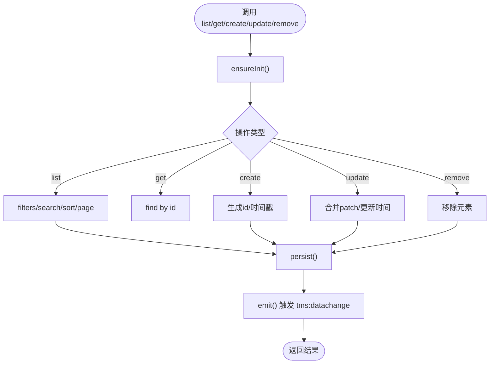
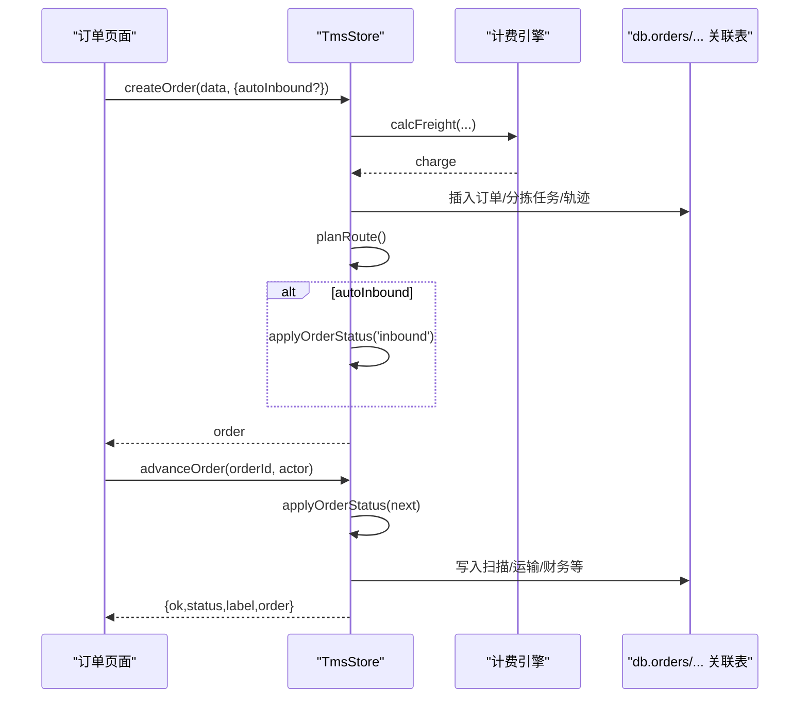
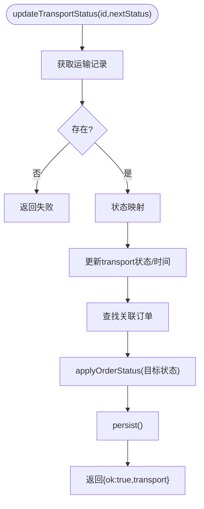
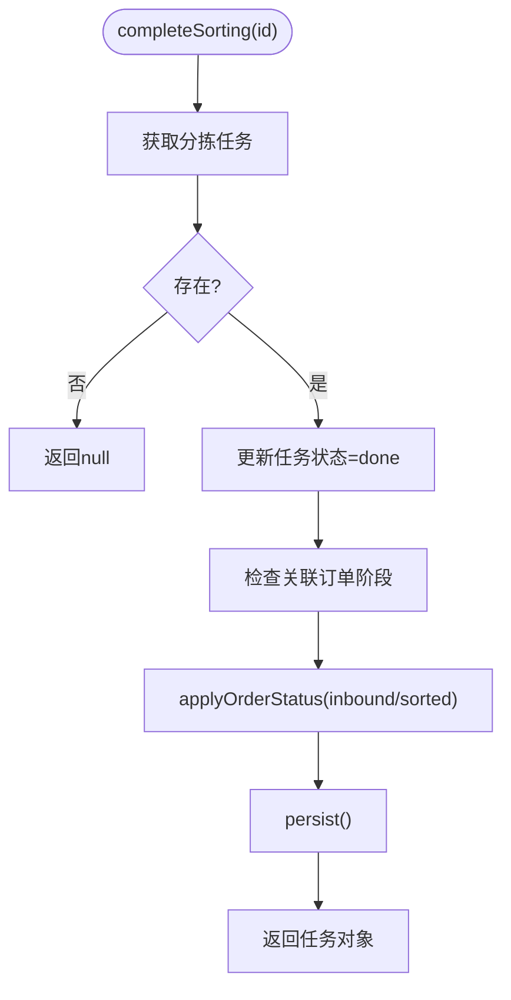
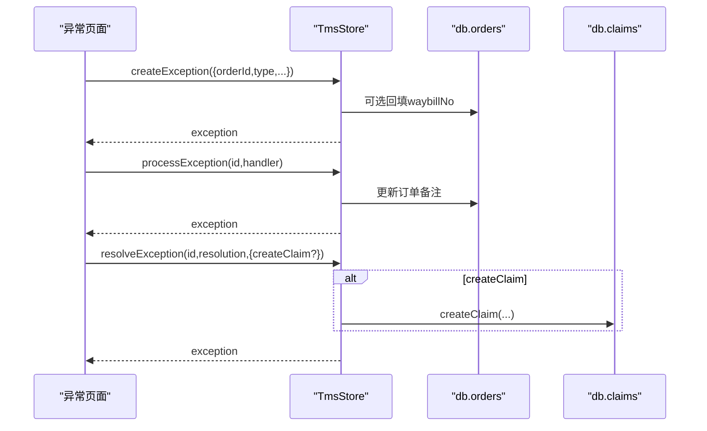
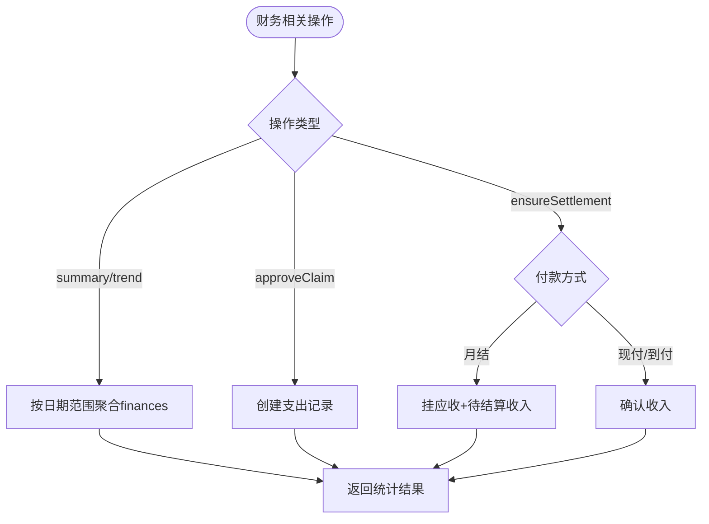
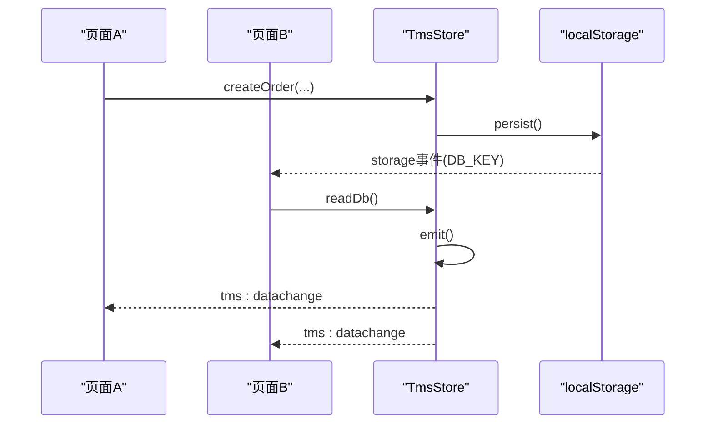
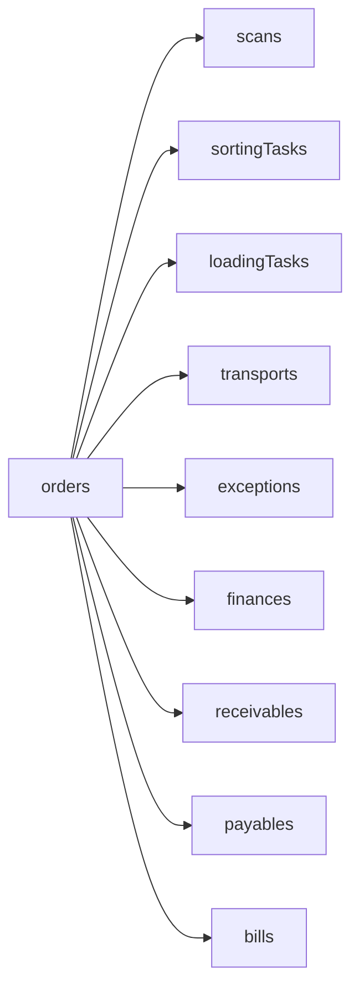

# TmsStore数据层API

<cite>
**本文引用的文件**   
- [tms-store.js](file://tms-store.js)
</cite>

## 目录
1. [简介](#简介)
2. [项目结构](#项目结构)
3. [核心组件](#核心组件)
4. [架构总览](#架构总览)
5. [详细组件分析](#详细组件分析)
6. [依赖关系分析](#依赖关系分析)
7. [性能与优化建议](#性能与优化建议)
8. [故障排查指南](#故障排查指南)
9. [结论](#结论)
10. [附录：业务实体与字段说明](#附录业务实体与字段说明)

## 简介
TmsStore 是面向 TMS（运输管理系统）前端管理端的轻量级共享数据层，基于浏览器 localStorage 提供“类数据库”能力。它负责：
- 首次访问时生成具备真实感的种子数据；
- 提供统一的增删改查、搜索、筛选、排序、分页能力；
- 维护订单全生命周期状态流转，并自动联动扫描、运输、财务等关联记录；
- 提供各页面所需的统计聚合指标；
- 通过事件机制通知数据变更，支持多标签页同步。

对外统一挂载到 `window.TmsStore`，所有业务模块通过该对象访问数据与业务方法。

**章节来源**
- [tms-store.js:1-12](file://tms-store.js#L1-L12)
- [tms-store.js:2034-2089](file://tms-store.js#L2034-L2089)

## 项目结构
TmsStore 以单文件形式组织，内部按职责划分为若干逻辑区块：
- 基础工具与字典：时间、哈希、随机、城市/状态/轨迹节点等常量；
- 初始化与持久化：读取/写入 localStorage、版本校验、跨标签页同步；
- 计费引擎：运价卡匹配、体积重计算、折扣与附加费；
- 路由与轨迹：线路规划、标准时效、轨迹明细生成；
- 种子数据：订单、运输、分拣、异常、财务、工单、理赔等初始数据；
- 通用 CRUD：list/get/create/update/remove/subscribe/reset；
- 业务流转：订单推进、异常处理、工单与理赔、运输任务状态推进、装卸与分拣完成；
- 统计聚合：概览、趋势、分布、日报、车辆/仓库/财务/员工统计；
- 对外暴露：统一 API 对象挂载至 window.TmsStore。

**图表来源**
- [tms-store.js:217-244](file://tms-store.js#L217-L244)
- [tms-store.js:1185-1193](file://tms-store.js#L1185-L1193)
- [tms-store.js:1195-1318](file://tms-store.js#L1195-L1318)
- [tms-store.js:1320-1821](file://tms-store.js#L1320-L1821)
- [tms-store.js:1823-2030](file://tms-store.js#L1823-L2030)
- [tms-store.js:2034-2089](file://tms-store.js#L2034-L2089)

**章节来源**
- [tms-store.js:19-78](file://tms-store.js#L19-L78)
- [tms-store.js:79-214](file://tms-store.js#L79-L214)
- [tms-store.js:215-257](file://tms-store.js#L215-L257)
- [tms-store.js:263-383](file://tms-store.js#L263-L383)
- [tms-store.js:385-460](file://tms-store.js#L385-L460)
- [tms-store.js:462-1152](file://tms-store.js#L462-L1152)
- [tms-store.js:1154-1193](file://tms-store.js#L1154-L1193)
- [tms-store.js:1195-1318](file://tms-store.js#L1195-L1318)
- [tms-store.js:1320-1821](file://tms-store.js#L1320-L1821)
- [tms-store.js:1823-2030](file://tms-store.js#L1823-L2030)
- [tms-store.js:2034-2089](file://tms-store.js#L2034-L2089)

## 核心组件
TmsStore 对外暴露的 API 分为三类：
- 通用数据操作：list、get、create、update、remove、subscribe、reset；
- 业务动作：advanceOrder、createOrder、cancelOrder、removeOrder、createException、processException、resolveException、createTicket、processTicket、resolveTicket、createClaim、approveClaim、updateTransportStatus、completeSorting、completeLoading；
- 统计聚合：overview、orderTrend、statusDistribution、exceptionByType、dailyStats、vehicleStats、warehouseStats、financeSummary、financeTrend、employeeStats；
- 工具函数：dateKey、dateTimeKey、money。

所有方法均通过 ensureInit 保证数据已初始化，并在修改后调用 persist 触发 tms:datachange 事件，通知订阅者。

**章节来源**
- [tms-store.js:1195-1318](file://tms-store.js#L1195-L1318)
- [tms-store.js:1558-1821](file://tms-store.js#L1558-L1821)
- [tms-store.js:1823-2030](file://tms-store.js#L1823-L2030)
- [tms-store.js:2034-2089](file://tms-store.js#L2034-L2089)

## 架构总览
TmsStore 的数据流与控制流如下：
- 初始化：readDb 从 localStorage 读取，若不存在或版本不匹配则 seed 生成种子数据；
- 持久化：persist 将内存 db 序列化写入 localStorage，并触发 emit；
- 事件广播：emit 分发 tms:datachange 事件，同时回调所有 listeners；
- 跨标签页同步：监听 storage 事件，当 DB_KEY 变化时重新读取并广播；
- 业务流转：订单推进、异常处理、工单与理赔、运输任务状态推进、装卸与分拣完成等方法会更新多个实体并保持一致性；
- 统计聚合：根据当前 db 状态计算各类指标。

**图表来源**
- [tms-store.js:220-244](file://tms-store.js#L220-L244)
- [tms-store.js:1185-1193](file://tms-store.js#L1185-L1193)
- [tms-store.js:1558-1634](file://tms-store.js#L1558-L1634)
- [tms-store.js:1768-1792](file://tms-store.js#L1768-L1792)
- [tms-store.js:2081-2089](file://tms-store.js#L2081-L2089)

**章节来源**
- [tms-store.js:217-244](file://tms-store.js#L217-L244)
- [tms-store.js:1185-1193](file://tms-store.js#L1185-L1193)
- [tms-store.js:2081-2089](file://tms-store.js#L2081-L2089)

## 详细组件分析

### 通用数据操作 API
- list(entity, options)
  - 参数：entity 为集合名；options 包含 search、searchFields、filters、sort、page、pageSize；
  - 返回：{ rows, total, page, pageSize, pages }；
  - 行为：先过滤、再全文检索、再排序、最后分页；
- get(entity, id)
  - 参数：entity、id；
  - 返回：匹配的记录或 null；
- create(entity, data)
  - 参数：entity、data；
  - 返回：新增后的记录；
  - 行为：自动生成 id（带前缀）、createdAt/updatedAt，插入数组头部并持久化；
- update(entity, id, patch)
  - 参数：entity、id、patch；
  - 返回：更新后的记录或 null；
  - 行为：合并 patch 并更新时间戳；
- remove(entity, id)
  - 参数：entity、id；
  - 返回：是否删除成功；
- subscribe(fn)
  - 参数：回调函数；
  - 返回：取消订阅函数；
- reset()
  - 清空本地存储并重建种子数据。

**图表来源**
- [tms-store.js:1208-1304](file://tms-store.js#L1208-L1304)
- [tms-store.js:1306-1318](file://tms-store.js#L1306-L1318)

**章节来源**
- [tms-store.js:1208-1318](file://tms-store.js#L1208-L1318)

### 订单管理 API（orders）
- createOrder(data, options)
  - 功能：创建订单，自动分配 ID、运单号、预计到达时间；未传运费时调用计费引擎试算；可选择 autoInbound 自动入库；
  - 副作用：生成分拣任务、计划路由、轨迹节点（揽收），必要时推进入库；
  - 返回：订单对象；
- advanceOrder(orderId, actor)
  - 功能：按 ORDER_FLOW 顺序推进订单状态；
  - 错误处理：订单不存在、已取消、已完成签收时返回失败；
  - 副作用：写入扫描、分拣、装卸、运输、财务等关联记录；
  - 返回：{ ok, status, label, order }；
- cancelOrder(orderId, reason)
  - 功能：取消订单（不可对已签收订单取消）；
  - 返回：布尔值；
- removeOrder(orderId)
  - 功能：删除订单及其关联的 transports、sortingTasks、loadingTasks、exceptions、scans；
  - 返回：布尔值。

**图表来源**
- [tms-store.js:1571-1634](file://tms-store.js#L1571-L1634)
- [tms-store.js:1558-1569](file://tms-store.js#L1558-L1569)
- [tms-store.js:1494-1556](file://tms-store.js#L1494-L1556)
- [tms-store.js:332-383](file://tms-store.js#L332-L383)

**章节来源**
- [tms-store.js:1558-1660](file://tms-store.js#L1558-L1660)
- [tms-store.js:1494-1556](file://tms-store.js#L1494-L1556)
- [tms-store.js:332-383](file://tms-store.js#L332-L383)

### 运输管理 API（transports）
- updateTransportStatus(id, nextStatus)
  - 功能：更新运输任务状态，并联动订单状态推进；
  - 状态映射：shipping→arrived/delivered→delivering→completed；cancelled 直接取消；
  - 错误处理：运输任务不存在时返回失败；
  - 副作用：更新订单阶段（如 arrived/delivering/signed），并可能触发结算；
  - 返回：{ ok, transport }。

**图表来源**
- [tms-store.js:1768-1792](file://tms-store.js#L1768-L1792)
- [tms-store.js:1494-1556](file://tms-store.js#L1494-L1556)

**章节来源**
- [tms-store.js:1768-1792](file://tms-store.js#L1768-L1792)
- [tms-store.js:1494-1556](file://tms-store.js#L1494-L1556)

### 分拣任务 API（sortingTasks）
- completeSorting(id)
  - 功能：标记分拣任务完成，并推动订单进入入库/分拣阶段；
  - 副作用：确保分拣任务状态为 done，并更新关联订单；
  - 返回：分拣任务对象或 null。

**图表来源**
- [tms-store.js:1794-1806](file://tms-store.js#L1794-L1806)
- [tms-store.js:1494-1556](file://tms-store.js#L1494-L1556)

**章节来源**
- [tms-store.js:1794-1806](file://tms-store.js#L1794-L1806)
- [tms-store.js:1494-1556](file://tms-store.js#L1494-L1556)

### 异常管理 API（exceptions）
- createException(data)
  - 功能：创建异常记录，默认状态 pending；
  - 返回：异常记录；
- processException(id, handler)
  - 功能：受理异常，状态变为 processing，并回写订单备注；
  - 返回：异常记录；
- resolveException(id, resolution, options)
  - 功能：解决异常，可选自动生成理赔申请；
  - 返回：异常记录。

**图表来源**
- [tms-store.js:1662-1711](file://tms-store.js#L1662-L1711)
- [tms-store.js:1736-1749](file://tms-store.js#L1736-L1749)

**章节来源**
- [tms-store.js:1662-1711](file://tms-store.js#L1662-L1711)
- [tms-store.js:1736-1749](file://tms-store.js#L1736-L1749)

### 财务管理 API（finances）
- financeSummary(days)、financeTrend(days)
  - 功能：汇总收入/支出/利润及趋势；
  - 返回：金额与计数；
- 其他财务相关：
  - approveClaim(id)：批准理赔并生成支出记录；
  - ensureSettlement(order)：签收后按付款方式生成应收或确认收入；
  - ensureIncome(order)：确保收入记录存在。

**图表来源**
- [tms-store.js:1994-2020](file://tms-store.js#L1994-L2020)
- [tms-store.js:1751-1766](file://tms-store.js#L1751-L1766)
- [tms-store.js:1464-1492](file://tms-store.js#L1464-L1492)
- [tms-store.js:1417-1432](file://tms-store.js#L1417-L1432)

**章节来源**
- [tms-store.js:1994-2020](file://tms-store.js#L1994-L2020)
- [tms-store.js:1751-1766](file://tms-store.js#L1751-L1766)
- [tms-store.js:1464-1492](file://tms-store.js#L1464-L1492)
- [tms-store.js:1417-1432](file://tms-store.js#L1417-L1432)

### 事件监听机制与数据变更通知
- 订阅：subscribe(fn) 注册回调，在数据变更后执行；
- 广播：emit 触发 tms:datachange 事件，并遍历 listeners；
- 跨标签页：监听 storage 事件，当 DB_KEY 变化时重新读取并广播；
- 使用建议：
  - 在页面加载时订阅，避免重复渲染；
  - 在组件卸载时调用 unsubscribe；
  - 在事件回调中仅做必要的数据刷新，避免频繁 DOM 操作。

**图表来源**
- [tms-store.js:237-244](file://tms-store.js#L237-L244)
- [tms-store.js:2081-2089](file://tms-store.js#L2081-L2089)

**章节来源**
- [tms-store.js:237-244](file://tms-store.js#L237-L244)
- [tms-store.js:1306-1318](file://tms-store.js#L1306-L1318)
- [tms-store.js:2081-2089](file://tms-store.js#L2081-L2089)

## 依赖关系分析
- 数据模型依赖：
  - orders 与 scans、sortingTasks、loadingTasks、transports、exceptions、finances、receivables、payables、bills 存在强关联；
  - 订单状态推进会触发多表一致性更新；
- 外部依赖：
  - localStorage 作为持久化存储；
  - CustomEvent 用于事件广播；
  - Date/Number/String 等原生对象用于时间与数值处理；
- 耦合与内聚：
  - 业务流转方法高度内聚于订单状态机；
  - 通用 CRUD 与业务方法解耦，便于扩展新实体。

**图表来源**
- [tms-store.js:1494-1556](file://tms-store.js#L1494-L1556)
- [tms-store.js:1650-1660](file://tms-store.js#L1650-L1660)

**章节来源**
- [tms-store.js:1494-1556](file://tms-store.js#L1494-L1556)
- [tms-store.js:1650-1660](file://tms-store.js#L1650-L1660)

## 性能与优化建议
- 列表查询优化：
  - 优先使用 filters 精确过滤，减少全文检索开销；
  - 合理设置 pageSize，避免一次性加载过多数据；
  - 对高频字段建立索引思路（当前为内存数组，可在上层缓存热点数据）；
- 事件订阅优化：
  - 避免在 tms:datachange 回调中进行重型计算；
  - 使用防抖/节流控制刷新频率；
- 存储大小控制：
  - scans 与 traces 有长度上限（500/2000），注意不要无限增长；
- 批量操作：
  - 尽量合并多次 update 为一次 persist，减少 localStorage 写入次数；
- 跨标签页同步：
  - 仅在必要时订阅 storage 事件，避免重复监听。

[本节为通用指导，不直接分析具体文件]

## 故障排查指南
- 常见问题：
  - 数据未初始化：检查 init/ensureInit 是否被调用；
  - 事件未触发：检查 persist/emit 是否被执行；
  - 跨标签页不同步：检查 storage 事件监听是否正常；
  - 订单无法推进：检查 ORDER_FLOW 状态机与当前状态；
  - 运费计算异常：检查 rateCards 与计费参数；
- 调试建议：
  - 在关键方法前后打印日志；
  - 使用 reset 恢复种子数据验证问题；
  - 检查 localStorage 中的 tmsDB_v3 数据完整性。

**章节来源**
- [tms-store.js:1185-1193](file://tms-store.js#L1185-L1193)
- [tms-store.js:237-244](file://tms-store.js#L237-L244)
- [tms-store.js:2081-2089](file://tms-store.js#L2081-L2089)
- [tms-store.js:1558-1569](file://tms-store.js#L1558-L1569)
- [tms-store.js:332-383](file://tms-store.js#L332-L383)

## 结论
TmsStore 提供了完整的前端数据层能力，涵盖通用 CRUD、订单全生命周期管理、运输与分拣任务联动、异常与理赔流程、财务结算与统计聚合，并通过事件机制实现多标签页数据同步。其设计简洁、职责清晰，适合中小型 TMS 管理端快速构建与迭代。在实际使用中，应关注性能优化、事件订阅管理与数据一致性保障。

[本节为总结性内容，不直接分析具体文件]

## 附录：业务实体与字段说明
- orders：订单主数据，包含客户、商品、重量、体积、运费、起终点、状态、时间线、轨迹等；
- transports：运输任务，包含承运商、车辆、司机、起止时间、状态、进度等；
- sortingTasks：分拣任务，包含订单、网点、分拣员、计划时间、状态等；
- loadingTasks：装卸任务，包含类型、地点、车辆、工人、吨位、设备、状态等；
- scans：扫描记录，包含类型、位置、设备、操作员、时间等；
- exceptions：异常记录，包含类型、描述、状态、处理人、SLA、定责、扣款等；
- finances：财务流水，包含类型、类别、金额、状态、日期、备注等；
- receivables/payables/bills：应收/应付/账单，包含客户、周期、金额、状态、到期日等；
- serviceTickets/claims：服务工单与理赔申请，包含类型、优先级、内容、状态、申请人等。

[本节为概念性说明，不直接分析具体文件]