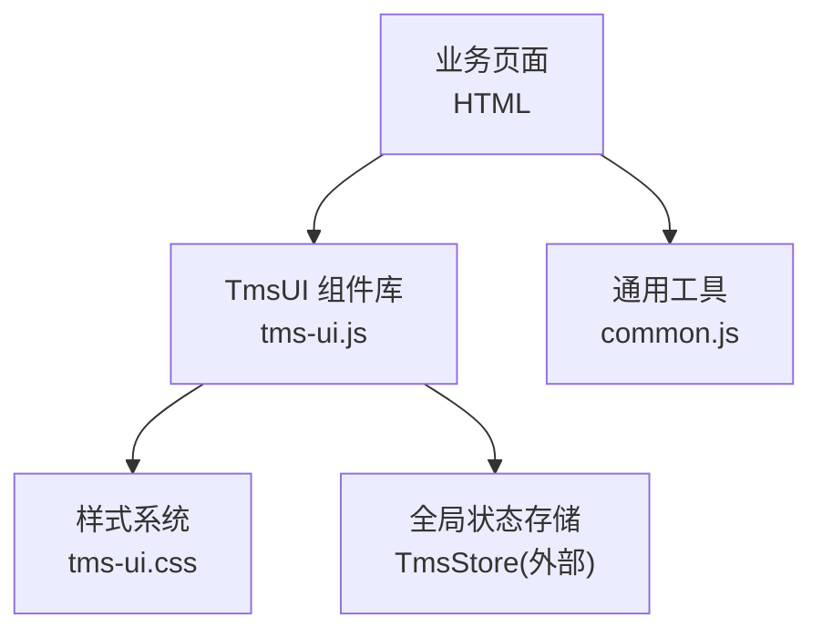
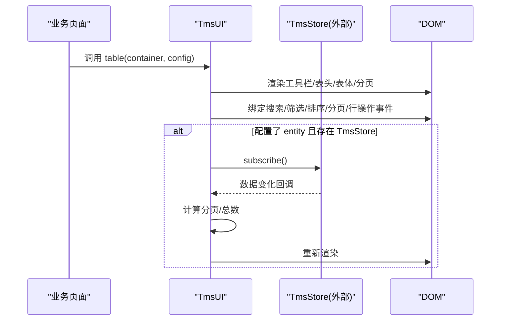
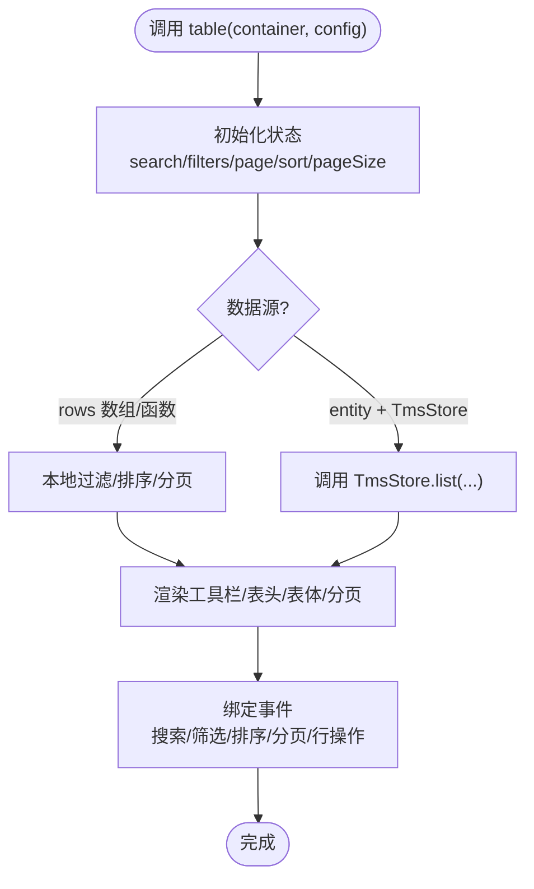
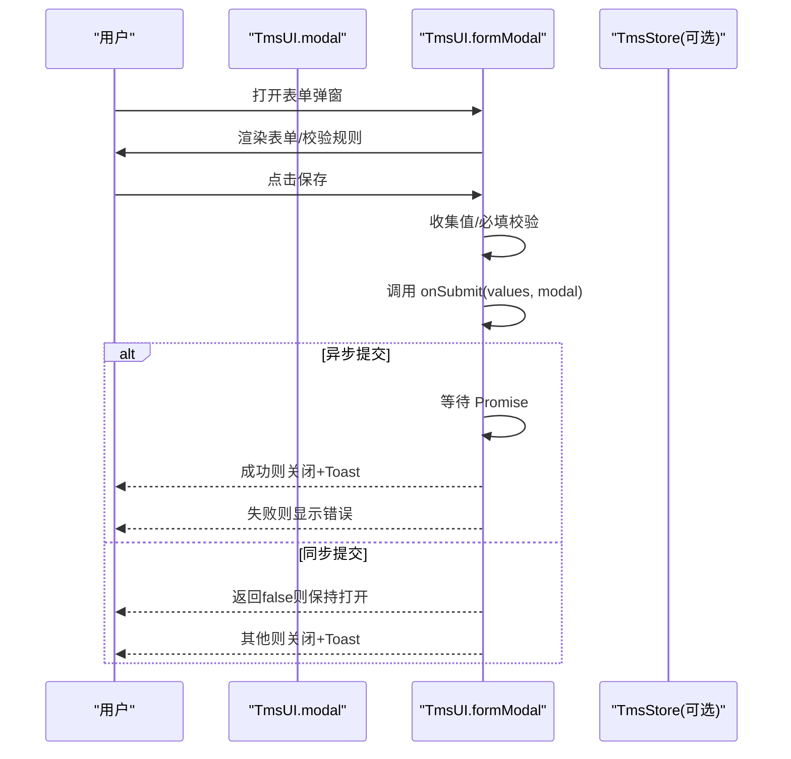
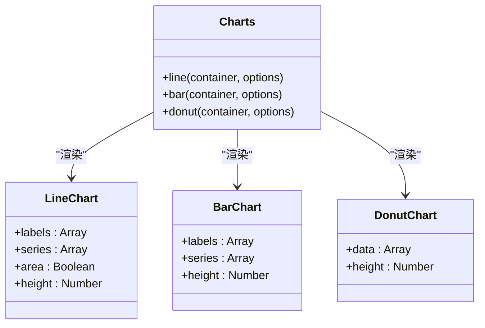
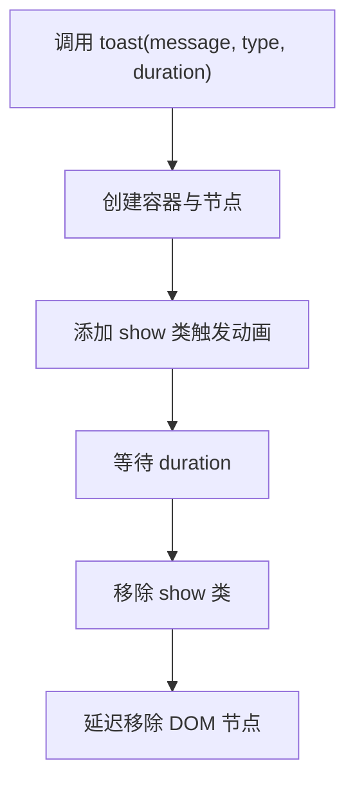
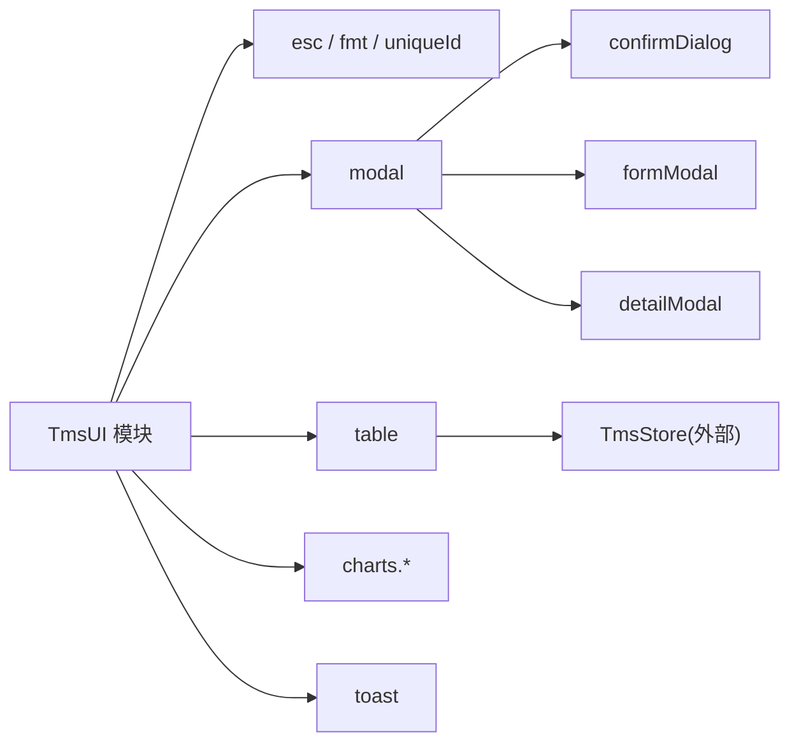
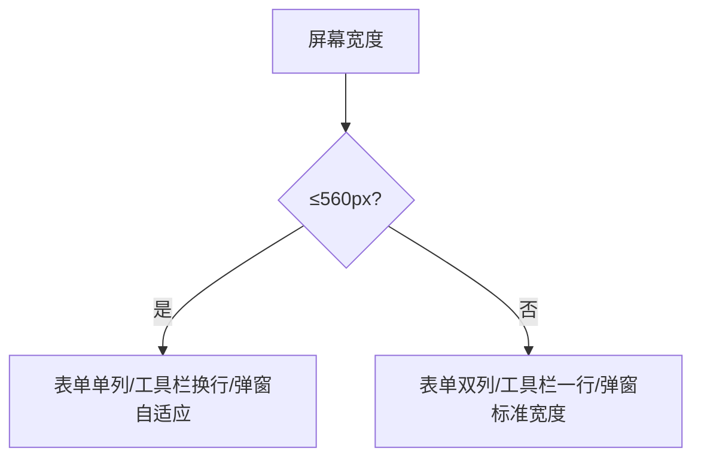

# TmsUI组件库API

<cite>
**本文引用的文件**   
- [tms-ui.js](file://tms-ui.js)
- [tms-ui.css](file://tms-ui.css)
- [common.js](file://common.js)
</cite>

## 目录
1. [简介](#简介)
2. [项目结构](#项目结构)
3. [核心组件](#核心组件)
4. [架构总览](#架构总览)
5. [详细组件分析](#详细组件分析)
6. [依赖关系分析](#依赖关系分析)
7. [性能与可维护性](#性能与可维护性)
8. [故障排查指南](#故障排查指南)
9. [结论](#结论)
10. [附录：响应式与移动端适配](#附录响应式与移动端适配)

## 简介
TmsUI 是本项目中的共享 UI 组件库，提供表格、搜索/筛选/分页、表单弹窗、确认对话框、Toast 通知、SVG 图表（折线图、柱状图、环形图）、KPI 卡片、详情展示、时间线、页面外壳等能力。所有样式类名统一使用 `tms-` 前缀，避免与页面原有样式冲突。组件通过全局对象 `TmsUI` 暴露 API，供各业务页面调用。

## 项目结构
本仓库为多页面应用，TmsUI 的核心实现集中在以下两个文件：
- JavaScript 实现：[tms-ui.js](file://tms-ui.js)
- CSS 样式：[tms-ui.css](file://tms-ui.css)
- 通用工具与登录逻辑：[common.js](file://common.js)

**图示来源**
- [tms-ui.js:756-779](file://tms-ui.js#L756-L779)
- [tms-ui.css:1-10](file://tms-ui.css#L1-L10)
- [common.js:135-210](file://common.js#L135-L210)

**章节来源**
- [tms-ui.js:1-10](file://tms-ui.js#L1-L10)
- [tms-ui.css:1-10](file://tms-ui.css#L1-L10)

## 核心组件
- 基础工具
  - `esc(value)`：转义 HTML 特殊字符，防止 XSS。
  - `fmt`：日期、时间、金额、数字、百分比格式化器。
  - `uniqueId(prefix)`：生成唯一 ID，用于表格实例隔离。
- 通知
  - `toast(message, type?, duration?)`：显示 Toast 通知。
- 弹窗
  - `modal(options)`：基础模态框。
  - `confirmDialog(options)`：确认对话框，返回 Promise。
  - `formModal(options)`：动态表单弹窗，支持字段校验与异步提交。
  - `detailModal(title, html, width?)`：详情弹窗。
- 列表与数据表格
  - `table(container, config)`：通用数据表格，支持搜索、筛选、排序、分页、行点击、操作列、工具栏按钮。
- KPI 与图表
  - `kpis(container, items)`：KPI 指标卡片。
  - `charts.line(container, options)`：折线图。
  - `charts.bar(container, options)`：柱状图。
  - `charts.donut(container, options)`：环形图。
- 详情与时间线
  - `detailGrid(items)`：详情网格。
  - `timeline(items)`：时间线。
- 页面外壳
  - `initShell(options?)`：初始化导航高亮、子菜单、退出登录、异常角标等。
  - `pageHeader(title, subtitle?, actionsHtml?)`：页面头部。
  - `emptyState(text?)`：空状态占位。

**章节来源**
- [tms-ui.js:12-82](file://tms-ui.js#L12-L82)
- [tms-ui.js:84-103](file://tms-ui.js#L84-L103)
- [tms-ui.js:105-156](file://tms-ui.js#L105-L156)
- [tms-ui.js:158-285](file://tms-ui.js#L158-L285)
- [tms-ui.js:287-542](file://tms-ui.js#L287-L542)
- [tms-ui.js:544-678](file://tms-ui.js#L544-L678)
- [tms-ui.js:680-754](file://tms-ui.js#L680-L754)
- [tms-ui.js:756-779](file://tms-ui.js#L756-L779)

## 架构总览
TmsUI 以函数式组件为主，通过全局对象 `TmsUI` 暴露 API。表格组件在绑定事件后，会监听 DOM 交互并更新内部状态；当配置了 `entity` 且存在 `TmsStore` 时，会订阅数据源变更，自动刷新视图。

**图示来源**
- [tms-ui.js:301-542](file://tms-ui.js#L301-L542)

**章节来源**
- [tms-ui.js:301-542](file://tms-ui.js#L301-L542)

## 详细组件分析

### 表格组件 API
- 初始化
  - 调用方式：`TmsUI.table(container, config)`
  - 参数说明：
    - `container`：挂载容器元素。
    - `config`：配置对象，包含以下关键属性：
      - `entity`：实体名称，配合 `TmsStore.list(entity, params)` 获取数据。
      - `rows`：直接传入数组或函数，覆盖 `entity` 的数据源。
      - `columns`：列定义数组，每项含 `key`、`label`、`render`、`width`、`sortable`。
      - `actions`：操作列定义，每项含 `label`、`className`、`onClick(row)`、可选 `show(row)`。
      - `search`：布尔值，控制是否启用搜索输入框。
      - `searchFields`：搜索字段数组，未指定则默认对首行对象的键进行模糊匹配。
      - `searchPlaceholder`：搜索框占位文本。
      - `filters`：筛选器数组，每项含 `key`、`label`、`options`。
      - `pageSize`：每页条数，传 `0` 表示禁用分页。
      - `defaultSort`：默认排序 `{ key, dir }`。
      - `toolbar`：工具栏按钮数组，每项含 `text`、`className`、`onClick()`。
      - `emptyText`：空数据提示文案。
      - `onRowClick(row)`：行点击回调。
      - `rowClass(row)`：根据行数据返回额外 class。
- 数据绑定
  - 优先使用 `rows` 数组或函数；若未设置，则读取 `TmsStore.list(entity, { sort })`。
  - 当 `entity` 存在且 `TmsStore` 可用时，表格订阅数据变化，自动刷新。
- 搜索与筛选
  - 搜索：基于 `searchFields` 或首行键进行不区分大小写模糊匹配。
  - 筛选：根据 `filters` 的 `key` 精确匹配字段值。
- 排序
  - 支持按列升序/降序切换；数值类型优先比较，否则按字符串中文排序。
- 分页
  - 前端分页：当 `rows` 为数组或函数时，按 `pageSize` 切片。
  - 后端分页：当使用 `entity` + `TmsStore` 时，将当前搜索、筛选、排序、页码、页大小传给 store。
- 生命周期与销毁
  - 返回值包含：
    - `refresh()`：手动刷新。
    - `state`：当前搜索、筛选、分页、排序状态。
    - `destroy()`：取消订阅，释放资源。
- 示例路径
  - 参考调用位置：[tms-ui.js:301-542](file://tms-ui.js#L301-L542)

**图示来源**
- [tms-ui.js:301-542](file://tms-ui.js#L301-L542)

**章节来源**
- [tms-ui.js:287-542](file://tms-ui.js#L287-L542)

### 弹窗组件 API
- 基础模态框
  - 调用方式：`TmsUI.modal(options)`
  - 选项：
    - `title`：标题。
    - `body`：主体 HTML。
    - `footer`：底部按钮区域，传 `null` 隐藏底部。
    - `width`：最大宽度。
  - 行为：
    - 支持 ESC 关闭、遮罩点击关闭。
    - 返回对象：`el`、`close()`、`body`。
- 确认对话框
  - 调用方式：`TmsUI.confirmDialog(options)`
  - 选项：
    - `title`、`message`、`okText`、`cancelText`、`danger`（危险按钮样式）。
  - 返回 Promise，resolve(true/false)。
- 表单弹窗
  - 调用方式：`TmsUI.formModal(options)`
  - 选项：
    - `title`、`width`、`submitText`、`successText`。
    - `fields`：字段定义数组，每项含：
      - `key`、`label`、`type`（text/number/select/textarea/checkbox）、`options`（select 用）、`required`、`placeholder`、`value`、`help`、`min`、`max`、`step`、`rows`（textarea 行数）、`full`（跨两列）、`disabled`、`checkboxLabel`。
    - `values`：初始值映射。
    - `onSubmit(values, modalInstance)`：提交回调，可返回 false 阻止关闭，或抛出错误显示失败信息；支持 Promise。
  - 行为：
    - 内置必填校验，错误信息在表单顶部显示。
    - 提交成功后显示成功 Toast 并关闭。
- 详情弹窗
  - 调用方式：`TmsUI.detailModal(title, html, width?)`
  - 行为：固定“关闭”按钮。

**图示来源**
- [tms-ui.js:105-156](file://tms-ui.js#L105-L156)
- [tms-ui.js:158-285](file://tms-ui.js#L158-L285)

**章节来源**
- [tms-ui.js:105-156](file://tms-ui.js#L105-L156)
- [tms-ui.js:158-285](file://tms-ui.js#L158-L285)

### 图表组件 API
- 折线图
  - 调用方式：`TmsUI.charts.line(container, options)`
  - 选项：
    - `labels`：X 轴标签数组。
    - `series`：系列数组，每项含 `name`、`data`、`color`。
    - `area`：是否填充面积（仅单系列有效）。
    - `height`：图表高度。
- 柱状图
  - 调用方式：`TmsUI.charts.bar(container, options)`
  - 选项：同折线图。
- 环形图
  - 调用方式：`TmsUI.charts.donut(container, options)`
  - 选项：
    - `data`：数据项数组，每项含 `label`、`value`、`color`。
    - `height`：图表高度。

**图示来源**
- [tms-ui.js:573-678](file://tms-ui.js#L573-L678)

**章节来源**
- [tms-ui.js:544-678](file://tms-ui.js#L544-L678)

### Toast 通知系统 API
- 调用方式：`TmsUI.toast(message, type?, duration?)`
- 参数：
  - `message`：提示文本。
  - `type`：类型，如 `info`、`success`、`warning`、`error`。
  - `duration`：显示时长（毫秒），默认约 2600ms。
- 行为：
  - 自动创建容器并插入到 body。
  - 带入场动画与自动移除。
- 自定义样式：
  - 可通过 `.tms-toast`、`.tms-toast-success`、`.tms-toast-error`、`.tms-toast-warning` 等类名扩展样式。

**图示来源**
- [tms-ui.js:84-103](file://tms-ui.js#L84-L103)

**章节来源**
- [tms-ui.js:84-103](file://tms-ui.js#L84-L103)

### 页面外壳与辅助方法
- `initShell(options?)`
  - 功能：
    - 高亮当前页导航。
    - 展开/收起子菜单。
    - 绑定退出登录按钮。
    - 调用 `displayCurrentUser()` 显示用户名。
    - 计算异常待办数量并在导航上显示角标。
- `pageHeader(title, subtitle?, actionsHtml?)`
  - 功能：生成页面头部 HTML。
- `emptyState(text?)`
  - 功能：生成空状态占位 HTML。
- `statusBadge(status, entity?)`、`badge(text, tone?)`
  - 功能：生成状态徽章与普通徽章。
- `detailGrid(items)`、`timeline(items)`
  - 功能：生成详情网格与时间线 HTML。

**章节来源**
- [tms-ui.js:680-754](file://tms-ui.js#L680-L754)
- [tms-ui.js:756-779](file://tms-ui.js#L756-L779)

## 依赖关系分析
- 外部依赖
  - `TmsStore`：表格组件在 `entity` 模式下依赖其 `list` 与 `subscribe` 接口。
- 内部依赖
  - `esc`、`fmt`、`uniqueId` 被多处复用。
  - `modal` 被 `confirmDialog`、`formModal`、`detailModal` 复用。
- 样式依赖
  - 所有组件均依赖 `tms-ui.css` 中定义的 `tms-*` 类名。

**图示来源**
- [tms-ui.js:12-82](file://tms-ui.js#L12-L82)
- [tms-ui.js:105-156](file://tms-ui.js#L105-L156)
- [tms-ui.js:287-542](file://tms-ui.js#L287-L542)
- [tms-ui.js:573-678](file://tms-ui.js#L573-L678)
- [tms-ui.js:84-103](file://tms-ui.js#L84-L103)

**章节来源**
- [tms-ui.js:12-82](file://tms-ui.js#L12-L82)
- [tms-ui.js:84-103](file://tms-ui.js#L84-L103)
- [tms-ui.js:105-156](file://tms-ui.js#L105-L156)
- [tms-ui.js:287-542](file://tms-ui.js#L287-L542)
- [tms-ui.js:573-678](file://tms-ui.js#L573-L678)

## 性能与可维护性
- 表格性能
  - 搜索输入采用防抖（约 220ms）减少频繁重绘。
  - 本地过滤与排序在内存中进行，适合中小数据集；大数据建议结合后端分页。
  - 使用 `TmsStore.subscribe` 仅在必要时刷新，避免全量重渲染。
- 样式与主题
  - 统一使用 `tms-` 前缀，降低样式冲突风险。
  - 颜色与尺寸通过 CSS 变量与类名组合，便于主题定制。
- 可维护性
  - 组件职责单一，函数式实现易于测试与替换。
  - 公共工具集中管理，减少重复代码。

[本节为通用指导，不直接分析具体文件]

## 故障排查指南
- 表格无数据
  - 检查 `config.entity` 是否正确，以及 `TmsStore.list(entity, params)` 是否返回正确结构。
  - 若使用 `rows`，确保数组非空或 `emptyText` 已设置。
- 搜索无效
  - 确认 `searchFields` 是否存在于数据对象中；未设置时默认对首行键进行模糊匹配。
- 分页异常
  - 前端分页：检查 `pageSize` 与 `rows` 长度。
  - 后端分页：检查 `TmsStore.list` 返回的 `total`、`page`、`rows` 是否符合预期。
- 表单校验不生效
  - 确认字段定义中包含 `required`，且 `values` 与 `fields.key` 对应。
- Toast 不显示
  - 检查 `document.body` 是否存在；确认未被其他脚本移除容器。
- 弹窗无法关闭
  - 检查是否覆盖了遮罩点击或 ESC 事件；确认 `close()` 未被拦截。

**章节来源**
- [tms-ui.js:301-542](file://tms-ui.js#L301-L542)
- [tms-ui.js:158-285](file://tms-ui.js#L158-L285)
- [tms-ui.js:84-103](file://tms-ui.js#L84-L103)

## 结论
TmsUI 提供了轻量、易用的前端组件集合，覆盖表格、弹窗、图表、通知、页面外壳等常见场景。通过统一的 API 与样式命名规范，便于在多页面应用中复用与维护。对于大数据量场景，建议结合后端分页与按需加载；对于复杂交互，可在 `onSubmit`、`onRowClick`、`toolbar.onClick` 等回调中扩展业务逻辑。

[本节为总结性内容，不直接分析具体文件]

## 附录：响应式与移动端适配
- 表单布局
  - 桌面端默认双列网格，移动端（≤560px）自动切换为单列。
- 表格与工具栏
  - 表格容器支持横向滚动，工具栏在小屏下换行显示。
- 弹窗
  - 弹窗最大高度限制为视口高度的 90%，在小屏设备上自动调整。
- 图表
  - SVG 图表容器宽度自适应，高度可通过 `height` 配置。

**图示来源**
- [tms-ui.css:611-615](file://tms-ui.css#L611-L615)
- [tms-ui.css:456-531](file://tms-ui.css#L456-L531)
- [tms-ui.css:107-161](file://tms-ui.css#L107-L161)

**章节来源**
- [tms-ui.css:611-615](file://tms-ui.css#L611-L615)
- [tms-ui.css:456-531](file://tms-ui.css#L456-L531)
- [tms-ui.css:107-161](file://tms-ui.css#L107-L161)