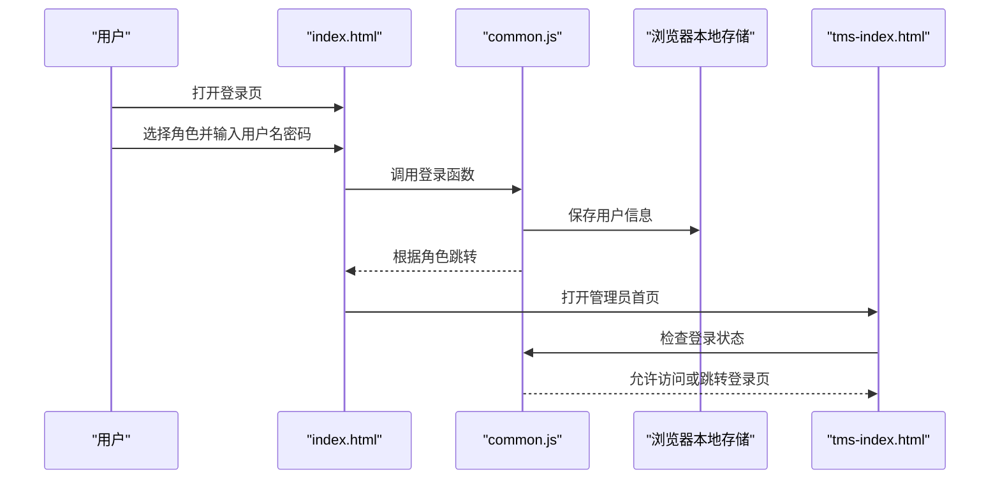
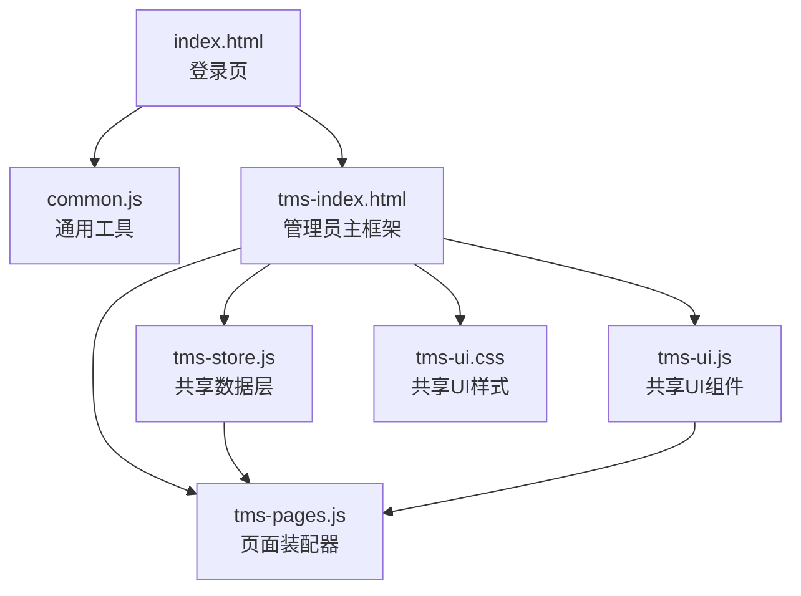
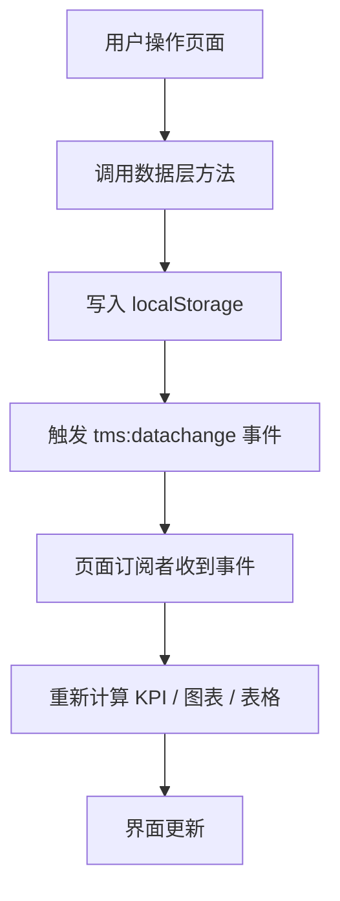
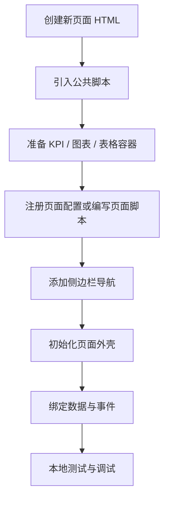
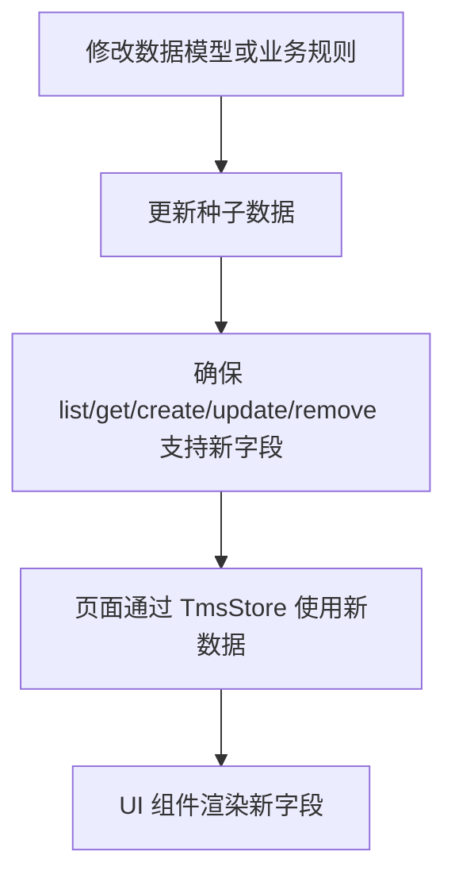

# 开发指南

<cite>
**本文引用的文件**   
- [index.html](file://index.html)
- [common.js](file://common.js)
- [tms-index.html](file://tms-index.html)
- [tms-ui.css](file://tms-ui.css)
- [tms-ui.js](file://tms-ui.js)
- [tms-store.js](file://tms-store.js)
- [tms-pages.js](file://tms-pages.js)
- [readme](file://readme)
</cite>

## 目录
1. [项目概述](#项目概述)
2. [环境搭建与运行方式](#环境搭建与运行方式)
3. [项目结构说明](#项目结构说明)
4. [核心架构与数据流](#核心架构与数据流)
5. [编码规范](#编码规范)
6. [新功能开发流程](#新功能开发流程)
7. [扩展 UI 组件](#扩展-ui-组件)
8. [修改数据模型与业务规则](#修改数据模型与业务规则)
9. [集成第三方服务](#集成第三方服务)
10. [测试策略](#测试策略)
11. [性能优化建议](#性能优化建议)
12. [故障排查指南](#故障排查指南)
13. [代码审查、版本控制与团队协作](#代码审查版本控制与团队协作)
14. [快速上手清单](#快速上手清单)
15. [结论](#结论)

## 项目概述
TMS 运输管理系统是一个面向物流运营的前端演示系统。它通过浏览器本地存储模拟后端数据库，提供订单、异常、运输、仓储、车辆、运力、财务、客服、人事等管理页面，并以统一 UI 组件库和共享数据层支撑多角色页面。

系统特点：
- 纯前端实现，无需服务器即可运行。
- 使用 `localStorage` 作为共享数据源，支持跨标签页联动刷新。
- 提供统一的 UI 组件库，包括表格、表单弹窗、确认框、Toast、KPI、SVG 图表等。
- 管理员端采用“配置化页面装配”模式，新增页面只需注册配置。
- 订单号与运单号遵循仓库内约定格式。

**章节来源**
- [readme:1-3](file://readme#L1-L3)

## 环境搭建与运行方式
### 运行环境
- 现代浏览器（Chrome、Edge、Firefox、Safari）。
- 不需要 Node.js、构建工具或后端服务。

### 启动步骤
1. 直接双击打开登录页 `index.html`。
2. 在登录页选择角色并点击登录。
3. 登录后根据角色跳转到对应主页，例如管理员进入 `tms-index.html`。

### 登录与权限
- 登录逻辑由通用脚本提供，用户名和密码目前为前端校验。
- 登录后用户信息保存在本地存储中。
- 受保护页面会检查登录状态与角色，未登录或角色不匹配时跳转回登录页。

**图示来源**
- [index.html:145-168](file://index.html#L145-L168)
- [common.js:135-199](file://common.js#L135-L199)
- [tms-index.html:431-458](file://tms-index.html#L431-L458)

**章节来源**
- [index.html:117-172](file://index.html#L117-L172)
- [common.js:135-199](file://common.js#L135-L199)
- [tms-index.html:431-458](file://tms-index.html#L431-L458)

## 项目结构说明
项目采用扁平化的 HTML + JS + CSS 结构，按功能域划分文件：

| 分类 | 典型文件 | 职责 |
| --- | --- | --- |
| 入口与登录 | `index.html` | 登录界面、角色选择、基础样式 |
| 通用工具 | `common.js` | 订单号/运单号生成、按钮样式注入、登录登出、用户信息与积分 |
| 管理员主框架 | `tms-index.html` | 运营总览、侧边栏导航、仪表盘渲染 |
| 共享 UI 样式 | `tms-ui.css` | 所有 `tms-*` 前缀的样式 |
| 共享 UI 组件 | `tms-ui.js` | Toast、弹窗、表单、表格、图表、详情页、页面外壳 |
| 共享数据层 | `tms-store.js` | 种子数据、CRUD、搜索筛选排序分页、计费引擎、路由轨迹、统计聚合 |
| 页面装配器 | `tms-pages.js` | 将业务页面装配为 KPI + 图表 + 表格 + CRUD 的统一结构 |
| 业务页面 | `tms-*.html` | 各业务模块的具体页面 |

**图示来源**
- [index.html:145-168](file://index.html#L145-L168)
- [tms-index.html:431-458](file://tms-index.html#L431-L458)
- [tms-store.js:1-12](file://tms-store.js#L1-L12)
- [tms-ui.js:1-6](file://tms-ui.js#L1-L6)
- [tms-pages.js:1-12](file://tms-pages.js#L1-L12)

**章节来源**
- [tms-index.html:290-434](file://tms-index.html#L290-L434)
- [tms-ui.css:1-10](file://tms-ui.css#L1-L10)
- [tms-ui.js:1-6](file://tms-ui.js#L1-L6)
- [tms-store.js:1-12](file://tms-store.js#L1-L12)
- [tms-pages.js:1-12](file://tms-pages.js#L1-L12)

## 核心架构与数据流
### 分层职责
- **视图层**：HTML 页面负责结构与交互事件。
- **UI 组件层**：`tms-ui.js` 提供可复用组件；`tms-ui.css` 提供统一视觉风格。
- **页面装配层**：`tms-pages.js` 将业务页面标准化为“KPI + 图表 + 表格 + 操作”。
- **数据层**：`tms-store.js` 维护 `localStorage` 中的业务数据，并提供查询、变更、订阅能力。
- **通用层**：`common.js` 提供登录、用户信息、编号生成等跨页面能力。

### 数据变化传播
数据层在持久化后触发全局事件，页面订阅该事件后重新渲染 KPI、图表和表格，从而实现跨标签页实时联动。

**图示来源**
- [tms-store.js:220-244](file://tms-store.js#L220-L244)
- [tms-pages.js:87-114](file://tms-pages.js#L87-L114)
- [tms-index.html:454-458](file://tms-index.html#L454-L458)

**章节来源**
- [tms-store.js:1-12](file://tms-store.js#L1-L12)
- [tms-store.js:220-244](file://tms-store.js#L220-L244)
- [tms-pages.js:87-114](file://tms-pages.js#L87-L114)
- [tms-index.html:454-458](file://tms-index.html#L454-L458)

## 编码规范
### 命名规范
- UI 相关类名统一使用 `tms-` 前缀，避免与页面自有样式冲突。
- 数据实体使用复数形式，如 `orders`、`exceptions`、`transports`、`vehicles`、`inventory`。
- 全局对象使用驼峰命名，如 `TmsStore`、`TmsUI`、`TmsPages`。
- 通用函数暴露到全局时使用小写或驼峰，如 `login`、`logout`、`generateOrderId`。

### 样式规范
- 优先复用 `tms-ui.css` 中的已有样式类。
- 新增样式必须使用 `tms-` 前缀。
- 避免在 HTML 中大量内联样式，尽量使用 CSS 类。

### JavaScript 规范
- 优先使用 `tms-ui.js` 提供的组件，而不是重复实现弹窗、表格、分页。
- 数据读写统一通过 `TmsStore`，不要直接操作 `localStorage`。
- 异步操作返回 Promise 或回调，避免阻塞 UI。
- 错误提示使用 `TmsUI.toast` 或表单错误区域。

### 数据与编号规范
- 订单号与运单号生成逻辑参考 `common.js` 与 `tms-store.js`。
- 仓库文档明确订单号与运单号的标准格式。

**章节来源**
- [tms-ui.css:1-10](file://tms-ui.css#L1-L10)
- [tms-ui.js:1-6](file://tms-ui.js#L1-L6)
- [common.js:1-50](file://common.js#L1-L50)
- [tms-store.js:252-261](file://tms-store.js#L252-L261)
- [readme:1-3](file://readme#L1-L3)

## 新功能开发流程
### 新增一个管理员端业务页面
推荐流程如下：

1. 创建新的 HTML 页面，例如 `tms-new-feature.html`。
2. 引入必要脚本：`common.js`、`tms-store.js`、`tms-ui.js`、`tms-pages.js`。
3. 在页面中准备容器元素，例如用于 KPI、图表、表格的区域。
4. 如果页面属于标准列表型页面，可在 `tms-pages.js` 中注册配置。
5. 如果需要复杂自定义逻辑，直接在页面脚本中调用 `TmsStore` 和 `TmsUI`。
6. 在管理员侧边栏添加导航链接。
7. 初始化页面外壳、KPI、图表、表格，并订阅数据变化。

**图示来源**
- [tms-pages.js:1-12](file://tms-pages.js#L1-L12)
- [tms-pages.js:87-114](file://tms-pages.js#L87-L114)
- [tms-index.html:308-364](file://tms-index.html#L308-L364)

**章节来源**
- [tms-pages.js:1-12](file://tms-pages.js#L1-L12)
- [tms-pages.js:87-114](file://tms-pages.js#L87-L114)
- [tms-index.html:308-364](file://tms-index.html#L308-L364)

### 新增一个标准列表型页面
标准列表型页面适合使用 `tms-pages.js` 的 `define` 注册方式：

1. 在 `tms-pages.js` 中调用 `define('pageId', config)`。
2. 配置 `title`、`subtitle`、`kpis`、`charts`、`table`。
3. `table` 中指定 `entity`、列定义、搜索字段、筛选条件、工具栏和操作。
4. 在页面 HTML 中调用 `TmsPages.render('pageId')`。

这种方式能快速获得 KPI、图表、搜索、筛选、分页、排序、行操作等能力。

**章节来源**
- [tms-pages.js:87-114](file://tms-pages.js#L87-L114)
- [tms-pages.js:116-227](file://tms-pages.js#L116-L227)

## 扩展 UI 组件
### 现有 UI 组件能力
`TmsUI` 提供以下主要能力：
- 文本转义与格式化：`esc`、`fmt.date`、`fmt.dateTime`、`fmt.money`、`fmt.number`、`fmt.percent`。
- 反馈组件：`toast`、`modal`、`confirm`、`formModal`。
- 数据展示：`table`、`kpis`、`detailModal`、`detailGrid`、`timeline`。
- 图表：折线图、柱状图、环形图。
- 页面外壳：`initShell`、`pageHeader`、`emptyState`、`uniqueId`。
- 状态徽章：`statusBadge`、`badge`。

### 如何扩展
1. 在 `tms-ui.js` 中新增组件函数。
2. 在 `TmsUI` 导出对象中挂载新函数。
3. 在 `tms-ui.css` 中新增对应样式类。
4. 在页面中使用 `TmsUI.newComponent(...)` 调用。

注意：
- 新增组件应保持无副作用或最小副作用。
- 新增样式必须使用 `tms-` 前缀。
- 新增组件应支持可配置参数，避免硬编码业务逻辑。

**章节来源**
- [tms-ui.js:756-779](file://tms-ui.js#L756-L779)
- [tms-ui.css:1-10](file://tms-ui.css#L1-L10)

## 修改数据模型与业务规则
### 数据模型位置
所有业务实体和数据字典集中在 `tms-store.js`，包括：
- 订单、异常、运输、扫描、分拣、装卸、库存、仓库、车辆、运力、电子围栏、策略、路由、员工、角色、权限等。
- 状态标签映射 `STATUS_LABELS`。
- 客户、商品、承运商、城市、员工姓名等种子字典。

### 新增数据实体
推荐步骤：
1. 在 `tms-store.js` 中新增实体初始数组。
2. 在 `seed` 中生成种子数据。
3. 在 `list`、`get`、`create`、`update`、`remove` 等方法中支持新实体。
4. 在 `STATUS_LABELS` 中补充状态标签。
5. 在页面中通过 `TmsStore.list('newEntity')` 读取数据。
6. 在 `tms-pages.js` 中注册页面配置或使用页面脚本操作数据。

### 修改业务规则
常见修改点：
- 订单号/运单号生成：`buildOrderId`、`buildWaybill`。
- 计费引擎：`calcFreight`、`pickRateCard`、`discountRateFor`。
- 路由与轨迹：`buildRoutes`、`planRoute`、`buildTraces`。
- 状态流转：`ORDER_FLOW`、`TRACE_NODE_MAP`、`STAGE_NODE`。

**图示来源**
- [tms-store.js:88-120](file://tms-store.js#L88-L120)
- [tms-store.js:252-261](file://tms-store.js#L252-L261)
- [tms-store.js:332-383](file://tms-store.js#L332-L383)
- [tms-store.js:387-440](file://tms-store.js#L387-L440)

**章节来源**
- [tms-store.js:88-120](file://tms-store.js#L88-L120)
- [tms-store.js:252-261](file://tms-store.js#L252-L261)
- [tms-store.js:332-383](file://tms-store.js#L332-L383)
- [tms-store.js:387-440](file://tms-store.js#L387-L440)

## 集成第三方服务
当前系统是纯前端演示系统，没有后端 API。若需要集成第三方服务，建议遵循以下原则：

1. **抽象接口**：在 `tms-store.js` 或独立模块中定义统一的数据访问接口。
2. **默认实现**：继续使用 `localStorage` 作为默认实现，保证离线可用。
3. **可选替换**：提供网络请求封装，用于对接真实后端。
4. **错误处理**：区分本地失败与网络失败，使用 `TmsUI.toast` 提示用户。
5. **缓存策略**：网络请求结果可落盘到 `localStorage`，提升体验。
6. **鉴权扩展**：在登录成功后保存 token，并在后续请求中携带。

示例思路：
- 新增 `ApiService` 模块，提供 `fetchOrders`、`createOrder` 等方法。
- 在 `TmsStore` 中保留本地实现，同时预留网络实现入口。
- 页面仍通过 `TmsStore` 调用，不直接感知数据来源。

**章节来源**
- [tms-store.js:1-12](file://tms-store.js#L1-L12)
- [tms-store.js:220-244](file://tms-store.js#L220-L244)
- [common.js:135-199](file://common.js#L135-L199)

## 测试策略
由于项目是前端静态页面，测试应以手动验证为主，并可逐步引入自动化测试。

### 手动测试清单
- 登录流程：不同角色是否能正确跳转。
- 数据持久化：刷新页面后数据是否保留。
- 跨标签页同步：多个标签页操作同一数据后是否联动。
- 表格功能：搜索、筛选、排序、分页是否正常。
- 表单弹窗：必填校验、提交成功、提交失败是否正确。
- 状态显示：状态徽章、时间、金额格式是否符合预期。
- 图表渲染：折线图、柱状图、环形图数据是否正确。

### 自动化测试建议
- 使用浏览器自动化测试工具对关键流程进行回归测试。
- 对 `TmsStore` 的核心方法编写单元测试，例如增删改查、分页、排序。
- 对 `TmsUI` 的组件行为编写交互测试，例如弹窗关闭、表单提交。
- 对编号生成逻辑编写确定性测试，确保订单号、运单号符合规则。

**章节来源**
- [tms-store.js:220-244](file://tms-store.js#L220-L244)
- [tms-ui.js:107-156](file://tms-ui.js#L107-L156)
- [tms-ui.js:163-285](file://tms-ui.js#L163-L285)
- [tms-ui.js:301-542](file://tms-ui.js#L301-L542)

## 性能优化建议
### 数据层优化
- 避免频繁全量遍历大数据集，合理使用 `pageSize` 和 `filters`。
- 对只读聚合数据使用缓存，减少重复计算。
- 避免在每次渲染中重复构造大型 DOM。

### UI 层优化
- 表格分页加载，避免一次性渲染过多行。
- 图表数据量较大时分段渲染或限制点数。
- 避免在高频事件中执行昂贵计算，使用防抖或节流。

### 存储层优化
- 合理拆分 `localStorage` 键，避免单个值过大。
- 定期清理过期数据，例如历史日志、临时草稿。
- 在数据变更后批量触发一次 UI 刷新，避免多次重排。

**章节来源**
- [tms-ui.js:301-542](file://tms-ui.js#L301-L542)
- [tms-store.js:220-244](file://tms-store.js#L220-L244)

## 故障排查指南
### 常见问题
1. **页面空白或数据不显示**
   - 检查是否引入了 `tms-store.js`、`tms-ui.js`、`tms-pages.js`。
   - 检查控制台是否有 JSON 解析错误或 `localStorage` 被禁用。
   - 检查 `TmsStore` 是否成功初始化并生成种子数据。

2. **登录后无法进入管理员页面**
   - 检查 `checkLoginStatus` 是否返回有效用户。
   - 检查角色是否与页面要求一致。
   - 检查 `localStorage` 中是否存在 `tmsUser`。

3. **表格搜索或筛选无效**
   - 检查 `searchFields` 是否包含目标字段。
   - 检查 `filters` 的 key 是否与数据字段一致。
   - 检查表格是否基于 `entity` 还是本地 `rows`。

4. **弹窗或表单不工作**
   - 检查是否调用了 `TmsUI.formModal`。
   - 检查 `fields` 配置是否正确。
   - 检查 `onSubmit` 是否抛出错误或返回 false。

5. **数据变更后其他页面未刷新**
   - 检查是否通过 `TmsStore` 修改数据。
   - 检查页面是否订阅了 `tms:datachange`。
   - 检查是否触发了 `persist` 和 `emit`。

### 调试技巧
- 打开浏览器开发者工具查看控制台日志。
- 在 `localStorage` 中查看 `tmsDB_v3`、`tmsUser` 等键值。
- 在关键函数处添加断点，观察数据流向。
- 使用 `TmsStore.subscribe` 打印数据变化时机。

**章节来源**
- [common.js:135-199](file://common.js#L135-L199)
- [tms-store.js:220-244](file://tms-store.js#L220-L244)
- [tms-ui.js:163-285](file://tms-ui.js#L163-L285)
- [tms-ui.js:301-542](file://tms-ui.js#L301-L542)

## 代码审查、版本控制与团队协作
### 代码审查重点
- 是否复用 `TmsUI` 和 `TmsStore`，避免重复造轮子。
- 新增样式是否使用 `tms-` 前缀。
- 新增数据实体是否在 `STATUS_LABELS` 中补充状态标签。
- 新增页面是否在侧边栏有导航入口。
- 是否处理空数据、错误状态和用户反馈。
- 是否避免直接操作 `localStorage`，而是通过 `TmsStore`。

### 版本控制建议
- 每个功能独立分支，提交信息清晰描述改动范围。
- 提交前完成本地测试，尤其是数据变更和 UI 交互。
- 合并前检查样式冲突、脚本依赖顺序、页面导航完整性。
- 对破坏性变更增加迁移逻辑，例如 `localStorage` 版本升级。

### 团队协作建议
- 统一使用仓库内的编号规则和状态字典。
- 新增业务页面优先使用 `tms-pages.js` 的配置化方式。
- 复杂业务逻辑放在 `tms-store.js` 或独立模块，不在页面中散落。
- 新增第三方集成需保持向后兼容，默认使用本地数据。

**章节来源**
- [tms-ui.css:1-10](file://tms-ui.css#L1-L10)
- [tms-store.js:88-120](file://tms-store.js#L88-L120)
- [tms-pages.js:1-12](file://tms-pages.js#L1-L12)
- [tms-index.html:308-364](file://tms-index.html#L308-L364)

## 快速上手清单
### 新人第一天
1. 打开 `index.html`，尝试不同角色登录。
2. 进入 `tms-index.html`，熟悉运营总览。
3. 阅读 `tms-store.js` 顶部注释，理解数据层职责。
4. 阅读 `tms-ui.js` 顶部注释，理解 UI 组件职责。
5. 阅读 `tms-pages.js` 顶部注释，理解页面装配模式。

### 新人第一个任务
1. 在 `tms-pages.js` 中添加一个新页面配置。
2. 使用 `TmsStore.list('orders')` 获取订单数据。
3. 使用 `TmsUI.table` 渲染表格。
4. 添加搜索、筛选、分页。
5. 添加新增或编辑操作。
6. 在管理员侧边栏添加导航链接。
7. 本地测试并修复问题。

**章节来源**
- [index.html:117-172](file://index.html#L117-L172)
- [tms-index.html:431-578](file://tms-index.html#L431-L578)
- [tms-store.js:1-12](file://tms-store.js#L1-L12)
- [tms-ui.js:1-6](file://tms-ui.js#L1-L6)
- [tms-pages.js:1-12](file://tms-pages.js#L1-L12)

## 结论
TMS 系统以轻量前端架构实现了完整的运输管理演示能力。其核心价值在于：
- 清晰的职责分层：页面、UI 组件、页面装配、数据层、通用工具。
- 统一的开发范式：通过 `TmsStore` 管理数据，通过 `TmsUI` 构建界面。
- 可扩展的业务模型：订单、异常、运输、仓储、车辆、运力、财务、客服、人事均可扩展。
- 可操作的开发流程：新增页面、扩展组件、修改数据模型、集成第三方服务均有明确路径。

对于新加入的开发者，建议从登录流程、运营总览、异常管理和运输管理入手；对于有经验的开发者，建议重点关注数据层扩展、计费引擎、路由轨迹、第三方服务集成和性能优化。