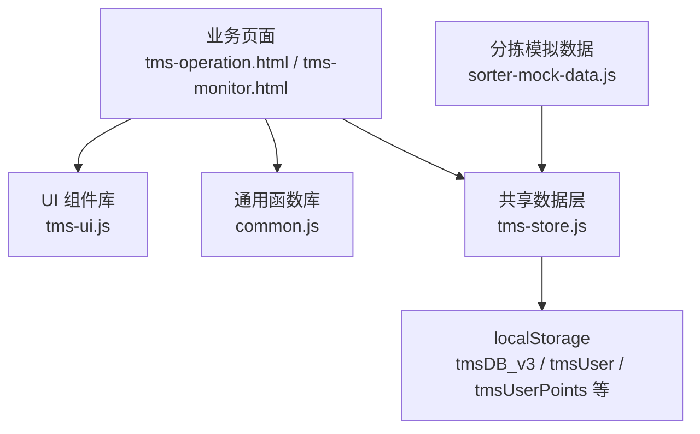
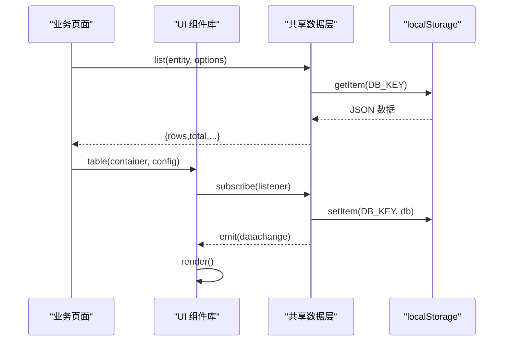
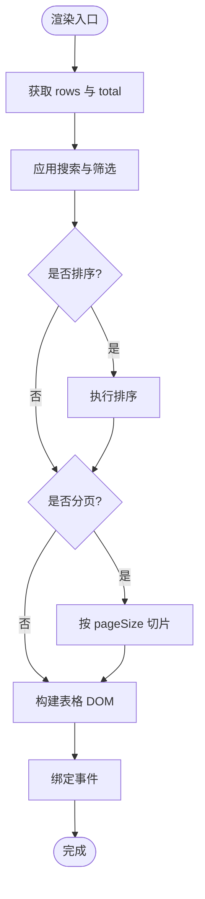
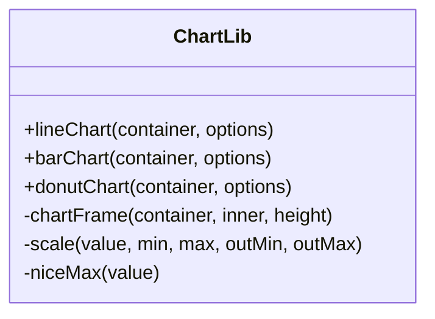
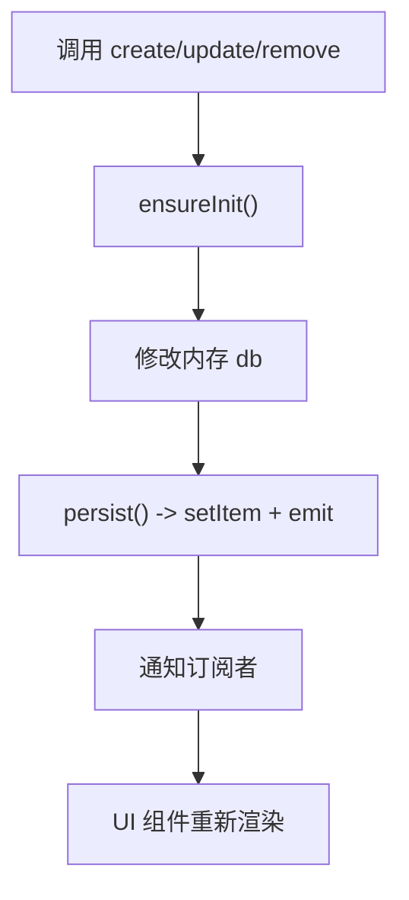
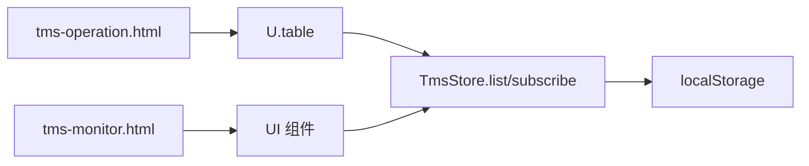

# 性能优化

<cite>
**本文引用的文件**   
- [tms-ui.js](file://tms-ui.js)
- [common.js](file://common.js)
- [tms-store.js](file://tms-store.js)
- [tms-operation.html](file://tms-operation.html)
- [tms-monitor.html](file://tms-monitor.html)
- [sorter-mock-data.js](file://sorter-mock-data.js)
</cite>

## 目录
1. [引言](#引言)
2. [项目结构](#项目结构)
3. [核心组件](#核心组件)
4. [架构总览](#架构总览)
5. [详细组件分析](#详细组件分析)
6. [依赖关系分析](#依赖关系分析)
7. [性能考虑](#性能考虑)
8. [故障排查指南](#故障排查指南)
9. [结论](#结论)
10. [附录](#附录)

## 引言
本指南面向 TMS 系统的前端与数据层，聚焦在高并发与大负载场景下的稳定性与响应性。内容覆盖：
- DOM 操作优化、事件监听优化、内存泄漏预防
- localStorage 存储优化策略（分片、缓存、清理）
- 图表渲染优化（大数据量、动画）
- 页面加载优化（资源压缩、懒加载、预加载）
- 性能监控与分析工具使用
- 瓶颈定位与解决案例

## 项目结构
TMS 前端采用多 HTML 页面 + 共享 JS/CSS 的轻量架构：
- tms-ui.js：共享 UI 组件库（表格、弹窗、表单、KPI、SVG 图表等）
- common.js：通用函数（登录、用户信息、积分、按钮样式注入等）
- tms-store.js：基于 localStorage 的共享数据层（种子数据、CRUD、状态流转、统计聚合）
- 业务页面（如 tms-operation.html、tms-monitor.html）：组合 UI 组件与数据层进行展示与交互
- sorter-mock-data.js：分拣端模拟数据写入 localStorage

**图示来源**
- [tms-ui.js:303-544](file://tms-ui.js#L303-L544)
- [tms-store.js:16-17](file://tms-store.js#L16-L17)
- [common.js:136-218](file://common.js#L136-L218)
- [tms-operation.html:682-701](file://tms-operation.html#L682-L701)
- [tms-monitor.html:365-383](file://tms-monitor.html#L365-L383)

**章节来源**
- [tms-ui.js:1-783](file://tms-ui.js#L1-L783)
- [common.js:1-383](file://common.js#L1-L383)
- [tms-store.js:1-2377](file://tms-store.js#L1-L2377)
- [tms-operation.html:541-701](file://tms-operation.html#L541-L701)
- [tms-monitor.html:355-383](file://tms-monitor.html#L355-L383)
- [sorter-mock-data.js:1-350](file://sorter-mock-data.js#L1-L350)

## 核心组件
- UI 组件库（tms-ui.js）
  - 提供 table、modal、formModal、toast、kpis、lineChart/barChart/donutChart 等能力
  - 列表组件支持搜索、筛选、排序、分页；订阅数据变更自动刷新
- 通用函数库（common.js）
  - 登录/登出、用户信息持久化、积分余额与历史管理、按钮样式注入
- 共享数据层（tms-store.js）
  - 基于 localStorage 的“轻量数据库”，维护订单全生命周期、扫描、运输、财务、异常等实体
  - 提供 list/get/create/update/remove/subscribe/reset 等 API
  - 内置计费引擎、路由规划、轨迹生成、报表聚合

**章节来源**
- [tms-ui.js:303-544](file://tms-ui.js#L303-L544)
- [tms-ui.js:548-680](file://tms-ui.js#L548-L680)
- [common.js:136-383](file://common.js#L136-L383)
- [tms-store.js:16-17](file://tms-store.js#L16-L17)
- [tms-store.js:1186-1319](file://tms-store.js#L1186-L1319)
- [tms-store.js:1209-1305](file://tms-store.js#L1209-L1305)

## 架构总览
TMS 前端通过 UI 组件与数据层解耦，数据层统一读写 localStorage，并通过自定义事件通知订阅者刷新视图。

**图示来源**
- [tms-store.js:220-244](file://tms-store.js#L220-L244)
- [tms-store.js:1209-1305](file://tms-store.js#L1209-L1305)
- [tms-ui.js:303-544](file://tms-ui.js#L303-L544)

## 详细组件分析

### 列表与表格组件（tms-ui.js）
- 功能要点
  - 支持行内搜索、下拉筛选、列排序、分页
  - 当数据源为 entity 时，订阅数据变更并自动刷新
  - 输入框 input 事件使用防抖，避免频繁重排
- 性能关注点
  - 大量 DOM 拼接使用 innerHTML 一次性替换，减少多次 reflow
  - 事件绑定在 bind() 中集中处理，避免重复绑定
  - 分页与过滤在渲染前完成，降低 DOM 节点数量
- 优化建议
  - 对超长列表启用虚拟滚动或增量渲染
  - 将 searchFields 显式配置，避免遍历所有字段
  - 对复杂 render 函数做结果缓存

**图示来源**
- [tms-ui.js:303-544](file://tms-ui.js#L303-L544)

**章节来源**
- [tms-ui.js:303-544](file://tms-ui.js#L303-L544)

### 图表渲染（tms-ui.js）
- 功能要点
  - lineChart/barChart/donutChart 均基于 SVG 绘制
  - 网格线、坐标轴、图例由函数动态生成
- 性能关注点
  - 大量字符串拼接生成 SVG 片段，适合中小数据集
  - 未实现动画过渡，避免额外合成开销
- 优化建议
  - 大数据集下改用 Canvas 或 WebGL 渲染
  - 对 labels/series 做采样或降采样
  - 使用 requestAnimationFrame 分批渲染大图表

**图示来源**
- [tms-ui.js:559-680](file://tms-ui.js#L559-L680)

**章节来源**
- [tms-ui.js:548-680](file://tms-ui.js#L548-L680)

### 共享数据层（tms-store.js）
- 功能要点
  - 首次访问生成种子数据，后续从 localStorage 读取
  - 提供 CRUD、订阅机制、重置数据库
  - 订单状态推进时联动扫描、任务、运输、财务等关联记录
- 性能关注点
  - persist() 每次写都触发 localStorage.setItem 与事件分发
  - list() 对数组进行 filter/sort/slice，数据量大时开销明显
  - scans/traces 有长度上限保护，避免无限增长
- 优化建议
  - 批量更新合并持久化
  - 对高频查询建立索引或缓存
  - 对长列表查询增加服务端分页或本地分页

**图示来源**
- [tms-store.js:1264-1305](file://tms-store.js#L1264-L1305)
- [tms-store.js:232-244](file://tms-store.js#L232-L244)

**章节来源**
- [tms-store.js:1186-1319](file://tms-store.js#L1186-L1319)
- [tms-store.js:1327-1463](file://tms-store.js#L1327-L1463)

### 通用函数与用户态（common.js）
- 功能要点
  - 登录/登出、用户信息持久化、积分余额与历史
  - 页面加载时注入统一按钮样式
- 性能关注点
  - 频繁 localStorage 读写可能阻塞主线程
  - displayCurrentUser 会遍历多个元素 ID 并设置样式
- 优化建议
  - 对热点数据做短期内存缓存
  - 批量更新用户信息后统一触发一次 UI 刷新

**章节来源**
- [common.js:136-383](file://common.js#L136-L383)

### 业务页面示例（tms-operation.html / tms-monitor.html）
- tms-operation.html
  - 使用 U.table 渲染运营指标表，pageSize 设为 0 表示不分页
  - 通过 S.dailyStats(7) 获取近 7 日数据并反转显示
- tms-monitor.html
  - 提供“系统监控”面板，包含 KPI、趋势图等占位区域

**章节来源**
- [tms-operation.html:682-701](file://tms-operation.html#L682-L701)
- [tms-monitor.html:365-383](file://tms-monitor.html#L365-L383)

## 依赖关系分析
- UI 组件库依赖全局 TmsStore 与 TmsUI 暴露的方法
- 数据层依赖 localStorage 作为唯一持久化介质
- 业务页面依赖 UI 组件与数据层提供的 API

**图示来源**
- [tms-operation.html:682-701](file://tms-operation.html#L682-L701)
- [tms-ui.js:303-544](file://tms-ui.js#L303-L544)
- [tms-store.js:1209-1305](file://tms-store.js#L1209-L1305)

**章节来源**
- [tms-operation.html:682-701](file://tms-operation.html#L682-L701)
- [tms-ui.js:303-544](file://tms-ui.js#L303-L544)
- [tms-store.js:1209-1305](file://tms-store.js#L1209-L1305)

## 性能考虑

### 前端性能优化技巧
- DOM 操作优化
  - 使用 innerHTML 一次性替换整段表格，减少多次 reflow
  - 对长列表优先分页，控制可见节点数量
  - 避免在循环中频繁查询 DOM，先缓存容器引用
- 事件监听优化
  - 搜索输入使用防抖（当前已实现），避免频繁渲染
  - 对动态生成的按钮使用委托或仅在 bind() 中绑定
  - 弹窗关闭时移除 document 级 keydown 监听，防止泄漏
- 内存泄漏预防
  - 表格组件返回 destroy 方法以取消订阅
  - 弹窗关闭时移除事件监听并移除 DOM
  - 避免在闭包中持有大对象引用

**章节来源**
- [tms-ui.js:109-158](file://tms-ui.js#L109-L158)
- [tms-ui.js:454-521](file://tms-ui.js#L454-L521)
- [tms-ui.js:525-544](file://tms-ui.js#L525-L544)

### localStorage 存储优化策略
- 数据分片
  - 当前使用单一键 tmsDB_v3 存储完整数据库，建议拆分为 orders、scans、finances 等子键以降低单次序列化体积
- 缓存策略
  - 对热点查询结果（如 dailyStats、KPI）做短期内存缓存，并在数据变更后失效
- 数据清理
  - scans/traces 已有长度限制，建议扩展至其他长列表（如 exceptions、adminRecords）
  - 定期清理过期或归档数据，避免 localStorage 膨胀

**章节来源**
- [tms-store.js:220-244](file://tms-store.js#L220-L244)
- [tms-store.js:1346-1347](file://tms-store.js#L1346-L1347)
- [tms-store.js:1462-1463](file://tms-store.js#L1462-L1463)

### 图表渲染优化方法
- 大数据量处理
  - 对 series.data 做采样或聚合，减少 SVG 节点数
  - 使用 Canvas/WebGL 替代 SVG 以提升大规模数据渲染性能
- 动画性能优化
  - 当前无动画，避免合成层抖动
  - 如需动画，使用 requestAnimationFrame 并限制帧率

**章节来源**
- [tms-ui.js:575-680](file://tms-ui.js#L575-L680)

### 页面加载性能优化建议
- 资源压缩
  - 对 JS/CSS 进行压缩与合并，减少请求次数
- 懒加载
  - 非首屏模块（如图表、统计）延迟初始化
- 预加载
  - 对关键资源使用 preload/prefetch，提升首屏速度

[本节为通用指导，不直接分析具体文件]

### 性能监控与分析工具使用方法
- 浏览器开发者工具
  - Performance 面板录制关键交互，识别长时间任务与布局抖动
  - Memory 面板检查内存增长与泄漏
- 自定义监控
  - 在 tms-monitor.html 中接入运行指标采集与可视化
  - 结合 TmsStore.subscribe 统计数据变更频率与耗时

**章节来源**
- [tms-monitor.html:365-383](file://tms-monitor.html#L365-L383)

## 故障排查指南
- 常见问题
  - 列表卡顿：检查是否未分页或未使用防抖
  - 内存泄漏：检查弹窗与表格销毁逻辑是否执行
  - 存储过大：检查是否有长列表未做长度限制
- 定位步骤
  - 使用 Performance 面板定位重排/重绘热点
  - 使用 Memory 面板对比快照，确认对象未被释放
  - 在 TmsStore.persist 前后打点，评估序列化与 I/O 耗时

**章节来源**
- [tms-ui.js:109-158](file://tms-ui.js#L109-L158)
- [tms-ui.js:525-544](file://tms-ui.js#L525-L544)
- [tms-store.js:232-244](file://tms-store.js#L232-L244)

## 结论
TMS 系统在前端层面通过 UI 组件库与共享数据层实现了较好的解耦与复用。在高并发与大负载场景下，应重点关注：
- 列表与图表的大数据渲染优化
- localStorage 的分片、缓存与清理策略
- 事件监听的生命周期管理与内存泄漏防护
- 页面加载的资源优化与懒加载
- 持续的性能监控与瓶颈定位

## 附录
- 相关页面与脚本路径参考
  - [tms-ui.js](file://tms-ui.js)
  - [common.js](file://common.js)
  - [tms-store.js](file://tms-store.js)
  - [tms-operation.html](file://tms-operation.html)
  - [tms-monitor.html](file://tms-monitor.html)
  - [sorter-mock-data.js](file://sorter-mock-data.js)