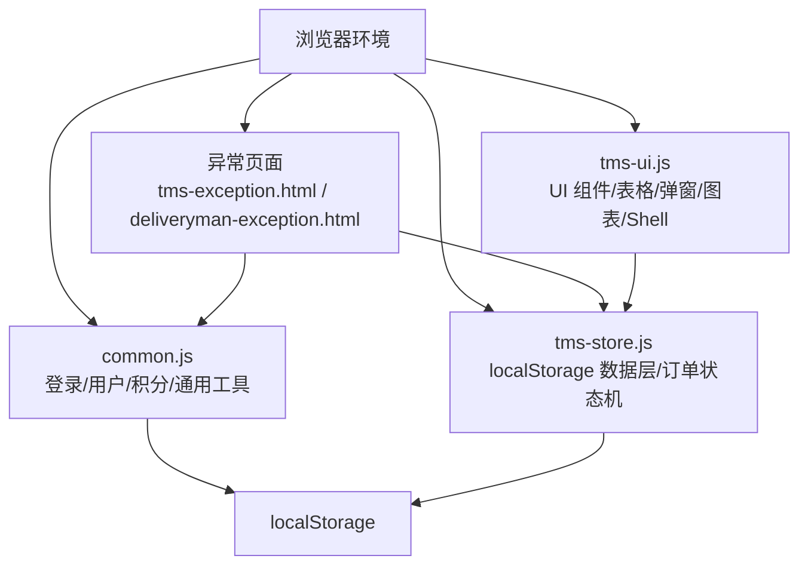
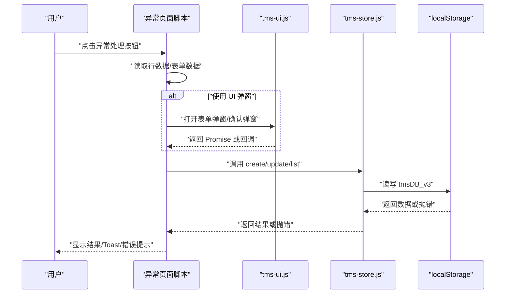
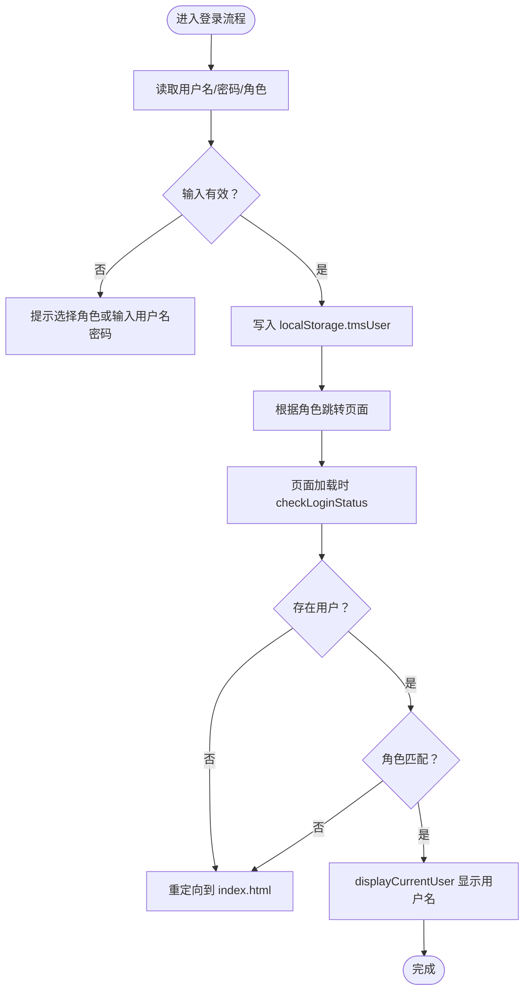
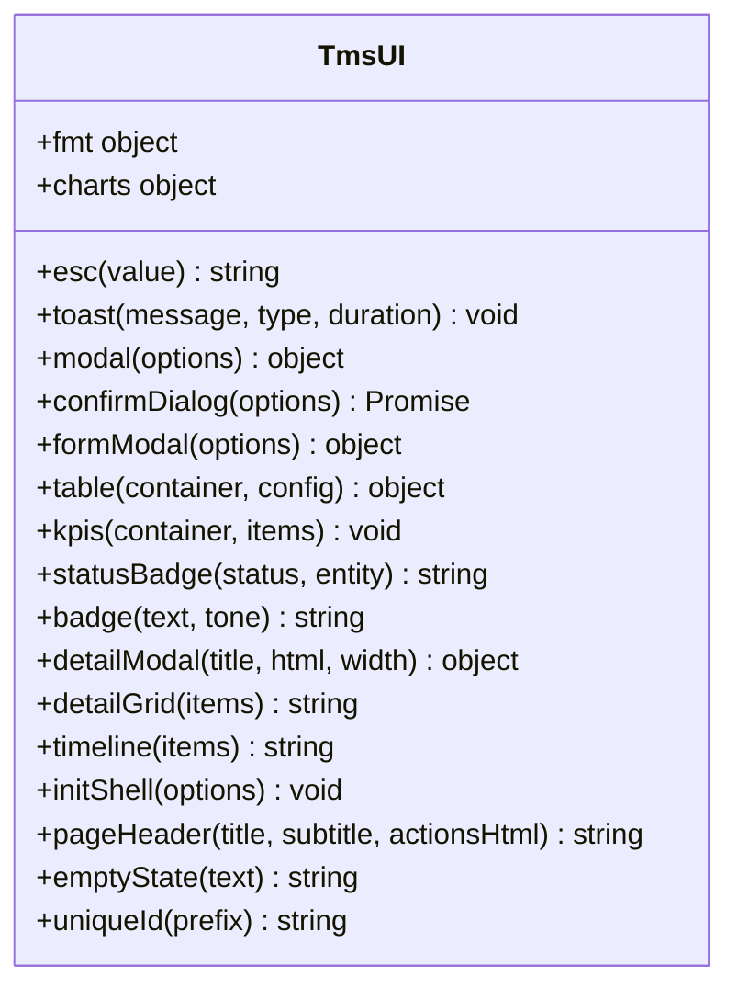
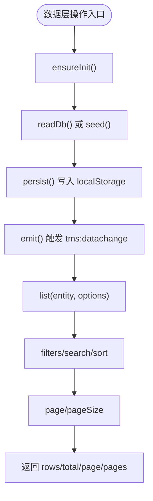

# 故障排查

<cite>
**本文引用的文件**   
- [common.js](file://common.js)
- [tms-ui.js](file://tms-ui.js)
- [tms-store.js](file://tms-store.js)
- [deliveryman-exception.html](file://deliveryman-exception.html)
- [tms-exception.html](file://tms-exception.html)
</cite>

## 目录
1. [引言](#引言)
2. [项目结构与定位范围](#项目结构与定位范围)
3. [核心问题域与常见故障](#核心问题域与常见故障)
4. [架构视角下的错误传播路径](#架构视角下的错误传播路径)
5. [按模块的故障排查指南](#按模块的故障排查指南)
6. [调试技巧与工具使用](#调试技巧与工具使用)
7. [性能问题诊断方法](#性能问题诊断方法)
8. [错误日志分析与定位技巧](#错误日志分析与定位技巧)
9. [系统监控与告警建议](#系统监控与告警建议)
10. [问题上报与解决流程](#问题上报与解决流程)
11. [快速排障清单](#快速排障清单)
12. [结论](#结论)

## 引言
本故障排查指南面向 TMS 前端单页应用，目标是帮助你在浏览器环境中快速定位并解决常见问题。代码库以纯前端为主，数据主要依赖 `localStorage`，UI 组件、通用逻辑和数据层分别集中在几个关键文件中。因此，故障排查重点包括：
- 浏览器兼容性与 DOM 事件处理异常
- `localStorage` 存储异常、数据版本不一致、容量不足
- 登录状态、权限校验、用户信息显示异常
- 列表渲染、搜索筛选、分页排序异常
- 订单状态流转、轨迹写入、结算逻辑异常
- 页面级异常上报与处理流程异常

## 项目结构与定位范围
该仓库是一个多页面 HTML + JS 的前端演示系统，核心可维护文件如下：
- `common.js`：通用函数、登录/登出、用户信息、积分等本地存储逻辑
- `tms-ui.js`：共享 UI 组件库，包含 Toast、弹窗、表单、表格、图表、页面外壳初始化
- `tms-store.js`：基于 `localStorage` 的数据层，提供种子数据、CRUD、订单状态机、轨迹、结算、统计等能力
- 业务页面如 `tms-exception.html`、`deliveryman-exception.html`：异常相关页面，存在大量事件绑定和 `localStorage` 操作

**图示来源**
- [common.js:135-218](file://common.js#L135-L218)
- [tms-ui.js:703-780](file://tms-ui.js#L703-L780)
- [tms-store.js:16-17](file://tms-store.js#L16-L17)
- [tms-store.js:220-244](file://tms-store.js#L220-L244)
- [tms-exception.html:472-497](file://tms-exception.html#L472-L497)
- [deliveryman-exception.html:471-581](file://deliveryman-exception.html#L471-L581)

**章节来源**
- [common.js:1-383](file://common.js#L1-L383)
- [tms-ui.js:1-783](file://tms-ui.js#L1-L783)
- [tms-store.js:1-2379](file://tms-store.js#L1-L2379)
- [tms-exception.html:469-501](file://tms-exception.html#L469-L501)
- [deliveryman-exception.html:462-599](file://deliveryman-exception.html#L462-L599)

## 核心问题域与常见故障
结合代码实现，可将常见问题归纳为以下类别：
- 浏览器兼容性
  - `DOMContentLoaded` 事件绑定差异
  - `CustomEvent` 兼容性
  - `requestSubmit` 兼容性
  - `Intl.NumberFormat` 或区域化格式化差异
- `localStorage` 存储异常
  - 键名冲突（`tmsUser`、`tmsUserProfile`、`tmsUserPoints`、`tmsDB_v3`）
  - JSON 解析失败导致数据损坏
  - 存储空间不足或配额限制
  - 多标签页并发写入导致数据不一致
- 事件处理错误
  - 按钮点击未触发或重复绑定
  - 表单提交未阻止默认行为
  - 动态元素事件委托缺失
- 数据层异常
  - 数据版本不匹配导致重新生成种子数据
  - 列表查询参数错误导致空结果
  - 订单状态机推进失败
  - 轨迹写入与扫描记录不一致
- UI 组件异常
  - 表格搜索/筛选/分页状态不同步
  - 弹窗关闭后键盘事件未解绑
  - Toast 容器未创建导致报错

**章节来源**
- [common.js:133-218](file://common.js#L133-L218)
- [tms-ui.js:88-158](file://tms-ui.js#L88-L158)
- [tms-ui.js:239-287](file://tms-ui.js#L239-L287)
- [tms-ui.js:303-544](file://tms-ui.js#L303-L544)
- [tms-store.js:220-244](file://tms-store.js#L220-L244)
- [tms-store.js:1210-1258](file://tms-store.js#L1210-L1258)
- [tms-store.js:1497-1572](file://tms-store.js#L1497-L1572)

## 架构视角下的错误传播路径
TMS 前端的错误传播通常遵循“页面事件 → UI 组件 → 数据层 → localStorage”的路径。例如：
- 用户点击异常处理按钮，页面脚本读取行数据并调用 `alert` 或更新状态
- 若使用 `tms-ui.js` 的表单弹窗，则可能进入 `formModal` 的提交回调
- 若涉及数据变更，则通过 `tms-store.js` 的 CRUD 接口写入 `localStorage`
- 若数据层抛出错误或监听器失败，可能影响 UI 刷新

**图示来源**
- [tms-exception.html:472-497](file://tms-exception.html#L472-L497)
- [deliveryman-exception.html:471-581](file://deliveryman-exception.html#L471-L581)
- [tms-ui.js:165-287](file://tms-ui.js#L165-L287)
- [tms-store.js:1265-1306](file://tms-store.js#L1265-L1306)
- [tms-store.js:220-244](file://tms-store.js#L220-L244)

## 按模块的故障排查指南

### 登录与用户信息模块
常见问题：
- 登录后未跳转或跳转到错误页面
- 角色权限校验失败
- 用户名未显示或显示为空
- 退出登录后仍保留用户信息

排查要点：
- 检查 `login` 是否成功写入 `tmsUser`
- 检查 `checkLoginStatus` 是否正确读取并校验角色
- 检查 `displayCurrentUser` 是否能找到用户名显示元素
- 检查 `logout` 是否删除 `tmsUser`

**图示来源**
- [common.js:135-174](file://common.js#L135-L174)
- [common.js:176-199](file://common.js#L176-L199)
- [common.js:201-218](file://common.js#L201-L218)
- [common.js:220-270](file://common.js#L220-L270)

**章节来源**
- [common.js:135-270](file://common.js#L135-L270)

### UI 组件模块
常见问题：
- Toast 未显示或容器未创建
- 弹窗无法关闭或键盘事件泄漏
- 表单提交未阻止默认行为
- 表格搜索/筛选/分页状态不同步

排查要点：
- 检查 `toast` 是否创建 `tms-toast-container`
- 检查 `modal` 是否在关闭时移除 `keydown` 监听
- 检查 `formModal` 是否调用 `requestSubmit` 或派发 `submit` 事件
- 检查 `table` 的 `bind` 中事件绑定是否生效

**图示来源**
- [tms-ui.js:12-84](file://tms-ui.js#L12-L84)
- [tms-ui.js:88-158](file://tms-ui.js#L88-L158)
- [tms-ui.js:165-287](file://tms-ui.js#L165-L287)
- [tms-ui.js:303-544](file://tms-ui.js#L303-L544)
- [tms-ui.js:758-780](file://tms-ui.js#L758-L780)

**章节来源**
- [tms-ui.js:88-158](file://tms-ui.js#L88-L158)
- [tms-ui.js:165-287](file://tms-ui.js#L165-L287)
- [tms-ui.js:303-544](file://tms-ui.js#L303-L544)

### 数据层模块
常见问题：
- 数据版本不匹配导致重新生成种子数据
- 列表查询结果为空
- 订单状态推进失败
- 轨迹写入不完整
- 结算逻辑未按支付方式执行

排查要点：
- 检查 `readDb` 是否因版本不匹配返回 `null`
- 检查 `list` 的 filters/search/sort/page 参数
- 检查 `applyOrderStatus` 的状态机推进逻辑
- 检查 `addTrace` 与 `addScanRecord` 是否同步写入
- 检查 `ensureSettlement` 对月结/现付/到付的处理

**图示来源**
- [tms-store.js:220-244](file://tms-store.js#L220-L244)
- [tms-store.js:1187-1202](file://tms-store.js#L1187-L1202)
- [tms-store.js:1210-1258](file://tms-store.js#L1210-L1258)
- [tms-store.js:1497-1572](file://tms-store.js#L1497-L1572)
- [tms-store.js:1446-1465](file://tms-store.js#L1446-L1465)
- [tms-store.js:1467-1495](file://tms-store.js#L1467-L1495)

**章节来源**
- [tms-store.js:220-244](file://tms-store.js#L220-L244)
- [tms-store.js:1187-1202](file://tms-store.js#L1187-L1202)
- [tms-store.js:1210-1258](file://tms-store.js#L1210-L1258)
- [tms-store.js:1446-1495](file://tms-store.js#L1446-L1495)
- [tms-store.js:1497-1572](file://tms-store.js#L1497-L1572)

### 异常页面模块
常见问题：
- 异常查看/开始处理/标记已解决按钮仅弹出 `alert`，无实际逻辑
- 配送员异常页面表单提交后数据未持久化或展示异常
- 异常列表排序或时间显示不正确

排查要点：
- 检查 `tms-exception.html` 中按钮事件是否仅调用 `alert`
- 检查 `deliveryman-exception.html` 中 `submitException` 是否写入 `localStorage`
- 检查异常数据初始化与排序逻辑

**章节来源**
- [tms-exception.html:472-497](file://tms-exception.html#L472-L497)
- [deliveryman-exception.html:471-581](file://deliveryman-exception.html#L471-L581)

## 调试技巧与工具使用
推荐在浏览器开发者工具中使用以下功能：
- Console 面板
  - 观察 `console.log` 输出，定位登录、用户信息、积分、数据层操作
  - 过滤关键字如 `login`、`checkLoginStatus`、`tms-store`、`localStorage`
- Sources 面板
  - 设置断点于 `common.js`、`tms-ui.js`、`tms-store.js` 的关键函数
  - 使用 Call Stack 跟踪事件触发链
- Application 面板
  - 检查 `localStorage` 中的 `tmsUser`、`tmsUserProfile`、`tmsUserPoints`、`tmsDB_v3`
  - 手动修改或删除键值以复现问题
- Network 面板
  - 若后续接入后端 API，检查请求失败、跨域、超时等问题
- Performance 面板
  - 录制页面交互，分析长任务、布局抖动、内存增长

实用命令：
- 在 Console 中直接调用全局函数，如 `window.login()`、`window.checkLoginStatus('admin')`
- 检查 `localStorage.getItem('tmsDB_v3')` 是否为合法 JSON
- 使用 `document.querySelectorAll('.action-btn').length` 验证按钮是否存在

**章节来源**
- [common.js:152-161](file://common.js#L152-L161)
- [common.js:178-199](file://common.js#L178-L199)
- [tms-store.js:220-244](file://tms-store.js#L220-L244)

## 性能问题诊断方法
针对当前纯前端架构，性能瓶颈主要集中在：
- `localStorage` 序列化/反序列化开销
- 大列表渲染与频繁重绘
- 多次 DOM 查询与事件绑定
- 复杂计算如计费引擎、轨迹生成

诊断步骤：
- 使用 Performance 面板录制页面加载与交互过程
- 关注 Long Tasks、Layout Shift、Memory Heap 增长
- 检查 `tms-store.js` 中 `seed()` 生成的数据量是否过大
- 检查 `tms-ui.js` 中 `table` 渲染是否频繁触发
- 检查 `calcFreight`、`buildTraces` 等计算密集型函数是否被重复调用

优化建议：
- 对大列表使用分页与虚拟滚动
- 避免在每次渲染时重复计算，缓存中间结果
- 减少 `localStorage` 写入频率，合并批量更新
- 使用事件委托减少监听器数量

**章节来源**
- [tms-store.js:464-800](file://tms-store.js#L464-L800)
- [tms-store.js:332-383](file://tms-store.js#L332-L383)
- [tms-ui.js:303-544](file://tms-ui.js#L303-L544)

## 错误日志分析与定位技巧
当前代码中错误日志主要通过 `console.log` 输出，部分地方使用 `try-catch` 包裹潜在异常。定位技巧：
- 在 Console 中过滤 `error`、`warn`、`[TmsStore] listener error`
- 检查 `tms-store.js` 中 `emit` 函数的监听器错误日志
- 检查 `tms-ui.js` 中 `formModal` 的 `catch` 分支是否捕获表单提交异常
- 检查 `common.js` 中 `checkLoginStatus`、`displayCurrentUser` 的日志输出

常见问题日志模式：
- `login - username:` 后无用户名或角色
- `checkLoginStatus - no user found` 表示未登录
- `checkLoginStatus - role mismatch` 表示权限不足
- `[TmsStore] listener error` 表示数据变更监听器抛错

**章节来源**
- [common.js:152-161](file://common.js#L152-L161)
- [common.js:178-199](file://common.js#L178-L199)
- [tms-ui.js:255-273](file://tms-ui.js#L255-L273)
- [tms-store.js:237-244](file://tms-store.js#L237-L244)

## 系统监控与告警建议
由于当前为纯前端系统，建议在前端层面增加以下监控与告警：
- 前端埋点
  - 记录关键操作：登录、登出、创建订单、推进状态、异常上报
  - 记录错误：`window.onerror`、`unhandledrejection`
- 性能监控
  - 记录页面加载时间、首屏时间、交互响应时间
  - 监控 `localStorage` 大小变化
- 告警规则
  - 登录失败率超过阈值
  - 订单状态推进失败率
  - 异常处理超时率
  - 前端错误率突增

实施建议：
- 将错误日志上报至统一日志平台
- 使用性能 SDK 采集关键指标
- 配置告警通知（邮件、IM、工单系统）

**章节来源**
- [tms-store.js:237-244](file://tms-store.js#L237-L244)
- [tms-ui.js:729-745](file://tms-ui.js#L729-L745)

## 问题上报与解决流程
建议建立标准化流程：
1. 发现问题
   - 用户反馈或监控告警
2. 复现问题
   - 使用浏览器开发者工具复现
   - 记录操作步骤、浏览器版本、网络环境
3. 定位根因
   - 检查 Console 日志、Network 请求、Application 存储
   - 分析 `common.js`、`tms-ui.js`、`tms-store.js` 相关代码
4. 修复问题
   - 修改代码并提交
   - 添加单元测试或冒烟测试
5. 验证与回归
   - 本地验证通过后部署测试环境
   - 回归测试覆盖相关场景
6. 上线与监控
   - 灰度发布，观察错误率与性能指标
   - 配置告警，及时响应异常

**章节来源**
- [common.js:135-270](file://common.js#L135-L270)
- [tms-ui.js:703-780](file://tms-ui.js#L703-L780)
- [tms-store.js:1187-1202](file://tms-store.js#L1187-L1202)

## 快速排障清单
- 登录异常
  - 检查 `localStorage.tmsUser` 是否存在
  - 检查 `checkLoginStatus` 是否返回用户对象
  - 检查角色权限是否匹配
- 用户信息不显示
  - 检查 `displayCurrentUser` 是否找到 DOM 元素
  - 检查用户名元素 ID 是否正确
- 列表为空
  - 检查 `tms-store.list` 的 filters/search/sort 参数
  - 检查 `tmsDB_v3` 中对应实体是否存在
- 订单状态无法推进
  - 检查 `applyOrderStatus` 状态机逻辑
  - 检查订单当前状态是否允许推进
- 异常页面按钮无效
  - 检查按钮事件绑定是否成功
  - 检查是否仅调用 `alert` 而无实际逻辑
- 性能卡顿
  - 使用 Performance 面板录制
  - 检查大列表渲染与 `localStorage` 写入频率

**章节来源**
- [common.js:176-270](file://common.js#L176-L270)
- [tms-store.js:1210-1258](file://tms-store.js#L1210-L1258)
- [tms-store.js:1497-1572](file://tms-store.js#L1497-L1572)
- [tms-exception.html:472-497](file://tms-exception.html#L472-L497)

## 结论
本故障排查指南围绕 TMS 前端代码的核心模块展开，重点覆盖了浏览器兼容性、`localStorage` 存储异常、事件处理错误、数据层异常、UI 组件异常以及异常页面逻辑问题。通过结构化分析、可视化图示与具体文件引用，读者可以快速定位问题根因并采取相应措施。在生产环境中，建议结合前端监控、日志上报与告警机制，进一步提升问题发现与解决效率。