# UI组件扩展

<cite>
**本文引用的文件**   
- [tms-ui.js](file://tms-ui.js)
- [tms-ui.css](file://tms-ui.css)
- [common.js](file://common.js)
- [tms-store.js](file://tms-store.js)
- [tms-user.html](file://tms-user.html)
</cite>

## 目录
1. [引言](#引言)
2. [项目结构](#项目结构)
3. [核心组件](#核心组件)
4. [架构总览](#架构总览)
5. [详细组件分析](#详细组件分析)
6. [依赖关系分析](#依赖关系分析)
7. [性能与可维护性](#性能与可维护性)
8. [自定义组件开发指南](#自定义组件开发指南)
9. [测试与调试](#测试与调试)
10. [常见问题排查](#常见问题排查)
11. [结论](#结论)

## 引言
本指南面向需要在现有 TMS 系统中扩展和定制 UI 组件的开发者。仓库中的共享 UI 库以 tms- 前缀组织，提供表格、弹窗、表单弹窗、Toast、KPI、SVG 图表、详情展示等能力；数据层通过 TmsStore 提供统一的数据查询、订阅与事件通知；页面通过 TmsUI 暴露的 API 组合出业务界面。本文从架构、组件、样式、生命周期、注册机制、最佳实践到示例与测试，帮助你在不破坏现有样式与行为的前提下，安全地扩展 UI 能力。

## 项目结构
仓库采用“页面 + 共享脚本 + 共享样式”的组织方式：
- 共享 UI 逻辑集中在 tms-ui.js，所有交互型组件（Toast、Modal、FormModal、Table、Charts、Detail、Shell）均在此实现并挂载到全局 TmsUI。
- 共享样式集中在 tms-ui.css，所有类名使用 tms- 前缀，避免与页面自有样式冲突。
- 通用工具与登录流程在 common.js，包含用户状态、权限检查、按钮样式注入等。
- 数据层在 tms-store.js，基于 localStorage 提供种子数据、CRUD、搜索/筛选/排序/分页、统计聚合与事件广播。
- 各业务页面（如 tms-user.html）通过引入 common.js、tms-store.js、tms-ui.js 并使用 TmsUI.initShell、TmsUI.table、TmsUI.toast 等 API 构建界面。

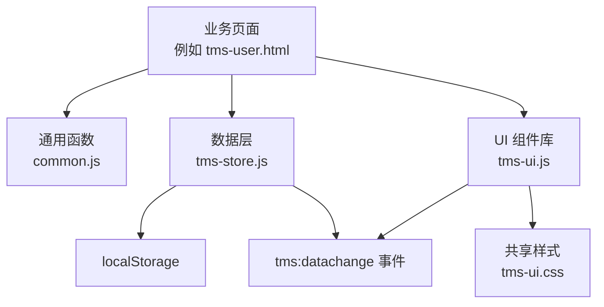

**图示来源**
- [tms-user.html:524-539](file://tms-user.html#L524-L539)
- [tms-ui.js:758-781](file://tms-ui.js#L758-L781)
- [tms-store.js:237-244](file://tms-store.js#L237-L244)

**章节来源**
- [tms-ui.js:1-10](file://tms-ui.js#L1-L10)
- [tms-ui.css:1-5](file://tms-ui.css#L1-L5)
- [common.js:1-10](file://common.js#L1-L10)
- [tms-store.js:1-12](file://tms-store.js#L1-L12)
- [tms-user.html:524-539](file://tms-user.html#L524-L539)

## 核心组件
TmsUI 将以下能力作为公共 API 暴露给页面：
- 基础工具：esc、fmt、uniqueId
- 反馈与交互：toast、modal、confirm、formModal
- 列表与数据展示：table、kpis、statusBadge、badge
- 图表：charts.line、charts.bar、charts.donut
- 详情与时间线：detailModal、detailGrid、timeline
- 页面外壳：initShell、pageHeader、emptyState

这些 API 均以函数形式存在，调用方传入容器元素与配置对象，返回实例或 DOM 片段。组件内部通过 class 名（tms-*）与 CSS 解耦，便于覆盖与扩展。

**章节来源**
- [tms-ui.js:758-781](file://tms-ui.js#L758-L781)

## 架构总览
TMS 前端采用“页面驱动 + 共享 UI + 共享数据层”的轻量架构：
- 页面负责编排：初始化 Shell、绑定 Tab、渲染 KPI、创建 Table、监听数据变化。
- UI 组件负责呈现与交互：渲染 HTML、绑定事件、处理用户操作、调用 Toast/Modal。
- 数据层负责持久化与分发：维护 DB、提供 list/create/update/delete、触发 tms:datachange。
- 样式层负责视觉一致性：所有类名带 tms- 前缀，避免污染页面样式。

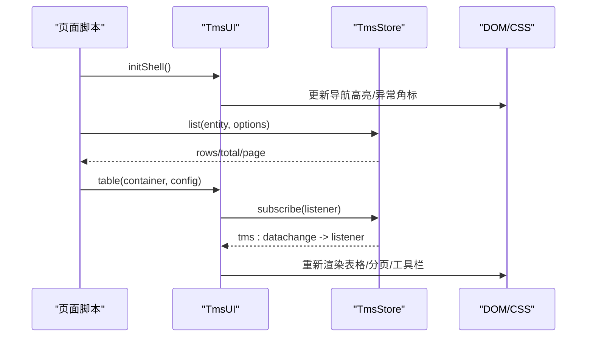

**图示来源**
- [tms-user.html:524-539](file://tms-user.html#L524-L539)
- [tms-ui.js:703-746](file://tms-ui.js#L703-L746)
- [tms-ui.js:303-543](file://tms-ui.js#L303-L543)
- [tms-store.js:237-244](file://tms-store.js#L237-L244)

## 详细组件分析

### 表格组件（TmsUI.table）
表格组件是 TMS 中最常用的数据展示与交互组件，支持：
- 数据来源：本地数组、函数动态获取、或 TmsStore.entity 查询
- 列定义：key、label、render、width、sortable、align
- 行操作：actions（显示条件 show、回调 onClick(row)）
- 工具栏：search、filters、toolbar（按钮组）
- 分页：pageSize、页码计算、上一页/下一页
- 排序：默认排序 defaultSort、点击列头切换升序/降序
- 空态：emptyText
- 行点击：onRowClick(row)
- 行样式：rowClass(row)
- 生命周期：refresh、state、destroy（取消订阅）

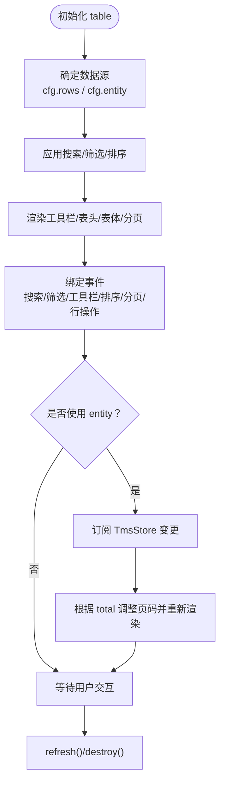

**图示来源**
- [tms-ui.js:303-543](file://tms-ui.js#L303-L543)

关键要点：
- 当使用 cfg.entity 且存在 global.TmsStore 时，表格会订阅数据变化，自动刷新并修正当前页码。
- 搜索输入有防抖（约 220ms），避免频繁重绘。
- 排序对数字与字符串分别处理，中文按 localeCompare('zh-CN') 比较。
- 行操作按钮通过 data-row-action 定位行数据，再回调 actions[i].onClick(row)。

**章节来源**
- [tms-ui.js:289-543](file://tms-ui.js#L289-L543)

### 弹窗与确认框（TmsUI.modal / confirm）
- modal(options)：创建遮罩层与对话框，支持 title、body、footer、width；提供 close()、body 节点引用；支持 ESC 关闭与点击遮罩关闭。
- confirmDialog(options)：基于 modal 封装确认对话框，返回 Promise，resolve(true/false)。

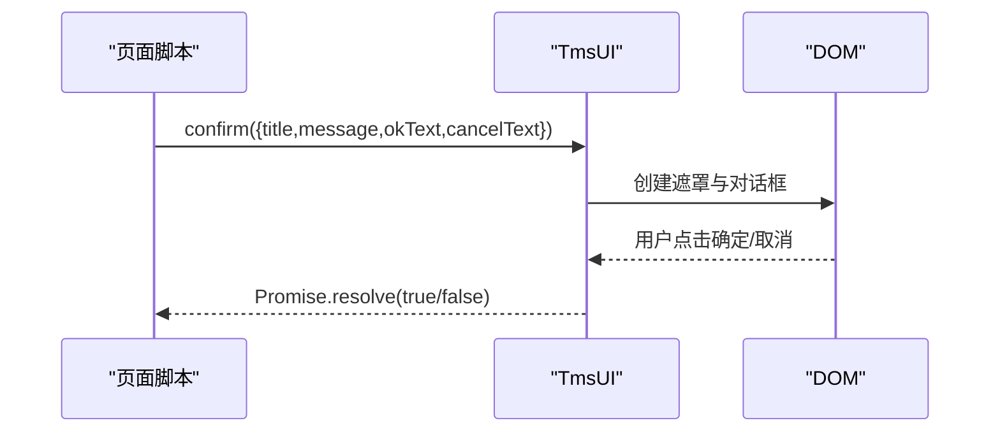

**图示来源**
- [tms-ui.js:109-158](file://tms-ui.js#L109-L158)

**章节来源**
- [tms-ui.js:107-158](file://tms-ui.js#L107-L158)

### 表单弹窗（TmsUI.formModal）
- fields 定义字段类型：text、number、select、textarea、checkbox
- 支持 required、placeholder、help、min/max/step、rows、full（跨列）
- 提交校验：必填校验、异步 onSubmit(data, modal) 支持 Promise
- 错误提示：统一错误区域显示
- 成功反馈：保存成功后 toast.success

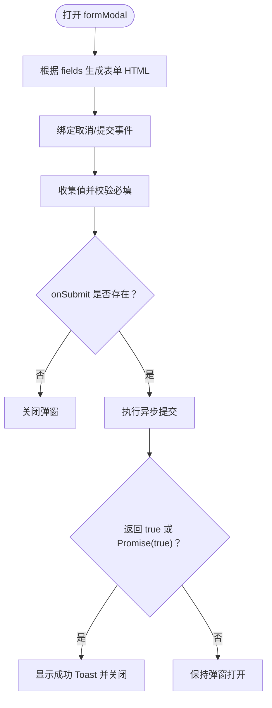

**图示来源**
- [tms-ui.js:160-287](file://tms-ui.js#L160-L287)

**章节来源**
- [tms-ui.js:160-287](file://tms-ui.js#L160-L287)

### Toast 通知（TmsUI.toast）
- 自动创建容器 tms-toast-container
- 支持 type：info、success、warning、error
- 动画：进入/退出过渡，默认时长约 2600ms

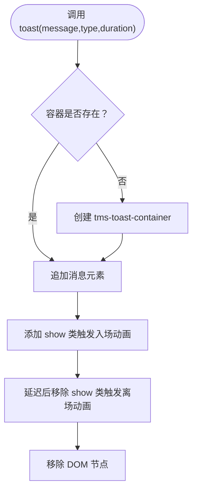

**图示来源**
- [tms-ui.js:86-105](file://tms-ui.js#L86-L105)

**章节来源**
- [tms-ui.js:86-105](file://tms-ui.js#L86-L105)

### 图表组件（TmsUI.charts）
- lineChart：折线图，支持 area、series、labels、height
- barChart：柱状图，支持 series、labels、height
- donutChart：环形图，支持 data、height、legend

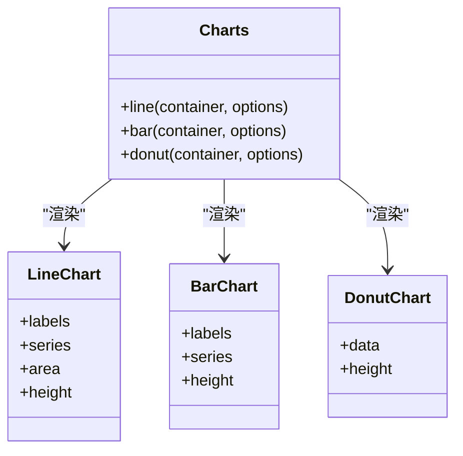

**图示来源**
- [tms-ui.js:575-680](file://tms-ui.js#L575-L680)

**章节来源**
- [tms-ui.js:546-680](file://tms-ui.js#L546-L680)

### 详情与时间线（TmsUI.detailModal / detailGrid / timeline）
- detailModal(title, html, width)：快速展示详情弹窗
- detailGrid(items)：键值对网格展示
- timeline(items)：时间线展示，支持 label/time/actor

**章节来源**
- [tms-ui.js:682-699](file://tms-ui.js#L682-L699)

### 页面外壳（TmsUI.initShell）
- 高亮当前导航项
- 展开/折叠子菜单
- 绑定登出按钮
- 调用 displayCurrentUser
- 读取异常待办数量并在导航上显示角标

**章节来源**
- [tms-ui.js:701-746](file://tms-ui.js#L701-L746)
- [common.js:221-270](file://common.js#L221-L270)

## 依赖关系分析
- TmsUI 依赖全局 window 与 document，并通过 global.TmsStore 访问数据层。
- TmsStore 基于 localStorage 持久化，并通过 CustomEvent('tms:datachange') 广播数据变更。
- 页面通过 TmsUI.initShell 初始化外壳，通过 TmsUI.table 订阅数据变化并渲染。
- 样式全部使用 tms- 前缀，避免与页面自有样式冲突。

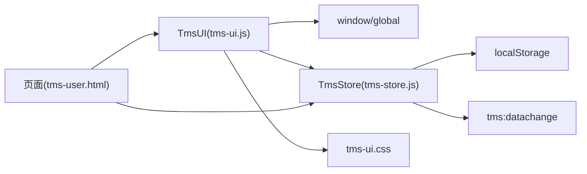

**图示来源**
- [tms-ui.js:758-781](file://tms-ui.js#L758-L781)
- [tms-store.js:237-244](file://tms-store.js#L237-L244)
- [tms-user.html:524-539](file://tms-user.html#L524-L539)

**章节来源**
- [tms-ui.js:758-781](file://tms-ui.js#L758-L781)
- [tms-store.js:237-244](file://tms-store.js#L237-L244)
- [tms-user.html:524-539](file://tms-user.html#L524-L539)

## 性能与可维护性
- 表格搜索防抖：减少频繁渲染开销。
- 分页与排序：优先使用 TmsStore 服务端式分页（entity 模式），避免全量数据在前端处理。
- 事件委托：表格工具栏、分页、行操作通过 data-* 属性集中绑定，降低事件监听数量。
- 样式隔离：tms- 前缀避免样式冲突，便于主题替换与覆盖。
- 生命周期管理：table 返回 destroy 方法用于取消订阅，防止内存泄漏。

[本节为通用建议，无需具体文件引用]

## 自定义组件开发指南

### 组件架构设计原则
- 单一职责：每个组件只负责一种展示或交互（如表单、状态展示、交互控件）。
- 配置驱动：通过 props 配置控制行为与外观，避免硬编码。
- 事件驱动：对外暴露事件回调（如 onChange、onSubmit、onAction），由页面处理业务逻辑。
- 样式隔离：使用 tms- 前缀类名，必要时提供可选的主题变量或覆盖规则。
- 生命周期：提供 init/render/destroy 钩子，确保资源释放。

### API 接口定义规范
- 构造函数：component(container, props)
- Props 设计：
  - 数据：data、items、value
  - 展示：label、placeholder、options、format、color
  - 行为：disabled、readonly、required、validate
  - 事件：onChange、onSubmit、onAction、onError
- 返回值：实例对象，包含 refresh、state、destroy 等方法。

### 样式系统集成
- 新增类名遵循 tms- 前缀，如 tms-custom-field、tms-custom-status。
- 复用已有样式：tms-btn、tms-badge、tms-panel、tms-form 等。
- 主题覆盖：通过 CSS 变量或覆盖类名实现主题切换。

### 组件注册机制与生命周期
- 注册：将组件挂载到 TmsUI 命名空间下，如 TmsUI.customComponent = function(...) {...}
- 生命周期：
  - 初始化：接收 container 与 props，创建 DOM 与事件
  - 渲染：根据 props 更新视图
  - 销毁：清理事件监听、定时器、订阅等

### 自定义组件示例

#### 表单组件（自定义输入控件）
- 目标：封装一个带校验与格式化能力的输入控件
- Props：
  - name、label、type、placeholder、required、format、validate
  - value、onChange、onBlur
- 行为：
  - 输入时触发 onChange(value)
  - 失焦时触发 onBlur(value)
  - 校验失败时显示错误信息
- 样式：使用 tms-field、tms-form-error 等已有样式

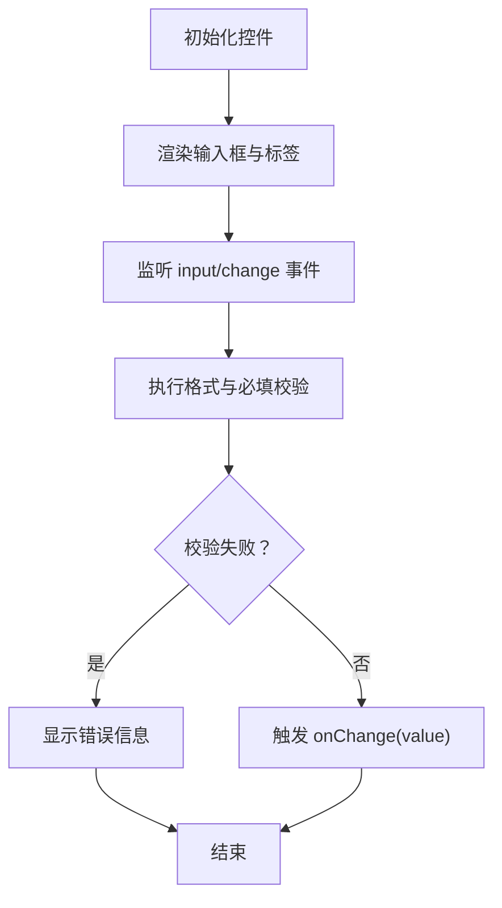

**图示来源**
- [tms-ui.js:160-287](file://tms-ui.js#L160-L287)

#### 状态展示组件（状态徽章增强版）
- 目标：根据业务状态显示不同颜色与文本
- Props：
  - status、entity、label、color
- 行为：
  - 根据 STATUS_CLASS 映射类名
  - 使用 TmsStore.labels 获取本地化标签
- 样式：复用 tms-badge、tms-badge-*

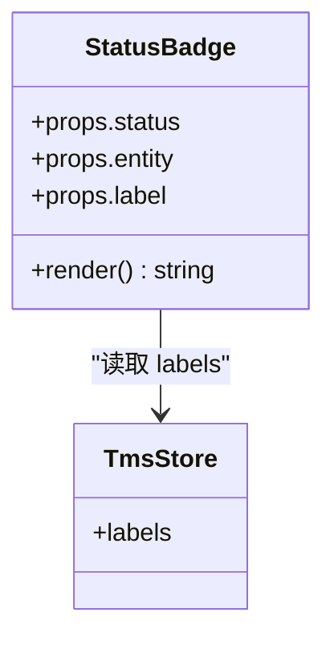

**图示来源**
- [tms-ui.js:57-80](file://tms-ui.js#L57-L80)
- [tms-store.js:98-120](file://tms-store.js#L98-L120)

#### 交互组件（批量操作面板）
- 目标：提供多选、批量删除、导出等功能
- Props：
  - items、actions、onSelect、onDelete、onExport
- 行为：
  - 全选/反选
  - 批量删除（调用 confirm）
  - 导出（调用 toast）
- 样式：复用 tms-btn、tms-toolbar

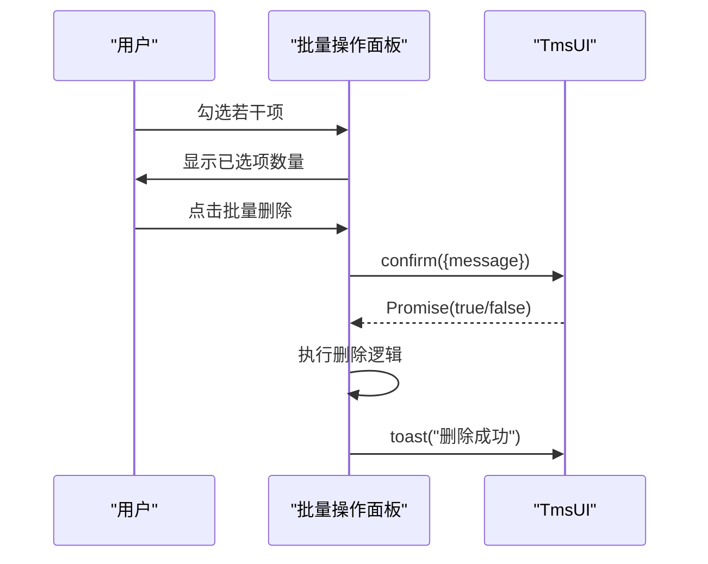

**图示来源**
- [tms-ui.js:109-158](file://tms-ui.js#L109-L158)
- [tms-ui.js:86-105](file://tms-ui.js#L86-L105)

### Props 设计、事件处理、状态管理最佳实践
- Props 不可变：组件内部不直接修改 props，而是通过 state 管理内部状态。
- 事件冒泡：使用事件委托减少监听器数量。
- 状态同步：与 TmsStore 同步时，使用 subscribe 监听数据变化，避免轮询。
- 错误边界：捕获异步错误并显示友好提示。
- 可访问性：为交互元素添加 aria-* 属性，提升无障碍体验。

[本节为通用建议，无需具体文件引用]

## 测试与调试

### 单元测试建议
- 表格组件：
  - 验证 columns 渲染正确
  - 验证 search/filters/sort 行为
  - 验证分页与工具栏按钮回调
- 弹窗组件：
  - 验证 modal 打开/关闭
  - 验证 confirm 返回 Promise
  - 验证 formModal 校验与提交
- Toast 组件：
  - 验证容器创建与消息显示
  - 验证动画与自动消失

### 调试技巧
- 使用浏览器控制台查看 TmsUI 与 TmsStore 对象。
- 在表格 render 前后打印 rows 与 total，确认数据流。
- 在 formModal onSubmit 中打断点，检查数据收集与校验。
- 使用 Network 面板观察 localStorage 变更（通过 Storage 面板）。

**章节来源**
- [tms-ui.js:303-543](file://tms-ui.js#L303-L543)
- [tms-ui.js:109-287](file://tms-ui.js#L109-L287)
- [tms-ui.js:86-105](file://tms-ui.js#L86-L105)

## 常见问题排查

### 表格不显示数据
- 检查 cfg.entity 是否正确，global.TmsStore 是否可用。
- 检查 columns.key 是否与数据字段一致。
- 检查 searchFields 是否指定，或未指定时使用首行对象的 key。

**章节来源**
- [tms-ui.js:316-363](file://tms-ui.js#L316-L363)

### 弹窗无法关闭
- 检查是否手动调用了 close()。
- 检查 ESC 键监听是否被其他代码拦截。

**章节来源**
- [tms-ui.js:122-137](file://tms-ui.js#L122-L137)

### Toast 不显示
- 检查 tms-ui.css 是否加载。
- 检查容器 tms-toast-container 是否被其他样式覆盖。

**章节来源**
- [tms-ui.js:86-105](file://tms-ui.js#L86-L105)
- [tms-ui.css:681-730](file://tms-ui.css#L681-L730)

### 数据变更后表格未刷新
- 检查是否使用 cfg.entity 模式。
- 检查 TmsStore.subscribe 是否被正确调用。
- 检查 destroy 是否提前被调用导致订阅失效。

**章节来源**
- [tms-ui.js:525-543](file://tms-ui.js#L525-L543)
- [tms-store.js:237-244](file://tms-store.js#L237-L244)

## 结论
TMS 的 UI 组件库提供了稳定、可扩展的基础能力。通过遵循 tms- 前缀的样式约定、配置驱动的 API 设计、事件驱动的状态管理，开发者可以安全地扩展自定义组件，满足复杂业务需求。建议在扩展过程中：
- 复用现有组件能力（表格、弹窗、Toast、图表）
- 保持样式隔离与可访问性
- 完善生命周期管理与错误处理
- 编写测试用例与调试日志

这样既能保证系统稳定性，又能提升开发效率与用户体验。