# 业务逻辑实现

<cite>
**本文引用的文件**   
- [tms-store.js](file://tms-store.js)
- [common.js](file://common.js)
- [tms-ui.js](file://tms-ui.js)
- [tms-user.html](file://tms-user.html)
- [client-index.html](file://client-index.html)
</cite>

## 目录
1. [引言](#引言)
2. [项目结构](#项目结构)
3. [核心组件](#核心组件)
4. [架构总览](#架构总览)
5. [详细组件分析](#详细组件分析)
6. [依赖关系分析](#依赖关系分析)
7. [性能与扩展性](#性能与扩展性)
8. [故障排查指南](#故障排查指南)
9. [结论](#结论)
10. [附录：关键业务流程示例](#附录关键业务流程示例)

## 引言
本指南面向需要实现复杂物流业务逻辑的开发者，围绕订单状态流转、事件驱动架构、跨页面通信、权限控制、异常处理、运输调度、计费引擎等核心能力展开。仓库采用“共享数据层 + UI 组件库 + 页面脚本”的分层组织方式，通过基于 localStorage 的轻量数据库和浏览器 CustomEvent 实现跨页面数据同步与事件驱动的业务编排。

## 项目结构
- 共享数据层：`tms-store.js` 提供统一的数据模型、CRUD、状态机、轨迹与扫描记录、计费引擎、种子数据生成与持久化。
- 通用工具：`common.js` 提供登录、用户信息、积分、按钮样式注入等基础能力。
- UI 组件库：`tms-ui.js` 提供表格、表单弹窗、确认框、Toast、图表、详情页等可复用 UI 能力。
- 业务页面：如 `tms-user.html`（角色/权限管理）、`client-index.html`（客户侧订单统计）等，组合使用 Store 与 UI 组件完成具体业务场景。

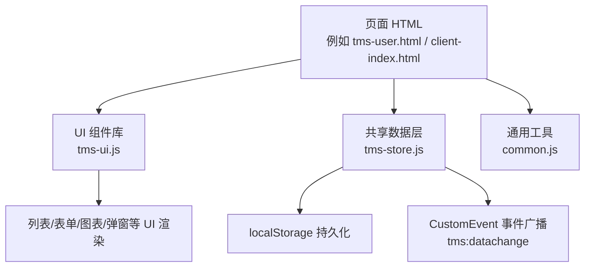

**图示来源**
- [tms-store.js:1-12](file://tms-store.js#L1-L12)
- [tms-ui.js:1-6](file://tms-ui.js#L1-L6)
- [common.js:1-10](file://common.js#L1-L10)

**章节来源**
- [tms-store.js:1-12](file://tms-store.js#L1-L12)
- [tms-ui.js:1-6](file://tms-ui.js#L1-L6)
- [common.js:1-10](file://common.js#L1-L10)

## 核心组件
- 共享数据层（TmsStore）
  - 职责：维护所有实体（订单、运单、运输、异常、财务、员工、车辆、仓储、库存、运力、围栏、设备、策略、路由规则、账单、应收应付等），提供增删改查、搜索筛选排序分页、订阅发布、状态机推进、轨迹与扫描记录写入、计费试算、种子数据初始化。
  - 关键点：
    - 数据持久化到 localStorage，变更时触发 `tms:datachange` 事件。
    - 订单状态机：待入库→已入库→已分拣→运输中→已到达→派送中→已签收。
    - 计费引擎：支持首重/续重、体积重、燃油附加、偏远附加、保价、到付、客户折扣与账期。
    - 路由计划：按起终点匹配线路，计算分段标准时效与截止时间。
    - 轨迹节点：与订单阶段映射，自动标记超时与偏差。
- UI 组件库（TmsUI）
  - 职责：提供表格、搜索/筛选/分页、表单弹窗、确认框、Toast、KPI、SVG 折线/柱状/环形图、详情展示、页面外壳初始化等。
  - 关键点：
    - 表格组件支持 entity 模式，自动订阅 TmsStore 数据变化并刷新。
    - 表单弹窗支持异步提交、错误提示、成功反馈。
    - 状态标签根据实体类型映射为不同颜色。
- 通用工具（Common）
  - 职责：登录流程、用户信息存取、角色跳转、按钮样式注入、积分管理等。
  - 关键点：
    - 登录成功后将用户信息存入 localStorage，并按角色跳转到对应页面。
    - 提供 checkLoginStatus 进行页面级权限校验。

**章节来源**
- [tms-store.js:1-12](file://tms-store.js#L1-L12)
- [tms-store.js:88-120](file://tms-store.js#L88-L120)
- [tms-store.js:263-383](file://tms-store.js#L263-L383)
- [tms-store.js:1322-1559](file://tms-store.js#L1322-L1559)
- [tms-ui.js:86-287](file://tms-ui.js#L86-L287)
- [tms-ui.js:303-544](file://tms-ui.js#L303-L544)
- [common.js:135-218](file://common.js#L135-L218)

## 架构总览
系统采用“事件驱动 + 共享数据层”的架构：
- 页面通过 TmsStore 读写数据；TmsStore 在持久化后广播 `tms:datachange`。
- UI 组件通过订阅该事件或显式调用 list 接口获取最新数据，实现跨页面实时同步。
- 业务编排由 Store 内部的状态机与辅助函数承担，页面仅负责交互与展示。

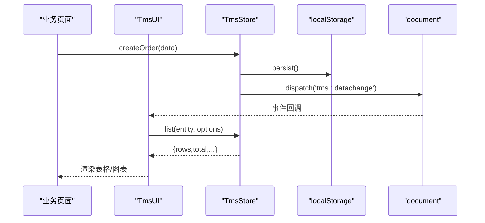

**图示来源**
- [tms-store.js:232-244](file://tms-store.js#L232-L244)
- [tms-store.js:1574-1615](file://tms-store.js#L1574-L1615)
- [tms-ui.js:525-544](file://tms-ui.js#L525-L544)

## 详细组件分析

### 共享数据层（TmsStore）
- 数据模型与字典
  - 订单状态流 ORDER_FLOW、各实体状态标签 STATUS_LABELS、轨迹节点 TRACE_NODE_MAP、城市/省份映射、客户等级与服务等级等。
- 持久化与事件
  - readDb/persist 负责从 localStorage 读取与写入；emit 分发 `tms:datachange` 并通知监听者。
- 计费引擎
  - calcFreight 根据运价卡、重量/体积、服务等级、客户等级与付款方式计算费用明细。
- 路由与轨迹
  - buildRoutes/findRoute/planRoute 构建多段路由并计算截止时间；buildTraces/addTrace 生成轨迹明细并标记超时/偏差。
- 种子数据
  - seed 生成真实感初始数据，包括订单、运输、分拣、装卸、扫描、异常、财务、账单、员工、车辆、仓储、库存、运力、围栏、设备等。
- CRUD 与查询
  - list/get/create/update/remove 提供统一操作；支持 filters/search/sort/page。
- 业务流转
  - applyOrderStatus 是核心状态机：推进订单状态，联动扫描记录、分拣/装卸任务、运输任务、车辆状态、财务结算等。
  - advanceOrder 提供“下一步”推进能力。
  - ensureSortingTask/ensureLoadingTask/ensureTransport/ensureIncome/ensureSettlement 保证关联数据一致性。

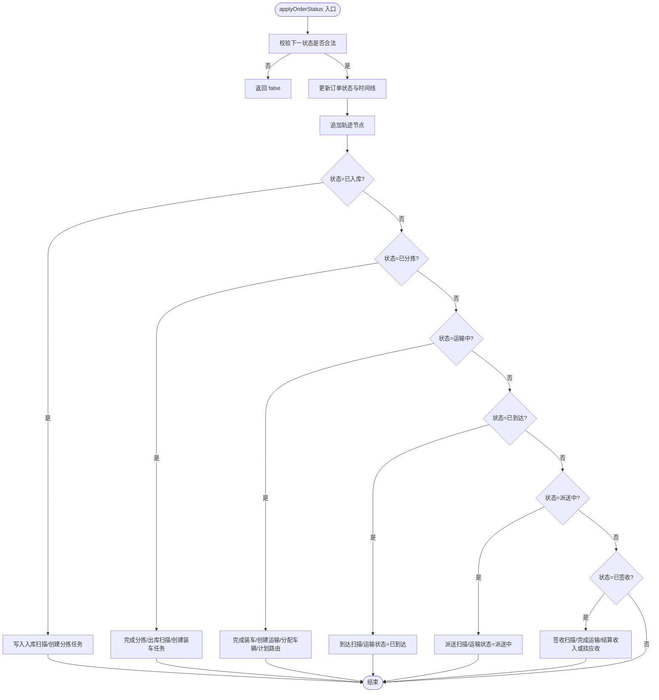

**图示来源**
- [tms-store.js:1497-1559](file://tms-store.js#L1497-L1559)

**章节来源**
- [tms-store.js:88-120](file://tms-store.js#L88-L120)
- [tms-store.js:232-244](file://tms-store.js#L232-L244)
- [tms-store.js:263-383](file://tms-store.js#L263-L383)
- [tms-store.js:385-460](file://tms-store.js#L385-L460)
- [tms-store.js:462-1154](file://tms-store.js#L462-L1154)
- [tms-store.js:1197-1320](file://tms-store.js#L1197-L1320)
- [tms-store.js:1322-1559](file://tms-store.js#L1322-L1559)

### UI 组件库（TmsUI）
- 表单弹窗与确认框
  - formModal 支持字段定义、必填校验、异步提交、错误提示与成功 Toast。
  - confirmDialog 提供 Promise 风格的确认交互。
- 表格组件
  - table 支持 entity 模式，自动订阅 TmsStore 数据变化；内置搜索、筛选、排序、分页、工具栏与行操作。
- 图表与 KPI
  - lineChart/barChart/donutChart 使用 SVG 绘制；kpis 渲染指标卡片。
- 页面外壳
  - initShell 高亮当前导航、绑定退出登录、显示当前用户、异常待办角标。

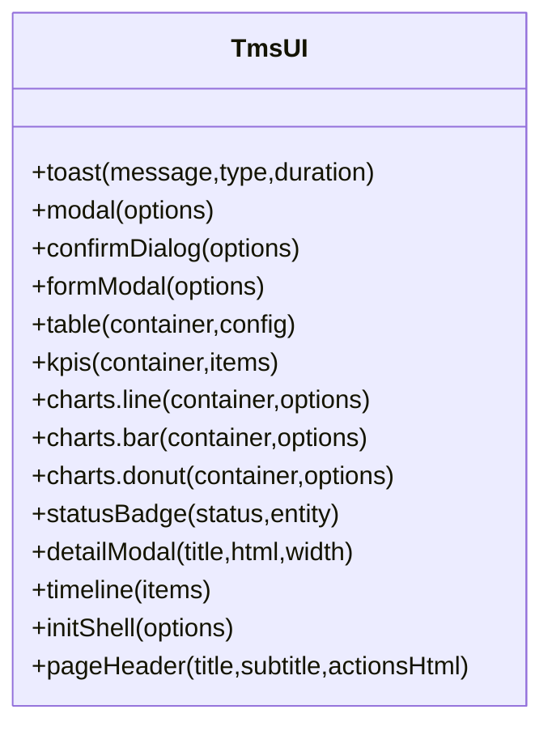

**图示来源**
- [tms-ui.js:86-287](file://tms-ui.js#L86-L287)
- [tms-ui.js:303-544](file://tms-ui.js#L303-L544)
- [tms-ui.js:546-680](file://tms-ui.js#L546-L680)
- [tms-ui.js:701-782](file://tms-ui.js#L701-L782)

**章节来源**
- [tms-ui.js:86-287](file://tms-ui.js#L86-L287)
- [tms-ui.js:303-544](file://tms-ui.js#L303-L544)
- [tms-ui.js:546-680](file://tms-ui.js#L546-L680)
- [tms-ui.js:701-782](file://tms-ui.js#L701-L782)

### 通用工具（Common）
- 登录与用户信息
  - login 保存用户信息到 localStorage，并根据角色跳转到对应页面。
  - checkLoginStatus 校验登录态与角色，未登录或角色不匹配则跳转登录页。
  - getCurrentUser/displayCurrentUser 获取与展示当前用户。
- 积分管理
  - initUserPoints/addUserPoints/deductUserPoints/getUserPointsHistory 管理用户积分余额与流水。

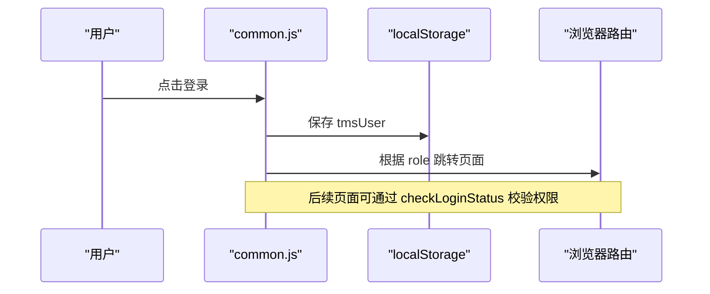

**图示来源**
- [common.js:135-218](file://common.js#L135-L218)

**章节来源**
- [common.js:135-218](file://common.js#L135-L218)
- [common.js:274-363](file://common.js#L274-L363)

### 权限控制与角色管理
- 权限与角色模型
  - PERMISSIONS/ROLES 定义系统权限与角色，用户通过 roleId 关联角色。
- 页面集成
  - tms-user.html 使用 TmsUI.formModal 编辑角色与权限，调用 TmsStore.create/update 持久化。
- 页面级校验
  - common.js 提供 checkLoginStatus，用于限制访问特定角色页面。

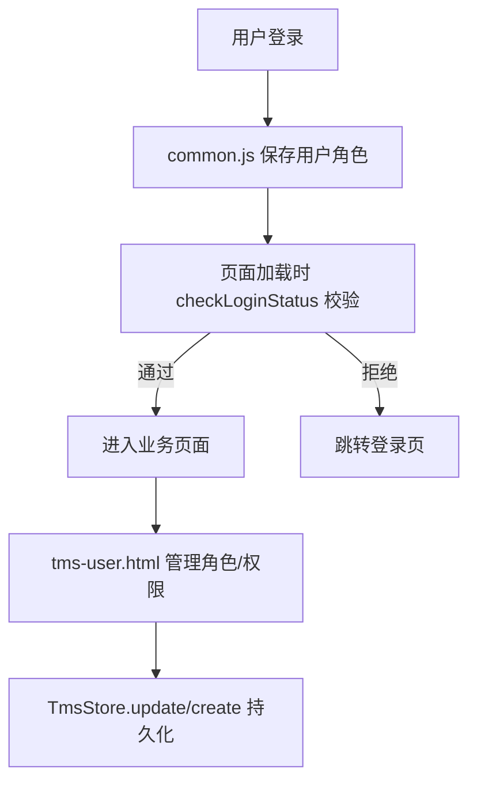

**图示来源**
- [common.js:176-199](file://common.js#L176-L199)
- [tms-user.html:685-771](file://tms-user.html#L685-L771)
- [tms-store.js:144-164](file://tms-store.js#L144-L164)

**章节来源**
- [tms-store.js:144-164](file://tms-store.js#L144-L164)
- [tms-user.html:685-771](file://tms-user.html#L685-L771)
- [common.js:176-199](file://common.js#L176-L199)

## 依赖关系分析
- 页面 → UI 组件：页面通过 TmsUI 渲染表格、弹窗、图表等。
- 页面 → 共享数据层：页面通过 TmsStore.list/create/update 等操作数据。
- 共享数据层 → 浏览器 API：localStorage 持久化、CustomEvent 事件广播。
- UI 组件 → 共享数据层：表格组件订阅 tms:datachange 并刷新。

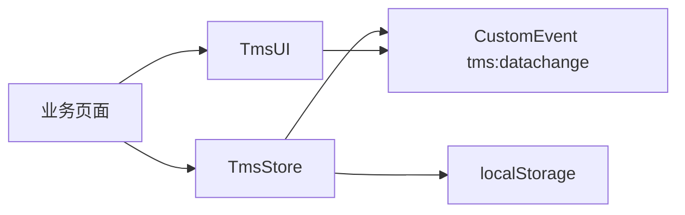

**图示来源**
- [tms-store.js:232-244](file://tms-store.js#L232-L244)
- [tms-ui.js:525-544](file://tms-ui.js#L525-L544)

**章节来源**
- [tms-store.js:232-244](file://tms-store.js#L232-L244)
- [tms-ui.js:525-544](file://tms-ui.js#L525-L544)

## 性能与扩展性
- 本地存储容量与版本迁移
  - DB_VERSION 与 readDb 确保数据版本兼容；persist 序列化写入 localStorage。
- 列表查询优化
  - list 支持 filters/search/sort/page，避免全量渲染；表格组件仅在必要时刷新。
- 轨迹与扫描记录上限
  - traces/scans 设置长度上限，防止无限增长影响性能。
- 可扩展点
  - 新增实体：在 seed 中初始化、在 prefixMap 中配置 ID 前缀、在 list/get/create 中使用。
  - 新增状态：扩展 ORDER_FLOW/STATUS_LABELS/STATUS_NODE，并在 applyOrderStatus 中添加分支逻辑。
  - 新增计费规则：扩展 SERVICE_LEVELS 与 rateCards 构建逻辑。

[本节为通用指导，无需代码引用]

## 故障排查指南
- 数据未刷新
  - 检查是否正确订阅 tms:datachange；确认 TmsStore.persist 被调用。
- 权限拦截
  - 检查 common.js 的 checkLoginStatus 返回值与页面跳转逻辑。
- 订单无法推进
  - 检查 order.status 与 ORDER_FLOW 索引；确认非取消且未完成。
- 计费结果异常
  - 检查运价卡是否存在、服务等级是否匹配、客户等级与付款方式是否正确。
- 轨迹缺失
  - 检查 applyOrderStatus 是否调用了 addTrace；确认 nodeCode 是否在 TRACE_NODE_MAP 中。

**章节来源**
- [tms-store.js:220-244](file://tms-store.js#L220-L244)
- [tms-store.js:1497-1559](file://tms-store.js#L1497-L1559)
- [tms-store.js:263-383](file://tms-store.js#L263-L383)
- [common.js:176-199](file://common.js#L176-L199)

## 结论
本仓库通过 TmsStore 与 TmsUI 的组合，实现了完整的物流业务闭环：订单创建、状态流转、轨迹与扫描、运输调度、异常处理、财务结算、权限控制与跨页面数据同步。开发者可在此基础上扩展新的实体、状态与计费规则，并通过事件驱动机制保持 UI 与数据的实时一致。

[本节为总结，无需代码引用]

## 附录：关键业务流程示例

### 订单创建流程
- 输入：发货地、目的地、服务等级、重量/体积、保价、付款方式、客户等。
- 处理：
  - 若未传入运费，调用 calcFreight 试算。
  - 生成订单号与运单号，写入订单主数据。
  - 可选：立即推进至待入库（通常由仓内作业触发）。
- 输出：订单对象、运费明细、可能的应收/收入记录。

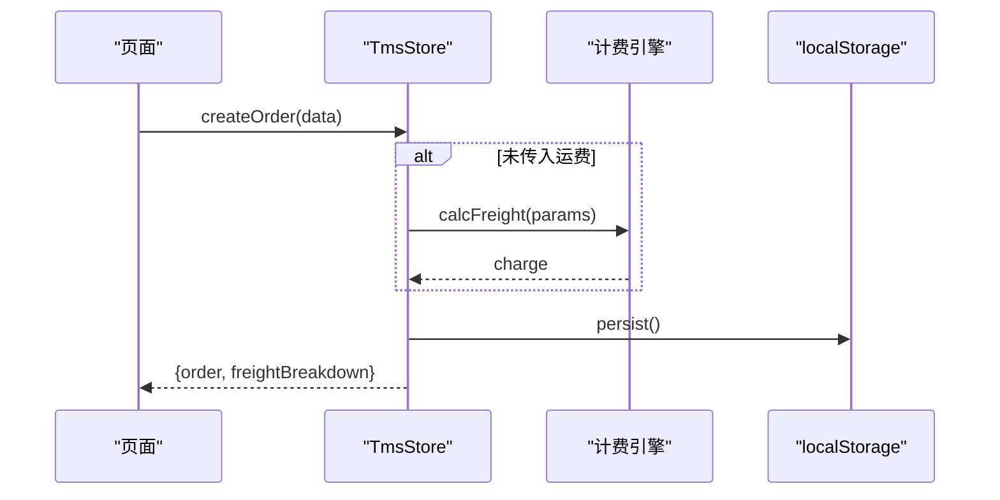

**图示来源**
- [tms-store.js:1574-1615](file://tms-store.js#L1574-L1615)
- [tms-store.js:263-383](file://tms-store.js#L263-L383)

**章节来源**
- [tms-store.js:1574-1615](file://tms-store.js#L1574-L1615)
- [tms-store.js:263-383](file://tms-store.js#L263-L383)

### 订单状态流转流程
- 入口：advanceOrder 或 applyOrderStatus。
- 规则：按 ORDER_FLOW 顺序推进；每步联动扫描、任务、运输、车辆与财务。
- 异常：取消订单不可推进；已完成签收不可再推进。

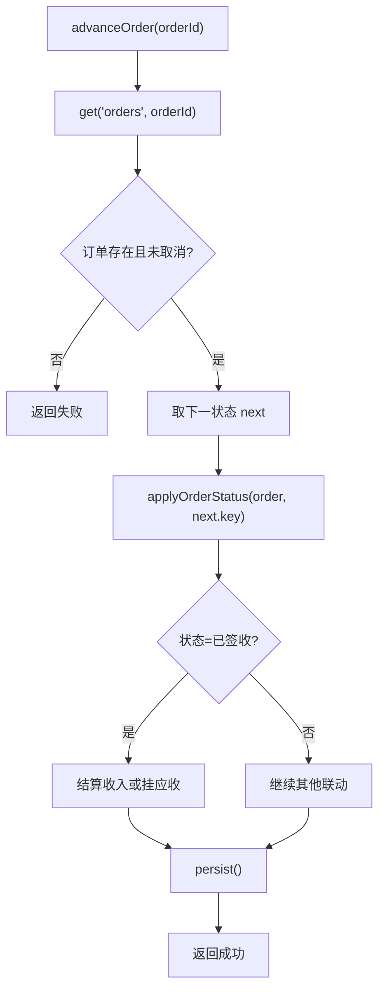

**图示来源**
- [tms-store.js:1561-1572](file://tms-store.js#L1561-L1572)
- [tms-store.js:1497-1559](file://tms-store.js#L1497-L1559)

**章节来源**
- [tms-store.js:1561-1572](file://tms-store.js#L1561-L1572)
- [tms-store.js:1497-1559](file://tms-store.js#L1497-L1559)

### 运输调度流程
- 触发：订单进入“运输中”。
- 动作：
  - 确保装车任务完成。
  - 创建运输任务并分配车辆/司机。
  - 计划路由并计算截止时间。
  - 更新车辆状态为“运输中”。

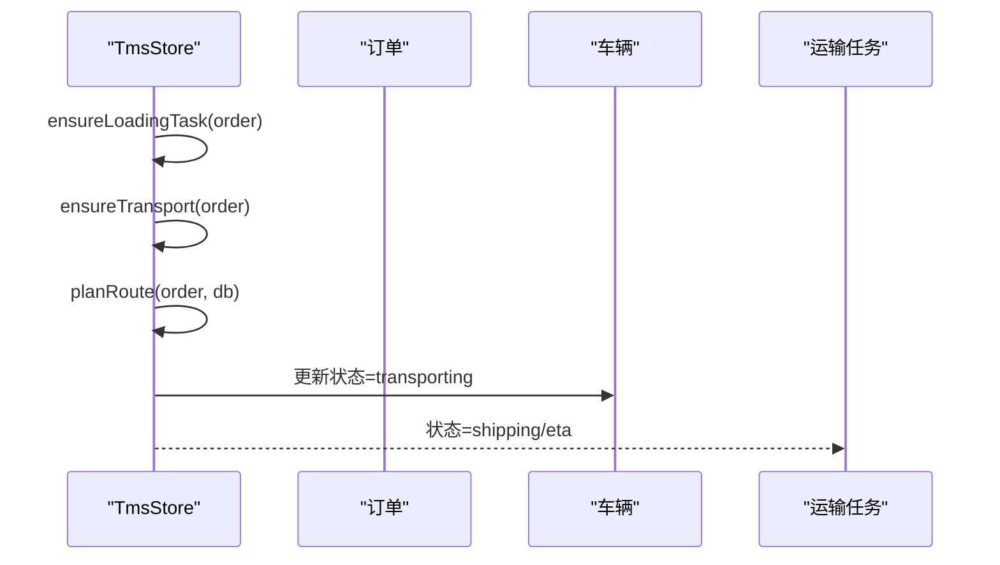

**图示来源**
- [tms-store.js:1527-1538](file://tms-store.js#L1527-L1538)
- [tms-store.js:1394-1417](file://tms-store.js#L1394-L1417)
- [tms-store.js:427-440](file://tms-store.js#L427-L440)

**章节来源**
- [tms-store.js:1527-1538](file://tms-store.js#L1527-L1538)
- [tms-store.js:1394-1417](file://tms-store.js#L1394-L1417)
- [tms-store.js:427-440](file://tms-store.js#L427-L440)

### 异常处理流程
- 触发：随机或业务规则生成异常记录。
- 处理：
  - 分派处理人。
  - 标记解决并填写处理结果。
  - 可选联动理赔申请。
  - 定责扣款生成应付记录。

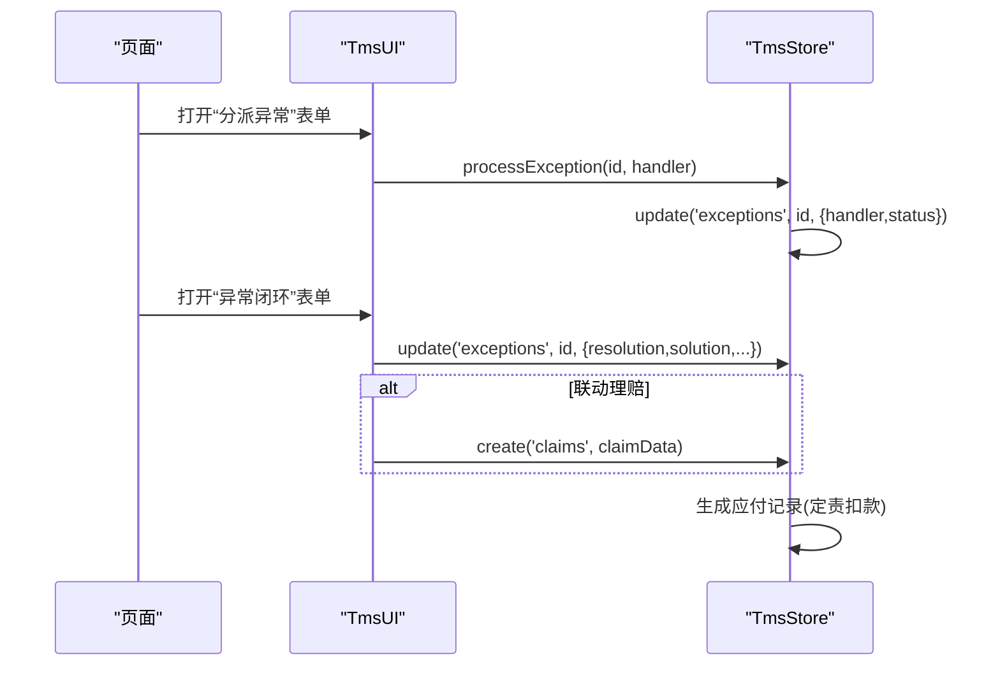

**图示来源**
- [tms-pages.js:211-236](file://tms-pages.js#L211-L236)
- [tms-store.js:875-917](file://tms-store.js#L875-L917)

**章节来源**
- [tms-pages.js:211-236](file://tms-pages.js#L211-L236)
- [tms-store.js:875-917](file://tms-store.js#L875-L917)

### 事件驱动与跨页面通信
- 机制：TmsStore.persist 后触发 `tms:datachange`；TmsUI.table 订阅该事件并刷新。
- 适用场景：订单列表、异常待办角标、KPI 指标实时更新。

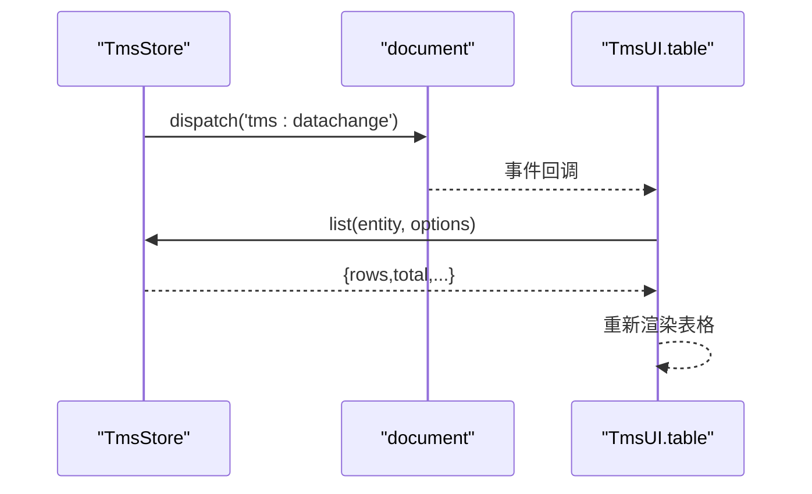

**图示来源**
- [tms-store.js:232-244](file://tms-store.js#L232-L244)
- [tms-ui.js:525-544](file://tms-ui.js#L525-L544)

**章节来源**
- [tms-store.js:232-244](file://tms-store.js#L232-L244)
- [tms-ui.js:525-544](file://tms-ui.js#L525-L544)

### 权限控制与页面访问
- 登录：common.js 保存用户角色并跳转。
- 校验：checkLoginStatus 在页面加载时校验角色。
- 管理：tms-user.html 通过 TmsUI.formModal 编辑角色与权限。

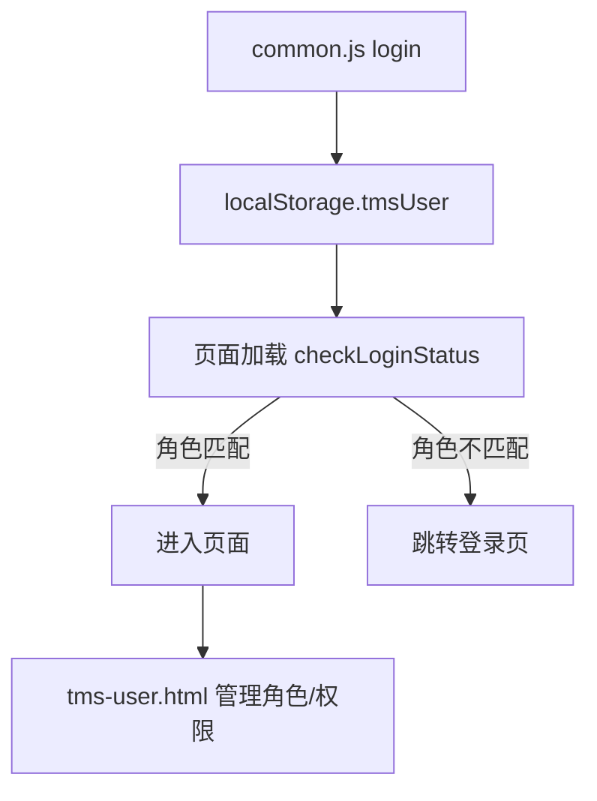

**图示来源**
- [common.js:135-218](file://common.js#L135-L218)
- [tms-user.html:685-771](file://tms-user.html#L685-L771)

**章节来源**
- [common.js:135-218](file://common.js#L135-L218)
- [tms-user.html:685-771](file://tms-user.html#L685-L771)

### 计费引擎与报价
- 输入：origin/destination/service/weight/volume/dims/declaredValue/isInsured/paymentMethod/customer。
- 处理：选择最匹配运价卡，计算首重/续重/燃油/偏远/保价/到付/折扣。
- 输出：完整费用明细 breakdown 与 total。

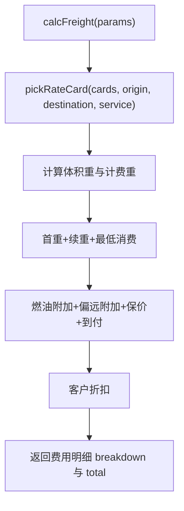

**图示来源**
- [tms-store.js:263-383](file://tms-store.js#L263-L383)

**章节来源**
- [tms-store.js:263-383](file://tms-store.js#L263-L383)