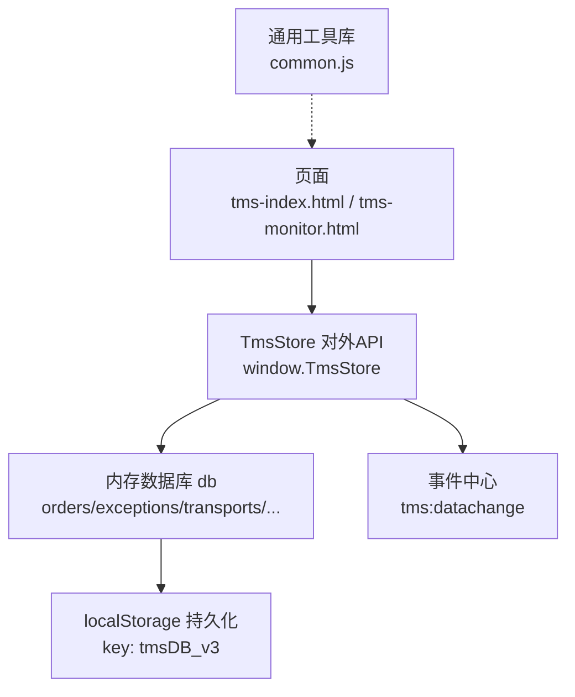
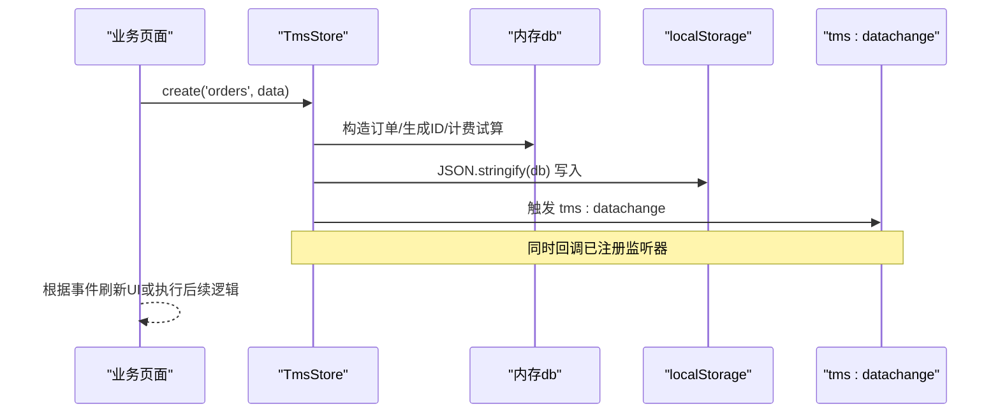
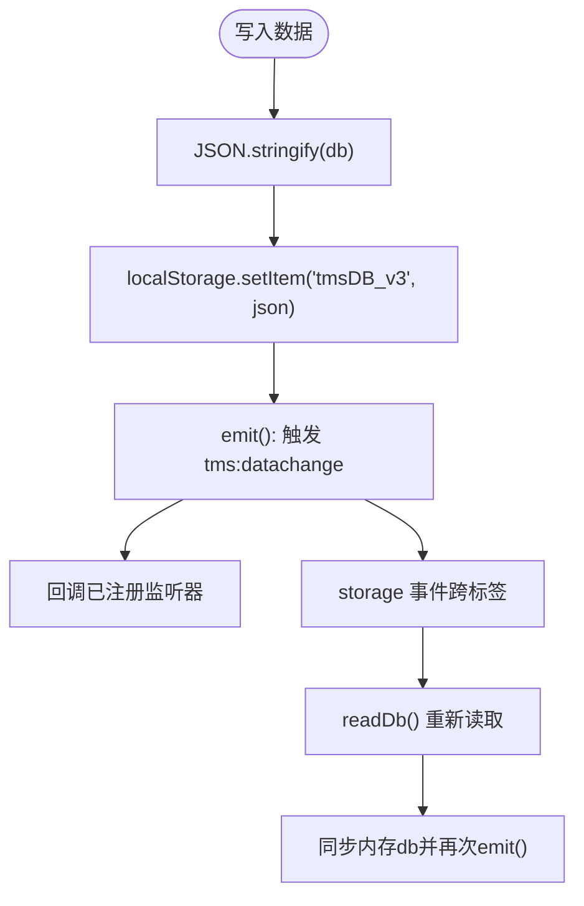
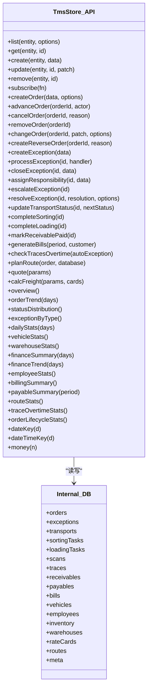

# CRUD操作实现

<cite>
**本文引用的文件**   
- [tms-store.js](file://tms-store.js)
- [common.js](file://common.js)
- [tms-index.html](file://tms-index.html)
- [tms-monitor.html](file://tms-monitor.html)
</cite>

## 目录
1. [引言](#引言)
2. [项目结构](#项目结构)
3. [核心组件](#核心组件)
4. [架构总览](#架构总览)
5. [详细组件分析](#详细组件分析)
6. [依赖关系分析](#依赖关系分析)
7. [性能与一致性](#性能与一致性)
8. [故障排查指南](#故障排查指南)
9. [结论](#结论)
10. [附录：CRUD使用清单](#附录crud使用清单)

## 引言
本指南面向需要在 TMS 系统中进行数据层开发的工程师，围绕 TmsStore 提供的通用 CRUD 接口与业务方法，系统说明增删改查的调用方式、参数规范、持久化机制、事务与一致性保证、事件通知机制，以及常见错误处理策略。读者可据此快速完成单条记录与批量数据的正确读写，并基于 tms:datachange 事件驱动页面刷新与联动逻辑。

## 项目结构
TMS 的数据层由单一模块 tms-store.js 提供，通过 window.TmsStore 暴露 API；其他页面（如 tms-index.html、tms-monitor.html）通过该全局对象访问数据。通用工具函数位于 common.js，主要承担登录、用户信息与积分等独立于 TMS 主数据的辅助功能。

图表来源
- [tms-store.js:2297-2379](file://tms-store.js#L2297-L2379)
- [tms-store.js:220-244](file://tms-store.js#L220-L244)
- [tms-index.html:476-578](file://tms-index.html#L476-L578)
- [tms-monitor.html:448-458](file://tms-monitor.html#L448-L458)

章节来源
- [tms-store.js:1-12](file://tms-store.js#L1-L12)
- [tms-store.js:2297-2379](file://tms-store.js#L2297-L2379)
- [common.js:1-20](file://common.js#L1-L20)

## 核心组件
- TmsStore 对外 API
  - 通用 CRUD：list、get、create、update、remove
  - 订阅与事件：subscribe、tms:datachange
  - 业务方法：advanceOrder、createOrder、cancelOrder、removeOrder、changeOrder、createReverseOrder、createException、processException、closeException、assignResponsibility、escalateException、updateTransportStatus、completeSorting、completeLoading、markReceivablePaid、generateBills、checkTracesOvertime、planRoute、quote、calcFreight
  - 统计聚合：overview、orderTrend、statusDistribution、exceptionByType、dailyStats、vehicleStats、warehouseStats、financeSummary、financeTrend、employeeStats、billingSummary、payableSummary、routeStats、traceOvertimeStats、orderLifecycleStats
  - 工具：dateKey、dateTimeKey、money

- 数据模型（部分关键实体）
  - orders：订单主数据，包含状态机、轨迹、计费明细、路由计划等
  - exceptions：异常记录，含处理流程、责任方、扣款金额等
  - transports：运输任务，关联车辆与订单
  - sortingTasks/loadingTasks：分拣/装卸任务
  - scans/traces：扫描与轨迹节点
  - receivables/payables/bills：应收/应付/账单
  - vehicles/employees/inventory/warehouses/routeCards/routes 等支撑数据

章节来源
- [tms-store.js:2297-2379](file://tms-store.js#L2297-L2379)
- [tms-store.js:86-120](file://tms-store.js#L86-L120)
- [tms-store.js:194-214](file://tms-store.js#L194-L214)

## 架构总览
TmsStore 采用“内存数据库 + localStorage 持久化”的轻量架构。所有写操作统一经过 persist()，在写入后触发 emit()，广播 tms:datachange 事件，并回调已注册的监听器。跨标签页通过 storage 事件同步最新数据，确保多标签一致。

图表来源
- [tms-store.js:220-244](file://tms-store.js#L220-L244)
- [tms-store.js:1574-1637](file://tms-store.js#L1574-L1637)
- [tms-store.js:2369-2375](file://tms-store.js#L2369-L2375)

## 详细组件分析

### 通用 CRUD 接口
- list(entity, options)
  - 用途：分页查询某类实体列表
  - 典型参数：pageSize、page、filters、sort、search
  - 返回：rows 数组与 total 总数
  - 适用场景：表格渲染、筛选排序、分页加载

- get(entity, id)
  - 用途：按 ID 获取单条记录
  - 返回：对象或 null

- create(entity, data)
  - 用途：新增一条记录
  - 行为：ensureInit() 初始化 → 写入内存 → persist() 持久化 → emit() 触发事件
  - 注意：业务实体建议优先使用专用方法（如 createOrder），以自动维护关联数据与状态机

- update(entity, id, patch)
  - 用途：更新指定记录的字段
  - 行为：合并 patch → persist() → emit()

- remove(entity, id)
  - 用途：删除记录
  - 行为：从内存移除 → persist() → emit()

示例路径参考
- [tms-store.js:2297-2379](file://tms-store.js#L2297-L2379)

章节来源
- [tms-store.js:2297-2379](file://tms-store.js#L2297-L2379)

### 订单生命周期与业务 CRUD
- createOrder(data, options)
  - 自动生成订单号、运单号、计费明细、路由计划与轨迹起点
  - 可选 autoInbound 自动推进入库
  - 返回完整订单对象

- advanceOrder(orderId, actor)
  - 按 ORDER_FLOW 顺序推进一个状态
  - 自动写入扫描、任务、财务等关联数据

- cancelOrder(orderId, reason)
  - 取消订单，联动作废应收、冲销收入、释放车辆

- removeOrder(orderId)
  - 删除订单并级联清理相关表（transport/sorting/loading/exception/scan/trace/receivable）

- changeOrder(orderId, patch, options)
  - 支持改址/改约/改重/改线路，自动重算运费并留痕

- createReverseOrder(orderId, reason)
  - 拒收退货时创建逆向订单

示例路径参考
- [tms-store.js:1561-1738](file://tms-store.js#L1561-L1738)

章节来源
- [tms-store.js:1561-1738](file://tms-store.js#L1561-L1738)

### 异常与工单闭环
- createException(data)
- processException(id, handler)
- closeException(id, data)
- assignResponsibility(id, data)
- escalateException(id)
- resolveException(id, resolution, options)

这些方法维护异常处理流程、责任方与扣款应付，并在闭环时可选择联动理赔。

示例路径参考
- [tms-store.js:1740-1837](file://tms-store.js#L1740-L1837)

章节来源
- [tms-store.js:1740-1837](file://tms-store.js#L1740-L1837)

### 运输与作业任务
- updateTransportStatus(id, nextStatus)
- completeSorting(id)
- completeLoading(id)

这些方法会联动订单状态机，确保仓储与运输环节的一致性。

示例路径参考
- [tms-store.js:1953-2006](file://tms-store.js#L1953-L2006)

章节来源
- [tms-store.js:1953-2006](file://tms-store.js#L1953-L2006)

### 计费与报价
- quote(params)
- calcFreight(params, cards)

用于报价页与新单创建时的费用试算，考虑首重/续重、体积重、燃油附加、偏远附加、保价、到付、客户折扣等。

示例路径参考
- [tms-store.js:327-383](file://tms-store.js#L327-L383)
- [tms-store.js:2222-2226](file://tms-store.js#L2222-L2226)

章节来源
- [tms-store.js:327-383](file://tms-store.js#L327-L383)
- [tms-store.js:2222-2226](file://tms-store.js#L2222-L2226)

### 事件触发机制
- TmsStore 在每次数据变更后触发 tms:datachange 事件
- 页面可通过 document.addEventListener('tms:datachange', ...) 监听
- 内部也维护 listeners 数组，直接回调已订阅函数

最佳实践
- 在页面初始化时订阅事件，避免重复绑定
- 在事件回调中仅做必要刷新，避免频繁 DOM 操作
- 对 listener 中的异常进行 try/catch，防止影响其他监听器

示例路径参考
- [tms-store.js:237-244](file://tms-store.js#L237-L244)
- [tms-store.js:2369-2375](file://tms-store.js#L2369-L2375)

章节来源
- [tms-store.js:237-244](file://tms-store.js#L237-L244)
- [tms-store.js:2369-2375](file://tms-store.js#L2369-L2375)

### 数据持久化与序列化
- 存储键：tmsDB_v3
- 版本控制：DB_VERSION = 3
- 读取：readDb() 解析 JSON，校验版本
- 写入：persist() 将 db 序列化为 JSON 字符串写入 localStorage
- 跨标签同步：监听 storage 事件，当 key 为 tmsDB_v3 时重新读取并触发事件

图表来源
- [tms-store.js:220-244](file://tms-store.js#L220-L244)
- [tms-store.js:2369-2375](file://tms-store.js#L2369-L2375)

章节来源
- [tms-store.js:220-244](file://tms-store.js#L220-L244)
- [tms-store.js:2369-2375](file://tms-store.js#L2369-L2375)

### 事务处理与一致性保证
- 无显式事务：TmsStore 未实现数据库事务，但通过“原子性写入 + 强一致事件”保障最终一致性
- 一致性策略
  - 所有写操作统一经 persist()，保证内存与 localStorage 同步
  - 状态机推进（applyOrderStatus）自动维护 timeline、扫描、任务、财务等关联数据
  - 删除订单时级联清理相关实体，避免孤儿数据
  - 跨标签页通过 storage 事件保持数据一致

注意事项
- 复杂业务组合写应封装为单一业务方法（如 createOrder、changeOrder），避免分散更新导致中间态不一致
- 对需要强一致性的读操作，建议在事件回调后再读取最新数据

章节来源
- [tms-store.js:1500-1558](file://tms-store.js#L1500-L1558)
- [tms-store.js:1728-1738](file://tms-store.js#L1728-L1738)
- [tms-store.js:2369-2375](file://tms-store.js#L2369-L2375)

### 错误处理策略
- 业务方法返回值多为 { ok, message, ... } 或布尔值
  - 例如 advanceOrder 返回 { ok: false, message: '订单不存在' }
  - cancelOrder/removeOrder 返回布尔值表示成功与否
- 监听器异常保护：emit() 中对每个 listener 包裹 try/catch，避免单个监听器失败影响整体
- 读取容错：readDb() 捕获 JSON 解析异常，降级为 null

建议
- 调用方始终检查返回值，尤其是 ok 字段
- 对可能失败的批量操作，逐条捕获异常并汇总结果
- 在 UI 层展示明确的用户提示，避免静默失败

章节来源
- [tms-store.js:1561-1572](file://tms-store.js#L1561-L1572)
- [tms-store.js:237-244](file://tms-store.js#L237-L244)
- [tms-store.js:220-230](file://tms-store.js#L220-L230)

## 依赖关系分析
- TmsStore 内部依赖
  - 字典与常量：ORDER_FLOW、STATUS_LABELS、TRACE_NODES、CITIES、CUSTOMERS 等
  - 工具函数：pad、dateKey、nowIso、hash、mulberry32 等
  - 业务引擎：calcFreight、buildRoutes、planRoute、buildTraces
- 外部依赖
  - localStorage：持久化
  - document：事件分发
  - 页面：通过 window.TmsStore 调用

图表来源
- [tms-store.js:2297-2379](file://tms-store.js#L2297-L2379)

章节来源
- [tms-store.js:2297-2379](file://tms-store.js#L2297-L2379)

## 性能与一致性
- 性能要点
  - 列表查询建议使用 list 的分页参数，避免一次性拉取大量数据
  - 批量操作建议分批提交，减少单次 localStorage 写入体积
  - 事件回调中避免重型计算，必要时使用 requestAnimationFrame 或节流
- 一致性要点
  - 使用业务方法（如 createOrder、changeOrder）而非直接修改内存对象
  - 在事件回调中读取最新数据，确保跨标签页一致
  - 对状态机推进使用 advanceOrder，避免手动维护 timeline 与关联表

[本节为通用指导，不直接分析具体文件]

## 故障排查指南
- 常见问题
  - 数据未持久化：检查是否调用了业务方法或 ensureInit() 是否被调用
  - 事件未触发：确认 persist() 是否被执行，监听器是否正确注册
  - 跨标签数据不同步：确认 storage 事件是否被浏览器拦截（如私有模式限制）
  - 状态推进失败：检查订单当前状态与 ORDER_FLOW 顺序
- 定位步骤
  - 查看 readDb/persist/emit 的执行链路
  - 检查 localStorage 中 tmsDB_v3 的内容与版本
  - 在事件回调中添加日志，观察数据变化时序

章节来源
- [tms-store.js:220-244](file://tms-store.js#L220-L244)
- [tms-store.js:1561-1572](file://tms-store.js#L1561-L1572)

## 结论
TmsStore 提供了完整的通用 CRUD 与丰富的业务方法，结合 localStorage 持久化与 tms:datachange 事件机制，能够支撑 TMS 各页面的数据读写与联动刷新。开发者应优先使用业务方法以保证状态机与关联数据的一致性，并通过事件驱动实现解耦的界面更新。对于复杂场景，建议封装统一的调用入口，集中处理错误与重试逻辑。

[本节为总结，不直接分析具体文件]

## 附录：CRUD使用清单

- 通用接口
  - list(entity, options)：分页查询
  - get(entity, id)：按 ID 获取
  - create(entity, data)：新增
  - update(entity, id, patch)：更新
  - remove(entity, id)：删除
  - subscribe(fn)：订阅数据变更

- 订单相关
  - createOrder(data, options)
  - advanceOrder(orderId, actor)
  - cancelOrder(orderId, reason)
  - removeOrder(orderId)
  - changeOrder(orderId, patch, options)
  - createReverseOrder(orderId, reason)

- 异常与工单
  - createException(data)
  - processException(id, handler)
  - closeException(id, data)
  - assignResponsibility(id, data)
  - escalateException(id)
  - resolveException(id, resolution, options)

- 运输与作业
  - updateTransportStatus(id, nextStatus)
  - completeSorting(id)
  - completeLoading(id)

- 财务与应收
  - markReceivablePaid(id)
  - generateBills(period, customer)

- 轨迹与时效
  - checkTracesOvertime(autoException)
  - planRoute(order, database)

- 计费
  - quote(params)
  - calcFreight(params, cards)

- 统计
  - overview()
  - orderTrend(days)
  - statusDistribution()
  - exceptionByType()
  - dailyStats(days)
  - vehicleStats()
  - warehouseStats()
  - financeSummary(days)
  - financeTrend(days)
  - employeeStats()
  - billingSummary()
  - payableSummary(period)
  - routeStats()
  - traceOvertimeStats()
  - orderLifecycleStats()

- 工具
  - dateKey(d)
  - dateTimeKey(d)
  - money(n)

章节来源
- [tms-store.js:2297-2379](file://tms-store.js#L2297-L2379)