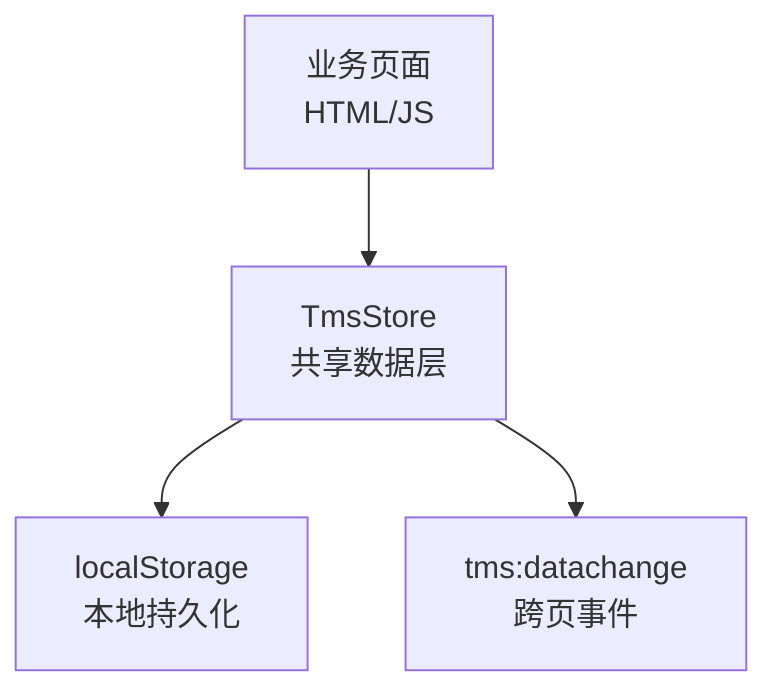
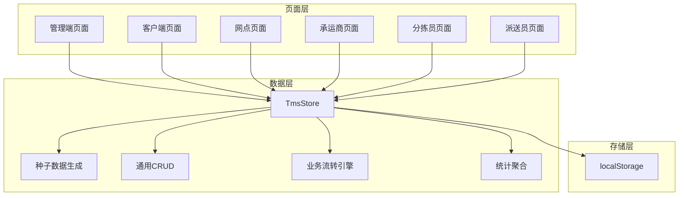
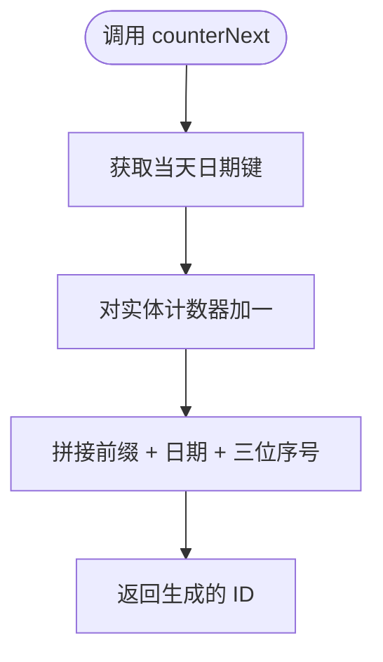
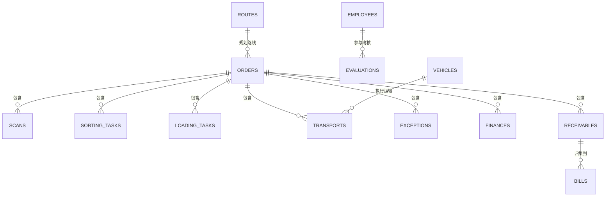
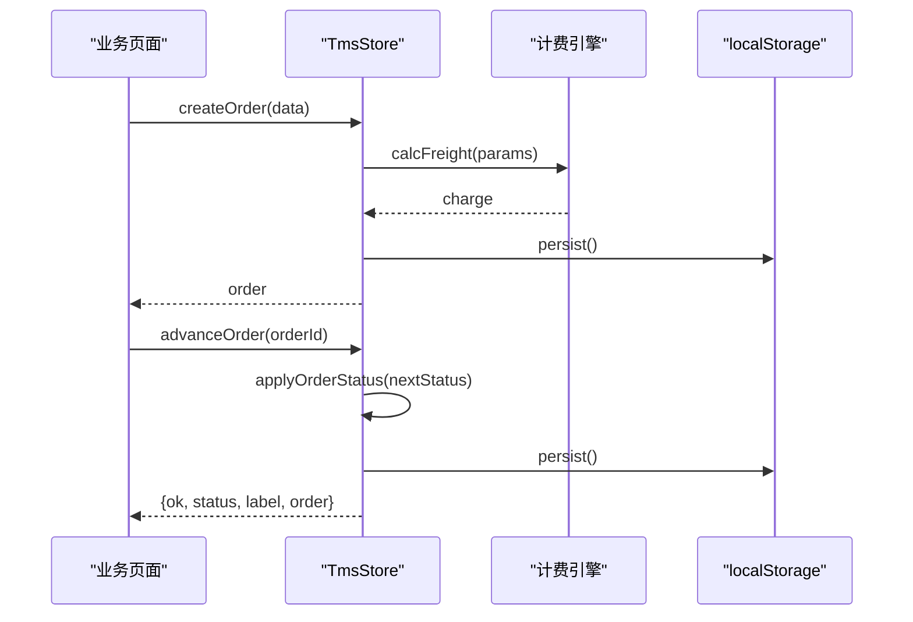
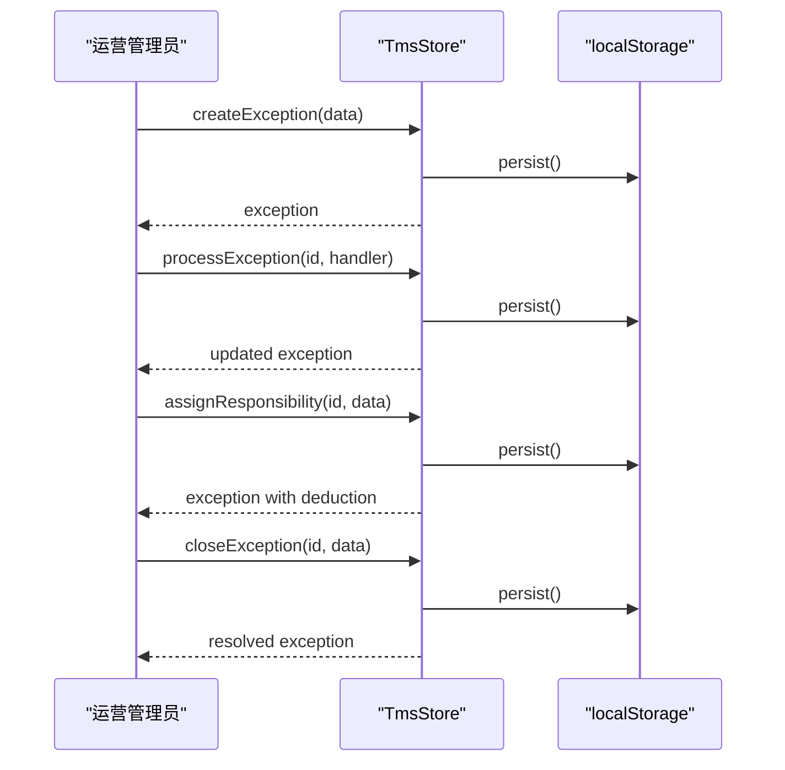
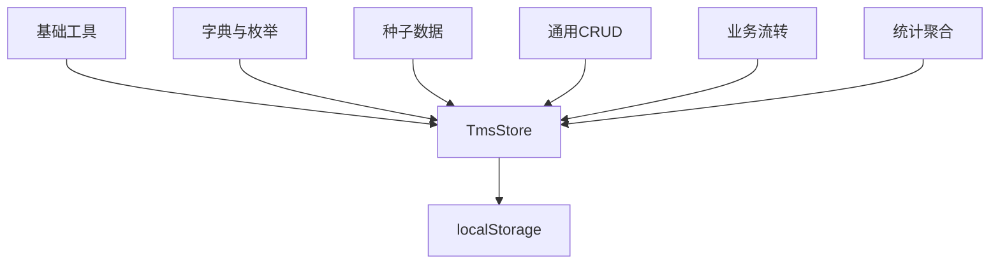

# 实体定义规范

<cite>
**本文引用的文件**   
- [tms-store.js](file://tms-store.js)
</cite>

## 目录
1. [引言](#引言)
2. [项目结构与数据层定位](#项目结构与数据层定位)
3. [核心组件与职责边界](#核心组件与职责边界)
4. [架构总览](#架构总览)
5. [实体定义规范](#实体定义规范)
6. [ID 生成策略与命名约定](#id-生成策略与命名约定)
7. [字段类型、必填字段与可选字段规范](#字段类型必填字段与可选字段规范)
8. [字段验证规则与业务约束实现方式](#字段验证规则与业务约束实现方式)
9. [现有实体结构分析](#现有实体结构分析)
10. [实体关系映射与关联查询方法](#实体关系映射与关联查询方法)
11. [关键流程时序图](#关键流程时序图)
12. [依赖关系分析](#依赖关系分析)
13. [性能与存储特性](#性能与存储特性)
14. [最佳实践建议](#最佳实践建议)
15. [常见错误与避坑指南](#常见错误与避坑指南)
16. [结论](#结论)

## 引言
本规范面向需要在 TMS 系统中新增数据实体的开发者，目标是说明如何在 `TmsStore` 中正确定义实体结构、字段类型、必填与可选字段、ID 生成策略、字段验证与业务约束，并给出订单、用户、员工等现有实体的结构分析与关系映射方法。文档同时提供流程图与时序图，帮助非技术读者理解系统行为。

## 项目结构与数据层定位
TMS 前端采用多页面 HTML + 共享 JavaScript 的模式。所有页面的共享数据访问入口是全局对象 `window.TmsStore`，其实现位于单一数据层文件 `tms-store.js`。该文件承担以下职责：
- 基于 `localStorage` 的轻量业务数据库初始化与持久化。
- 提供统一的增删改查、搜索、筛选、排序、分页能力。
- 维护订单全生命周期状态流转，并自动写入扫描、运输、财务等关联记录。
- 提供各页面所需的统计聚合结果。
- 通过 `tms:datachange` 事件通知其他页面数据变更。

**图表来源**
- [tms-store.js:1-12](file://tms-store.js#L1-L12)
- [tms-store.js:232-244](file://tms-store.js#L232-L244)
- [tms-store.js:2299-2367](file://tms-store.js#L2299-L2367)

**章节来源**
- [tms-store.js:1-12](file://tms-store.js#L1-L12)
- [tms-store.js:232-244](file://tms-store.js#L232-L244)
- [tms-store.js:2299-2367](file://tms-store.js#L2299-L2367)

## 核心组件与职责边界
`TmsStore` 的核心组件包括：
- 基础工具函数：日期键、哈希、随机数、金额处理、ISO 时间等。
- 字典与枚举：城市、服务等级、付款方式、订单状态流、轨迹节点、角色权限等。
- 种子数据生成器：首次加载时生成真实感演示数据。
- 通用 CRUD：列表查询、按 ID 获取、创建、更新、删除、订阅。
- 业务流转：订单推进、扫描记录、分拣/装卸任务、运输任务、异常闭环、应收账单、理赔工单等。
- 统计聚合：概览、趋势、分布、日报、车辆、仓库、财务、员工、计费、路线、轨迹超时等。
- 对外 API：统一暴露给页面调用的方法集合。

**章节来源**
- [tms-store.js:19-77](file://tms-store.js#L19-L77)
- [tms-store.js:79-214](file://tms-store.js#L79-L214)
- [tms-store.js:462-1154](file://tms-store.js#L462-L1154)
- [tms-store.js:1197-1320](file://tms-store.js#L1197-L1320)
- [tms-store.js:1322-1738](file://tms-store.js#L1322-L1738)
- [tms-store.js:1740-2006](file://tms-store.js#L1740-L2006)
- [tms-store.js:2008-2295](file://tms-store.js#L2008-L2295)
- [tms-store.js:2299-2367](file://tms-store.js#L2299-L2367)

## 架构总览
下图展示 TMS 数据层在系统中的位置以及主要交互关系：

**图表来源**
- [tms-store.js:462-1154](file://tms-store.js#L462-L1154)
- [tms-store.js:1197-1320](file://tms-store.js#L1197-L1320)
- [tms-store.js:1322-1738](file://tms-store.js#L1322-L1738)
- [tms-store.js:2008-2295](file://tms-store.js#L2008-L2295)

## 实体定义规范
在 TMS 中新增实体应遵循以下规范：

### 1. 实体集合命名
- 实体集合名使用复数或语义明确的英文名词，例如 `orders`、`employees`、`vehicles`、`exceptions`、`finances`、`receivables`、`payables`、`bills`、`serviceTickets`、`claims`、`adminRecords`、`evaluations`、`sortingTasks`、`loadingTasks`、`scans`、`traces`。
- 集合名需与 `db[entity]` 访问路径一致，并在 `create` 方法的 `prefixMap` 中注册对应前缀。

### 2. 实体主键
- 每个实体必须有唯一 `id` 字段。
- 若未传入 `id`，则通过 `counterNext(entity, prefix)` 自动生成。
- 对于种子数据，可使用 `counterSeed(entity, prefix, seq)` 生成与业务时间一致的 ID。

### 3. 时间字段
- 推荐统一使用 ISO 字符串时间，如 `createdAt`、`updatedAt`、`signedAt`、`expectedAt`、`dueDate`、`settledAt`、`resolvedAt`、`operatedAt`。
- 新增实体应包含 `createdAt` 和 `updatedAt`；业务状态变化时需更新 `updatedAt`。

### 4. 状态字段
- 实体状态建议使用枚举值，并通过 `STATUS_LABELS` 或相关字典维护显示标签。
- 新增实体如需状态机，应在 `TmsStore` 中补充状态流定义与转换逻辑。

### 5. 关联字段
- 使用外键式字符串 ID 表示关联，例如 `orderId`、`customerId`、`departmentId`、`roleId`、`vehicleId`、`routeId`。
- 避免直接嵌入复杂对象，保持实体扁平化，便于查询与统计。

### 6. 扩展性字段
- 可预留 `remark`、`flow`、`timeline`、`planSegments`、`traces` 等扩展字段，用于记录备注、流程历史、计划分段、轨迹明细等。

**章节来源**
- [tms-store.js:246-250](file://tms-store.js#L246-L250)
- [tms-store.js:1156-1164](file://tms-store.js#L1156-L1164)
- [tms-store.js:1265-1287](file://tms-store.js#L1265-L1287)
- [tms-store.js:1268-1277](file://tms-store.js#L1268-L1277)
- [tms-store.js:1289-1296](file://tms-store.js#L1289-L1296)

## ID 生成策略与命名约定
### counterNext 函数
`counterNext` 用于运行时动态生成 ID，格式为：
- 前缀 + `-` + 当日序号（去横杠的日期）+ 三位递增序号。
- 示例：`EX-20260122-001`、`TR-20260122-002`、`SC-20260122-003`。

**图表来源**
- [tms-store.js:246-250](file://tms-store.js#L246-L250)

### counterSeed 函数
`counterSeed` 用于种子数据初始化阶段，保证列表 ID 与业务时间一致：
- 使用当前日期构造 `ymd`。
- 使用传入的 `seq` 作为序号，确保 ID 稳定且可读。

### buildOrderId 与 buildWaybill
- `buildOrderId`：根据发货地、客户、时间戳、序列号生成订单 ID。
- `buildWaybill`：根据订单 ID 生成运单号。

**章节来源**
- [tms-store.js:246-261](file://tms-store.js#L246-L261)
- [tms-store.js:1156-1164](file://tms-store.js#L1156-L1164)

## 字段类型、必填字段与可选字段规范
### 字段类型建议
- 字符串：`id`、`name`、`email`、`phone`、`address`、`status`、`type`、`category`。
- 数字：`weight`、`volume`、`declaredValue`、`amount`、`stock`、`capacity`、`score`。
- 布尔：`isInsured`、`escalated`、`missed`。
- 数组：`permissions`、`timeline`、`flow`、`planSegments`、`traces`。
- 对象：`freightBreakdown`、`breakdown`。
- 时间：ISO 字符串，如 `createdAt`、`updatedAt`、`signedAt`、`expectedAt`、`dueDate`。

### 必填字段
- 主键：`id`。
- 时间：`createdAt`、`updatedAt`。
- 状态：`status`。
- 业务关键字段：如订单的 `customer`、`origin`、`destination`、`weight`、`service`、`paymentMethod`；员工的 `name`、`department`、`position`；车辆的 `plate`、`type`、`model`、`driver`、`branch`、`status`。

### 可选字段
- 备注：`remark`。
- 扩展信息：`dims`、`volume`、`declaredValue`、`isInsured`、`rateCardId`、`routeId`、`planSegments`、`traces`、`slaDeadline`。
- 关联信息：`orderId`、`waybillNo`、`departmentId`、`roleId`、`vehicleId`、`routeId`。

**章节来源**
- [tms-store.js:739-777](file://tms-store.js#L739-L777)
- [tms-store.js:484-498](file://tms-store.js#L484-L498)
- [tms-store.js:505-518](file://tms-store.js#L505-L518)
- [tms-store.js:1079-1088](file://tms-store.js#L1079-L1088)
- [tms-store.js:1596-1630](file://tms-store.js#L1596-L1630)

## 字段验证规则与业务约束实现方式
TMS 并未提供统一的字段校验框架，而是通过业务函数在创建、更新、推进状态时进行隐式验证与约束：

### 1. 数值与类型处理
- 使用 `Number()` 将输入转为数字，并提供默认值，例如 `weight`、`volume`、`declaredValue`。
- 使用 `money()` 对金额进行四舍五入，避免浮点误差。

### 2. 业务规则
- 订单状态推进必须按 `ORDER_FLOW` 顺序，禁止回退。
- 取消订单不能对已签收订单执行。
- 改单不允许对已签收或已取消订单执行。
- 月结订单签收后挂应收，现付/到付直接确认收入。
- 异常定责扣款会生成应付记录。
- 轨迹超时会标记并可能自动创建异常。

### 3. 默认值与补全
- 未传运费时调用计费引擎计算。
- 未传 `createdAt` 时自动填充当前时间。
- 未传 `updatedAt` 时自动填充更新时间。
- 未传 `id` 时通过 `counterNext` 生成。

**章节来源**
- [tms-store.js:64-66](file://tms-store.js#L64-L66)
- [tms-store.js:1497-1559](file://tms-store.js#L1497-L1559)
- [tms-store.js:1640-1703](file://tms-store.js#L1640-L1703)
- [tms-store.js:1740-1819](file://tms-store.js#L1740-L1819)
- [tms-store.js:1880-1896](file://tms-store.js#L1880-L1896)
- [tms-store.js:1574-1637](file://tms-store.js#L1574-L1637)

## 现有实体结构分析
### 订单实体
订单是 TMS 的核心实体，包含寄件人、收件人、货物、重量、体积、保价、运费、状态、时间线、路由计划、轨迹等信息。关键字段包括：
- `id`、`waybillNo`、`customer`、`contact`、`phone`、`goods`、`weight`、`pieces`、`service`、`orderType`、`dims`、`volume`、`volumetricWeight`、`chargeableWeight`、`declaredValue`、`isInsured`、`paymentMethod`、`settleCycle`、`freight`、`freightBreakdown`、`rateCardId`、`origin`、`destination`、`senderAddress`、`receiverAddress`、`status`、`createdAt`、`expectedAt`、`signedAt`、`updatedAt`、`timeline`、`remark`、`receivableStatus`、`routeId`、`planSegments`、`traces`、`slaDeadline`。

**章节来源**
- [tms-store.js:739-777](file://tms-store.js#L739-L777)
- [tms-store.js:1596-1630](file://tms-store.js#L1596-L1630)

### 用户实体
用户实体用于系统登录与权限控制，关键字段包括：
- `id`、`name`、`email`、`phone`、`departmentId`、`roleId`、`status`、`areaId`。

**章节来源**
- [tms-store.js:1079-1088](file://tms-store.js#L1079-L1088)

### 员工实体
员工实体用于人事与绩效统计，关键字段包括：
- `id`、`name`、`department`、`position`、`email`、`phone`、`hireDate`、`status`、`salary`。

**章节来源**
- [tms-store.js:484-498](file://tms-store.js#L484-L498)

### 车辆实体
车辆实体用于运力管理，关键字段包括：
- `id`、`plate`、`type`、`model`、`driver`、`branch`、`status`、`location`、`capacityTon`、`mileage`、`lastUpdate`。

**章节来源**
- [tms-store.js:505-518](file://tms-store.js#L505-L518)

### 仓储与库存实体
- 仓库：`id`、`name`、`city`、`manager`、`area`、`usedRate`、`inboundToday`、`outboundToday`、`status`。
- 库存：`id`、`name`、`spec`、`warehouse`、`location`、`stock`、`safetyStock`、`unit`、`status`、`updatedAt`。

**章节来源**
- [tms-store.js:542-554](file://tms-store.js#L542-L554)
- [tms-store.js:528-540](file://tms-store.js#L528-L540)

### 财务与应收应付实体
- 财务流水：`id`、`type`、`category`、`orderId`、`amount`、`status`、`date`、`remark`、`createdAt`。
- 应收：`id`、`orderId`、`customer`、`amount`、`paymentMethod`、`settleCycle`、`issuedAt`、`dueDate`、`status`、`billId`、`period`。
- 应付：`id`、`target`、`targetType`、`category`、`refId`、`amount`、`period`、`status`、`settledAt`。
- 账单：`id`、`billNo`、`customer`、`period`、`itemCount`、`totalAmount`、`receivedAmount`、`status`、`dueDate`、`createdAt`。

**章节来源**
- [tms-store.js:928-948](file://tms-store.js#L928-L948)
- [tms-store.js:954-961](file://tms-store.js#L954-L961)
- [tms-store.js:963-988](file://tms-store.js#L963-L988)
- [tms-store.js:865-872](file://tms-store.js#L865-L872)

### 任务与扫描实体
- 分拣任务：`id`、`orderId`、`waybillNo`、`origin`、`destination`、`center`、`sorter`、`planAt`、`status`、`missed`、`completedAt`。
- 装卸任务：`id`、`orderId`、`waybillNo`、`type`、`place`、`vehicleId`、`workers`、`planAt`、`startAt`、`tons`、`equipment`、`status`。
- 扫描记录：`id`、`scannedAt`、`orderId`、`waybillNo`、`type`、`location`、`device`、`operator`。

**章节来源**
- [tms-store.js:797-809](file://tms-store.js#L797-L809)
- [tms-store.js:813-827](file://tms-store.js#L813-L827)
- [tms-store.js:831-842](file://tms-store.js#L831-L842)

### 异常与工单实体
- 异常：`id`、`orderId`、`waybillNo`、`type`、`description`、`occurredAt`、`status`、`handler`、`resolution`、`resolvedAt`、`level`、`slaDeadline`、`escalated`、`responsibleParty`、`responsible`、`solution`、`rootCause`、`deductionAmount`、`linkedClaimId`、`linkedTicketId`、`flow`。
- 服务工单：`id`、`orderId`、`customer`、`type`、`priority`、`content`、`status`、`assignee`、`createdAt`、`resolvedAt`。
- 理赔申请：`id`、`orderId`、`customer`、`type`、`amount`、`reason`、`status`、`applicant`、`createdAt`、`handledAt`。

**章节来源**
- [tms-store.js:881-906](file://tms-store.js#L881-L906)
- [tms-store.js:991-1005](file://tms-store.js#L991-L1005)
- [tms-store.js:1008-1022](file://tms-store.js#L1008-L1022)

## 实体关系映射与关联查询方法
TMS 使用字符串 ID 建立实体间关联，并通过 `list`、`get`、`find` 等方法进行关联查询。典型关系如下：

**图表来源**
- [tms-store.js:739-777](file://tms-store.js#L739-L777)
- [tms-store.js:797-842](file://tms-store.js#L797-L842)
- [tms-store.js:848-872](file://tms-store.js#L848-L872)
- [tms-store.js:881-906](file://tms-store.js#L881-L906)
- [tms-store.js:928-988](file://tms-store.js#L928-L988)
- [tms-store.js:1040-1076](file://tms-store.js#L1040-L1076)

### 关联查询实现方式
- 通过 `db.orders`、`db.scans`、`db.transports` 等集合直接访问。
- 使用 `list(entity, options)` 支持过滤、搜索、排序、分页。
- 使用 `get(entity, id)` 按 ID 获取单条记录。
- 自定义关联查询可通过遍历集合并按外键匹配实现，例如按 `orderId` 查找扫描记录、按 `vehicleId` 查找运输任务。

**章节来源**
- [tms-store.js:1210-1258](file://tms-store.js#L1210-L1258)
- [tms-store.js:1260-1263](file://tms-store.js#L1260-L1263)

## 关键流程时序图
### 订单创建与推进流程

**图表来源**
- [tms-store.js:1574-1637](file://tms-store.js#L1574-L1637)
- [tms-store.js:1497-1559](file://tms-store.js#L1497-L1559)
- [tms-store.js:332-383](file://tms-store.js#L332-L383)
- [tms-store.js:232-244](file://tms-store.js#L232-L244)

### 异常闭环流程

**图表来源**
- [tms-store.js:1740-1819](file://tms-store.js#L1740-L1819)
- [tms-store.js:232-244](file://tms-store.js#L232-L244)

## 依赖关系分析
`TmsStore` 内部模块之间的依赖关系如下：

**图表来源**
- [tms-store.js:19-77](file://tms-store.js#L19-L77)
- [tms-store.js:79-214](file://tms-store.js#L79-L214)
- [tms-store.js:462-1154](file://tms-store.js#L462-L1154)
- [tms-store.js:1197-1320](file://tms-store.js#L1197-L1320)
- [tms-store.js:1322-1738](file://tms-store.js#L1322-L1738)
- [tms-store.js:2008-2295](file://tms-store.js#L2008-L2295)

**章节来源**
- [tms-store.js:19-77](file://tms-store.js#L19-L77)
- [tms-store.js:79-214](file://tms-store.js#L79-L214)
- [tms-store.js:462-1154](file://tms-store.js#L462-L1154)
- [tms-store.js:1197-1320](file://tms-store.js#L1197-L1320)
- [tms-store.js:1322-1738](file://tms-store.js#L1322-L1738)
- [tms-store.js:2008-2295](file://tms-store.js#L2008-L2295)

## 性能与存储特性
- 数据存储于 `localStorage`，适合小规模演示数据与前端原型开发。
- 数据变更通过 `persist()` 写入 `localStorage` 并触发 `tms:datachange` 事件。
- 列表查询支持过滤、搜索、排序、分页，但大数据量下性能有限。
- 扫描记录与轨迹记录有长度限制，避免无限增长。

**章节来源**
- [tms-store.js:232-244](file://tms-store.js#L232-L244)
- [tms-store.js:1210-1258](file://tms-store.js#L1210-L1258)
- [tms-store.js:1337-1348](file://tms-store.js#L1337-L1348)
- [tms-store.js:1455-1465](file://tms-store.js#L1455-L1465)

## 最佳实践建议
- 新增实体时，务必在 `create` 方法的 `prefixMap` 中注册 ID 前缀。
- 实体字段应保持扁平化，避免嵌套过深。
- 使用 ISO 时间字符串，便于排序与比较。
- 业务约束应在创建、更新、状态推进函数中显式实现。
- 关联查询通过外键 ID 匹配，避免直接嵌入复杂对象。
- 对金额字段使用 `money()` 处理，避免浮点误差。
- 对时间字段使用 `nowIso()`、`dateKey()`、`dateTimeKey()` 等工具函数。
- 对状态字段使用字典或枚举维护，便于显示与校验。

**章节来源**
- [tms-store.js:1265-1287](file://tms-store.js#L1265-L1287)
- [tms-store.js:64-77](file://tms-store.js#L64-L77)
- [tms-store.js:1497-1559](file://tms-store.js#L1497-L1559)

## 常见错误与避坑指南
- 忘记在 `prefixMap` 中注册新实体前缀，导致 ID 生成不符合约定。
- 未设置 `createdAt` 或 `updatedAt`，导致时间字段缺失。
- 直接使用浮点数金额，导致精度问题。
- 在已签收或已取消订单上执行改单或取消操作。
- 状态推进顺序错误，违反 `ORDER_FLOW` 定义。
- 关联字段为空或未同步更新，导致关联查询失败。
- 未在业务函数中处理默认值与空值，导致数据不一致。

**章节来源**
- [tms-store.js:1268-1277](file://tms-store.js#L1268-L1277)
- [tms-store.js:1282-1283](file://tms-store.js#L1282-L1283)
- [tms-store.js:64-66](file://tms-store.js#L64-L66)
- [tms-store.js:1640-1703](file://tms-store.js#L1640-L1703)
- [tms-store.js:1497-1559](file://tms-store.js#L1497-L1559)

## 结论
通过在 `TmsStore` 中遵循实体定义规范、ID 生成策略、字段类型与验证规则，开发者可以正确定义符合系统规范的数据实体。结合现有订单、用户、员工等实体的结构分析，以及关系映射与关联查询方法，可以在不破坏现有业务逻辑的前提下扩展系统功能。建议在新增实体时充分考虑业务约束、默认值处理、时间字段标准化与关联字段一致性，以确保数据质量与系统稳定性。