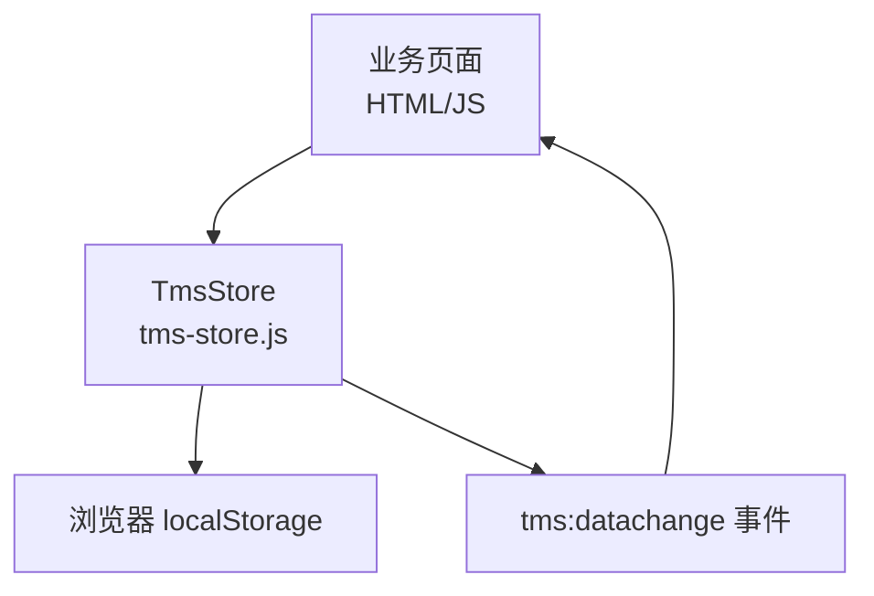
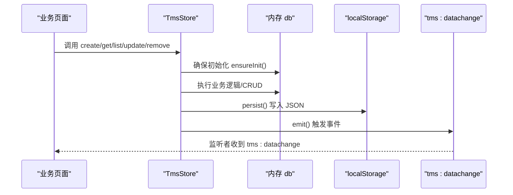
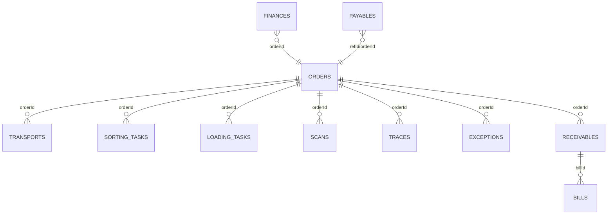
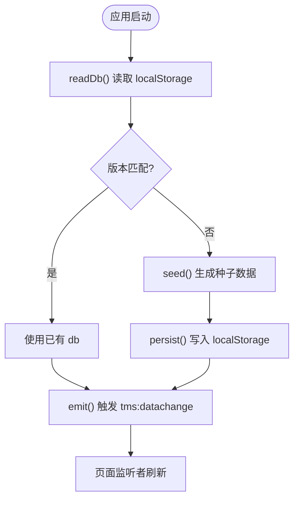
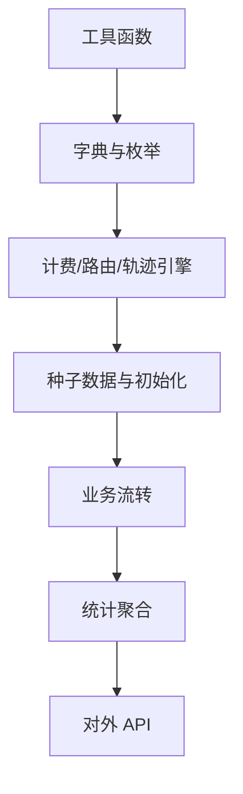

# 数据模型扩展

<cite>
**本文引用的文件**   
- [tms-store.js](file://tms-store.js)
</cite>

## 目录
1. [引言](#引言)
2. [项目结构](#项目结构)
3. [核心组件](#核心组件)
4. [架构总览](#架构总览)
5. [详细组件分析](#详细组件分析)
6. [依赖关系分析](#依赖关系分析)
7. [性能与容量特性](#性能与容量特性)
8. [数据迁移与版本管理](#数据迁移与版本管理)
9. [CRUD 与业务接口规范](#crud-与业务接口规范)
10. [新数据模型开发指南](#新数据模型开发指南)
11. [常见问题排查](#常见问题排查)
12. [结论](#结论)

## 引言
本指南面向需要在 TMS 前端数据层中扩展新数据实体的开发者。TMS 的数据层由 `tms-store.js` 提供，基于浏览器 `localStorage` 实现轻量级持久化，承担以下职责：
- 首次访问生成真实感种子数据；
- 提供统一的增删改查、搜索、筛选、排序、分页能力；
- 维护订单全生命周期状态流转，并自动写入扫描、运输、财务等关联记录；
- 提供各页面所需的统计聚合（KPI、趋势、分布、日报）；
- 通过事件机制通知其他页面数据变更。

阅读完本指南后，你将能够：
- 在 `TmsStore` 中定义新的数据实体；
- 理解字段规范、关系映射和关联更新策略；
- 使用通用 CRUD 和业务接口完成新增、查询、修改、删除；
- 设计数据验证规则与业务约束；
- 编写种子数据、关联查询与统计口径；
- 安全地进行数据迁移与版本升级；
- 遵循性能优化与最佳实践。

## 项目结构
当前仓库是一个纯前端演示型 TMS 系统，核心数据逻辑集中在单个模块文件中。关键文件如下：
- `tms-store.js`：共享数据层，包含数据模型、种子数据、CRUD、业务流转、统计聚合与对外 API。
- 多个 HTML 页面：管理员端、分支网点、客户、分拣员、配送员、承运商等角色页面，通过 `window.TmsStore` 读取或触发数据变更。

**图示来源**
- [tms-store.js:1-12](file://tms-store.js#L1-L12)
- [tms-store.js:2369-2378](file://tms-store.js#L2369-L2378)

**章节来源**
- [tms-store.js:1-12](file://tms-store.js#L1-L12)

## 核心组件
`TmsStore` 的核心由以下部分组成：
- 基础工具函数：日期格式化、哈希、随机数、金额处理等；
- 字典与枚举：城市、订单流程、状态标签、客户等级、轨迹节点等；
- 初始化与持久化：从 `localStorage` 读取、校验版本、生成种子数据、保存并广播事件；
- 通用 CRUD：`list`、`get`、`create`、`update`、`remove`；
- 业务流转：订单推进、取消、改单、逆向退货、异常闭环、应收账单、轨迹超时检查等；
- 统计聚合：概览、趋势、分布、日指标、车辆/仓储/财务/员工/计费/路线/轨迹等；
- 对外暴露 API：统一挂载到 `window.TmsStore`。

**章节来源**
- [tms-store.js:19-77](file://tms-store.js#L19-L77)
- [tms-store.js:79-214](file://tms-store.js#L79-L214)
- [tms-store.js:215-244](file://tms-store.js#L215-L244)
- [tms-store.js:1197-1320](file://tms-store.js#L1197-L1320)
- [tms-store.js:1322-1738](file://tms-store.js#L1322-L1738)
- [tms-store.js:2008-2295](file://tms-store.js#L2008-L2295)
- [tms-store.js:2299-2378](file://tms-store.js#L2299-L2378)

## 架构总览
下图展示 `TmsStore` 的运行时架构：页面调用 API → 数据层校验与计算 → 写入内存对象 → 持久化到 `localStorage` → 触发事件 → 其他页面同步刷新。

**图示来源**
- [tms-store.js:220-244](file://tms-store.js#L220-L244)
- [tms-store.js:1197-1320](file://tms-store.js#L1197-L1320)
- [tms-store.js:2369-2378](file://tms-store.js#L2369-L2378)

## 详细组件分析

### 数据模型与实体集合
`TmsStore` 的内存数据结构以 `db` 对象为中心，包含多个实体数组。常见实体包括：
- 主业务：`orders`、`transports`、`sortingTasks`、`loadingTasks`、`scans`、`traces`；
- 运营支撑：`exceptions`、`serviceTickets`、`claims`、`employees`、`vehicles`、`warehouses`、`inventory`、`capacities`、`geofences`、`devices`；
- 策略与配置：`policies`、`routingRules`、`rateCards`、`routes`、`deliveryAddresses`、`timingRules`、`changeRecords`、`evalMetrics`；
- 管理与权限：`users`、`roles`、`permissions`、`departments`、`areas`；
- 财务与结算：`finances`、`receivables`、`payables`、`bills`；
- 绩效与行政：`evaluations`、`performance`、`adminRecords`。

每个实体通常具备：
- 唯一标识 `id`；
- 业务键值如 `orderId`、`waybillNo`、`customer`、`origin`、`destination`；
- 时间戳如 `createdAt`、`updatedAt`、业务时间如 `expectedAt`、`signedAt`、`occurredAt`；
- 状态字段如 `status`、`level`、`priority`；
- 可选扩展字段如 `remark`、`flow`、`timeline`。

**章节来源**
- [tms-store.js:1113-1153](file://tms-store.js#L1113-L1153)
- [tms-store.js:1265-1287](file://tms-store.js#L1265-L1287)

### 字段规范与命名约定
- ID 生成：默认使用 `counterNext` 生成带前缀的编号，例如 `EX-YYYYMMDD-XXXX`、`TR-YYYYMMDD-XXXX`；若未传 `id`，则按实体前缀自动生成。
- 时间格式：统一使用 ISO 字符串，内部通过 `nowIso()`、`dateKey()`、`dateTimeKey()` 处理。
- 金额字段：使用 `money()` 四舍五入到两位小数，避免浮点误差。
- 状态字段：优先使用 `STATUS_LABELS` 中的 key，便于 UI 渲染与过滤。
- 地址与地点：使用 `origin`、`destination`、`receiverAddress`、`location` 等标准字段，配合轨迹节点与路由计划。

**章节来源**
- [tms-store.js:21-33](file://tms-store.js#L21-L33)
- [tms-store.js:64-70](file://tms-store.js#L64-L70)
- [tms-store.js:98-120](file://tms-store.js#L98-L120)
- [tms-store.js:1265-1287](file://tms-store.js#L1265-L1287)

### 关系映射与关联更新
TMS 强调“主订单驱动”的关系模型：
- 订单主表 `orders` 是核心，衍生出运单号、轨迹、扫描、运输、异常、财务、应收等；
- 运输任务 `transports` 与订单通过 `orderId` 关联，并在签收时联动车辆状态；
- 分拣/装卸任务通过 `orderId` 关联，并在完成时推进订单状态；
- 异常 `exceptions` 可关联订单，定责后可生成应付 `payables`；
- 月结订单签收后生成应收 `receivables`，并按客户+账期聚合为账单 `bills`；
- 轨迹 `traces` 全局汇总，用于轨迹中心检索与超时/偏差统计。

**图示来源**
- [tms-store.js:1328-1417](file://tms-store.js#L1328-L1417)
- [tms-store.js:1446-1495](file://tms-store.js#L1446-L1495)
- [tms-store.js:1740-1819](file://tms-store.js#L1740-L1819)
- [tms-store.js:1841-1876](file://tms-store.js#L1841-L1876)

### 数据验证与业务约束
- 订单状态推进：通过 `applyOrderStatus` 严格校验顺序，禁止回退；已取消或已完成签收的订单不可继续推进。
- 改单约束：已签收或已取消订单不可改单；重量、目的地、服务等级、付款方式变化会触发运费重算与路由计划更新。
- 逆向退货：拒收/退货将正向订单置为退回，并创建逆向订单。
- 异常闭环：受理→定责→闭环，支持升级、扣款、理赔联动。
- 应收核销：标记回款后更新收入状态与订单应收状态。
- 轨迹超时：定时检查节点是否超标准时限，可自动创建异常预警。

**章节来源**
- [tms-store.js:1497-1559](file://tms-store.js#L1497-L1559)
- [tms-store.js:1668-1726](file://tms-store.js#L1668-L1726)
- [tms-store.js:1740-1819](file://tms-store.js#L1740-L1819)
- [tms-store.js:1841-1876](file://tms-store.js#L1841-L1876)
- [tms-store.js:1880-1896](file://tms-store.js#L1880-L1896)

### 存储策略与持久化机制
- 存储键：`DB_KEY = 'tmsDB_v3'`；
- 版本控制：`DB_VERSION = 3`，读取时校验版本，不匹配则丢弃旧数据；
- 读写流程：`readDb()` 解析 JSON，`persist()` 序列化并触发事件；
- 跨页同步：监听 `storage` 事件，当其他标签页写入相同 key 时重新加载并广播；
- 重置能力：`reset()` 清除本地存储并重新初始化种子数据。

**图示来源**
- [tms-store.js:16-17](file://tms-store.js#L16-L17)
- [tms-store.js:220-244](file://tms-store.js#L220-L244)
- [tms-store.js:1187-1195](file://tms-store.js#L1187-L1195)
- [tms-store.js:2369-2378](file://tms-store.js#L2369-L2378)

**章节来源**
- [tms-store.js:16-17](file://tms-store.js#L16-L17)
- [tms-store.js:220-244](file://tms-store.js#L220-L244)
- [tms-store.js:1187-1195](file://tms-store.js#L1187-L1195)
- [tms-store.js:2369-2378](file://tms-store.js#L2369-L2378)

## 依赖关系分析
`TmsStore` 内部存在清晰的依赖层次：
- 工具层：`pad`、`dateKey`、`dateTimeKey`、`hash`、`mulberry32`、`pick`、`randInt`、`money`、`nowIso`、`at`；
- 字典层：`CITY_PROVINCE`、`CITIES`、`ORDER_FLOW`、`STATUS_LABELS`、`CUSTOMERS`、`GOODS`、`CARRIERS`、`SERVICE_LEVELS`、`PAYMENT_METHODS`、`CUSTOMER_LEVELS`、`TRACE_NODES`；
- 引擎层：计费引擎 `calcFreight`、路由规划 `planRoute`、轨迹生成 `buildTraces`；
- 数据层：`seed`、`init`、`ensureInit`、`readDb`、`persist`、`emit`；
- 业务层：订单、异常、工单、理赔、运输、分拣、装卸、应收、账单等；
- 统计层：概览、趋势、分布、日指标、车辆、仓储、财务、员工、计费、路线、轨迹、生命周期等；
- 对外 API：统一挂载到 `window.TmsStore`。

**图示来源**
- [tms-store.js:19-77](file://tms-store.js#L19-L77)
- [tms-store.js:79-214](file://tms-store.js#L79-L214)
- [tms-store.js:263-460](file://tms-store.js#L263-L460)
- [tms-store.js:462-1154](file://tms-store.js#L462-L1154)
- [tms-store.js:1197-2295](file://tms-store.js#L1197-L2295)
- [tms-store.js:2299-2378](file://tms-store.js#L2299-L2378)

**章节来源**
- [tms-store.js:19-77](file://tms-store.js#L19-L77)
- [tms-store.js:79-214](file://tms-store.js#L79-L214)
- [tms-store.js:263-460](file://tms-store.js#L263-L460)
- [tms-store.js:462-1154](file://tms-store.js#L462-L1154)
- [tms-store.js:1197-2295](file://tms-store.js#L1197-L2295)
- [tms-store.js:2299-2378](file://tms-store.js#L2299-L2378)

## 性能与容量特性
- 列表查询复杂度：`list` 先过滤再排序，最后分页；适合中小规模数据（浏览器本地存储）。
- 扫描与轨迹上限：扫描记录限制最多 500 条，轨迹记录限制最多 2000 条，避免无限增长。
- 内存对象操作：所有操作均在内存中进行，仅最终 `persist()` 一次写入 `localStorage`。
- 跨页同步：通过 `storage` 事件避免多标签页数据不一致。
- 建议：
  - 对高频查询增加索引字段（如 `period`、`status`、`orderId`）；
  - 对大数据集进行分页与懒加载；
  - 避免在循环中频繁调用 `persist()`，批量变更后统一持久化；
  - 谨慎扩展实体字段数量，保持 JSON 体积可控。

**章节来源**
- [tms-store.js:1210-1258](file://tms-store.js#L1210-L1258)
- [tms-store.js:1337-1348](file://tms-store.js#L1337-L1348)
- [tms-store.js:1446-1465](file://tms-store.js#L1446-L1465)
- [tms-store.js:2369-2378](file://tms-store.js#L2369-L2378)

## 数据迁移与版本管理
- 版本号：`DB_VERSION = 3`，每次结构变更需递增；
- 读取校验：`readDb()` 在解析后检查 `parsed.version !== DB_VERSION`，不匹配则返回空，触发重新初始化；
- 导入旧数据：`importLegacyData()` 兼容旧用户数据，避免丢失；
- 迁移策略建议：
  - 新增实体：在 `seed()` 中生成初始数据，并在 `meta.counters` 中登记计数；
  - 字段扩展：在 `create()` 中设置默认值，保证旧数据兼容；
  - 结构重构：在 `init()` 中根据版本判断是否需要迁移脚本；
  - 清理策略：在迁移完成后删除废弃字段或归档历史数据。

**章节来源**
- [tms-store.js:16-17](file://tms-store.js#L16-L17)
- [tms-store.js:220-230](file://tms-store.js#L220-L230)
- [tms-store.js:1166-1195](file://tms-store.js#L1166-L1195)

## CRUD 与业务接口规范

### 通用 CRUD
- `list(entity, options)`：支持 filters、search、searchFields、sort、page、pageSize；
- `get(entity, id)`：按唯一 ID 查找；
- `create(entity, data)`：自动分配 ID、时间戳，插入数组头部；
- `update(entity, id, patch)`：合并补丁并更新时间；
- `remove(entity, id)`：按 ID 删除；
- `subscribe(fn)`：订阅数据变更；
- `reset()`：重置本地存储并重新初始化。

**章节来源**
- [tms-store.js:1210-1320](file://tms-store.js#L1210-L1320)

### 业务接口
- 订单：`advanceOrder`、`createOrder`、`cancelOrder`、`removeOrder`、`changeOrder`、`createReverseOrder`；
- 异常：`createException`、`processException`、`assignResponsibility`、`closeException`、`escalateException`、`resolveException`；
- 工单与理赔：`createTicket`、`processTicket`、`resolveTicket`、`createClaim`、`approveClaim`；
- 运输与作业：`updateTransportStatus`、`completeSorting`、`completeLoading`；
- 应收与账单：`markReceivablePaid`、`generateBills`；
- 轨迹与超时：`checkTracesOvertime`、`planRoute`；
- 计费与统计：`quote`、`calcFreight`、`overview`、`orderTrend`、`statusDistribution`、`exceptionByType`、`dailyStats`、`vehicleStats`、`warehouseStats`、`financeSummary`、`financeTrend`、`employeeStats`、`billingSummary`、`payableSummary`、`routeStats`、`traceOvertimeStats`、`orderLifecycleStats`。

**章节来源**
- [tms-store.js:1561-1738](file://tms-store.js#L1561-L1738)
- [tms-store.js:1740-1819](file://tms-store.js#L1740-L1819)
- [tms-store.js:1898-1951](file://tms-store.js#L1898-L1951)
- [tms-store.js:1953-2006](file://tms-store.js#L1953-L2006)
- [tms-store.js:1841-1876](file://tms-store.js#L1841-L1876)
- [tms-store.js:1880-1896](file://tms-store.js#L1880-L1896)
- [tms-store.js:2222-2295](file://tms-store.js#L2222-L2295)

## 新数据模型开发指南

### 步骤一：定义实体与字段
- 在 `seed()` 中生成初始数据，确保字段完整；
- 在 `meta.counters` 中登记实体计数，以便 ID 生成；
- 在 `prefixMap` 中为新实体添加前缀，便于 ID 风格一致；
- 在 `STATUS_LABELS` 中补充状态标签，便于 UI 渲染。

**章节来源**
- [tms-store.js:1113-1153](file://tms-store.js#L1113-L1153)
- [tms-store.js:1268-1277](file://tms-store.js#L1268-L1277)
- [tms-store.js:98-120](file://tms-store.js#L98-L120)

### 步骤二：实现关联更新
- 在主实体创建/更新时，调用相关辅助函数（如 `ensureSortingTask`、`ensureLoadingTask`、`ensureTransport`、`ensureIncome`、`ensureSettlement`）；
- 在状态推进时，追加扫描记录与轨迹；
- 在异常闭环时，生成应付或理赔；
- 在应收核销时，更新财务与订单状态。

**章节来源**
- [tms-store.js:1328-1495](file://tms-store.js#L1328-L1495)
- [tms-store.js:1740-1819](file://tms-store.js#L1740-L1819)
- [tms-store.js:1841-1876](file://tms-store.js#L1841-L1876)

### 步骤三：提供查询与统计
- 使用 `list` 实现分页、筛选、排序；
- 新增统计方法，如按实体维度聚合；
- 在 `overview` 或专用统计函数中纳入新指标；
- 如需趋势图，参考 `orderTrend`、`financeTrend` 的实现模式。

**章节来源**
- [tms-store.js:1210-1258](file://tms-store.js#L1210-L1258)
- [tms-store.js:2015-2044](file://tms-store.js#L2015-L2044)
- [tms-store.js:2046-2062](file://tms-store.js#L2046-L2062)
- [tms-store.js:2192-2208](file://tms-store.js#L2192-L2208)

### 步骤四：暴露对外 API
- 在 `api` 对象中注册新方法；
- 在页面中通过 `window.TmsStore.newMethod(...)` 调用；
- 如需事件通知，确保 `persist()` 被调用以触发 `emit()`。

**章节来源**
- [tms-store.js:2299-2378](file://tms-store.js#L2299-L2378)

### 示例：扩展“供应商合同”模型
假设需要新增“供应商合同”实体，用于管理承运商或仓储服务商的合同信息：
- 字段建议：
  - `id`：合同编号；
  - `supplier`：供应商名称；
  - `type`：承运商/仓储/其他；
  - `contractNo`：合同编号；
  - `startAt`、`endAt`：有效期；
  - `status`：生效/暂停/失效；
  - `terms`：条款摘要；
  - `contact`：联系人；
  - `createdAt`、`updatedAt`。
- 关联更新：
  - 在创建合同时，可在运力资源 `capacities` 中建立引用；
  - 在合同到期时，可自动标记相关运力为失效；
  - 在异常扣款或应付中，可关联合同编号以便审计。
- 查询与统计：
  - 使用 `list('contracts', { filters: { status: 'active' }, sort: { key: 'endAt', dir: 'asc' } })`；
  - 新增统计：合同到期预警、供应商覆盖率、合同金额分布等。
- 对外 API：
  - `createContract(data)`、`updateContract(id, patch)`、`expireContract(id)`、`contractSummary()`。

该示例仅为概念说明，实际实现需参照现有实体模式与接口规范。

[本节为概念性指导，不直接分析具体代码文件]

## 常见问题排查

### 数据未持久化
- 检查是否调用 `persist()`；
- 确认 `localStorage` 可用且未被禁用；
- 检查 `DB_KEY` 是否与页面期望一致。

**章节来源**
- [tms-store.js:232-235](file://tms-store.js#L232-L235)
- [tms-store.js:220-230](file://tms-store.js#L220-L230)

### 多标签页数据不同步
- 确认监听 `storage` 事件；
- 检查其他标签页是否写入相同 `DB_KEY`；
- 确认 `emit()` 正确触发。

**章节来源**
- [tms-store.js:2369-2378](file://tms-store.js#L2369-L2378)
- [tms-store.js:237-244](file://tms-store.js#L237-L244)

### 订单状态无法推进
- 检查订单是否已取消或已签收；
- 检查状态顺序是否符合 `ORDER_FLOW`；
- 查看 `applyOrderStatus` 的返回值与日志。

**章节来源**
- [tms-store.js:1561-1572](file://tms-store.js#L1561-L1572)
- [tms-store.js:1497-1559](file://tms-store.js#L1497-L1559)

### 统计结果异常
- 检查过滤条件与时间口径；
- 确认数据是否已被清理或重置；
- 核对聚合逻辑与百分比计算。

**章节来源**
- [tms-store.js:2015-2044](file://tms-store.js#L2015-L2044)
- [tms-store.js:2108-2156](file://tms-store.js#L2108-L2156)

## 结论
`TmsStore` 提供了完整的前端数据层能力，涵盖实体定义、字段规范、关系映射、CRUD、业务流转、统计聚合与版本迁移。扩展新数据模型时，应遵循以下原则：
- 明确实体职责与字段语义；
- 使用统一 ID 与时间格式；
- 在主实体变更时维护关联数据；
- 提供清晰的查询与统计接口；
- 通过版本控制与安全迁移保障数据一致性；
- 关注性能与容量，避免过度膨胀。

按照本指南实践，开发者可以稳健地扩展 TMS 数据层，满足新功能需求并保持系统一致性、可维护性与可扩展性。