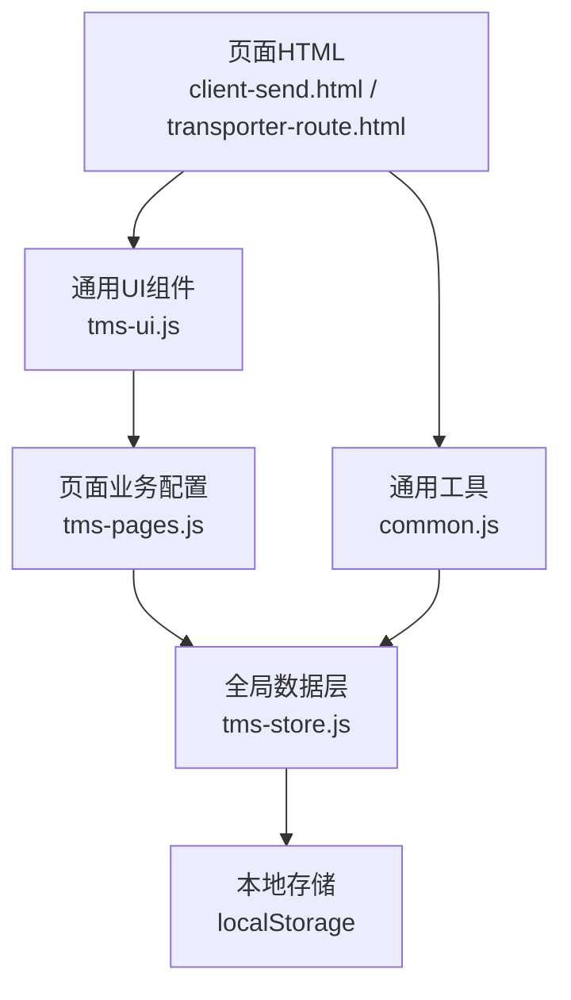
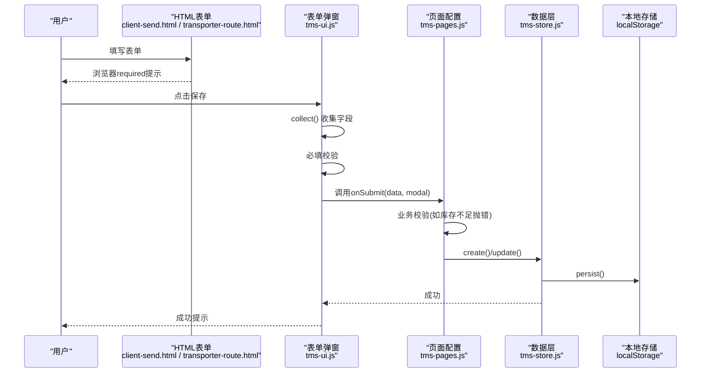
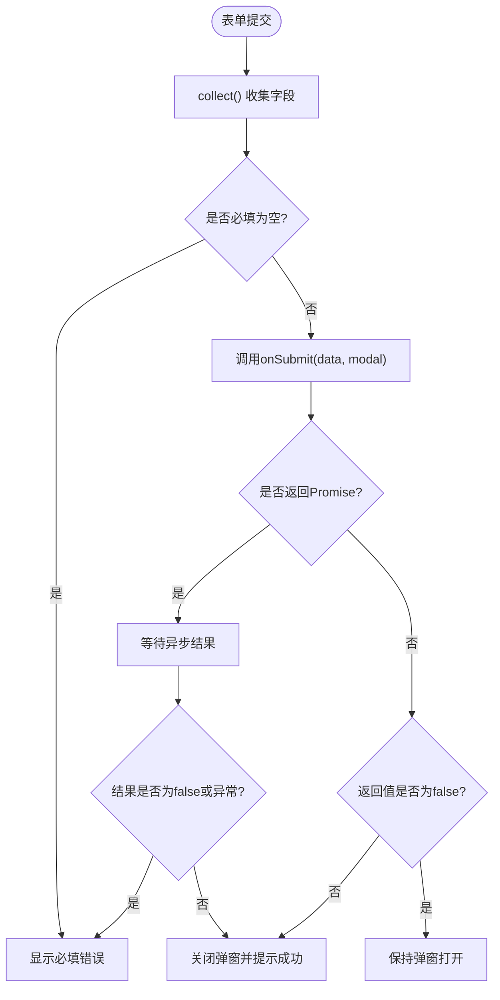
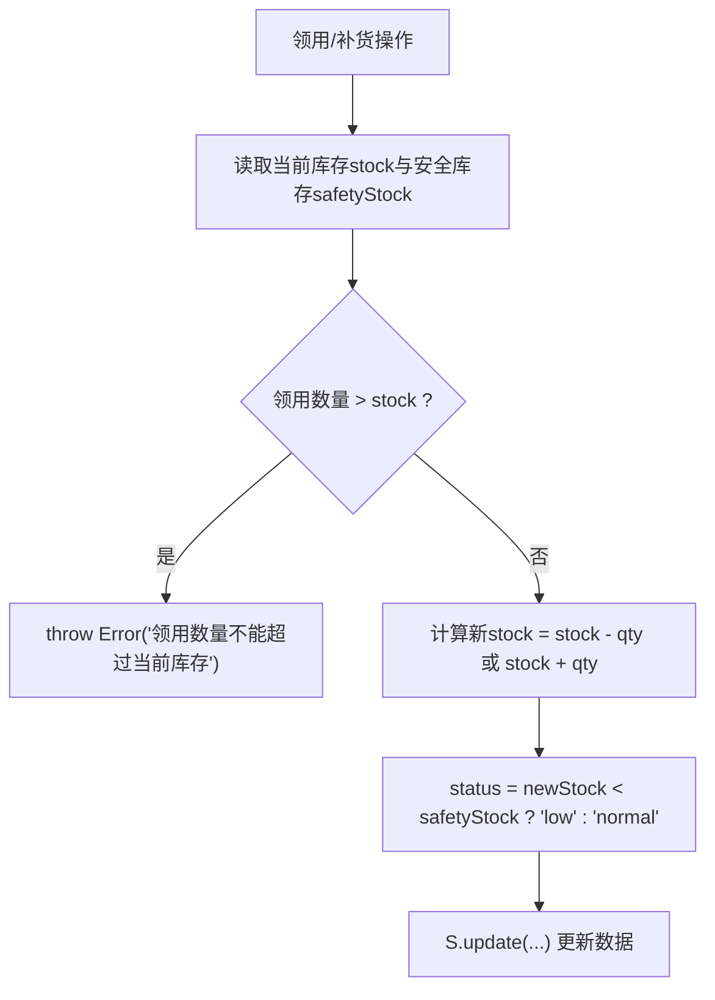
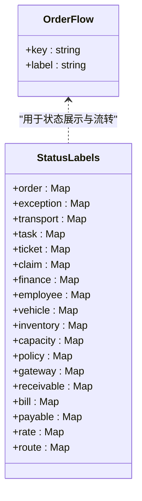
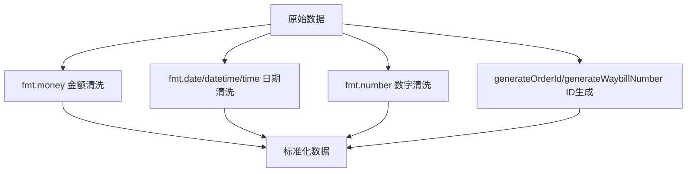
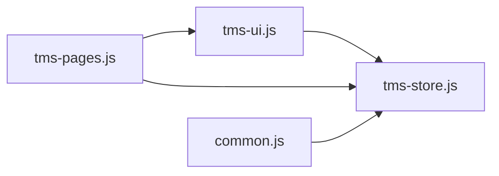

# 数据验证与约束

<cite>
**本文引用的文件**   
- [tms-ui.js](file://tms-ui.js)
- [common.js](file://common.js)
- [tms-store.js](file://tms-store.js)
- [tms-pages.js](file://tms-pages.js)
- [client-send.html](file://client-send.html)
- [transporter-route.html](file://transporter-route.html)
</cite>

## 目录
1. [引言](#引言)
2. [项目结构中的验证相关位置](#项目结构中的验证相关位置)
3. [核心组件与职责](#核心组件与职责)
4. [系统架构总览](#系统架构总览)
5. [详细组件分析](#详细组件分析)
6. [依赖关系分析](#依赖关系分析)
7. [性能优化建议](#性能优化建议)
8. [故障排查指南](#故障排查指南)
9. [结论](#结论)

## 引言
本文件聚焦于仓库中“数据验证与约束”的实现方式，包括：
- 前端表单字段类型检查、必填校验、数值范围校验。
- 业务逻辑约束，如库存领用不能超过当前库存、运力剩余量与满载状态的关系。
- 状态枚举字典 ORDER_FLOW 与 STATUS_LABELS 的定义、流转与展示。
- 自定义验证规则在前端和后端（本地存储模拟）的最佳实践。
- 数据清洗与标准化处理，如金额格式化、日期时间格式化、ID 生成。
- 批量验证与异步验证的扩展思路，帮助开发者构建健壮的数据验证机制。

## 项目结构中的验证相关位置
本项目为纯前端演示型 TMS 系统，数据持久化使用浏览器本地存储，因此“后端验证”在当前仓库中体现为本地数据层与页面逻辑层的联合校验。主要涉及以下文件：
- tms-ui.js：通用 UI 组件库，包含表单弹窗、提交收集、基础错误提示。
- common.js：通用工具函数，包含订单号、运单号生成等 ID 规范化逻辑。
- tms-store.js：全局数据模型与种子数据，定义 ORDER_FLOW、STATUS_LABELS 等枚举字典，以及部分业务计算与状态推进逻辑。
- tms-pages.js：各业务页面配置，集中声明表单字段、选项、必填、最小值等业务约束。
- client-send.html、transporter-route.html：客户端与运输端页面中的 HTML 表单元素，提供原生 required 属性等基础校验。

**图表来源**
- [tms-ui.js:160-287](file://tms-ui.js#L160-L287)
- [tms-pages.js:600-799](file://tms-pages.js#L600-L799)
- [tms-store.js:88-120](file://tms-store.js#L88-L120)
- [common.js:22-50](file://common.js#L22-L50)

**章节来源**
- [tms-ui.js:160-287](file://tms-ui.js#L160-L287)
- [tms-pages.js:600-799](file://tms-pages.js#L600-L799)
- [tms-store.js:88-120](file://tms-store.js#L88-L120)
- [common.js:22-50](file://common.js#L22-L50)

## 核心组件与职责
- 表单弹窗组件 formModal：负责渲染字段、收集数据、必填校验、调用 onSubmit、支持同步或异步返回结果并显示成功/失败提示。
- 列表与表格组件 table：负责搜索、筛选、排序、分页，间接影响查询条件合法性。
- 全局数据层 store：定义 ORDER_FLOW、STATUS_LABELS、TRACE_NODES 等字典，提供 create/update/list 等操作，并在部分场景进行业务校验。
- 通用工具 common：提供 generateOrderId、generateWaybillNumber 等 ID 生成函数，保证标识符格式一致。
- 页面配置 pages：以声明式方式定义 fields、options、required、min/max 等约束，驱动表单行为。

**章节来源**
- [tms-ui.js:160-287](file://tms-ui.js#L160-L287)
- [tms-store.js:88-120](file://tms-store.js#L88-L120)
- [common.js:22-50](file://common.js#L22-L50)
- [tms-pages.js:600-799](file://tms-pages.js#L600-L799)

## 系统架构总览
下图展示从用户输入到数据落盘的完整流程，突出验证点：
- 用户在 HTML 表单中输入数据，浏览器原生 required 属性触发基础校验。
- 点击保存时，formModal 收集字段值，执行必填校验。
- 若存在自定义 onSubmit，则在该回调中进行业务校验（例如库存不足抛错）。
- 校验通过后，调用 store.create/update 写入本地存储，并触发 UI 刷新。

**图表来源**
- [tms-ui.js:216-280](file://tms-ui.js#L216-L280)
- [tms-pages.js:700-740](file://tms-pages.js#L700-L740)
- [tms-store.js:232-244](file://tms-store.js#L232-L244)

## 详细组件分析

### 前端表单验证与字段类型检查
- 字段类型：支持 text、number、date、select、textarea、checkbox。
- 必填校验：fields.required 为 true 时，collect() 会判断空值并阻止提交。
- 数值范围：通过 min/max/step 控制 number 类型输入；在 collect() 中将空字符串转为空值，非空转 Number。
- 错误提示：统一在 .tms-form-error 区域显示中文提示，避免直接 alert。
- 异步提交：onSubmit 可返回 Promise，支持异步校验与网络请求；失败时保持弹窗打开并显示错误信息。

**图表来源**
- [tms-ui.js:216-280](file://tms-ui.js#L216-L280)

**章节来源**
- [tms-ui.js:160-287](file://tms-ui.js#L160-L287)

### 业务逻辑约束示例
- 库存领用：当领用数量大于当前库存时抛出错误，阻止更新。
- 运力满载：根据 remaining 与 capacity 的比例自动设置 status 为 busy 或 available。
- 库存补货：补货后重新计算 status，确保 low/normal 状态正确。

这些约束在页面配置的 onSubmit 中实现，并通过 throw Error 的方式中断提交流程。

**图表来源**
- [tms-pages.js:710-740](file://tms-pages.js#L710-L740)

**章节来源**
- [tms-pages.js:700-740](file://tms-pages.js#L700-L740)

### 状态枚举字典 ORDER_FLOW 与 STATUS_LABELS
- ORDER_FLOW：定义订单生命周期关键阶段，如待入库、已入库、已分拣、运输中、已到达、派送中、已签收。用于状态推进、轨迹节点映射与下拉选择。
- STATUS_LABELS：按实体分类的状态标签映射，如 order、exception、transport、task、ticket、claim、finance、employee、vehicle、inventory、capacity、policy、gateway、receivable、bill、payable、rate、route。用于 UI 展示与状态徽章。

**图表来源**
- [tms-store.js:88-120](file://tms-store.js#L88-L120)

**章节来源**
- [tms-store.js:88-120](file://tms-store.js#L88-L120)

### 数据清洗与标准化
- 金额格式化：fmt.money 将数字格式化为人民币样式，保留两位小数。
- 日期时间格式化：fmt.date、fmt.dateTime、fmt.time 对 Date 对象进行安全解析与格式化。
- 数字格式化：fmt.number 使用本地化千分位显示。
- ID 生成：common.js 提供 generateOrderId、generateWaybillNumber，结合哈希与随机数生成稳定且可读的订单号与运单号。
- 状态徽章：statusBadge 根据 STATUS_LABELS 与 STATUS_CLASS 映射输出带样式的状态标签。

**图表来源**
- [tms-ui.js:25-55](file://tms-ui.js#L25-L55)
- [common.js:22-50](file://common.js#L22-L50)

**章节来源**
- [tms-ui.js:25-55](file://tms-ui.js#L25-L55)
- [common.js:22-50](file://common.js#L22-L50)

### 自定义验证规则最佳实践
- 前端必填与范围校验：通过 fields.required、min/max/step 声明式配置，减少重复代码。
- 业务校验封装：在页面配置的 onSubmit 中集中处理复杂规则，必要时 throw Error 中断提交。
- 异步校验：onSubmit 返回 Promise，支持远程校验或耗时计算，失败时保持弹窗并显示错误。
- 状态一致性：所有状态值应来自 ORDER_FLOW 或 STATUS_LABELS，避免硬编码导致展示不一致。
- 数据标准化：在提交前统一调用 fmt.* 与 ID 生成函数，确保数据格式一致。

**章节来源**
- [tms-ui.js:160-287](file://tms-ui.js#L160-L287)
- [tms-pages.js:600-799](file://tms-pages.js#L600-L799)
- [tms-store.js:88-120](file://tms-store.js#L88-L120)

### 表单验证与API请求验证示例
- 表单验证：
  - 新增运力：type/name/supplier/capacity/remaining/validUntil 必填，capacity 最小值为 1，remaining 最小值为 0。
  - 新增物资：name/spec/warehouse/location/stock/safetyStock/unit 必填，stock/safetyStock 最小值为 0。
  - 新建服务工单：orderId/type/priority/content 必填。
- API 请求验证：
  - 当前仓库无真实后端 API，但可通过 onsubmit 返回 Promise 模拟异步校验与网络请求。
  - 建议在真实后端增加参数校验、权限校验、业务规则校验，并返回结构化错误码。

**章节来源**
- [tms-pages.js:600-799](file://tms-pages.js#L600-L799)
- [tms-ui.js:216-280](file://tms-ui.js#L216-L280)

### 状态流转与推进
- 订单状态推进：基于 ORDER_FLOW 索引推进下一个状态，防止越界（已完成签收不可继续推进）。
- 轨迹节点映射：STAGE_NODE 将订单阶段映射到具体轨迹节点，便于追踪时效与偏差。
- 状态展示：statusBadge 使用 STATUS_LABELS 与 STATUS_CLASS 输出带语义的颜色与文本。

**图表来源**
- [tms-store.js:88-96](file://tms-store.js#L88-L96)

**章节来源**
- [tms-store.js:88-96](file://tms-store.js#L88-L96)

## 依赖关系分析
- tms-ui.js 依赖全局 TmsStore.labels 获取状态标签，依赖 toast/modal 等 UI 能力。
- tms-pages.js 依赖 U.formModal 与 S.create/update 完成表单提交与数据更新。
- tms-store.js 暴露 ORDER_FLOW、STATUS_LABELS、labels 等常量供 UI 与页面使用。
- common.js 提供 ID 生成工具，被页面与数据层共同使用。

**图表来源**
- [tms-ui.js:71-76](file://tms-ui.js#L71-L76)
- [tms-pages.js:600-799](file://tms-pages.js#L600-L799)
- [tms-store.js:2301-2306](file://tms-store.js#L2301-L2306)
- [common.js:22-50](file://common.js#L22-L50)

**章节来源**
- [tms-ui.js:71-76](file://tms-ui.js#L71-L76)
- [tms-pages.js:600-799](file://tms-pages.js#L600-L799)
- [tms-store.js:2301-2306](file://tms-store.js#L2301-L2306)
- [common.js:22-50](file://common.js#L22-L50)

## 性能优化建议
- 批量验证：
  - 在表单提交前对多个字段进行批量校验，一次性返回错误集合，减少多次交互。
  - 对于列表页的批量操作，先做前端批量校验，再分批调用后端接口。
- 异步验证：
  - 使用 Promise 或 async/await 包装远程校验逻辑，避免阻塞 UI。
  - 对耗时校验（如唯一性检查）采用防抖与取消机制，避免重复请求。
- 数据标准化缓存：
  - 对频繁使用的格式化结果（如金额、日期）进行局部缓存，减少重复计算。
- 状态字典集中管理：
  - 将 ORDER_FLOW、STATUS_LABELS 等字典集中维护，避免分散导致的冗余与不一致。
- 本地存储优化：
  - 合并多次 update 为一次 persist，减少 localStorage 写入频率。

[本节为通用指导，不直接分析具体文件]

## 故障排查指南
- 表单未提交：
  - 检查 fields.required 是否正确配置。
  - 查看 .tms-form-error 区域是否有必填提示。
- 数值校验异常：
  - 确认 type 为 number 时 min/max/step 配置合理。
  - 检查 collect() 中对空字符串的处理逻辑。
- 业务校验失败：
  - 在 onSubmit 中捕获 throw Error 的消息，定位具体业务规则。
  - 核对库存、运力等数据的初始值与边界条件。
- 状态展示不一致：
  - 确认状态值是否在 STATUS_LABELS 中存在对应 label。
  - 检查 STATUS_CLASS 中是否定义了该状态的样式类。

**章节来源**
- [tms-ui.js:216-280](file://tms-ui.js#L216-L280)
- [tms-pages.js:700-740](file://tms-pages.js#L700-L740)
- [tms-store.js:88-120](file://tms-store.js#L88-L120)

## 结论
本仓库通过声明式表单配置与通用 UI 组件实现了较为完善的前端数据验证与约束机制；同时借助全局数据层与状态字典保证了业务逻辑的一致性与可维护性。尽管当前没有真实后端 API，但通过 Promise 与本地存储模拟了异步校验与数据持久化流程。开发者可在此基础上扩展批量验证、异步校验与更复杂的业务规则，构建健壮的数据验证体系。