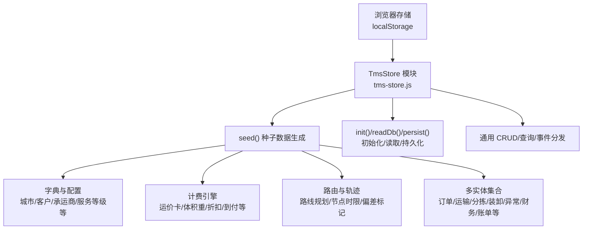
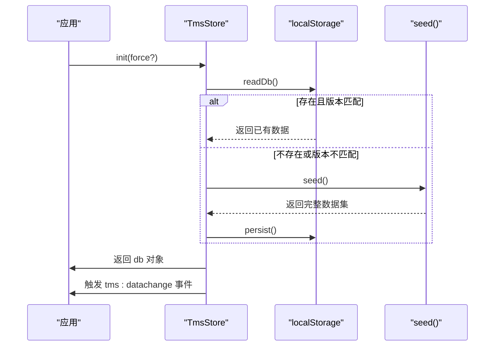
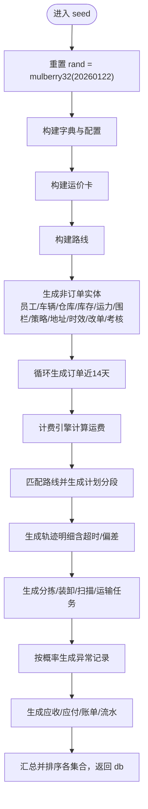
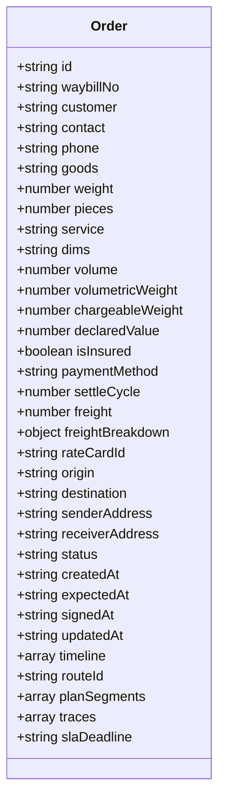
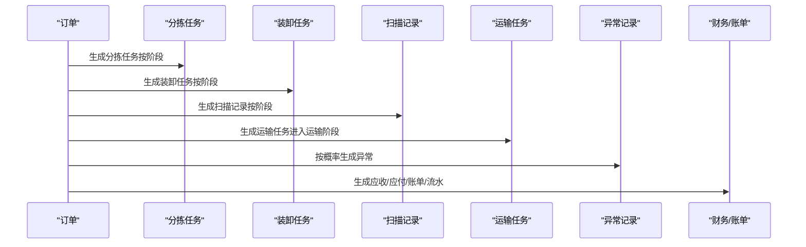
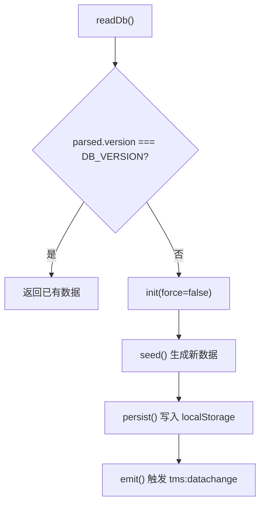
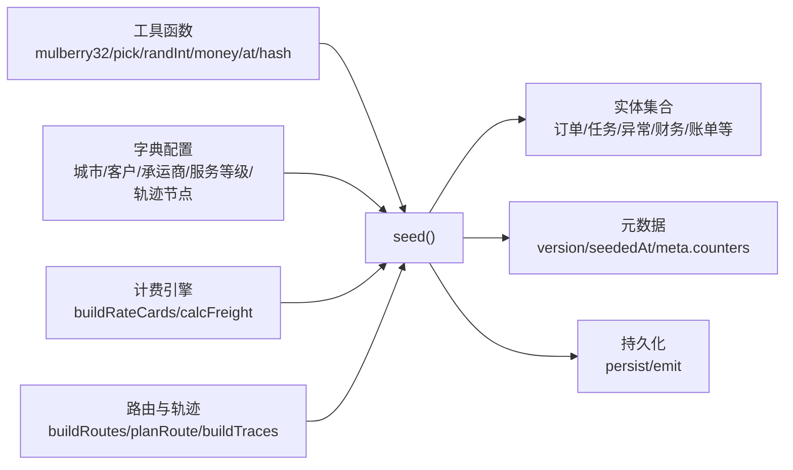

# 种子数据生成

<cite>
**本文引用的文件**   
- [tms-store.js](file://tms-store.js)
</cite>

## 目录
1. [引言](#引言)
2. [项目结构](#项目结构)
3. [核心组件](#核心组件)
4. [架构总览](#架构总览)
5. [详细组件分析](#详细组件分析)
6. [依赖关系分析](#依赖关系分析)
7. [性能与扩展性](#性能与扩展性)
8. [故障排查指南](#故障排查指南)
9. [结论](#结论)
10. [附录：扩展与自定义示例](#附录扩展与自定义示例)

## 引言
本指南面向开发者，系统性说明 TMS 前端共享数据层中的种子数据生成机制。重点包括：
- seed 函数的实现原理、随机数生成器 mulberry32 的使用方式与数据分布控制策略
- 订单、用户、车辆、仓库等实体数据的构造方法与关联关系
- 如何扩展新的种子数据类型，包括数据结构设计与关系维护
- 测试数据与演示数据的生成策略
- 数据版本管理与迁移机制（DB_VERSION 的作用与升级策略）
- 数据质量检查与完整性验证方法
目标是帮助开发者快速理解并安全地扩展种子数据，生成符合业务场景的真实感数据。

## 项目结构
TMS 的种子数据逻辑集中在单一模块中，通过浏览器 localStorage 提供轻量级“数据库”能力，供管理员端各页面共享。该模块同时负责：
- 首次访问时自动生成真实感种子数据
- 提供统一的增删改查、搜索、筛选、排序、分页能力
- 维护订单全生命周期状态流转，并自动写入扫描、运输、财务等关联记录
- 提供各页面所需的统计聚合（KPI、趋势、分布、日报）

图表来源
- [tms-store.js:16-17](file://tms-store.js#L16-L17)
- [tms-store.js:220-244](file://tms-store.js#L220-L244)
- [tms-store.js:464-1154](file://tms-store.js#L464-L1154)

章节来源
- [tms-store.js:1-12](file://tms-store.js#L1-L12)
- [tms-store.js:16-17](file://tms-store.js#L16-L17)
- [tms-store.js:220-244](file://tms-store.js#L220-L244)

## 核心组件
- 随机数与工具函数
  - mulberry32：固定种子的伪随机数生成器，保证同一浏览器中演示数据稳定可复现
  - pick/randInt/money/at/nowIso/hash/pad/dateKey/dateTimeKey：基础工具，用于选择、区间随机、金额精度、时间偏移、哈希、补零、日期键等
- 字典与配置
  - 城市、省份、客户、商品、承运商、员工姓名、部门、权限、角色、区域、偏远城市、服务等级、付款方式、客户分层、轨迹节点等
- 计费引擎
  - 运价模板构建、匹配规则、体积重计算、燃油附加、偏远附加、保价、到付、折扣、最低消费等
- 路由与轨迹
  - 多段路线定义、按起终点匹配、计划分段与截止时间、轨迹节点生成与超时/偏差标记
- 种子数据生成器
  - 员工、车辆、仓库/库存、运力资源、电子围栏、运营策略、路由规则、派送地址、时效规则、改单记录、考核指标、订单主数据、分拣任务、装卸任务、扫描记录、运输任务、异常记录、应收应付、账单、工单、理赔、行政记录、绩效、用户、设备等
- 数据持久化与事件
  - readDb/persist/emit/init/importLegacyData 等

章节来源
- [tms-store.js:21-77](file://tms-store.js#L21-L77)
- [tms-store.js:81-213](file://tms-store.js#L81-L213)
- [tms-store.js:278-383](file://tms-store.js#L278-L383)
- [tms-store.js:385-460](file://tms-store.js#L385-L460)
- [tms-store.js:464-1154](file://tms-store.js#L464-L1154)

## 架构总览
下图展示种子数据生成的整体流程：从初始化读取本地存储开始，若不存在或版本不匹配则调用 seed 生成完整数据集，随后持久化并触发数据变更事件。

图表来源
- [tms-store.js:220-244](file://tms-store.js#L220-L244)
- [tms-store.js:1187-1195](file://tms-store.js#L1187-L1195)
- [tms-store.js:464-1154](file://tms-store.js#L464-L1154)

## 详细组件分析

### 随机数生成与数据分布控制
- mulberry32 使用固定种子 20260122，确保在相同浏览器环境下多次刷新仍得到一致的数据集，便于演示和回归测试
- 全局 rand 实例由 mulberry32 创建，pick/randInt 基于 rand 进行均匀采样
- 数据分布控制体现在：
  - 订单状态按日期分布：较早订单多为已签收，近期订单包含更多未完成状态
  - 取消率：历史订单有低概率取消
  - 异常率：约 22% 的订单会生成异常记录
  - 超时与偏差：轨迹节点根据阶段与随机阈值标记 isOvertime/isDeviant
  - 费用构成：运费通过计费引擎计算，考虑体积重、燃油、偏远、保价、到付、折扣等

图表来源
- [tms-store.js:44-54](file://tms-store.js#L44-L54)
- [tms-store.js:278-383](file://tms-store.js#L278-L383)
- [tms-store.js:385-460](file://tms-store.js#L385-L460)
- [tms-store.js:464-1154](file://tms-store.js#L464-L1154)

章节来源
- [tms-store.js:44-54](file://tms-store.js#L44-L54)
- [tms-store.js:56-62](file://tms-store.js#L56-L62)
- [tms-store.js:684-777](file://tms-store.js#L684-L777)
- [tms-store.js:778-950](file://tms-store.js#L778-L950)

### 订单数据构造
- 订单编号与运单号：
  - buildOrderId：结合起运城市代码、时间戳、客户哈希与序列号生成唯一 ID
  - buildWaybill：基于订单 ID 哈希生成运单号
- 订单字段：
  - 客户、联系人、电话、货物类型、重量、件数、服务等级、尺寸/体积/体积重、保价、付款方式、账期、运费及明细、起终点、收发地址、状态、时间线、SLA 截止等
- 状态与时间线：
  - ORDER_FLOW 定义状态顺序；timeline 按阶段写入操作人与时间
- 路由与轨迹：
  - planRoute 匹配路线并写入 planSegments 与 deadline
  - buildTraces 生成节点、地点、超时/偏差标记

图表来源
- [tms-store.js:252-261](file://tms-store.js#L252-L261)
- [tms-store.js:684-777](file://tms-store.js#L684-L777)
- [tms-store.js:426-460](file://tms-store.js#L426-L460)

章节来源
- [tms-store.js:252-261](file://tms-store.js#L252-L261)
- [tms-store.js:684-777](file://tms-store.js#L684-L777)
- [tms-store.js:426-460](file://tms-store.js#L426-L460)

### 用户、车辆、仓库等实体构造
- 用户与组织
  - users：系统管理员、运营经理、客服、仓储、司机、财务、人事等
  - departments/roles/permissions/areas：组织、角色、权限、区域
- 车辆
  - vehicles：车牌、车型、司机、网点、状态、位置、载重、里程、更新时间
- 仓库与库存
  - warehouses：中心仓/分拨仓/前置仓/区域仓，面积、利用率、当日进出量
  - inventory：包材类物料，库存与安全库存、库位、状态
- 其他
  - capacities：自有/外协运力、临时仓、航空仓位
  - geofences：仓储/网点/禁行区域围栏
  - policies/routingRules/timingRules/changeRecords/evalMetrics/adminRecords/evaluations/performance/devices：运营策略、路由规则、时效规则、改单记录、考核指标、行政记录、绩效、设备

章节来源
- [tms-store.js:483-518](file://tms-store.js#L483-L518)
- [tms-store.js:520-554](file://tms-store.js#L520-L554)
- [tms-store.js:556-591](file://tms-store.js#L556-L591)
- [tms-store.js:593-678](file://tms-store.js#L593-L678)
- [tms-store.js:1078-1102](file://tms-store.js#L1078-L1102)

### 关联数据与业务流程
- 分拣任务：按订单阶段生成，包含计划时间与完成状态
- 装卸任务：根据是否进入运输阶段决定装车/卸车，关联车辆与工人
- 扫描记录：按阶段生成入库/分拣/出库/到达/派送/签收扫描
- 运输任务：关联承运商、车辆、司机、预计到达、进度
- 异常记录：类型、责任方、扣款、处理流程、升级标志
- 财务与账单：月结挂应收、逾期/部分回款、账单聚合、应付（干线运费与异常扣款）、流水

图表来源
- [tms-store.js:796-950](file://tms-store.js#L796-L950)

章节来源
- [tms-store.js:796-950](file://tms-store.js#L796-L950)

### 数据版本管理与迁移机制
- DB_KEY 与 DB_VERSION
  - DB_KEY 标识本地存储键名
  - DB_VERSION 表示数据模型版本
- 读取与校验
  - readDb 从 localStorage 读取 JSON，解析后校验 version 是否等于 DB_VERSION，否则视为无效数据
- 初始化与迁移
  - init(force)：若无数据或强制初始化，则调用 seed 生成新数据；若非强制，尝试 importLegacyData 导入旧用户数据
  - persist：将 db 序列化到 localStorage，并触发数据变更事件
- 升级策略
  - 当 DB_VERSION 提升时，readDb 会拒绝旧版本数据，从而触发重新生成种子数据
  - 如需兼容旧数据，可在 importLegacyData 中进行字段映射与迁移

图表来源
- [tms-store.js:16-17](file://tms-store.js#L16-L17)
- [tms-store.js:220-244](file://tms-store.js#L220-L244)
- [tms-store.js:1187-1195](file://tms-store.js#L1187-L1195)

章节来源
- [tms-store.js:16-17](file://tms-store.js#L16-L17)
- [tms-store.js:220-244](file://tms-store.js#L220-L244)
- [tms-store.js:1166-1195](file://tms-store.js#L1166-L1195)

### 数据质量检查与完整性验证
建议在扩展或自定义种子数据时加入以下自检逻辑：
- 唯一性
  - 订单 ID、运单号、实体 ID 唯一
- 一致性
  - 订单状态与时间线一致（createdAt ≤ updatedAt ≤ signedAt）
  - 计划分段 deadline 递增且合理
  - 轨迹节点与订单阶段对应
- 关联性
  - 分拣/装卸/扫描/运输任务均能追溯到 orderId/waybillNo
  - 异常记录与订单关联，扣款与应付关联
  - 应收/账单/流水与订单、客户、账期一致
- 数值合理性
  - 重量/体积/体积重/计费重逻辑正确
  - 运费明细合计等于 total
  - 折扣不超过协议上限
- 覆盖率
  - 各实体数量满足预期范围
  - 状态分布符合业务假设（如异常率、取消率、逾期比例）

章节来源
- [tms-store.js:684-950](file://tms-store.js#L684-L950)
- [tms-store.js:1104-1154](file://tms-store.js#L1104-L1154)

## 依赖关系分析
- 内部依赖
  - seed 依赖工具函数、字典配置、计费引擎、路由与轨迹
  - 订单生成依赖计费引擎与路由匹配
  - 任务与异常依赖订单状态与时间线
  - 财务与账单依赖订单结算与付款方式
- 外部依赖
  - localStorage 作为持久化存储
  - 浏览器事件 CustomEvent 用于跨页面通知

图表来源
- [tms-store.js:21-77](file://tms-store.js#L21-L77)
- [tms-store.js:81-213](file://tms-store.js#L81-L213)
- [tms-store.js:278-383](file://tms-store.js#L278-L383)
- [tms-store.js:385-460](file://tms-store.js#L385-L460)
- [tms-store.js:464-1154](file://tms-store.js#L464-L1154)

章节来源
- [tms-store.js:21-77](file://tms-store.js#L21-L77)
- [tms-store.js:81-213](file://tms-store.js#L81-L213)
- [tms-store.js:278-383](file://tms-store.js#L278-L383)
- [tms-store.js:385-460](file://tms-store.js#L385-L460)
- [tms-store.js:464-1154](file://tms-store.js#L464-L1154)

## 性能与扩展性
- 性能特性
  - 种子数据一次性生成并持久化，后续读取直接命中 localStorage
  - 使用固定种子避免每次刷新产生不同数据，利于 UI 渲染稳定性
- 扩展建议
  - 新增实体：在 seed 中增加数组收集与 ID 生成逻辑，并在返回的 db 对象中挂载
  - 新增关系：在订单生成流程中插入关联数据构造步骤，确保 ID 引用一致
  - 新增分布控制：通过 rand 的概率阈值调整实体生成比例与状态分布
  - 新增计费维度：扩展 calcFreight 与 buildRateCards，保持运费明细一致性

[本节为通用指导，不直接分析具体文件]

## 故障排查指南
- 数据未生成或为空
  - 检查 localStorage 是否存在有效数据，确认 DB_VERSION 是否与当前代码一致
  - 若版本不匹配，readDb 会返回 null，需重新初始化
- 数据不一致
  - 核对订单状态与时间线、计划分段 deadline、轨迹节点与阶段对应关系
  - 检查任务与异常是否能追溯到订单 ID/运单号
- 费用异常
  - 检查计费引擎输入参数（重量/体积/保价/到付/折扣），确认运费明细合计与 total 一致
- 事件未触发
  - 检查 emit 是否正确派发 tms:datachange 事件，监听器是否注册

章节来源
- [tms-store.js:220-244](file://tms-store.js#L220-L244)
- [tms-store.js:684-950](file://tms-store.js#L684-L950)

## 结论
本指南系统梳理了 TMS 种子数据生成的实现原理与关键组件，涵盖随机数生成、数据分布控制、实体构造、关联关系、版本管理、质量检查等方面。开发者可据此安全扩展新的种子数据类型，并通过概率与规则控制生成符合业务场景的真实感数据。

[本节为总结，不直接分析具体文件]

## 附录：扩展与自定义示例

### 新增种子数据类型的设计步骤
- 设计数据结构
  - 明确必填字段、枚举值、关联字段（如 orderId、customer、period）
- 在 seed 中生成数据
  - 使用 counterSeed 生成唯一 ID
  - 使用 pick/randInt 控制分布与取值
  - 与现有实体建立引用关系（如关联订单、客户、承运商）
- 更新返回对象
  - 在 seed 返回的 db 对象中挂载新集合
- 添加质量检查
  - 唯一性、一致性、关联性、数值合理性、覆盖率

章节来源
- [tms-store.js:1157-1164](file://tms-store.js#L1157-L1164)
- [tms-store.js:1104-1154](file://tms-store.js#L1104-L1154)

### 测试数据与演示数据生成策略
- 演示数据
  - 使用固定种子 mulberry32(20260122)，保证演示环境数据稳定
- 测试数据
  - 可通过覆盖 rand 或传入不同种子以生成多样化数据
  - 针对边界场景（高异常率、高取消率、高逾期比例）调整概率阈值
  - 针对特定业务线（冷链、加急）调整服务等级与费用参数

章节来源
- [tms-store.js:44-54](file://tms-store.js#L44-L54)
- [tms-store.js:684-777](file://tms-store.js#L684-L777)