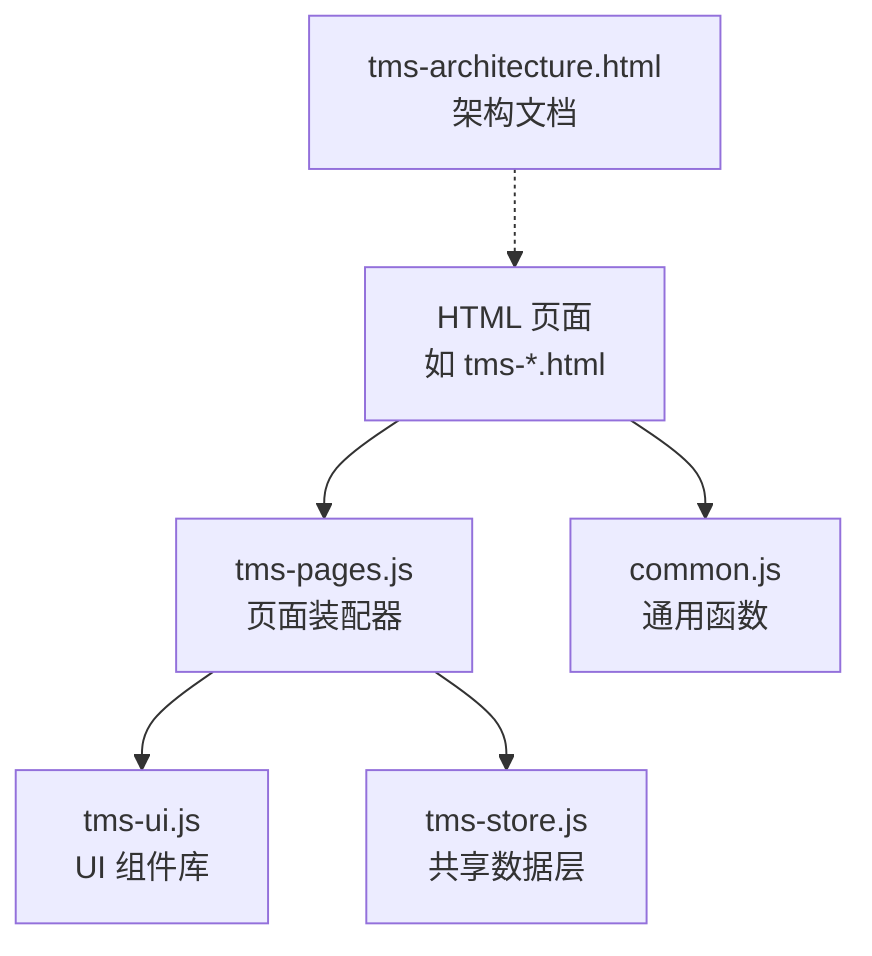
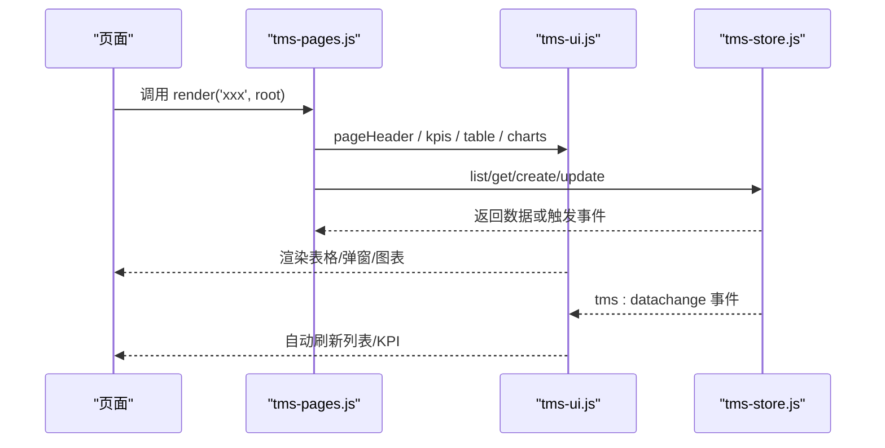
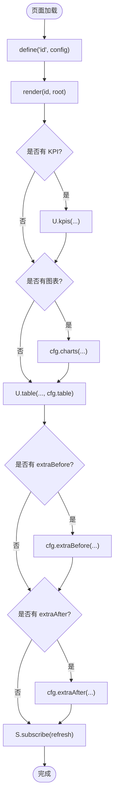
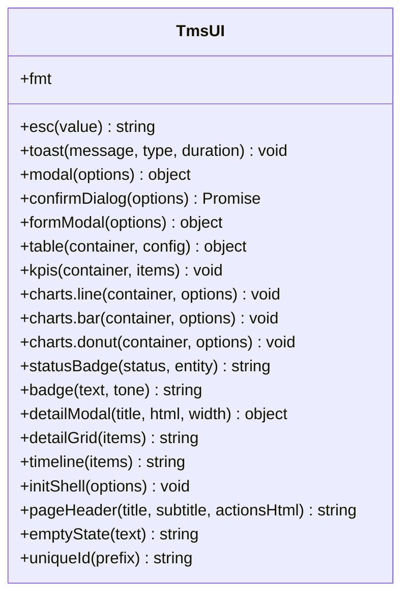
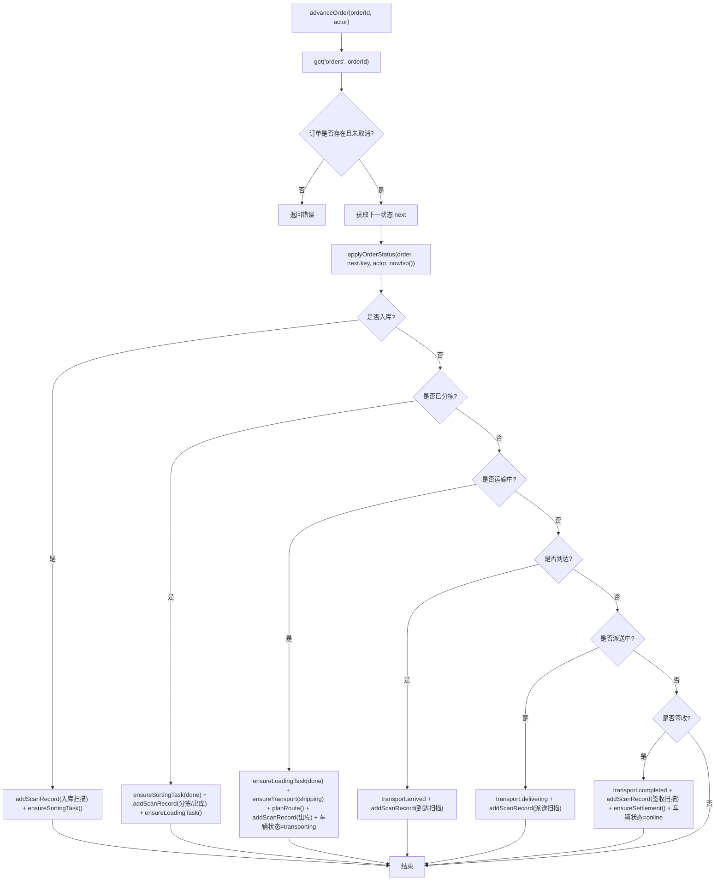
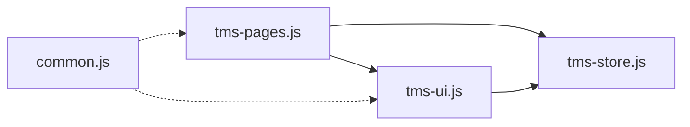

# 新功能开发

<cite>
**本文引用的文件**   
- [tms-pages.js](file://tms-pages.js)
- [tms-ui.js](file://tms-ui.js)
- [tms-store.js](file://tms-store.js)
- [common.js](file://common.js)
- [tms-architecture.html](file://tms-architecture.html)
</cite>

## 目录
1. [引言](#引言)
2. [项目结构](#项目结构)
3. [核心组件](#核心组件)
4. [架构总览](#架构总览)
5. [详细组件分析](#详细组件分析)
6. [依赖关系分析](#依赖关系分析)
7. [性能与可扩展性](#性能与可扩展性)
8. [故障排查指南](#故障排查指南)
9. [结论](#结论)
10. [附录：端到端新增页面示例](#附录端到端新增页面示例)

## 引言
本指南面向希望在本仓库中独立开发新功能模块的开发者。系统采用“页面装配 + UI 组件库 + 共享数据层”的前端架构，所有业务页面通过统一的数据源和 UI 能力快速拼装，具备一致的表格、表单、弹窗、图表、状态标签等体验。本文从如何添加新页面、扩展 UI 组件、扩展数据模型、实现业务逻辑、页面通信与数据共享，到测试调试与完整示例，提供系统化说明。

## 项目结构
仓库以多个角色入口 HTML 页面为主，配合三个关键脚本：
- tms-pages.js：管理员端页面装配器，将各业务页统一装配为 KPI + 图表 + 可筛选分页表格 + CRUD 操作的结构。
- tms-ui.js：共享 UI 组件库，提供列表、搜索/筛选/分页、表单弹窗、确认框、Toast、SVG 图表等能力。
- tms-store.js：基于 localStorage 的轻量业务数据库，负责种子数据、CRUD、订单生命周期、统计聚合等。
- common.js：通用函数库（登录、权限校验、用户信息、积分等）。
- tms-architecture.html：系统架构介绍文档（概念性内容）。

**图示来源**
- [tms-pages.js:1-16](file://tms-pages.js#L1-L16)
- [tms-ui.js:1-10](file://tms-ui.js#L1-L10)
- [tms-store.js:1-12](file://tms-store.js#L1-L12)
- [common.js:1-10](file://common.js#L1-L10)
- [tms-architecture.html:638-715](file://tms-architecture.html#L638-L715)

**章节来源**
- [tms-pages.js:1-16](file://tms-pages.js#L1-L16)
- [tms-ui.js:1-10](file://tms-ui.js#L1-L10)
- [tms-store.js:1-12](file://tms-store.js#L1-L12)
- [common.js:1-10](file://common.js#L1-L10)
- [tms-architecture.html:638-715](file://tms-architecture.html#L638-L715)

## 核心组件
- 页面装配器（tms-pages.js）
  - 提供 define(id, config) 注册页面配置；render(id, root) 渲染页面骨架；每个页面包含 kpis、charts、table、extraBefore/After 等扩展点。
  - 内置异常管理、运输管理、仓储管理、车辆管理、运力管理、物资管理、客服管理、理赔管理、财务管理、行政管理、考核评级、绩效管理、人事管理、分拣管理、装卸管理、扫描管理、时效管理等页面。
- UI 组件库（tms-ui.js）
  - 基础工具：esc、fmt（日期/金额/数字/百分比）、statusBadge、badge、uniqueId。
  - 交互组件：toast、modal、confirmDialog、formModal。
  - 列表组件：table（支持 entity 绑定、搜索、筛选、排序、分页、工具栏、行操作、点击行回调）。
  - 图表组件：lineChart、barChart、donutChart。
  - 详情展示：detailModal、detailGrid、timeline。
  - 页面外壳：initShell、pageHeader、emptyState。
- 共享数据层（tms-store.js）
  - 数据持久化：localStorage 存储，版本控制，事件广播（tms:datachange）。
  - 字典与常量：城市、订单流程、状态标签、客户/商品/承运商/员工/部门/权限/角色等。
  - 计费引擎：运价卡、体积重、燃油附加费、偏远附加费、保价费、到付手续费、客户折扣、月结账期。
  - 路由与轨迹：多段路由计划、轨迹节点映射、超时/偏差标记。
  - 种子数据：订单、运输、分拣、装卸、扫描、异常、财务、应收应付、账单、服务工单、理赔、行政记录、考核绩效、设备、用户等。
  - 通用 CRUD：list/get/create/update/remove/subscribe/reset。
  - 业务流转：advanceOrder、applyOrderStatus、ensureSortingTask/LoadingTask/Transport/Income/Settlement、addScanRecord/addTrace 等。
- 通用函数（common.js）
  - 登录/登出、角色跳转、权限检查、当前用户显示、个人信息与积分管理。

**章节来源**
- [tms-pages.js:14-114](file://tms-pages.js#L14-L114)
- [tms-ui.js:12-78](file://tms-ui.js#L12-L78)
- [tms-ui.js:84-285](file://tms-ui.js#L84-L285)
- [tms-ui.js:287-542](file://tms-ui.js#L287-L542)
- [tms-ui.js:544-779](file://tms-ui.js#L544-L779)
- [tms-store.js:79-214](file://tms-store.js#L79-L214)
- [tms-store.js:263-383](file://tms-store.js#L263-L383)
- [tms-store.js:385-460](file://tms-store.js#L385-L460)
- [tms-store.js:462-1153](file://tms-store.js#L462-L1153)
- [tms-store.js:1196-1319](file://tms-store.js#L1196-L1319)
- [tms-store.js:1321-1570](file://tms-store.js#L1321-L1570)
- [common.js:135-209](file://common.js#L135-L209)
- [common.js:211-383](file://common.js#L211-L383)

## 架构总览
系统前端由“页面装配器 + UI 组件库 + 共享数据层”构成，页面通过 TmsStore 访问数据，通过 TmsUI 渲染界面。数据变更会触发事件，驱动视图刷新。

**图示来源**
- [tms-pages.js:87-114](file://tms-pages.js#L87-L114)
- [tms-ui.js:301-542](file://tms-ui.js#L301-L542)
- [tms-store.js:232-244](file://tms-store.js#L232-L244)

## 详细组件分析

### 页面装配器（tms-pages.js）
- 页面定义模式
  - 使用 define(id, config) 注册页面，config 包含 title、subtitle、kpis、charts、table、extraBefore、extraAfter。
  - render(id, root) 渲染页面骨架：KPI 区、图表区、额外前置区、表格面板、额外后置区。
  - 订阅数据变化后刷新 KPI 与表格。
- 典型页面示例
  - 异常管理：登记异常、分派处理人、闭环解决并联动理赔。
  - 运输管理：调度发车、到达、完成，联动订单状态推进。
  - 仓储管理：仓库增改查、低库存预警、补货。
  - 车辆管理：增改查、维修/恢复。
  - 运力管理：资源增改查、释放。
  - 物资管理：领用/补货、库存状态计算。
  - 客服管理：新建工单、受理、解决。
  - 理赔管理：新建理赔、通过/驳回、生成支出流水。
  - 财务管理：收支登记、结算/作废、趋势图。
  - 行政管理：事项申请、审批/驳回。
  - 考核评级：发起考核、指标配置。
  - 绩效管理：排名、得分。
  - 人事管理：员工增改查、离职。
  - 分拣/装卸/扫描/时效：任务创建、状态推进、规则编辑。

**图示来源**
- [tms-pages.js:87-114](file://tms-pages.js#L87-L114)

**章节来源**
- [tms-pages.js:14-114](file://tms-pages.js#L14-L114)
- [tms-pages.js:116-227](file://tms-pages.js#L116-L227)
- [tms-pages.js:229-336](file://tms-pages.js#L229-L336)
- [tms-pages.js:338-451](file://tms-pages.js#L338-L451)
- [tms-pages.js:453-554](file://tms-pages.js#L453-L554)
- [tms-pages.js:556-637](file://tms-pages.js#L556-L637)
- [tms-pages.js:639-721](file://tms-pages.js#L639-L721)
- [tms-pages.js:723-810](file://tms-pages.js#L723-L810)
- [tms-pages.js:812-900](file://tms-pages.js#L812-L900)
- [tms-pages.js:902-990](file://tms-pages.js#L902-L990)
- [tms-pages.js:992-1063](file://tms-pages.js#L992-L1063)
- [tms-pages.js:1065-1152](file://tms-pages.js#L1065-L1152)
- [tms-pages.js:1154-1209](file://tms-pages.js#L1154-L1209)
- [tms-pages.js:1211-1291](file://tms-pages.js#L1211-L1291)
- [tms-pages.js:1293-1360](file://tms-pages.js#L1293-L1360)
- [tms-pages.js:1362-1433](file://tms-pages.js#L1362-L1433)
- [tms-pages.js:1435-1509](file://tms-pages.js#L1435-L1509)
- [tms-pages.js:1511-1582](file://tms-pages.js#L1511-L1582)

### UI 组件库（tms-ui.js）
- 基础工具与格式化
  - esc 防 XSS；fmt.date/time/dateTime/money/number/percent。
  - STATUS_CLASS 与 statusBadge 根据实体类型映射状态样式。
- 交互组件
  - toast：全局提示容器，支持类型与时长。
  - modal：通用弹窗，支持 ESC 关闭、遮罩点击关闭。
  - confirmDialog：异步确认框，返回 Promise。
  - formModal：动态表单，支持 select/textarea/checkbox/number/date 等字段，必填校验、错误提示、提交回调（同步/异步）。
- 列表组件
  - table(container, config)：支持 entity 绑定、rows 覆盖、columns 自定义渲染、actions 行操作、search/searchFields/searchPlaceholder、filters、pageSize、defaultSort、toolbar、onRowClick、rowClass。
  - 内部维护 state（search/filters/page/sort/pageSize），监听输入、筛选、排序、分页、工具栏按钮、行操作、行点击。
  - 当 entity 存在时，订阅 TmsStore 数据变化，自动刷新。
- 图表组件
  - lineChart/barChart/donutChart：纯 SVG 绘制，支持多系列、图例、高度定制。
- 详情展示
  - detailModal/detailGrid/timeline：用于详情弹窗与时间线展示。
- 页面外壳
  - initShell：导航高亮、子菜单展开、退出登录、当前用户显示、异常待办角标。
  - pageHeader/emptyState：页面头部与空态。

**图示来源**
- [tms-ui.js:12-78](file://tms-ui.js#L12-L78)
- [tms-ui.js:84-285](file://tms-ui.js#L84-L285)
- [tms-ui.js:287-542](file://tms-ui.js#L287-L542)
- [tms-ui.js:544-779](file://tms-ui.js#L544-L779)

**章节来源**
- [tms-ui.js:12-78](file://tms-ui.js#L12-L78)
- [tms-ui.js:84-285](file://tms-ui.js#L84-L285)
- [tms-ui.js:287-542](file://tms-ui.js#L287-L542)
- [tms-ui.js:544-779](file://tms-ui.js#L544-L779)

### 共享数据层（tms-store.js）
- 数据初始化与持久化
  - readDb/persist/emit：读取本地存储、写入并广播事件。
  - init(force)/ensureInit：懒加载与强制初始化。
- 通用 CRUD
  - list/get/create/update/remove：支持 filters/search/sort/page/pageSize。
  - subscribe：订阅数据变化，返回取消订阅函数。
  - reset：清空并重建种子数据。
- 业务流转
  - advanceOrder：按 ORDER_FLOW 顺序推进订单状态。
  - applyOrderStatus：更新状态、时间线、轨迹、扫描记录、关联任务、车辆状态、结算。
  - ensureSortingTask/LoadingTask/Transport/Income/Settlement：确保关联数据存在并补齐。
  - addScanRecord/addTrace：追加扫描与轨迹记录。
- 计费引擎
  - calcFreight：首重/续重、体积重、燃油附加费、偏远附加费、保价费、到付手续费、客户折扣、最低消费、最终总价。
- 路由与轨迹
  - buildRoutes/findRoute/planRoute：构建多段路由、匹配线路、计划分段与截止时间。
  - buildTraces：根据订单阶段生成轨迹明细，含超时/偏差标记。
- 种子数据
  - seed：生成订单、运输、分拣、装卸、扫描、异常、财务、应收应付、账单、服务工单、理赔、行政记录、考核绩效、设备、用户等。
  - counterSeed/counterNext：ID 生成策略。

**图示来源**
- [tms-store.js:1559-1570](file://tms-store.js#L1559-L1570)
- [tms-store.js:1495-1557](file://tms-store.js#L1495-L1557)
- [tms-store.js:1327-1443](file://tms-store.js#L1327-L1443)

**章节来源**
- [tms-store.js:220-244](file://tms-store.js#L220-L244)
- [tms-store.js:1196-1319](file://tms-store.js#L1196-L1319)
- [tms-store.js:1321-1570](file://tms-store.js#L1321-L1570)
- [tms-store.js:263-383](file://tms-store.js#L263-L383)
- [tms-store.js:385-460](file://tms-store.js#L385-L460)
- [tms-store.js:462-1153](file://tms-store.js#L462-L1153)

### 通用函数（common.js）
- 登录/登出：保存用户信息到 localStorage，按角色跳转到对应页面。
- 权限检查：checkLoginStatus(requiredRole)，无权限则跳转登录页。
- 当前用户显示：displayCurrentUser 更新页面用户名元素。
- 个人信息与积分：saveUserProfile/getUserProfile/updateUserProfile/initUserPoints/addUserPoints/deductUserPoints/getUserPointsHistory。

**章节来源**
- [common.js:135-209](file://common.js#L135-L209)
- [common.js:211-383](file://common.js#L211-L383)

## 依赖关系分析
- 页面装配器依赖 UI 组件库进行渲染，依赖数据层进行数据读写。
- UI 组件库在表格组件中直接依赖 TmsStore 进行数据查询与订阅。
- 数据层不依赖 UI 与页面装配器，保持数据层独立性。
- 通用函数与页面装配器/UI 组件库解耦，仅通过全局函数暴露能力。

**图示来源**
- [tms-pages.js:10-12](file://tms-pages.js#L10-L12)
- [tms-ui.js:317-358](file://tms-ui.js#L317-L358)
- [tms-ui.js:523-535](file://tms-ui.js#L523-L535)

**章节来源**
- [tms-pages.js:10-12](file://tms-pages.js#L10-L12)
- [tms-ui.js:317-358](file://tms-ui.js#L317-L358)
- [tms-ui.js:523-535](file://tms-ui.js#L523-L535)

## 性能与可扩展性
- 列表渲染优化
  - table 组件对搜索输入使用防抖（220ms），避免频繁重绘。
  - 当 entity 存在时，通过 TmsStore.subscribe 增量刷新，减少全量重算。
- 数据层优化
  - list 方法支持 filters/search/sort/page/pageSize，前端分页与过滤降低 DOM 压力。
  - traces/scans 数组设置上限（2000/500），防止无限增长。
- 可扩展性建议
  - 新增实体：在 create 的 prefixMap 中添加前缀，保证 ID 生成一致。
  - 新增页面：在 tms-pages.js 中 define 新页面，复用 U.table/U.formModal/U.kpis/U.charts。
  - 新增 UI 组件：在 tms-ui.js 中扩展方法，并在 global.TmsUI 中导出。
  - 新增业务逻辑：在 tms-store.js 中扩展 applyOrderStatus/ensureXxx 等方法，保持事务一致性。

[本节为通用指导，无需具体文件引用]

## 故障排查指南
- 页面空白或表格不显示
  - 检查页面是否在 tms-pages.js 中正确 define。
  - 检查 table.config.entity 是否存在于 TmsStore。
  - 检查 U.table(container, config) 是否正确传入容器与配置。
- 表单提交无效
  - 检查 formModal.fields 配置是否正确（key/label/type/required）。
  - 检查 onSubmit 回调是否抛出错误或返回 false。
- 数据不刷新
  - 检查 TmsStore.list/get/create/update 是否被调用。
  - 检查 TmsStore.subscribe 是否被注册。
- 权限问题
  - 检查 common.js 的 checkLoginStatus 是否调用成功。
  - 检查 localStorage.tmsUser 是否存在且 role 匹配。

**章节来源**
- [tms-ui.js:163-285](file://tms-ui.js#L163-L285)
- [tms-ui.js:301-542](file://tms-ui.js#L301-L542)
- [tms-store.js:1196-1319](file://tms-store.js#L1196-L1319)
- [common.js:176-199](file://common.js#L176-L199)

## 结论
本仓库通过页面装配器、UI 组件库与共享数据层的清晰分层，实现了快速构建业务页面的目标。开发者只需关注页面配置与业务逻辑，即可复用统一的表格、表单、弹窗、图表与数据管理能力。结合本文的流程指南与示例，开发者可以独立完成新功能模块的开发、测试与调试。

[本节为总结，无需具体文件引用]

## 附录：端到端新增页面示例
以下以“新增一个‘供应商管理’页面”为例，说明从需求分析到代码实现的完整流程。

- 需求分析
  - 功能目标：管理供应商信息，包括名称、类型、联系人、电话、状态、评分等。
  - 页面结构：KPI（供应商总数、活跃供应商、平均评分、高风险供应商数）、表格（增删改查、搜索、筛选、分页）、工具栏（新增供应商）、行操作（编辑、停用、启用）。
  - 数据模型：entity='suppliers'，字段 id/name/type/contact/phone/status/rating/createdAt/updatedAt。
  - 权限控制：仅运营管理员可访问。
  - 页面间通信：与其他页面通过 TmsStore 共享数据。

- 步骤一：扩展数据模型
  - 在 tms-store.js 的 create 方法的 prefixMap 中添加 'suppliers': 'SUP'。
  - 在 seed 中生成初始供应商数据（可选）。
  - 如需统计，可在 store 中增加 supplierStats 方法。

**章节来源**
- [tms-store.js:1264-1286](file://tms-store.js#L1264-L1286)
- [tms-store.js:462-1153](file://tms-store.js#L462-L1153)

- 步骤二：注册页面配置
  - 在 tms-pages.js 中 define('supplier', { ... })。
  - 配置 title/subtitle/kpis/table.toolbar/actions/columns。
  - 使用 U.formModal 实现新增/编辑表单，调用 S.create/S.update。
  - 使用 U.statusBadge 显示状态，U.fmt.dateTime 显示时间。

**章节来源**
- [tms-pages.js:14-114](file://tms-pages.js#L14-L114)
- [tms-pages.js:116-227](file://tms-pages.js#L116-L227)

- 步骤三：集成 UI 组件
  - 使用 U.table 渲染表格，配置 entity='suppliers'。
  - 使用 U.kpis 渲染 KPI。
  - 使用 U.detailModal 展示详情（可选）。

**章节来源**
- [tms-ui.js:301-542](file://tms-ui.js#L301-L542)
- [tms-ui.js:544-779](file://tms-ui.js#L544-L779)

- 步骤四：权限控制
  - 在页面入口 HTML 中引入 common.js。
  - 在页面加载时调用 checkLoginStatus('admin')。
  - 若无权限，跳转到登录页。

**章节来源**
- [common.js:176-199](file://common.js#L176-L199)

- 步骤五：页面间通信与数据共享
  - 其他页面通过 TmsStore.list('suppliers') 读取供应商数据。
  - 数据变更通过 TmsStore.subscribe 自动刷新。

**章节来源**
- [tms-store.js:1209-1257](file://tms-store.js#L1209-L1257)
- [tms-store.js:1307-1312](file://tms-store.js#L1307-L1312)

- 步骤六：测试与调试
  - 打开浏览器控制台，检查 TmsStore 数据是否正确。
  - 使用 U.toast 反馈操作结果。
  - 验证表单校验、状态切换、KPI 计算。

**章节来源**
- [tms-ui.js:84-103](file://tms-ui.js#L84-L103)
- [tms-ui.js:163-285](file://tms-ui.js#L163-L285)