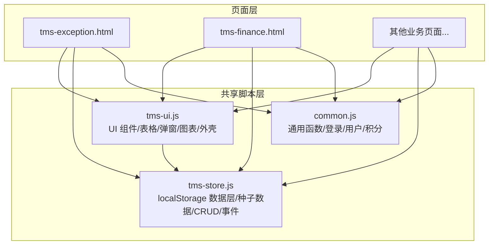
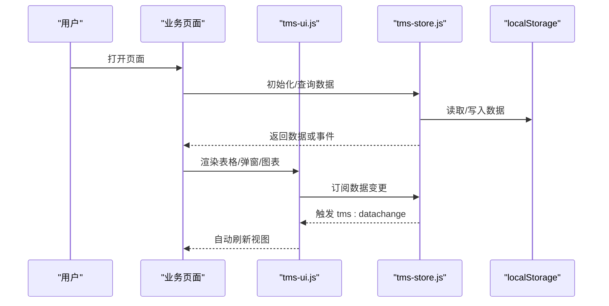
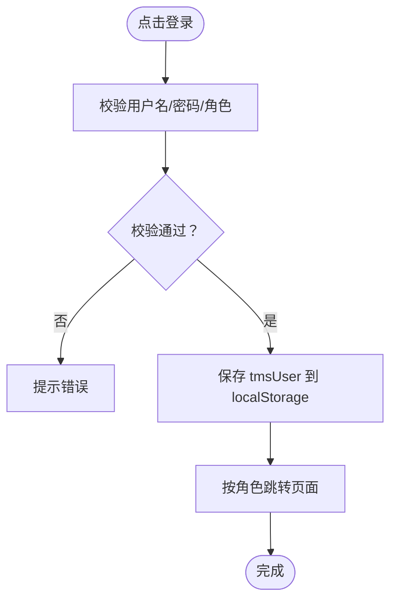
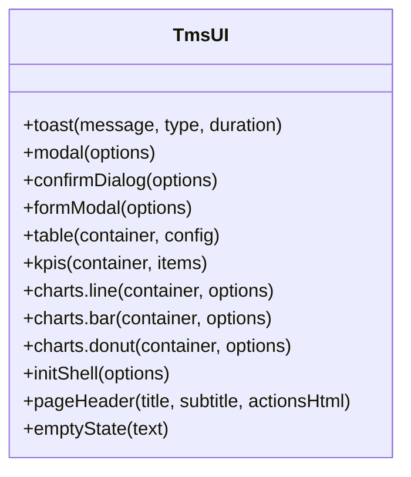
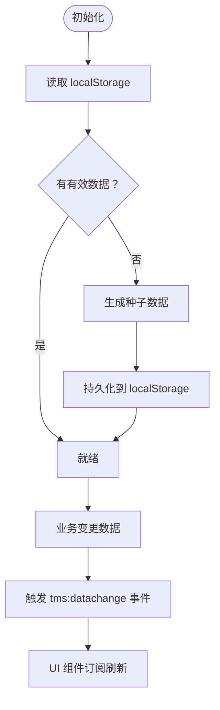
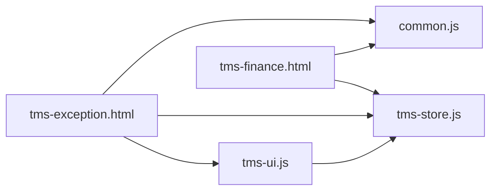

# 测试与调试

<cite>
**本文引用的文件**   
- [common.js](file://common.js)
- [tms-ui.js](file://tms-ui.js)
- [tms-store.js](file://tms-store.js)
- [tms-exception.html](file://tms-exception.html)
- [tms-finance.html](file://tms-finance.html)
</cite>

## 目录
1. [引言](#引言)
2. [项目结构](#项目结构)
3. [核心组件](#核心组件)
4. [架构总览](#架构总览)
5. [详细组件分析](#详细组件分析)
6. [依赖关系分析](#依赖关系分析)
7. [性能考虑](#性能考虑)
8. [故障排查指南](#故障排查指南)
9. [结论](#结论)
10. [附录：自动化测试集成方案](#附录自动化测试集成方案)

## 引言
本指南面向前端开发者，目标是帮助你高效测试和调试本仓库中的物流管理系统（TMS）前端模块。内容覆盖：
- 单元测试、集成测试、用户验收测试的落地方法
- 浏览器开发者工具实操：DOM、网络、控制台、存储
- localStorage 数据的查看与修改
- 常见问题定位：数据同步、权限控制、样式冲突等
- 自动化测试框架集成建议
- 性能分析与优化建议

本项目为纯前端静态站点，使用多个 HTML 页面分别承载不同角色与业务域，并通过共享脚本提供通用能力与数据层。

## 项目结构
仓库由大量独立 HTML 页面组成，按角色/业务域划分，例如客户端、网点端、分拣员端、运输端、配送端以及管理端。共享逻辑集中在三个关键脚本中：
- common.js：通用工具、登录鉴权、用户信息与积分等轻量功能
- tms-ui.js：共享 UI 组件库（表格、弹窗、表单、图表、页面外壳等）
- tms-store.js：基于 localStorage 的共享数据层，负责种子数据生成、CRUD、事件通知与聚合统计

图示来源
- [tms-exception.html:443-454](file://tms-exception.html#L443-L454)
- [tms-finance.html:452-483](file://tms-finance.html#L452-L483)
- [common.js:135-218](file://common.js#L135-L218)
- [tms-ui.js:758-782](file://tms-ui.js#L758-L782)
- [tms-store.js:220-244](file://tms-store.js#L220-L244)

章节来源
- [common.js:1-383](file://common.js#L1-L383)
- [tms-ui.js:1-783](file://tms-ui.js#L1-L783)
- [tms-store.js:1-2379](file://tms-store.js#L1-L2379)

## 核心组件
本节聚焦三个共享脚本的职责边界与交互方式，便于你在测试时快速定位问题范围。

- common.js
  - 职责：通用工具、按钮样式注入、登录/登出、当前用户信息读取与展示、用户个人信息与积分读写。
  - 关键点：登录状态与角色校验通过 localStorage 的 tmsUser 键维护；登出会移除该键并跳转至登录页。
  - 测试关注点：登录流程、角色跳转、用户信息显示、积分余额与历史。

- tms-ui.js
  - 职责：封装 Toast、Modal、Confirm、Form Modal、通用 Table、KPI、SVG 图表、页面外壳 initShell 等。
  - 关键点：Table 支持搜索、筛选、排序、分页，并可订阅 TmsStore 的数据变更进行自动刷新。
  - 测试关注点：弹窗交互、表单校验、表格渲染与交互、图表渲染、页面外壳初始化。

- tms-store.js
  - 职责：基于 localStorage 的“轻量数据库”，负责首次访问生成种子数据、统一 CRUD、搜索/筛选/排序/分页、订单生命周期联动、统计聚合、事件广播。
  - 关键点：所有数据变更触发 tms:datachange 自定义事件；页面可通过 TmsStore.subscribe 订阅更新。
  - 测试关注点：数据一致性、事件驱动刷新、复杂计算（计费引擎）、跨实体关联（订单→扫描/运输/异常/财务）。

章节来源
- [common.js:135-218](file://common.js#L135-L218)
- [tms-ui.js:86-287](file://tms-ui.js#L86-L287)
- [tms-ui.js:303-544](file://tms-ui.js#L303-L544)
- [tms-store.js:220-244](file://tms-store.js#L220-L244)
- [tms-store.js:263-383](file://tms-store.js#L263-L383)

## 架构总览
系统采用“页面 + 共享脚本”的扁平架构：HTML 页面引入 common.js、tms-ui.js、tms-store.js，页面逻辑调用 UI 组件和数据层接口，数据层通过 localStorage 持久化并在变更时广播事件，UI 组件监听事件实现视图自动刷新。

图示来源
- [tms-store.js:220-244](file://tms-store.js#L220-L244)
- [tms-ui.js:525-544](file://tms-ui.js#L525-L544)

## 详细组件分析

### 登录与权限控制（common.js）
- 登录流程
  - 从表单获取用户名、密码与选中角色
  - 校验必填项与角色选择
  - 将用户信息写入 localStorage.tmsUser
  - 根据角色跳转到对应首页
- 权限检查
  - checkLoginStatus(requiredRole) 读取 tmsUser，若不存在或未授权则跳转登录页并提示
- 登出流程
  - 删除 tmsUser 并跳转登录页

图示来源
- [common.js:135-174](file://common.js#L135-L174)

章节来源
- [common.js:135-218](file://common.js#L135-L218)

### 共享 UI 组件（tms-ui.js）
- Toast 与 Modal
  - 提供消息提示、确认框、表单弹窗等交互能力
  - 表单弹窗内置必填校验、异步提交处理、错误显示
- 通用表格
  - 支持搜索、筛选、排序、分页
  - 可绑定 actions 行操作
  - 当 entity 模式且存在 TmsStore 时，订阅数据变更自动刷新
- 图表与 KPI
  - 折线、柱状、环形图与 KPI 卡片
- 页面外壳
  - 高亮当前菜单、绑定退出登录、显示当前用户、异常待办角标

图示来源
- [tms-ui.js:86-287](file://tms-ui.js#L86-L287)
- [tms-ui.js:303-544](file://tms-ui.js#L303-L544)
- [tms-ui.js:548-680](file://tms-ui.js#L548-L680)
- [tms-ui.js:703-746](file://tms-ui.js#L703-L746)
- [tms-ui.js:758-782](file://tms-ui.js#L758-L782)

章节来源
- [tms-ui.js:1-783](file://tms-ui.js#L1-L783)

### 数据层与事件机制（tms-store.js）
- 数据持久化
  - 使用 localStorage 的 tmsDB_v3 键存储结构化数据
  - 首次访问无有效数据时生成种子数据，包含订单、运单、运输、异常、扫描、财务等多实体
- 事件广播
  - 数据变更后触发 tms:datachange 事件，供 UI 组件订阅刷新
- 通用 CRUD
  - 提供 list、subscribe 等方法，支持 search、filters、sort、page、pageSize
- 计费引擎
  - 根据线路、服务等级、重量/体积、保价、到付、客户折扣等计算运费明细
- 路由与轨迹
  - 构建多段路由与标准时效，生成轨迹节点与超时/偏差标记

图示来源
- [tms-store.js:220-244](file://tms-store.js#L220-L244)
- [tms-store.js:1187-1195](file://tms-store.js#L1187-L1195)

章节来源
- [tms-store.js:1-2379](file://tms-store.js#L1-L2379)

## 依赖关系分析
- 页面依赖
  - tms-exception.html 引入 common.js、tms-store.js、tms-ui.js、tms-pages.js，并在 DOMContentLoaded 中执行登录校验与页面渲染
  - tms-finance.html 在本地存储中维护财务记录，用于演示财务流水
- 脚本依赖
  - tms-ui.js 依赖全局 TmsStore 以订阅数据变更
  - common.js 暴露登录、用户信息、积分等全局函数
  - tms-store.js 作为数据源，被 UI 与页面共同消费

图示来源
- [tms-exception.html:443-454](file://tms-exception.html#L443-L454)
- [tms-finance.html:452-483](file://tms-finance.html#L452-L483)
- [tms-ui.js:525-544](file://tms-ui.js#L525-L544)

章节来源
- [tms-exception.html:443-454](file://tms-exception.html#L443-L454)
- [tms-finance.html:452-483](file://tms-finance.html#L452-L483)

## 性能考虑
- 列表渲染
  - 表格组件对搜索输入做了防抖处理，避免频繁重绘
  - 分页与排序在内存中进行，适合中小规模数据
- 事件订阅
  - 表格订阅 TmsStore 变更时，会判断焦点是否在输入控件内以避免打断用户编辑
- 图表渲染
  - SVG 图表按需绘制，避免过度开销
- 建议
  - 大数据量场景下，优先使用后端分页与增量更新
  - 减少不必要的 DOM 操作，复用容器与模板
  - 对耗时计算（如计费）做缓存与懒加载

[本节为通用指导，不直接分析具体文件]

## 故障排查指南

### 数据同步问题
- 现象
  - 修改数据后界面未刷新
- 排查步骤
  - 确认数据层是否触发了 tms:datachange 事件
  - 检查 UI 表格是否正确订阅了 TmsStore
  - 观察控制台是否有订阅回调报错
- 相关代码位置
  - 事件触发：[tms-store.js:237-244](file://tms-store.js#L237-L244)
  - 订阅刷新：[tms-ui.js:525-544](file://tms-ui.js#L525-L544)

章节来源
- [tms-store.js:237-244](file://tms-store.js#L237-L244)
- [tms-ui.js:525-544](file://tms-ui.js#L525-L544)

### 权限控制问题
- 现象
  - 登录后无法进入目标页面，或被强制跳转回登录页
- 排查步骤
  - 检查 localStorage 中是否存在 tmsUser
  - 核对 requiredRole 与当前用户 role 是否匹配
  - 查看控制台输出，确认 checkLoginStatus 的执行路径
- 相关代码位置
  - 登录保存用户：[common.js:154-161](file://common.js#L154-L161)
  - 权限校验与跳转：[common.js:177-199](file://common.js#L177-L199)

章节来源
- [common.js:154-161](file://common.js#L154-L161)
- [common.js:177-199](file://common.js#L177-L199)

### 样式冲突问题
- 现象
  - 按钮样式不一致、弹窗样式错乱
- 排查步骤
  - 确认 common.js 是否已注入统一按钮样式
  - 检查页面是否重复定义同名类名导致覆盖
  - 使用开发者工具审查元素，查看最终生效样式
- 相关代码位置
  - 按钮样式注入：[common.js:52-133](file://common.js#L52-L133)

章节来源
- [common.js:52-133](file://common.js#L52-L133)

### 财务数据未初始化
- 现象
  - 财务页面无记录或为空
- 排查步骤
  - 检查 localStorage 中是否存在 tmsFinanceRecords
  - 若无，页面应初始化模拟数据
- 相关代码位置
  - 财务记录初始化逻辑：[tms-finance.html:452-483](file://tms-finance.html#L452-L483)

章节来源
- [tms-finance.html:452-483](file://tms-finance.html#L452-L483)

## 结论
本项目的测试与调试重点在于理解三层协作：页面层、共享 UI 层、数据层。通过浏览器开发者工具与 localStorage 的辅助，可以快速定位数据流与交互问题。建议在新增功能时遵循以下原则：
- 明确数据归属与事件传播路径
- 复用 UI 组件，避免重复造轮子
- 对关键流程（登录、权限、数据变更）编写用例
- 结合控制台日志与断点进行逐步验证

[本节为总结性内容，不直接分析具体文件]

## 附录：自动化测试集成方案

### 单元测试
- 推荐框架
  - Jest：适用于 JavaScript 逻辑测试，可配合 jsdom 模拟 DOM
- 测试对象
  - common.js 中的工具函数（如 generateOrderId、generateWaybillNumber）
  - tms-ui.js 中的格式化函数与状态标签映射
  - tms-store.js 中的计费引擎与数据转换逻辑
- 示例思路
  - 输入参数 → 期望结果（纯函数）
  - 边界条件（空值、非法输入、极值）
  - 副作用隔离（mock localStorage）

### 集成测试
- 推荐框架
  - Playwright 或 Cypress：端到端测试，模拟用户操作
- 测试场景
  - 登录流程：填写表单 → 选择角色 → 跳转页面
  - 权限控制：低权限用户访问受限页面 → 被拒绝
  - 数据同步：修改数据 → 表格自动刷新
  - 表单弹窗：必填校验 → 异步提交 → 成功提示
- 环境准备
  - 启动本地静态服务器
  - 预置 localStorage 数据（种子数据或测试夹具）

### 用户验收测试（UAT）
- 目标
  - 验证业务流程是否符合预期，包括订单全生命周期、异常处理、财务结算等
- 方法
  - 编写测试用例清单，覆盖主要角色与关键路径
  - 使用真实浏览器手动或半自动化执行
  - 收集反馈并回归验证

### 性能测试
- 工具
  - Chrome DevTools Performance 面板、Lighthouse
- 关注点
  - 首屏渲染时间、长任务、布局抖动
  - 大列表渲染性能、图表绘制开销
- 优化策略
  - 虚拟滚动（大数据列表）
  - 延迟加载与分片渲染
  - 减少重排与重绘

[本节为通用指导，不直接分析具体文件]