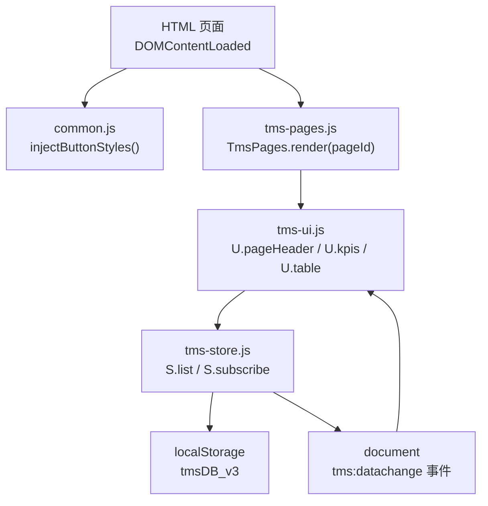
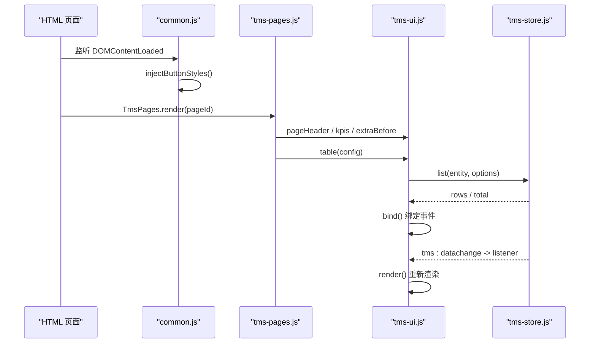
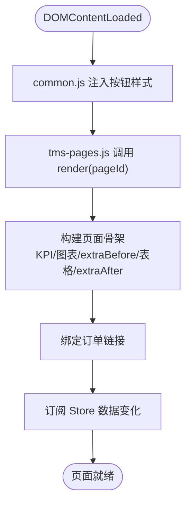
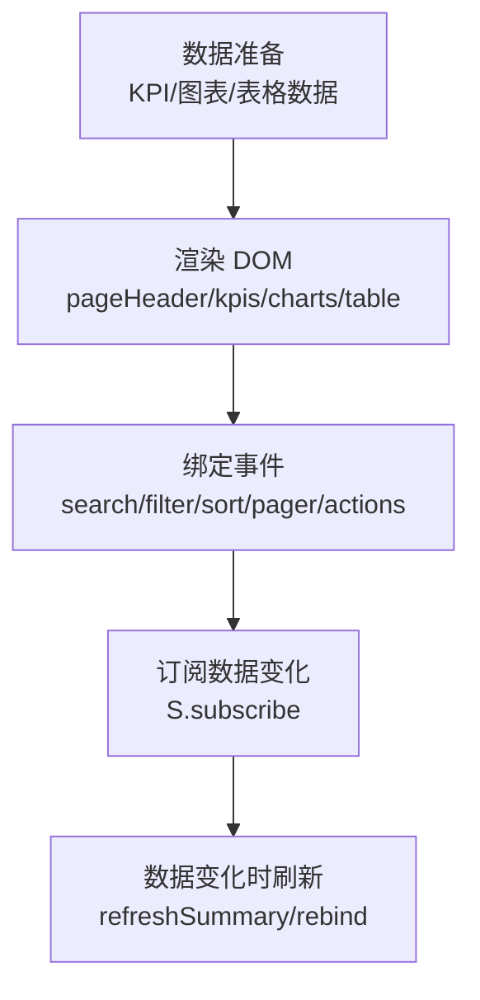
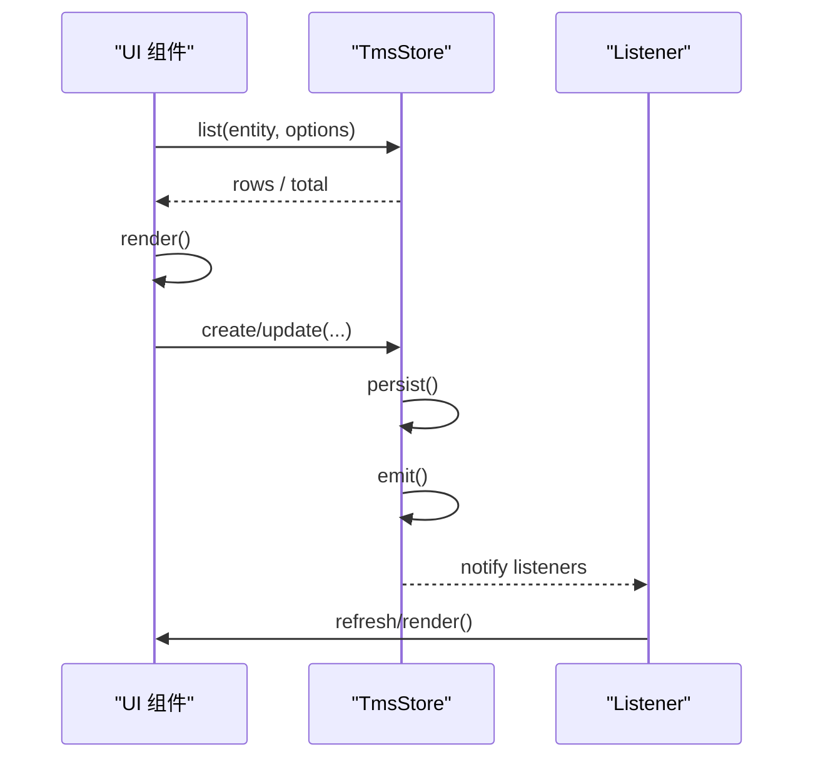
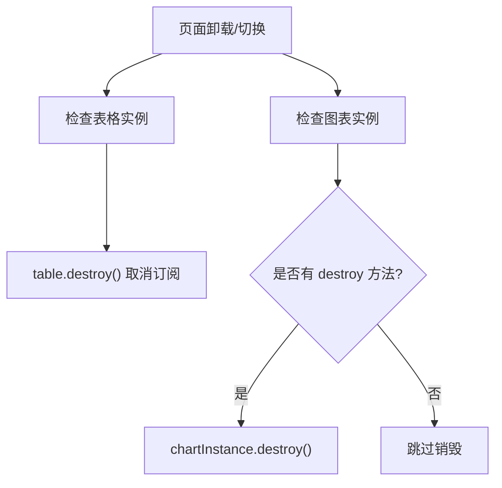
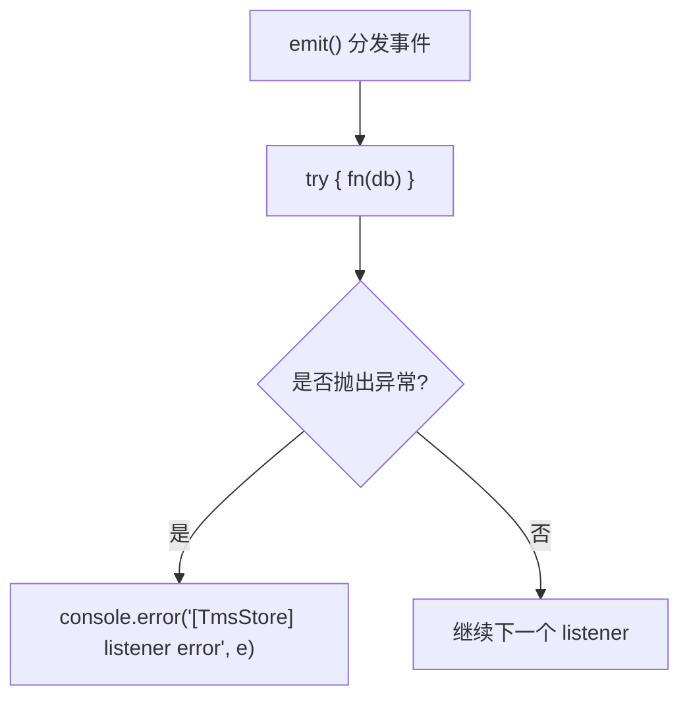
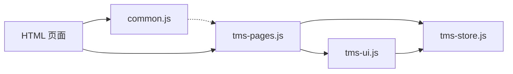

# 生命周期管理

<cite>
**本文引用的文件**   
- [tms-store.js](file://tms-store.js)
- [tms-ui.js](file://tms-ui.js)
- [tms-pages.js](file://tms-pages.js)
- [common.js](file://common.js)
- [branch-system.html](file://branch-system.html)
</cite>

## 目录
1. [引言](#引言)
2. [项目结构](#项目结构)
3. [核心组件](#核心组件)
4. [架构总览](#架构总览)
5. [详细组件分析](#详细组件分析)
6. [依赖关系分析](#依赖关系分析)
7. [性能与渲染特性](#性能与渲染特性)
8. [错误处理与异常恢复](#错误处理与异常恢复)
9. [调试指南](#调试指南)
10. [结论](#结论)

## 引言
本指南围绕仓库中的页面生命周期管理展开，重点说明：
- DOMContentLoaded 事件的处理流程与页面初始化顺序。
- 页面渲染的关键节点，包括“数据准备、KPI/图表渲染、表格渲染、事件绑定”等阶段。
- 数据绑定的时机与更新机制，包括基于 Store 订阅的单向数据流。
- 页面销毁与资源清理的最佳实践。
- 错误处理与异常恢复机制。
- 生命周期调试方法与工具使用建议。

本项目采用轻量前端架构：
- 共享数据层 TmsStore 负责持久化、状态变更与事件通知。
- 共享 UI 库 TmsUI 提供通用组件（表格、弹窗、图表等）。
- 页面装配器 TmsPages 将业务页统一装配为 KPI + 图表 + 表格的结构。
- 各 HTML 页面在 DOMContentLoaded 中触发页面初始化。

## 项目结构
从生命周期视角看，关键文件职责如下：
- tms-store.js：数据模型、种子数据、CRUD、订阅发布、全局事件。
- tms-ui.js：UI 组件与页面外壳，包含表格、弹窗、图表、initShell 等。
- tms-pages.js：页面装配逻辑，定义每个页面的 KPI、图表、表格配置与交互。
- common.js：通用函数与登录相关逻辑，注入按钮样式并监听 DOMContentLoaded。
- branch-system.html：示例页面，展示图表实例销毁的生命周期清理模式。

**图示来源**
- [common.js:133-133](file://common.js#L133-L133)
- [tms-pages.js:108-135](file://tms-pages.js#L108-L135)
- [tms-ui.js:303-543](file://tms-ui.js#L303-L543)
- [tms-store.js:220-244](file://tms-store.js#L220-L244)

**章节来源**
- [common.js:133-133](file://common.js#L133-L133)
- [tms-pages.js:108-135](file://tms-pages.js#L108-L135)
- [tms-ui.js:303-543](file://tms-ui.js#L303-L543)
- [tms-store.js:220-244](file://tms-store.js#L220-L244)

## 核心组件
- TmsStore（数据层）
  - 维护 localStorage 中的数据，提供 list/get/create/update 等方法。
  - 通过 emit 分发 tms:datachange 事件，并调用所有已注册的 listener。
  - 提供 subscribe/unsubscribe 能力，供 UI 组件订阅数据变化。
- TmsUI（UI 层）
  - 提供 table、modal、formModal、kpis、charts、initShell 等能力。
  - table 内部维护本地 state（搜索、筛选、分页、排序），并在数据源变化时重新渲染。
  - 返回 refresh/state/destroy 接口，支持外部控制刷新与销毁。
- TmsPages（页面装配层）
  - define(id, config) 注册页面配置。
  - render(id, root) 组装页面骨架：KPI、图表、extraBefore、表格、extraAfter。
  - 通过 S.subscribe 监听数据变化，刷新摘要与订单链接。

**章节来源**
- [tms-store.js:220-244](file://tms-store.js#L220-L244)
- [tms-ui.js:303-543](file://tms-ui.js#L303-L543)
- [tms-pages.js:14-135](file://tms-pages.js#L14-L135)

## 架构总览
下图展示页面生命周期中的主要阶段与组件协作：

**图示来源**
- [common.js:133-133](file://common.js#L133-L133)
- [tms-pages.js:108-135](file://tms-pages.js#L108-L135)
- [tms-ui.js:303-543](file://tms-ui.js#L303-L543)
- [tms-store.js:237-244](file://tms-store.js#L237-L244)

## 详细组件分析

### 页面初始化与 DOMContentLoaded 流程
- common.js 在 DOMContentLoaded 中注入统一按钮样式，确保页面基础样式可用。
- 各页面脚本在 DOMContentLoaded 中调用 TmsPages.render('pageId')，完成页面装配。
- TmsPages.render 会：
  - 设置页面容器类名。
  - 渲染页面头部、KPI、可选图表区、extraBefore、表格面板、extraAfter。
  - 绑定订单链接点击事件。
  - 订阅 Store 数据变化，刷新摘要与链接。

**图示来源**
- [common.js:133-133](file://common.js#L133-L133)
- [tms-pages.js:108-135](file://tms-pages.js#L108-L135)

**章节来源**
- [common.js:133-133](file://common.js#L133-L133)
- [tms-pages.js:108-135](file://tms-pages.js#L108-L135)

### 页面渲染生命周期钩子
项目中没有显式的 beforeRender/afterRender 命名钩子，但存在明确的渲染阶段：
- 数据准备阶段：读取 KPI、图表数据与表格数据源。
- 渲染阶段：调用 U.pageHeader、U.kpis、U.charts.*、U.table。
- 绑定阶段：table.bind() 绑定搜索、筛选、排序、分页、行操作等事件。
- 订阅阶段：S.subscribe 监听数据变化，触发 refreshSummary 与 rebind。

这些阶段可视为隐式生命周期钩子：
- “数据准备”相当于 beforeRender。
- “DOM 写入与事件绑定”相当于 afterRender。

**图示来源**
- [tms-pages.js:108-135](file://tms-pages.js#L108-L135)
- [tms-ui.js:303-543](file://tms-ui.js#L303-L543)

**章节来源**
- [tms-pages.js:108-135](file://tms-pages.js#L108-L135)
- [tms-ui.js:303-543](file://tms-ui.js#L303-L543)

### 数据绑定与更新机制
- 单向数据流：
  - UI 组件通过 S.list 获取数据，不直接修改数据。
  - 用户操作通过 S.create/update 等方法修改数据，触发 emit。
  - emit 分发 tms:datachange 事件，并调用所有 listener。
  - UI 组件在 listener 中重新计算并渲染。
- 双向绑定：
  - 表单弹窗 formModal 收集表单值，提交后调用 Store 方法更新数据。
  - 表格行操作 actions.onClick 调用 Store 方法更新数据。
  - 表单输入本身未实现响应式双向绑定，而是提交时集中校验与更新。

**图示来源**
- [tms-store.js:232-244](file://tms-store.js#L232-L244)
- [tms-ui.js:303-543](file://tms-ui.js#L303-L543)

**章节来源**
- [tms-store.js:232-244](file://tms-store.js#L232-L244)
- [tms-ui.js:303-543](file://tms-ui.js#L303-L543)

### 页面销毁与资源清理
- 表格组件返回 destroy 方法，用于取消 Store 订阅，避免内存泄漏。
- 部分页面在切换或重绘前销毁图表实例，防止重复渲染与事件累积。
- 最佳实践：
  - 在页面卸载或路由切换时调用 table.destroy()。
  - 在图表实例存在且具备 destroy 方法时调用其销毁。
  - 移除不必要的事件监听器，释放定时器引用。

**图示来源**
- [tms-ui.js:539-543](file://tms-ui.js#L539-L543)
- [branch-system.html:1037-1039](file://branch-system.html#L1037-L1039)
- [branch-system.html:1084-1086](file://branch-system.html#L1084-L1086)

**章节来源**
- [tms-ui.js:539-543](file://tms-ui.js#L539-L543)
- [branch-system.html:1037-1039](file://branch-system.html#L1037-L1039)
- [branch-system.html:1084-1086](file://branch-system.html#L1084-L1086)

### 错误处理与异常恢复
- Store 的 emit 对 listener 调用进行 try/catch，避免单个 listener 错误影响其他监听者。
- UI 组件在弹窗提交时对 onSubmit 进行 try/catch，捕获同步错误并显示错误信息。
- 异步 Promise 错误通过 catch 分支处理，保持按钮状态恢复与错误提示。
- 角标更新等辅助逻辑使用 try/catch 包裹，失败不影响主流程。

**图示来源**
- [tms-store.js:237-244](file://tms-store.js#L237-L244)
- [tms-ui.js:254-273](file://tms-ui.js#L254-L273)
- [tms-ui.js:730-745](file://tms-ui.js#L730-L745)

**章节来源**
- [tms-store.js:237-244](file://tms-store.js#L237-L244)
- [tms-ui.js:254-273](file://tms-ui.js#L254-L273)
- [tms-ui.js:730-745](file://tms-ui.js#L730-L745)

## 依赖关系分析
- TmsPages 依赖 TmsUI 与 TmsStore。
- TmsUI 依赖 TmsStore（当表格配置 entity 时）。
- common.js 独立于业务逻辑，仅注入样式与提供登录相关函数。
- HTML 页面依赖上述三个模块，并通过 DOMContentLoaded 启动生命周期。

**图示来源**
- [tms-pages.js:10-12](file://tms-pages.js#L10-L12)
- [tms-ui.js:758-781](file://tms-ui.js#L758-L781)
- [tms-store.js:220-244](file://tms-store.js#L220-L244)
- [common.js:366-382](file://common.js#L366-L382)

**章节来源**
- [tms-pages.js:10-12](file://tms-pages.js#L10-L12)
- [tms-ui.js:758-781](file://tms-ui.js#L758-L781)
- [tms-store.js:220-244](file://tms-store.js#L220-L244)
- [common.js:366-382](file://common.js#L366-L382)

## 性能与渲染特性
- 表格组件在每次数据变化时重新渲染整个表格 DOM，适合中小规模数据；大数据量场景建议分页与虚拟滚动。
- 搜索输入使用防抖（setTimeout）减少频繁渲染。
- 图表渲染通过 innerHTML 拼接 SVG，简单高效；大量图表时需考虑实例复用与销毁。
- Store 的 emit 遍历所有 listener，listener 数量较多时应注意性能开销。

[本节为通用性能讨论，不直接分析具体文件]

## 错误处理与异常恢复
- Store 层：
  - emit 中对 listener 调用进行 try/catch，记录错误但不中断后续 listener。
- UI 层：
  - formModal 对 onSubmit 进行 try/catch，捕获同步错误并显示错误消息。
  - 异步结果通过 Promise.catch 捕获错误，恢复按钮状态并提示。
  - initShell 中角标更新逻辑使用 try/catch，失败不影响页面。
- 页面层：
  - 图表实例销毁前判断是否存在 destroy 方法，避免空引用错误。

**章节来源**
- [tms-store.js:237-244](file://tms-store.js#L237-L244)
- [tms-ui.js:254-273](file://tms-ui.js#L254-L273)
- [tms-ui.js:730-745](file://tms-ui.js#L730-L745)
- [branch-system.html:1037-1039](file://branch-system.html#L1037-L1039)
- [branch-system.html:1084-1086](file://branch-system.html#L1084-L1086)

## 调试指南
- 观察数据变化：
  - 在浏览器控制台监听 document 的 tms:datachange 事件，查看 detail.at 时间戳。
  - 在 Store 的 emit 处添加日志，确认 listener 执行顺序与错误。
- 跟踪渲染过程：
  - 在 TmsPages.render 与 TmsUI.table.render 中添加日志，观察渲染阶段。
  - 在 table.bind 中为搜索、筛选、排序、分页事件添加日志，验证交互触发。
- 监控内存与资源：
  - 在页面切换或卸载时调用 table.destroy()，确认 unsubscribe 被调用。
  - 对图表实例在重绘前调用 destroy，避免重复渲染与事件累积。
- 常见问题排查：
  - 表格不刷新：检查 S.subscribe 是否注册成功，以及 emit 是否被调用。
  - 弹窗提交无响应：检查 onSubmit 是否返回 false 或抛出异常。
  - 角标不显示：检查 TmsStore 是否可用，以及异常列表查询是否成功。

**章节来源**
- [tms-store.js:237-244](file://tms-store.js#L237-L244)
- [tms-pages.js:108-135](file://tms-pages.js#L108-L135)
- [tms-ui.js:303-543](file://tms-ui.js#L303-L543)
- [tms-ui.js:539-543](file://tms-ui.js#L539-L543)

## 结论
本项目通过 TmsStore、TmsUI、TmsPages 三层协作实现了清晰的页面生命周期管理：
- DOMContentLoaded 触发样式注入与页面装配。
- 页面渲染分为数据准备、DOM 渲染、事件绑定与数据订阅四个阶段。
- 数据绑定采用单向数据流，UI 通过 Store 订阅更新。
- 页面销毁需主动调用 table.destroy 与图表实例销毁，避免资源泄漏。
- 错误处理贯穿 Store、UI 与页面层，保证系统稳定性。
- 调试可通过事件监听、日志输出与实例销毁检查定位问题。

[本节为总结性内容，不直接分析具体文件]