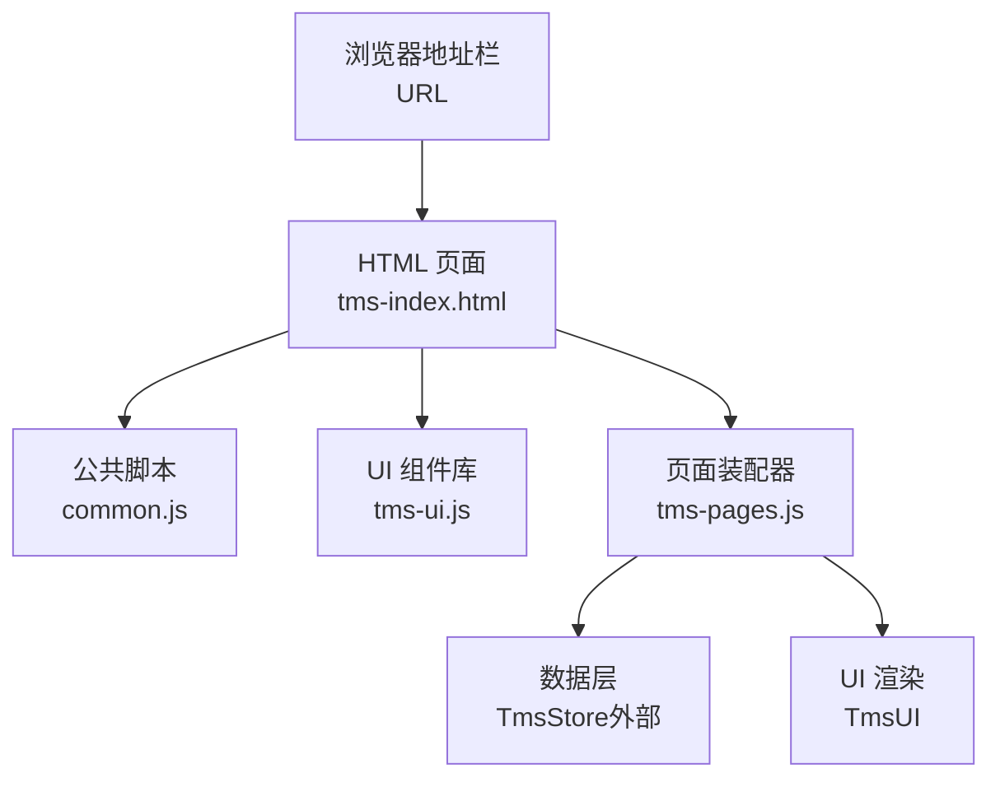
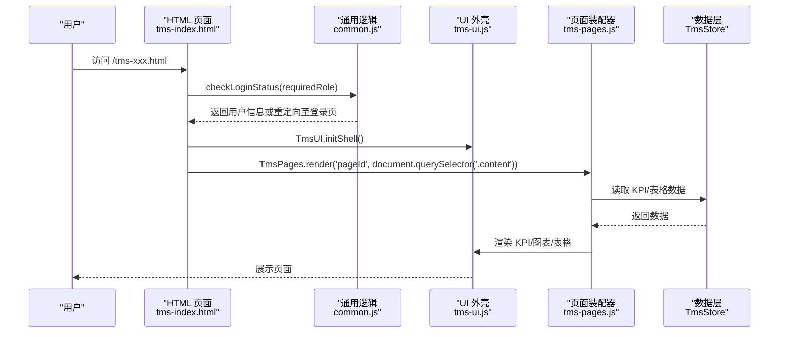
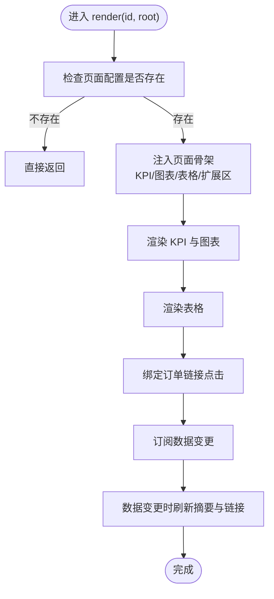
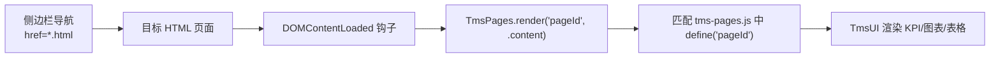
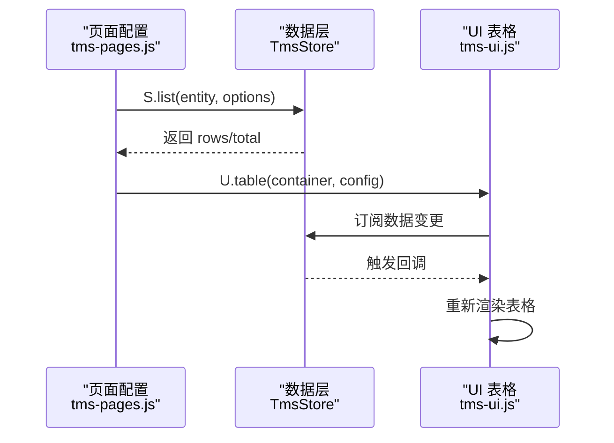
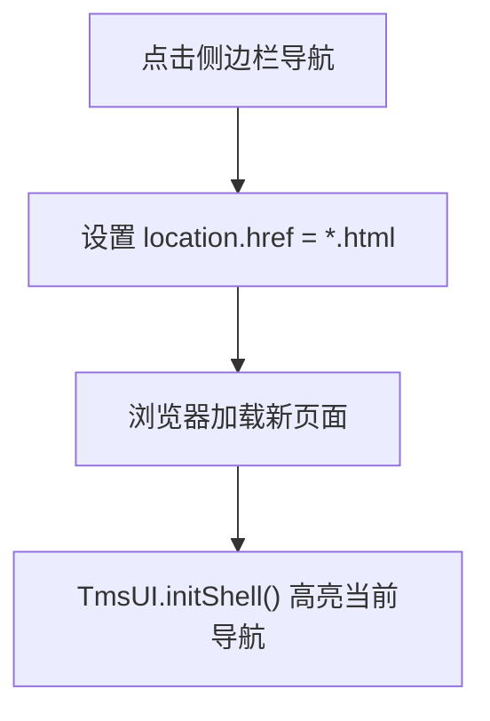
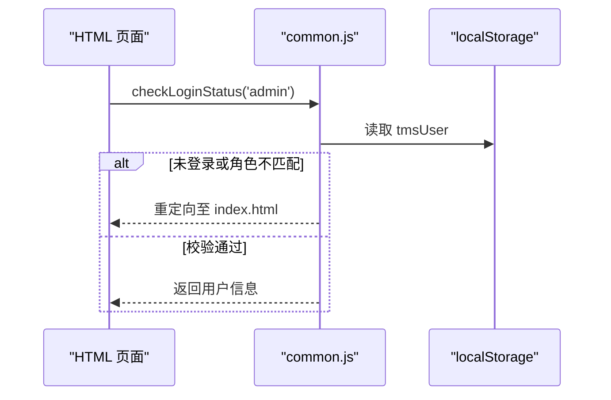
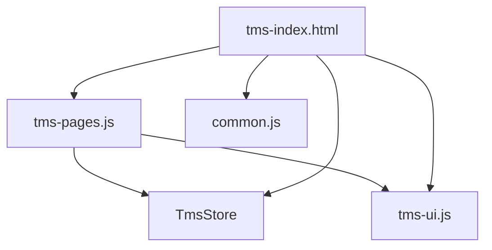

# 路由注册机制

<cite>
**本文引用的文件**   
- [tms-pages.js](file://tms-pages.js)
- [tms-ui.js](file://tms-ui.js)
- [common.js](file://common.js)
- [tms-index.html](file://tms-index.html)
</cite>

## 目录
1. [引言](#引言)
2. [项目结构](#项目结构)
3. [核心组件](#核心组件)
4. [架构总览](#架构总览)
5. [详细组件分析](#详细组件分析)
6. [依赖关系分析](#依赖关系分析)
7. [性能与优化](#性能与优化)
8. [故障排查指南](#故障排查指南)
9. [结论](#结论)
10. [附录：新增页面路由配置示例](#附录新增页面路由配置示例)

## 引言
本文件面向 TMS 管理系统的前端“路由注册机制”，聚焦 tms-pages.js 中的页面装配与渲染流程，解释 URL 路径到页面组件的映射方式、参数传递与状态管理、页面跳转与导航历史、以及权限守卫的实现。同时给出 SPA 模式下的页面切换优化建议，并提供为新页面添加路由支持的完整步骤。

## 项目结构
TMS 前端采用多 HTML 页面 + 共享 JS 模块的组织方式：
- tms-pages.js：定义所有业务页面的“页面配置”（标题、KPI、图表、表格、工具栏、操作等），并提供统一的 render(id, root) 渲染器。
- tms-ui.js：提供 UI 组件库（表单弹窗、列表、KPI、图表、详情、时间线、页面外壳初始化等）。
- common.js：通用函数与登录/登出、角色校验、用户信息展示等。
- tms-index.html：运营首页，包含侧边栏导航、主内容区，并加载上述脚本；通过 location.href 进行页面跳转。

**图示来源**  
- [tms-index.html:437-440](file://tms-index.html#L437-L440)  
- [tms-pages.js:1-16](file://tms-pages.js#L1-L16)  
- [tms-ui.js:758-781](file://tms-ui.js#L758-L781)

**章节来源**  
- [tms-index.html:293-440](file://tms-index.html#L293-L440)  
- [tms-pages.js:1-16](file://tms-pages.js#L1-L16)  
- [tms-ui.js:701-781](file://tms-ui.js#L701-L781)  
- [common.js:135-209](file://common.js#L135-L209)

## 核心组件
- 页面装配器（tms-pages.js）
  - define(id, config)：注册页面配置，id 为页面标识符，config 包含 title、subtitle、kpis、charts、table、extraBefore/After 等。
  - render(id, root)：根据 id 查找已注册的页面配置，向根节点注入统一页面骨架（头部、KPI、图表、表格、扩展区域），并绑定事件与订阅数据变更。
- UI 组件库（tms-ui.js）
  - initShell(options)：高亮当前导航项、处理子菜单展开、绑定退出按钮、显示当前用户、计算异常待办角标。
  - table(container, config)：通用数据表格，支持搜索、筛选、排序、分页、工具栏、行操作、行点击回调。
  - formModal/modal/confirm/toast/detailModal/timeline 等：表单弹窗、确认框、消息提示、详情弹窗、时间线等。
- 通用逻辑（common.js）
  - login/logout/checkLoginStatus/displayCurrentUser：登录、登出、角色校验、用户信息显示。

**章节来源**  
- [tms-pages.js:14-16](file://tms-pages.js#L14-L16)  
- [tms-pages.js:108-135](file://tms-pages.js#L108-L135)  
- [tms-ui.js:703-746](file://tms-ui.js#L703-L746)  
- [tms-ui.js:303-544](file://tms-ui.js#L303-L544)  
- [common.js:135-209](file://common.js#L135-L209)

## 架构总览
下图展示了从 URL 到页面渲染的核心流程：

**图示来源**  
- [tms-index.html:441-464](file://tms-index.html#L441-L464)  
- [tms-ui.js:703-746](file://tms-ui.js#L703-L746)  
- [tms-pages.js:108-135](file://tms-pages.js#L108-L135)

## 详细组件分析

### 页面注册与渲染流程（tms-pages.js）
- 页面注册：通过 define(pageId, config) 将页面配置存入内部 pages 表。
- 页面渲染：render(id, root) 负责：
  - 校验配置与根节点
  - 注入页面骨架（标题、副标题、KPI、图表、表格、扩展区域）
  - 调用 kpis/charts/extraBefore/table/extraAfter 完成具体渲染
  - 绑定订单链接点击事件
  - 订阅数据变化后刷新摘要与订单链接

**图示来源**  
- [tms-pages.js:108-135](file://tms-pages.js#L108-L135)

**章节来源**  
- [tms-pages.js:14-16](file://tms-pages.js#L14-L16)  
- [tms-pages.js:108-135](file://tms-pages.js#L108-L135)

### URL 路径与页面组件映射
- 当前实现并非基于单页应用的路由框架，而是以“多 HTML 页面 + 侧边栏导航”的方式组织。
- 每个业务页面 HTML 在 DOMContentLoaded 中调用 TmsPages.render('pageId', container)，从而将 pageId 映射到 tms-pages.js 中已注册的页面配置。
- 侧边栏导航使用 href 指向具体 HTML 文件，如 tms-order.html、tms-transport.html 等。

**图示来源**  
- [tms-index.html:309-369](file://tms-index.html#L309-L369)  
- [tms-pages.js:14-16](file://tms-pages.js#L14-L16)

**章节来源**  
- [tms-index.html:309-369](file://tms-index.html#L309-L369)  
- [tms-pages.js:14-16](file://tms-pages.js#L14-L16)

### 参数传递与状态管理
- 参数传递：
  - 页面间跳转主要通过 location.href 跳转到不同 HTML 文件。
  - 部分页面内跳转使用 hash 定位（如 tms-index.html 中的 switchTab/scrollToSection）。
  - 页面内数据联动通过 TmsStore 订阅机制实现（例如表格订阅数据变更自动刷新）。
- 状态管理：
  - TmsStore 提供 list/get/create/update 等方法，页面通过 S.list(entity, options) 获取数据，并通过 S.subscribe(callback) 订阅更新。
  - UI 层的表格组件在 entity 模式下会订阅 TmsStore 变更，自动重新渲染。

**图示来源**  
- [tms-ui.js:303-544](file://tms-ui.js#L303-L544)  
- [tms-pages.js:108-135](file://tms-pages.js#L108-L135)

**章节来源**  
- [tms-index.html:467-473](file://tms-index.html#L467-L473)  
- [tms-ui.js:303-544](file://tms-ui.js#L303-L544)  
- [tms-pages.js:108-135](file://tms-pages.js#L108-L135)

### 页面跳转与导航历史
- 页面跳转：
  - 侧边栏导航通过 <a href="*.html"> 直接跳转。
  - 快捷入口使用 location.href 动态拼接 hash 进行页面内定位。
- 导航历史：
  - 未使用 History API 或路由框架，因此无内置前进后退控制。
  - 可通过 window.history.pushState/replaceState 扩展以实现更细粒度的导航历史管理。

**图示来源**  
- [tms-index.html:309-369](file://tms-index.html#L309-L369)  
- [tms-ui.js:703-710](file://tms-ui.js#L703-L710)

**章节来源**  
- [tms-index.html:309-369](file://tms-index.html#L309-L369)  
- [tms-ui.js:703-710](file://tms-ui.js#L703-L710)

### 路由守卫与权限检查
- 权限守卫：
  - common.js 提供 checkLoginStatus(requiredRole)，用于校验 localStorage 中的用户角色。
  - tms-index.html 在 DOMContentLoaded 中调用 checkLoginStatus('admin')，若未登录或角色不匹配则重定向至登录页。
- 登出：
  - common.js 提供 logout()，清空本地用户信息并重定向至登录页。
  - tms-ui.js 的 initShell 会绑定全局 logout-btn 的点击事件，委托给 global.logout。

**图示来源**  
- [common.js:176-199](file://common.js#L176-L199)  
- [tms-index.html:441-445](file://tms-index.html#L441-L445)  
- [tms-ui.js:719-727](file://tms-ui.js#L719-L727)

**章节来源**  
- [common.js:176-209](file://common.js#L176-L209)  
- [tms-index.html:441-445](file://tms-index.html#L441-L445)  
- [tms-ui.js:719-727](file://tms-ui.js#L719-L727)

## 依赖关系分析
- tms-pages.js 依赖：
  - TmsStore：数据查询、创建、更新、订阅。
  - TmsUI：KPI、图表、表格、弹窗、详情、时间线、页面外壳。
- tms-ui.js 依赖：
  - 全局对象 window.document、window.location。
  - 可选全局函数 global.logout、global.displayCurrentUser。
- tms-index.html 依赖：
  - common.js、tms-store.js、tms-ui.js、tms-pages.js。
  - 侧边栏导航与主内容区容器。

**图示来源**  
- [tms-pages.js:10-12](file://tms-pages.js#L10-L12)  
- [tms-ui.js:758-781](file://tms-ui.js#L758-L781)  
- [tms-index.html:437-440](file://tms-index.html#L437-L440)

**章节来源**  
- [tms-pages.js:10-12](file://tms-pages.js#L10-L12)  
- [tms-ui.js:758-781](file://tms-ui.js#L758-L781)  
- [tms-index.html:437-440](file://tms-index.html#L437-L440)

## 性能与优化
- 减少重复渲染：
  - 表格组件已内置订阅机制，避免手动频繁刷新。
  - 对大数据集建议使用分页（pageSize）与后端过滤（searchFields/filters）。
- 懒加载与按需渲染：
  - 当前为多页面模式，每次跳转加载新 HTML，天然具备一定隔离性。
  - 可考虑引入路由框架（如 HashRouter/HistoryRouter）实现单页应用，按需加载页面模块。
- 事件与内存管理：
  - 表格组件返回 destroy 方法，可在页面卸载时释放订阅。
  - 弹窗与模态框在关闭时移除事件监听，避免内存泄漏。
- 网络与存储：
  - 当前数据存储在内存/LocalStorage，适合演示与轻量场景。
  - 生产环境建议接入后端 API，结合缓存策略（如 Service Worker）提升首屏性能。

[本节为通用指导，无需代码引用]

## 故障排查指南
- 页面无法渲染：
  - 检查 tms-pages.js 是否已 define('pageId', config)。
  - 检查 HTML 是否在 DOMContentLoaded 中调用 TmsPages.render('pageId', container)。
- 表格数据不更新：
  - 确认表格配置中包含 entity，且 TmsStore 已正确订阅。
  - 检查 S.subscribe 回调是否正确触发。
- 权限校验失败：
  - 检查 localStorage 中 tmsUser 是否存在且 role 匹配 requiredRole。
  - 确认 tms-index.html 中已调用 checkLoginStatus('admin')。
- 导航高亮异常：
  - 检查 TmsUI.initShell 是否被调用。
  - 确认侧边栏 a 标签的 href 与 location.pathname 一致。

**章节来源**  
- [tms-pages.js:108-135](file://tms-pages.js#L108-L135)  
- [tms-ui.js:703-746](file://tms-ui.js#L703-L746)  
- [common.js:176-199](file://common.js#L176-L199)

## 结论
TMS 前端当前采用多 HTML 页面 + 共享 JS 模块的模式，通过 tms-pages.js 的 define/render 机制实现页面配置与渲染，配合 tms-ui.js 的 UI 组件库与 common.js 的权限守卫，形成完整的页面装配与导航体系。虽然未使用现代路由框架，但通过侧边栏导航与页面内 hash 定位，已能满足基本业务需求。未来可考虑引入单页应用路由以提升交互体验与性能。

[本节为总结，无需代码引用]

## 附录：新增页面路由配置示例
步骤如下：
1. 在 tms-pages.js 中使用 define('newPage', { ... }) 注册页面配置，包含 title、subtitle、kpis、charts、table、extraBefore/After 等。
2. 在侧边栏导航中添加 <a href="tms-new-page.html"> 链接。
3. 新建 tms-new-page.html，并在 DOMContentLoaded 中调用 TmsPages.render('newPage', document.querySelector('.content'))。
4. 如需权限控制，在 HTML 中调用 checkLoginStatus('requiredRole')。
5. 如需页面内跳转，使用 location.href 或 history.pushState。

示例要点：
- define('newPage', { title: '新页面', subtitle: '描述', table: { entity: 'entities', columns: [...] } })
- HTML 中：
- 权限：if (checkLoginStatus('admin') === undefined) return;

**章节来源**  
- [tms-pages.js:14-16](file://tms-pages.js#L14-L16)  
- [tms-index.html:309-369](file://tms-index.html#L309-L369)  
- [common.js:176-199](file://common.js#L176-L199)