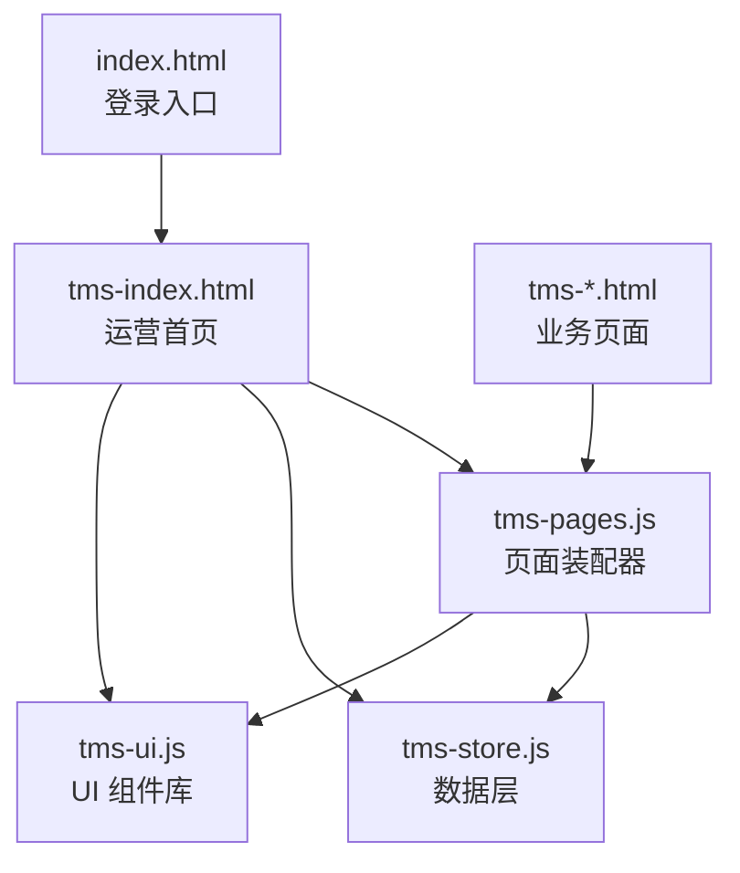
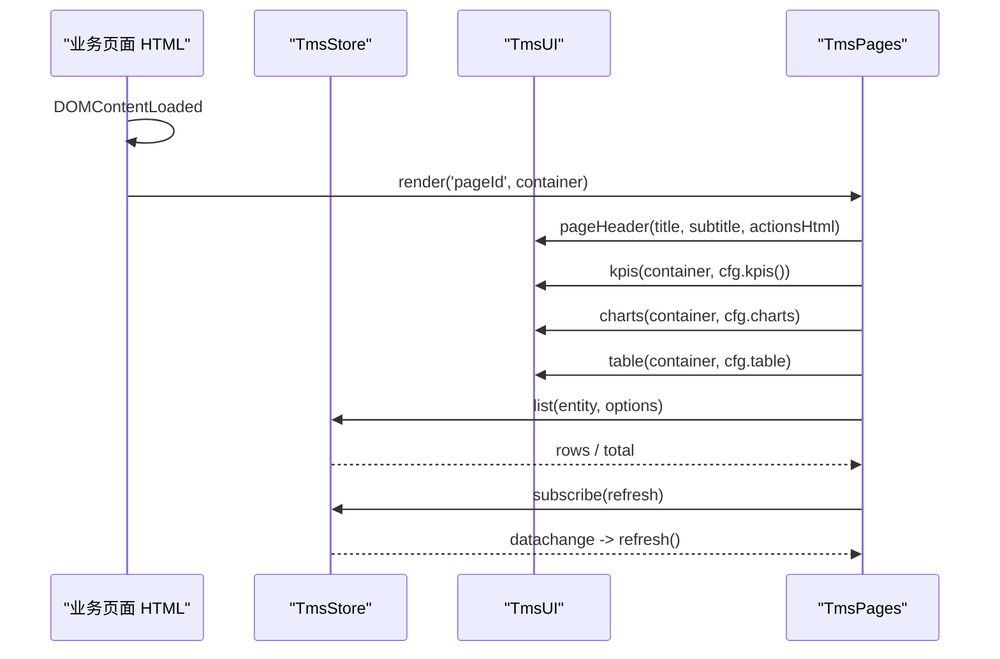
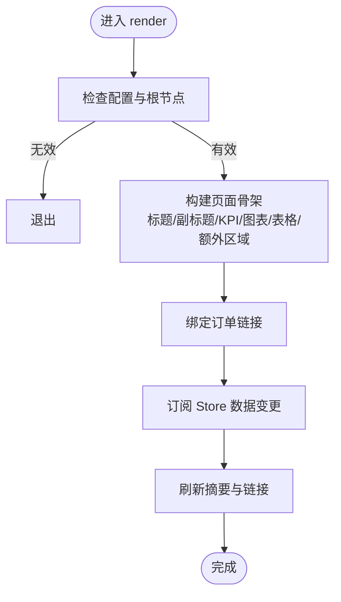
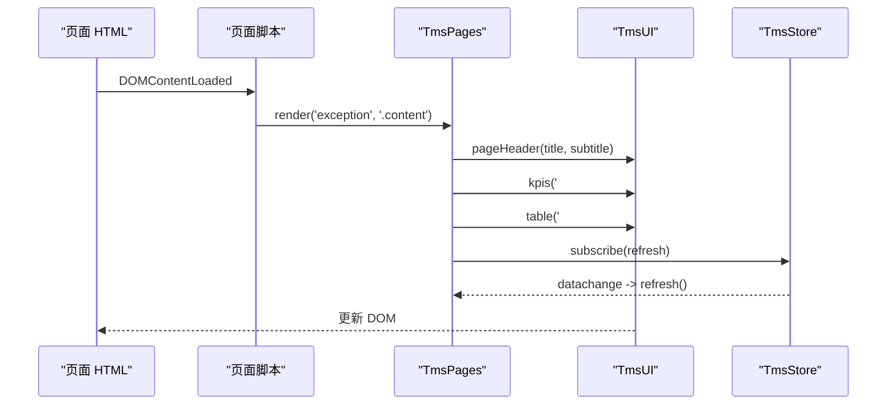
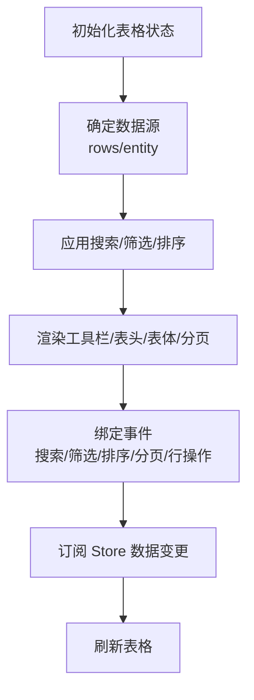
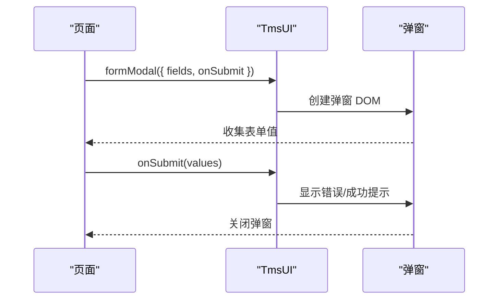
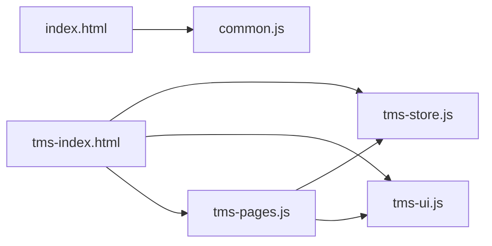

# 页面开发流程

<cite>
**本文引用的文件**   
- [tms-pages.js](file://tms-pages.js)
- [tms-ui.js](file://tms-ui.js)
- [tms-store.js](file://tms-store.js)
- [index.html](file://index.html)
- [tms-index.html](file://tms-index.html)
</cite>

## 目录
1. [引言](#引言)
2. [项目结构](#项目结构)
3. [核心组件](#核心组件)
4. [架构总览](#架构总览)
5. [详细组件分析](#详细组件分析)
6. [依赖关系分析](#依赖关系分析)
7. [性能与可维护性](#性能与可维护性)
8. [故障排查指南](#故障排查指南)
9. [结论](#结论)
10. [附录：从零创建业务页面清单](#附录从零创建业务页面清单)

## 引言
本指南面向需要独立开发 TMS 系统业务页面的前端开发者，目标是让你掌握从 HTML 模板、页面配置到路由注册、数据绑定与权限控制的全流程。文档重点解释 tms-pages.js 中的页面装配机制、define() 函数与页面配置对象结构（title、subtitle、kpis、charts、table 等），并说明页面生命周期管理（DOMContentLoaded、渲染流程、数据订阅）。文末提供从简单列表页到复杂 CRUD 操作页的完整实践路径，以及权限集成、样式适配与响应式设计的最佳实践。

## 项目结构
仓库采用“HTML 页面 + 共享 JS/CSS”的组织方式：
- 页面层：各业务模块以独立的 HTML 文件存在，如 tms-exception.html、tms-transport.html、tms-finance.html 等。
- 装配层：tms-pages.js 负责将页面配置统一装配为“KPI + 图表 + 表格 + 工具栏/操作”的标准结构。
- UI 层：tms-ui.js 提供通用 UI 能力（Toast、弹窗、表单、表格、图表、状态标签、详情展示等）。
- 数据层：tms-store.js 提供基于 localStorage 的数据存储、CRUD、搜索筛选排序分页、统计聚合与事件订阅。
- 入口与登录：index.html 是登录入口；tms-index.html 是运营首页，演示了页面外壳初始化与仪表盘渲染。

**图示来源**
- [index.html:145-168](file://index.html#L145-L168)
- [tms-index.html:431-458](file://tms-index.html#L431-L458)
- [tms-ui.js:758-781](file://tms-ui.js#L758-L781)
- [tms-store.js:1-12](file://tms-store.js#L1-L12)
- [tms-pages.js:1-16](file://tms-pages.js#L1-L16)

**章节来源**
- [index.html:1-172](file://index.html#L1-L172)
- [tms-index.html:1-581](file://tms-index.html#L1-L581)

## 核心组件
- 页面装配器（tms-pages.js）
  - define(id, config)：注册页面配置。
  - render(id, root)：根据配置渲染页面骨架（标题、副标题、KPI、图表、表格、额外区域），并绑定订单链接与数据变更订阅。
- UI 组件库（tms-ui.js）
  - 基础工具：esc、fmt（日期/时间/金额/数字/百分比）、statusBadge、badge。
  - 交互组件：toast、modal、confirmDialog、formModal。
  - 列表组件：table（支持 entity、rows、columns、actions、search、filters、pageSize、defaultSort、toolbar、emptyText、onRowClick、rowClass）。
  - 图表组件：lineChart、barChart、donutChart。
  - 详情组件：detailModal、detailGrid、timeline。
  - 页面外壳：initShell、pageHeader、emptyState。
- 数据层（tms-store.js）
  - 持久化：localStorage 读写、版本控制、事件广播（tms:datachange）。
  - 数据模型：订单、异常、运输、扫描、财务、理赔、员工、车辆、库存、运力、策略、路由、时效规则等。
  - API：list、get、create、update、advanceOrder、createException、resolveException、createClaim、approveClaim、createTicket、resolveTicket、completeSorting、completeLoading、financeSummary、financeTrend、overview、orderTrend、statusDistribution、exceptionByType、warehouseStats、vehicleStats、employeeStats 等。
  - 订阅：subscribe(fn)，供页面在数据变化时刷新。

**章节来源**
- [tms-pages.js:14-16](file://tms-pages.js#L14-L16)
- [tms-pages.js:108-135](file://tms-pages.js#L108-L135)
- [tms-ui.js:12-55](file://tms-ui.js#L12-L55)
- [tms-ui.js:88-105](file://tms-ui.js#L88-L105)
- [tms-ui.js:109-158](file://tms-ui.js#L109-L158)
- [tms-ui.js:165-287](file://tms-ui.js#L165-L287)
- [tms-ui.js:303-544](file://tms-ui.js#L303-L544)
- [tms-ui.js:548-680](file://tms-ui.js#L548-L680)
- [tms-ui.js:684-699](file://tms-ui.js#L684-L699)
- [tms-ui.js:703-752](file://tms-ui.js#L703-L752)
- [tms-store.js:1-12](file://tms-store.js#L1-L12)
- [tms-store.js:220-244](file://tms-store.js#L220-L244)

## 架构总览
页面开发遵循“配置驱动 + 组件复用 + 数据订阅”的模式：
- 每个业务页面通过 define() 声明配置，包含 title、subtitle、kpis、charts、table 等属性。
- 页面在 DOMContentLoaded 中调用 TmsPages.render(pageId, container) 完成渲染。
- 表格与 KPI/图表通过 TmsStore.list/get 获取数据，并通过 subscribe 实现实时联动。
- UI 组件统一使用 tms- 前缀类名，避免样式冲突。

**图示来源**
- [tms-pages.js:108-135](file://tms-pages.js#L108-L135)
- [tms-ui.js:748-752](file://tms-ui.js#L748-L752)
- [tms-store.js:237-244](file://tms-store.js#L237-L244)

## 详细组件分析

### 页面装配机制（tms-pages.js）
- define(id, config)
  - 作用：将页面配置注册到内部 pages 映射表。
  - 参数：id 为页面标识，config 为页面配置对象。
- render(id, root)
  - 作用：根据配置生成页面骨架，注入 KPI、图表、表格与额外区域，并绑定订单链接与数据订阅。
  - 关键步骤：
    - 设置根容器 class 为 tms-page。
    - 使用 U.pageHeader 渲染标题与副标题。
    - 渲染 KPI 容器 #tms-kpis。
    - 可选渲染图表容器 #tms-charts。
    - 渲染额外前置区域 #tms-extra-before。
    - 渲染表格面板 #tms-table-panel。
    - 渲染额外后置区域 #tms-extra-after。
    - 绑定订单链接点击事件。
    - 订阅 Store 数据变更，刷新摘要与链接。

**图示来源**
- [tms-pages.js:108-135](file://tms-pages.js#L108-L135)

**章节来源**
- [tms-pages.js:14-16](file://tms-pages.js#L14-L16)
- [tms-pages.js:108-135](file://tms-pages.js#L108-L135)

### 页面配置对象结构
- title：页面主标题。
- subtitle：页面副标题或说明。
- kpis：返回 KPI 数组的函数，每项包含 label、value、color、sub。
- charts：可选函数，用于在图表容器中绘制图表（line/bar/donut）。
- table：表格配置对象，包含：
  - entity：数据实体名称（如 orders、exceptions、transports）。
  - rows：可选覆盖数据源（函数或数组）。
  - columns：列定义数组，每项包含 key、label、render、width、sortable。
  - actions：行操作按钮数组，每项包含 label、className、show、onClick。
  - searchPlaceholder、searchFields：搜索占位与字段。
  - filters：筛选器数组，每项包含 key、label、options。
  - pageSize：每页条数（0 表示不分页）。
  - defaultSort：默认排序键与方向。
  - toolbar：工具栏按钮数组，每项包含 text、className、onClick。
  - emptyText：空数据提示文本。
  - onRowClick、rowClass：行点击回调与行样式函数。

示例参考：
- 异常管理：[tms-pages.js:139-248](file://tms-pages.js#L139-L248)
- 运输管理：[tms-pages.js:252-357](file://tms-pages.js#L252-L357)
- 仓储管理：[tms-pages.js:361-472](file://tms-pages.js#L361-L472)
- 财务管理：[tms-pages.js:925-1025](file://tms-pages.js#L925-L1025)

**章节来源**
- [tms-pages.js:139-248](file://tms-pages.js#L139-L248)
- [tms-pages.js:252-357](file://tms-pages.js#L252-L357)
- [tms-pages.js:361-472](file://tms-pages.js#L361-L472)
- [tms-pages.js:925-1025](file://tms-pages.js#L925-L1025)

### 页面生命周期管理
- DOMContentLoaded
  - 业务页面在 DOMContentLoaded 中调用 TmsPages.render(pageId, container)。
  - 运营首页还调用 TmsUI.initShell() 初始化导航、用户信息与角标。
- 渲染流程
  - 页面装配器按顺序渲染标题、KPI、图表、表格与额外区域。
  - 表格组件内部处理搜索、筛选、排序、分页与行操作。
- 数据绑定机制
  - 表格与 KPI/图表通过 TmsStore.list/get 获取数据。
  - 通过 TmsStore.subscribe 监听数据变更，自动刷新页面内容。
  - 订单链接通过 data-order-link 属性与点击事件绑定，打开详情弹窗。

**图示来源**
- [tms-index.html:437-458](file://tms-index.html#L437-L458)
- [tms-pages.js:108-135](file://tms-pages.js#L108-L135)
- [tms-ui.js:703-752](file://tms-ui.js#L703-L752)
- [tms-store.js:237-244](file://tms-store.js#L237-L244)

**章节来源**
- [tms-index.html:437-458](file://tms-index.html#L437-L458)
- [tms-pages.js:108-135](file://tms-pages.js#L108-L135)

### 表格组件（tms-ui.js）
- 数据源优先级：cfg.rows（函数/数组） > cfg.entity（TmsStore.list）。
- 过滤与排序：支持 search、filters、sort（默认与点击切换）。
- 分页：当 pageSize > 0 时启用分页控件。
- 工具栏：支持搜索框、筛选下拉、自定义按钮（toolbar）。
- 行操作：actions 数组，支持 show 条件与 onClick 回调。
- 事件绑定：搜索防抖、筛选变更、排序切换、分页点击、行操作点击、行点击回调。
- 数据订阅：当使用 entity 时，自动订阅 Store 数据变更并刷新。

**图示来源**
- [tms-ui.js:303-544](file://tms-ui.js#L303-L544)

**章节来源**
- [tms-ui.js:303-544](file://tms-ui.js#L303-L544)

### 表单弹窗与确认框
- formModal：动态生成表单字段（select、textarea、checkbox、number、date 等），支持必填校验、错误提示、异步提交、成功提示。
- confirmDialog：弹出确认对话框，返回 Promise，支持危险操作标记。
- modal：通用弹窗框架，支持关闭按钮、ESC 关闭、遮罩点击关闭。

**图示来源**
- [tms-ui.js:165-287](file://tms-ui.js#L165-L287)
- [tms-ui.js:139-158](file://tms-ui.js#L139-L158)
- [tms-ui.js:109-137](file://tms-ui.js#L109-L137)

**章节来源**
- [tms-ui.js:165-287](file://tms-ui.js#L165-L287)
- [tms-ui.js:139-158](file://tms-ui.js#L139-L158)
- [tms-ui.js:109-137](file://tms-ui.js#L109-L137)

### 图表与 KPI
- KPI：U.kpis(container, items) 渲染指标卡片，支持颜色与副标题。
- 图表：U.charts.line/bar/donut 渲染 SVG 图表，支持多系列、图例、高度配置。
- 详情展示：U.detailModal/U.detailGrid/U.timeline 用于展示详细信息与轨迹。

**章节来源**
- [tms-ui.js:548-680](file://tms-ui.js#L548-L680)
- [tms-ui.js:684-699](file://tms-ui.js#L684-L699)

### 页面外壳与导航
- initShell：高亮当前导航项、展开子菜单、绑定退出登录、显示当前用户、计算异常待办角标。
- pageHeader：生成页面头部（标题、副标题、操作区）。
- emptyState：空状态提示。

**章节来源**
- [tms-ui.js:703-752](file://tms-ui.js#L703-L752)

## 依赖关系分析
- tms-pages.js 依赖：
  - TmsStore：读取数据、触发数据变更订阅。
  - TmsUI：渲染页面骨架、表格、图表、弹窗、状态标签等。
- tms-ui.js 依赖：
  - 无外部依赖，纯前端 UI 组件库。
- tms-store.js 依赖：
  - localStorage：持久化数据。
  - 全局事件：tms:datachange 通知订阅者。

**图示来源**
- [tms-pages.js:10-12](file://tms-pages.js#L10-L12)
- [tms-store.js:1-12](file://tms-store.js#L1-L12)
- [tms-ui.js:758-781](file://tms-ui.js#L758-L781)
- [index.html:145-168](file://index.html#L145-L168)
- [tms-index.html:431-458](file://tms-index.html#L431-L458)

**章节来源**
- [tms-pages.js:10-12](file://tms-pages.js#L10-L12)
- [tms-store.js:1-12](file://tms-store.js#L1-L12)
- [tms-ui.js:758-781](file://tms-ui.js#L758-L781)

## 性能与可维护性
- 数据访问优化：
  - 表格组件对搜索输入进行防抖（220ms），减少频繁重绘。
  - 分页仅在 pageSize > 0 时启用，避免大数据量时的内存压力。
  - 使用 TmsStore.list 的 sort/page/pageSize 参数，服务端侧（模拟）减少不必要的数据传输。
- 渲染优化：
  - 页面装配器按需渲染 KPI/图表/表格，避免无关 DOM 插入。
  - 表格组件在数据变更时跳过正在编辑的输入框，防止焦点丢失。
- 可维护性：
  - 所有 UI 类名使用 tms- 前缀，避免样式冲突。
  - 页面配置集中定义，便于扩展与维护。
  - 数据层与 UI 层解耦，便于替换或升级。

[本节为通用指导，不直接分析具体文件]

## 故障排查指南
- 页面未渲染
  - 检查是否在 DOMContentLoaded 中调用了 TmsPages.render(pageId, container)。
  - 确认页面配置已通过 define() 注册。
- 表格无数据
  - 检查 table.entity 是否正确，TmsStore.list 是否返回数据。
  - 检查 searchFields 与 filters 是否匹配数据字段。
- 表单提交失败
  - 检查必填字段校验逻辑，查看错误提示元素。
  - 确认 onSubmit 回调中是否正确调用 S.create/update 等方法。
- 数据不同步
  - 检查是否订阅了 TmsStore.subscribe，并在回调中刷新页面。
  - 确认数据变更后触发了 tms:datachange 事件。

**章节来源**
- [tms-pages.js:108-135](file://tms-pages.js#L108-L135)
- [tms-ui.js:303-544](file://tms-ui.js#L303-L544)
- [tms-store.js:237-244](file://tms-store.js#L237-L244)

## 结论
通过 tms-pages.js 的页面装配机制与 tms-ui.js 的组件库，开发者可以快速构建符合系统规范的页面模块。结合 tms-store.js 的数据层能力，可以实现数据驱动的实时页面更新。遵循本文档的流程与实践，你可以独立完成从简单列表页到复杂 CRUD 操作页的开发，并集成权限控制、样式适配与响应式设计。

[本节为总结，不直接分析具体文件]

## 附录：从零创建业务页面清单
1. 创建 HTML 页面
   - 复制现有页面模板（如 tms-exception.html），修改标题与导航链接。
   - 在页面底部引入 common.js、tms-store.js、tms-ui.js、tms-pages.js。
2. 注册页面配置
   - 在 tms-pages.js 中使用 define('yourPageId', { ... }) 注册页面配置。
   - 配置 title、subtitle、kpis、charts、table 等属性。
3. 在页面中调用渲染
   - 在 DOMContentLoaded 中调用 TmsPages.render('yourPageId', document.querySelector('.content'))。
4. 配置表格
   - 设置 table.entity 为数据实体名称。
   - 定义 columns、actions、toolbar、filters、searchFields 等。
5. 集成数据与事件
   - 使用 TmsStore.list/get 获取数据。
   - 使用 TmsStore.subscribe 监听数据变更并刷新页面。
6. 权限控制
   - 在 actions.show 中根据用户角色或权限码控制按钮显示。
   - 在 toolbar.onClick 中检查权限后再执行操作。
7. 样式与响应式
   - 使用 tms-ui.css 提供的样式类，确保一致性。
   - 利用 CSS 媒体查询适配移动端布局。

**章节来源**
- [tms-pages.js:139-248](file://tms-pages.js#L139-L248)
- [tms-ui.js:303-544](file://tms-ui.js#L303-L544)
- [tms-store.js:237-244](file://tms-store.js#L237-L244)