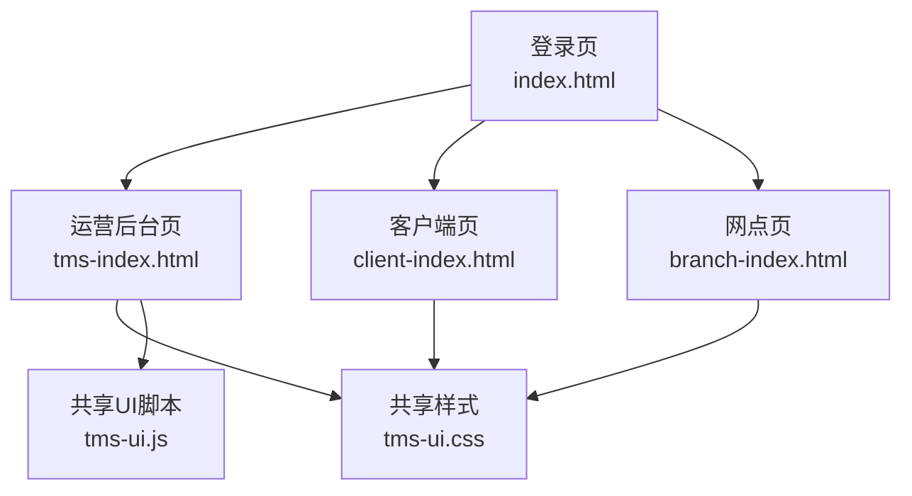
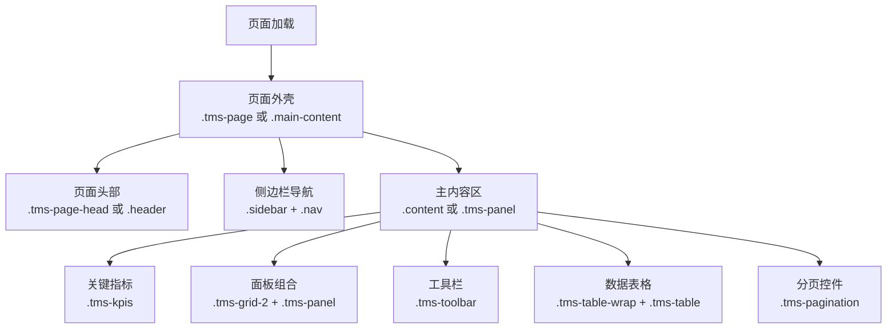
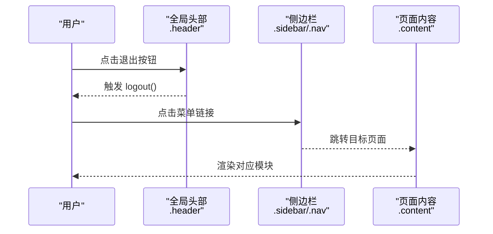
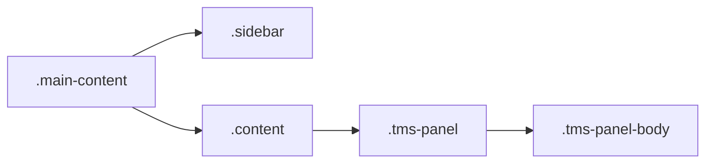
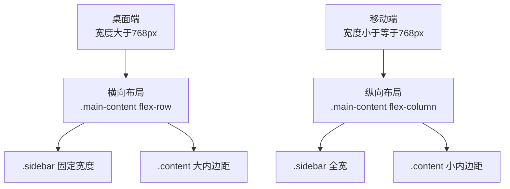
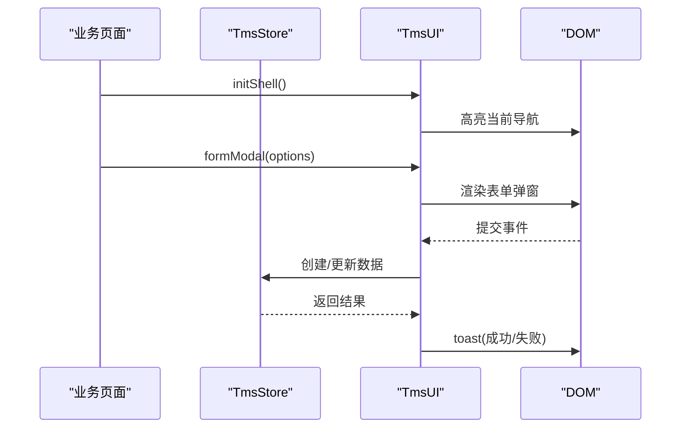

# 页面模板结构

<cite>
**本文引用的文件**   
- [index.html](file://index.html)
- [tms-index.html](file://tms-index.html)
- [client-index.html](file://client-index.html)
- [branch-index.html](file://branch-index.html)
- [tms-ui.css](file://tms-ui.css)
- [tms-ui.js](file://tms-ui.js)
</cite>

## 目录
1. [引言](#引言)
2. [项目结构与模板定位](#项目结构与模板定位)
3. [标准页面骨架与语义化容器](#标准页面骨架与语义化容器)
4. [头部导航规范](#头部导航规范)
5. [主内容区域与侧边栏布局](#主内容区域与侧边栏布局)
6. [共享样式类与命名规范](#共享样式类与命名规范)
7. [响应式设计与媒体查询适配](#响应式设计与媒体查询适配)
8. [完整页面模板示例说明](#完整页面模板示例说明)
9. [依赖关系与组件交互](#依赖关系与组件交互)
10. [性能与可维护性建议](#性能与可维护性建议)
11. [常见问题排查](#常见问题排查)
12. [结论](#结论)

## 引言
本文件面向 TMS 运输管理系统的页面模板结构，目标是明确 HTML 页面的标准结构、头部导航、主内容区域、底部信息栏的布局规范，并解释页面容器元素的使用方式、CSS 类名命名规范、样式继承机制以及响应式设计适配方案。文档同时提供完整的页面模板组织思路，帮助新增页面与既有页面保持统一风格。

## 项目结构与模板定位
仓库采用“多角色入口 + 共享 UI 库”的结构：
- 登录入口：`index.html`
- 运营后台典型页面：`tms-index.html`
- 客户端入口：`client-index.html`
- 网点入口：`branch-index.html`
- 共享样式：`tms-ui.css`
- 共享 UI 组件脚本：`tms-ui.js`

**图表来源**
- [index.html:1-172](file://index.html#L1-L172)
- [tms-index.html:1-587](file://tms-index.html#L1-L587)
- [client-index.html:1-765](file://client-index.html#L1-L765)
- [branch-index.html:1-284](file://branch-index.html#L1-L284)
- [tms-ui.css:1-795](file://tms-ui.css#L1-L795)
- [tms-ui.js:1-783](file://tms-ui.js#L1-L783)

**章节来源**
- [index.html:1-172](file://index.html#L1-L172)
- [tms-index.html:1-587](file://tms-index.html#L1-L587)
- [client-index.html:1-765](file://client-index.html#L1-L765)
- [branch-index.html:1-284](file://branch-index.html#L1-L284)

## 标准页面骨架与语义化容器
TMS 系统存在两套页面骨架：
- 传统骨架：使用 `.header`、`.main-content`、`.sidebar`、`.content` 等通用类名，常见于各角色首页。
- 共享 UI 骨架：使用 `.tms-page`、`.tms-page-head`、`.tms-panel`、`.tms-toolbar` 等以 `tms-` 前缀命名的类，由 `tms-ui.css` 提供统一视觉。

推荐的新增页面应优先采用共享 UI 骨架，以保证整体风格一致；若为旧页面或特殊场景，可沿用传统骨架，但需避免与 `tms-` 类名冲突。

**图表来源**
- [tms-ui.css:7-11](file://tms-ui.css#L7-L11)
- [tms-ui.css:13-39](file://tms-ui.css#L13-L39)
- [tms-ui.css:42-105](file://tms-ui.css#L42-L105)
- [tms-ui.css:107-161](file://tms-ui.css#L107-L161)
- [tms-ui.css:245-356](file://tms-ui.css#L245-L356)
- [tms-index.html:374-432](file://tms-index.html#L374-L432)

**章节来源**
- [tms-ui.css:1-795](file://tms-ui.css#L1-L795)
- [tms-index.html:374-432](file://tms-index.html#L374-L432)

## 头部导航规范
头部导航包含两个层面：
- 全局顶部导航：用于展示系统名称、当前角色、退出登录按钮。
- 侧边栏导航：按角色划分功能菜单，支持子菜单展开。

### 全局顶部导航
- 容器：`<header class="header">`
- 左侧：品牌/标题
- 右侧：用户信息与退出按钮
- 样式：Flex 布局，背景白色，带阴影

### 侧边栏导航
- 容器：`<aside class="sidebar">`
- 导航：`<nav class="nav">`
- 菜单项：`<ul><li><a href="...">...</a></li></ul>`
- 子菜单：通过 `.has-submenu` 与 `.submenu` 控制显示隐藏
- 激活态：通过 `.active` 高亮当前页

**图表来源**
- [tms-index.html:297-303](file://tms-index.html#L297-L303)
- [tms-index.html:308-370](file://tms-index.html#L308-L370)
- [tms-index.html:176-220](file://tms-index.html#L176-L220)

**章节来源**
- [tms-index.html:297-303](file://tms-index.html#L297-L303)
- [tms-index.html:308-370](file://tms-index.html#L308-L370)
- [tms-index.html:176-220](file://tms-index.html#L176-L220)

## 主内容区域与侧边栏布局
主内容区域采用 Flex 布局：
- `.main-content` 作为左右布局容器
- `.sidebar` 固定宽度（桌面端）
- `.content` 自适应填充剩余空间

在移动端，通过媒体查询将 `.main-content` 改为纵向排列，`.sidebar` 宽度变为 100%，菜单横向滚动。

**图表来源**
- [tms-index.html:66-114](file://tms-index.html#L66-L114)
- [tms-ui.css:74-105](file://tms-ui.css#L74-L105)

**章节来源**
- [tms-index.html:66-114](file://tms-index.html#L66-L114)
- [tms-ui.css:74-105](file://tms-ui.css#L74-L105)

## 共享样式类与命名规范
所有共享样式均使用 `tms-` 前缀，避免与页面自有样式冲突。核心类别如下：

| 类别 | 用途 | 说明 |
| --- | --- | --- |
| `.tms-page` | 页面容器 | 垂直布局，间距统一 |
| `.tms-page-head` | 页面头部 | 标题与操作按钮组合 |
| `.tms-kpis` / `.tms-kpi` | 关键指标卡片 | 网格布局，数值突出 |
| `.tms-panel` / `.tms-panel-head` / `.tms-panel-body` | 面板容器 | 白底圆角卡片 |
| `.tms-toolbar` | 工具栏 | 搜索、筛选、批量操作 |
| `.tms-search` / `.tms-filter` | 搜索与筛选 | 输入框与下拉选择 |
| `.tms-btn` / `.tms-btn-primary` 等 | 按钮 | 基础按钮与变体 |
| `.tms-table-wrap` / `.tms-table` | 表格 | 横向滚动与行悬停 |
| `.tms-pagination` / `.tms-page-btn` | 分页 | 上一页/下一页与页码 |
| `.tms-badge` / `.tms-badge-*` | 状态徽章 | 成功、警告、危险、信息、静音 |
| `.tms-form` / `.tms-field` | 表单 | 双列栅格布局 |
| `.tms-modal-overlay` / `.tms-modal` | 弹窗 | 遮罩与模态框 |
| `.tms-toast-container` / `.tms-toast` | 提示消息 | 右上角 Toast |

样式继承机制：
- 基础字体、颜色、行高由页面 `<style>` 或全局样式定义
- 共享组件通过 `tms-` 类覆盖默认行为
- 页面特有样式放在页面内 `<style>`，避免污染共享样式

**章节来源**
- [tms-ui.css:1-795](file://tms-ui.css#L1-L795)

## 响应式设计与媒体查询适配
现有页面普遍采用以下响应式策略：
- 断点：`max-width: 768px`
- 桌面端：`.main-content` 为横向 Flex，`.sidebar` 固定宽度
- 移动端：`.main-content` 改为纵向 Flex，`.sidebar` 宽度 100%，菜单横向滚动
- 内容区：`.content` 内边距缩小，提升小屏可读性

共享样式中也有针对表单的响应式处理：
- `.tms-form` 在小屏幕下切换为单列栅格

**图表来源**
- [tms-index.html:176-220](file://tms-index.html#L176-L220)
- [client-index.html:315-347](file://client-index.html#L315-L347)
- [branch-index.html:135-167](file://branch-index.html#L135-L167)
- [tms-ui.css:611-615](file://tms-ui.css#L611-L615)

**章节来源**
- [tms-index.html:176-220](file://tms-index.html#L176-L220)
- [client-index.html:315-347](file://client-index.html#L315-L347)
- [branch-index.html:135-167](file://branch-index.html#L135-L167)
- [tms-ui.css:611-615](file://tms-ui.css#L611-L615)

## 完整页面模板示例说明
以下为一个符合系统风格的页面模板组织方式（不直接粘贴代码，仅给出结构与引用路径）：

- 文档类型与语言：`<!DOCTYPE html>`，`<html lang="zh-CN">`
- 元信息：字符集、robots、viewport、标题
- 样式引入：
  - 页面级基础样式（重置、body、header、main-content、sidebar、content、响应式）
  - 共享样式：`tms-ui.css`
- 页面外壳：
  - 全局头部：`<header class="header">`
  - 主内容容器：`<main class="main-content">`
  - 侧边栏：`<aside class="sidebar"><nav class="nav">...</nav></aside>`
  - 内容区：`<section class="content">`
- 内容区内部：
  - 页面头部：`.tms-page-head`
  - 关键指标：`.tms-kpis`
  - 面板组合：`.tms-grid-2` + `.tms-panel`
  - 工具栏：`.tms-toolbar`
  - 表格：`.tms-table-wrap` + `.tms-table`
  - 分页：`.tms-pagination`
- 脚本引入：
  - 公共逻辑：`common.js`
  - 数据层：`tms-store.js`
  - UI 组件：`tms-ui.js`
  - 页面逻辑：`tms-pages.js`

参考路径：
- 登录页骨架与样式：[index.html:1-172](file://index.html#L1-L172)
- 运营后台页骨架与共享 UI 使用：[tms-index.html:293-440](file://tms-index.html#L293-L440)
- 客户端页骨架与响应式：[client-index.html:351-494](file://client-index.html#L351-L494)
- 网点页骨架与响应式：[branch-index.html:172-264](file://branch-index.html#L172-L264)

**章节来源**
- [index.html:1-172](file://index.html#L1-L172)
- [tms-index.html:293-440](file://tms-index.html#L293-L440)
- [client-index.html:351-494](file://client-index.html#L351-L494)
- [branch-index.html:172-264](file://branch-index.html#L172-L264)

## 依赖关系与组件交互
共享 UI 组件提供弹窗、表单、列表、图表、Toast 等能力，页面通过调用 `TmsUI` 接口完成交互。

**图表来源**
- [tms-ui.js:701-746](file://tms-ui.js#L701-L746)
- [tms-ui.js:160-287](file://tms-ui.js#L160-L287)
- [tms-ui.js:86-105](file://tms-ui.js#L86-L105)
- [tms-index.html:441-464](file://tms-index.html#L441-L464)

**章节来源**
- [tms-ui.js:1-783](file://tms-ui.js#L1-L783)
- [tms-index.html:441-464](file://tms-index.html#L441-L464)

## 性能与可维护性建议
- 优先复用 `.tms-*` 类，减少重复样式
- 页面级样式尽量局部化，避免影响共享组件
- 使用 `tms-ui.js` 提供的组件方法，避免手写复杂弹窗与表单逻辑
- 表格与分页使用 `table(container, config)` 配置化渲染，降低维护成本
- 图表使用 `charts.line/bar/donut`，统一 SVG 渲染与图例
- 对长列表启用分页，避免一次性渲染过多 DOM

[本节为通用建议，不直接分析具体文件]

## 常见问题排查
- 页面布局错乱：检查是否混用 `.tms-*` 与页面自有类名导致冲突
- 弹窗无法关闭：确认是否调用了 `modal.close()` 或触发了 ESC 键
- 表单校验未生效：确认字段配置 `required` 与 `onSubmit` 回调是否正确
- Toast 不显示：确认 `tms-ui.js` 已加载且 `toast` 被调用
- 响应式异常：检查媒体查询断点是否与页面样式一致

**章节来源**
- [tms-ui.js:109-137](file://tms-ui.js#L109-L137)
- [tms-ui.js:160-287](file://tms-ui.js#L160-L287)
- [tms-ui.js:86-105](file://tms-ui.js#L86-L105)

## 结论
TMS 系统的页面模板结构以“全局头部 + 侧边栏 + 主内容区”为核心，并通过 `tms-ui.css` 与 `tms-ui.js` 提供统一的视觉与交互能力。新增页面应优先采用 `.tms-page`、`.tms-page-head`、`.tms-panel`、`.tms-toolbar`、`.tms-table`、`.tms-pagination` 等共享类，确保风格一致、可维护性强。响应式方面，遵循 768px 断点的 Flex 布局切换策略，并在表单等组件中使用共享样式中的媒体查询规则。