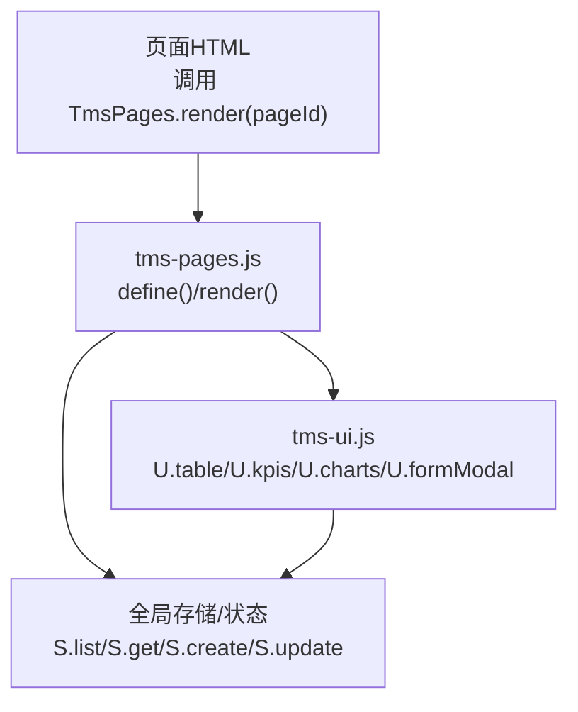
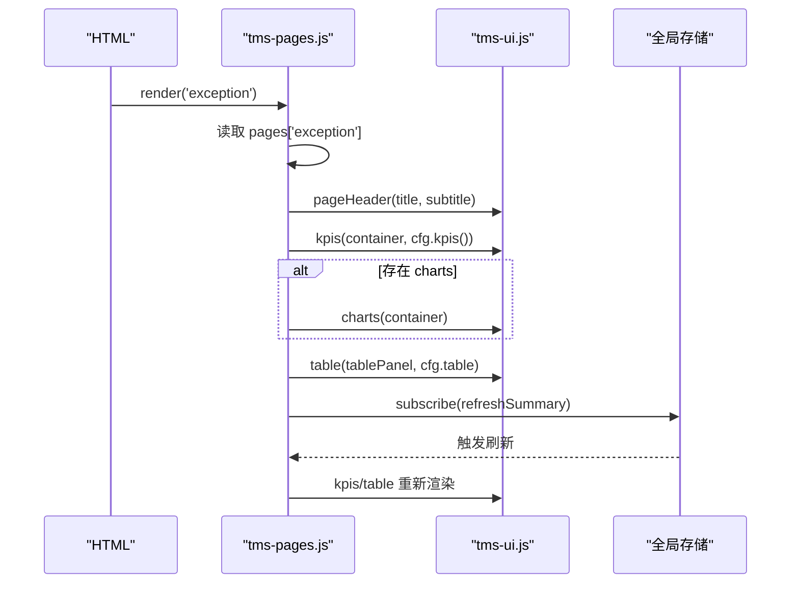
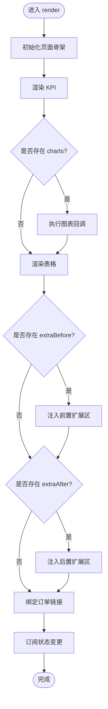
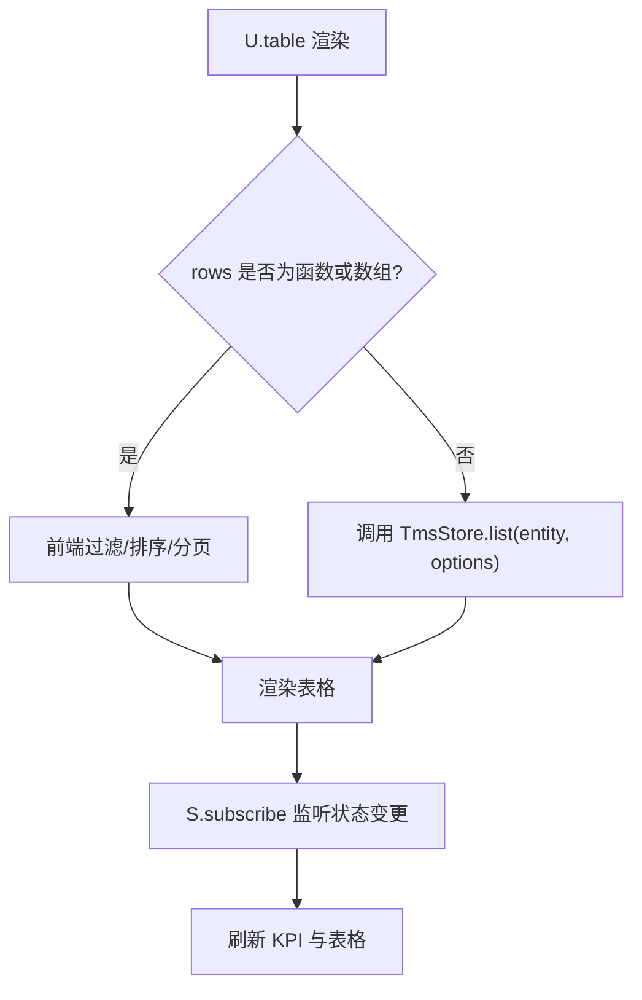
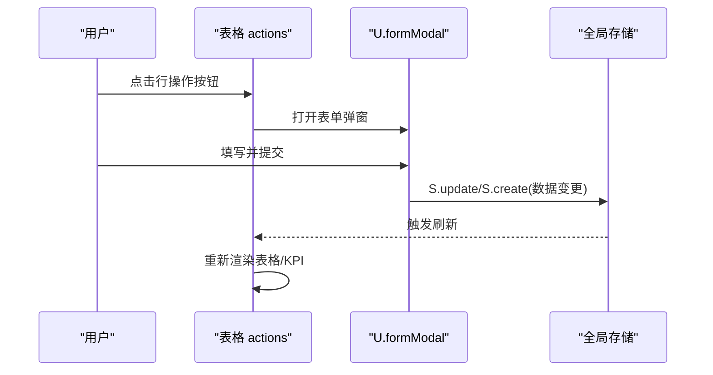
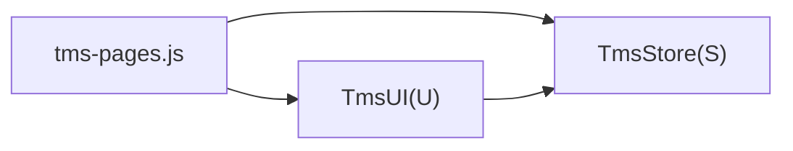

# 页面配置定义

<cite>
**本文引用的文件**   
- [tms-pages.js](file://tms-pages.js)
- [tms-ui.js](file://tms-ui.js)
</cite>

## 目录
1. [引言](#引言)
2. [项目结构](#项目结构)
3. [核心组件](#核心组件)
4. [架构总览](#架构总览)
5. [详细组件分析](#详细组件分析)
6. [依赖关系分析](#依赖关系分析)
7. [性能与可扩展性](#性能与可扩展性)
8. [故障排查指南](#故障排查指南)
9. [结论](#结论)
10. [附录：配置参考与示例](#附录配置参考与示例)

## 引言
本指南面向使用 TMS 管理端“页面装配”能力的开发者，系统说明 tms-pages.js 中 define() 函数的使用方法、页面配置对象的结构与校验规则，并给出从只读列表页到复杂 CRUD 页面的完整实践。文档同时覆盖权限控制、数据源绑定、事件处理等高级配置项，帮助读者快速搭建高质量业务页面。

## 项目结构
TMS 管理端的页面装配由两个关键模块协作完成：
- tms-pages.js：集中注册各业务页面，提供 define(id, config) 与 render(id, root) 能力，负责组装 KPI、图表、表格与扩展区域。
- tms-ui.js：提供通用 UI 能力，包括通用表格渲染、KPI 卡片、图表绘制、表单弹窗、详情弹窗等。

**图示来源**
- [tms-pages.js:10-16](file://tms-pages.js#L10-L16)
- [tms-pages.js:108-135](file://tms-pages.js#L108-L135)
- [tms-ui.js:290-302](file://tms-ui.js#L290-L302)

**章节来源**
- [tms-pages.js:1-16](file://tms-pages.js#L1-L16)
- [tms-ui.js:290-302](file://tms-ui.js#L290-L302)

## 核心组件
- define(id, config)：将页面 id 与其配置对象注册到内部 pages 映射表，供 render() 在运行时查找并渲染。
- render(id, root)：根据已注册的页面配置，动态生成页面骨架（标题、副标题、KPI、图表、扩展区、表格），并绑定数据订阅刷新逻辑。

页面配置对象的核心属性：
- title：页面主标题
- subtitle：页面副标题
- kpis：返回 KPI 数组的函数
- charts：可选，用于在 KPI 下方渲染图表区域的函数
- table：表格配置对象
- extraBefore / extraAfter：可选，用于在表格前后插入自定义内容区的函数
- actions：行级操作按钮数组（位于 table.actions）

**章节来源**
- [tms-pages.js:14-16](file://tms-pages.js#L14-L16)
- [tms-pages.js:108-135](file://tms-pages.js#L108-L135)

## 架构总览
页面装配流程如下：
1. HTML 页面在 DOMContentLoaded 中调用 TmsPages.render('pageId')。
2. tms-pages.js 通过 pages 映射找到对应配置。
3. 渲染页面头部（title/subtitle）、KPI 容器、可选图表容器、表格面板与扩展区。
4. 调用 U.kpis 渲染指标；若存在 charts，则执行图表回调。
5. 调用 U.table 渲染表格，支持搜索、筛选、排序、分页与工具栏。
6. 订阅全局状态变更，自动刷新 KPI 与订单链接。

**图示来源**
- [tms-pages.js:108-135](file://tms-pages.js#L108-L135)
- [tms-ui.js:290-302](file://tms-ui.js#L290-L302)

## 详细组件分析

### define() 函数与页面注册
- 作用：将页面 id 与配置对象关联起来，形成可被 render() 消费的页面元信息。
- 参数：
  - id：字符串，页面唯一标识，如 'exception'、'transport'、'finance' 等。
  - config：页面配置对象，包含 title、subtitle、kpis、charts、table、extraBefore、extraAfter 等。

典型用法：
- 在 tms-pages.js 内以 define('xxx', { ... }) 的形式批量注册多个页面。
- 外部 HTML 通过 TmsPages.render('xxx') 触发渲染。

**章节来源**
- [tms-pages.js:14-16](file://tms-pages.js#L14-L16)
- [tms-pages.js:139-148](file://tms-pages.js#L139-L148)

### render() 渲染管线
- 初始化：为根节点添加页面样式类，填充标题、KPI、图表、扩展区与表格容器。
- 刷新摘要：调用 cfg.kpis() 渲染 KPI；若存在 cfg.charts，则执行图表回调。
- 表格渲染：调用 U.table(container, cfg.table)。
- 扩展区：若存在 cfg.extraBefore/cfg.extraAfter，分别注入到表格前后。
- 订单链接绑定：为所有带 data-order-link 的元素绑定点击事件，打开订单详情弹窗。
- 数据订阅：监听全局状态变化，自动刷新摘要与订单链接。

**图示来源**
- [tms-pages.js:108-135](file://tms-pages.js#L108-L135)

**章节来源**
- [tms-pages.js:108-135](file://tms-pages.js#L108-L135)

### 页面配置对象结构与验证规则

#### 顶层属性
- title：字符串，必填。作为页面主标题显示。
- subtitle：字符串，必填。作为页面副标题显示。
- kpis：函数，必填。返回 KPI 数组，每项包含 label、value、color、sub 等字段。
- charts：函数，可选。接收图表容器元素，用于渲染图表。
- table：对象，必填。详见下文表格配置。
- extraBefore：函数，可选。接收前置扩展区容器元素。
- extraAfter：函数，可选。接收后置扩展区容器元素。

#### KPI 数组项
- label：字符串，KPI 名称。
- value：数字或格式化后的字符串，KPI 数值。
- color：字符串，颜色值，用于高亮数值。
- sub：字符串，可选，辅助说明文本。

#### 图表回调 charts(el)
- 输入：图表容器元素。
- 行为：在该容器内渲染图表（例如柱状图、折线图、环形图等）。
- 常见实现：调用 U.charts.bar(...) 或 U.charts.donut(...)，传入 labels、series、height 等参数。

#### 表格配置 table
- entity：字符串，数据实体名，如 'exceptions'、'transports'、'finances' 等。
- rows：数组或函数，可选。若提供，则覆盖 entity 查询，直接使用该数据源。
- columns：数组，必填。列定义，每项包含 key、label、render、width、sortable 等。
- actions：数组，可选。行级操作按钮定义，每项包含 label、className、show、onClick。
- search：布尔或 undefined，默认启用搜索；设为 false 可禁用。
- searchFields：字符串数组，可选。指定搜索字段。
- searchPlaceholder：字符串，可选。搜索框占位符。
- filters：数组，可选。筛选器定义，每项包含 key、label、options。
- pageSize：数字，默认 10；设为 0 表示不分页。
- defaultSort：对象，可选。默认排序键与方向，如 { key: 'createdAt', dir: 'desc' }。
- toolbar：数组，可选。工具栏按钮，每项包含 text、className、onClick。
- emptyText：字符串，可选。空数据提示文案。
- onRowClick：函数，可选。行点击回调。
- rowClass：函数，可选。根据行数据返回 CSS 类名。

#### 列定义 columns[i]
- key：字符串，数据字段名。
- label：字符串，列头显示名。
- render(row)：函数，可选。自定义单元格渲染逻辑。
- width：字符串，可选。列宽，如 '150px'。
- sortable：布尔，可选。是否允许排序；默认受 entity 或 rows 影响。

#### 行操作 actions[i]
- label：字符串，按钮文案。
- className：字符串，CSS 类名，如 'tms-btn-light'。
- show(row)：函数，可选。根据行数据决定是否显示该按钮。
- onClick(row)：函数，必填。按钮点击回调，通常调用 S.update/S.create 等操作。

#### 工具栏 toolbar[i]
- text：字符串，按钮文案。
- className：字符串，CSS 类名，如 'tms-btn tms-btn-primary'。
- onClick()：函数，必填。按钮点击回调，常打开 U.formModal 进行新增/编辑。

#### 筛选器 filters[i]
- key：字符串，筛选字段名。
- label：字符串，筛选器标签。
- options：数组或字符串数组。选项值与显示名；可为 [{ value, label }] 或 ['a','b']。

#### 扩展区 extraBefore(el) / extraAfter(el)
- 用途：在表格之前或之后插入额外面板，如低库存预警、指标配置等。
- 常见实现：向 el.innerHTML 写入面板 HTML，再调用 U.table 渲染子表格。

**章节来源**
- [tms-ui.js:290-302](file://tms-ui.js#L290-L302)
- [tms-ui.js:303-489](file://tms-ui.js#L303-L489)
- [tms-ui.js:546-557](file://tms-ui.js#L546-L557)
- [tms-ui.js:637-653](file://tms-ui.js#L637-L653)
- [tms-ui.js:655-658](file://tms-ui.js#L655-L658)

### 数据源绑定与更新机制
- 当 table.entity 存在时，U.table 通过 global.TmsStore.list(entity, options) 获取数据。
- 当 table.rows 为函数或数组时，优先使用本地数据源，并在前端进行过滤、排序与分页。
- 当 table.rows 为函数时，每次渲染前都会调用该函数获取最新数据。
- 全局状态变更通过 S.subscribe 触发刷新，确保 KPI 与表格联动更新。

**图示来源**
- [tms-ui.js:316-363](file://tms-ui.js#L316-L363)
- [tms-pages.js:131-134](file://tms-pages.js#L131-L134)

**章节来源**
- [tms-ui.js:316-363](file://tms-ui.js#L316-L363)
- [tms-pages.js:131-134](file://tms-pages.js#L131-L134)

### 事件处理与交互模式
- 行操作按钮：通过 actions[].onClick(row) 触发业务逻辑，常用 U.formModal 弹出表单，提交后调用 S.update/S.create 修改数据。
- 工具栏按钮：通过 toolbar[].onClick() 打开新增/编辑弹窗，或在回调中直接执行动作（如标记到达、完成运输任务）。
- 订单链接：通过 data-order-link 属性绑定点击事件，打开订单详情弹窗，展示轨迹与运费明细。
- 确认对话框：通过 U.confirm({ message, okText, danger }) 进行危险操作二次确认。

**图示来源**
- [tms-pages.js:171-187](file://tms-pages.js#L171-L187)
- [tms-pages.js:211-246](file://tms-pages.js#L211-L246)
- [tms-pages.js:289-318](file://tms-pages.js#L289-L318)

**章节来源**
- [tms-pages.js:171-187](file://tms-pages.js#L171-L187)
- [tms-pages.js:211-246](file://tms-pages.js#L211-L246)
- [tms-pages.js:289-318](file://tms-pages.js#L289-L318)

### 权限控制配置
当前仓库未提供基于角色的权限控制字段。如需权限控制，可在以下位置扩展：
- 页面级：在 render() 前检查权限，若无权限则不渲染页面或隐藏敏感区域。
- 行操作级：在 actions[].show(row) 中结合当前用户角色判断是否显示按钮。
- 工具栏级：在 toolbar[].onClick() 前增加权限校验。
- 数据级：在 table.rows 或 table.entity 查询时按权限过滤数据。

建议扩展点：
- 在页面配置中添加权限字段，如 roles: ['admin', 'ops']，并在 render() 中校验。
- 在 actions[].show(row) 中结合全局用户上下文判断。

[本节为概念性指导，不涉及具体代码片段]

### 不同复杂度页面配置示例

#### 简单只读列表页
- 目标：展示某实体的只读列表，无需新增/编辑。
- 配置要点：
  - title/subtitle：页面标题与副标题。
  - kpis：返回统计指标数组。
  - table.entity：数据实体名。
  - table.columns：定义列与格式化。
  - table.search/searchFields/filters：开启搜索与筛选。
  - table.pageSize：按需设置分页。
  - 不配置 toolbar/actions。

适用场景：监控看板、报表查看页。

**章节来源**
- [tms-pages.js:361-391](file://tms-pages.js#L361-L391)
- [tms-pages.js:476-503](file://tms-pages.js#L476-L503)

#### 带筛选与排序的列表页
- 目标：支持多条件筛选与列排序。
- 配置要点：
  - table.filters：定义筛选器与选项。
  - table.defaultSort：设置默认排序。
  - columns[].sortable：允许列排序（默认受 entity/rows 影响）。

适用场景：异常管理、财务管理等需要多维度检索的页面。

**章节来源**
- [tms-pages.js:154-170](file://tms-pages.js#L154-L170)
- [tms-pages.js:949-986](file://tms-pages.js#L949-L986)

#### 带工具栏的新增/编辑页
- 目标：支持新增与编辑实体。
- 配置要点：
  - table.toolbar：新增按钮，打开 U.formModal 表单。
  - table.actions：编辑按钮，预填 values: row，提交后调用 S.update。
  - form fields：定义表单字段类型、校验与默认值。

适用场景：仓储管理、车辆管理、运力管理等 CRUD 页面。

**章节来源**
- [tms-pages.js:392-447](file://tms-pages.js#L392-L447)
- [tms-pages.js:504-573](file://tms-pages.js#L504-L573)

#### 复杂业务流程页（含状态流转与联动）
- 目标：实现多步骤状态流转，并与其它实体联动。
- 配置要点：
  - actions.show：根据行状态显示不同操作按钮。
  - actions.onClick：调用 S.advanceOrder/S.updateTransportStatus 等接口驱动状态机。
  - 订单链接：通过 orderLink/orderDetail 打开订单详情与轨迹。

适用场景：异常处理、运输调度、理赔审核等。

**章节来源**
- [tms-pages.js:188-246](file://tms-pages.js#L188-L246)
- [tms-pages.js:320-355](file://tms-pages.js#L320-L355)
- [tms-pages.js:882-919](file://tms-pages.js#L882-L919)

#### 带图表与扩展区的综合页
- 目标：在 KPI 下方展示图表，并在表格前后插入扩展面板。
- 配置要点：
  - charts：渲染图表（如收支趋势）。
  - extraBefore/extraAfter：插入额外面板（如低库存预警、考核指标配置）。

适用场景：财务管理、绩效考核、运营监控等。

**章节来源**
- [tms-pages.js:937-948](file://tms-pages.js#L937-L948)
- [tms-pages.js:450-471](file://tms-pages.js#L450-L471)
- [tms-pages.js:1169-1186](file://tms-pages.js#L1169-L1186)

## 依赖关系分析
- tms-pages.js 依赖：
  - global.TmsStore（S）：数据存取与订阅。
  - global.TmsUI（U）：UI 组件与工具方法。
- tms-ui.js 依赖：
  - global.TmsStore（S）：在表格渲染时读取数据。
  - 浏览器 DOM API：创建与操作 DOM 元素。

耦合与内聚：
- tms-pages.js 专注于页面装配与业务配置，内聚性强。
- tms-ui.js 提供通用 UI 能力，解耦业务逻辑，便于复用。
- 通过 S 与 U 的全局引用，降低模块间耦合度。

潜在循环依赖：
- 无直接循环依赖；tms-pages.js 与 tms-ui.js 单向依赖 S 与 U。

外部集成点：
- 全局存储 S：提供 list/get/create/update 等方法。
- 全局 UI U：提供 toast/modal/form/charts/detailGrid 等方法。

**图示来源**
- [tms-pages.js:10-12](file://tms-pages.js#L10-L12)
- [tms-ui.js:316-323](file://tms-ui.js#L316-L323)

**章节来源**
- [tms-pages.js:10-12](file://tms-pages.js#L10-L12)
- [tms-ui.js:316-323](file://tms-ui.js#L316-L323)

## 性能与可扩展性
- 数据源优化：
  - 使用 table.rows 函数或数组时，避免在回调中进行昂贵计算；必要时缓存结果。
  - 对大数据集，合理设置 pageSize 与 searchFields，减少前端过滤开销。
- 渲染优化：
  - 仅在必要区域调用 U.table，避免重复渲染。
  - 使用 extraBefore/extraAfter 拆分复杂页面，提升可读性与维护性。
- 可扩展性：
  - 通过 actions.show 与 toolbar.onClick 扩展权限控制与业务逻辑。
  - 通过 charts 与 extraBefore/extraAfter 扩展可视化与辅助面板。

[本节为一般性指导，不涉及具体代码片段]

## 故障排查指南
常见问题与定位方法：
- 页面未渲染：
  - 检查是否在 HTML 中调用了 TmsPages.render('pageId')。
  - 检查 define('pageId', ...) 是否正确注册。
- 表格无数据：
  - 检查 table.entity 是否与 S.list 中的实体一致。
  - 检查 table.rows 是否为函数或数组，且返回有效数据。
- 搜索/筛选无效：
  - 检查 table.searchFields 是否包含目标字段。
  - 检查 table.filters 的 key 是否与数据字段一致。
- 操作按钮不显示：
  - 检查 actions[].show(row) 返回值是否符合预期。
- 图表不显示：
  - 检查 charts 回调是否正确写入 innerHTML 并调用 U.charts.*。
- 状态未刷新：
  - 检查是否通过 S.update/S.create 修改数据，并触发 S.subscribe 刷新。

**章节来源**
- [tms-pages.js:108-135](file://tms-pages.js#L108-L135)
- [tms-ui.js:316-363](file://tms-ui.js#L316-L363)

## 结论
通过 tms-pages.js 的 define() 与 render()，配合 tms-ui.js 的通用 UI 能力，可以快速构建从只读列表到复杂 CRUD 的多层次业务页面。掌握页面配置对象的属性结构与验证规则，结合权限控制、数据源绑定与事件处理，能够高效实现高内聚、低耦合的管理端界面。

[本节为总结性内容，不涉及具体代码片段]

## 附录：配置参考与示例

### 页面配置对象参考
- title：字符串，必填。
- subtitle：字符串，必填。
- kpis：函数，必填。返回 KPI 数组。
- charts：函数，可选。渲染图表。
- table：对象，必填。
  - entity：字符串。
  - rows：数组或函数，可选。
  - columns：数组，必填。
  - actions：数组，可选。
  - search：布尔，可选。
  - searchFields：字符串数组，可选。
  - searchPlaceholder：字符串，可选。
  - filters：数组，可选。
  - pageSize：数字，可选。
  - defaultSort：对象，可选。
  - toolbar：数组，可选。
  - emptyText：字符串，可选。
  - onRowClick：函数，可选。
  - rowClass：函数，可选。
- extraBefore：函数，可选。
- extraAfter：函数，可选。

**章节来源**
- [tms-ui.js:290-302](file://tms-ui.js#L290-L302)
- [tms-ui.js:303-489](file://tms-ui.js#L303-L489)

### 示例路径索引
- 异常管理（复杂流程）：[tms-pages.js:139-248](file://tms-pages.js#L139-L248)
- 运输管理（状态联动）：[tms-pages.js:252-357](file://tms-pages.js#L252-L357)
- 仓储管理（CRUD + 扩展区）：[tms-pages.js:361-472](file://tms-pages.js#L361-L472)
- 车辆管理（CRUD + 状态切换）：[tms-pages.js:476-575](file://tms-pages.js#L476-L575)
- 运力管理（资源管理）：[tms-pages.js:579-658](file://tms-pages.js#L579-L658)
- 物资管理（库存预警）：[tms-pages.js:662-742](file://tms-pages.js#L662-L742)
- 客服管理（工单闭环）：[tms-pages.js:746-831](file://tms-pages.js#L746-L831)
- 理赔管理（审批流程）：[tms-pages.js:835-921](file://tms-pages.js#L835-L921)
- 财务管理（图表 + 流水）：[tms-pages.js:925-1025](file://tms-pages.js#L925-L1025)
- 行政管理（审批流）：[tms-pages.js:1029-1098](file://tms-pages.js#L1029-L1098)
- 考核评级（指标配置）：[tms-pages.js:1102-1187](file://tms-pages.js#L1102-L1187)
- 绩效管理（排名统计）：[tms-pages.js:1191-1247](file://tms-pages.js#L1191-L1247)

[本节为索引性内容，不涉及具体代码片段]