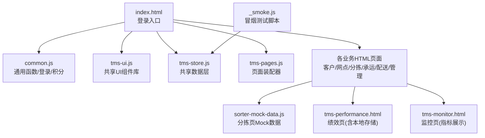
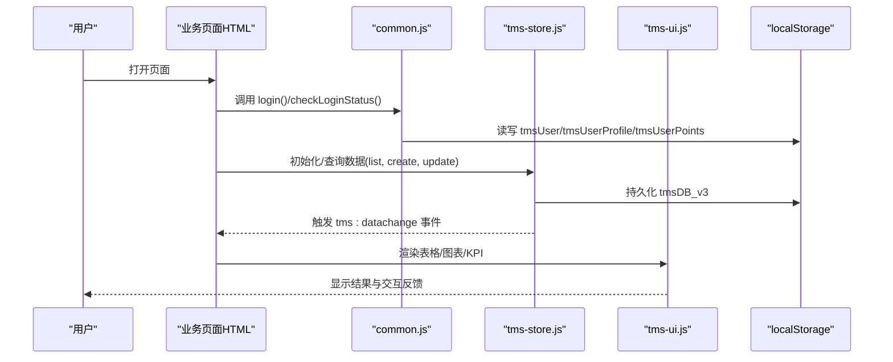
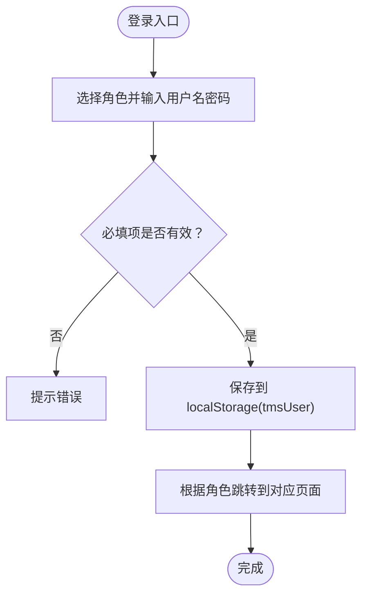
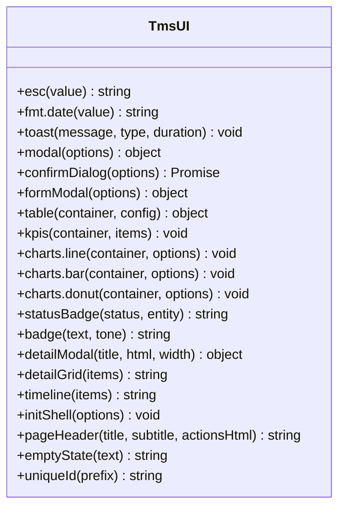
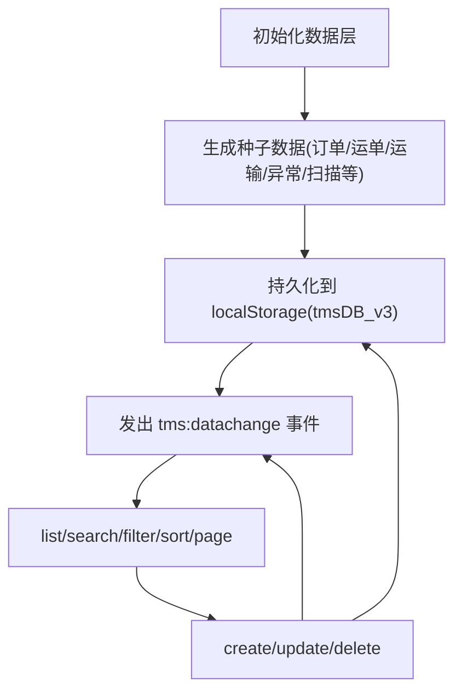
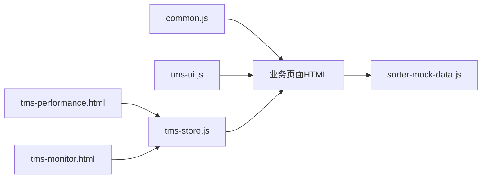
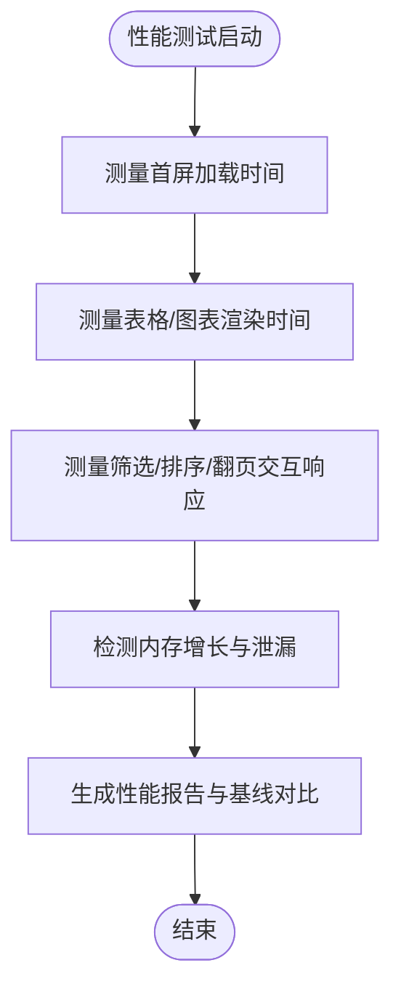
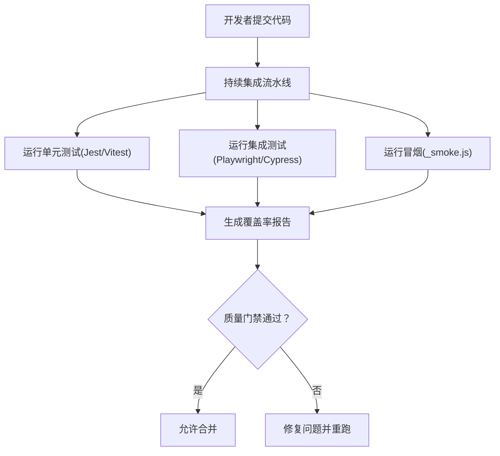

# 测试策略

<cite>
**本文引用的文件**   
- [readme](file://readme)
- [common.js](file://common.js)
- [tms-ui.js](file://tms-ui.js)
- [tms-store.js](file://tms-store.js)
- [tms-pages.js](file://tms-pages.js)
- [sorter-mock-data.js](file://sorter-mock-data.js)
- [tms-performance.html](file://tms-performance.html)
- [tms-monitor.html](file://tms-monitor.html)
- [_smoke.js](file://_smoke.js)
</cite>

## 目录
1. [引言](#引言)
2. [项目结构](#项目结构)
3. [核心组件](#核心组件)
4. [架构总览](#架构总览)
5. [详细组件分析](#详细组件分析)
6. [依赖关系分析](#依赖关系分析)
7. [性能测试指南](#性能测试指南)
8. [自动化与持续集成](#自动化与持续集成)
9. [常见测试场景与用例示例](#常见测试场景与用例示例)
10. [故障排查与稳定性保障](#故障排查与稳定性保障)
11. [结论](#结论)

## 引言
本测试策略面向 TMS（运输管理系统）前端原型，目标是建立覆盖单元测试、集成测试、性能测试和用户验收测试的完整实践体系。系统以浏览器端 JavaScript 为主，数据层基于 localStorage，UI 通过共享组件库渲染页面；业务逻辑集中在共享数据层与页面装配脚本中。测试策略将围绕以下目标展开：
- 保证订单号、运单号等关键标识生成规则稳定可测。
- 验证共享 UI 组件在交互、状态更新、事件订阅下的行为正确性。
- 校验数据层在增删改查、搜索筛选、分页排序、状态流转和关联记录写入上的正确性。
- 对页面加载、图表渲染、大数据量表格进行性能基线监控。
- 为权限控制、登录跳转、角色隔离提供集成测试与验收测试方法。
- 搭建可复用的自动化流程，支持持续集成与报告输出。

## 项目结构
仓库采用“多页面 + 共享脚本”的前端原型组织方式：
- 共享脚本：通用工具、用户会话、UI 组件库、共享数据层、页面装配器。
- 业务页面：按角色或模块划分的 HTML 页面，如客户、网点、分拣员、承运商、配送员、管理员等。
- 辅助脚本：模拟数据、冒烟脚本、样式与配置。

**图示来源**
- [common.js:135-218](file://common.js#L135-L218)
- [tms-ui.js:758-781](file://tms-ui.js#L758-L781)
- [tms-store.js:1-12](file://tms-store.js#L1-L12)
- [tms-pages.js:1-12](file://tms-pages.js#L1-L12)
- [sorter-mock-data.js:1-20](file://sorter-mock-data.js#L1-L20)
- [tms-performance.html:542-543](file://tms-performance.html#L542-L543)
- [tms-monitor.html:365-383](file://tms-monitor.html#L365-L383)
- [_smoke.js:1-20](file://_smoke.js#L1-L20)

**章节来源**
- [readme:1-3](file://readme#L1-L3)
- [common.js:1-383](file://common.js#L1-L383)
- [tms-ui.js:1-783](file://tms-ui.js#L1-L783)
- [tms-store.js:1-800](file://tms-store.js#L1-L800)
- [tms-pages.js:1-38](file://tms-pages.js#L1-L38)

## 核心组件
本节聚焦测试需要重点覆盖的核心模块：
- 通用函数与用户会话：订单号/运单号生成、登录/登出、权限检查、用户信息、积分管理。
- 共享 UI 组件库：Toast、弹窗、表单弹窗、列表表格、KPI、图表、页面外壳。
- 共享数据层：种子数据、CRUD、搜索/筛选/排序/分页、订单生命周期、轨迹与路由、计费引擎、统计聚合。
- 页面装配器：统一装配 KPI+图表+表格+CRUD 的结构。
- Mock 数据与冒烟脚本：分拣页 Mock、端到端冒烟断言。

**章节来源**
- [common.js:22-50](file://common.js#L22-L50)
- [common.js:135-218](file://common.js#L135-L218)
- [common.js:272-383](file://common.js#L272-L383)
- [tms-ui.js:86-287](file://tms-ui.js#L86-L287)
- [tms-ui.js:289-544](file://tms-ui.js#L289-L544)
- [tms-ui.js:546-781](file://tms-ui.js#L546-L781)
- [tms-store.js:1-12](file://tms-store.js#L1-L12)
- [tms-store.js:217-250](file://tms-store.js#L217-L250)
- [tms-store.js:263-383](file://tms-store.js#L263-L383)
- [tms-store.js:385-460](file://tms-store.js#L385-L460)
- [tms-store.js:462-800](file://tms-store.js#L462-L800)
- [tms-pages.js:1-38](file://tms-pages.js#L1-L38)
- [sorter-mock-data.js:1-20](file://sorter-mock-data.js#L1-L20)
- [_smoke.js:1-20](file://_smoke.js#L1-L20)

## 架构总览
TMS 前端采用“页面 + 共享脚本”的轻量架构：
- 页面负责 DOM 结构与业务编排。
- 共享 UI 组件提供一致的交互与可视化能力。
- 共享数据层作为“内存数据库”，维护业务实体与状态流转，并通过事件通知 UI 刷新。
- 页面装配器统一构建页面骨架，减少重复代码。
- 登录与会话由通用函数处理，使用 localStorage 持久化。

**图示来源**
- [common.js:135-218](file://common.js#L135-L218)
- [tms-store.js:217-250](file://tms-store.js#L217-L250)
- [tms-ui.js:758-781](file://tms-ui.js#L758-L781)

## 详细组件分析

### 通用函数与用户会话（common.js）
- 订单号/运单号生成：遵循 readme 中的标准格式，结合省份首字母映射、时间戳、用户ID哈希与随机数。
- 登录/登出：校验必填项、保存用户信息到 localStorage、根据角色跳转到对应页面。
- 权限检查：读取当前用户并校验所需角色，不匹配则跳转登录页。
- 用户信息与积分：提供个人信息存取、积分余额增减与历史记录。

**图示来源**
- [common.js:135-174](file://common.js#L135-L174)

**章节来源**
- [readme:1-3](file://readme#L1-L3)
- [common.js:22-50](file://common.js#L22-L50)
- [common.js:135-218](file://common.js#L135-L218)
- [common.js:272-383](file://common.js#L272-L383)

### 共享 UI 组件库（tms-ui.js）
- Toast 与弹窗：提供消息提示、确认对话框、表单弹窗，支持异步提交与错误展示。
- 列表表格：支持搜索、筛选、排序、分页、行点击、操作按钮、空态展示。
- KPI 与图表：折线图、柱状图、环形图，封装 SVG 绘制与图例。
- 页面外壳：导航高亮、子菜单切换、异常待办角标、页面头部与空态。

**图示来源**
- [tms-ui.js:758-781](file://tms-ui.js#L758-L781)

**章节来源**
- [tms-ui.js:86-287](file://tms-ui.js#L86-L287)
- [tms-ui.js:289-544](file://tms-ui.js#L289-L544)
- [tms-ui.js:546-781](file://tms-ui.js#L546-L781)

### 共享数据层（tms-store.js）
- 数据模型与字典：城市/省份、订单状态流、状态标签、客户/商品/承运商/员工/车辆/仓库/库存/运力/围栏/策略/路由/地址/时效规则/考核指标等。
- 初始化与持久化：首次访问生成种子数据，维护计数器，持久化到 localStorage，并发出数据变更事件。
- 计费引擎：根据运价卡、服务等级、重量/体积、保价、到付、偏远附加费、折扣等计算费用明细。
- 路由与轨迹：构造多段路由、计划分段与截止时间、生成轨迹节点并标记超时/偏差。
- 种子数据：批量生成订单、分拣任务、装卸、扫描、异常、财务、工单、理赔、应收应付、账单等。

**图示来源**
- [tms-store.js:217-250](file://tms-store.js#L217-L250)
- [tms-store.js:462-800](file://tms-store.js#L462-L800)

**章节来源**
- [tms-store.js:1-12](file://tms-store.js#L1-L12)
- [tms-store.js:79-214](file://tms-store.js#L79-L214)
- [tms-store.js:217-250](file://tms-store.js#L217-L250)
- [tms-store.js:263-383](file://tms-store.js#L263-L383)
- [tms-store.js:385-460](file://tms-store.js#L385-L460)
- [tms-store.js:462-800](file://tms-store.js#L462-L800)

### 页面装配器（tms-pages.js）
- 统一装配：每个页面通过定义 id 与配置，装配 KPI、图表、可筛选分页表格与 CRUD 操作。
- 选项生成：从数据层获取订单选项，供下拉框等控件使用。
- 链接生成：安全转义后生成订单链接。

**章节来源**
- [tms-pages.js:1-38](file://tms-pages.js#L1-L38)

### Mock 数据与冒烟脚本
- 分拣页 Mock：通过 localStorage 注入分拣相关统计数据、性能指标、扫描记录、分拣任务、排班、打卡记录等。
- 冒烟脚本：在 Node 环境下运行，断言订单轨迹、异常处理等关键流程。

**章节来源**
- [sorter-mock-data.js:1-20](file://sorter-mock-data.js#L1-L20)
- [_smoke.js:1-20](file://_smoke.js#L1-L20)

## 依赖关系分析
- common.js 被所有页面引用，负责登录、权限、用户信息与积分。
- tms-ui.js 被页面与装配器引用，提供 UI 能力。
- tms-store.js 被页面与装配器引用，提供数据能力与事件。
- sorter-mock-data.js 仅服务于分拣相关页面。
- tms-performance.html 与 tms-monitor.html 分别用于绩效与监控展示，依赖 localStorage 与共享 UI。

**图示来源**
- [common.js:135-218](file://common.js#L135-L218)
- [tms-ui.js:758-781](file://tms-ui.js#L758-L781)
- [tms-store.js:217-250](file://tms-store.js#L217-L250)
- [sorter-mock-data.js:1-20](file://sorter-mock-data.js#L1-L20)
- [tms-performance.html:542-543](file://tms-performance.html#L542-L543)
- [tms-monitor.html:365-383](file://tms-monitor.html#L365-L383)

**章节来源**
- [common.js:135-218](file://common.js#L135-L218)
- [tms-ui.js:758-781](file://tms-ui.js#L758-L781)
- [tms-store.js:217-250](file://tms-store.js#L217-L250)
- [sorter-mock-data.js:1-20](file://sorter-mock-data.js#L1-L20)
- [tms-performance.html:542-543](file://tms-performance.html#L542-L543)
- [tms-monitor.html:365-383](file://tms-monitor.html#L365-L383)

## 性能测试指南
针对 TMS 前端的性能测试，建议关注以下关键指标与方法：
- 加载性能
  - 首屏渲染时间：从页面开始加载到主内容可见的时间。
  - 资源加载耗时：JS/CSS/字体等资源的下载与解析时间。
  - 数据初始化耗时：数据层种子数据生成与持久化的耗时。
- 渲染性能
  - 大表格渲染：1000+ 行数据的渲染时间与交互响应。
  - 图表渲染：折线/柱状/环形图的绘制耗时与重绘开销。
  - 滚动与分页：翻页、筛选、排序时的卡顿与重排。
- 内存使用
  - 长时间运行的内存增长：是否存在泄漏（定时器、事件监听未清理）。
  - 大量 DOM 节点创建与销毁：避免不必要的节点累积。
- 监控与基准
  - 使用浏览器开发者工具的 Performance/Memory 面板采集指标。
  - 在 tms-monitor.html 中展示近 7 日单量趋势与关键指标。
  - 在 tms-performance.html 中维护绩效数据并观察趋势变化。

**图示来源**
- [tms-monitor.html:365-383](file://tms-monitor.html#L365-L383)
- [tms-performance.html:542-543](file://tms-performance.html#L542-L543)

[本节为通用性能指导，不直接分析具体代码文件]

## 自动化与持续集成
建议的自动化测试流程：
- 单元测试
  - 使用 Jest 或 Vitest 对纯函数进行测试，如订单号/运单号生成、金额格式化、日期格式化、状态标签映射。
  - 对 UI 组件进行沙箱测试，使用 jsdom 模拟 DOM，断言渲染结果与交互回调。
- 集成测试
  - 使用 Playwright 或 Cypress 进行端到端测试，覆盖登录、权限跳转、页面交互、数据流。
  - 在 CI 环境中预置 localStorage 数据（包括 tmsDB_v3、tmsUser、tmsUserPoints），确保测试环境一致。
- 冒烟测试
  - 复用 _smoke.js 的思路，在 Node 环境下断言关键业务流程（如订单轨迹、异常处理）。
- 报告与质量门禁
  - 生成覆盖率报告（Jest/Vitest）、E2E 测试报告（Playwright/Cypress）。
  - 设置质量门禁：覆盖率阈值、失败用例阻断合并。

[本节为通用自动化流程指导，不直接分析具体代码文件]

## 常见测试场景与用例示例

### 单元测试示例
- 订单号生成
  - 输入发货省份、用户ID、时间戳、序列号，断言生成的订单号符合 HL+省份首字母+时间戳+4位用户ID哈希+4位随机数字的规则。
  - 参考路径：[common.js:22-38](file://common.js#L22-L38)、[readme:1-3](file://readme#L1-L3)。
- 运单号生成
  - 输入订单号，断言生成的运单号符合 WB+10位订单号哈希+4位随机数的规则。
  - 参考路径：[common.js:40-50](file://common.js#L40-L50)。
- 金额与百分比格式化
  - 输入数值，断言格式化后的字符串符合货币与百分比规范。
  - 参考路径：[tms-ui.js:44-54](file://tms-ui.js#L44-L54)。
- 状态标签映射
  - 输入状态码与实体类型，断言返回正确的标签文本与样式类名。
  - 参考路径：[tms-ui.js:57-76](file://tms-ui.js#L57-L76)。

**章节来源**
- [common.js:22-50](file://common.js#L22-L50)
- [tms-ui.js:44-76](file://tms-ui.js#L44-L76)
- [readme:1-3](file://readme#L1-L3)

### 集成测试示例
- 登录与权限控制
  - 步骤：选择角色、输入用户名密码、点击登录、断言跳转到对应页面。
  - 无权限访问：断言跳转到登录页并提示无权限。
  - 参考路径：[common.js:135-199](file://common.js#L135-L199)。
- 页面交互与数据流
  - 步骤：打开订单列表页、输入搜索关键字、选择筛选条件、点击排序列头、翻页、断言表格数据与分页信息。
  - 参考路径：[tms-ui.js:289-544](file://tms-ui.js#L289-L544)、[tms-store.js:217-250](file://tms-store.js#L217-L250)。
- 表单弹窗与异步提交
  - 步骤：打开新增/编辑弹窗、填写必填字段、提交、断言成功提示与数据更新。
  - 参考路径：[tms-ui.js:165-287](file://tms-ui.js#L165-L287)。

**章节来源**
- [common.js:135-199](file://common.js#L135-L199)
- [tms-ui.js:165-287](file://tms-ui.js#L165-L287)
- [tms-ui.js:289-544](file://tms-ui.js#L289-L544)
- [tms-store.js:217-250](file://tms-store.js#L217-L250)

### 性能测试示例
- 大表格渲染
  - 步骤：准备 1000+ 行数据，渲染表格，测量渲染时间与交互响应。
  - 参考路径：[tms-ui.js:289-544](file://tms-ui.js#L289-L544)。
- 图表渲染
  - 步骤：传入多系列数据，渲染折线/柱状/环形图，测量绘制耗时。
  - 参考路径：[tms-ui.js:575-680](file://tms-ui.js#L575-L680)。
- 监控与趋势
  - 步骤：在监控页查看近 7 日单量趋势，验证数据更新与图表刷新。
  - 参考路径：[tms-monitor.html:365-383](file://tms-monitor.html#L365-L383)。

**章节来源**
- [tms-ui.js:289-544](file://tms-ui.js#L289-L544)
- [tms-ui.js:575-680](file://tms-ui.js#L575-L680)
- [tms-monitor.html:365-383](file://tms-monitor.html#L365-L383)

### 用户验收测试示例
- 订单全生命周期
  - 步骤：创建订单、入库、分拣、装车、发车、到达、派送、签收，断言状态流转与轨迹节点。
  - 参考路径：[tms-store.js:88-96](file://tms-store.js#L88-L96)、[tms-store.js:442-460](file://tms-store.js#L442-L460)。
- 异常处理
  - 步骤：创建异常、分配责任方、处理并解决，断言异常状态与扣款记录。
  - 参考路径：[tms-store.js:874-896](file://tms-store.js#L874-L896)。
- 计费试算
  - 步骤：输入重量/体积/保价/到付/服务等级，断言费用明细与折扣。
  - 参考路径：[tms-store.js:327-383](file://tms-store.js#L327-L383)。

**章节来源**
- [tms-store.js:88-96](file://tms-store.js#L88-L96)
- [tms-store.js:327-383](file://tms-store.js#L327-L383)
- [tms-store.js:442-460](file://tms-store.js#L442-L460)
- [tms-store.js:874-896](file://tms-store.js#L874-L896)

## 故障排查与稳定性保障
- 常见问题
  - localStorage 数据损坏：数据层 readDb 捕获异常并返回 null，需清理脏数据或重建种子。
  - 事件监听未清理：UI 组件 destroy 方法应释放订阅与事件监听，避免内存泄漏。
  - 权限判断失败：检查 localStorage 中 tmsUser 是否存在且角色匹配。
- 调试建议
  - 在 common.js 与 tms-store.js 中保留必要的 console.log，便于定位登录与数据流问题。
  - 使用浏览器控制台执行 store.list('orders', {...}) 验证数据查询与过滤。
  - 在 tms-monitor.html 中观察指标趋势，发现异常波动。

**章节来源**
- [tms-store.js:217-250](file://tms-store.js#L217-L250)
- [tms-ui.js:539-543](file://tms-ui.js#L539-L543)
- [common.js:135-218](file://common.js#L135-L218)
- [tms-monitor.html:365-383](file://tms-monitor.html#L365-L383)

## 结论
本测试策略围绕 TMS 前端原型的共享脚本与多页面结构，构建了覆盖单元、集成、性能与验收的完整测试体系。通过明确的数据层、UI 组件与页面装配职责，配合 localStorage 的持久化机制与事件驱动的数据更新，测试用例能够准确覆盖订单号/运单号生成、登录权限、页面交互、数据流、计费与轨迹等关键业务。建议在持续集成中引入自动化测试与报告，确保代码质量与系统稳定性，并为后续扩展与重构提供可靠的测试基础。