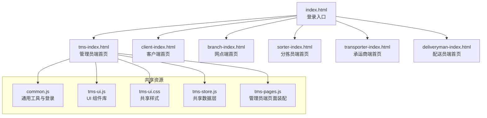
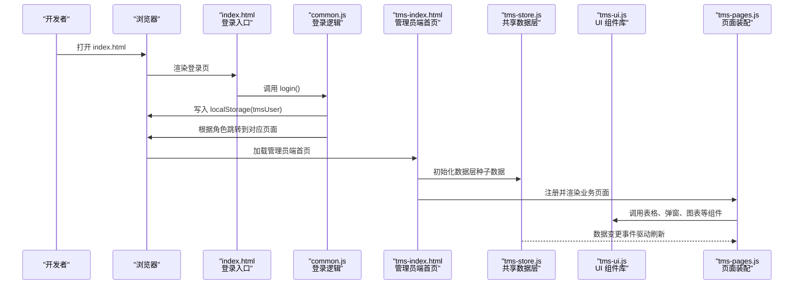
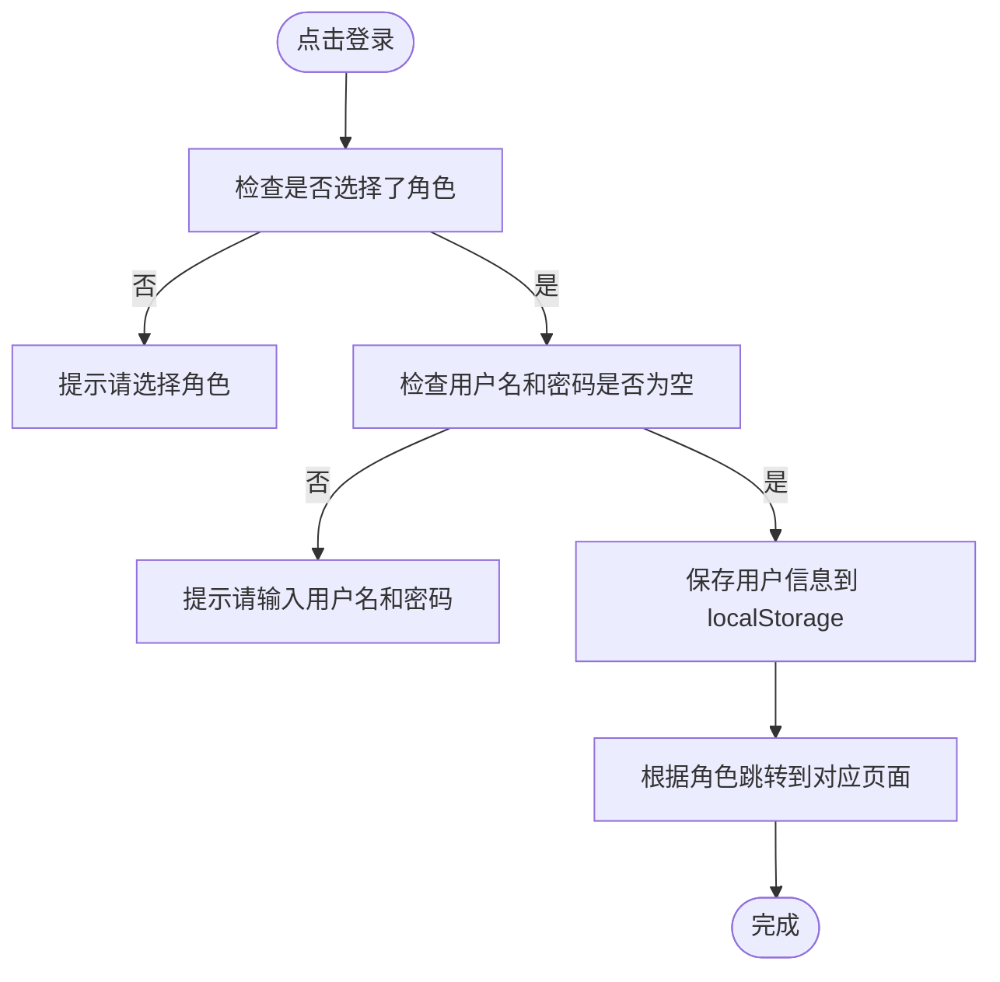
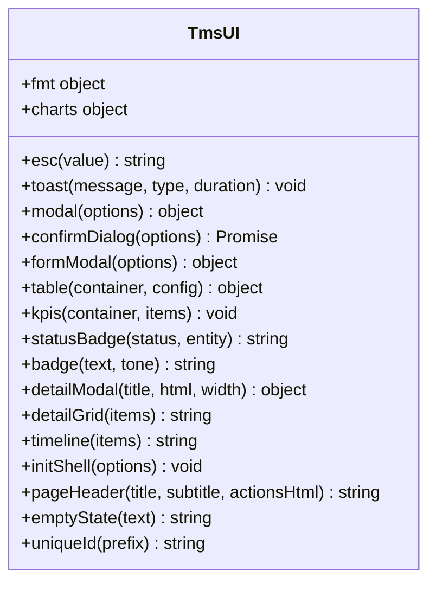
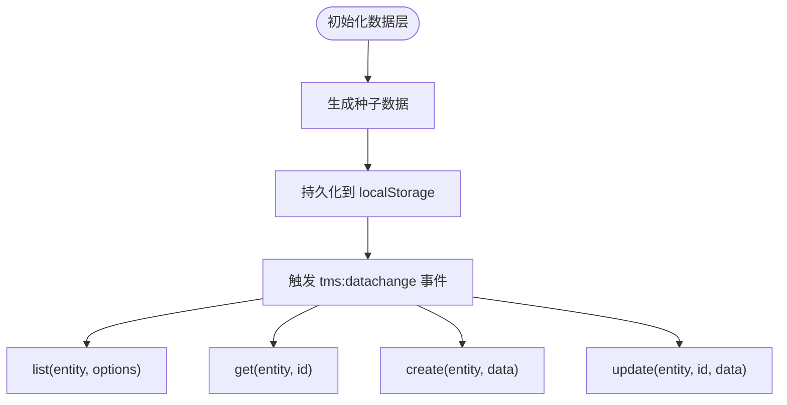
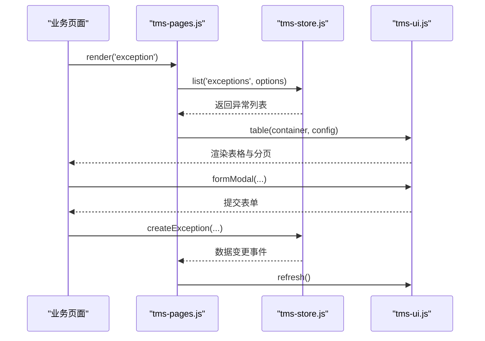
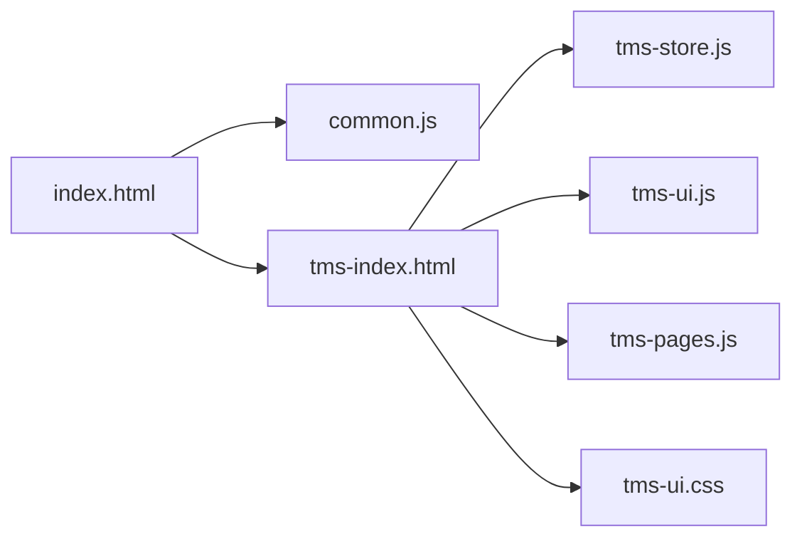

# 环境搭建

<cite>
**本文引用的文件**   
- [readme](file://readme)
- [common.js](file://common.js)
- [tms-ui.js](file://tms-ui.js)
- [tms-ui.css](file://tms-ui.css)
- [tms-store.js](file://tms-store.js)
- [tms-pages.js](file://tms-pages.js)
- [index.html](file://index.html)
- [tms-index.html](file://tms-index.html)
</cite>

## 目录
1. [简介](#简介)
2. [项目结构](#项目结构)
3. [核心组件](#核心组件)
4. [架构总览](#架构总览)
5. [详细组件分析](#详细组件分析)
6. [依赖关系分析](#依赖关系分析)
7. [性能与兼容性](#性能与兼容性)
8. [常见问题排查](#常见问题排查)
9. [IDE 配置建议](#ide-配置建议)
10. [结论](#结论)

## 简介
本指南面向首次接触 TMS（运输管理系统）前端演示项目的开发者，目标是帮助你在最短时间内完成本地开发环境搭建并进入编码。该项目为纯前端静态站点，使用浏览器本地存储作为数据层，无需后端服务即可运行。你将了解：
- 最低环境与浏览器要求
- 如何克隆、安装依赖、启动开发服务器
- 项目目录结构与文件组织方式
- 常见环境问题定位与解决
- IDE 与代码风格配置建议

## 项目结构
仓库根目录下包含三类内容：
- 业务页面 HTML：按角色或模块划分，如客户端、网点端、分拣员端、承运商端、配送员端、管理员端等
- 共享脚本与样式：UI 组件库、通用工具函数、共享数据层、管理员端页面装配器
- 辅助脚本：用于更新登录逻辑的 Python 脚本（当前项目以纯前端为主，Python 脚本非必需）

**图表来源**
- [index.html:1-200](file://index.html#L1-L200)
- [tms-index.html:1-200](file://tms-index.html#L1-L200)
- [common.js:135-218](file://common.js#L135-L218)
- [tms-ui.js:756-779](file://tms-ui.js#L756-L779)
- [tms-store.js:1-12](file://tms-store.js#L1-L12)
- [tms-pages.js:1-12](file://tms-pages.js#L1-L12)

**章节来源**
- [index.html:1-200](file://index.html#L1-L200)
- [tms-index.html:1-200](file://tms-index.html#L1-L200)
- [common.js:135-218](file://common.js#L135-L218)
- [tms-ui.js:756-779](file://tms-ui.js#L756-L779)
- [tms-store.js:1-12](file://tms-store.js#L1-L12)
- [tms-pages.js:1-12](file://tms-pages.js#L1-L12)

## 核心组件
TMS 前端由以下核心部分组成：
- 登录与用户会话：基于 localStorage 的用户信息存取与角色跳转
- UI 组件库：提供表格、弹窗、表单、Toast、KPI、SVG 图表等能力
- 共享数据层：基于 localStorage 的业务数据库，负责种子数据生成、CRUD、搜索/筛选/排序/分页、状态流转与统计
- 管理员端页面装配：将各业务页统一装配为“KPI + 图表 + 可筛选分页表格 + CRUD”的结构

关键职责与交互要点：
- common.js 暴露全局登录、登出、用户信息显示、订单号与运单号生成等工具
- tms-ui.js 暴露 TmsUI 对象，供页面调用 UI 组件
- tms-store.js 暴露 TmsStore 对象，提供 list/get/create/update 等方法，并在数据变更时触发事件
- tms-pages.js 定义管理员端各页面的 KPI、表格列、工具栏与操作按钮

**章节来源**
- [common.js:1-50](file://common.js#L1-L50)
- [common.js:135-218](file://common.js#L135-L218)
- [tms-ui.js:756-779](file://tms-ui.js#L756-L779)
- [tms-store.js:1-12](file://tms-store.js#L1-L12)
- [tms-pages.js:1-12](file://tms-pages.js#L1-L12)

## 架构总览
下图展示从登录到管理员端主界面的主要流程，以及共享组件之间的依赖关系。

**图表来源**
- [index.html:1-200](file://index.html#L1-L200)
- [common.js:135-218](file://common.js#L135-L218)
- [tms-index.html:1-200](file://tms-index.html#L1-L200)
- [tms-store.js:1-12](file://tms-store.js#L1-L12)
- [tms-ui.js:756-779](file://tms-ui.js#L756-L779)
- [tms-pages.js:1-12](file://tms-pages.js#L1-L12)

## 详细组件分析

### 登录与用户会话（common.js）
- 功能要点
  - 选择角色后校验用户名与密码输入
  - 将用户信息保存到 localStorage
  - 根据角色跳转到对应页面
  - 提供 checkLoginStatus、logout、getCurrentUser、displayCurrentUser 等工具方法
- 行为说明
  - 未登录访问受保护页面会重定向到登录页
  - 退出登录会清除用户信息并返回登录页

**图表来源**
- [common.js:135-218](file://common.js#L135-L218)

**章节来源**
- [common.js:135-218](file://common.js#L135-L218)

### UI 组件库（tms-ui.js）
- 功能要点
  - 提供 Toast、Modal、Confirm、FormModal、Table、KPI、Line/Bar/Donut 图表、详情展示、页面外壳等
  - 所有组件以 tms- 前缀命名，避免与页面自有样式冲突
  - 通过 window.TmsUI 暴露 API
- 使用场景
  - 管理员端页面通过 TmsUI.table 渲染数据表格
  - 通过 TmsUI.formModal 创建新增/编辑表单
  - 通过 TmsUI.confirm 进行危险操作确认

**图表来源**
- [tms-ui.js:756-779](file://tms-ui.js#L756-L779)

**章节来源**
- [tms-ui.js:756-779](file://tms-ui.js#L756-L779)

### 共享数据层（tms-store.js）
- 功能要点
  - 基于 localStorage 的轻量业务数据库
  - 首次访问自动生成真实感种子数据（订单、运单、运输、异常、扫描等）
  - 提供统一的增删改查、搜索、筛选、排序、分页能力
  - 维护订单全生命周期状态流转，并自动写入关联记录
  - 提供统计聚合（KPI、趋势、分布、日报）
  - 数据变更触发 tms:datachange 事件
- 关键接口
  - list(entity, options)：查询列表，支持 search、filters、sort、page、pageSize
  - get(entity, id)：获取单条记录
  - create(entity, data)：新增记录
  - update(entity, id, data)：更新记录
  - subscribe(fn)：订阅数据变更事件

**图表来源**
- [tms-store.js:1-12](file://tms-store.js#L1-L12)
- [tms-store.js:220-244](file://tms-store.js#L220-L244)

**章节来源**
- [tms-store.js:1-12](file://tms-store.js#L1-L12)
- [tms-store.js:220-244](file://tms-store.js#L220-L244)

### 管理员端页面装配（tms-pages.js）
- 功能要点
  - 将各业务页统一装配为“KPI + 图表 + 可筛选分页表格 + CRUD 操作”的结构
  - 每个页面只需在 DOMContentLoaded 中调用 TmsPages.render('<pageId>')
  - 内置异常管理、运输管理、仓储管理、车辆管理、运力管理、物资管理、客服管理等页面定义
- 典型流程
  - 定义页面标题与副标题
  - 计算 KPI 指标
  - 配置表格列、搜索字段、过滤器、工具栏按钮
  - 绑定行操作（查看、编辑、删除等）

**图表来源**
- [tms-pages.js:1-12](file://tms-pages.js#L1-L12)
- [tms-pages.js:116-227](file://tms-pages.js#L116-L227)
- [tms-store.js:1-12](file://tms-store.js#L1-L12)
- [tms-ui.js:756-779](file://tms-ui.js#L756-L779)

**章节来源**
- [tms-pages.js:1-12](file://tms-pages.js#L1-L12)
- [tms-pages.js:116-227](file://tms-pages.js#L116-L227)

## 依赖关系分析
- 页面依赖
  - index.html 作为登录入口，根据角色跳转到不同首页
  - tms-index.html 作为管理员端首页，依赖 common.js、tms-ui.js、tms-store.js、tms-pages.js
- 组件依赖
  - tms-pages.js 依赖 tms-store.js 与 tms-ui.js
  - tms-store.js 不依赖其他业务脚本，仅依赖浏览器 API
  - tms-ui.js 不依赖其他业务脚本，仅依赖浏览器 API
- 样式依赖
  - tms-ui.css 提供共享样式，被所有页面引用

**图表来源**
- [index.html:1-200](file://index.html#L1-L200)
- [tms-index.html:1-200](file://tms-index.html#L1-L200)
- [common.js:135-218](file://common.js#L135-L218)
- [tms-store.js:1-12](file://tms-store.js#L1-L12)
- [tms-ui.js:756-779](file://tms-ui.js#L756-L779)
- [tms-pages.js:1-12](file://tms-pages.js#L1-L12)
- [tms-ui.css:1-20](file://tms-ui.css#L1-L20)

**章节来源**
- [index.html:1-200](file://index.html#L1-L200)
- [tms-index.html:1-200](file://tms-index.html#L1-L200)
- [common.js:135-218](file://common.js#L135-L218)
- [tms-store.js:1-12](file://tms-store.js#L1-L12)
- [tms-ui.js:756-779](file://tms-ui.js#L756-L779)
- [tms-pages.js:1-12](file://tms-pages.js#L1-L12)
- [tms-ui.css:1-20](file://tms-ui.css#L1-L20)

## 性能与兼容性
- 浏览器兼容性
  - 项目使用现代 Web API（localStorage、CustomEvent、Promise、ES6+），建议使用最新稳定版 Chrome、Edge、Firefox、Safari
  - 若需兼容旧版 IE，需要引入 Polyfill 并调整 ES6+ 语法
- Node.js 版本
  - 本项目为纯前端静态站点，无需 Node.js 运行时
  - 如需使用本地开发服务器（推荐），可使用任意 HTTP 服务器；Node.js 仅作为可选工具链
- 端口与权限
  - 本地开发服务器默认监听 8080 端口，若冲突可更换为其他端口
  - 某些系统对低端口（如 80/443）有权限限制，建议使用 8080 或更高端口

[本节为通用指导，不直接分析具体文件]

## 常见问题排查
- 端口冲突
  - 现象：启动开发服务器时报端口占用错误
  - 处理：更换端口，例如使用 8081、8082 等
- 权限问题
  - 现象：无法访问低端口或写入目录
  - 处理：使用普通端口，或以管理员身份运行终端（谨慎）
- 跨域与本地协议
  - 现象：直接双击打开 HTML 出现跨域或路径解析异常
  - 处理：使用本地 HTTP 服务器访问，而非 file:// 协议
- 数据异常或为空
  - 现象：表格无数据或 KPI 显示异常
  - 处理：清理浏览器 localStorage 中的 tmsDB_v3 键值，重新加载页面以生成种子数据
- 登录无效或跳转失败
  - 现象：登录后未跳转或提示无权限
  - 处理：检查 localStorage 中 tmsUser 是否存在且 role 正确；确认目标页面存在

**章节来源**
- [tms-store.js:220-244](file://tms-store.js#L220-L244)
- [common.js:135-218](file://common.js#L135-L218)

## IDE 配置建议
- VS Code 插件推荐
  - Live Server：一键启动本地开发服务器，支持热重载
  - Prettier：代码格式化（HTML/CSS/JS）
  - ESLint：JavaScript 语法与风格检查
  - CSS Peek：快速跳转到 CSS 类定义
  - GitLens：增强 Git 历史与差异对比
- 代码格式化配置
  - HTML：双引号、缩进 2 空格、换行符 LF
  - CSS：缩进 2 空格、分号结尾、逗号后空格
  - JavaScript：单引号、尾逗号、缩进 2 空格、行宽 120
- 调试建议
  - 使用浏览器开发者工具的 Sources 面板断点调试
  - 使用 Console 面板查看日志与执行表达式
  - 使用 Application 面板检查 localStorage 中的数据

[本节为通用指导，不直接分析具体文件]

## 结论
通过以上步骤，你可以在本地快速搭建 TMS 前端开发环境，理解项目结构与核心组件职责，并掌握常见问题的处理方法。建议在熟悉基础流程后，进一步阅读共享数据层与 UI 组件库的实现，以便扩展新功能或定制界面。

[本节为总结性内容，不直接分析具体文件]