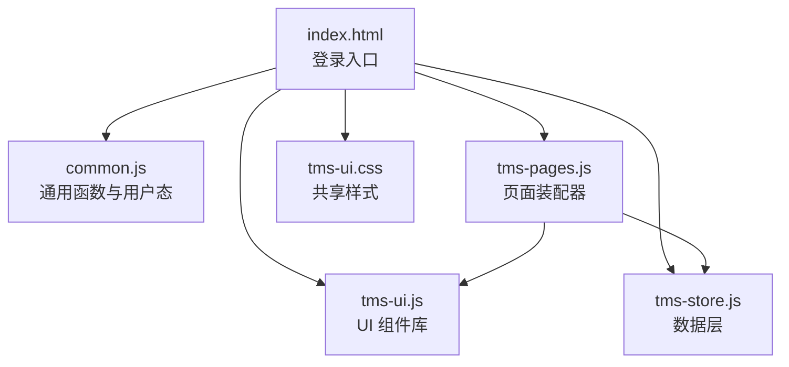
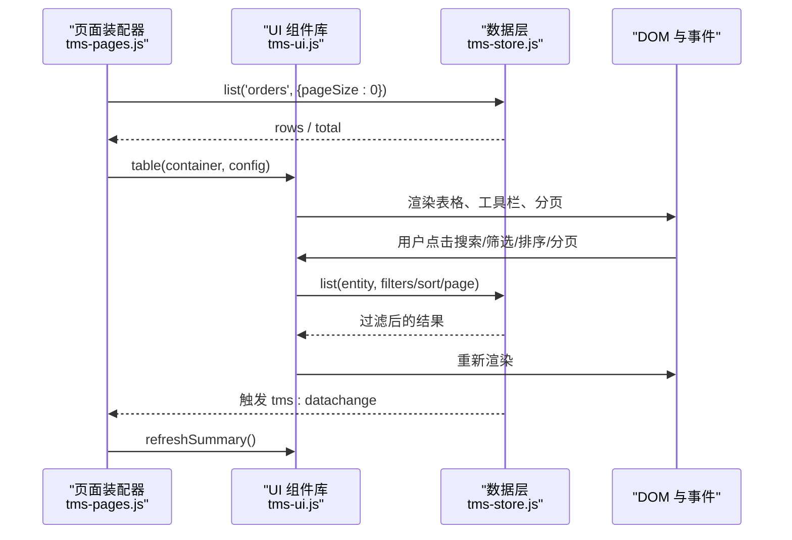
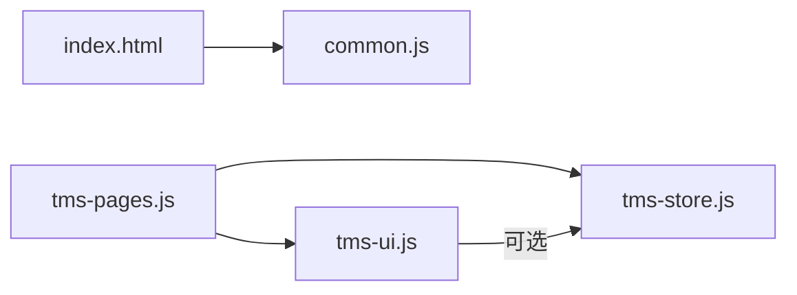

# 编码规范

<cite>
**本文引用的文件**   
- [common.js](file://common.js)
- [tms-ui.js](file://tms-ui.js)
- [tms-store.js](file://tms-store.js)
- [tms-pages.js](file://tms-pages.js)
- [tms-ui.css](file://tms-ui.css)
- [index.html](file://index.html)
</cite>

## 目录
1. [引言](#引言)
2. [项目结构](#项目结构)
3. [核心组件](#核心组件)
4. [架构总览](#架构总览)
5. [详细组件分析](#详细组件分析)
6. [依赖关系分析](#依赖关系分析)
7. [性能与内存优化](#性能与内存优化)
8. [代码审查清单](#代码审查清单)
9. [质量检查工具配置建议](#质量检查工具配置建议)
10. [结论](#结论)

## 引言
本规范面向 TMS（运输管理系统）前端代码，目标是统一团队在 JavaScript ES5、HTML 结构与 CSS 样式上的写法，明确模块化组织方式、事件驱动架构、数据层与 UI 层的职责边界，并提供可落地的代码审查清单与质量检查工具配置建议。通过统一命名约定、注释风格、表单处理、响应式原则和组件样式组织，提升可维护性与协作效率。

## 项目结构
仓库采用“多页面 + 共享库”的静态站点结构：
- 登录入口页：index.html
- 通用逻辑与用户态：common.js
- 管理员端页面装配：tms-pages.js
- 共享 UI 组件库：tms-ui.js
- 共享数据层（localStorage 数据库）：tms-store.js
- 共享 UI 样式：tms-ui.css
- 各业务 HTML 页面：branch-*/client-*/deliveryman-*/sorter-*/transporter-*/tms-*.html

**图表来源**
- [index.html:1-172](file://index.html#L1-L172)
- [common.js:1-383](file://common.js#L1-L383)
- [tms-ui.js:1-781](file://tms-ui.js#L1-L781)
- [tms-store.js:1-800](file://tms-store.js#L1-L800)
- [tms-pages.js:1-800](file://tms-pages.js#L1-L800)
- [tms-ui.css:1-795](file://tms-ui.css#L1-L795)

**章节来源**
- [index.html:1-172](file://index.html#L1-L172)
- [common.js:1-383](file://common.js#L1-L383)
- [tms-ui.js:1-781](file://tms-ui.js#L1-L781)
- [tms-store.js:1-800](file://tms-store.js#L1-L800)
- [tms-pages.js:1-800](file://tms-pages.js#L1-L800)
- [tms-ui.css:1-795](file://tms-ui.css#L1-L795)

## 核心组件
- common.js：提供订单号/运单号生成、按钮样式注入、用户登录/登出、当前用户展示、积分管理等全局能力，并通过 window 暴露方法供页面直接调用。
- tms-ui.js：以 IIFE 封装的共享 UI 组件库，包含 Toast、Modal、Confirm、FormModal、Table、KPI、SVG 图表、状态徽章、详情面板等，所有类名使用 tms- 前缀避免冲突。
- tms-store.js：基于 localStorage 的轻量数据层，负责种子数据生成、CRUD、搜索/筛选/排序/分页、订单生命周期推进、计费引擎、路由与轨迹规划，并通过自定义事件通知订阅者。
- tms-pages.js：管理员端页面装配器，将 KPI、图表、表格与 CRUD 操作组合为统一页面模板，通过 define(id, config) 注册页面。
- tms-ui.css：统一的 UI 样式，涵盖页面骨架、KPI、面板、工具栏、按钮、表格、分页、弹窗、表单、详情、时间线、Toast、导航角标等。
- index.html：登录入口，负责角色选择、用户名密码输入与登录事件绑定，并加载 common.js。

**章节来源**
- [common.js:1-383](file://common.js#L1-L383)
- [tms-ui.js:1-781](file://tms-ui.js#L1-L781)
- [tms-store.js:1-800](file://tms-store.js#L1-L800)
- [tms-pages.js:1-800](file://tms-pages.js#L1-L800)
- [tms-ui.css:1-795](file://tms-ui.css#L1-L795)
- [index.html:1-172](file://index.html#L1-L172)

## 架构总览
TMS 前端采用“页面装配 + 共享 UI + 共享数据层”的事件驱动架构：
- 页面装配器（tms-pages.js）根据配置渲染 KPI、图表、表格与操作按钮。
- UI 组件库（tms-ui.js）提供一致的交互与可视化能力。
- 数据层（tms-store.js）维护业务数据与状态变更，触发 tms:datachange 事件。
- 通用逻辑（common.js）提供用户态与基础工具。
- 样式（tms-ui.css）统一视觉与布局。

**图表来源**
- [tms-pages.js:14-114](file://tms-pages.js#L14-L114)
- [tms-ui.js:301-542](file://tms-ui.js#L301-L542)
- [tms-store.js:220-244](file://tms-store.js#L220-L244)

**章节来源**
- [tms-pages.js:14-114](file://tms-pages.js#L14-L114)
- [tms-ui.js:301-542](file://tms-ui.js#L301-L542)
- [tms-store.js:220-244](file://tms-store.js#L220-L244)

## 详细组件分析

### JavaScript ES5 语法与命名规范
- 变量与常量
  - 使用 var 声明局部变量；常量使用全大写加下划线（如 DB_KEY、DB_VERSION）。
  - 对象属性与方法使用驼峰命名（如 buildOrderId、calcFreight）。
  - 全局导出方法使用小驼峰（如 login、logout、getCurrentUser）。
- 函数定义
  - 优先使用具名函数，便于调试栈追踪。
  - 复杂逻辑拆分为小函数（如 pad、dateKey、dateTimeKey、hash）。
  - 回调函数使用匿名函数或短箭头风格的 ES5 等价形式（即普通函数表达式）。
- 字符串与数字
  - 使用 String(value) 进行安全转换，避免 null/undefined 报错。
  - 金额计算使用 money(n) 四舍五入到两位小数。
  - 日期格式化使用 fmt.date/fmt.dateTime/fmt.time。
- 注释规范
  - 文件头部说明模块职责与对外接口。
  - 关键算法与业务规则添加行内注释（如计费引擎、路由计划、轨迹生成）。
  - 对外 API 使用 JSDoc 风格注释（如 calcFreight 参数说明）。
- 错误处理
  - 对 localStorage 读写使用 try/catch 包裹，防止异常中断。
  - 事件监听与 DOM 操作增加空值判断与存在性检查。
  - 弹窗与表单提交捕获异常并显示友好错误信息。

**章节来源**
- [tms-store.js:16-70](file://tms-store.js#L16-L70)
- [tms-store.js:220-244](file://tms-store.js#L220-L244)
- [tms-ui.js:12-55](file://tms-ui.js#L12-L55)
- [common.js:1-383](file://common.js#L1-L383)

### HTML 结构编写标准
- 语义化标签
  - 使用 <form>、<input>、<select>、<textarea> 构建表单，确保可访问性与原生验证。
  - 列表使用 <ul>/<li>，详情使用 <dl>/<dt>/<dd>（若需要）。
- 表单处理
  - 必填字段使用 required 属性，配合 formModal 内置校验。
  - 数值字段使用 type="number" 与 min/max/step 约束。
  - 下拉选项使用 options 数组映射，支持 value/label 两种格式。
- 事件绑定
  - 使用 addEventListener 绑定 click/input/change 事件。
  - 避免内联事件处理器（如 onclick），保持结构与行为分离。
  - 对动态生成的元素使用事件委托或重新绑定（如表格操作按钮）。

**章节来源**
- [tms-ui.js:163-285](file://tms-ui.js#L163-L285)
- [index.html:117-172](file://index.html#L117-L172)

### CSS 样式编写规范
- 类名命名约定
  - 所有共享样式使用 tms- 前缀（如 .tms-page、.tms-btn、.tms-table）。
  - 避免全局污染，不直接使用无前缀类名。
- 响应式设计原则
  - 使用 flexbox 与 grid 实现自适应布局（如 .tms-kpis、.tms-form）。
  - 媒体查询适配移动端（如 @media (max-width: 560px)）。
- 组件样式组织
  - 按功能分块注释（如页面骨架、KPI、面板、工具栏、按钮、表格、分页、弹窗、表单、详情、Toast）。
  - 颜色、字号、间距使用统一变量（虽未引入 CSS 变量，但通过一致的值保证一致性）。

**章节来源**
- [tms-ui.css:1-795](file://tms-ui.css#L1-L795)

### 代码组织结构模式
- 模块化设计
  - 每个 JS 文件承担单一职责：common.js（通用）、tms-ui.js（UI）、tms-store.js（数据）、tms-pages.js（页面装配）。
  - 通过 window 暴露全局 API（如 window.TmsUI、window.TmsStore、window.login）。
- IIFE 使用
  - tms-ui.js 与 tms-store.js 使用 IIFE 封装，避免污染全局作用域。
- 事件驱动架构
  - 数据层通过 CustomEvent('tms:datachange') 通知订阅者。
  - 页面装配器订阅数据变化，自动刷新 KPI 与表格。

**章节来源**
- [tms-ui.js:7-781](file://tms-ui.js#L7-L781)
- [tms-store.js:13-244](file://tms-store.js#L13-L244)
- [tms-pages.js:10-114](file://tms-pages.js#L10-L114)

## 依赖关系分析
- tms-pages.js 依赖 tms-ui.js 与 tms-store.js。
- tms-ui.js 依赖 window.TmsStore（可选）用于状态徽章与列表数据。
- common.js 独立运行，提供用户态与基础工具。
- index.html 加载 common.js 并绑定登录事件。

**图表来源**
- [index.html:145-172](file://index.html#L145-L172)
- [tms-pages.js:10-114](file://tms-pages.js#L10-L114)
- [tms-ui.js:70-781](file://tms-ui.js#L70-L781)
- [tms-store.js:13-244](file://tms-store.js#L13-L244)

**章节来源**
- [index.html:145-172](file://index.html#L145-L172)
- [tms-pages.js:10-114](file://tms-pages.js#L10-L114)
- [tms-ui.js:70-781](file://tms-ui.js#L70-L781)
- [tms-store.js:13-244](file://tms-store.js#L13-L244)

## 性能与内存优化
- 减少 DOM 操作
  - 批量更新 innerHTML，避免频繁重排重绘。
  - 使用 requestAnimationFrame 或 setTimeout 延迟非关键渲染。
- 事件去抖与节流
  - 搜索输入使用防抖（如 tms-ui.js 中 220ms 延迟）。
  - 滚动或高频事件使用节流。
- 内存管理
  - 及时移除不再使用的 DOM 节点（如 modal.remove()）。
  - 解绑事件监听器（如 document.removeEventListener('keydown', onKey)）。
  - 避免闭包引用大对象，必要时显式置空。
- 数据层优化
  - 分页与过滤在服务端或本地缓存中进行，避免全量遍历。
  - 使用索引或预计算字段（如 statusIndex、planSegments）。

**章节来源**
- [tms-ui.js:452-464](file://tms-ui.js#L452-L464)
- [tms-ui.js:120-134](file://tms-ui.js#L120-L134)
- [tms-store.js:443-460](file://tms-store.js#L443-L460)

## 代码审查清单
- JavaScript
  - [ ] 是否使用 ES5 兼容语法？
  - [ ] 变量命名是否符合驼峰与常量规范？
  - [ ] 函数是否具有清晰职责与注释？
  - [ ] 是否避免全局变量污染？
  - [ ] 是否处理 null/undefined 与异常？
- HTML
  - [ ] 是否使用语义化标签？
  - [ ] 表单字段是否具备必要属性（required、type、min/max）？
  - [ ] 事件绑定是否使用 addEventListener？
- CSS
  - [ ] 是否使用 tms- 前缀类名？
  - [ ] 是否遵循响应式设计原则？
  - [ ] 是否避免重复样式与硬编码值？
- 架构
  - [ ] 是否遵循模块化设计？
  - [ ] 是否使用 IIFE 封装？
  - [ ] 是否通过事件驱动解耦组件？
- 性能
  - [ ] 是否避免频繁 DOM 操作？
  - [ ] 是否使用防抖/节流？
  - [ ] 是否及时清理内存（移除节点、解绑事件）？

## 质量检查工具配置建议
- ESLint
  - 启用 ES5 环境（env: es5: true）。
  - 禁用现代语法（no-arrow-functions、no-template-literals）。
  - 强制命名约定（camelcase、capitalized-comments）。
  - 禁止全局变量（no-global-assign、no-unused-vars）。
- Stylelint
  - 强制类名前缀（plugin:selector-class-pattern）。
  - 禁止硬编码颜色（color-no-hex、color-named）。
  - 启用响应式最佳实践（media-query-no-invalid）。
- Prettier
  - 统一缩进、引号、分号、换行符。
  - 与 ESLint 集成，避免冲突规则。
- 单元测试
  - 使用 Jest 或 QUnit 测试纯函数（如 hashCode、generateOrderId、calcFreight）。
  - 模拟 localStorage 与 DOM 环境。

**章节来源**
- [tms-ui.js:1-781](file://tms-ui.js#L1-L781)
- [tms-store.js:1-800](file://tms-store.js#L1-L800)
- [tms-ui.css:1-795](file://tms-ui.css#L1-L795)

## 结论
本规范明确了 TMS 系统在 JavaScript ES5、HTML 结构与 CSS 样式上的统一标准，定义了模块化、IIFE 与事件驱动的组织模式，并提供了性能优化与内存管理最佳实践。通过代码审查清单与质量检查工具配置，团队可确保代码风格一致、可维护性强、协作高效。建议在后续迭代中持续完善自动化检查与文档更新，以保持规范落地与演进。