# 仓储库存数据模型

<cite>
**本文引用的文件**   
- [tms-store.js](file://tms-store.js)
- [tms-pages.js](file://tms-pages.js)
- [tms-warehouse.html](file://tms-warehouse.html)
- [tms-material.html](file://tms-material.html)
- [branch-inventory.html](file://branch-inventory.html)
</cite>

## 目录
1. [引言](#引言)
2. [项目结构](#项目结构)
3. [核心数据实体](#核心数据实体)
4. [架构总览](#架构总览)
5. [详细数据模型分析](#详细数据模型分析)
6. [依赖关系分析](#依赖关系分析)
7. [性能与扩展性](#性能与扩展性)
8. [故障排查指南](#故障排查指南)
9. [结论](#结论)

## 引言
本文件面向仓储管理系统的数据模型，重点说明仓库、库存、物料等实体的设计，以及库存状态管理、安全库存预警、库存周转、仓库容量与利用率统计、空间位置跟踪、库存变动记录与审计追踪、设备管理与维护记录等能力在代码中的体现。文档以仓库侧的共享数据层和页面渲染逻辑为依据，给出可追溯的数据字段、状态流转与聚合计算方式，帮助读者在不直接阅读源码的情况下理解系统的数据结构与业务语义。

## 项目结构
本项目采用前端静态页面加轻量级本地存储数据层的模式：
- 共享数据层 tms-store.js 提供基于 localStorage 的数据库能力，负责种子数据生成、增删改查、状态流转、统计聚合与跨页事件通知。
- 页面 tms-warehouse.html、tms-material.html、branch-inventory.html 分别承载仓储管理、内部物资管理和网点库存与资产管理的界面与交互。
- tms-pages.js 定义各功能模块的表格、表单、操作按钮与 KPI 展示，并调用 TmsStore 提供的 API 读写数据。

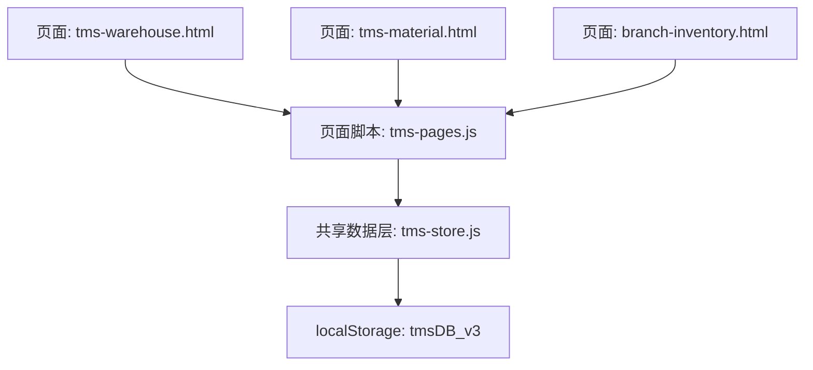

**图表来源**
- [tms-warehouse.html:340-537](file://tms-warehouse.html#L340-L537)
- [tms-material.html:262-379](file://tms-material.html#L262-L379)
- [branch-inventory.html:337-458](file://branch-inventory.html#L337-L458)
- [tms-pages.js:340-450](file://tms-pages.js#L340-L450)
- [tms-store.js:2297-2376](file://tms-store.js#L2297-L2376)

**章节来源**
- [tms-warehouse.html:340-537](file://tms-warehouse.html#L340-L537)
- [tms-material.html:262-379](file://tms-material.html#L262-L379)
- [branch-inventory.html:337-458](file://branch-inventory.html#L337-L458)
- [tms-pages.js:340-450](file://tms-pages.js#L340-L450)
- [tms-store.js:2297-2376](file://tms-store.js#L2297-L2376)

## 核心数据实体
围绕仓储与库存的核心实体包括：
- 仓库（warehouses）
- 库存（inventory）
- 物料（material，内部物资）
- 运力资源（capacities）
- 电子围栏（geofences）
- 订单、轨迹、异常、财务等关联实体用于联动统计与审计

其中仓库与库存是仓储数据模型的主轴；物料在“内部物资管理”中作为独立实体存在；运力资源与电子围栏为仓储与运输协同提供支撑。

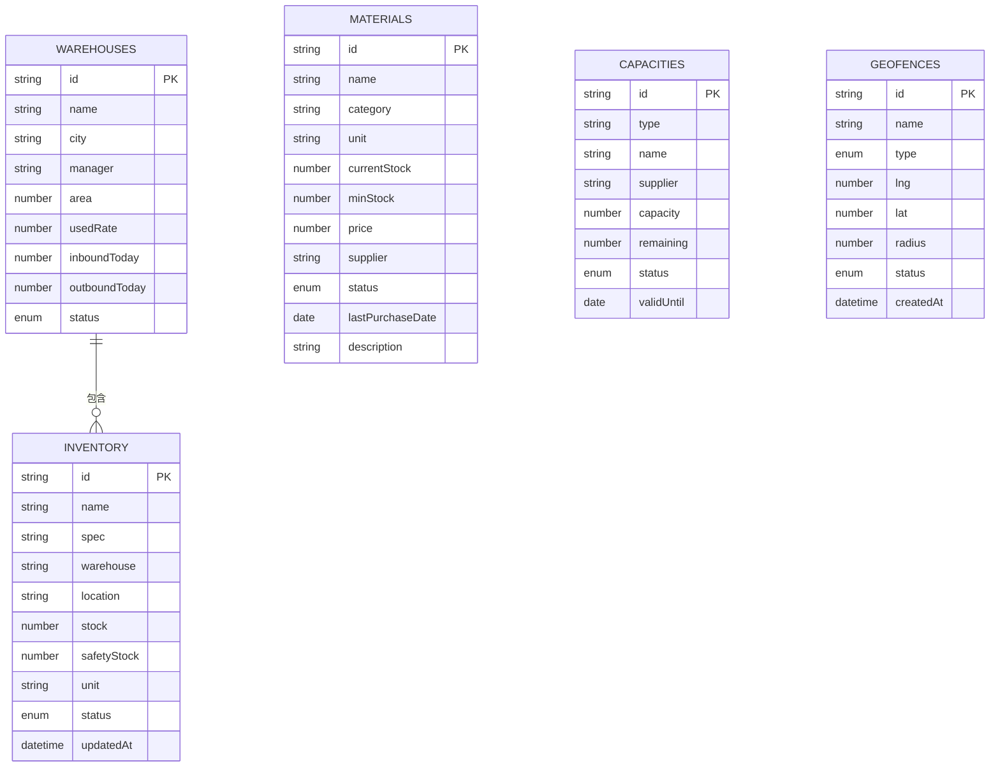

**图表来源**
- [tms-store.js:520-554](file://tms-store.js#L520-L554)
- [tms-store.js:556-571](file://tms-store.js#L556-L571)
- [tms-store.js:573-591](file://tms-store.js#L573-L591)
- [tms-material.html:459-527](file://tms-material.html#L459-L527)

**章节来源**
- [tms-store.js:520-554](file://tms-store.js#L520-L554)
- [tms-store.js:556-571](file://tms-store.js#L556-L571)
- [tms-store.js:573-591](file://tms-store.js#L573-L591)
- [tms-material.html:459-527](file://tms-material.html#L459-L527)

## 架构总览
TMS 仓储数据模型通过以下流程组织：
- 初始化阶段：tms-store.js 生成仓库、库存、运力、围栏等种子数据，写入 localStorage。
- 页面加载：tms-warehouse.html、tms-material.html、branch-inventory.html 初始化 UI，并通过 tms-pages.js 调用 S.list/S.create/S.update 等 API 读取或更新数据。
- 状态与统计：tms-store.js 提供 STATUS_LABELS、warehouseStats 等字典与聚合函数，供页面展示库存健康度、低库存预警、仓库使用率等指标。
- 事件同步：数据变更触发 tms:datachange 事件，多标签页之间通过 storage 事件保持数据一致。

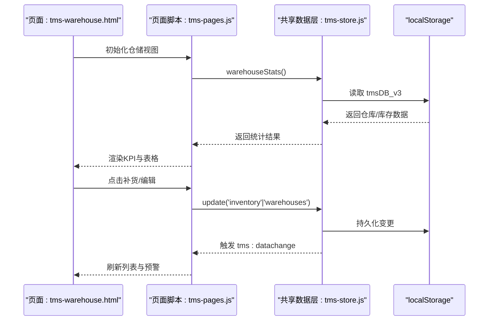

**图表来源**
- [tms-store.js:232-244](file://tms-store.js#L232-L244)
- [tms-store.js:2167-2178](file://tms-store.js#L2167-L2178)
- [tms-pages.js:340-450](file://tms-pages.js#L340-L450)
- [tms-warehouse.html:532-605](file://tms-warehouse.html#L532-L605)

**章节来源**
- [tms-store.js:232-244](file://tms-store.js#L232-L244)
- [tms-store.js:2167-2178](file://tms-store.js#L2167-L2178)
- [tms-pages.js:340-450](file://tms-pages.js#L340-L450)
- [tms-warehouse.html:532-605](file://tms-warehouse.html#L532-L605)

## 详细数据模型分析

### 仓库（Warehouse）
仓库实体描述仓储设施的基本信息与运营指标：
- 标识与基础信息：id、name、city、manager
- 容量与利用率：area（面积）、usedRate（使用率百分比）
- 当日作业量：inboundToday、outboundToday
- 运行状态：status（normal/busy）

仓库使用率阈值驱动状态切换：当 usedRate > 85% 时标记为 busy，否则为 normal。该逻辑在新增与编辑仓库时由页面脚本设置，并在仓库详情中展示使用率进度条。

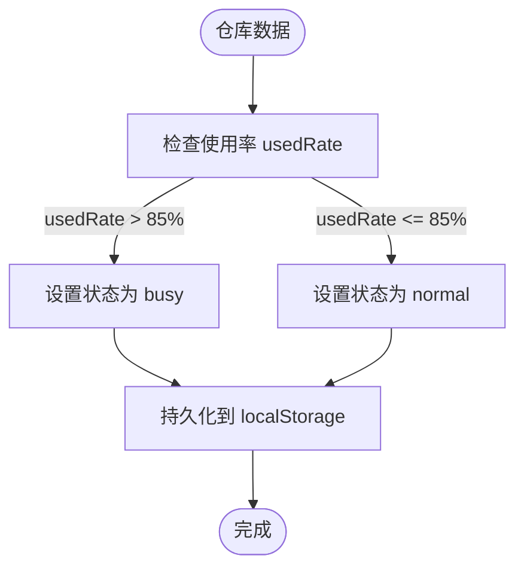

**图表来源**
- [tms-pages.js:371-386](file://tms-pages.js#L371-L386)
- [tms-pages.js:412-424](file://tms-pages.js#L412-L424)
- [tms-store.js:542-554](file://tms-store.js#L542-L554)

**章节来源**
- [tms-store.js:542-554](file://tms-store.js#L542-L554)
- [tms-pages.js:371-386](file://tms-pages.js#L371-L386)
- [tms-pages.js:412-424](file://tms-pages.js#L412-L424)

### 库存（Inventory）
库存实体描述具体物料在各仓库中的数量与安全水位：
- 标识与名称：id、name
- 规格与单位：spec、unit
- 仓库与位置：warehouse、location（如“A区-01”）
- 数量与安全库存：stock、safetyStock
- 状态：status（normal/low），按 stock < safetyStock 判定
- 更新时间：updatedAt

库存状态由当前库存与安全库存比较得出，页面在仓库详情中展示仓内物资清单及状态徽章。低库存预警区域会列出所有低于安全库存的库存项，并提供补货操作。

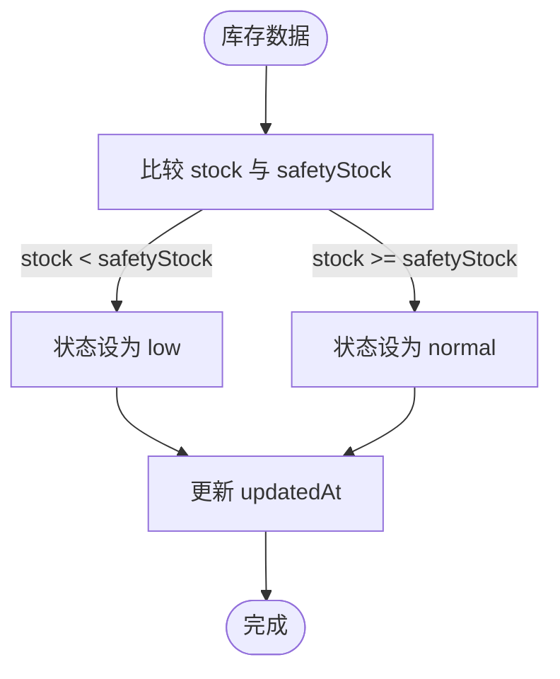

**图表来源**
- [tms-store.js:525-539](file://tms-store.js#L525-L539)
- [tms-pages.js:390-405](file://tms-pages.js#L390-L405)
- [tms-pages.js:430-449](file://tms-pages.js#L430-L449)

**章节来源**
- [tms-store.js:525-539](file://tms-store.js#L525-L539)
- [tms-pages.js:390-405](file://tms-pages.js#L390-L405)
- [tms-pages.js:430-449](file://tms-pages.js#L430-L449)

### 物料（Material）
内部物资管理将物料作为独立实体，字段包括：
- 标识与名称：id、name
- 分类与单位：category、unit
- 库存与最低库存：currentStock、minStock
- 价格与供应商：price、supplier
- 状态：status（in_stock/low_stock/out_of_stock）
- 采购时间：lastPurchaseDate
- 描述：description

物料状态根据 currentStock 与 minStock 的关系自动更新，支持采购与库存更新操作。

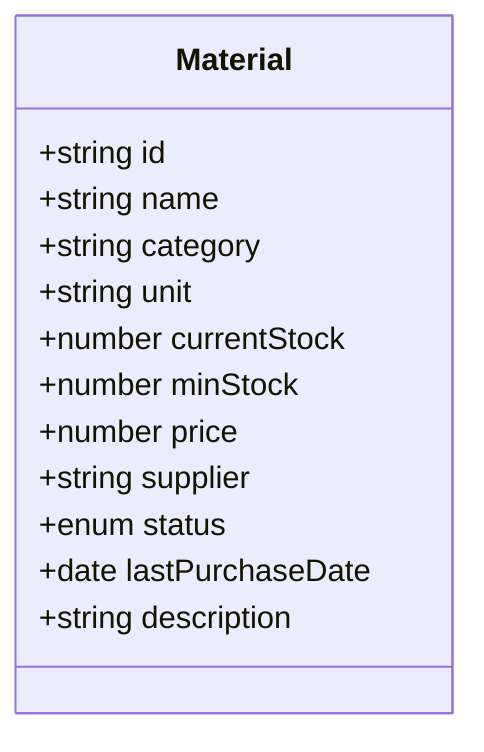

**图表来源**
- [tms-material.html:459-527](file://tms-material.html#L459-L527)
- [tms-material.html:559-618](file://tms-material.html#L559-L618)

**章节来源**
- [tms-material.html:459-527](file://tms-material.html#L459-L527)
- [tms-material.html:559-618](file://tms-material.html#L559-L618)

### 库存状态管理与安全库存预警
库存状态管理规则：
- 正常：stock >= safetyStock
- 偏低：stock < safetyStock

安全库存预警：
- 页面在“低库存预警”区域列出所有 status=low 的库存项
- 提供补货操作，增加 stock 并恢复状态为 normal

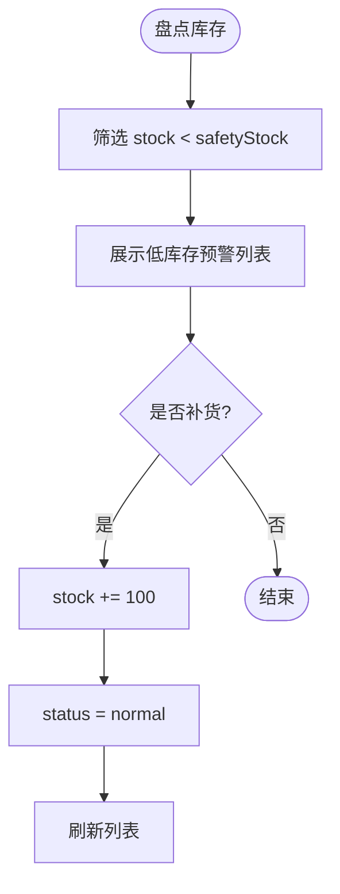

**图表来源**
- [tms-pages.js:430-449](file://tms-pages.js#L430-L449)
- [tms-store.js:525-539](file://tms-store.js#L525-L539)

**章节来源**
- [tms-pages.js:430-449](file://tms-pages.js#L430-L449)
- [tms-store.js:525-539](file://tms-store.js#L525-L539)

### 库存周转与利用率统计
库存总量与周转相关统计：
- 库存总量：warehouseStats 对 db.inventory 的 stock 求和
- 低库存数量：过滤 status=low 的库存项
- 仓库使用率：usedRate 字段表示仓库面积利用百分比
- 网点库存与资产页面显示“库存周转率”，但当前实现为模拟值

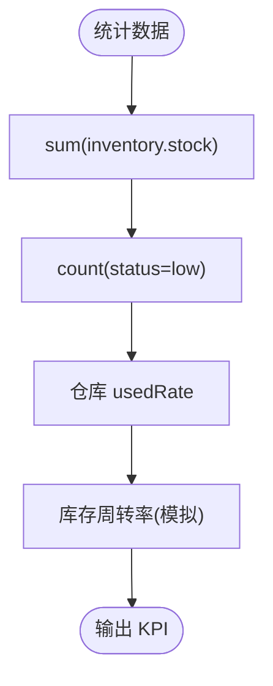

**图表来源**
- [tms-store.js:2167-2178](file://tms-store.js#L2167-L2178)
- [branch-inventory.html:646-653](file://branch-inventory.html#L646-L653)

**章节来源**
- [tms-store.js:2167-2178](file://tms-store.js#L2167-L2178)
- [branch-inventory.html:646-653](file://branch-inventory.html#L646-L653)

### 仓库容量管理与空间规划
仓库容量与空间规划体现在：
- area：仓库面积（㎡）
- usedRate：使用率百分比
- location：库存的空间位置编码（如“A区-01”）
- 仓库详情展示使用率进度条与仓内物资清单

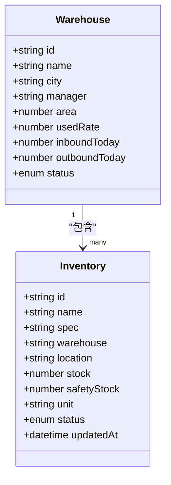

**图表来源**
- [tms-store.js:542-554](file://tms-store.js#L542-L554)
- [tms-store.js:525-539](file://tms-store.js#L525-L539)
- [tms-pages.js:390-405](file://tms-pages.js#L390-L405)

**章节来源**
- [tms-store.js:542-554](file://tms-store.js#L542-L554)
- [tms-store.js:525-539](file://tms-store.js#L525-L539)
- [tms-pages.js:390-405](file://tms-pages.js#L390-L405)

### 物料分类、规格管理与库存位置跟踪
- 物料分类：material.category（如“包装材料”“办公用品”“设备”）
- 规格管理：inventory.spec（如“中号 400×300×250mm”）
- 库存位置跟踪：inventory.location（如“A区-01”）

这些字段在仓库详情与低库存预警列表中展示，便于定位与管理。

**章节来源**
- [tms-store.js:525-539](file://tms-store.js#L525-L539)
- [tms-material.html:459-527](file://tms-material.html#L459-L527)
- [tms-pages.js:390-405](file://tms-pages.js#L390-L405)

### 库存变动记录与审计追踪
当前仓库与库存模块未实现独立的库存变动日志表；库存更新通过 S.update 直接修改库存行，并触发 tms:datachange 事件。若需审计追踪，可在后续扩展中引入 inventoryChangeLogs 实体，记录变更前后值、操作人、时间与原因。

现有审计相关能力主要体现在订单与异常链路：
- 订单 timeline 与 traces 记录节点与时间
- 异常处理 flow 记录处理动作与责任人
- 财务流水 finances 记录收入与支出

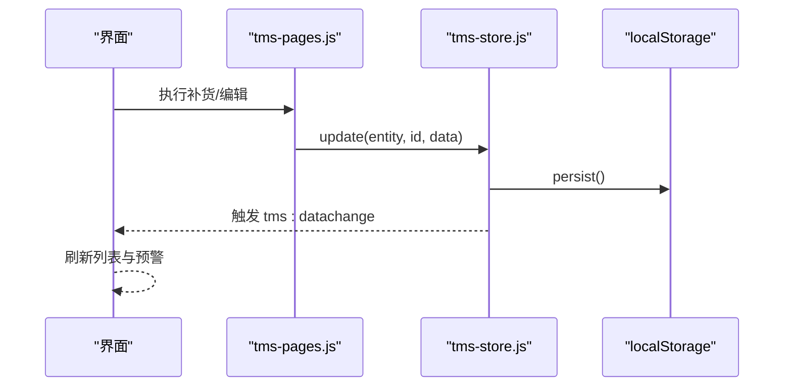

**图表来源**
- [tms-store.js:232-244](file://tms-store.js#L232-L244)
- [tms-pages.js:430-449](file://tms-pages.js#L430-L449)

**章节来源**
- [tms-store.js:232-244](file://tms-store.js#L232-L244)
- [tms-pages.js:430-449](file://tms-pages.js#L430-L449)

### 仓库设备管理与维护记录
仓库设备管理在“内部物资管理”中以物料形式体现，例如“叉车”作为设备类物料存在。设备维护记录可通过车辆管理模块的设备状态字段进行类比：
- 车辆状态：online/transporting/maintenance/offline
- 维修操作：将车辆状态设置为 maintenance

仓库设备可沿用此模式，为设备类物料添加维护状态与维护历史字段。

**章节来源**
- [tms-material.html:459-527](file://tms-material.html#L459-L527)
- [tms-pages.js:453-539](file://tms-pages.js#L453-L539)

## 依赖关系分析
- tms-pages.js 依赖 tms-store.js 提供的 API（list/get/create/update/remove/subscribe 等）
- tms-warehouse.html、tms-material.html、branch-inventory.html 依赖 tms-pages.js 渲染与交互
- tms-store.js 依赖 localStorage 持久化数据，并通过事件机制通知其他页面

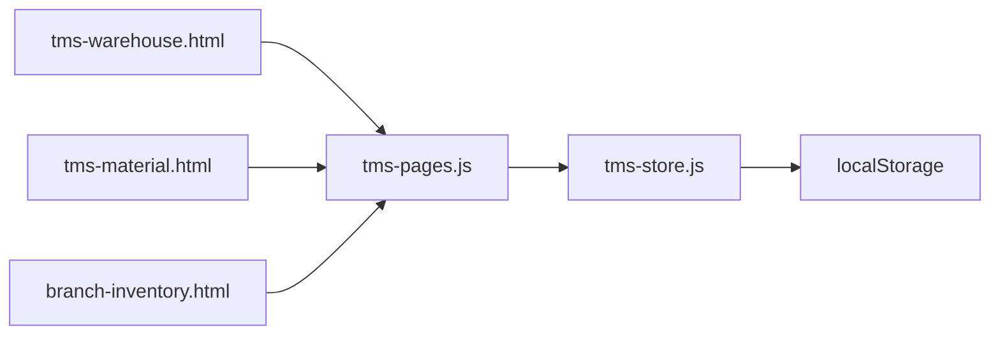

**图表来源**
- [tms-warehouse.html:527-537](file://tms-warehouse.html#L527-L537)
- [tms-material.html:369-379](file://tms-material.html#L369-L379)
- [branch-inventory.html:436-458](file://branch-inventory.html#L436-L458)
- [tms-pages.js:340-450](file://tms-pages.js#L340-L450)
- [tms-store.js:2297-2376](file://tms-store.js#L2297-L2376)

**章节来源**
- [tms-warehouse.html:527-537](file://tms-warehouse.html#L527-L537)
- [tms-material.html:369-379](file://tms-material.html#L369-L379)
- [branch-inventory.html:436-458](file://branch-inventory.html#L436-L458)
- [tms-pages.js:340-450](file://tms-pages.js#L340-L450)
- [tms-store.js:2297-2376](file://tms-store.js#L2297-L2376)

## 性能与扩展性
- 数据量较小且基于 localStorage，适合演示与轻量场景；大数据量时应迁移至后端数据库与分页查询。
- 统计聚合 warehouseStats 对 inventory 数组求和，复杂度 O(n)，在当前规模下可接受。
- 建议扩展：
  - 引入库存变动日志表，支持审计追踪与回滚
  - 为仓库增加分区/库位维度，细化空间规划
  - 为设备类物料增加维护计划与历史记录
  - 实现真实库存周转率计算（如期间出库成本/平均库存）

[本节为通用指导，不直接分析具体文件]

## 故障排查指南
常见问题与定位方法：
- 数据未持久化：检查 localStorage 键名是否为 tmsDB_v3，确认 persist 与 emit 是否正常触发
- 页面未刷新：确认 tms:datachange 事件是否被监听并触发 UI 更新
- 低库存预警不显示：检查 inventory.status 是否正确计算为 low，确认 S.list 过滤条件
- 仓库使用率异常：检查 usedRate 是否在新增/编辑时正确设置，阈值是否为 85%

**章节来源**
- [tms-store.js:232-244](file://tms-store.js#L232-L244)
- [tms-store.js:2167-2178](file://tms-store.js#L2167-L2178)
- [tms-pages.js:430-449](file://tms-pages.js#L430-L449)

## 结论
本仓储库存数据模型以仓库与库存为核心，辅以物料、运力与围栏等实体，形成完整的仓储管理数据结构。库存状态与安全库存预警通过简单规则实现，仓库容量与利用率通过 area 与 usedRate 表达，空间位置通过 location 编码跟踪。当前版本未实现独立的库存变动审计日志，但具备事件通知与跨页同步能力。建议在后续迭代中完善审计追踪、设备维护与真实周转率计算，以提升系统的可运维性与决策支持能力。