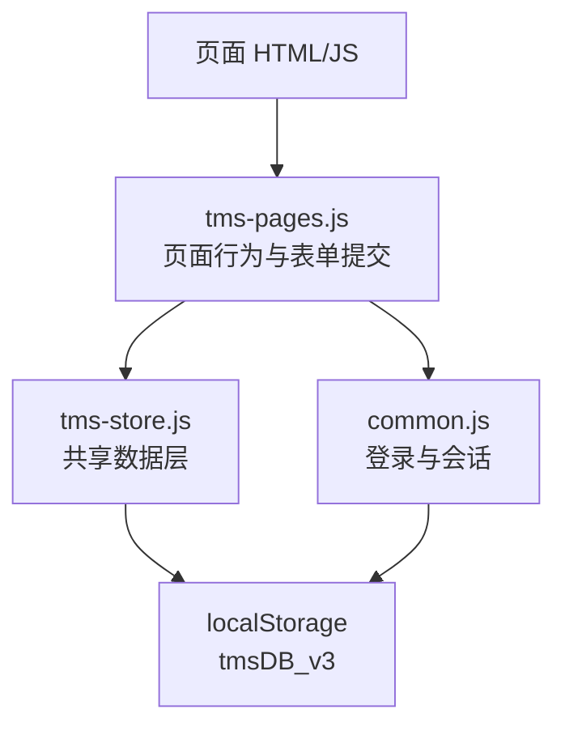
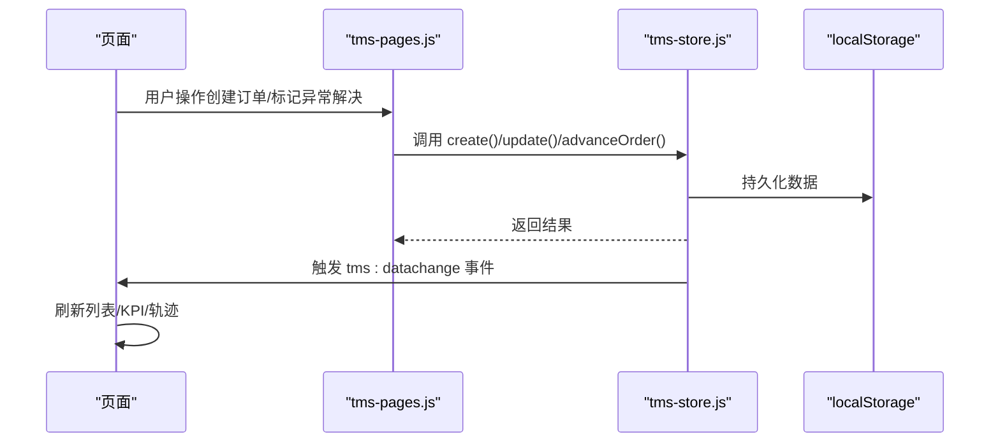
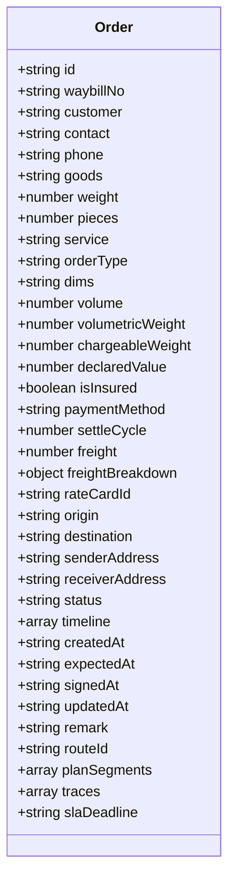
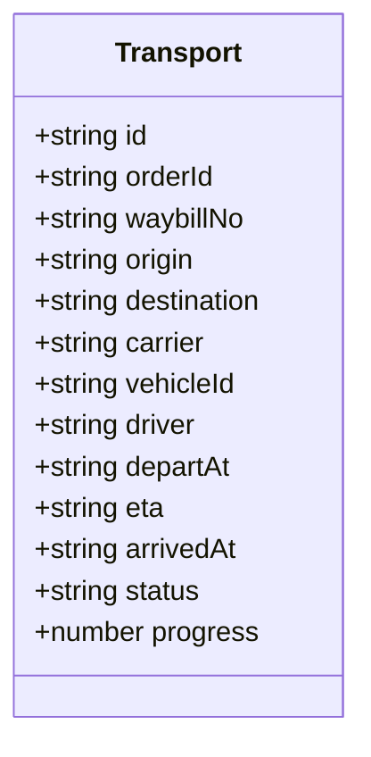
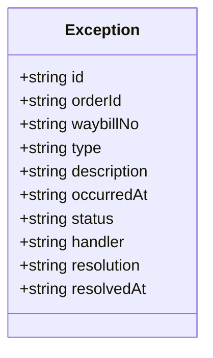
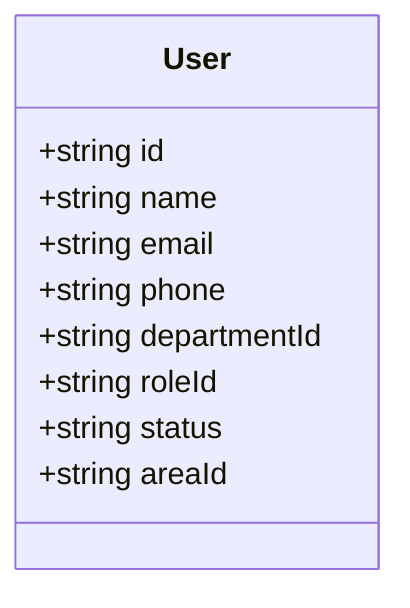
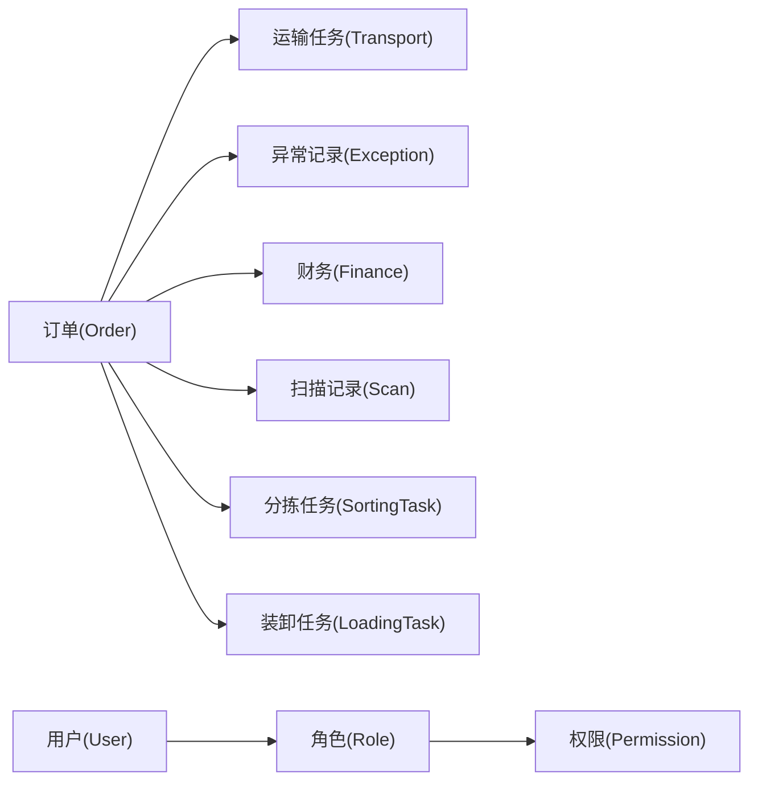

# 数据模型设计

<cite>
**本文引用的文件**   
- [tms-store.js](file://tms-store.js)
- [common.js](file://common.js)
- [tms-pages.js](file://tms-pages.js)
</cite>

## 目录
1. [引言](#引言)
2. [项目结构](#项目结构)
3. [核心组件](#核心组件)
4. [架构总览](#架构总览)
5. [详细数据模型分析](#详细数据模型分析)
6. [依赖关系分析](#依赖关系分析)
7. [性能与缓存策略](#性能与缓存策略)
8. [数据生命周期、保留与归档](#数据生命周期保留与归档)
9. [数据安全、隐私与访问控制](#数据安全隐私与访问控制)
10. [数据迁移与版本管理](#数据迁移与版本管理)
11. [故障排查指南](#故障排查指南)
12. [结论](#结论)

## 引言
本文件为 TMS（运输管理系统）前端演示项目的数据模型文档。系统以浏览器本地存储作为轻量级“数据库”，通过共享数据层维护订单、运输任务、异常记录、用户信息等核心实体，并提供统一的增删改查、状态流转、轨迹生成、计费试算和统计聚合能力。本文重点说明：
- 实体关系、字段定义与数据类型
- 主键/外键、索引与约束
- 数据验证规则与业务规则
- 数据访问模式、缓存策略与性能考虑
- 数据生命周期、保留策略与归档规则
- 数据迁移路径与版本管理
- 数据安全、隐私要求与访问控制
- 核心模型：订单、运输任务、异常记录、用户信息的设计与实现细节

## 项目结构
TMS 的数据模型主要集中在一处共享数据层中，其他页面通过该数据层进行读写。关键文件职责如下：
- tms-store.js：共享数据层，负责种子数据生成、CRUD、状态流转、轨迹与计费引擎、事件通知等
- common.js：通用函数库，包含登录、用户会话、积分等通用逻辑
- tms-pages.js：页面路由与页面行为配置，部分页面操作会调用数据层接口

**图表来源**
- [tms-store.js:1-12](file://tms-store.js#L1-L12)
- [tms-store.js:220-244](file://tms-store.js#L220-L244)
- [common.js:135-199](file://common.js#L135-L199)

**章节来源**
- [tms-store.js:1-12](file://tms-store.js#L1-L12)
- [common.js:1-10](file://common.js#L1-L10)
- [tms-pages.js:211-236](file://tms-pages.js#L211-L236)

## 核心组件
- 共享数据层（TmsStore）：提供 list/get/create/update/remove/subscribe/reset 等统一接口，并暴露业务方法如 advanceOrder、createException、resolveException、createClaim 等
- 种子数据生成器：首次加载时生成具有真实感的订单、运输、异常、财务、员工、车辆、仓库、库存、运力、围栏、策略、路由、地址、时效规则、考核指标等数据
- 计费引擎：根据线路、服务等级、重量体积、保价、到付、客户协议折扣计算运费明细
- 路由与轨迹规划：按起终点匹配路线，生成计划分段与标准时限；按订单阶段生成轨迹节点、地点、超时与偏差标记
- 事件机制：数据变更触发 tms:datachange 事件，供 UI 刷新或联动更新

**章节来源**
- [tms-store.js:1-12](file://tms-store.js#L1-L12)
- [tms-store.js:263-383](file://tms-store.js#L263-L383)
- [tms-store.js:385-460](file://tms-store.js#L385-L460)
- [tms-store.js:462-1062](file://tms-store.js#L462-L1062)
- [tms-store.js:1112-1227](file://tms-store.js#L1112-L1227)

## 架构总览
下图展示数据模型在系统中的位置与交互关系：页面通过 tms-pages.js 发起操作，调用 tms-store.js 的 API；tms-store.js 将数据写入 localStorage，并通过事件通知 UI 刷新。

**图表来源**
- [tms-store.js:232-244](file://tms-store.js#L232-L244)
- [tms-store.js:1173-1213](file://tms-store.js#L1173-L1213)
- [tms-pages.js:211-236](file://tms-pages.js#L211-L236)

## 详细数据模型分析

### 全局字典与枚举
- 城市与省份映射：用于订单号生成与路由选择
- 订单状态流：待入库→已入库→已分拣→运输中→已到达→派送中→已签收
- 各实体状态标签：订单、异常、运输、任务、工单、理赔、财务、员工、车辆、库存、运力、策略、网关、应收、账单、应付、费率、路线等
- 轨迹节点字典：揽收、入库、分拣、装车、发车、干线在途、到达、派送、签收、退回、拦截、超区、问题件等，带标准时限（stdHours）
- 客户分层与协议折扣：KA/A/B/C 等级，对应折扣与账期
- 服务等级与付款方式：标准/加急/经济/冷链；现付/到付/月结

这些字典与枚举是数据模型的基础约束与业务规则来源。

**章节来源**
- [tms-store.js:81-120](file://tms-store.js#L81-L120)
- [tms-store.js:122-192](file://tms-store.js#L122-L192)
- [tms-store.js:194-214](file://tms-store.js#L194-L214)

### 订单（Order）
- 主键：id（业务编号，HL+发货省份首字母+时间戳+用户ID哈希+随机数）
- 关键字段：
  - waybillNo：运单号（WB+订单哈希+随机数）
  - customer/contact/phone：客户与联系人信息
  - goods/pieces/weight/dims/volume/volumetricWeight/chargeableWeight：货物与计费要素
  - declaredValue/isInsured/paymentMethod/settleCycle/freight/freightBreakdown/rateCardId：保价、付款、结算与费用明细
  - origin/destination/senderAddress/receiverAddress：收发地
  - status/timeline/createdAt/expectedAt/signedAt/updatedAt/remark：状态与审计
  - routeId/planSegments/traces/slaDeadline：路由计划、分段计划、轨迹与SLA截止
- 数据类型：字符串、数字、布尔、ISO时间字符串、数组（timeline/traces/planSegments）、对象（freightBreakdown）
- 主键/外键：
  - id 为主键
  - rateCardId 关联运价卡
  - routeId 关联路线
  - traces 内联轨迹明细（非独立表）
- 索引与约束：
  - 无数据库索引；内存过滤与排序由 list() 实现
  - 状态必须遵循 ORDER_FLOW 顺序推进
  - 取消订单不可继续推进
- 验证与业务规则：
  - 计费引擎基于线路、服务等级、重量体积、保价、到付、客户协议折扣计算
  - 订单状态推进自动写入扫描、分拣、装卸、运输、财务等关联记录
  - SLA 截止时间为 expectedAt，轨迹节点含标准时限与超时标记

**图表来源**
- [tms-store.js:680-791](file://tms-store.js#L680-L791)
- [tms-store.js:1417-1454](file://tms-store.js#L1417-L1454)

**章节来源**
- [tms-store.js:680-791](file://tms-store.js#L680-L791)
- [tms-store.js:1417-1454](file://tms-store.js#L1417-L1454)

### 运输任务（Transport）
- 主键：id（TR+日期+序号）
- 关键字段：
  - orderId/waybillNo：关联订单
  - origin/destination/carrier/vehicleId/driver：起终点、承运商、车辆与司机
  - departAt/eta/arrivedAt/status/progress：发车时间、预计到达、到达时间、状态与进度
- 数据类型：字符串、数字、ISO时间字符串
- 主键/外键：
  - id 为主键
  - orderId 外键关联订单
  - vehicleId 外键关联车辆
- 索引与约束：
  - 状态推进需符合 shipping→arrived→delivering→completed 流程
  - 到达后进度设为 100
- 验证与业务规则：
  - 当订单进入“运输中”时自动生成运输任务
  - 到达/完成状态联动订单状态与车辆状态

**图表来源**
- [tms-store.js:843-861](file://tms-store.js#L843-L861)
- [tms-store.js:1301-1324](file://tms-store.js#L1301-L1324)

**章节来源**
- [tms-store.js:843-861](file://tms-store.js#L843-L861)
- [tms-store.js:1301-1324](file://tms-store.js#L1301-L1324)

### 异常记录（Exception）
- 主键：id（EX+日期+序号）
- 关键字段：
  - orderId/waybillNo：关联订单
  - type/description：异常类型与描述
  - occurredAt/status/handler/resolution/resolvedAt：发生时间、处理状态、处理人、解决方案与解决时间
- 数据类型：字符串、ISO时间字符串
- 主键/外键：
  - id 为主键
  - orderId 外键关联订单
- 索引与约束：
  - 状态：pending→processing→resolved→closed
  - 处理中异常会影响订单备注
- 验证与业务规则：
  - 解决异常时可联动创建理赔申请
  - 异常数量与类型影响运营KPI

**图表来源**
- [tms-store.js:863-878](file://tms-store.js#L863-L878)
- [tms-store.js:1481-1530](file://tms-store.js#L1481-L1530)

**章节来源**
- [tms-store.js:863-878](file://tms-store.js#L863-L878)
- [tms-store.js:1481-1530](file://tms-store.js#L1481-L1530)

### 用户信息（User）
- 主键：id（user-1, user-2...）
- 关键字段：
  - name/email/phone：姓名、邮箱、电话
  - departmentId/roleId：部门与角色
  - status/areaId：状态与区域
- 数据类型：字符串
- 主键/外键：
  - id 为主键
  - departmentId 外键关联部门
  - roleId 外键关联角色
- 索引与约束：
  - 状态：active/on_leave/resigned
  - 角色权限由 ROLES/PERMISSIONS 控制
- 验证与业务规则：
  - 用户登录与会话由 common.js 管理
  - 页面权限校验基于角色与所需角色

**图表来源**
- [tms-store.js:995-1004](file://tms-store.js#L995-L1004)
- [common.js:135-199](file://common.js#L135-L199)

**章节来源**
- [tms-store.js:995-1004](file://tms-store.js#L995-L1004)
- [common.js:135-199](file://common.js#L135-L199)

### 其他重要实体（摘要）
- 员工（Employee）：部门、岗位、薪资、状态
- 车辆（Vehicle）：车牌、车型、司机、网点、状态、里程、容量
- 仓库（Warehouse）与库存（Inventory）：仓库名称、城市、面积、利用率、物料库存与安全库存
- 运力（Capacity）：自有/外协/临时仓/航空仓位，总量与剩余
- 电子围栏（Geofence）：经纬度、半径、类型、状态
- 策略（Policy）与路由规则（RoutingRule）：生效范围、内容、优先级、时效
- 配送地址（DeliveryAddress）：详细地址、区域、审核状态
- 时效规则（TimingRule）：线路、方式、标准时长、优先级
- 变更记录（ChangeRecord）：订单变更原因与内容
- 考核指标（EvalMetric）与评估（Evaluation）：签收率、准时率、满意度、评分与等级
- 行政记录（AdminRecord）：采购、报销、会议、资产、用车
- 服务工单（ServiceTicket）与理赔（Claim）：类型、优先级、内容、金额、状态
- 财务（Finance）：收入/支出、类别、金额、状态、日期、备注
- 扫描记录（Scan）：扫描时间、类型、地点、设备、操作员
- 分拣任务（SortingTask）与装卸任务（LoadingTask）：计划时间、状态、完成时间、人员与设备

这些实体共同构成 TMS 的业务闭环，支撑订单全生命周期管理与运营可视化。

**章节来源**
- [tms-store.js:483-554](file://tms-store.js#L483-L554)
- [tms-store.js:556-678](file://tms-store.js#L556-L678)
- [tms-store.js:906-992](file://tms-store.js#L906-L992)
- [tms-store.js:1006-1018](file://tms-store.js#L1006-L1018)

## 依赖关系分析
- 订单与运输：订单进入“运输中”自动生成运输任务；运输到达/完成联动订单状态
- 订单与异常：异常记录关联订单；处理中异常影响订单备注；解决异常可联动理赔
- 订单与财务：签收后生成运费收入流水；理赔审批后生成赔付支出
- 订单与扫描/分拣/装卸：状态推进自动写入扫描与任务记录
- 用户与权限：角色与权限控制页面访问与操作

**图表来源**
- [tms-store.js:1343-1402](file://tms-store.js#L1343-L1402)
- [tms-store.js:1481-1530](file://tms-store.js#L1481-L1530)
- [tms-store.js:1555-1585](file://tms-store.js#L1555-L1585)

**章节来源**
- [tms-store.js:1343-1402](file://tms-store.js#L1343-L1402)
- [tms-store.js:1481-1530](file://tms-store.js#L1481-L1530)
- [tms-store.js:1555-1585](file://tms-store.js#L1555-L1585)

## 性能与缓存策略
- 存储介质：localStorage，键名为 tmsDB_v3，版本号为 DB_VERSION=3
- 读取与持久化：readDb() 解析 JSON，persist() 序列化写入；失败时返回 null
- 事件通知：emit() 触发 tms:datachange 事件，UI 订阅后刷新
- 查询优化：list() 支持 filters/search/sort/page/pageSize，内存过滤与排序
- 计数与分页：meta.counters 维护实体计数，避免重复计算
- 限制与裁剪：扫描记录超过 500 条时裁剪，避免 localStorage 膨胀

建议：
- 对高频查询字段（orderId、status、type）在前端建立索引映射以提升搜索性能
- 对大数据集（scans、finances）采用分页与懒加载
- 对敏感字段（email、phone）在展示层脱敏

**章节来源**
- [tms-store.js:220-244](file://tms-store.js#L220-L244)
- [tms-store.js:1112-1166](file://tms-store.js#L1112-L1166)
- [tms-store.js:1235-1255](file://tms-store.js#L1235-L1255)

## 数据生命周期、保留与归档
- 生命周期：
  - 订单：创建→入库→分拣→出库→运输→到达→派送→签收→取消
  - 运输：待发车→运输中→到达→派送→完成→取消
  - 异常：待处理→处理中→已解决→已关闭
  - 财务：待结算→已结算→已作废
- 保留策略：
  - 扫描记录上限 500 条，超出裁剪
  - 未明确归档策略，建议在数据量增长时引入离线归档与历史表
- 归档规则：
  - 建议按月份归档已完成订单与相关轨迹、扫描、财务流水
  - 保留审计日志（timeline、changeRecords）至少一个季度

**章节来源**
- [tms-store.js:88-120](file://tms-store.js#L88-L120)
- [tms-store.js:1235-1255](file://tms-store.js#L1235-L1255)

## 数据安全、隐私与访问控制
- 会话管理：common.js 使用 localStorage 保存 tmsUser（username、role），提供 login/checkLoginStatus/logout/getCurrentUser/displayCurrentUser
- 权限模型：ROLES/PERMISSIONS/DEPARTMENTS 定义角色与权限，用户通过 roleId 关联
- 访问控制：checkLoginStatus(requiredRole) 校验角色，不匹配则跳转登录页
- 隐私保护：
  - 用户个人信息（name/email/phone）应仅在授权页面展示
  - 建议在传输层与展示层对敏感字段脱敏
- 安全建议：
  - 避免在 localStorage 存储明文密码
  - 对敏感操作增加二次确认与审计记录

**章节来源**
- [common.js:135-199](file://common.js#L135-L199)
- [tms-store.js:144-164](file://tms-store.js#L144-L164)
- [tms-store.js:995-1004](file://tms-store.js#L995-L1004)

## 数据迁移与版本管理
- 版本号：DB_VERSION=3，键名 tmsDB_v3
- 初始化流程：
  - readDb() 检查版本，不匹配则丢弃旧数据
  - init(force) 首次加载生成种子数据，可选导入旧用户数据（importLegacyData）
  - persist() 写入 localStorage 并触发事件
- 迁移策略：
  - 升级 DB_VERSION 时需兼容旧数据结构
  - importLegacyData 示例展示了从 tmsUsers 迁移至 users 的逻辑
- 重置功能：reset() 清除 localStorage 并重新初始化

**章节来源**
- [tms-store.js:16-17](file://tms-store.js#L16-L17)
- [tms-store.js:220-244](file://tms-store.js#L220-L244)
- [tms-store.js:1074-1103](file://tms-store.js#L1074-L1103)
- [tms-store.js:1222-1227](file://tms-store.js#L1222-L1227)

## 故障排查指南
- 常见问题：
  - 数据未持久化：检查 persist() 是否被调用，localStorage 是否可用
  - 事件未触发：检查 emit() 是否正确分发 tms:datachange
  - 状态推进失败：检查 ORDER_FLOW 顺序与当前状态索引
  - 异常解决未联动理赔：检查 resolveException(options.createClaim) 参数
- 调试建议：
  - 在 list()/get()/create()/update()/remove() 中添加日志
  - 使用 reset() 清理数据后重新初始化
  - 检查 meta.counters 是否与实体数量一致

**章节来源**
- [tms-store.js:232-244](file://tms-store.js#L232-L244)
- [tms-store.js:1112-1213](file://tms-store.js#L1112-L1213)
- [tms-store.js:1343-1415](file://tms-store.js#L1343-L1415)
- [tms-store.js:1481-1530](file://tms-store.js#L1481-L1530)

## 结论
TMS 的数据模型以订单为核心，围绕运输、异常、财务、用户等实体构建完整业务闭环。共享数据层提供统一的 CRUD 与状态流转能力，结合 localStorage 实现轻量级持久化。通过字典与枚举约束业务规则，通过事件机制驱动 UI 更新。未来可在数据量增长时引入后端数据库、索引优化、归档策略与更强的安全控制，以提升系统的可扩展性与安全性。