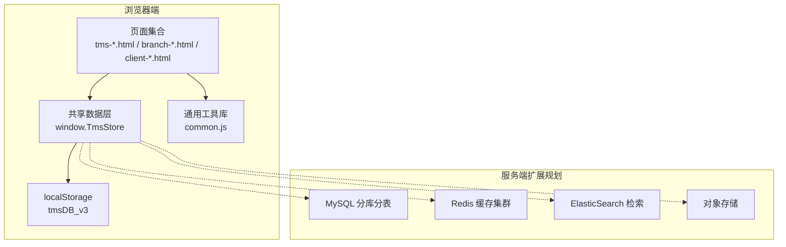
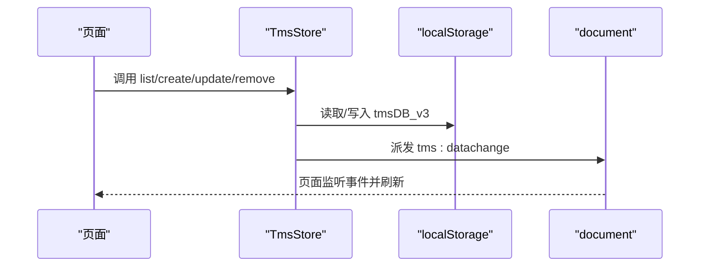
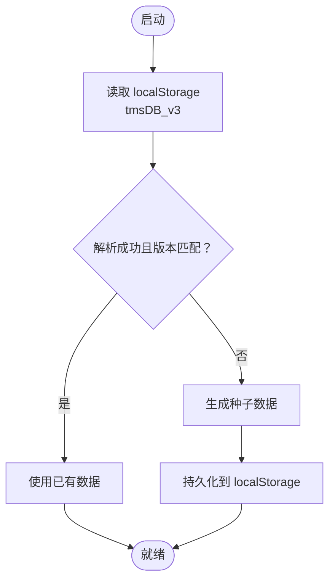
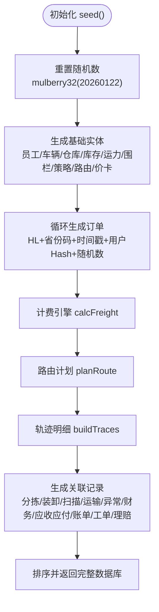
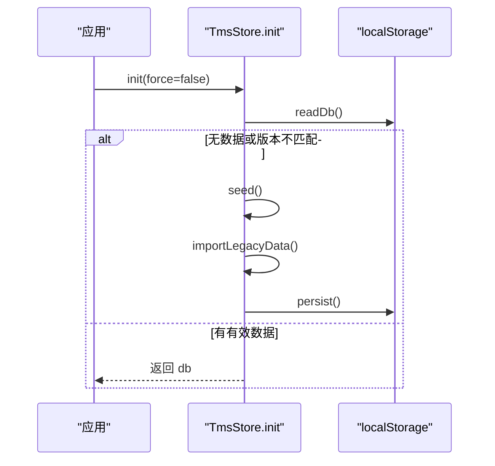
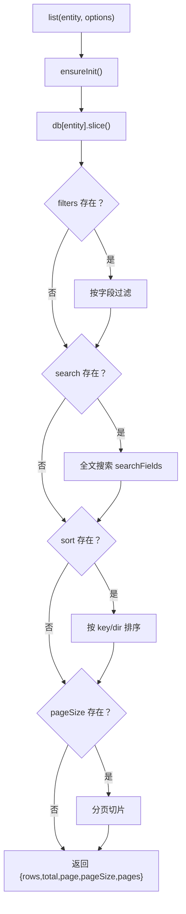
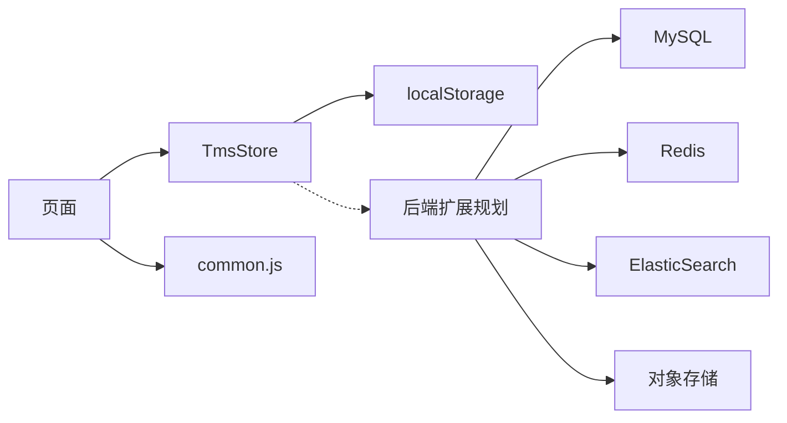
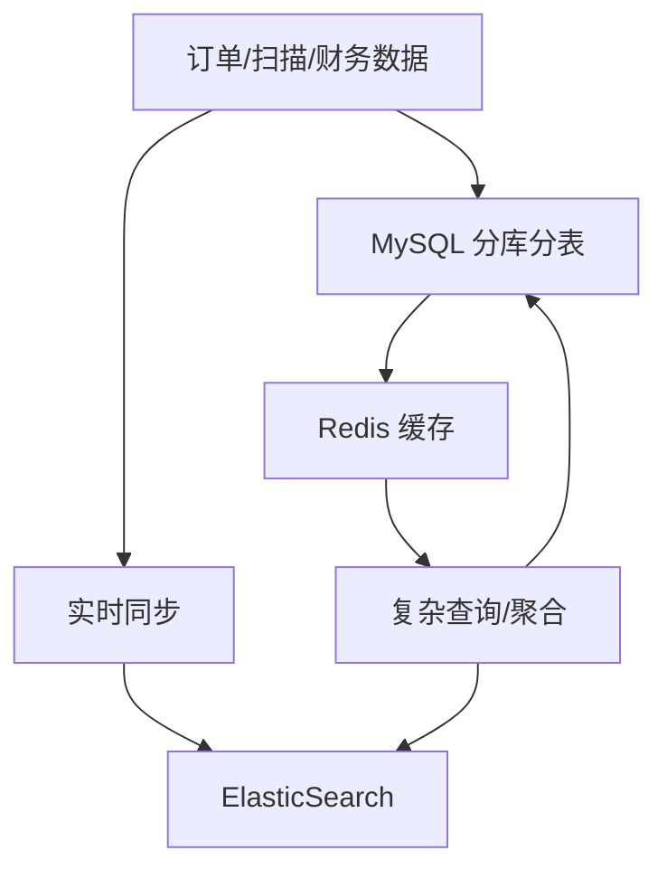
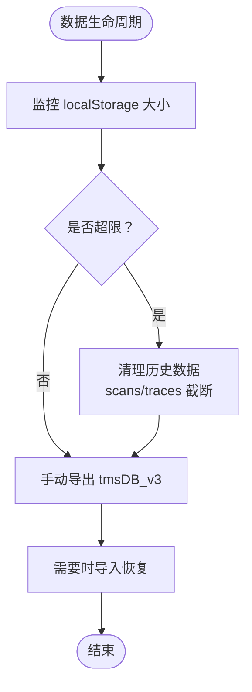
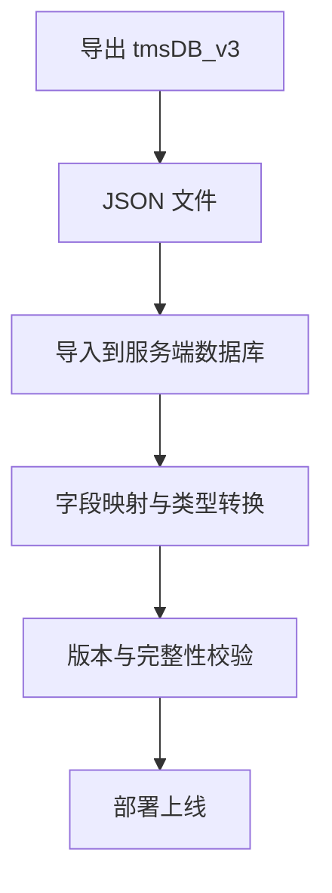

# 数据生命周期管理

<cite>
**本文引用的文件**   
- [tms-store.js](file://tms-store.js)
- [common.js](file://common.js)
- [tms-architecture.html](file://tms-architecture.html)
</cite>

## 目录
1. [引言](#引言)
2. [项目结构](#项目结构)
3. [核心组件](#核心组件)
4. [架构总览](#架构总览)
5. [详细组件分析](#详细组件分析)
6. [依赖关系分析](#依赖关系分析)
7. [性能与索引策略](#性能与索引策略)
8. [备份、恢复与清理](#备份恢复与清理)
9. [安全与隐私保护](#安全与隐私保护)
10. [导出导入与兼容性](#导出导入与兼容性)
11. [故障排查指南](#故障排查指南)
12. [结论](#结论)

## 引言
本文件面向 TMS 系统的数据生命周期管理，聚焦以下目标：
- localStorage 存储策略、数据版本控制与迁移机制
- 种子数据生成算法、随机数生成器与数据初始化流程
- 数据备份恢复、数据清理与存储空间管理
- 数据加密、安全存储与隐私保护措施
- 数据导出导入、格式转换与兼容性处理
- 性能优化、索引策略与查询优化设计

TMS 的核心数据层由基于 localStorage 的轻量业务数据库实现，提供订单全生命周期状态流转、关联扫描/运输/财务记录以及统计聚合能力。该数据层通过统一事件通知页面刷新，保证多页面共享一致数据视图。

**章节来源**
- [tms-store.js:1-12](file://tms-store.js#L1-L12)

## 项目结构
仓库采用“页面 + 共享数据层”的组织方式：
- 管理员端页面（如 tms-*.html）通过 window.TmsStore 访问共享数据
- 通用工具库 common.js 提供登录、用户信息、积分等通用功能
- 架构文档 tms-architecture.html 描述后端扩展方案（分库分表、缓存、ES 等），用于指导未来从浏览器本地存储向服务端数据库演进

**图表来源**
- [tms-store.js:1-12](file://tms-store.js#L1-L12)
- [tms-architecture.html:882-925](file://tms-architecture.html#L882-L925)

**章节来源**
- [tms-store.js:1-12](file://tms-store.js#L1-L12)
- [tms-architecture.html:882-925](file://tms-architecture.html#L882-L925)

## 核心组件
- 共享数据层 TmsStore
  - 负责首次访问时生成种子数据、维护订单状态机、自动写入关联记录、提供 CRUD 与分页查询
  - 通过 tms:datachange 事件通知 UI 刷新
- 通用工具库 common.js
  - 提供登录、用户信息、积分等通用逻辑，使用独立的 localStorage key 管理用户会话与个人数据
- 架构文档 tms-architecture.html
  - 描述后端扩展方案，包括分库分表、缓存、ES、对象存储等，为后续从浏览器本地存储迁移到服务端数据库提供蓝图

**章节来源**
- [tms-store.js:1-12](file://tms-store.js#L1-L12)
- [common.js:135-218](file://common.js#L135-L218)
- [tms-architecture.html:1031-1044](file://tms-architecture.html#L1031-L1044)

## 架构总览
TMS 当前以浏览器端 localStorage 作为主存储，所有业务实体（订单、运单、运输、异常、扫描、财务、应收应付、账单、服务工单、理赔、员工、车辆、仓库、库存、运力、围栏、设备、策略、路由规则、价卡、轨迹等）均保存在同一 JSON 结构中。数据变更会触发全局事件，供各页面订阅并更新视图。

**图表来源**
- [tms-store.js:220-244](file://tms-store.js#L220-L244)
- [tms-store.js:1186-1194](file://tms-store.js#L1186-L1194)

**章节来源**
- [tms-store.js:220-244](file://tms-store.js#L220-L244)
- [tms-store.js:1186-1194](file://tms-store.js#L1186-L1194)

## 详细组件分析

### 数据存储与版本控制
- 存储键：tmsDB_v3
- 版本字段：version，与 DB_VERSION 比较，不匹配则视为无效数据
- 读写封装：readDb/persist，确保解析失败或版本不一致时返回空数据并触发种子生成
- 元数据：meta.counters 维护各实体计数器，用于生成带日期的 ID

**图表来源**
- [tms-store.js:16-17](file://tms-store.js#L16-L17)
- [tms-store.js:220-235](file://tms-store.js#L220-L235)
- [tms-store.js:1186-1194](file://tms-store.js#L1186-L1194)

**章节来源**
- [tms-store.js:16-17](file://tms-store.js#L16-L17)
- [tms-store.js:220-235](file://tms-store.js#L220-L235)
- [tms-store.js:1186-1194](file://tms-store.js#L1186-L1194)

### 种子数据生成与随机数生成器
- 固定种子随机数：mulberry32(20260122)，保证演示数据在同一浏览器中稳定可复现
- 种子数据包含：员工、车辆、仓库、库存、运力、围栏、策略、路由规则、价卡、订单、扫描、运输、异常、财务、应收应付、账单、服务工单、理赔、行政记录、考核绩效、用户、设备等
- 计费引擎：calcFreight 根据线路、服务等级、重量/体积、保价、到付、客户折扣等计算运费明细
- 路由计划：planRoute 根据起终点选择路线，生成分段计划与截止时间
- 轨迹明细：buildTraces 按订单阶段生成节点、地点、超时/偏差标记

**图表来源**
- [tms-store.js:43-54](file://tms-store.js#L43-L54)
- [tms-store.js:278-383](file://tms-store.js#L278-L383)
- [tms-store.js:387-460](file://tms-store.js#L387-L460)
- [tms-store.js:464-1153](file://tms-store.js#L464-L1153)

**章节来源**
- [tms-store.js:43-54](file://tms-store.js#L43-L54)
- [tms-store.js:278-383](file://tms-store.js#L278-L383)
- [tms-store.js:387-460](file://tms-store.js#L387-L460)
- [tms-store.js:464-1153](file://tms-store.js#L464-L1153)

### 数据初始化与迁移
- 初始化流程：init(force) 优先读取 localStorage；若不存在或强制初始化，则生成种子数据并持久化
- 旧数据兼容：importLegacyData 尝试将旧用户数据迁移到新结构，避免覆盖已存在用户
- 重置数据：reset 删除 localStorage 中的 tmsDB_v3 并重新初始化

**图表来源**
- [tms-store.js:1165-1194](file://tms-store.js#L1165-L1194)

**章节来源**
- [tms-store.js:1165-1194](file://tms-store.js#L1165-L1194)

### 订单生命周期与状态机
- 状态定义：ORDER_FLOW 定义待入库→已入库→已分拣→运输中→已到达→派送中→已签收
- 状态推进：applyOrderStatus 校验状态顺序，更新 timeline、轨迹、扫描、任务、运输、财务等
- 结算逻辑：ensureSettlement 区分月结与现付/到付，生成应收/收入记录

**图表来源**
- [tms-store.js:88-96](file://tms-store.js#L88-L96)
- [tms-store.js:1496-1558](file://tms-store.js#L1496-L1558)

**章节来源**
- [tms-store.js:88-96](file://tms-store.js#L88-L96)
- [tms-store.js:1496-1558](file://tms-store.js#L1496-L1558)

### 通用 CRUD 与查询
- 列表查询：list(entity, options) 支持 filters/search/sort/page/pageSize
- 增删改查：create/update/remove/get
- 订阅机制：subscribe(fn) 允许页面订阅数据变化

**图表来源**
- [tms-store.js:1209-1257](file://tms-store.js#L1209-L1257)

**章节来源**
- [tms-store.js:1209-1257](file://tms-store.js#L1209-L1257)

## 依赖关系分析
- TmsStore 依赖 localStorage 进行持久化
- 页面通过 window.TmsStore 访问数据，并通过 document 事件总线接收 tms:datachange
- common.js 独立管理用户会话与个人信息，不与 TmsStore 耦合
- 架构文档 tms-architecture.html 描述后端扩展依赖（MySQL、Redis、ES、对象存储），为未来迁移提供指引

**图表来源**
- [tms-store.js:1-12](file://tms-store.js#L1-L12)
- [common.js:135-218](file://common.js#L135-L218)
- [tms-architecture.html:882-925](file://tms-architecture.html#L882-L925)

**章节来源**
- [tms-store.js:1-12](file://tms-store.js#L1-L12)
- [common.js:135-218](file://common.js#L135-L218)
- [tms-architecture.html:882-925](file://tms-architecture.html#L882-L925)

## 性能与索引策略
当前 TmsStore 在浏览器端使用内存数组进行过滤、排序与分页，适合中小规模演示数据。针对未来扩展至服务端数据库，架构文档提出以下优化方向：
- 分库分表：按地区码与年份/月份进行水平分片，提升容量与查询性能
- 缓存策略：Redis 缓存热点订单、用户信息、网点信息，设置合理过期时间
- 索引优化：联合索引、索引覆盖，减少回表
- 复杂查询：ElasticSearch 实时同步订单数据，支持全文检索、范围查询与聚合分析
- 降级策略：ES 不可用时降级为直连数据库，缓存失效时异步加载

**图表来源**
- [tms-architecture.html:1265-1423](file://tms-architecture.html#L1265-L1423)

**章节来源**
- [tms-architecture.html:1265-1423](file://tms-architecture.html#L1265-L1423)

## 备份、恢复与清理
- 备份恢复
  - 当前实现未内置自动备份/恢复机制
  - 可通过导出 localStorage 内容（tmsDB_v3）进行手动备份，并在需要时导入恢复
  - 架构文档建议定期全量备份与增量备份，并进行恢复演练
- 数据清理
  - TmsStore 对部分高频数据做了长度限制，例如 scans 超过 500 条、traces 超过 2000 条时截断
  - reset 方法可清空 localStorage 并重新初始化种子数据
- 存储空间管理
  - localStorage 容量有限（通常约 5-10MB），需监控数据增长，必要时迁移至服务端存储

**图表来源**
- [tms-store.js:1346-1347](file://tms-store.js#L1346-L1347)
- [tms-store.js:1462-1463](file://tms-store.js#L1462-L1463)
- [tms-store.js:1314-1319](file://tms-store.js#L1314-L1319)
- [tms-architecture.html:1436-1441](file://tms-architecture.html#L1436-L1441)

**章节来源**
- [tms-store.js:1346-1347](file://tms-store.js#L1346-L1347)
- [tms-store.js:1462-1463](file://tms-store.js#L1462-L1463)
- [tms-store.js:1314-1319](file://tms-store.js#L1314-L1319)
- [tms-architecture.html:1436-1441](file://tms-architecture.html#L1436-L1441)

## 安全与隐私保护
- 当前实现未对 localStorage 数据进行加密或敏感信息脱敏
- 用户会话与个人信息存储在 common.js 管理的独立 key（如 tmsUser、tmsUserProfile、tmsUserPoints）
- 建议在后续版本中：
  - 对敏感字段（手机号、地址、金额）进行前端脱敏显示
  - 在服务端存储时对敏感数据进行加密（如 AES-GCM）
  - 使用 HttpOnly Cookie 或更安全的前端存储方案替代 localStorage 存储会话令牌
  - 增加权限校验与审计日志

**章节来源**
- [common.js:135-218](file://common.js#L135-L218)

## 导出导入与兼容性
- 导出
  - 可将 localStorage 中的 tmsDB_v3 序列化为 JSON 文件，便于离线备份与分享
- 导入
  - 可通过 importLegacyData 兼容旧用户数据结构，避免覆盖现有用户
- 格式转换
  - 未来迁移至服务端数据库时，需将 JSON 结构映射到 MySQL 表结构，并处理枚举值、时间戳、金额精度等
- 兼容性
  - 保持 version 字段与 DB_VERSION 一致，确保向后兼容
  - 对新增字段提供默认值，避免旧数据解析失败

**图表来源**
- [tms-store.js:1165-1184](file://tms-store.js#L1165-L1184)
- [tms-store.js:220-235](file://tms-store.js#L220-L235)

**章节来源**
- [tms-store.js:1165-1184](file://tms-store.js#L1165-L1184)
- [tms-store.js:220-235](file://tms-store.js#L220-L235)

## 故障排查指南
- 数据无法加载
  - 检查 localStorage 中是否存在 tmsDB_v3
  - 确认 version 字段是否与 DB_VERSION 匹配
  - 查看 readDb 是否抛出解析异常
- 数据不同步
  - 确认页面是否订阅了 tms:datachange 事件
  - 检查 emit 函数是否正确派发事件
- 数据异常
  - 使用 reset 方法重建种子数据
  - 检查 seeds 生成逻辑与随机数种子是否被修改

**章节来源**
- [tms-store.js:220-244](file://tms-store.js#L220-L244)
- [tms-store.js:1314-1319](file://tms-store.js#L1314-L1319)

## 结论
TMS 的数据生命周期管理当前以浏览器端 localStorage 为核心，具备完整的种子数据生成、版本控制、CRUD 与事件通知机制。未来可依据架构文档逐步迁移至服务端数据库，引入分库分表、缓存、ES 与对象存储，以提升性能、可扩展性与安全性。同时应加强数据加密、隐私保护与备份恢复能力，确保系统在规模化运行中的稳定性与合规性。