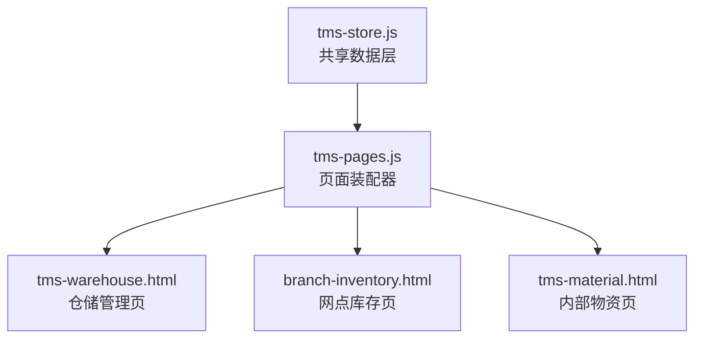
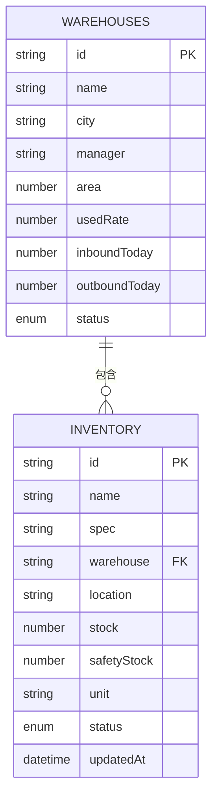
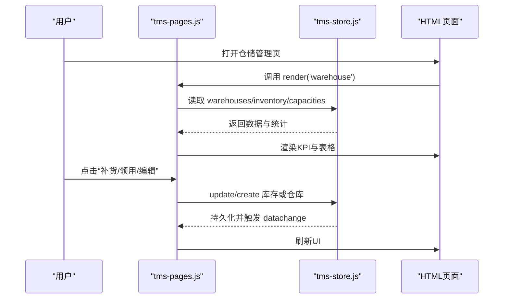
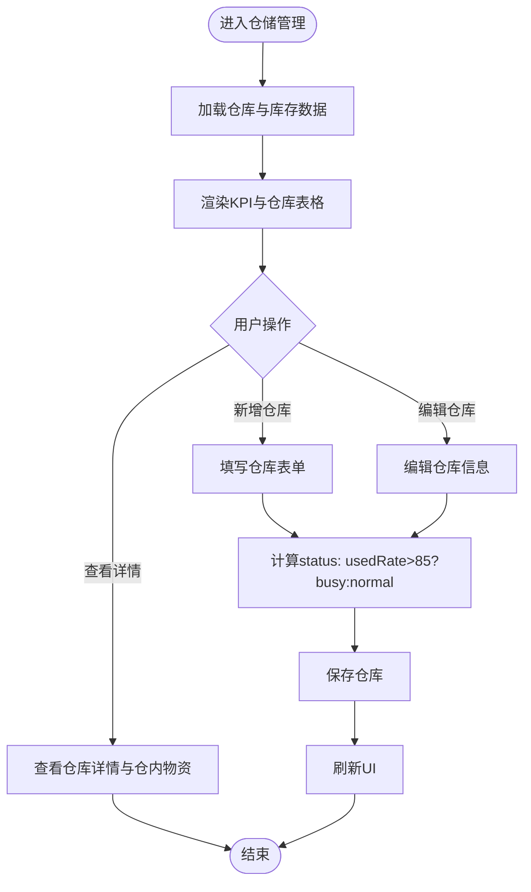
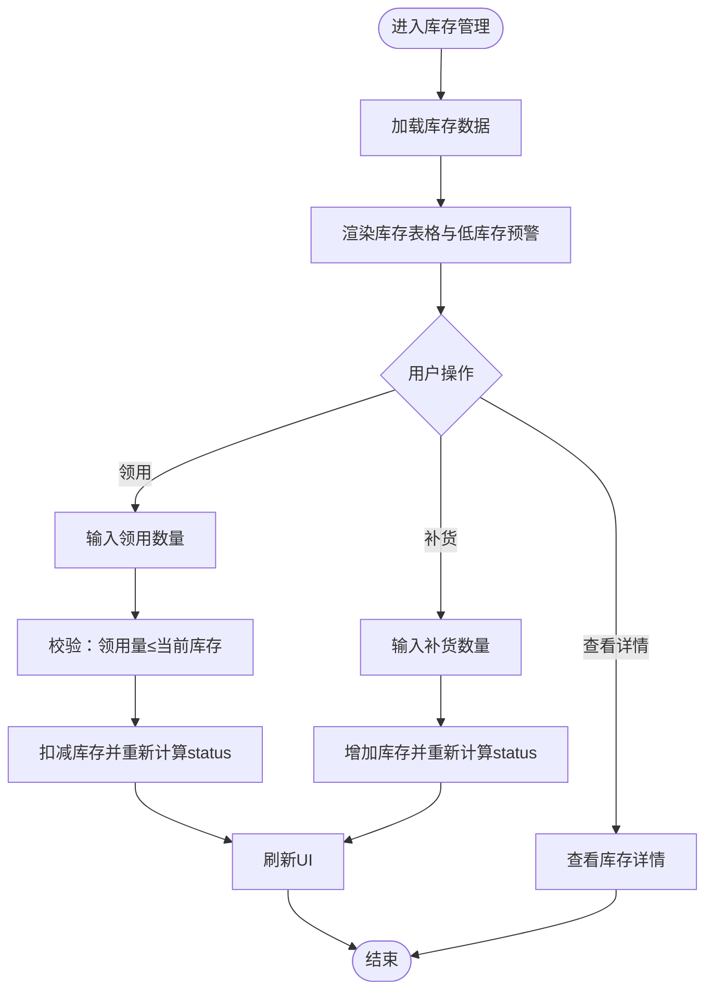
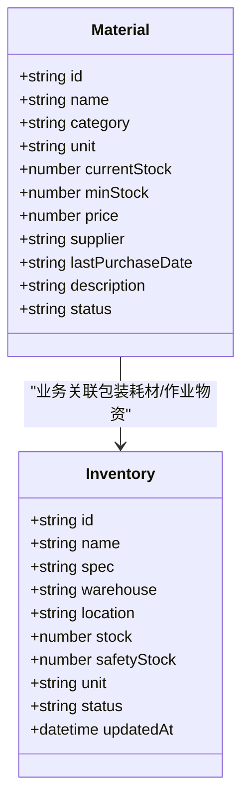
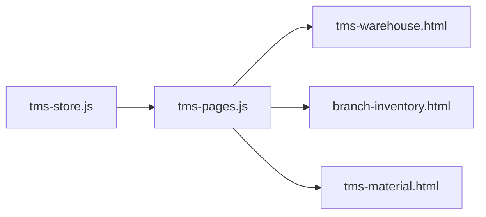
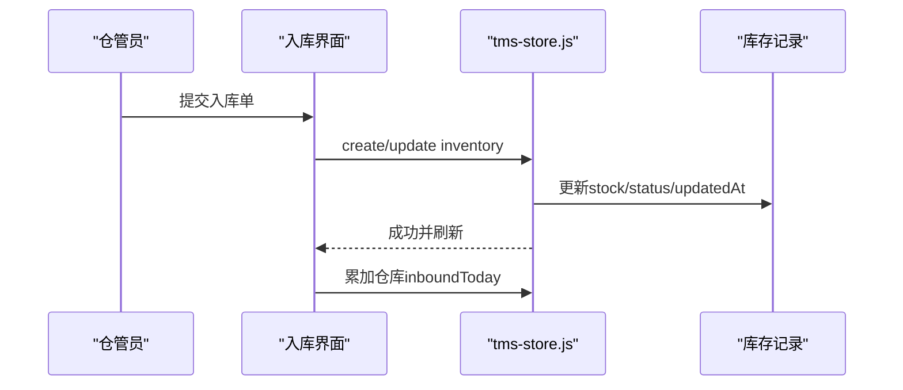
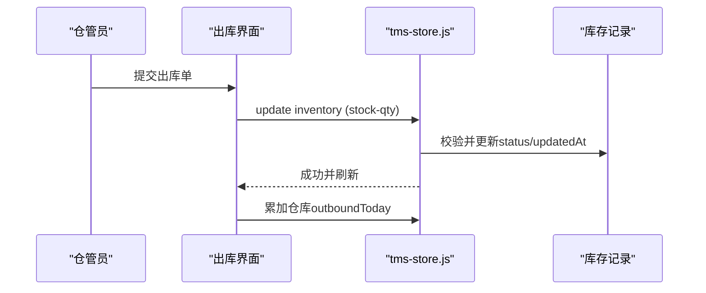
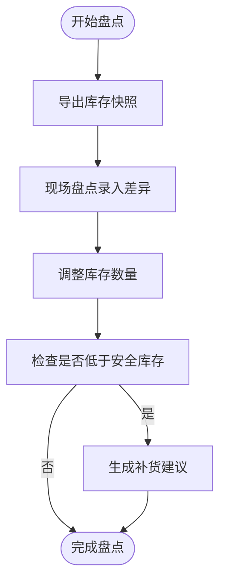

# 仓储与库存模型

<cite>
**本文引用的文件**   
- [tms-store.js](file://tms-store.js)
- [tms-pages.js](file://tms-pages.js)
- [tms-warehouse.html](file://tms-warehouse.html)
- [branch-inventory.html](file://branch-inventory.html)
- [tms-material.html](file://tms-material.html)
</cite>

## 目录
1. [引言](#引言)
2. [项目结构](#项目结构)
3. [核心数据模型](#核心数据模型)
4. [系统架构总览](#系统架构总览)
5. [详细组件分析](#详细组件分析)
6. [依赖关系分析](#依赖关系分析)
7. [性能与容量规划](#性能与容量规划)
8. [仓储作业流程](#仓储作业流程)
9. [排障指南](#排障指南)
10. [结论](#结论)

## 引言
本文件面向 TMS 系统的仓库（Warehouse）与库存（Inventory）数据模型，聚焦以下目标：
- 明确仓库实体与库存实体的字段定义、状态机制与安全库存预警逻辑。
- 说明仓库容量管理、资源利用率监控的业务规则。
- 梳理物料（Material）管理与库存的关联关系和补货策略。
- 给出入库、出库、盘点等仓储作业的完整业务流程与管理策略。
- 提供可落地的场景示例与数据操作路径。

## 项目结构
TMS 前端采用“页面 + 共享数据层”的结构：
- tms-store.js：基于 localStorage 的轻量业务数据库，负责种子数据生成、CRUD、统计聚合与事件通知。
- tms-pages.js：管理员端页面装配器，将各业务页统一为 KPI + 图表 + 表格 + CRUD 的结构。
- tms-warehouse.html / branch-inventory.html / tms-material.html：仓储、网点库存与内部物资的前端页面。

**图示来源**
- [tms-store.js:1-12](file://tms-store.js#L1-L12)
- [tms-pages.js:1-16](file://tms-pages.js#L1-L16)

**章节来源**
- [tms-store.js:1-12](file://tms-store.js#L1-L12)
- [tms-pages.js:1-16](file://tms-pages.js#L1-L16)

## 核心数据模型
本节定义仓库与库存的核心字段，并解释其业务含义与约束。

### 仓库实体（warehouses）
| 字段 | 类型/取值 | 含义与规则 |
|---|---|---|
| id | 字符串 | 仓库唯一标识，如 WH-01 |
| name | 字符串 | 仓库名称，如 北京中心仓 |
| city | 枚举 | 所在城市，可选值见页面城市下拉 |
| manager | 字符串 | 负责人姓名 |
| area | 数字 | 仓库面积（㎡），用于容量规划与利用率展示 |
| usedRate | 数字(%) | 使用率，0~100；超过阈值时仓库状态标记为繁忙 |
| inboundToday | 数字 | 今日入库数量 |
| outboundToday | 数字 | 今日出库数量 |
| status | normal/busy | 正常/繁忙；usedRate > 85% 或剩余能力低于阈值时触发繁忙 |

仓库状态判定规则：
- 新增或编辑仓库时，若 usedRate > 85%，则 status = busy，否则 normal。
- 在运力维度，当 remaining < capacity × 0.15 时，对应资源标记为 busy。

**章节来源**
- [tms-pages.js:373-409](file://tms-pages.js#L373-L409)
- [tms-pages.js:623-627](file://tms-pages.js#L623-L627)

### 库存实体（inventory）
| 字段 | 类型/取值 | 含义与规则 |
|---|---|---|
| id | 字符串 | 库存记录唯一标识，如 INV-001 |
| name | 字符串 | 物资名称 |
| spec | 字符串 | 规格型号 |
| warehouse | 字符串 | 所属仓库名称 |
| location | 字符串 | 库位，如 A区-01 |
| stock | 数字 | 当前库存数量 |
| safetyStock | 数字 | 安全库存阈值 |
| unit | 个/卷/箱/包 | 计量单位 |
| status | normal/low/out | 正常/库存偏低/缺货 |
| updatedAt | ISO时间 | 最后更新时间 |

库存状态判定规则：
- 当 stock < safetyStock 时，status = low；否则 status = normal。
- 当 stock ≤ 0 时，建议视为 out（缺货），并在界面与补货流程中提示采购。

**章节来源**
- [tms-store.js:520-554](file://tms-store.js#L520-L554)
- [tms-pages.js:104-106](file://tms-pages.js#L104-L106)
- [tms-pages.js:674-740](file://tms-pages.js#L674-L740)

### 仓库与库存的关系
- 一个仓库可包含多条库存记录（一对多）。
- 库存记录的 warehouse 字段指向仓库 name，便于按仓库筛选与查看仓内物资。
- 仓库维度的今日出入库（inboundToday/outboundToday）与库存总量（stockTotal）共同构成仓储运营指标。

**图示来源**
- [tms-store.js:520-554](file://tms-store.js#L520-L554)
- [tms-pages.js:373-409](file://tms-pages.js#L373-L409)

## 系统架构总览
仓储与库存模块由“数据层 + 页面装配 + 前端页面”组成：
- 数据层（tms-store.js）：维护 warehouses、inventory、capacities 等实体，提供 list/get/create/update 等方法，并通过事件通知 UI 刷新。
- 页面装配（tms-pages.js）：定义 warehouse、material 等页面的 KPI、表格列、工具栏与动作，调用数据层完成增删改查。
- 前端页面（HTML）：承载仓储管理、网点库存、内部物资的交互界面与样式。

**图示来源**
- [tms-pages.js:108-135](file://tms-pages.js#L108-L135)
- [tms-store.js:220-244](file://tms-store.js#L220-L244)

**章节来源**
- [tms-store.js:1-12](file://tms-store.js#L1-L12)
- [tms-pages.js:108-135](file://tms-pages.js#L108-L135)

## 详细组件分析

### 仓库管理组件
职责：
- 展示仓库列表、KPI（仓库数量、低库存物资、库存总量等）。
- 支持新增、编辑仓库，自动根据 usedRate 计算 status。
- 查看仓库详情，联动显示该仓库下的库存明细。

关键字段与规则：
- usedRate 阈值：> 85% 标记为 busy。
- 城市选择：页面内置城市下拉选项。
- 面积与使用率：用于容量规划与利用率可视化。

**图示来源**
- [tms-pages.js:361-449](file://tms-pages.js#L361-L449)

**章节来源**
- [tms-pages.js:361-449](file://tms-pages.js#L361-L449)

### 库存管理组件
职责：
- 展示库存列表，支持按仓库筛选。
- 支持领用、补货操作，自动更新 stock、status、updatedAt。
- 低库存预警区域列出低于安全库存的物资，并提供一键补货。

状态管理机制：
- 正常：stock ≥ safetyStock。
- 库存偏低：stock < safetyStock。
- 缺货：stock ≤ 0（建议在业务上触发采购流程）。

**图示来源**
- [tms-pages.js:662-742](file://tms-pages.js#L662-L742)

**章节来源**
- [tms-pages.js:662-742](file://tms-pages.js#L662-L742)

### 内部物资管理组件
职责：
- 展示内部物资清单，统计种类、库存总量、低库存数量。
- 支持采购、更新库存、查看详情等操作。
- 与库存表（inventory）协同，体现包装耗材与作业物资的管理。

状态映射：
- in_stock → 正常
- low_stock → 库存不足
- out_of_stock → 缺货

**图示来源**
- [tms-material.html:459-534](file://tms-material.html#L459-L534)
- [tms-store.js:520-554](file://tms-store.js#L520-L554)

**章节来源**
- [tms-material.html:459-534](file://tms-material.html#L459-L534)

## 依赖关系分析
- tms-store.js 是数据源，提供仓库、库存、运力等实体的增删改查与统计方法。
- tms-pages.js 通过 TmsStore 访问数据，并驱动 UI 渲染与交互。
- HTML 页面作为视图层，绑定按钮事件与展示样式。

**图示来源**
- [tms-store.js:1-12](file://tms-store.js#L1-L12)
- [tms-pages.js:1-16](file://tms-pages.js#L1-L16)

**章节来源**
- [tms-store.js:1-12](file://tms-store.js#L1-L12)
- [tms-pages.js:1-16](file://tms-pages.js#L1-L16)

## 性能与容量规划
- 仓库容量管理：
  - area 表示仓库面积，usedRate 反映利用率；usedRate > 85% 时仓库标记为 busy，提示扩容或分流。
  - 结合 capacities 资源的 remaining/capacity 比例（< 15% 为 busy）进行综合评估。
- 库存优化策略：
  - 安全库存（safetyStock）作为补货触发点，避免断货风险。
  - 低库存预警区域集中展示，支持一键补货，提升响应速度。
- 资源利用率监控：
  - 仓库使用率与运力剩余量共同决定调度策略；满载时优先释放或切换线路。

**章节来源**
- [tms-pages.js:383-390](file://tms-pages.js#L383-L390)
- [tms-pages.js:623-627](file://tms-pages.js#L623-L627)

## 仓储作业流程
本节描述入库、出库、盘点等关键流程，并与数据模型联动。

### 入库流程
- 触发条件：供应商到货或生产备料完成。
- 操作步骤：
  1. 登记入库单，选择仓库与库位。
  2. 扫描物料条码，核对规格与数量。
  3. 更新 inventory.stock 与 inventory.updatedAt。
  4. 若 stock ≥ safetyStock，status = normal；否则 status = low。
  5. 累计仓库 inboundToday。

**图示来源**
- [tms-pages.js:690-706](file://tms-pages.js#L690-L706)
- [tms-store.js:520-554](file://tms-store.js#L520-L554)

### 出库流程
- 触发条件：订单拣选或内部领用。
- 操作步骤：
  1. 创建出库单，选择仓库与库位。
  2. 扫描物料条码，确认出库数量。
  3. 扣减 inventory.stock，校验是否低于 safetyStock。
  4. 更新 inventory.status 与 inventory.updatedAt。
  5. 累计仓库 outboundToday。

**图示来源**
- [tms-pages.js:711-739](file://tms-pages.js#L711-L739)

### 盘点流程
- 触发条件：周期性盘点或差异调整。
- 操作步骤：
  1. 导出当前库存快照。
  2. 现场盘点并录入差异。
  3. 调整 inventory.stock 与 inventory.updatedAt。
  4. 若调整后 stock < safetyStock，触发补货建议。

**图示来源**
- [tms-pages.js:662-742](file://tms-pages.js#L662-L742)

## 排障指南
常见问题与处理建议：
- 库存状态异常：
  - 现象：status 未随 stock 变化而更新。
  - 排查：检查领用/补货逻辑是否正确调用 update 并设置 updatedAt。
  - 参考：[tms-pages.js:711-739](file://tms-pages.js#L711-L739)
- 仓库状态误判：
  - 现象：usedRate 阈值判断错误导致 busy/normal 状态不符。
  - 排查：确认新增/编辑仓库时 status 计算逻辑。
  - 参考：[tms-pages.js:404-407](file://tms-pages.js#L404-L407)
- 低库存预警不显示：
  - 现象：低库存物资未在预警区域列出。
  - 排查：确认过滤条件是否为 stock < safetyStock。
  - 参考：[tms-pages.js:451-470](file://tms-pages.js#L451-L470)

**章节来源**
- [tms-pages.js:404-407](file://tms-pages.js#L404-L407)
- [tms-pages.js:451-470](file://tms-pages.js#L451-L470)
- [tms-pages.js:711-739](file://tms-pages.js#L711-L739)

## 结论
本文件系统化梳理了 TMS 系统中仓库与库存的数据模型、状态机制与业务流程。通过仓库容量管理、安全库存预警与物料补货策略，实现了仓储作业的闭环管理。建议在后续迭代中：
- 完善缺货（out）状态的自动化采购流程。
- 引入更精细的库位管理与批次追踪。
- 扩展盘点差异分析与审计日志。