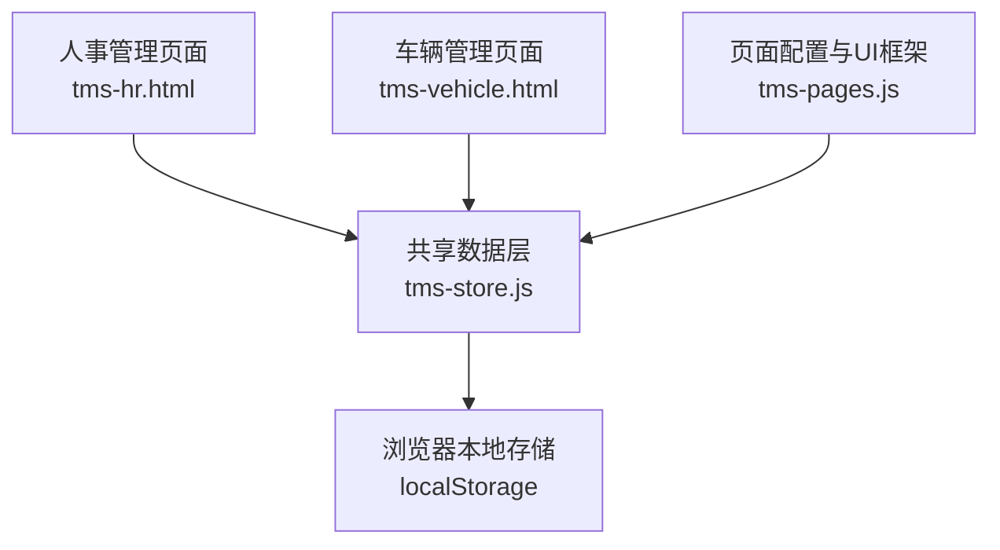
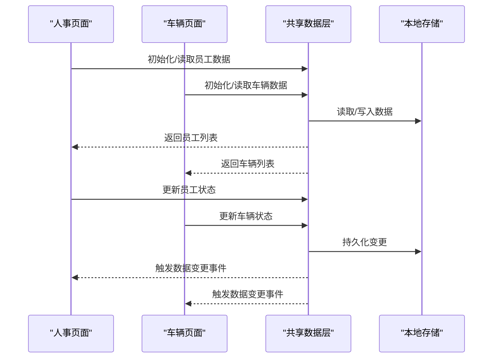
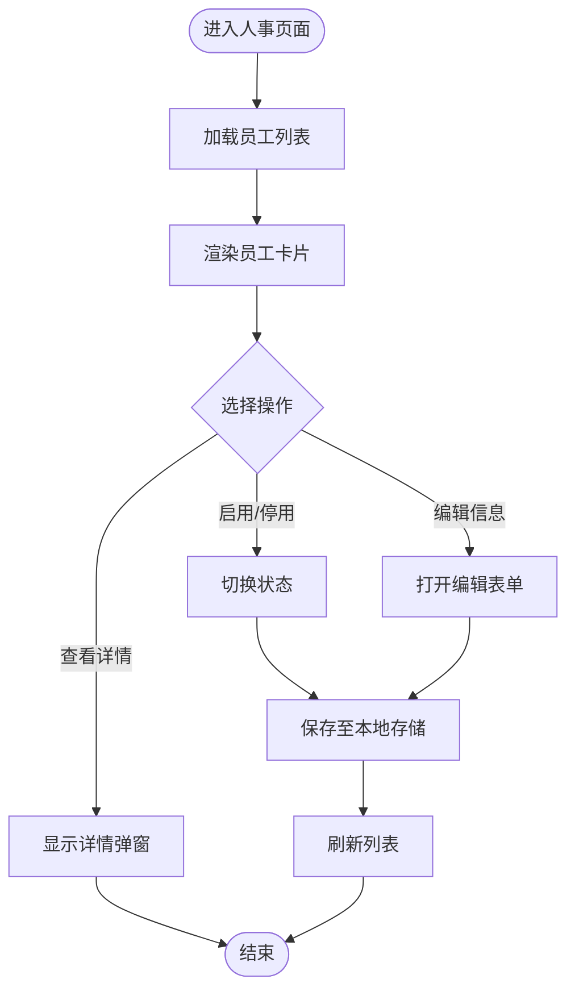
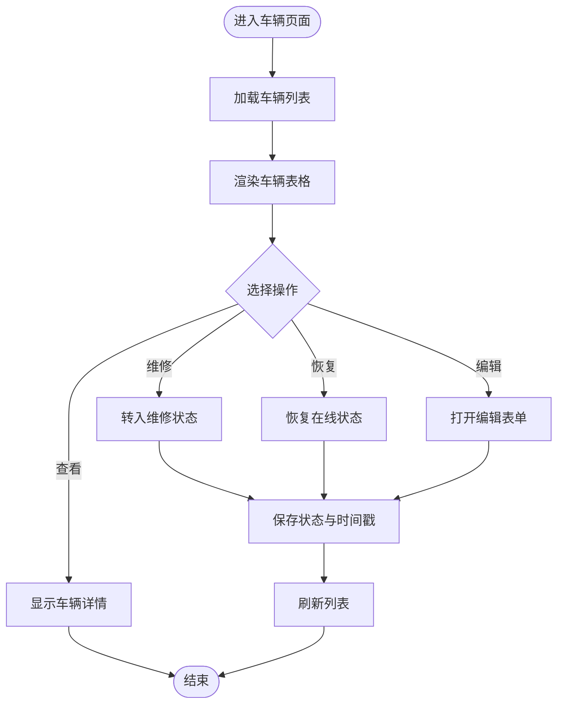
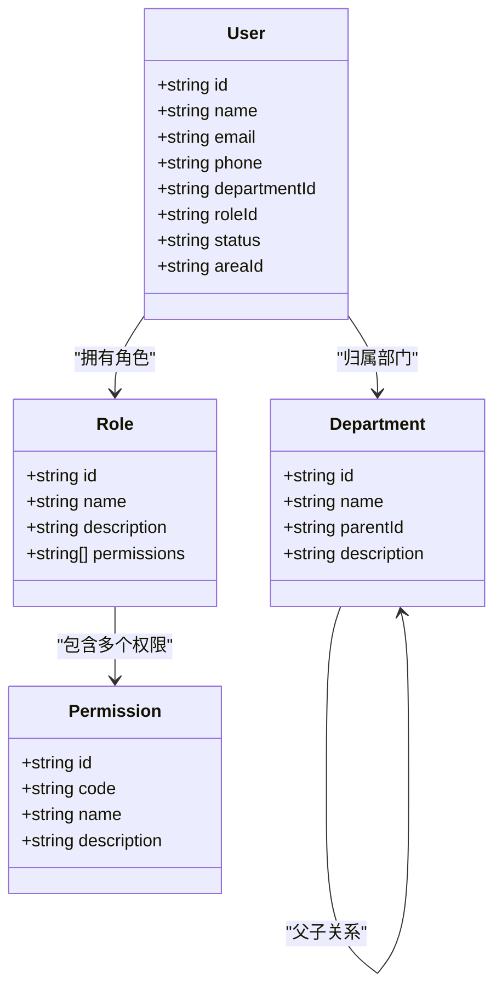
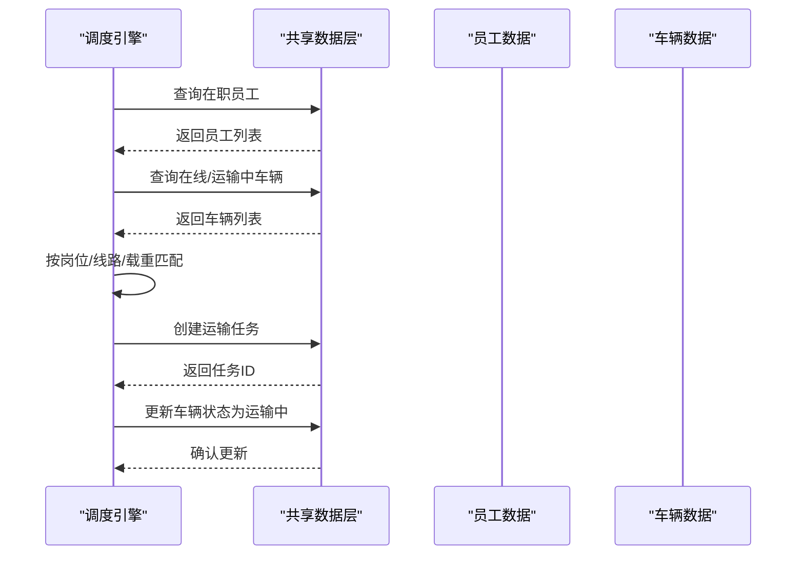
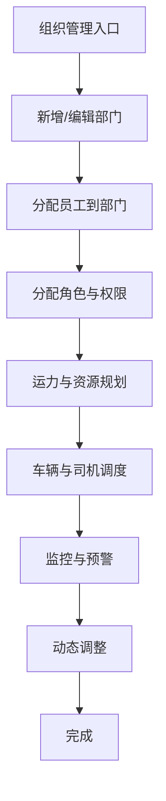
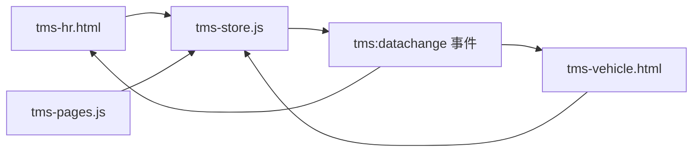

# 员工与车辆模型

<cite>
**本文引用的文件**   
- [tms-hr.html](file://tms-hr.html)
- [tms-vehicle.html](file://tms-vehicle.html)
- [tms-store.js](file://tms-store.js)
- [tms-pages.js](file://tms-pages.js)
</cite>

## 目录
1. [引言](#引言)
2. [项目结构](#项目结构)
3. [核心数据模型](#核心数据模型)
4. [架构总览](#架构总览)
5. [详细组件分析](#详细组件分析)
6. [依赖关系分析](#依赖关系分析)
7. [性能与可扩展性](#性能与可扩展性)
8. [故障排查指南](#故障排查指南)
9. [结论](#结论)

## 引言
本文件聚焦 TMS 系统中的“员工”和“车辆”两个核心实体，系统化说明其数据结构、状态管理、关联关系以及权限组织体系。文档同时覆盖人事管理与车辆管理的业务场景，包括员工排班、车辆调度、部门层级与权限控制、角色访问控制等关键流程，并提供可操作的数据示例与处理逻辑说明，帮助读者快速理解并扩展系统能力。

## 项目结构
TMS 的前端页面与共享数据层采用“页面 + 共享存储”的轻量架构：
- tms-hr.html：人事管理页面，负责展示和操作员工数据。
- tms-vehicle.html：车辆管理页面，负责展示和操作车辆数据。
- tms-store.js：基于 localStorage 的共享数据层，提供种子数据、统一 CRUD、统计聚合与事件通知。
- tms-pages.js：页面路由与表格/表单 UI 配置，驱动各功能页面的渲染与交互。

**图表来源**
- [tms-hr.html:375-386](file://tms-hr.html#L375-L386)
- [tms-vehicle.html:561-571](file://tms-vehicle.html#L561-L571)
- [tms-store.js:1-12](file://tms-store.js#L1-L12)
- [tms-pages.js:470-575](file://tms-pages.js#L470-L575)

**章节来源**
- [tms-hr.html:375-386](file://tms-hr.html#L375-L386)
- [tms-vehicle.html:561-571](file://tms-vehicle.html#L561-L571)
- [tms-store.js:1-12](file://tms-store.js#L1-L12)
- [tms-pages.js:470-575](file://tms-pages.js#L470-L575)

## 核心数据模型
本节定义员工与车辆的核心字段、取值范围与业务含义。

### 员工实体（Employee）
- id：员工编号，唯一标识。
- name：姓名。
- department：所属部门名称，用于组织归属与统计。
- position：岗位/职位。
- email：邮箱。
- phone：电话。
- hireDate：入职日期。
- status：状态，枚举值在职(active)、休假(on_leave)、离职(resigned)。
- salary：薪资（数值）。
- role：系统角色（admin、branch、client），用于登录与菜单权限控制。
- description：描述信息。

状态语义：
- active：在职，可参与排班与任务分配。
- on_leave：休假，不参与新任务分配。
- inactive/resigned：离职或停用，不可参与业务操作。

**章节来源**
- [tms-hr.html:459-541](file://tms-hr.html#L459-L541)
- [tms-hr.html:571-589](file://tms-hr.html#L571-L589)
- [tms-store.js:484-498](file://tms-store.js#L484-L498)
- [tms-store.js:98-110](file://tms-store.js#L98-L110)

### 车辆实体（Vehicle）
- id：车辆编号，唯一标识。
- plate：车牌号码。
- type：车辆类型（卡车、厢货、集装箱、冷链车）。
- model：车型。
- driver：司机姓名。
- branch：所属网点。
- status：状态，枚举值在线(online)、运输中(transporting)、维修中(maintenance)、离线(off-line)。
- location：当前位置。
- capacityTon：载重吨位。
- mileage：累计里程。
- lastUpdate：最后更新时间。

状态语义：
- online：在线可用，可被调度。
- transporting：正在执行运输任务。
- maintenance：维修中，不可调度。
- offline：离线，不可调度。

**章节来源**
- [tms-vehicle.html:476-554](file://tms-vehicle.html#L476-L554)
- [tms-store.js:500-518](file://tms-store.js#L500-L518)
- [tms-store.js:98-110](file://tms-store.js#L98-L110)

### 部门与权限组织
- departments：部门层级结构，包含 id、name、parentId、description。
- permissions：权限集合，包含 id、code、name、description。
- roles：角色集合，包含 id、name、description、permissions（权限ID数组）。

部门层级示例：
- 总部 → 运营部、客服部、仓储部、运输部、财务部、人事部。

权限与角色关联：
- 系统管理员拥有全部权限。
- 运营管理员具备用户管理、订单管理、围栏管理、异常管理等权限。
- 客服专员具备订单管理与异常管理权限。
- 仓储管理员具备部门管理与仓储管理权限。
- 财务专员具备费用管理权限。

**章节来源**
- [tms-store.js:134-164](file://tms-store.js#L134-L164)
- [tms-store.js:1078-1088](file://tms-store.js#L1078-L1088)

## 架构总览
TMS 的员工与车辆数据通过共享数据层统一管理，页面侧仅做展示与交互。数据变更会触发事件，供其他模块订阅更新。

**图表来源**
- [tms-store.js:220-244](file://tms-store.js#L220-L244)
- [tms-hr.html:459-541](file://tms-hr.html#L459-L541)
- [tms-vehicle.html:561-571](file://tms-vehicle.html#L561-L571)

## 详细组件分析

### 员工管理组件
- 数据源：tms-hr.html 中的模拟数据与 localStorage 存储键 tmsEmployees。
- 状态映射：active→在职，on_leave→休假，inactive→离职。
- 操作：查看详情、编辑信息、启用/停用。
- 业务约束：
  - 只有在职员工可参与排班与任务分配。
  - 休假员工暂停派单，保留历史绩效记录。
  - 离职员工不可再登录系统，相关资源回收。

**图表来源**
- [tms-hr.html:543-629](file://tms-hr.html#L543-L629)

**章节来源**
- [tms-hr.html:459-541](file://tms-hr.html#L459-L541)
- [tms-hr.html:543-629](file://tms-hr.html#L543-L629)

### 车辆管理组件
- 数据源：tms-vehicle.html 静态表格与 tms-store.js 生成的车辆数据。
- 状态映射：online→在线，transporting→运输中，maintenance→维修中，offline→离线。
- 操作：查看、编辑、维修、恢复。
- 业务约束：
  - 在线与运输中车辆可被调度；维修中与离线车辆不可调度。
  - 维修后需恢复为在线方可重新投入运力。
  - 车辆详情展示累计里程、载重、位置与运输任务数。

**图表来源**
- [tms-pages.js:504-573](file://tms-pages.js#L504-L573)
- [tms-vehicle.html:476-554](file://tms-vehicle.html#L476-L554)

**章节来源**
- [tms-vehicle.html:476-554](file://tms-vehicle.html#L476-L554)
- [tms-pages.js:476-575](file://tms-pages.js#L476-L575)

### 部门层级与权限体系
- 部门层级：以 parentId 构建树形结构，支持多级组织。
- 权限定义：以 code 作为最小权限单元，便于细粒度控制。
- 角色绑定：每个角色绑定一组权限ID，实现 RBAC 访问控制。
- 用户关联：用户记录包含 departmentId 与 roleId，决定可见范围与操作权限。

**图表来源**
- [tms-store.js:134-164](file://tms-store.js#L134-L164)
- [tms-store.js:1078-1088](file://tms-store.js#L1078-L1088)

**章节来源**
- [tms-store.js:134-164](file://tms-store.js#L134-L164)
- [tms-store.js:1078-1088](file://tms-store.js#L1078-L1088)

### 员工排班与车辆调度
- 员工排班：
  - 筛选在职员工，排除休假与离职。
  - 按部门与岗位匹配任务需求。
  - 结合绩效考核与签收率进行优先级排序。
- 车辆调度：
  - 筛选在线与运输中车辆。
  - 根据线路与载重匹配车型。
  - 结合司机与网点进行就近派车。
- 数据处理：
  - 从共享数据层获取员工与车辆列表。
  - 使用过滤与排序生成候选集。
  - 将调度结果写入运输任务与扫描记录。

**图表来源**
- [tms-store.js:484-518](file://tms-store.js#L484-L518)
- [tms-pages.js:476-575](file://tms-pages.js#L476-L575)

**章节来源**
- [tms-store.js:484-518](file://tms-store.js#L484-L518)
- [tms-pages.js:476-575](file://tms-pages.js#L476-L575)

### 组织架构管理与资源分配流程
- 组织管理：
  - 新增/编辑部门，维护层级关系。
  - 分配员工到部门，设置岗位与角色。
- 资源分配：
  - 根据订单量与线路规划运力。
  - 动态调整车辆与司机的配比。
  - 监控库存与物料消耗，触发补货。

[此图为概念流程图，不直接对应具体源码文件]

## 依赖关系分析
- 页面与数据层解耦：tms-hr.html 与 tms-vehicle.html 通过 tms-store.js 访问数据，避免直接耦合。
- 状态字典集中管理：STATUS_LABELS 统一维护员工与车辆状态的中文标签，保证界面一致性。
- 事件驱动更新：数据变更触发 tms:datachange 事件，页面可订阅以实现实时刷新。

**图表来源**
- [tms-store.js:237-244](file://tms-store.js#L237-L244)
- [tms-store.js:98-110](file://tms-store.js#L98-L110)

**章节来源**
- [tms-store.js:237-244](file://tms-store.js#L237-L244)
- [tms-store.js:98-110](file://tms-store.js#L98-L110)

## 性能与可扩展性
- 数据规模：当前演示数据约 20 名员工与 14 辆车，适合前端本地存储与简单查询。
- 查询优化：建议对常用字段（如 status、department、branch）建立索引或缓存。
- 扩展建议：
  - 引入后端 API 替代 localStorage，支持并发与事务。
  - 增加分页与懒加载以提升大数据量下的渲染性能。
  - 引入权限校验中间件，确保前后端一致的控制策略。

[本节为通用指导，不涉及具体源码分析]

## 故障排查指南
- 员工状态异常：
  - 检查 tms-hr.html 中的状态映射函数是否正确。
  - 确认 localStorage 中 tmsEmployees 数据格式是否完整。
- 车辆状态无法更新：
  - 检查 tms-pages.js 中的更新逻辑是否调用 S.update。
  - 确认 lastUpdate 时间戳是否同步写入。
- 权限访问失败：
  - 检查用户的 roleId 与角色权限配置是否匹配。
  - 确认部门 ID 与权限范围是否一致。

**章节来源**
- [tms-hr.html:571-589](file://tms-hr.html#L571-L589)
- [tms-pages.js:540-573](file://tms-pages.js#L540-L573)
- [tms-store.js:1078-1088](file://tms-store.js#L1078-L1088)

## 结论
本文档系统梳理了 TMS 系统中员工与车辆的数据模型、状态管理、权限组织与调度流程。通过共享数据层与页面解耦的设计，实现了灵活的业务扩展与良好的可维护性。建议在后续迭代中引入后端服务与更完善的权限控制机制，以支撑更大规模与更高并发场景。