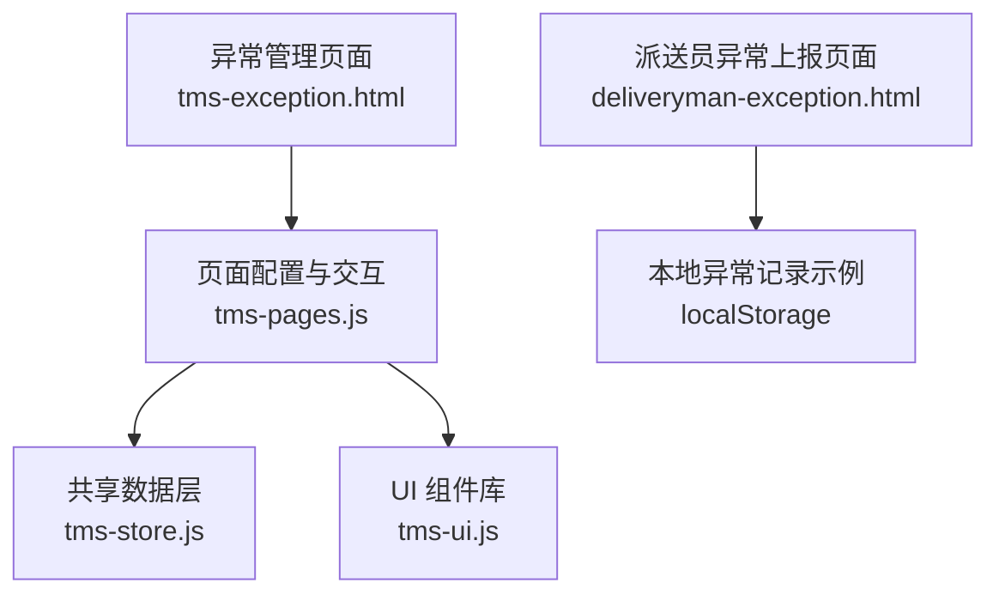
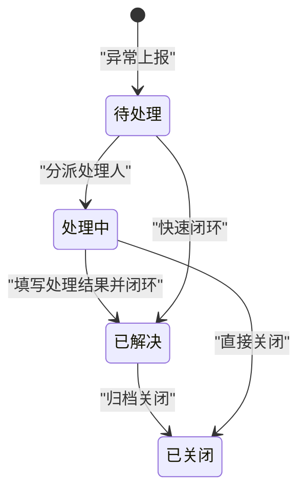
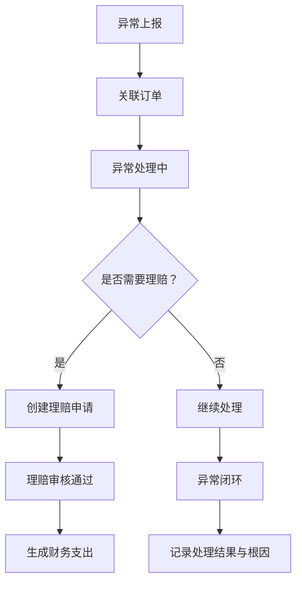
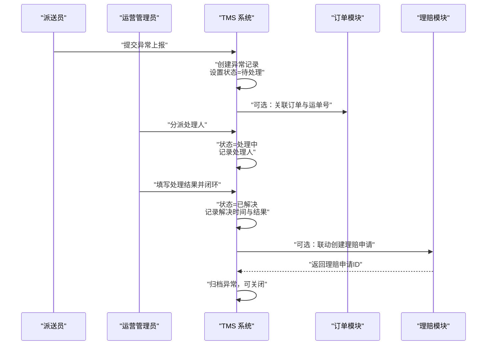
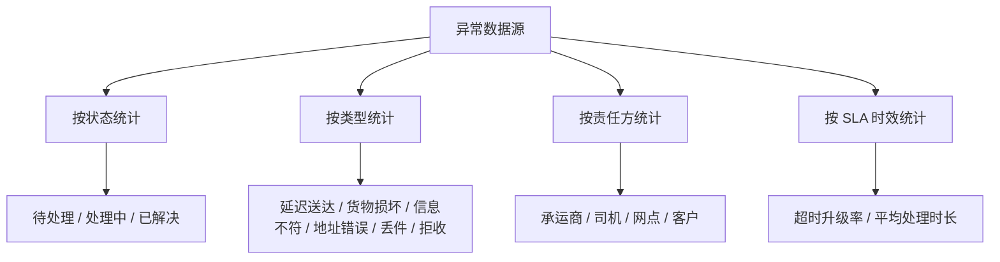
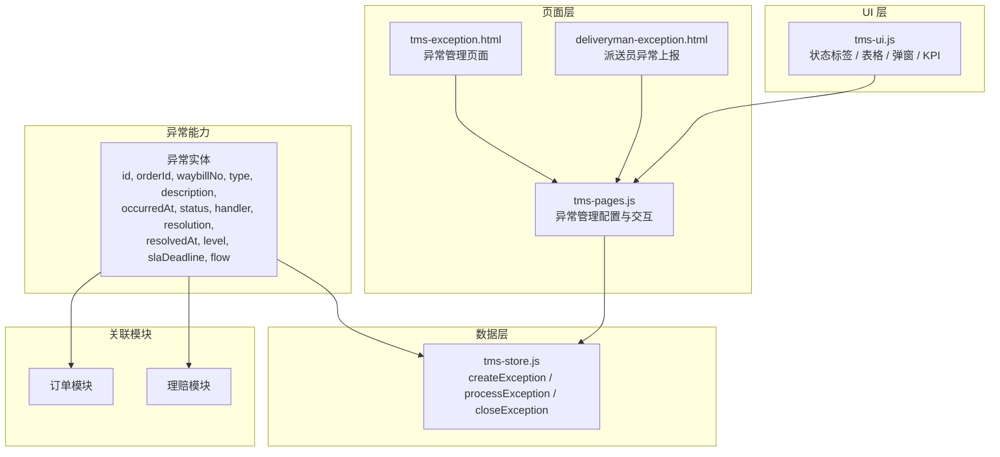

# 异常记录模型（Exception）

<cite>
**本文引用的文件**   
- [tms-store.js](file://tms-store.js)
- [tms-pages.js](file://tms-pages.js)
- [tms-ui.js](file://tms-ui.js)
- [tms-exception.html](file://tms-exception.html)
- [deliveryman-exception.html](file://deliveryman-exception.html)
</cite>

## 目录
1. [引言](#引言)
2. [项目结构与定位](#项目结构与定位)
3. [核心数据模型：异常实体 Exception](#核心数据模型异常实体-exception)
4. [异常类型分类与业务场景](#异常类型分类与业务场景)
5. [异常状态流转与责任人分配](#异常状态流转与责任人分配)
6. [异常与订单、理赔的关联关系](#异常与订单理赔的关联关系)
7. [完整业务流程：上报、处理、解决、闭环](#完整业务流程上报处理解决闭环)
8. [异常统计分析与 KPI 考核机制](#异常统计分析与-kpi-考核机制)
9. [典型异常处理案例与最佳实践](#典型异常处理案例与最佳实践)
10. [依赖关系与架构总览](#依赖关系与架构总览)
11. [性能与可维护性建议](#性能与可维护性建议)
12. [常见问题排查](#常见问题排查)
13. [结论](#结论)

## 引言
本文件面向 TMS 运输管理系统中的“异常记录”能力，围绕异常实体 Exception 的数据结构、异常类型分类、状态流转、责任人分配、与订单和理赔的关联关系，以及异常统计分析和 KPI 考核进行系统化说明。文档既适合运营、客服、仓储、运输等一线角色理解业务含义，也适合开发和维护人员理解实现细节。

## 项目结构与定位
TMS 系统采用前端页面 + 共享数据层的方式组织异常能力：
- 共享数据层负责异常实体的创建、查询、状态更新、责任定责、闭环联动理赔等核心逻辑。
- 页面层提供异常登记、查看、分派处理、闭环解决等操作界面。
- UI 组件库提供状态标签、表格、弹窗、KPI 展示等通用能力。

**图表来源**
- [tms-exception.html:377-437](file://tms-exception.html#L377-L437)
- [tms-pages.js:137-247](file://tms-pages.js#L137-L247)
- [tms-store.js:1740-1837](file://tms-store.js#L1740-L1837)
- [tms-ui.js:57-76](file://tms-ui.js#L57-L76)
- [deliveryman-exception.html:375-413](file://deliveryman-exception.html#L375-L413)

**章节来源**
- [tms-exception.html:377-437](file://tms-exception.html#L377-L437)
- [tms-pages.js:137-247](file://tms-pages.js#L137-L247)
- [tms-store.js:1740-1837](file://tms-store.js#L1740-L1837)
- [tms-ui.js:57-76](file://tms-ui.js#L57-L76)
- [deliveryman-exception.html:375-413](file://deliveryman-exception.html#L375-L413)

## 核心数据模型：异常实体 Exception
异常实体用于记录运输过程中出现的异常情况，并贯穿上报、处理、定责、闭环、理赔联动等流程。关键字段如下：

| 字段 | 类型 | 是否必填 | 默认值 | 业务含义 |
|---|---|---:|---|---|
| id | 字符串 | 是 | 自动生成 | 异常唯一标识，便于追踪与审计 |
| orderId | 字符串 | 否 | 空 | 关联订单号；若为空则为非订单级异常 |
| waybillNo | 字符串 | 否 | 空或从订单填充 | 运单号；优先从关联订单获取 |
| type | 枚举 | 是 | 其他异常 | 异常类型，如延迟送达、货物损坏、信息不符、地址错误、丢件、拒收 |
| description | 文本 | 是 | 空 | 异常描述，包括时间、地点、影响范围 |
| occurredAt | ISO 时间 | 是 | 当前时间 | 异常发生时间 |
| status | 枚举 | 是 | pending | 异常状态：待处理、处理中、已解决、已关闭 |
| handler | 字符串 | 否 | 空 | 处理人姓名或角色 |
| resolution | 文本 | 否 | 空 | 处理结果摘要 |
| resolvedAt | ISO 时间 | 否 | 空 | 异常解决时间 |
| level | 枚举 | 否 | 三级 | 异常等级：一级、二级、三级；用于优先级与升级策略 |
| slaDeadline | ISO 时间 | 是 | 上报后 4 小时 | SLA 截止时间，超时触发升级 |
| escalated | 布尔 | 否 | false | 是否已升级至更高管理层 |
| responsibleParty | 字符串 | 否 | 空 | 责任方：承运商、司机、网点、客户等 |
| responsible | 字符串 | 否 | 空 | 具体责任人 |
| solution | 文本 | 否 | 空 | 处理方案，如改派、补发、拦截退回 |
| rootCause | 文本 | 否 | 空 | 根因分析，用于复盘与改进 |
| deductionAmount | 数值 | 否 | 0 | 对责任方的扣款金额 |
| linkedClaimId | 字符串 | 否 | 空 | 关联理赔申请 ID |
| linkedTicketId | 字符串 | 否 | 空 | 关联客服工单 ID |
| flow | 数组 | 是 | 初始上报记录 | 异常处理流水，包含时间、操作人、动作 |

字段设计要点：
- 通过 orderId 与 waybillNo 建立与订单、运单的强关联，便于从异常追溯到订单轨迹。
- 通过 level 与 slaDeadline 支持时效管理与自动升级。
- 通过 responsibleParty、responsible、deductionAmount 支持责任定责与成本扣款。
- 通过 resolution、solution、rootCause 支持闭环复盘。
- 通过 linkedClaimId、linkedTicketId 支持与理赔、客服工单联动。
- 通过 flow 保留完整审计轨迹，满足合规与复盘需求。

**章节来源**
- [tms-store.js:1740-1757](file://tms-store.js#L1740-L1757)
- [tms-store.js:1760-1837](file://tms-store.js#L1760-L1837)
- [tms-pages.js:190-206](file://tms-pages.js#L190-L206)

## 异常类型分类与业务场景
异常类型枚举包括：延迟送达、货物损坏、信息不符、地址错误、丢件、拒收。各类型的定义与典型场景如下：

| 异常类型 | 定义 | 典型场景 | 常见处理方案 | 可能责任方 |
|---|---|---|---|---|
| 延迟送达 | 未在标准时限内完成签收 | 干线延误、末端派送积压、天气/交通因素 | 加急补派、协调运力、通知客户 | 承运商、运输调度、外部因素 |
| 货物损坏 | 包裹在运输或分拣中出现破损、变形、污染 | 装卸不当、车辆颠簸、包装不足 | 拍照取证、补发或理赔、加固包装 | 承运商、分拣环节、包装供应商 |
| 信息不符 | 订单信息与实物不一致，如品名、重量、数量 | 录入错误、贴错面单、少件 | 更正信息、重新扫描、核对库存 | 仓内作业、录入人员 |
| 地址错误 | 收件地址不正确或不完整 | 客户填写错误、地址库过期 | 联系收件人确认、改址重派 | 客户、地址维护方 |
| 丢件 | 包裹在链路中丢失 | 中转遗漏、扫描缺失、交接不清 | 调取轨迹、协调查找、启动理赔 | 承运商、中转节点 |
| 拒收 | 收件人拒绝接收 | 商品问题、到付争议、收货条件不满足 | 协商处理、退回逆向、记录原因 | 客户、销售/售后 |

异常类型在系统中的体现：
- 列表筛选与登记表单均使用统一类型选项。
- 类型影响理赔联动与责任定责策略。
- 类型可作为统计分析维度，用于趋势与分布分析。

**章节来源**
- [tms-pages.js:159-178](file://tms-pages.js#L159-L178)
- [tms-store.js:1740-1757](file://tms-store.js#L1740-L1757)

## 异常状态流转与责任人分配
异常状态包括：待处理、处理中、已解决、已关闭。状态流转规则如下：

状态与责任人分配逻辑：
- 待处理：未分派处理人，需尽快指派。
- 处理中：已分派处理人，开始调查与处置。
- 已解决：已完成处理方案，记录处理结果与解决时间。
- 已关闭：异常归档，不再参与日常处理。

责任人分配：
- 处理人由运营或主管在分派时指定。
- 责任方可在定责阶段指定为承运商、司机、网点或客户。
- 责任人与责任方决定后续扣款与应付生成。

SLA 与升级：
- 每个异常有 SLA 截止时间（默认上报后 4 小时）。
- 超时未处理将升级为一级异常，并记录升级流水。

**章节来源**
- [tms-store.js:1760-1828](file://tms-store.js#L1760-L1828)
- [tms-ui.js:57-76](file://tms-ui.js#L57-L76)

## 异常与订单、理赔的关联关系
异常与订单的关系：
- 异常通常关联一个订单，通过 orderId 与 waybillNo 建立关联。
- 当异常处理中时，订单备注会提示存在异常，便于订单侧感知风险。
- 异常详情可查看订单轨迹，辅助判断异常发生环节。

异常与理赔的关系：
- 异常闭环时可联动创建理赔申请。
- 理赔通过后生成财务支出记录。
- 异常记录保存理赔申请 ID，便于双向追溯。

异常与客服工单的关系：
- 异常可关联客服工单，便于客户服务视角的统一跟踪。
- 工单与异常共同构成客户体验保障闭环。

**图表来源**
- [tms-store.js:1767-1770](file://tms-store.js#L1767-L1770)
- [tms-store.js:1814-1817](file://tms-store.js#L1814-L1817)
- [tms-store.js:1921-1950](file://tms-store.js#L1921-L1950)

**章节来源**
- [tms-store.js:1767-1770](file://tms-store.js#L1767-L1770)
- [tms-store.js:1814-1817](file://tms-store.js#L1814-L1817)
- [tms-store.js:1921-1950](file://tms-store.js#L1921-L1950)
- [tms-pages.js:190-206](file://tms-pages.js#L190-L206)

## 完整业务流程：上报、处理、解决、闭环
异常全流程包括四个关键阶段：上报、处理、解决、闭环。

关键实现点：
- 上报：createException 创建异常记录，默认状态为待处理，写入初始流水。
- 处理：processException 分派处理人，状态转为处理中，同步订单备注。
- 解决：closeException 或 resolveException 填写处理结果，状态转为已解决，记录解决时间。
- 闭环：可联动理赔、生成责任扣款应付、补充根因与分析。

**图表来源**
- [tms-store.js:1740-1757](file://tms-store.js#L1740-L1757)
- [tms-store.js:1760-1772](file://tms-store.js#L1760-L1772)
- [tms-store.js:1795-1819](file://tms-store.js#L1795-L1819)
- [tms-pages.js:171-246](file://tms-pages.js#L171-L246)

**章节来源**
- [tms-store.js:1740-1757](file://tms-store.js#L1740-L1757)
- [tms-store.js:1760-1772](file://tms-store.js#L1760-L1772)
- [tms-store.js:1795-1819](file://tms-store.js#L1795-L1819)
- [tms-pages.js:171-246](file://tms-pages.js#L171-L246)

## 异常统计分析与 KPI 考核机制
异常统计与 KPI 主要体现在异常管理页面的指标卡片与列表过滤：
- 待处理：需要尽快分派处理人的异常数量。
- 处理中：已分派但尚未闭环的异常数量。
- 已解决：累计闭环异常数量。
- 异常总数：全部异常记录数量。

KPI 考核维度：
- 异常处理时效：以 SLA 截止时间为基准，衡量是否按时闭环。
- 异常类型分布：按类型统计占比，识别高频异常环节。
- 责任方扣款：按责任方统计扣款金额，驱动责任落实。
- 理赔联动率：异常闭环时联动理赔的比例，反映服务补救效率。

**图表来源**
- [tms-pages.js:142-152](file://tms-pages.js#L142-L152)
- [tms-pages.js:159-170](file://tms-pages.js#L159-L170)
- [tms-store.js:1774-1793](file://tms-store.js#L1774-L1793)

**章节来源**
- [tms-pages.js:142-152](file://tms-pages.js#L142-L152)
- [tms-pages.js:159-170](file://tms-pages.js#L159-L170)
- [tms-store.js:1774-1793](file://tms-store.js#L1774-L1793)

## 典型异常处理案例与最佳实践
### 案例一：延迟送达
- 场景：干线延误导致订单未在标准时限内签收。
- 处理：
  - 上报异常类型为延迟送达，记录发生时间与影响范围。
  - 分派运输调度处理，协调运力或加急补派。
  - 若超时未处理，系统自动升级至一级异常。
  - 闭环时填写解决方案与根因，必要时联动理赔。
- 最佳实践：
  - 明确 SLA 与升级策略，避免异常长期滞留。
  - 记录根因与改进措施，持续优化路由与运力。

### 案例二：货物损坏
- 场景：包裹在分拣或运输中出现破损。
- 处理：
  - 上报异常类型为货物损坏，上传证据照片。
  - 分派仓储或承运商处理，评估损失与补发方案。
  - 定责为承运商或分拣环节，生成扣款应付。
  - 闭环时联动理赔，记录处理结果与改进包装方案。
- 最佳实践：
  - 强化包装标准与装卸规范，减少破损率。
  - 理赔与扣款联动，确保责任落实。

### 案例三：地址错误
- 场景：收件地址不正确或不完整。
- 处理：
  - 上报异常类型为地址错误，联系收件人确认。
  - 修改地址后重新派送，记录变更原因。
  - 若多次出现，纳入地址质量考核。
- 最佳实践：
  - 完善地址校验与地址库维护，降低错误率。
  - 对客户进行地址填写引导，提升准确率。

**章节来源**
- [tms-store.js:1740-1837](file://tms-store.js#L1740-L1837)
- [tms-pages.js:171-246](file://tms-pages.js#L171-L246)

## 依赖关系与架构总览
异常能力依赖以下模块：
- 共享数据层：提供异常实体的增删改查、状态流转、责任定责、闭环联动。
- 页面配置：定义异常列表、搜索、过滤、操作按钮与弹窗表单。
- UI 组件库：提供状态标签、表格渲染、弹窗、KPI 展示。
- 订单模块：异常关联订单，订单备注与轨迹辅助异常处理。
- 理赔模块：异常闭环时可联动理赔申请，理赔通过后生成财务支出。

**图表来源**
- [tms-store.js:1740-1837](file://tms-store.js#L1740-L1837)
- [tms-pages.js:137-247](file://tms-pages.js#L137-L247)
- [tms-exception.html:377-437](file://tms-exception.html#L377-L437)
- [deliveryman-exception.html:375-413](file://deliveryman-exception.html#L375-L413)
- [tms-ui.js:57-76](file://tms-ui.js#L57-L76)

**章节来源**
- [tms-store.js:1740-1837](file://tms-store.js#L1740-L1837)
- [tms-pages.js:137-247](file://tms-pages.js#L137-L247)
- [tms-exception.html:377-437](file://tms-exception.html#L377-L437)
- [deliveryman-exception.html:375-413](file://deliveryman-exception.html#L375-L413)
- [tms-ui.js:57-76](file://tms-ui.js#L57-L76)

## 性能与可维护性建议
- 数据层优化：
  - 异常记录较多时，建议使用分页与过滤减少渲染压力。
  - 对高频查询字段（orderId、type、status）建立索引或缓存。
- 页面层优化：
  - 列表默认按发生时间倒序，便于最新异常优先处理。
  - 搜索字段覆盖异常ID、订单号、运单号、类型、处理人，提升检索效率。
- 可维护性：
  - 异常类型与状态枚举集中管理，便于扩展与维护。
  - 异常流程函数（create/process/close）职责清晰，便于单元测试与回归测试。

**章节来源**
- [tms-pages.js:154-170](file://tms-pages.js#L154-L170)
- [tms-store.js:1740-1837](file://tms-store.js#L1740-L1837)

## 常见问题排查
- 异常未显示处理人：
  - 检查是否执行了分派处理操作。
  - 确认 processException 已调用并更新 handler。
- 异常无法闭环：
  - 检查是否填写处理结果与解决方案。
  - 确认 closeException 或 resolveException 已正确调用。
- 理赔未联动：
  - 检查是否在闭环时勾选联动理赔。
  - 确认 createClaim 已执行并返回理赔申请 ID。
- SLA 未升级：
  - 检查 slaDeadline 是否正确设置。
  - 确认 escalateException 是否被触发。

**章节来源**
- [tms-store.js:1760-1837](file://tms-store.js#L1760-L1837)
- [tms-pages.js:211-246](file://tms-pages.js#L211-L246)

## 结论
异常记录模型（Exception）是 TMS 系统保障服务质量与风险控制的核心能力之一。通过清晰的实体字段设计、严格的异常类型分类、规范的状态流转与责任人分配机制，以及与订单、理赔的紧密联动，系统能够有效支撑异常的上报、处理、解决与闭环。同时，基于异常数据的统计分析与 KPI 考核，能够驱动运营持续优化，降低异常发生率，提升客户满意度与服务效率。