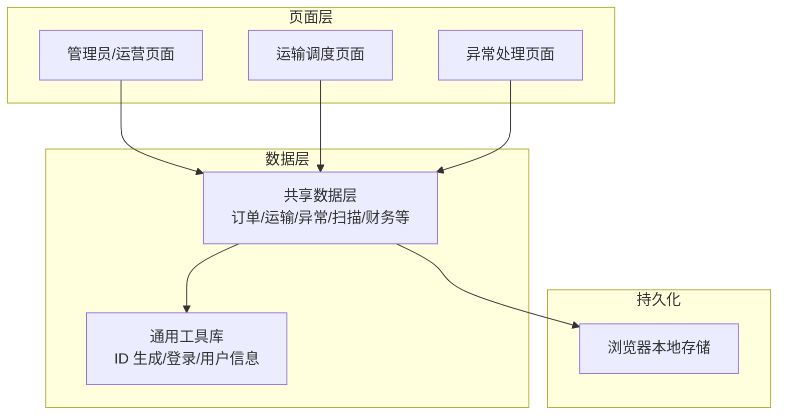
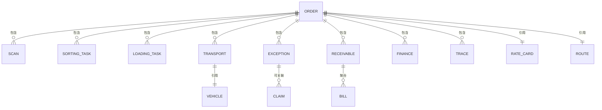
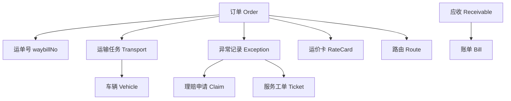
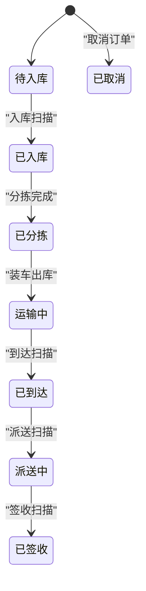
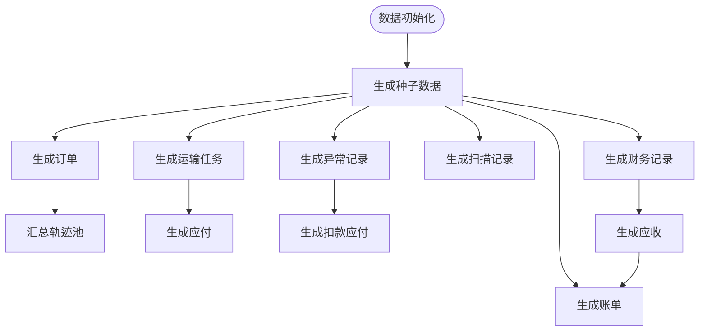
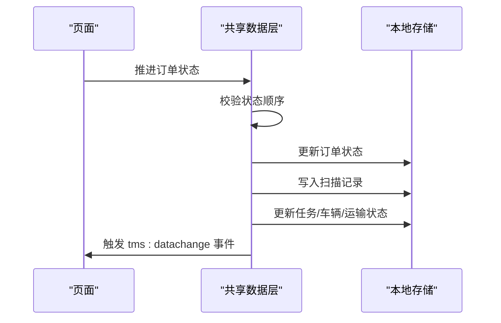

# 核心数据模型

<cite>
**本文引用的文件**   
- [tms-store.js](file://tms-store.js)
- [common.js](file://common.js)
- [tms-pages.js](file://tms-pages.js)
</cite>

## 目录
1. [引言](#引言)
2. [项目结构与数据层定位](#项目结构与数据层定位)
3. [核心实体总览](#核心实体总览)
4. [订单 Order 数据模型](#订单-order-数据模型)
5. [运输任务 Transport 数据模型](#运输任务-transport-数据模型)
6. [异常记录 Exception 数据模型](#异常记录-exception-数据模型)
7. [实体关系与关联方式](#实体关系与关联方式)
8. [状态流转机制](#状态流转机制)
9. [ID 生成策略与数据生成规则](#id-生成策略与数据生成规则)
10. [数据完整性与一致性保证](#数据完整性与一致性保证)
11. [性能与可扩展性建议](#性能与可扩展性建议)
12. [常见问题排查](#常见问题排查)
13. [结论](#结论)

## 引言
本文面向 TMS 系统的核心数据模型，重点说明订单、运输任务、异常记录等关键业务实体的数据结构设计。文档基于仓库中的共享数据层实现进行分析，覆盖字段定义、数据类型、约束条件、业务规则、实体关系、状态流转、ID 生成算法、数据示例和验证规则，并给出数据完整性与一致性维护机制的说明。

该数据层以浏览器本地存储为轻量持久化方案，提供统一的增删改查、搜索筛选、排序分页能力，并维护订单全生命周期状态流转，自动写入扫描、运输、财务等关联记录。所有页面通过统一的数据访问接口操作数据，数据变更会触发全局事件通知。

## 项目结构与数据层定位
TMS 系统采用前端多页面架构，核心业务数据集中在共享数据层中，由多个管理端页面调用。与核心数据模型直接相关的文件包括：
- 共享数据层：负责种子数据生成、主键生成、计费引擎、路由计划、轨迹生成、状态推进、事务式更新与事件广播。
- 通用工具库：提供订单号、运单号生成函数及登录、用户信息等通用能力。
- 页面逻辑层：部分页面在创建运输任务或调度时直接调用数据层接口，驱动业务状态变化。

**图表来源**
- [tms-store.js:1-12](file://tms-store.js#L1-L12)
- [tms-store.js:220-244](file://tms-store.js#L220-L244)
- [common.js:22-50](file://common.js#L22-L50)

**章节来源**
- [tms-store.js:1-12](file://tms-store.js#L1-L12)
- [tms-store.js:220-244](file://tms-store.js#L220-L244)
- [common.js:1-50](file://common.js#L1-L50)

## 核心实体总览
围绕订单、运输、异常三大核心实体，数据层还维护以下相关实体，用于支撑完整业务闭环：
- 扫描记录：记录入库、分拣、出库、到达、派送、签收等节点扫描。
- 分拣任务、装卸任务：仓储作业任务。
- 路线与路由计划：标准线路、分段时效、计划截止时间。
- 轨迹明细：订单级轨迹节点集合，含超时、偏差标记。
- 应收应付与账单：运费收入、承运商结算、异常扣款、月度账单聚合。
- 服务工单与理赔申请：客户服务与赔付流程。

**图表来源**
- [tms-store.js:739-777](file://tms-store.js#L739-L777)
- [tms-store.js:847-861](file://tms-store.js#L847-L861)
- [tms-store.js:880-905](file://tms-store.js#L880-L905)
- [tms-store.js:926-946](file://tms-store.js#L926-L946)
- [tms-store.js:978-985](file://tms-store.js#L978-L985)

**章节来源**
- [tms-store.js:739-777](file://tms-store.js#L739-L777)
- [tms-store.js:847-861](file://tms-store.js#L847-L861)
- [tms-store.js:880-905](file://tms-store.js#L880-L905)
- [tms-store.js:926-946](file://tms-store.js#L926-L946)
- [tms-store.js:978-985](file://tms-store.js#L978-L985)

## 订单 Order 数据模型
订单是 TMS 的核心主数据，承载客户、货物、计费、地址、状态、轨迹、SLA 等信息。

### 字段定义与类型
| 字段 | 类型 | 是否必填 | 默认值 | 约束与业务规则 |
|---|---|---:|---|---|
| id | 字符串 | 是 | 自动生成 | 订单主键，格式 HL+发货城市代码+时间戳+用户哈希+随机数 |
| waybillNo | 字符串 | 是 | 自动生成 | 运单号，WB+订单哈希+随机数 |
| customer | 字符串 | 是 | 散客 | 客户名称，影响折扣与账期 |
| contact | 字符串 | 否 | 客户名 | 联系人姓名 |
| phone | 字符串 | 否 | 空 | 联系电话 |
| goods | 字符串 | 否 | 日用百货 | 货物品类 |
| weight | 数字 | 否 | 1 | 实际重量（kg） |
| pieces | 数字 | 否 | 1 | 件数 |
| service | 字符串 | 否 | 标准 | 服务等级：标准/加急/经济/冷链 |
| orderType | 字符串 | 否 | forward | 订单类型，正向为主 |
| dims | 字符串 | 否 | 空 | 尺寸 LxWxH cm |
| volume | 数字 | 否 | 0 | 体积 m³ |
| volumetricWeight | 数字 | 否 | 0 | 体积重，按抛比计算 |
| chargeableWeight | 数字 | 否 | 0 | 计费重量，取实际重与体积重较大者 |
| declaredValue | 数字 | 否 | 0 | 保价金额 |
| isInsured | 布尔 | 否 | false | 是否保价 |
| paymentMethod | 字符串 | 否 | 现付 | 付款方式：现付/到付/月结 |
| settleCycle | 数字 | 否 | 30 | 账期天数 |
| freight | 数字 | 否 | 0 | 运费总额 |
| freightBreakdown | 对象 | 否 | null | 费用明细结构体 |
| rateCardId | 字符串 | 否 | 空 | 引用运价卡 ID |
| origin | 字符串 | 否 | 北京 | 发货城市 |
| destination | 字符串 | 否 | 上海 | 收货城市 |
| senderAddress | 字符串 | 否 | 发货城市 | 寄件地址 |
| receiverAddress | 字符串 | 否 | 收货城市 | 收件地址 |
| status | 字符串 | 是 | pending | 订单状态，见状态表 |
| createdAt | ISO 时间 | 是 | 当前时间 | 创建时间 |
| expectedAt | ISO 时间 | 是 | 当前时间+2天 | 预计送达时间 |
| signedAt | ISO 时间 | 否 | 空 | 签收时间 |
| updatedAt | ISO 时间 | 是 | 创建时间 | 更新时间 |
| timeline | 数组 | 是 | 初始一条创建记录 | 状态变更审计日志 |
| remark | 字符串 | 否 | 空 | 备注 |
| receivableStatus | 字符串 | 否 | 空 | 应收状态：未回款/部分回款/已回款/已逾期 |
| routeId | 字符串 | 否 | 空 | 匹配路由 ID |
| planSegments | 数组 | 否 | [] | 计划分段与截止时间 |
| traces | 数组 | 否 | [] | 轨迹明细集合 |
| slaDeadline | ISO 时间 | 是 | expectedAt | SLA 截止时间 |

### 业务规则与约束
- 订单状态必须遵循预定义顺序，禁止逆向跳转；取消后不可继续推进。
- 计费重量优先比较实际重量与体积重量，再与首重比较取最大值。
- 保价金额大于 0 时视为已保价，触发保价费计算。
- 到付订单会产生到付附加费。
- 偏远城市附加费根据目的地字典判断。
- 月结客户享受协议折扣与账期，且可能产生应收挂账。
- 订单创建后自动生成运单号、路由计划与初始轨迹节点。

### 数据示例
- 订单号示例：HLBJ20260122...（前缀 HL + 发货城市代码 + 时间戳 + 用户哈希 + 随机数）。
- 运单号示例：WBxxxxxxxxxxNNNN（WB + 订单哈希 + 随机数）。
- 费用明细示例：首重费、续重费、燃油附加费、偏远附加费、保价费、到付附加费、折扣、合计。

**章节来源**
- [tms-store.js:739-777](file://tms-store.js#L739-L777)
- [tms-store.js:252-261](file://tms-store.js#L252-L261)
- [tms-store.js:332-383](file://tms-store.js#L332-L383)
- [common.js:22-50](file://common.js#L22-L50)

## 运输任务 Transport 数据模型
运输任务描述订单从发货到签收的干线与末端配送过程，并与车辆、司机、承运商关联。

### 字段定义与类型
| 字段 | 类型 | 是否必填 | 默认值 | 约束与业务规则 |
|---|---|---:|---|---|
| id | 字符串 | 是 | 自动生成 | 运输任务主键，TR+日期+序号 |
| orderId | 字符串 | 是 | 空 | 关联订单 ID |
| waybillNo | 字符串 | 是 | 空 | 关联运单号 |
| origin | 字符串 | 是 | 空 | 发货城市 |
| destination | 字符串 | 是 | 空 | 收货城市 |
| carrier | 字符串 | 是 | 空 | 承运商名称 |
| vehicleId | 字符串 | 否 | 空 | 车辆 ID |
| driver | 字符串 | 否 | 待分配 | 司机姓名 |
| departAt | ISO 时间 | 否 | 空 | 发车时间 |
| eta | ISO 时间 | 否 | 空 | 预计到达时间 |
| arrivedAt | ISO 时间 | 否 | 空 | 到达时间 |
| status | 字符串 | 是 | shipping | 运输状态：运输中/已到达/派送中/已完成/已取消 |
| progress | 数字 | 否 | 0 | 进度百分比 |
| createdAt | ISO 时间 | 否 | 空 | 创建时间 |

### 业务规则与约束
- 当订单进入“运输中”时，若不存在运输任务则自动创建，并设置发车时间与状态。
- 运输状态推进会同步更新对应订单状态，例如到达→到达扫描，完成→签收。
- 车辆状态随运输任务变化：运输中→车辆状态设为运输中；完成→车辆恢复在线。
- 成本应付在订单签收后按收入约 60% 估算生成应付承运商款项。

### 数据示例
- 运输任务 ID：TR-YYYYMMDDNNNN。
- 状态映射：shipping→arrived→delivering→completed。

**章节来源**
- [tms-store.js:847-861](file://tms-store.js#L847-L861)
- [tms-store.js:1392-1415](file://tms-store.js#L1392-L1415)
- [tms-store.js:1768-1792](file://tms-store.js#L1768-L1792)

## 异常记录 Exception 数据模型
异常记录用于登记和处理物流过程中的异常情况，支持定责、扣款、升级、解决方案与根因分析。

### 字段定义与类型
| 字段 | 类型 | 是否必填 | 默认值 | 约束与业务规则 |
|---|---|---:|---|---|
| id | 字符串 | 是 | 自动生成 | 异常主键，EX+日期+序号 |
| orderId | 字符串 | 否 | 空 | 关联订单 ID |
| waybillNo | 字符串 | 否 | 空 | 关联运单号 |
| type | 字符串 | 是 | 其他异常 | 异常类型：延迟送达/货物损坏/信息不符/地址错误/丢件/拒收 |
| description | 字符串 | 是 | 空 | 异常描述 |
| occurredAt | ISO 时间 | 是 | 当前时间 | 发生时间 |
| status | 字符串 | 是 | pending | 异常状态：待处理/处理中/已解决/已关闭 |
| handler | 字符串 | 否 | 空 | 处理人 |
| resolution | 字符串 | 否 | 空 | 处理结果 |
| resolvedAt | ISO 时间 | 否 | 空 | 解决时间 |
| level | 字符串 | 否 | 空 | 异常级别：一级/二级/三级 |
| slaDeadline | ISO 时间 | 是 | 发生时间+4小时 | SLA 截止时间 |
| escalated | 布尔 | 否 | false | 是否升级 |
| responsibleParty | 字符串 | 否 | 空 | 责任方：承运商/网点/司机/仓库/客户 |
| responsible | 字符串 | 否 | 空 | 责任人 |
| solution | 字符串 | 否 | 空 | 解决方案：补发/改派/理赔/退回 |
| rootCause | 字符串 | 否 | 空 | 根因：操作不规范/系统对接异常/天气原因/客户原因/包装不合格 |
| deductionAmount | 数字 | 否 | 0 | 扣款金额 |
| linkedClaimId | 字符串 | 否 | 空 | 关联理赔申请 ID |
| linkedTicketId | 字符串 | 否 | 空 | 关联服务工单 ID |
| flow | 数组 | 否 | [] | 异常处理流程记录 |

### 业务规则与约束
- 异常登记后默认为“待处理”，处理人可为空。
- 处理异常时可将状态改为“处理中”，并填写处理人。
- 解决异常时可填写处理结果与解决时间，并可联动创建理赔申请。
- 若责任方非客户且已解决，可生成异常扣款应付记录。
- SLA 截止时间为发生时间后 4 小时，用于时效监控。

### 数据示例
- 异常类型：延迟送达、货物损坏、信息不符、地址错误、丢件、拒收。
- 责任方：承运商、网点、司机、仓库、客户。
- 解决方案：补发、改派、理赔、退回。

**章节来源**
- [tms-store.js:880-905](file://tms-store.js#L880-L905)
- [tms-store.js:1662-1677](file://tms-store.js#L1662-L1677)
- [tms-store.js:1679-1688](file://tms-store.js#L1679-L1688)
- [tms-store.js:1690-1711](file://tms-store.js#L1690-L1711)

## 实体关系与关联方式
订单、运输、异常之间的关联主要通过外键字段实现：
- 订单 → 运输：orderId、waybillNo。
- 订单 → 异常：orderId、waybillNo。
- 异常 → 理赔：linkedClaimId。
- 异常 → 服务工单：linkedTicketId。
- 运输 → 车辆：vehicleId。
- 订单 → 运价卡：rateCardId。
- 订单 → 路由：routeId。
- 应收 → 账单：billId。

**图表来源**
- [tms-store.js:739-777](file://tms-store.js#L739-L777)
- [tms-store.js:847-861](file://tms-store.js#L847-L861)
- [tms-store.js:880-905](file://tms-store.js#L880-L905)
- [tms-store.js:926-946](file://tms-store.js#L926-L946)
- [tms-store.js:978-985](file://tms-store.js#L978-L985)

**章节来源**
- [tms-store.js:739-777](file://tms-store.js#L739-L777)
- [tms-store.js:847-861](file://tms-store.js#L847-L861)
- [tms-store.js:880-905](file://tms-store.js#L880-L905)
- [tms-store.js:926-946](file://tms-store.js#L926-L946)
- [tms-store.js:978-985](file://tms-store.js#L978-L985)

## 状态流转机制
订单状态流转遵循严格顺序，禁止逆向跳转；取消后不可继续推进。

### 订单状态表
| 状态码 | 中文标签 | 含义 |
|---|---|---|
| pending | 待入库 | 订单创建 |
| inbound | 已入库 | 入库扫描 |
| sorted | 已分拣 | 分拣完成 |
| shipping | 运输中 | 干线运输开始 |
| arrived | 已到达 | 到达目的分拨 |
| delivering | 派送中 | 末端派送 |
| signed | 已签收 | 签收完成 |
| cancelled | 已取消 | 订单取消 |

### 状态推进流程图

**图表来源**
- [tms-store.js:88-105](file://tms-store.js#L88-L105)
- [tms-store.js:1494-1556](file://tms-store.js#L1494-L1556)
- [tms-store.js:1558-1569](file://tms-store.js#L1558-L1569)
- [tms-store.js:1637-1648](file://tms-store.js#L1637-L1648)

**章节来源**
- [tms-store.js:88-105](file://tms-store.js#L88-L105)
- [tms-store.js:1494-1556](file://tms-store.js#L1494-L1556)
- [tms-store.js:1558-1569](file://tms-store.js#L1558-L1569)
- [tms-store.js:1637-1648](file://tms-store.js#L1637-L1648)

## ID 生成策略与数据生成规则
### 订单号生成
- 规则：HL + 发货城市代码 + 时间戳 + 用户哈希（4位） + 随机数（4位）。
- 实现位置：共享数据层与通用工具库均提供类似实现。

### 运单号生成
- 规则：WB + 订单哈希（10位） + 随机数（4位）。
- 实现位置：共享数据层与通用工具库均提供类似实现。

### 列表 ID 生成
- 规则：前缀 + 日期（YYYYMMDD） + 序号（固定长度）。
- 适用实体：运输任务、异常记录、分拣任务、装卸任务、扫描记录、应收应付、账单等。

### 数据生成策略
- 首次访问自动生成真实感种子数据，涵盖订单、运输、异常、扫描、财务、服务工单、理赔等。
- 使用固定种子随机数，保证演示数据在同一浏览器中稳定。
- 订单数量按日期分布，状态按时间区间随机分布，模拟真实业务场景。

**图表来源**
- [tms-store.js:464-481](file://tms-store.js#L464-L481)
- [tms-store.js:681-791](file://tms-store.js#L681-L791)
- [tms-store.js:847-915](file://tms-store.js#L847-L915)
- [tms-store.js:926-985](file://tms-store.js#L926-L985)

**章节来源**
- [tms-store.js:246-261](file://tms-store.js#L246-L261)
- [tms-store.js:1154-1162](file://tms-store.js#L1154-L1162)
- [common.js:22-50](file://common.js#L22-L50)
- [tms-store.js:464-481](file://tms-store.js#L464-L481)
- [tms-store.js:681-791](file://tms-store.js#L681-L791)
- [tms-store.js:847-915](file://tms-store.js#L847-L915)
- [tms-store.js:926-985](file://tms-store.js#L926-L985)

## 数据完整性与一致性保证
- 主键唯一性：每个实体使用独立前缀与日期序号生成唯一 ID。
- 外键关联：订单、运输、异常等实体通过 orderId、waybillNo、vehicleId、rateCardId、routeId、billId 等字段保持关联。
- 状态一致性：订单状态推进时同步更新扫描记录、任务状态、车辆状态、运输任务状态。
- 审计追踪：订单 timeline 记录每次状态变更的操作人与时间。
- 事件广播：数据变更后触发 tms:datachange 事件，供页面监听刷新。
- 版本控制：数据库版本字段确保数据迁移兼容。

**图表来源**
- [tms-store.js:232-244](file://tms-store.js#L232-L244)
- [tms-store.js:1494-1556](file://tms-store.js#L1494-L1556)

**章节来源**
- [tms-store.js:232-244](file://tms-store.js#L232-L244)
- [tms-store.js:1494-1556](file://tms-store.js#L1494-L1556)

## 性能与可扩展性建议
- 索引优化：对 orderId、waybillNo、status、createdAt 等高频查询字段建立索引。
- 分页加载：大数据量下采用分页与懒加载，减少内存占用。
- 批量更新：状态推进与关联更新尽量合并为批量事务，减少重复持久化。
- 缓存热点：常用字典（城市、服务等级、承运商）可缓存至内存。
- 异步处理：轨迹生成、费用计算、账单聚合等耗时操作可异步执行。

[本节为通用性能建议，不直接分析具体文件]

## 常见问题排查
- 订单状态无法推进：检查是否已取消或已达最终状态。
- 运输任务未创建：确认订单是否已进入“运输中”状态。
- 异常未关联订单：检查 orderId 与 waybillNo 是否正确传入。
- 费用计算异常：核对重量、体积、保价金额、付款方式与服务等级。
- 数据不同步：检查 tms:datachange 事件是否被页面监听。

**章节来源**
- [tms-store.js:1558-1569](file://tms-store.js#L1558-L1569)
- [tms-store.js:1637-1648](file://tms-store.js#L1637-L1648)
- [tms-store.js:1662-1677](file://tms-store.js#L1662-L1677)

## 结论
TMS 系统的核心数据模型以订单为中心，围绕运输任务与异常记录构建完整的业务闭环。通过严格的 ID 生成策略、状态流转机制与关联关系设计，系统实现了数据一致性与业务可追溯性。共享数据层提供了统一的 CRUD 与事件广播能力，便于多页面协作与实时刷新。未来可在索引优化、分页加载、批量更新与异步处理方面进一步提升性能与可扩展性。