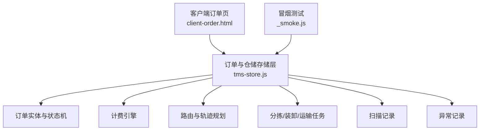
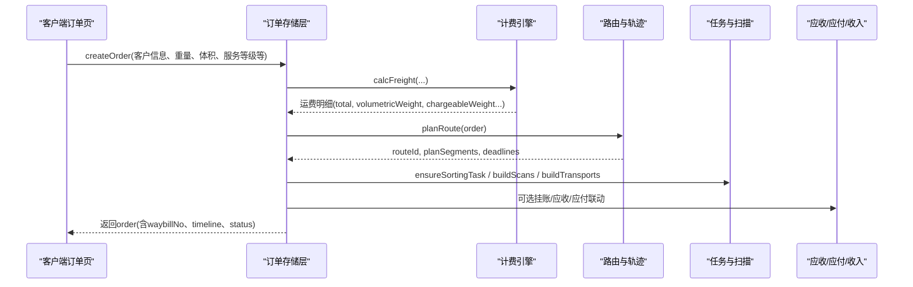
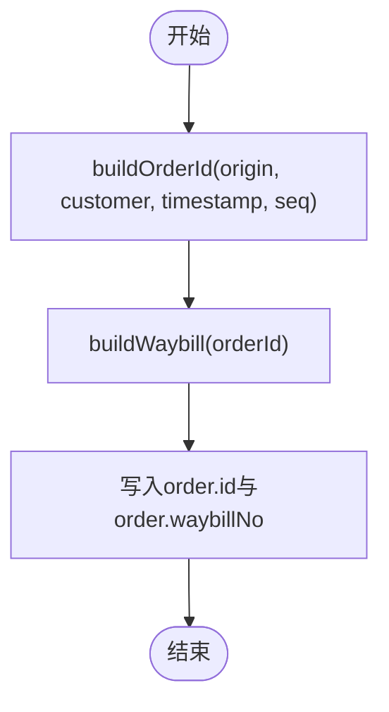
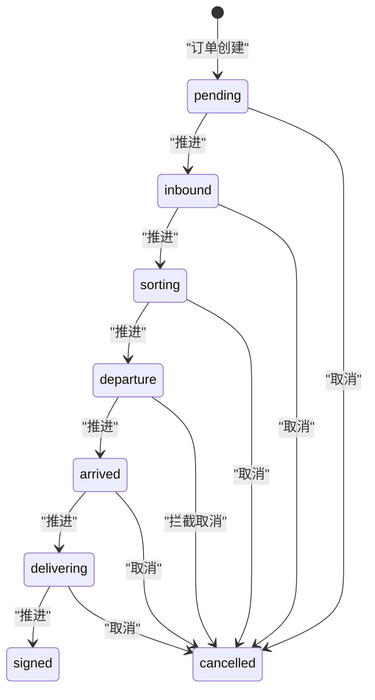
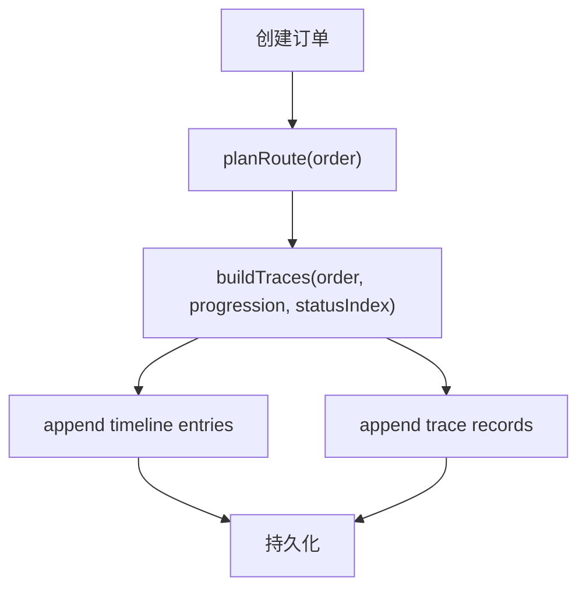
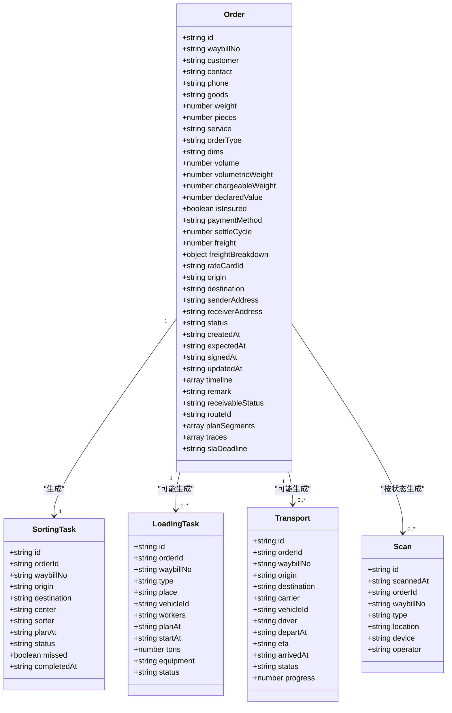
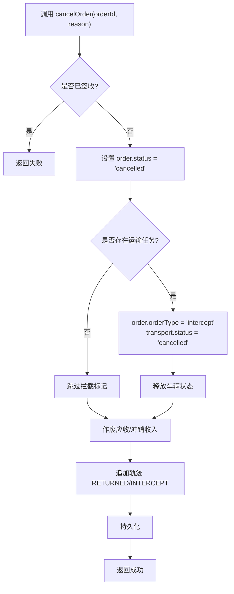
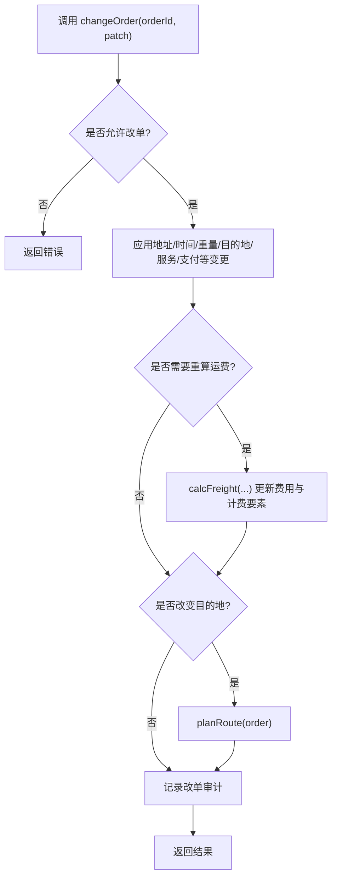
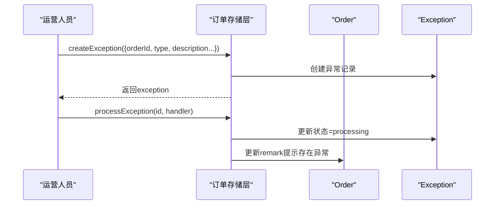
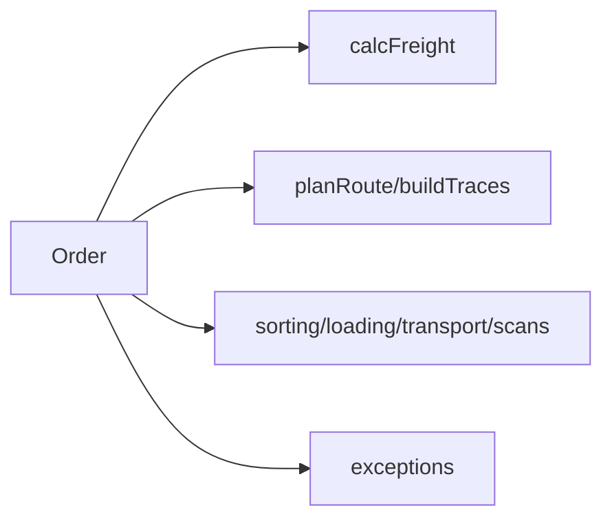

# 订单模型(Order)

<cite>
**本文引用的文件**   
- [tms-store.js](file://tms-store.js)
- [client-order.html](file://client-order.html)
- [_smoke.js](file://_smoke.js)
</cite>

## 目录
1. [引言](#引言)
2. [项目结构中的订单相关位置](#项目结构中的订单相关位置)
3. [核心组件总览](#核心组件总览)
4. [架构概览](#架构概览)
5. [详细组件分析](#详细组件分析)
6. [依赖关系分析](#依赖关系分析)
7. [性能与一致性考虑](#性能与一致性考虑)
8. [故障排查指南](#故障排查指南)
9. [结论](#结论)
10. [附录：字段定义、示例与校验规则](#附录字段定义示例与校验规则)

## 引言
本文面向TMS系统的订单核心数据模型，重点说明Order实体的完整数据结构、订单ID与运单号生成算法、订单状态流转机制、时间线记录、以及订单与运输任务、扫描记录、异常记录的关联关系。文档同时给出取消逻辑、改单重算、逆向退货等关键业务规则，并附带可操作的验证建议与常见问题排查思路。

## 项目结构中的订单相关位置
- 订单主数据、状态机、ID/运单号生成、计费引擎、路由计划、轨迹明细、取消与改单、逆向退货、异常处理等核心实现集中在仓储与订单存储模块中。
- 客户端订单页面包含部分前端状态展示与取消按钮逻辑，用于演示用户侧操作入口。
- 冒烟测试脚本通过反复推进订单状态，验证从创建到签收的端到端流程。

**图表来源**
- [tms-store.js:88-213](file://tms-store.js#L88-L213)
- [tms-store.js:252-261](file://tms-store.js#L252-L261)
- [tms-store.js:332-383](file://tms-store.js#L332-L383)
- [tms-store.js:387-439](file://tms-store.js#L387-L439)
- [tms-store.js:680-879](file://tms-store.js#L680-L879)
- [tms-store.js:1561-1726](file://tms-store.js#L1561-L1726)
- [client-order.html:828-838](file://client-order.html#L828-L838)
- [_smoke.js:48-49](file://_smoke.js#L48-L49)

**章节来源**
- [tms-store.js:88-213](file://tms-store.js#L88-L213)
- [tms-store.js:252-261](file://tms-store.js#L252-L261)
- [tms-store.js:332-383](file://tms-store.js#L332-L383)
- [tms-store.js:387-439](file://tms-store.js#L387-L439)
- [tms-store.js:680-879](file://tms-store.js#L680-L879)
- [tms-store.js:1561-1726](file://tms-store.js#L1561-L1726)
- [client-order.html:828-838](file://client-order.html#L828-L838)
- [_smoke.js:48-49](file://_smoke.js#L48-L49)

## 核心组件总览
- 订单ID生成：buildOrderId
- 运单号生成：buildWaybill
- 计费引擎：calcFreight（影响freight、volumetricWeight、chargeableWeight等）
- 路由与轨迹：planRoute、buildTraces、TRACE_NODE_MAP、STAGE_NODE
- 订单生命周期：ORDER_FLOW、advanceOrder、applyOrderStatus
- 订单操作：createOrder、cancelOrder、changeOrder、createReverseOrder、removeOrder
- 关联实体：transports、sortingTasks、loadingTasks、scans、exceptions、traces、receivables、finances

**章节来源**
- [tms-store.js:252-261](file://tms-store.js#L252-L261)
- [tms-store.js:332-383](file://tms-store.js#L332-L383)
- [tms-store.js:387-439](file://tms-store.js#L387-L439)
- [tms-store.js:442-460](file://tms-store.js#L442-L460)
- [tms-store.js:88-213](file://tms-store.js#L88-L213)
- [tms-store.js:1561-1726](file://tms-store.js#L1561-L1726)

## 架构概览
订单模型处于TMS系统的数据中枢位置，向上承接前端订单操作，向下驱动计费、路由、任务、扫描、异常与财务联动。

**图表来源**
- [tms-store.js:1574-1638](file://tms-store.js#L1574-L1638)
- [tms-store.js:332-383](file://tms-store.js#L332-L383)
- [tms-store.js:427-439](file://tms-store.js#L427-L439)
- [tms-store.js:680-879](file://tms-store.js#L680-L879)

## 详细组件分析

### 订单ID与运单号生成
- 订单ID(buildOrderId)
  - 组成要素：城市代码前缀、客户哈希片段、时间戳、序列随机片段。
  - 目的：保证唯一性、可读性与一定程度的可解析性。
- 运单号(buildWaybill)
  - 基于orderId进行哈希计算，拼接固定前缀与数字段，确保与订单一一对应且稳定。

**图表来源**
- [tms-store.js:252-261](file://tms-store.js#L252-L261)
- [tms-store.js:1574-1638](file://tms-store.js#L1574-L1638)

**章节来源**
- [tms-store.js:252-261](file://tms-store.js#L252-L261)
- [tms-store.js:1574-1638](file://tms-store.js#L1574-L1638)

### 订单状态流转机制
- 标准状态流(ORDER_FLOW)
  - 待入库(pending) → 已入库(inbound) → 已分拣(sorting) → 运输中(departure) → 已到达(arrived) → 派送中(delivering) → 已签收(signed)
- 推进逻辑(advanceOrder)
  - 根据当前状态索引取下一个状态；若已完成或已取消则拒绝推进。
- 状态应用(applyOrderStatus)
  - 更新order.status、updatedAt、追加timeline记录，并触发轨迹节点写入。

**图表来源**
- [tms-store.js:88-213](file://tms-store.js#L88-L213)
- [tms-store.js:1561-1572](file://tms-store.js#L1561-L1572)
- [tms-store.js:1640-1666](file://tms-store.js#L1640-L1666)

**章节来源**
- [tms-store.js:88-213](file://tms-store.js#L88-L213)
- [tms-store.js:1561-1572](file://tms-store.js#L1561-L1572)
- [tms-store.js:1640-1666](file://tms-store.js#L1640-L1666)

### 订单时间线(timeline)与轨迹(traces)
- timeline
  - 每条记录包含status、label、time、actor，用于审计与可视化。
- traces
  - 按阶段(STAGE_NODE)生成轨迹明细，包含node、nodeName、location、opTime、deadline、isOvertime、isDeviant等字段。
  - 非取消订单在创建时即生成轨迹池(tracePool)条目，供轨迹中心检索。

**图表来源**
- [tms-store.js:427-439](file://tms-store.js#L427-L439)
- [tms-store.js:442-460](file://tms-store.js#L442-L460)
- [tms-store.js:680-879](file://tms-store.js#L680-L879)

**章节来源**
- [tms-store.js:427-439](file://tms-store.js#L427-L439)
- [tms-store.js:442-460](file://tms-store.js#L442-L460)
- [tms-store.js:680-879](file://tms-store.js#L680-L879)

### 订单与任务的关联
- 分拣任务(sortingTasks)
  - 每个订单对应分拣任务，包含orderId、waybillNo、center、sorter、planAt、status、missed、completedAt。
- 装卸任务(loadingTasks)
  - 当订单进入运输阶段后生成装车/卸车任务，关联车辆与工人。
- 运输任务(transports)
  - 包含orderId、waybillNo、carrier、vehicleId、driver、departAt、eta、arrivedAt、status、progress。
- 扫描记录(scans)
  - 按状态推进生成入库、分拣、出库、到达、派送、签收等扫描记录。

**图表来源**
- [tms-store.js:680-879](file://tms-store.js#L680-L879)

**章节来源**
- [tms-store.js:680-879](file://tms-store.js#L680-L879)

### 订单取消与一致性保证
- 取消条件
  - 已签收订单不可取消。
- 取消逻辑
  - 将order.status置为cancelled，更新时间戳，追加timeline记录。
  - 若存在运输任务，则将order.orderType标记为intercept，并将transport状态置为cancelled，释放车辆状态。
  - 联动财务：作废未核销应收、冲销挂账收入。
  - 追加轨迹节点RETURNED或INTERCEPT。

**图表来源**
- [tms-store.js:1640-1666](file://tms-store.js#L1640-L1666)

**章节来源**
- [tms-store.js:1640-1666](file://tms-store.js#L1640-L1666)

### 改单与逆向退货
- 改单(changeOrder)
  - 支持改址、改约、改重、改线路与服务等级、支付方式。
  - 涉及计费要素变化时自动重算运费，更新freight、freightBreakdown、rateCardId、volumetricWeight、chargeableWeight，必要时重新规划路线。
  - 记录改单变更内容与审计记录。
- 逆向退货(createReverseOrder)
  - 将正向订单置为退回(canceled)，并生成逆向订单(reverse)，始发地与目的地互换，订单类型标记为reverse。

**图表来源**
- [tms-store.js:1668-1703](file://tms-store.js#L1668-L1703)
- [tms-store.js:1705-1726](file://tms-store.js#L1705-L1726)

**章节来源**
- [tms-store.js:1668-1703](file://tms-store.js#L1668-L1703)
- [tms-store.js:1705-1726](file://tms-store.js#L1705-L1726)

### 异常记录与订单关联
- 异常记录(createException)
  - 包含orderId、waybillNo、type、description、occurredAt、status、handler、resolution、resolvedAt、level、slaDeadline、escalated、responsibleParty、responsible、solution、rootCause、deductionAmount、linkedClaimId、linkedTicketId、flow等字段。
- 处理流程(processException)
  - 记录受理动作，更新异常状态为processing，并在关联订单上添加备注提示。

**图表来源**
- [tms-store.js:1740-1769](file://tms-store.js#L1740-L1769)

**章节来源**
- [tms-store.js:1740-1769](file://tms-store.js#L1740-L1769)

## 依赖关系分析
- 订单与计费引擎
  - 创建订单与改单时调用calcFreight，决定最终运费与计费要素。
- 订单与路由/轨迹
  - planRoute根据origin/destination匹配route，生成planSegments与deadline；buildTraces按阶段生成轨迹明细。
- 订单与任务/扫描
  - 根据订单状态推进生成分拣、装卸、运输任务与扫描记录。
- 订单与异常
  - 异常记录通过orderId与waybillNo与订单关联，并在处理过程中更新订单备注。

**图表来源**
- [tms-store.js:332-383](file://tms-store.js#L332-L383)
- [tms-store.js:427-460](file://tms-store.js#L427-L460)
- [tms-store.js:680-879](file://tms-store.js#L680-L879)
- [tms-store.js:1740-1769](file://tms-store.js#L1740-L1769)

**章节来源**
- [tms-store.js:332-383](file://tms-store.js#L332-L383)
- [tms-store.js:427-460](file://tms-store.js#L427-L460)
- [tms-store.js:680-879](file://tms-store.js#L680-L879)
- [tms-store.js:1740-1769](file://tms-store.js#L1740-L1769)

## 性能与一致性考虑
- ID与运单号生成
  - 使用哈希与固定前缀，避免冲突并保持可读性；建议在大规模并发场景下对seq计数器加锁或使用分布式ID策略。
- 计费重算
  - 改单时按需重算，避免不必要的计算开销；缓存常用路线与价卡以减少重复查询。
- 状态推进
  - advanceOrder仅允许顺序推进，防止非法跳转；结合timeline与traces保证可追溯性。
- 取消一致性
  - 取消时同步更新订单、任务、财务与车辆状态，确保跨实体一致性；建议在事务边界内执行，避免部分更新。

[本节为通用指导，不直接分析具体文件]

## 故障排查指南
- 订单无法推进
  - 检查order.status是否为cancelled或已签收；确认advanceOrder调用参数actor是否正确。
- 取消失败
  - 检查是否已签收；确认是否存在运输任务导致需要拦截逻辑。
- 运费不一致
  - 检查改单是否触发了重算；核对weight、dims、volume、service、paymentMethod、customer等计费要素。
- 轨迹缺失
  - 检查订单是否被取消；确认buildTraces是否被执行；核对STAGE_NODE与TRACE_NODE_MAP映射。
- 异常未关联订单
  - 检查createException传入的orderId与waybillNo是否正确；确认processException是否更新了订单备注。

**章节来源**
- [tms-store.js:1561-1572](file://tms-store.js#L1561-L1572)
- [tms-store.js:1640-1666](file://tms-store.js#L1640-L1666)
- [tms-store.js:1668-1703](file://tms-store.js#L1668-L1703)
- [tms-store.js:442-460](file://tms-store.js#L442-L460)
- [tms-store.js:1740-1769](file://tms-store.js#L1740-L1769)

## 结论
TMS系统的订单模型以Order为核心，围绕ID/运单号生成、计费引擎、路由与轨迹、状态机、任务与扫描、异常与财务联动形成闭环。通过严格的推进规则与取消逻辑，配合timeline与traces的可追溯机制，保障了订单全生命周期的数据一致性与业务可审计性。

[本节为总结性内容，不直接分析具体文件]

## 附录：字段定义、示例与校验规则

### Order实体关键字段定义
- id：订单ID，由buildOrderId生成，格式包含城市代码、时间戳与哈希片段。
- waybillNo：运单号，由buildWaybill生成，与orderId一一对应。
- customer：客户名称或标识。
- contact：联系人姓名。
- phone：联系电话。
- goods：货物描述。
- weight：重量(kg)。
- pieces：件数。
- service：服务等级(如标准、加急、经济、冷链)。
- orderType：订单类型(forward/reverse/intercept)。
- dims：尺寸(LxWxH cm)。
- volume：体积(m³)。
- volumetricWeight：体积重(kg)。
- chargeableWeight：计费重(kg)。
- declaredValue：保价金额。
- isInsured：是否保价。
- paymentMethod：支付方式(现付/月结/到付)。
- settleCycle：结算周期(天)。
- freight：运费(元)。
- freightBreakdown：运费明细对象。
- rateCardId：价卡ID。
- origin：始发城市。
- destination：目的城市。
- senderAddress：寄件地址。
- receiverAddress：收件地址。
- status：订单状态(pending/inbound/sorting/departure/arrived/delivering/signed/cancelled)。
- createdAt：创建时间。
- expectedAt：预计到达时间。
- signedAt：签收时间。
- updatedAt：更新时间。
- timeline：状态变更记录数组。
- remark：备注。
- receivableStatus：应收状态。
- routeId：路由ID。
- planSegments：计划分段数组。
- traces：轨迹明细数组。
- slaDeadline：SLA截止时间。

**章节来源**
- [tms-store.js:680-879](file://tms-store.js#L680-L879)
- [tms-store.js:1574-1638](file://tms-store.js#L1574-L1638)

### 订单数据示例(概念性)
- 一个典型订单包含上述字段，其中：
  - id与waybillNo由系统自动生成。
  - freight与计费要素由计费引擎计算得出。
  - timeline记录从创建到当前状态的每一步变更。
  - traces记录各阶段的轨迹节点与时间、地点、超时/偏差标记。
  - transports、sortingTasks、loadingTasks、scans、exceptions等关联实体通过orderId与waybillNo与订单关联。

[本节为概念性示例，不直接分析具体文件]

### 校验规则与建议
- 必填字段校验
  - origin、destination、weight、pieces、service、paymentMethod、customer、contact、phone等应在创建时校验。
- 数值范围校验
  - weight、volume、declaredValue应为正数；pieces≥1。
- 状态约束
  - 已签收或已取消订单禁止推进或改单。
- 计费一致性
  - 改单涉及计费要素变化时必须重算运费，并更新freightBreakdown与rateCardId。
- 轨迹完整性
  - 非取消订单必须生成traces；取消订单不应生成轨迹。
- 取消一致性
  - 取消时需同步更新订单、任务、财务与车辆状态，并追加轨迹节点。

**章节来源**
- [tms-store.js:1561-1572](file://tms-store.js#L1561-L1572)
- [tms-store.js:1640-1666](file://tms-store.js#L1640-L1666)
- [tms-store.js:1668-1703](file://tms-store.js#L1668-L1703)
- [tms-store.js:442-460](file://tms-store.js#L442-L460)