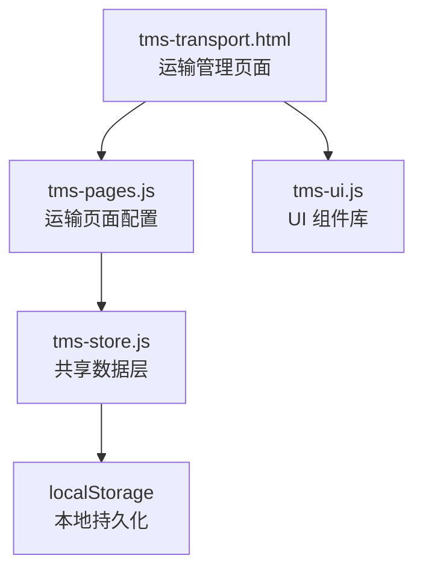
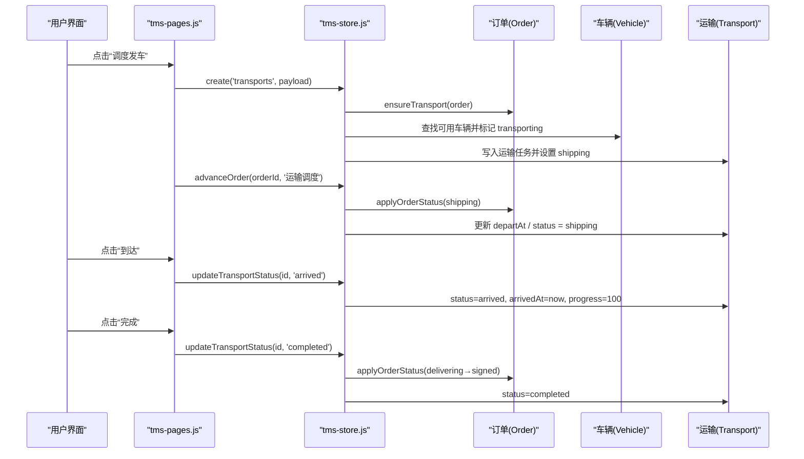
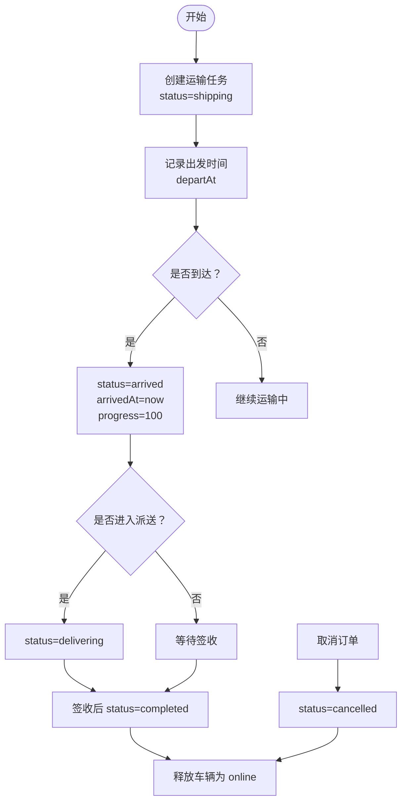
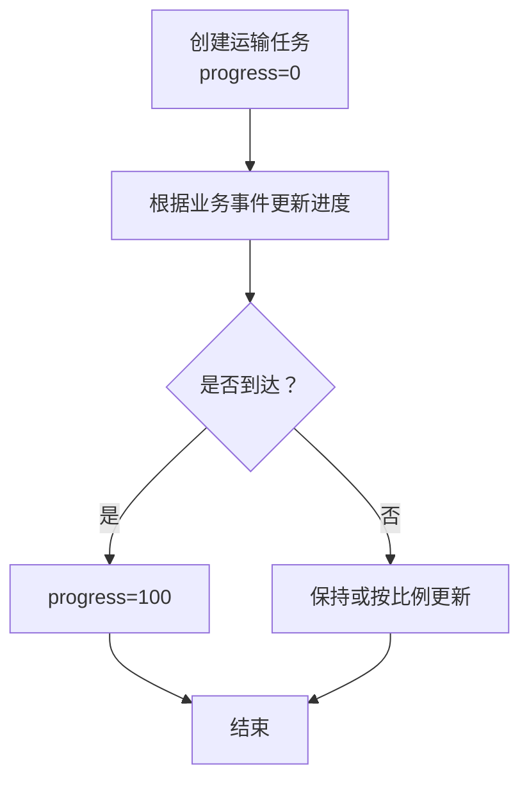
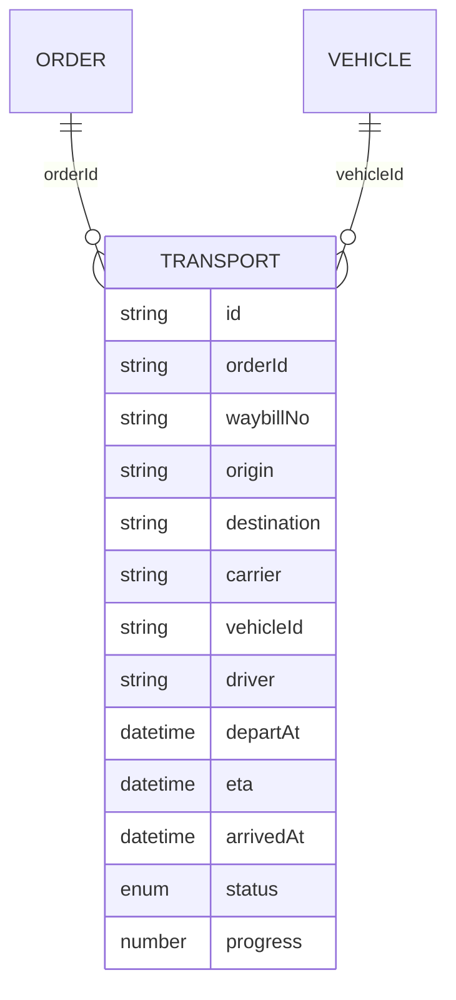
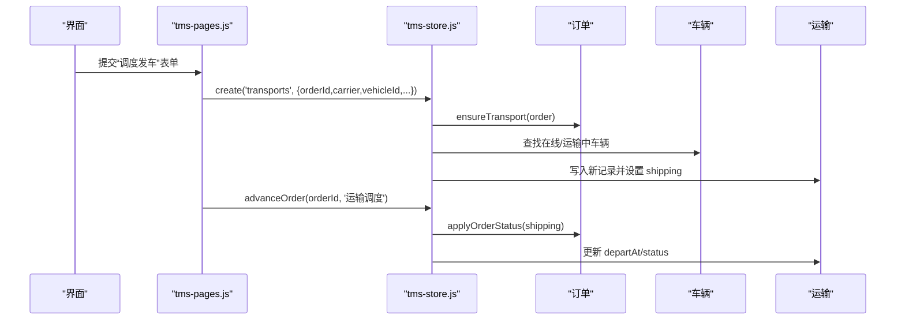
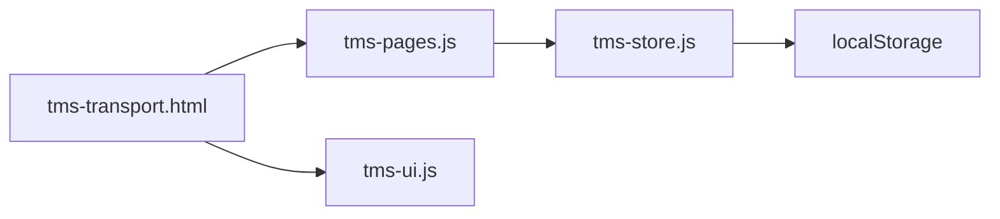

# 运输任务模型(Transport)

<cite>
**本文引用的文件**   
- [tms-store.js](file://tms-store.js)
- [tms-pages.js](file://tms-pages.js)
- [tms-transport.html](file://tms-transport.html)
- [tms-ui.js](file://tms-ui.js)
</cite>

## 目录
1. [引言](#引言)
2. [项目结构定位](#项目结构定位)
3. [核心实体：Transport 数据结构](#核心实体transport-数据结构)
4. [架构总览](#架构总览)
5. [详细组件分析](#详细组件分析)
6. [依赖关系分析](#依赖关系分析)
7. [性能与扩展建议](#性能与扩展建议)
8. [故障排查指南](#故障排查指南)
9. [结论](#结论)

## 引言
本文面向 TMS 系统的“运输任务”数据模型，围绕 Transport 实体的字段设计、ID 生成、状态流转、车辆调度关联、进度跟踪、时效管理与 ETA 策略进行系统化说明。文档同时给出创建流程、关键处理逻辑和典型业务场景，帮助运营、产品与研发快速理解并正确使用该模型。

## 项目结构定位
TMS 前端采用多页面 HTML + 共享 JS 的模式：
- tms-store.js：共享数据层，基于 localStorage 维护订单、运输、异常、财务等全量种子数据与业务流转方法。
- tms-pages.js：各业务页面渲染配置，包含“运输管理”页面的表格、筛选、操作按钮与表单弹窗。
- tms-transport.html：运输管理页面骨架与基础样式，引用共享脚本。
- tms-ui.js：通用 UI 组件库，提供状态标签、进度条、弹窗、列表等能力。

图表来源
- [tms-transport.html:465-476](file://tms-transport.html#L465-L476)
- [tms-pages.js:260-356](file://tms-pages.js#L260-L356)
- [tms-store.js:1-12](file://tms-store.js#L1-L12)
- [tms-ui.js:1-12](file://tms-ui.js#L1-L12)

章节来源
- [tms-transport.html:465-476](file://tms-transport.html#L465-L476)
- [tms-pages.js:260-356](file://tms-pages.js#L260-L356)
- [tms-store.js:1-12](file://tms-store.js#L1-L12)
- [tms-ui.js:1-12](file://tms-ui.js#L1-L12)

## 核心实体：Transport 数据结构
Transport 表示一次干线或区域运输任务，通常由一个或多个订单聚合形成；在本仓库中，每个已发运订单会对应一条运输记录。关键字段如下：

- id：运输任务唯一标识，格式为 TR-YYYYMMDDNNN，按日期递增。
- orderId：关联的订单号，用于从订单侧反查运输任务。
- waybillNo：运单号，与订单一致，便于跨系统追踪。
- origin：起点城市。
- destination：终点城市。
- carrier：承运商名称，如顺丰物流、中通快递等。
- vehicleId：调度车辆的 ID，关联车辆主数据。
- driver：司机姓名，来自车辆主数据的默认值。
- departAt：发车时间，ISO 时间字符串。
- eta：预计到达时间，来源于订单 expectedAt。
- arrivedAt：到达时间，初始为空，到达时写入。
- status：运输状态，取值包括 pending、shipping、arrived、delivering、completed、cancelled。
- progress：运输进度百分比，0~100，用于展示与统计。
- createdAt：创建时间（在运行时创建时写入）。

字段用途要点：
- id/orderId/waybillNo：贯穿订单、扫描、轨迹、异常、财务等模块的主键与外键。
- origin/destination/carrier：描述运输线路与责任方。
- vehicleId/driver：绑定运力资源，联动车辆状态。
- departAt/eta：时效管理的核心时间戳，用于 SLA 与延误判定。
- arrivedAt/status：状态推进的关键节点，驱动后续派送与结算。
- progress：可视化进度，辅助监控与考核。

章节来源
- [tms-store.js:844-862](file://tms-store.js#L844-L862)
- [tms-store.js:1394-1417](file://tms-store.js#L1394-L1417)
- [tms-pages.js:273-287](file://tms-pages.js#L273-L287)
- [tms-transport.html:388-457](file://tms-transport.html#L388-L457)

## 架构总览
运输任务的生命周期与订单状态紧密耦合，通过共享数据层统一推进。

图表来源
- [tms-pages.js:289-317](file://tms-pages.js#L289-L317)
- [tms-pages.js:341-354](file://tms-pages.js#L341-L354)
- [tms-store.js:1497-1559](file://tms-store.js#L1497-L1559)
- [tms-store.js:1561-1572](file://tms-store.js#L1561-L1572)
- [tms-store.js:1394-1417](file://tms-store.js#L1394-L1417)

## 详细组件分析

### Transport 实体字段定义与用途
- id：TR-YYYYMMDDNNN，使用 counterNext 生成，保证同日内单调递增。
- orderId：与订单强关联，支持按订单查询运输任务。
- waybillNo：与订单保持一致，便于与扫描、轨迹、异常等模块联动。
- origin/destination：起讫城市，用于路由匹配与时效计算。
- carrier：承运商，影响成本应付与对账。
- vehicleId/driver：绑定运力，驱动车辆状态变更。
- departAt：发车时间，进入 shipping 时写入。
- eta：预计到达，继承订单 expectedAt，作为 SLA 基准。
- arrivedAt：到达时间，进入 arrived 时写入。
- status：待发车(pending)、运输中(shipping)、已到达(arrived)、派送中(delivering)、已完成(completed)、已取消(cancelled)。
- progress：进度百分比，到达时为 100，其他状态可动态更新。
- createdAt：创建时间，运行时新增时写入。

章节来源
- [tms-store.js:844-862](file://tms-store.js#L844-L862)
- [tms-store.js:1394-1417](file://tms-store.js#L1394-L1417)
- [tms-store.js:104-105](file://tms-store.js#L104-L105)

### 运输任务 ID 生成规则
- 使用 counterNext(entity='transports', prefix='TR') 生成。
- 内部以当天日期 YYYYMMDD 拼接序号，确保同一天内不重复且有序。
- 示例：TR-20260120001。

章节来源
- [tms-store.js:246-250](file://tms-store.js#L246-L250)
- [tms-store.js:1156-1164](file://tms-store.js#L1156-L1164)
- [tms-store.js:1394-1417](file://tms-store.js#L1394-L1417)

### 运输状态流转机制
状态集合与标签映射：
- pending：待发车
- shipping：运输中
- arrived：已到达
- delivering：派送中
- completed：已完成
- cancelled：已取消

触发条件与处理逻辑：
- 创建运输任务：当订单进入 shipping 时，ensureTransport 创建或复用运输记录，status=shipping，写入 departAt，并标记车辆为 transporting。
- 到达：updateTransportStatus 将 status=arrived，写入 arrivedAt，progress=100。
- 完成：updateTransportStatus 将 status=completed，并推进订单至 delivering→signed，最终车辆状态恢复为 online。
- 取消：cancelOrder 将运输状态置为 cancelled，若车辆处于 transporting，则释放回 online。

图表来源
- [tms-store.js:1497-1559](file://tms-store.js#L1497-L1559)
- [tms-store.js:1640-1666](file://tms-store.js#L1640-L1666)
- [tms-pages.js:341-354](file://tms-pages.js#L341-L354)

章节来源
- [tms-store.js:104-105](file://tms-store.js#L104-L105)
- [tms-store.js:1497-1559](file://tms-store.js#L1497-L1559)
- [tms-store.js:1640-1666](file://tms-store.js#L1640-L1666)
- [tms-pages.js:341-354](file://tms-pages.js#L341-L354)

### 运输进度跟踪(progress)计算与更新
- 初始创建时，progress=0。
- 到达时，progress=100。
- 种子数据中，非完成状态的运输任务随机分配 30~90 的进度，用于演示效果。
- 运行时可通过 updateTransportStatus 或自定义逻辑更新 progress，例如结合 GPS 轨迹或站点扫描事件。

图表来源
- [tms-store.js:844-862](file://tms-store.js#L844-L862)
- [tms-store.js:1539-1547](file://tms-store.js#L1539-L1547)
- [tms-pages.js:281-287](file://tms-pages.js#L281-L287)

章节来源
- [tms-store.js:844-862](file://tms-store.js#L844-L862)
- [tms-store.js:1539-1547](file://tms-store.js#L1539-L1547)
- [tms-pages.js:281-287](file://tms-pages.js#L281-L287)

### 与订单、车辆、司机的关联关系
- 订单关联：orderId 指向订单主数据；waybillNo 与订单一致；eta 继承订单 expectedAt。
- 车辆关联：vehicleId 指向车辆主数据；driver 取自车辆主数据；进入 shipping 时车辆状态设为 transporting；完成或取消后恢复为 online。
- 司机关联：driver 字段用于展示与统计，实际调度由 vehicleId 决定。

图表来源
- [tms-store.js:844-862](file://tms-store.js#L844-L862)
- [tms-store.js:1394-1417](file://tms-store.js#L1394-L1417)
- [tms-store.js:1536-1538](file://tms-store.js#L1536-L1538)
- [tms-store.js:1658-1663](file://tms-store.js#L1658-L1663)

章节来源
- [tms-store.js:844-862](file://tms-store.js#L844-L862)
- [tms-store.js:1394-1417](file://tms-store.js#L1394-L1417)
- [tms-store.js:1536-1538](file://tms-store.js#L1536-L1538)
- [tms-store.js:1658-1663](file://tms-store.js#L1658-L1663)

### 运输任务创建流程与数据处理逻辑
- 手动创建：通过“调度发车”表单选择待发运订单、承运商与车辆，调用 S.create('transports', payload)，随后循环推进订单到 shipping。
- 自动创建：当订单状态推进到 shipping 时，ensureTransport 检查是否存在运输记录，不存在则自动生成，并设置 status=shipping、departAt=now、eta=order.expectedAt。
- 数据联动：创建运输任务的同时，可能生成应付账款（向承运商结算干线运费），并更新车辆状态。

图表来源
- [tms-pages.js:289-317](file://tms-pages.js#L289-L317)
- [tms-store.js:1394-1417](file://tms-store.js#L1394-L1417)
- [tms-store.js:1497-1538](file://tms-store.js#L1497-L1538)

章节来源
- [tms-pages.js:289-317](file://tms-pages.js#L289-L317)
- [tms-store.js:1394-1417](file://tms-store.js#L1394-L1417)
- [tms-store.js:1497-1538](file://tms-store.js#L1497-L1538)

### 运输时效管理与 ETA 计算策略
- ETA 来源：eta 字段直接继承订单 expectedAt，代表承诺送达时间。
- 时效规则：订单创建时设置 expectedAt；改单时可调整 expectedAt 与 slaDeadline。
- 路由计划：planRoute 根据起终点匹配路由，计算分段标准时长与截止时间，用于轨迹与超时判断。
- 超时标记：轨迹节点带有 deadline 与 isOvertime/isDeviant 标志，用于监控与预警。

章节来源
- [tms-store.js:426-440](file://tms-store.js#L426-L440)
- [tms-store.js:442-460](file://tms-store.js#L442-L460)
- [tms-store.js:1596-1637](file://tms-store.js#L1596-L1637)
- [tms-store.js:1668-1700](file://tms-store.js#L1668-L1700)

### 具体数据示例与业务场景
- 示例行：运输任务 ID、订单号、运单号、起点、终点、承运商、车辆 ID、司机、出发时间、预计到达、当前状态、操作按钮。
- 典型场景：
  - 干线运输中：status=shipping，progress 逐步提升。
  - 到达目的地：status=arrived，arrivedAt 写入，progress=100。
  - 末端派送：status=delivering，准备签收。
  - 完成签收：status=completed，车辆释放为 online。
  - 取消拦截：status=cancelled，应收作废、收入冲销。

章节来源
- [tms-transport.html:388-457](file://tms-transport.html#L388-L457)
- [tms-pages.js:273-356](file://tms-pages.js#L273-L356)
- [tms-store.js:1640-1666](file://tms-store.js#L1640-L1666)

## 依赖关系分析
- tms-pages.js 依赖 tms-store.js 提供的 list/create/update/advanceOrder 等方法。
- tms-store.js 维护 orders/transports/vehicles 等实体，并通过 localStorage 持久化。
- tms-ui.js 提供状态标签(statusBadge)、进度条(tms-progress)等 UI 能力。
- tms-transport.html 仅承载页面结构与样式，逻辑由上述 JS 文件承担。

图表来源
- [tms-transport.html:465-476](file://tms-transport.html#L465-L476)
- [tms-pages.js:260-356](file://tms-pages.js#L260-L356)
- [tms-store.js:1-12](file://tms-store.js#L1-L12)
- [tms-ui.js:1-12](file://tms-ui.js#L1-L12)

章节来源
- [tms-transport.html:465-476](file://tms-transport.html#L465-L476)
- [tms-pages.js:260-356](file://tms-pages.js#L260-L356)
- [tms-store.js:1-12](file://tms-store.js#L1-L12)
- [tms-ui.js:1-12](file://tms-ui.js#L1-L12)

## 性能与扩展建议
- 数据量增长：transports 表随订单增长而增长，建议在查询时增加分页与索引字段（orderId、status、departAt）。
- 进度更新频率：GPS 或扫描事件高频更新 progress 时，建议批量合并与节流，避免频繁写 localStorage。
- 时效计算：ETA 与 SLA 可引入更精细的路由权重与实时路况因子，提高预测准确性。
- 状态一致性：确保状态推进与扫描、轨迹、财务等模块的一致性，必要时引入事务或补偿机制。

[本节为通用指导，不涉及具体代码片段]

## 故障排查指南
- 运输任务未创建：检查订单是否已进入 shipping；确认 ensureTransport 是否被调用。
- 车辆状态异常：检查 shipping 与 signed/cancelled 分支是否正确更新车辆状态。
- ETA 不准确：核对订单 expectedAt 与 planRoute 生成的分段截止时间。
- 进度不更新：确认 updateTransportStatus 或自定义逻辑是否正确设置 progress。
- 取消后财务异常：检查应收作废与收入冲销逻辑是否执行。

章节来源
- [tms-store.js:1394-1417](file://tms-store.js#L1394-L1417)
- [tms-store.js:1536-1538](file://tms-store.js#L1536-L1538)
- [tms-store.js:1640-1666](file://tms-store.js#L1640-L1666)

## 结论
Transport 实体是 TMS 运输管理的核心数据模型，贯穿订单、车辆、司机、轨迹、财务等多个模块。其字段设计简洁明确，状态流转与订单生命周期紧密耦合，ETA 与时效管理支撑了端到端的时效保障。通过本文的结构化说明与图示，读者可以快速掌握 Transport 的数据模型、业务流程与实现要点，并在实际项目中正确扩展与优化。