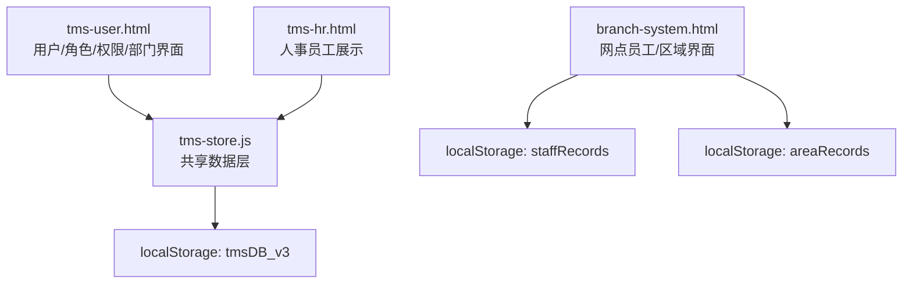
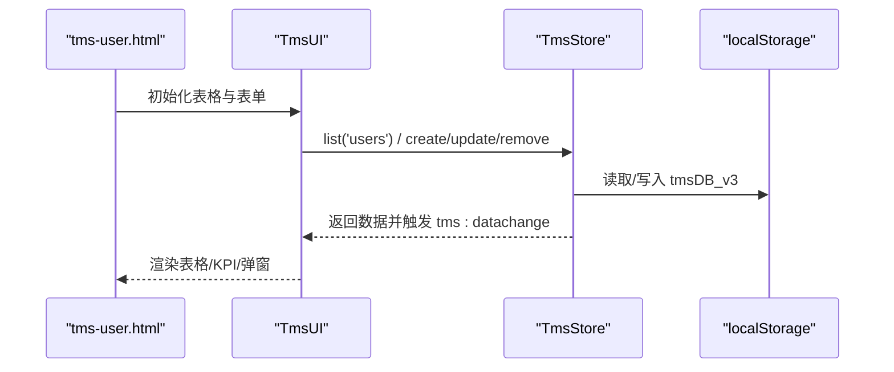
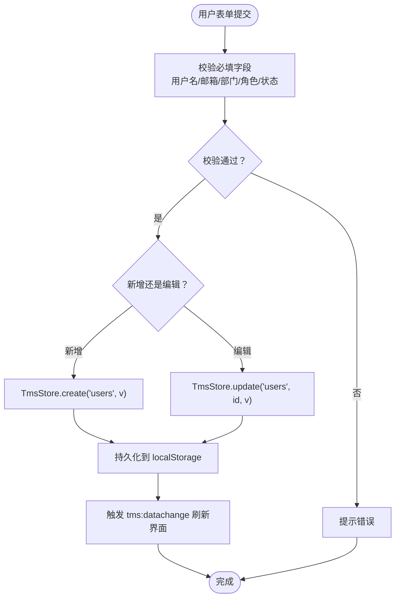
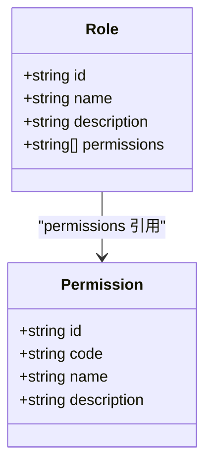
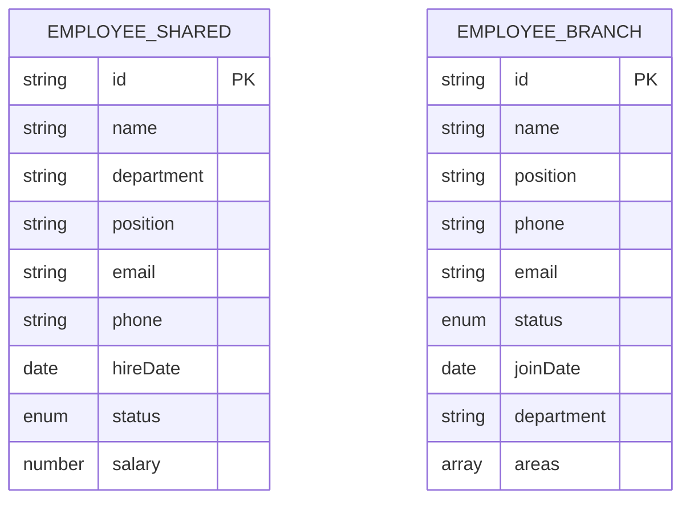
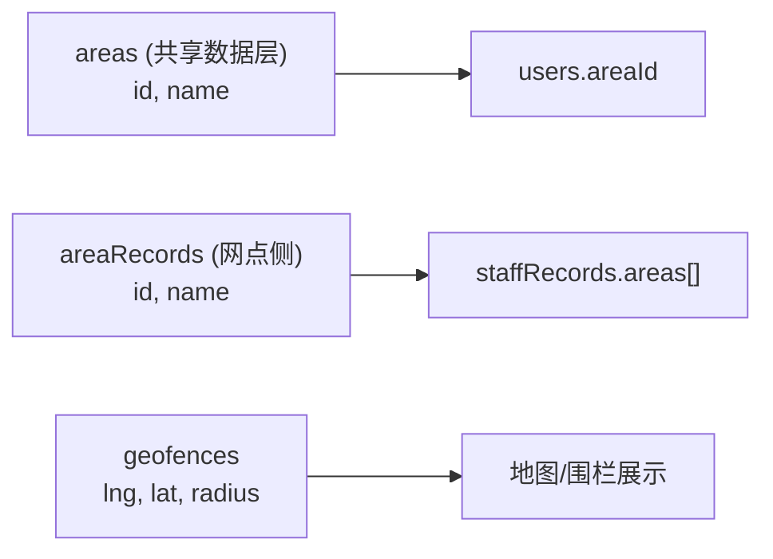
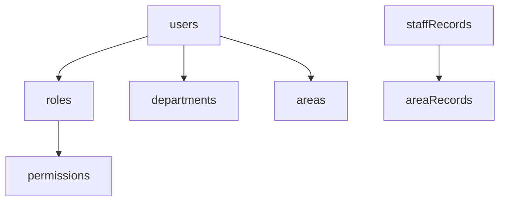

# 用户管理数据模型

<cite>
**本文引用的文件**   
- [tms-user.html](file://tms-user.html)
- [tms-store.js](file://tms-store.js)
- [branch-system.html](file://branch-system.html)
- [tms-hr.html](file://tms-hr.html)
</cite>

## 目录
1. [引言](#引言)
2. [项目结构](#项目结构)
3. [核心实体与字段](#核心实体与字段)
4. [架构总览](#架构总览)
5. [详细组件分析](#详细组件分析)
6. [依赖关系分析](#依赖关系分析)
7. [性能与扩展性](#性能与扩展性)
8. [故障排查指南](#故障排查指南)
9. [结论](#结论)

## 引言
本文件面向“用户管理系统”的数据模型，围绕用户、角色、权限、部门、员工、区域等核心实体进行系统化说明。文档基于仓库中的前端页面与共享数据层实现，重点解释：
- 各实体的数据结构与关键字段
- 多对多关系设计与权限继承机制
- 用户认证相关字段与安全注意事项
- 角色权限分配策略与数据验证规则
- 用户生命周期管理与状态控制
- 员工信息管理与区域地理数据存储方式

## 项目结构
用户管理相关能力由以下文件共同构成：
- tms-user.html：用户、角色、权限、部门的统一管理界面，通过 TmsStore 读写共享数据。
- tms-store.js：共享数据层，提供种子数据、CRUD、事件通知与聚合统计。
- branch-system.html：网点侧的员工与区域管理，使用独立的 localStorage 键维护员工与区域数据。
- tms-hr.html：人事侧员工数据展示与基础操作示例。

**图表来源**
- [tms-user.html:521-533](file://tms-user.html#L521-L533)
- [tms-store.js:16-17](file://tms-store.js#L16-L17)
- [branch-system.html:909-952](file://branch-system.html#L909-L952)

**章节来源**
- [tms-user.html:521-533](file://tms-user.html#L521-L533)
- [tms-store.js:16-17](file://tms-store.js#L16-L17)
- [branch-system.html:909-952](file://branch-system.html#L909-L952)

## 核心实体与字段
本节梳理用户、角色、权限、部门、员工、区域等实体的关键结构与用途。

### 用户（User）
- 标识：id
- 基本信息：name、email、phone
- 组织关联：departmentId（指向部门）、roleId（指向角色）
- 区域关联：areaId（可选，表示管理区域）
- 状态：status（active/inactive）
- 数据来源与用法：
  - 种子数据在共享数据层中初始化，并在用户管理界面中进行增删改查。
  - 列表显示包含用户名、邮箱、手机号、部门、角色、管理区域、状态等列。
  - 表单校验要求用户名、邮箱、部门、角色、状态必填；手机号为选填。

**章节来源**
- [tms-store.js:1077-1086](file://tms-store.js#L1077-L1086)
- [tms-user.html:566-637](file://tms-user.html#L566-L637)

### 角色（Role）
- 标识：id
- 名称：name
- 描述：description
- 权限集合：permissions（数组，存储权限ID）
- 设计要点：
  - 角色与权限是多对多关系，通过 permissions 数组建立引用。
  - 删除角色前会检查是否仍有用户引用该角色。

**章节来源**
- [tms-store.js:157-164](file://tms-store.js#L157-L164)
- [tms-user.html:640-709](file://tms-user.html#L640-L709)

### 权限（Permission）
- 标识：id
- 代码：code（如 user:manage、role:manage 等）
- 名称：name
- 描述：description
- 设计要点：
  - 权限是功能级控制的最小单元，供角色组合使用。
  - 删除权限前会检查是否被任何角色引用。

**章节来源**
- [tms-store.js:144-155](file://tms-store.js#L144-L155)
- [tms-user.html:711-766](file://tms-user.html#L711-L766)

### 部门（Department）
- 标识：id
- 名称：name
- 上级部门：parentId（支持树形层级）
- 描述：description
- 设计要点：
  - 部门可形成层级结构，删除前需检查是否有子部门或用户引用。
  - 用户通过 departmentId 归属到某个部门。

**章节来源**
- [tms-store.js:134-142](file://tms-store.js#L134-L142)
- [tms-user.html:768-800](file://tms-user.html#L768-L800)

### 员工（Employee）
存在两套员工数据模型：
- 共享数据层中的员工（employees）：用于系统内绩效、考核等聚合场景。
- 网点侧员工（staffRecords）：独立于共享数据层，用于网点人员与区域绑定。

#### 共享数据层员工（employees）
- 标识：id
- 姓名：name
- 部门：department（文本，非外键）
- 岗位：position
- 联系方式：email、phone
- 入职日期：hireDate
- 状态：status（active/on_leave/resigned）
- 薪资：salary
- 用途：参与绩效考核、报表统计等。

**章节来源**
- [tms-store.js:484-498](file://tms-store.js#L484-L498)
- [tms-store.js:1115-1120](file://tms-store.js#L1115-L1120)

#### 网点侧员工（staffRecords）
- 标识：id
- 姓名：name
- 岗位：position
- 联系方式：phone、email
- 状态：status（active/inactive）
- 入职日期：joinDate
- 部门：department（文本）
- 区域绑定：areas（数组，存储区域ID）
- 用途：网点人员管理、区域指派、状态切换。

**章节来源**
- [branch-system.html:909-952](file://branch-system.html#L909-L952)
- [branch-system.html:1150-1262](file://branch-system.html#L1150-L1262)

### 区域（Area）
存在两套区域数据模型：
- 共享数据层中的区域（areas）：用于用户管理界面的“管理区域”选择。
- 网点侧区域（areaRecords）：用于网点员工的多区域绑定。

#### 共享数据层区域（areas）
- 标识：id
- 名称：name（如“北京朝阳区”）
- 用途：作为用户“管理区域”的参考字典。

**章节来源**
- [tms-store.js:166-171](file://tms-store.js#L166-L171)
- [tms-user.html:583-586](file://tms-user.html#L583-L586)

#### 网点侧区域（areaRecords）
- 标识：id
- 名称：name
- 用途：与网点员工 areas 数组进行多对多关联。

**章节来源**
- [branch-system.html:1377-1388](file://branch-system.html#L1377-L1388)
- [branch-system.html:1204-1216](file://branch-system.html#L1204-L1216)

## 架构总览
用户管理数据流以 tms-user.html 为入口，通过 TmsUI 和 TmsStore 访问共享数据层。共享数据层负责：
- 首次加载时生成种子数据（users、roles、permissions、departments、areas、employees 等）。
- 提供统一的 list/get/create/update/remove 接口。
- 持久化到 localStorage 的 tmsDB_v3 键。
- 触发 tms:datachange 事件，驱动界面刷新。

**图表来源**
- [tms-user.html:521-533](file://tms-user.html#L521-L533)
- [tms-store.js:220-244](file://tms-store.js#L220-L244)
- [tms-store.js:1208-1256](file://tms-store.js#L1208-L1256)

**章节来源**
- [tms-user.html:521-533](file://tms-user.html#L521-L533)
- [tms-store.js:220-244](file://tms-store.js#L220-L244)
- [tms-store.js:1208-1256](file://tms-store.js#L1208-L1256)

## 详细组件分析

### 用户实体与生命周期
- 字段设计：id、name、email、phone、departmentId、roleId、areaId、status。
- 生命周期：
  - 创建：通过表单提交调用 TmsStore.create('users', v)。
  - 更新：通过表单提交调用 TmsStore.update('users', row.id, v)。
  - 删除：确认后调用 TmsStore.remove('users', row.id)。
  - 状态控制：status 为 active/inactive，影响登录与可见性。
- 安全考虑：
  - 当前页面通过 checkLoginStatus('admin') 限制管理员访问。
  - 建议后端增加密码哈希、会话令牌、权限校验与审计日志。

**图表来源**
- [tms-user.html:610-637](file://tms-user.html#L610-L637)
- [tms-store.js:1263-1290](file://tms-store.js#L1263-L1290)

**章节来源**
- [tms-user.html:566-637](file://tms-user.html#L566-L637)
- [tms-store.js:1263-1290](file://tms-store.js#L1263-L1290)

### 角色与权限的多对多关系
- 角色（roles）包含 permissions 数组，保存权限ID列表。
- 权限（permissions）是功能点的最小粒度，供多个角色复用。
- 删除保护：
  - 删除角色前检查是否有用户引用该角色。
  - 删除权限前检查是否被任何角色引用。

**图表来源**
- [tms-store.js:144-164](file://tms-store.js#L144-L164)
- [tms-user.html:640-766](file://tms-user.html#L640-L766)

**章节来源**
- [tms-store.js:144-164](file://tms-store.js#L144-L164)
- [tms-user.html:640-766](file://tms-user.html#L640-L766)

### 权限继承机制
- 当前实现未显式定义“权限继承”概念，而是通过角色组合权限来实现“间接继承”。
- 例如：系统管理员角色拥有全部权限ID；运营管理员角色拥有一组特定权限。
- 若需要更细粒度的继承（如父角色权限自动授予子角色），可在角色表增加 parentRoleId 字段，并在计算用户权限时递归合并。

**章节来源**
- [tms-store.js:157-164](file://tms-store.js#L157-L164)
- [tms-user.html:678-709](file://tms-user.html#L678-L709)

### 用户认证相关字段与安全考虑
- 认证字段：
  - 当前数据模型未包含 password 或 token 字段。
  - 页面通过 checkLoginStatus('admin') 判断当前登录身份。
- 安全建议：
  - 引入密码哈希（如 bcrypt）与盐值。
  - 使用 JWT 或会话令牌进行鉴权。
  - 记录登录审计日志（operator、operatedAt）。
  - 对敏感字段（email、phone）进行脱敏展示。

**章节来源**
- [tms-user.html:521-527](file://tms-user.html#L521-L527)
- [tms-store.js:1077-1086](file://tms-store.js#L1077-L1086)

### 角色权限分配策略与数据验证规则
- 分配策略：
  - 角色表单动态生成权限复选框，选中后保存为 permissions 数组。
  - 用户表单选择 roleId，将角色权限应用于用户。
- 验证规则：
  - 用户：name、email、departmentId、roleId、status 必填；phone 选填。
  - 角色：name 必填；description 可选。
  - 权限：name、code 必填；description 可选。
  - 删除保护：角色/权限/部门删除前检查引用关系。

**章节来源**
- [tms-user.html:610-766](file://tms-user.html#L610-L766)

### 员工信息管理完整数据模型
- 共享数据层员工（employees）：
  - 字段：id、name、department、position、email、phone、hireDate、status、salary。
  - 用途：系统内绩效、考核、统计。
- 网点侧员工（staffRecords）：
  - 字段：id、name、position、phone、email、status、joinDate、department、areas。
  - 用途：网点人员管理、区域绑定、状态切换。

**图表来源**
- [tms-store.js:484-498](file://tms-store.js#L484-L498)
- [branch-system.html:909-952](file://branch-system.html#L909-L952)

**章节来源**
- [tms-store.js:484-498](file://tms-store.js#L484-L498)
- [branch-system.html:909-952](file://branch-system.html#L909-L952)

### 区域管理与地理数据存储方式
- 共享数据层区域（areas）：
  - 字段：id、name。
  - 用途：用户“管理区域”下拉选项。
- 网点侧区域（areaRecords）：
  - 字段：id、name。
  - 用途：与网点员工 areas 数组进行多对多绑定。
- 地理数据：
  - 电子围栏（geofences）包含 lng、lat、radius，用于地理围栏管理。
  - 区域本身不存储经纬度，仅作为业务区域名称。

**图表来源**
- [tms-store.js:166-171](file://tms-store.js#L166-L171)
- [tms-store.js:574-591](file://tms-store.js#L574-L591)
- [branch-system.html:1377-1388](file://branch-system.html#L1377-L1388)

**章节来源**
- [tms-store.js:166-171](file://tms-store.js#L166-L171)
- [tms-store.js:574-591](file://tms-store.js#L574-L591)
- [branch-system.html:1377-1388](file://branch-system.html#L1377-L1388)

## 依赖关系分析
- 用户依赖角色与部门：
  - users.roleId → roles.id
  - users.departmentId → departments.id
- 角色依赖权限：
  - roles.permissions[] → permissions.id
- 员工与区域（网点侧）：
  - staffRecords.areas[] → areaRecords.id
- 用户与管理区域（共享数据层）：
  - users.areaId → areas.id

**图表来源**
- [tms-store.js:1077-1086](file://tms-store.js#L1077-L1086)
- [tms-store.js:144-164](file://tms-store.js#L144-L164)
- [branch-system.html:1204-1216](file://branch-system.html#L1204-L1216)

**章节来源**
- [tms-store.js:1077-1086](file://tms-store.js#L1077-L1086)
- [tms-store.js:144-164](file://tms-store.js#L144-L164)
- [branch-system.html:1204-1216](file://branch-system.html#L1204-L1216)

## 性能与扩展性
- 性能特性：
  - 所有数据存储在 localStorage，适合演示与小规模数据。
  - 列表查询支持过滤、搜索、排序与分页，避免全量渲染。
- 扩展建议：
  - 引入后端服务与数据库，提升并发与一致性。
  - 对大列表采用虚拟滚动与懒加载。
  - 对权限计算引入缓存与预计算。

[本节为通用指导，无需具体文件分析]

## 故障排查指南
- 常见问题：
  - 无法删除角色/权限/部门：检查是否存在用户或子项引用。
  - 用户表单提交失败：检查必填字段与类型（email、select）。
  - 员工状态切换无效：确认 localStorage 键名与数据格式一致。
- 定位方法：
  - 查看浏览器控制台与 localStorage 内容。
  - 检查 tms:datachange 事件是否触发。
  - 核对字段映射与枚举值（active/inactive、on_leave/resigned）。

**章节来源**
- [tms-user.html:658-743](file://tms-user.html#L658-L743)
- [branch-system.html:1247-1262](file://branch-system.html#L1247-L1262)

## 结论
本数据模型围绕用户、角色、权限、部门、员工、区域构建，采用前端共享数据层与独立 localStorage 键相结合的方式，满足演示与小型系统的管理需求。角色与权限通过多对多关系实现灵活授权；员工与区域在网点侧实现多对多绑定；区域地理数据通过电子围栏字段表达。建议在后续演进中引入后端服务、权限继承机制与更强的安全控制，以提升系统的可扩展性与安全性。