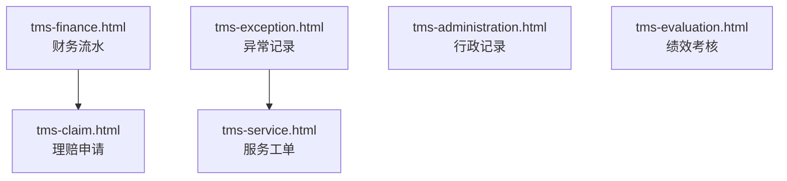
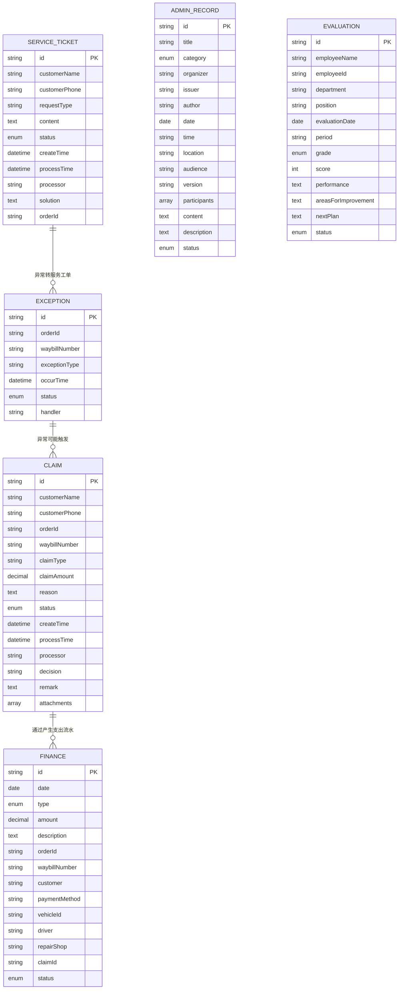
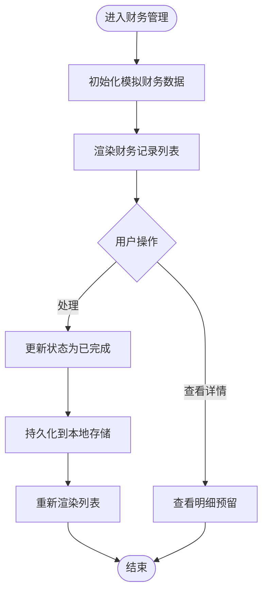
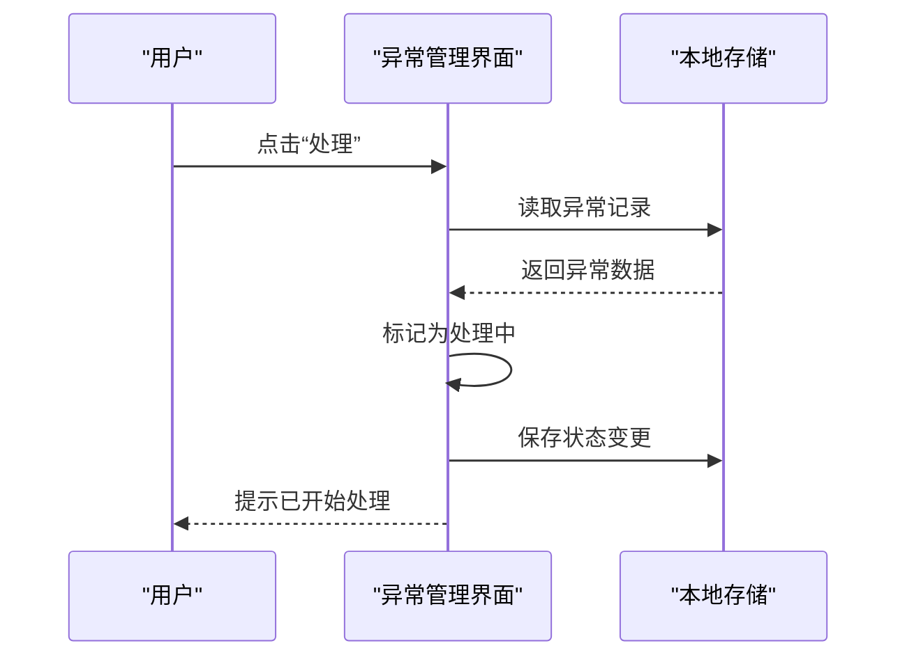
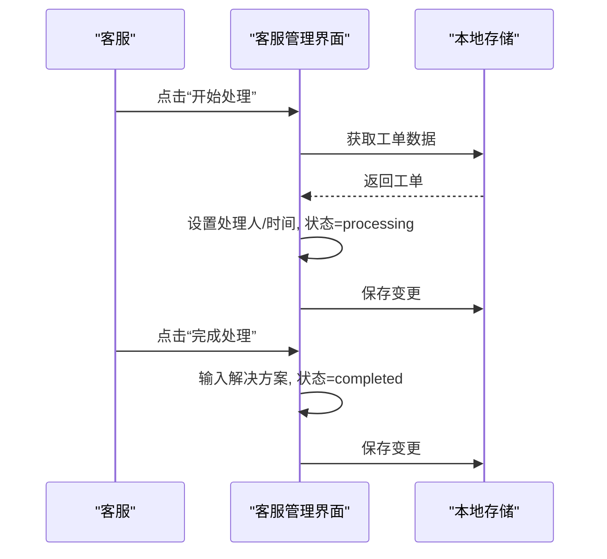
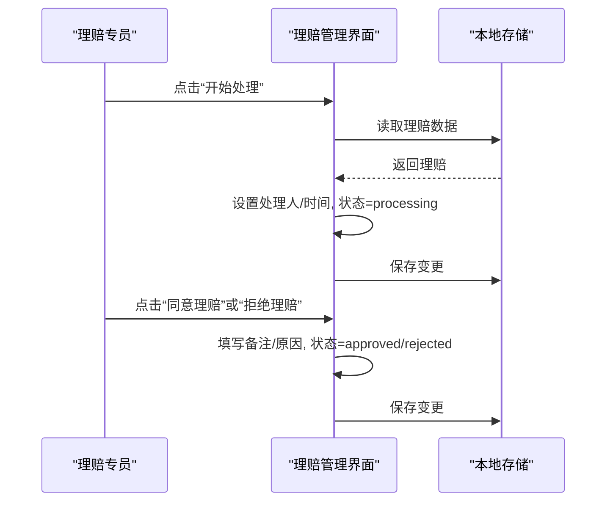
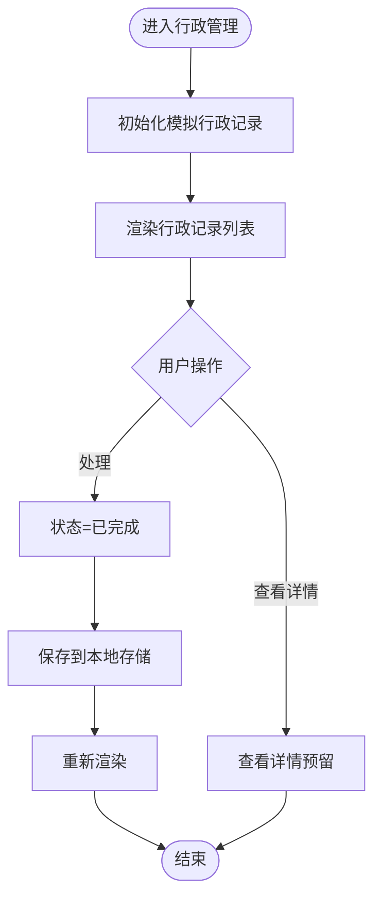
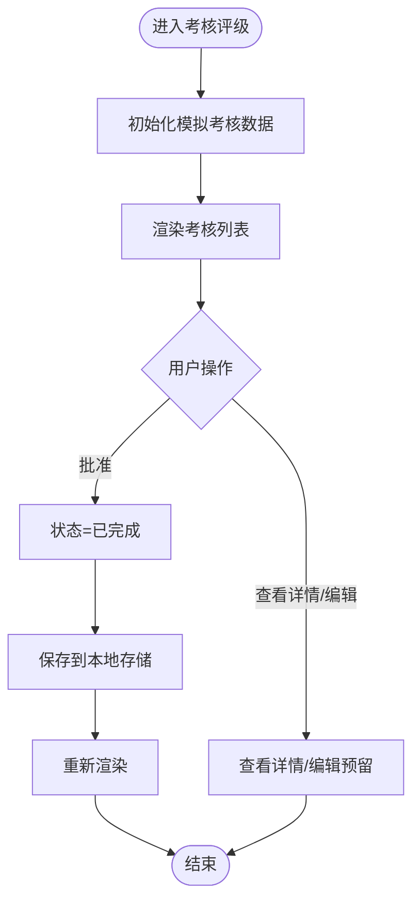
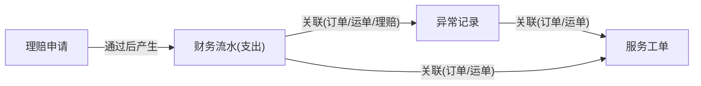

# 财务异常数据模型

<cite>
**本文引用的文件**   
- [tms-finance.html](file://tms-finance.html)
- [tms-exception.html](file://tms-exception.html)
- [tms-service.html](file://tms-service.html)
- [tms-claim.html](file://tms-claim.html)
- [tms-administration.html](file://tms-administration.html)
- [tms-evaluation.html](file://tms-evaluation.html)
</cite>

## 目录
1. [引言](#引言)
2. [项目结构](#项目结构)
3. [核心组件](#核心组件)
4. [架构总览](#架构总览)
5. [详细组件分析](#详细组件分析)
6. [依赖关系分析](#依赖关系分析)
7. [性能与可扩展性](#性能与可扩展性)
8. [故障排查指南](#故障排查指南)
9. [结论](#结论)

## 引言
本文件面向财务与异常处理系统的数据模型，聚焦以下实体：财务流水（Finance）、异常记录（Exception）、服务工单（ServiceTicket）、理赔申请（Claim）、行政记录（AdminRecord）与绩效考核（Evaluation）。文档从数据结构、分类枚举、状态机、流程与关联关系等维度进行系统化说明，并给出可视化图示，帮助读者快速理解各模块的数据设计与交互方式。

## 项目结构
本仓库为前端演示型页面集合，每个业务域以独立HTML页面承载UI与本地模拟数据逻辑。与财务异常相关的关键页面如下：
- tms-finance.html：财务管理与财务流水
- tms-exception.html：异常管理与异常记录
- tms-service.html：客服管理与服务工单
- tms-claim.html：理赔管理与理赔申请
- tms-administration.html：行政管理及行政记录
- tms-evaluation.html：考核评级与绩效考核

图表来源
- [tms-finance.html:332-359](file://tms-finance.html#L332-L359)
- [tms-exception.html:370-432](file://tms-exception.html#L370-L432)
- [tms-service.html:336-365](file://tms-service.html#L336-L365)
- [tms-claim.html:341-370](file://tms-claim.html#L341-L370)
- [tms-administration.html:336-365](file://tms-administration.html#L336-L365)
- [tms-evaluation.html:341-370](file://tms-evaluation.html#L341-L370)

章节来源
- [tms-finance.html:332-359](file://tms-finance.html#L332-L359)
- [tms-exception.html:370-432](file://tms-exception.html#L370-L432)
- [tms-service.html:336-365](file://tms-service.html#L336-L365)
- [tms-claim.html:341-370](file://tms-claim.html#L341-L370)
- [tms-administration.html:336-365](file://tms-administration.html#L336-L365)
- [tms-evaluation.html:341-370](file://tms-evaluation.html#L341-L370)

## 核心组件
本节概述六大实体的关键属性、分类与状态，以及它们之间的主要关联。

- 财务流水 Finance
  - 关键字段：id、date、type、amount、description、orderId、waybillNumber、customer、paymentMethod、vehicleId、driver、repairShop、claimId、status
  - 收支分类：income（收入）、expense（支出）
  - 结算状态：pending（待处理）、processing（处理中）、completed（已完成）、cancelled（已取消）
  - 关联：可关联订单、运单、车辆/司机、理赔申请；用于生成财务统计卡片（本月总收入/总支出/净利润/本年累计收入）

- 异常记录 Exception
  - 关键字段：id、orderId、waybillNumber、exceptionType、occurTime、status、handler
  - 异常类型：延迟送达、货物损坏、信息不符等
  - 处理状态：pending（待处理）、processing（处理中）、resolved（已解决）、closed（已关闭）
  - 关联：通常与订单和运单关联，后续可能触发理赔或服务工单

- 服务工单 ServiceTicket
  - 关键字段：id、customerName、customerPhone、requestType、content、status、createTime、processTime、processor、solution、orderId
  - 请求类型：查询、投诉、咨询、建议等
  - 处理状态：pending（待处理）、processing（处理中）、completed（已完成）、rejected（已拒绝）
  - 关联：可关联订单；与异常记录存在联动（异常转服务工单）

- 理赔申请 Claim
  - 关键字段：id、customerName、customerPhone、orderId、waybillNumber、claimType、claimAmount、reason、status、createTime、processTime、processor、decision、remark、attachments
  - 理赔类型：货物损坏、延迟送达、货物丢失、货物错发、服务投诉等
  - 审核状态：pending（待处理）、processing（处理中）、approved（已通过）、rejected（已拒绝）
  - 关联：可关联订单、运单；通过后产生财务支出流水

- 行政记录 AdminRecord
  - 关键字段：id、title、category、organizer/issuer/author、date、time/location/audience/version、participants/content/description、status
  - 分类：meeting（会议）、notice（通知）、document（文档）
  - 状态：upcoming（即将到来）、published（已发布）、approved（已批准）、completed（已完成）、cancelled（已取消）

- 绩效考核 Evaluation
  - 关键字段：id、employeeName、employeeId、department、position、evaluationDate、period、grade、score、performance、areasForImprovement、nextPlan、status
  - 等级：excellent（优秀）、good（良好）、average（合格）、poor（需改进）
  - 状态：pending（待批准）、completed（已完成）、rejected（已拒绝）

章节来源
- [tms-finance.html:448-524](file://tms-finance.html#L448-L524)
- [tms-finance.html:557-575](file://tms-finance.html#L557-L575)
- [tms-exception.html:376-430](file://tms-exception.html#L376-L430)
- [tms-service.html:415-479](file://tms-service.html#L415-L479)
- [tms-service.html:509-518](file://tms-service.html#L509-L518)
- [tms-claim.html:446-529](file://tms-claim.html#L446-L529)
- [tms-claim.html:586-595](file://tms-claim.html#L586-L595)
- [tms-administration.html:452-517](file://tms-administration.html#L452-L517)
- [tms-administration.html:557-577](file://tms-administration.html#L557-L577)
- [tms-evaluation.html:457-543](file://tms-evaluation.html#L457-L543)
- [tms-evaluation.html:575-594](file://tms-evaluation.html#L575-L594)

## 架构总览
下图展示各实体之间的关系与主要业务流程：异常记录与服务工单相互联动，理赔申请经审核后产生财务支出流水，行政与考核作为支撑管理模块。

图表来源
- [tms-finance.html:448-524](file://tms-finance.html#L448-L524)
- [tms-exception.html:376-430](file://tms-exception.html#L376-L430)
- [tms-service.html:415-479](file://tms-service.html#L415-L479)
- [tms-claim.html:446-529](file://tms-claim.html#L446-L529)
- [tms-administration.html:452-517](file://tms-administration.html#L452-L517)
- [tms-evaluation.html:457-543](file://tms-evaluation.html#L457-L543)

## 详细组件分析

### 财务流水 Finance
- 数据结构要点
  - 收支类型：income、expense
  - 结算状态：pending、processing、completed、cancelled
  - 关联字段：orderId、waybillNumber、claimId、vehicleId、driver、repairShop、customer、paymentMethod
- 报表与统计
  - 页面顶部统计卡片包含：本月总收入、本月总支出、本月净利润、本年累计收入
  - 列表渲染时根据type显示正负金额，并根据status映射中文文本
- 处理流程
  - 初始化为模拟数据后渲染列表
  - 支持“处理”将状态由pending转为completed
  - 支持查看详情（预留模态框扩展点）

图表来源
- [tms-finance.html:448-524](file://tms-finance.html#L448-L524)
- [tms-finance.html:526-555](file://tms-finance.html#L526-L555)
- [tms-finance.html:577-597](file://tms-finance.html#L577-L597)

章节来源
- [tms-finance.html:332-359](file://tms-finance.html#L332-L359)
- [tms-finance.html:448-524](file://tms-finance.html#L448-L524)
- [tms-finance.html:526-555](file://tms-finance.html#L526-L555)
- [tms-finance.html:557-575](file://tms-finance.html#L557-L575)
- [tms-finance.html:577-597](file://tms-finance.html#L577-L597)

### 异常记录 Exception
- 数据结构要点
  - 关键字段：id、orderId、waybillNumber、exceptionType、occurTime、status、handler
  - 异常类型示例：延迟送达、货物损坏、信息不符
  - 状态流转：pending → processing → resolved/closed
- 处理流程
  - 提供“查看”“处理”“解决”等操作按钮
  - 当前实现为占位提示，便于后续接入真实逻辑

图表来源
- [tms-exception.html:376-430](file://tms-exception.html#L376-L430)
- [tms-exception.html:472-497](file://tms-exception.html#L472-L497)

章节来源
- [tms-exception.html:370-432](file://tms-exception.html#L370-L432)
- [tms-exception.html:472-497](file://tms-exception.html#L472-L497)

### 服务工单 ServiceTicket
- 数据结构要点
  - 关键字段：id、customerName、customerPhone、requestType、content、status、createTime、processTime、processor、solution、orderId
  - 请求类型：查询、投诉、咨询、建议
  - 状态：pending、processing、completed、rejected
- 处理流程
  - 开始处理：设置处理人与处理时间，状态改为processing
  - 完成处理：填写解决方案，状态改为completed
  - 查看详情：预留详情弹窗扩展点

图表来源
- [tms-service.html:415-479](file://tms-service.html#L415-L479)
- [tms-service.html:520-558](file://tms-service.html#L520-L558)

章节来源
- [tms-service.html:336-365](file://tms-service.html#L336-L365)
- [tms-service.html:415-479](file://tms-service.html#L415-L479)
- [tms-service.html:509-518](file://tms-service.html#L509-L518)
- [tms-service.html:520-558](file://tms-service.html#L520-L558)

### 理赔申请 Claim
- 数据结构要点
  - 关键字段：id、customerName、customerPhone、orderId、waybillNumber、claimType、claimAmount、reason、status、createTime、processTime、processor、decision、remark、attachments
  - 理赔类型：货物损坏、延迟送达、货物丢失、货物错发、服务投诉
  - 审核状态：pending、processing、approved、rejected
- 审核流程
  - 开始处理：设置处理人与时间，状态改为processing
  - 同意理赔：填写备注，状态改为approved
  - 拒绝理赔：填写拒绝原因，状态改为rejected
  - 通过后在财务模块产生对应支出流水（通过claimId关联）

图表来源
- [tms-claim.html:446-529](file://tms-claim.html#L446-L529)
- [tms-claim.html:597-645](file://tms-claim.html#L597-L645)

章节来源
- [tms-claim.html:341-370](file://tms-claim.html#L341-L370)
- [tms-claim.html:446-529](file://tms-claim.html#L446-L529)
- [tms-claim.html:586-595](file://tms-claim.html#L586-L595)
- [tms-claim.html:597-645](file://tms-claim.html#L597-L645)

### 行政记录 AdminRecord
- 数据结构要点
  - 分类：meeting（会议）、notice（通知）、document（文档）
  - 关键字段随分类不同而有所差异（如会议含organizer/time/location/participants；通知含issuer/audience/content；文档含author/version/description）
  - 状态：upcoming、published、approved、completed、cancelled
- 处理流程
  - 支持“处理”将状态置为completed
  - 支持查看详情（预留）

图表来源
- [tms-administration.html:452-517](file://tms-administration.html#L452-L517)
- [tms-administration.html:519-555](file://tms-administration.html#L519-L555)
- [tms-administration.html:579-599](file://tms-administration.html#L579-L599)

章节来源
- [tms-administration.html:336-365](file://tms-administration.html#L336-L365)
- [tms-administration.html:452-517](file://tms-administration.html#L452-L517)
- [tms-administration.html:519-555](file://tms-administration.html#L519-L555)
- [tms-administration.html:557-577](file://tms-administration.html#L557-L577)
- [tms-administration.html:579-599](file://tms-administration.html#L579-L599)

### 绩效考核 Evaluation
- 数据结构要点
  - 关键字段：id、employeeName、employeeId、department、position、evaluationDate、period、grade、score、performance、areasForImprovement、nextPlan、status
  - 等级：excellent、good、average、poor
  - 状态：pending、completed、rejected
- 处理流程
  - 支持“批准考核”将状态置为completed
  - 支持查看详情与编辑（预留）

图表来源
- [tms-evaluation.html:457-543](file://tms-evaluation.html#L457-L543)
- [tms-evaluation.html:545-573](file://tms-evaluation.html#L545-L573)
- [tms-evaluation.html:596-623](file://tms-evaluation.html#L596-L623)

章节来源
- [tms-evaluation.html:341-370](file://tms-evaluation.html#L341-L370)
- [tms-evaluation.html:457-543](file://tms-evaluation.html#L457-L543)
- [tms-evaluation.html:545-573](file://tms-evaluation.html#L545-L573)
- [tms-evaluation.html:575-594](file://tms-evaluation.html#L575-L594)
- [tms-evaluation.html:596-623](file://tms-evaluation.html#L596-L623)

## 依赖关系分析
- 跨模块关联
  - 理赔申请通过claimId与财务流水建立关联，理赔通过后在财务侧产生支出流水
  - 异常记录与服务工单之间可通过orderId/waybillNumber进行关联，异常转服务工单便于统一跟踪
  - 财务流水可关联订单、运单、车辆/司机、维修店等，形成完整的费用归集链路
- 数据一致性
  - 所有数据均通过localStorage进行本地持久化，页面刷新后仍可保留
  - 解析失败时具备清理与重建机制（理赔模块有明确的try-catch与重建逻辑）

图表来源
- [tms-finance.html:448-524](file://tms-finance.html#L448-L524)
- [tms-claim.html:446-529](file://tms-claim.html#L446-L529)
- [tms-exception.html:376-430](file://tms-exception.html#L376-L430)
- [tms-service.html:415-479](file://tms-service.html#L415-L479)

章节来源
- [tms-finance.html:448-524](file://tms-finance.html#L448-L524)
- [tms-claim.html:446-529](file://tms-claim.html#L446-L529)
- [tms-exception.html:376-430](file://tms-exception.html#L376-L430)
- [tms-service.html:415-479](file://tms-service.html#L415-L479)

## 性能与可扩展性
- 当前实现使用浏览器localStorage进行本地数据存储，适合演示与轻量场景
- 列表渲染采用字符串拼接方式，数据量较小时性能良好；当数据规模增长时建议：
  - 引入分页与虚拟滚动
  - 对频繁更新的字段（如状态）做增量更新
  - 将枚举值集中配置，减少重复映射
- 可扩展方向
  - 将localStorage替换为后端API，增加权限校验与审计日志
  - 增加SLA计时器与超时告警（针对服务工单与异常记录）
  - 增加财务报表导出功能（CSV/Excel），按月度/季度/年度聚合

[本节为通用指导，不直接分析具体文件]

## 故障排查指南
- 数据解析失败
  - 现象：理赔列表为空或报错
  - 处理：检查localStorage中对应键是否损坏；系统会尝试清理并重建模拟数据
  - 参考位置：理赔模块的解析与重建逻辑
- 状态未更新
  - 现象：点击“处理/完成”后列表未刷新
  - 处理：确认localStorage写入成功；检查渲染函数是否被调用
  - 参考位置：各模块的状态更新与渲染函数
- 权限与登录
  - 现象：页面无法加载或跳转至登录页
  - 处理：检查登录状态校验逻辑与角色判断
  - 参考位置：各页面的登录校验与角色判断

章节来源
- [tms-claim.html:531-550](file://tms-claim.html#L531-L550)
- [tms-finance.html:577-597](file://tms-finance.html#L577-L597)
- [tms-service.html:520-558](file://tms-service.html#L520-L558)
- [tms-administration.html:579-599](file://tms-administration.html#L579-L599)
- [tms-evaluation.html:596-623](file://tms-evaluation.html#L596-L623)

## 结论
本套数据模型围绕财务、异常、服务、理赔、行政与考核六大领域展开，覆盖了从业务发生、处理、审核到财务结算与管理评估的全链路。通过清晰的分类与状态机设计，配合本地持久化与基础流程控制，形成了可演示、可扩展的基础框架。后续可在SLA跟踪、报表聚合、权限与审计等方面进一步增强，以满足生产环境需求。