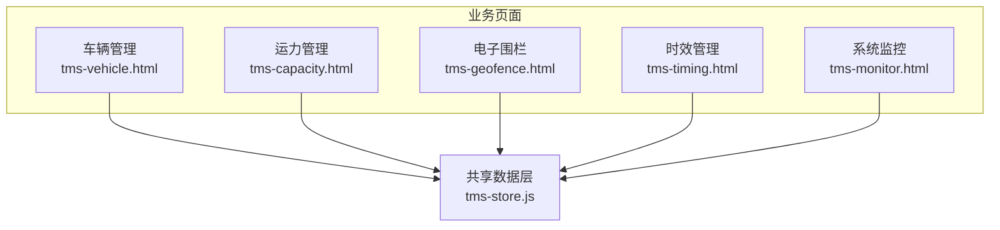
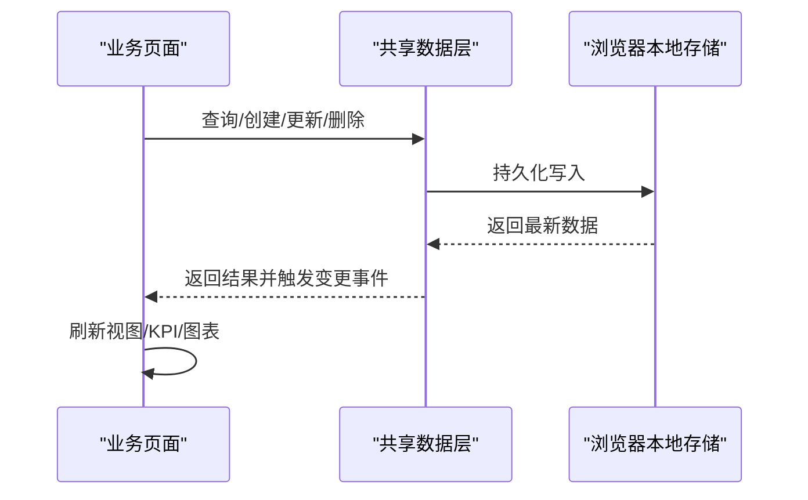
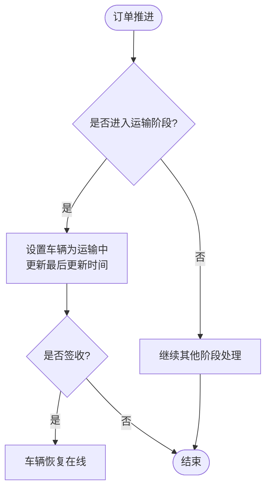
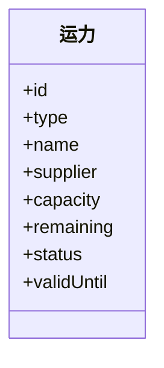
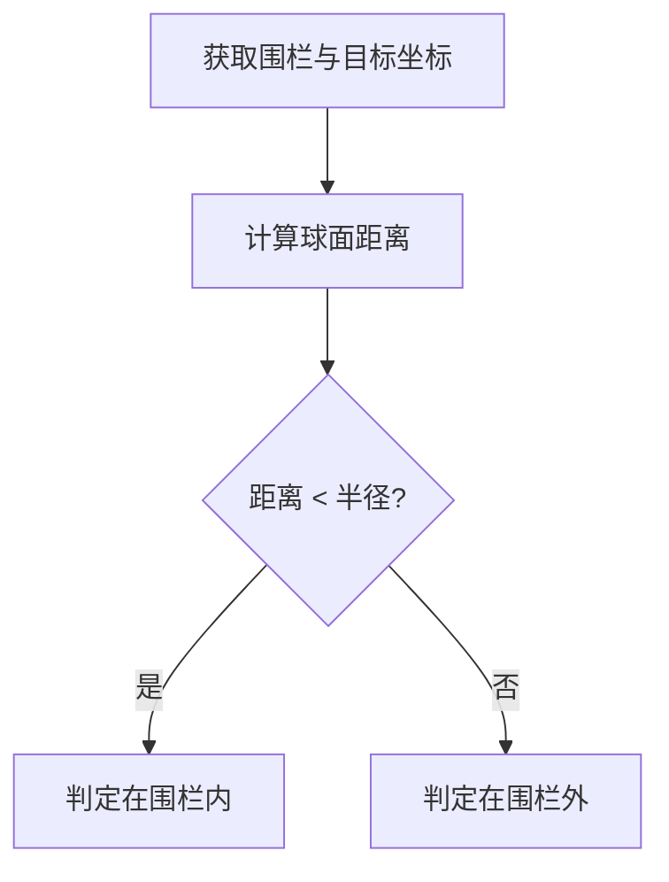
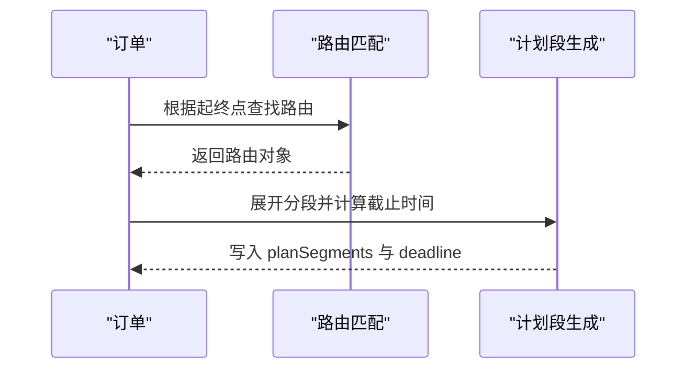
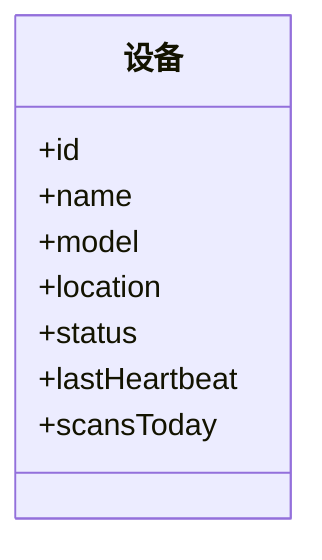
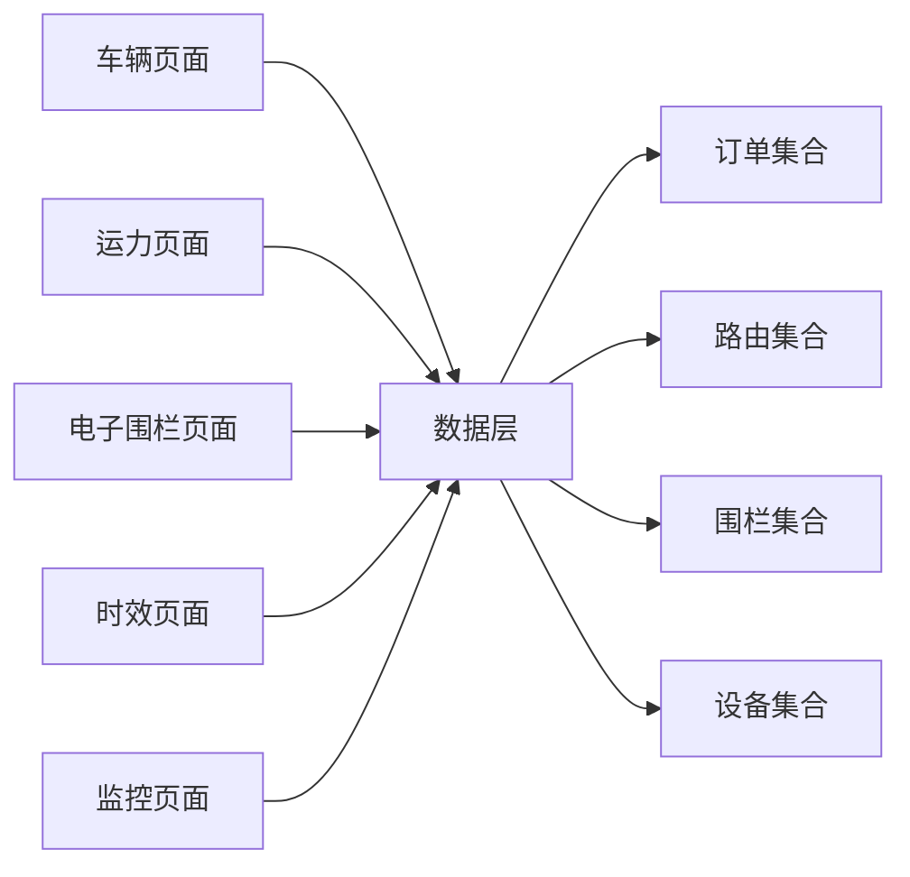

# 运输运力数据模型

<cite>
**本文引用的文件**   
- [tms-store.js](file://tms-store.js)
- [tms-vehicle.html](file://tms-vehicle.html)
- [tms-capacity.html](file://tms-capacity.html)
- [tms-geofence.html](file://tms-geofence.html)
- [tms-timing.html](file://tms-timing.html)
- [tms-monitor.html](file://tms-monitor.html)
</cite>

## 目录
1. [引言](#引言)
2. [项目结构](#项目结构)
3. [核心数据实体](#核心数据实体)
4. [架构总览](#架构总览)
5. [详细组件分析](#详细组件分析)
6. [依赖关系分析](#依赖关系分析)
7. [性能与扩展性](#性能与扩展性)
8. [故障排查指南](#故障排查指南)
9. [结论](#结论)

## 引言
本文件面向“运输调度系统”的数据模型，围绕车辆、运力、电子围栏、路线规划、时效规则和设备心跳等核心主题，给出结构化说明。文档基于仓库中的前端页面与共享数据层实现进行归纳，重点解释：
- 车辆状态管理、位置跟踪与维护记录的数据设计
- 运力资源分配、供应商管理与合同期限的数据模型
- 电子围栏的地理数据存储与边界检测思路
- 路线规划与时效管理的数据结构
- 设备管理与心跳监控的数据设计

## 项目结构
本项目为纯前端演示型 TMS 系统，核心数据由共享数据层维护在浏览器本地存储中，各业务页面通过统一接口读取和更新数据。

**图示来源**
- [tms-vehicle.html:442-550](file://tms-vehicle.html#L442-L550)
- [tms-capacity.html:420-522](file://tms-capacity.html#L420-L522)
- [tms-geofence.html:517-552](file://tms-geofence.html#L517-L552)
- [tms-timing.html:394-552](file://tms-timing.html#L394-L552)
- [tms-monitor.html:364-404](file://tms-monitor.html#L364-L404)
- [tms-store.js:2297-2365](file://tms-store.js#L2297-L2365)

**章节来源**
- [tms-vehicle.html:442-550](file://tms-vehicle.html#L442-L550)
- [tms-capacity.html:420-522](file://tms-capacity.html#L420-L522)
- [tms-geofence.html:517-552](file://tms-geofence.html#L517-L552)
- [tms-timing.html:394-552](file://tms-timing.html#L394-L552)
- [tms-monitor.html:364-404](file://tms-monitor.html#L364-L404)
- [tms-store.js:2297-2365](file://tms-store.js#L2297-L2365)

## 核心数据实体
本节从数据层种子数据与页面展示字段出发，归纳关键实体的结构与用途。

### 车辆 Vehicle
- 标识与基础信息
  - id：车辆编号
  - plate：车牌号码
  - type：车辆类型（如卡车、厢货、集装箱）
  - model：车型
  - driver：司机
  - branch：所属网点
- 运营状态与位置
  - status：在线、运输中、维修中、离线
  - location：当前位置描述
  - lastUpdate：最后更新时间
- 资产与能力
  - capacityTon：载重吨位
  - mileage：里程数

状态语义由数据层统一维护，并在订单推进时联动更新车辆状态。

**章节来源**
- [tms-store.js:500-518](file://tms-store.js#L500-L518)
- [tms-store.js:109-120](file://tms-store.js#L109-L120)
- [tms-store.js:1534-1555](file://tms-store.js#L1534-L1555)
- [tms-vehicle.html:470-548](file://tms-vehicle.html#L470-L548)

### 运力 Capacity
- 标识与归属
  - id：运力编号
  - type：资源类型（自有车辆、外协车辆、临时仓、航空仓位等）
  - name：资源名称
  - supplier：所属供应商
- 容量与使用
  - capacity：可承载量
  - remaining：剩余量
  - status：可用、满载、已失效
- 有效期
  - validUntil：有效日期

运力用于运力管理页面的资源盘点、分配与锁定释放流程。

**章节来源**
- [tms-store.js:556-571](file://tms-store.js#L556-L571)
- [tms-store.js:112-113](file://tms-store.js#L112-L113)
- [tms-capacity.html:448-519](file://tms-capacity.html#L448-L519)

### 电子围栏 Geofence
- 标识与元信息
  - id：围栏编号
  - name：围栏名称
  - type：围栏类型（仓储围栏、网点围栏、禁行区域等）
  - status：生效中、已停用
- 地理参数
  - lat：中心纬度
  - lng：中心经度
  - radius：半径（米）
  - createdAt：创建时间

围栏数据支持地图绘制、列表筛选、启用/停用控制，并与 KPI 统计联动。

**章节来源**
- [tms-store.js:573-591](file://tms-store.js#L573-L591)
- [tms-geofence.html:627-677](file://tms-geofence.html#L627-L677)
- [tms-geofence.html:717-740](file://tms-geofence.html#L717-L740)

### 路线规划 RoutingRule
- 路由定义
  - id：路由编号
  - origin：起点
  - destination：终点
  - mode：运输方式（陆运、空运）
  - priority：优先级
  - segments：分段计划（含标准时长）
  - totalStdHours：标准总时长
  - status：启用/停用
- 运行期关联
  - routeId：订单关联的路由
  - planSegments：按起终点展开的计划段及截止时间

路由匹配优先精确线路+服务等级，其次全国兜底；订单推进到运输阶段会补全计划段。

**章节来源**
- [tms-store.js:387-440](file://tms-store.js#L387-L440)
- [tms-store.js:614-630](file://tms-store.js#L614-L630)
- [tms-store.js:1532-1536](file://tms-store.js#L1532-L1536)

### 时效管理 TimingRule
- 规则维度
  - id：时效规则编号
  - route：线路（起点→终点）
  - mode：运输方式
  - standard：标准时效（如小时或天）
  - priority：优先级
  - status：生效中/已停用

时效规则与路由规则同源生成，用于时效监控与规则展示。

**章节来源**
- [tms-store.js:646-655](file://tms-store.js#L646-L655)
- [tms-timing.html:497-550](file://tms-timing.html#L497-L550)

### 设备 Device 与心跳
- 标识与属性
  - id：设备编号
  - name：设备名称
  - model：型号
  - location：安装位置
  - status：在线、维修中、离线
  - scansToday：当日扫描次数
- 心跳
  - lastHeartbeat：最近心跳时间

监控页面展示设备在线数量、位置与扫描活跃度。

**章节来源**
- [tms-store.js:1089-1101](file://tms-store.js#L1089-L1101)
- [tms-monitor.html:499-509](file://tms-monitor.html#L499-L509)

## 架构总览
TMS 数据模型以共享数据层为中心，页面只负责渲染与交互，所有增删改查与业务联动均通过数据层完成。

**图示来源**
- [tms-store.js:220-244](file://tms-store.js#L220-L244)
- [tms-store.js:1196-1319](file://tms-store.js#L1196-L1319)
- [tms-store.js:2297-2365](file://tms-store.js#L2297-L2365)

## 详细组件分析

### 车辆状态管理与位置跟踪
- 状态流转
  - 订单进入“运输中”时，关联车辆状态切换为“运输中”，并更新最后更新时间
  - 订单签收后，车辆恢复“在线”
  - 订单取消且曾发运时，若车辆仍为“运输中”，则回退为“在线”
- 位置跟踪
  - 车辆维护 location 字段，随业务场景更新
  - 车辆统计提供在线、运输中、维修中、离线计数

**图示来源**
- [tms-store.js:1534-1555](file://tms-store.js#L1534-L1555)
- [tms-store.js:1656-1661](file://tms-store.js#L1656-L1661)

**章节来源**
- [tms-store.js:1534-1555](file://tms-store.js#L1534-L1555)
- [tms-store.js:1656-1661](file://tms-store.js#L1656-L1661)
- [tms-store.js:2156-2164](file://tms-store.js#L2156-L2164)
- [tms-vehicle.html:470-548](file://tms-vehicle.html#L470-L548)

### 运力资源分配、供应商管理与合同期限
- 资源维度
  - 资源类型区分自有/外协/临时仓/航空仓位
  - 供应商字段用于结算与考核
- 容量管理
  - 可承载量与剩余量共同决定可用状态
  - 有效日期用于合同期限管控
- 页面操作
  - 查看、分配、锁定、释放等操作按钮对应不同业务动作

**图示来源**
- [tms-store.js:556-571](file://tms-store.js#L556-L571)
- [tms-capacity.html:448-519](file://tms-capacity.html#L448-L519)

**章节来源**
- [tms-store.js:556-571](file://tms-store.js#L556-L571)
- [tms-capacity.html:448-519](file://tms-capacity.html#L448-L519)

### 电子围栏地理数据存储与边界检测
- 数据结构
  - 以经纬度与半径表示圆形围栏
  - 类型区分仓储、网点、禁行区域等
  - 状态控制是否参与规则校验
- 地图展示
  - 使用地图库绘制圆形围栏，颜色与透明度随类型与状态变化
  - 支持定位单个围栏、查看所有围栏、重置地图
- 边界检测算法
  - 当前代码未实现点入多边形/圆判断逻辑
  - 建议在后端或计算引擎中实现距离判断：比较设备/车辆坐标与围栏中心的球面距离是否小于半径

[本图为概念流程图，不直接映射具体源码]

**章节来源**
- [tms-store.js:573-591](file://tms-store.js#L573-L591)
- [tms-geofence.html:627-677](file://tms-geofence.html#L627-L677)
- [tms-geofence.html:717-740](file://tms-geofence.html#L717-L740)

### 路线规划与时效管理
- 路由匹配
  - 优先精确线路+服务等级，其次全国兜底
  - 生成分段计划与截止时间，供时效评估
- 时效规则
  - 与路由规则同源生成，包含线路、运输方式、标准时效、优先级与状态
- 订单推进
  - 进入运输阶段时自动补全 planSegments 与 deadline

**图示来源**
- [tms-store.js:387-440](file://tms-store.js#L387-L440)
- [tms-store.js:614-630](file://tms-store.js#L614-L630)
- [tms-store.js:646-655](file://tms-store.js#L646-L655)
- [tms-store.js:1532-1536](file://tms-store.js#L1532-L1536)

**章节来源**
- [tms-store.js:387-440](file://tms-store.js#L387-L440)
- [tms-store.js:614-630](file://tms-store.js#L614-L630)
- [tms-store.js:646-655](file://tms-store.js#L646-L655)
- [tms-store.js:1532-1536](file://tms-store.js#L1532-L1536)
- [tms-timing.html:497-550](file://tms-timing.html#L497-L550)

### 设备管理与心跳监控
- 设备清单
  - 设备编号、名称、型号、位置、状态、当日扫描次数
- 心跳字段
  - lastHeartbeat 表示最近心跳时间
- 监控展示
  - 在线设备数量、位置与扫描活跃度

**图示来源**
- [tms-store.js:1089-1101](file://tms-store.js#L1089-L1101)
- [tms-monitor.html:499-509](file://tms-monitor.html#L499-L509)

**章节来源**
- [tms-store.js:1089-1101](file://tms-store.js#L1089-L1101)
- [tms-monitor.html:499-509](file://tms-monitor.html#L499-L509)

## 依赖关系分析
- 页面与数据层
  - 车辆、运力、电子围栏、时效、监控页面均依赖 tms-store.js 提供的 list/get/create/update/remove 与业务方法
- 数据层内部依赖
  - 车辆状态受订单生命周期驱动
  - 路由与时效规则影响订单计划段与轨迹超时判定
  - 电子围栏数据被地图页面消费，但边界检测需额外实现
  - 设备心跳用于监控面板展示

**图示来源**
- [tms-store.js:2297-2365](file://tms-store.js#L2297-L2365)
- [tms-store.js:1112-1152](file://tms-store.js#L1112-L1152)

**章节来源**
- [tms-store.js:1112-1152](file://tms-store.js#L1112-L1152)
- [tms-store.js:2297-2365](file://tms-store.js#L2297-L2365)

## 性能与扩展性
- 本地存储限制
  - 数据存储在浏览器 localStorage，适合演示与小规模数据
  - 大数据量下应考虑分页、索引与后端数据库
- 计算复杂度
  - 列表查询、过滤、排序为线性复杂度
  - 轨迹超时检查遍历 traces 数组，建议在后台任务中批量执行
- 扩展建议
  - 将围栏边界检测移至服务端或专用计算模块
  - 引入设备心跳上报通道（WebSocket/HTTP），定期更新 lastHeartbeat
  - 对运力分配增加并发锁与事务保障

[本节为通用指导，不直接分析具体文件]

## 故障排查指南
- 地图组件加载失败
  - 现象：围栏地图不可用，但围栏列表仍可正常使用
  - 处理：检查地图库加载，确认网络与跨域策略
- 数据不一致
  - 现象：多标签页数据不同步
  - 处理：确认 storage 事件监听与数据层订阅机制正常
- 围栏状态无效
  - 现象：围栏启用/停用无效果
  - 处理：检查围栏 status 字段与页面操作调用 update

**章节来源**
- [tms-geofence.html:594-603](file://tms-geofence.html#L594-L603)
- [tms-store.js:2367-2373](file://tms-store.js#L2367-L2373)

## 结论
该 TMS 数据模型以共享数据层为核心，围绕车辆、运力、电子围栏、路由与时效规则、设备心跳构建完整的数据闭环。页面仅承担展示与交互职责，业务逻辑集中在数据层，便于统一维护与扩展。未来可在边界检测、设备心跳上报、并发控制与后端集成方面进一步增强。