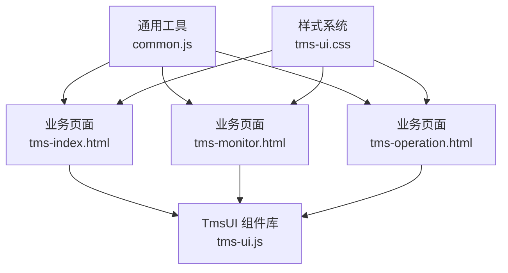
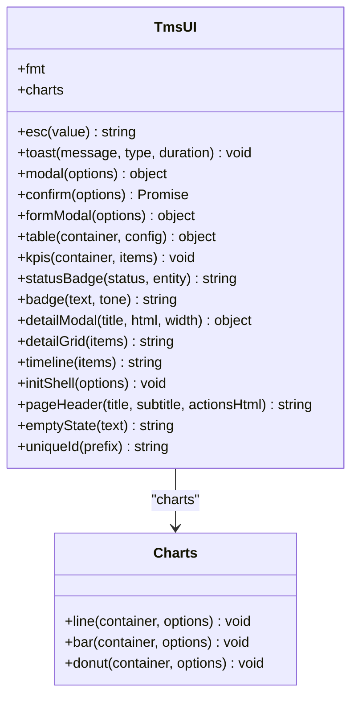
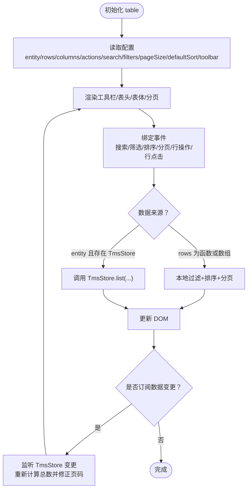
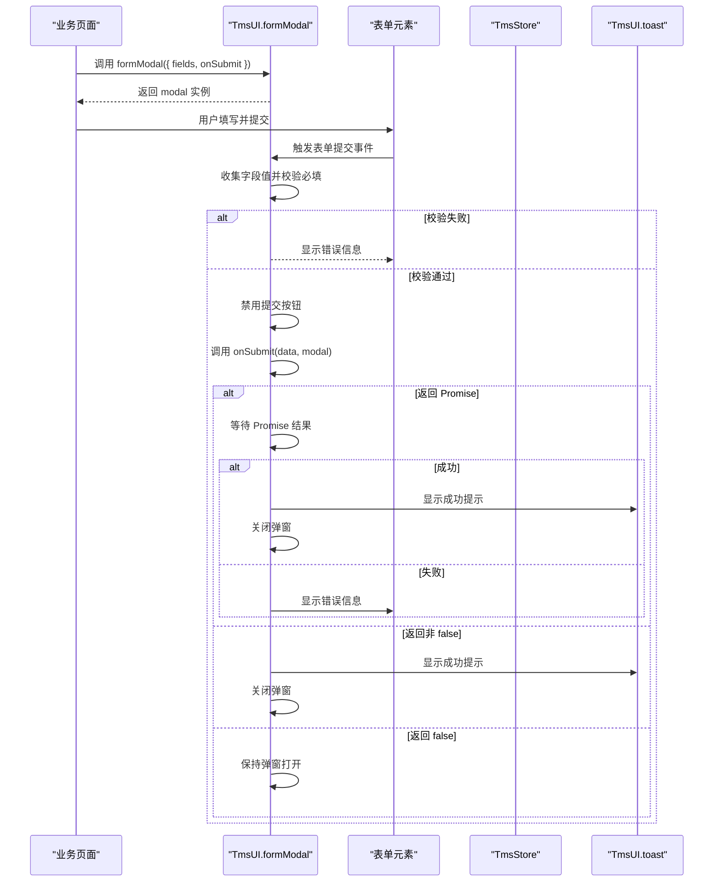
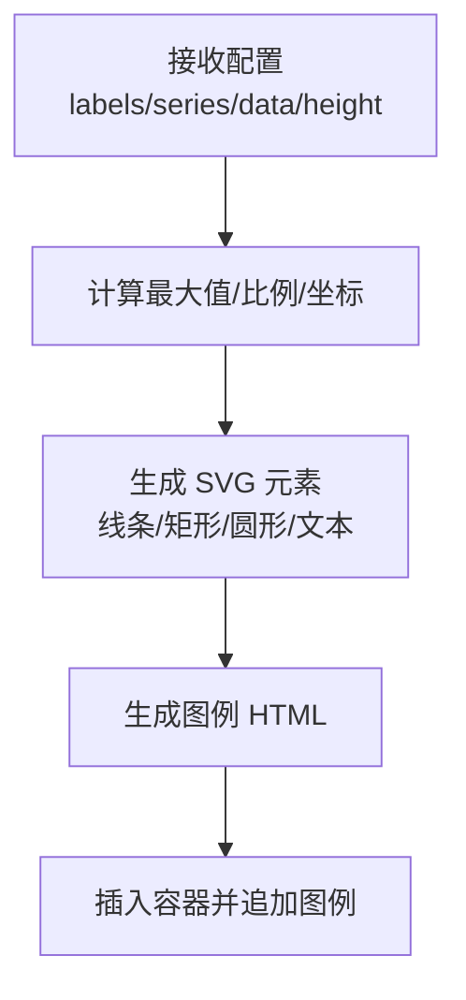
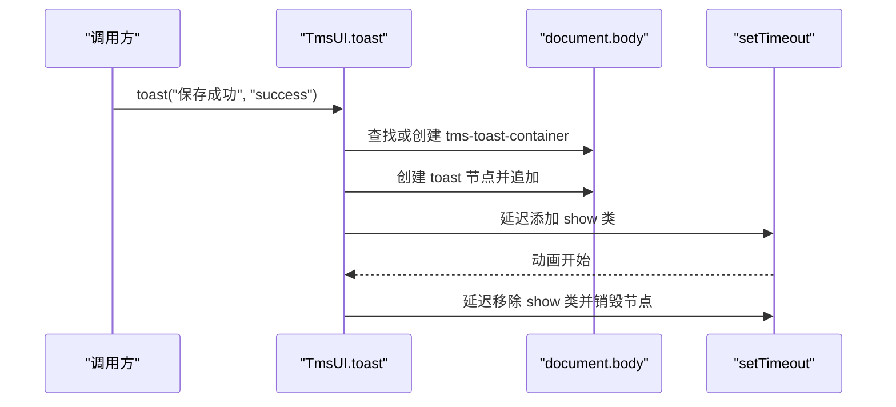
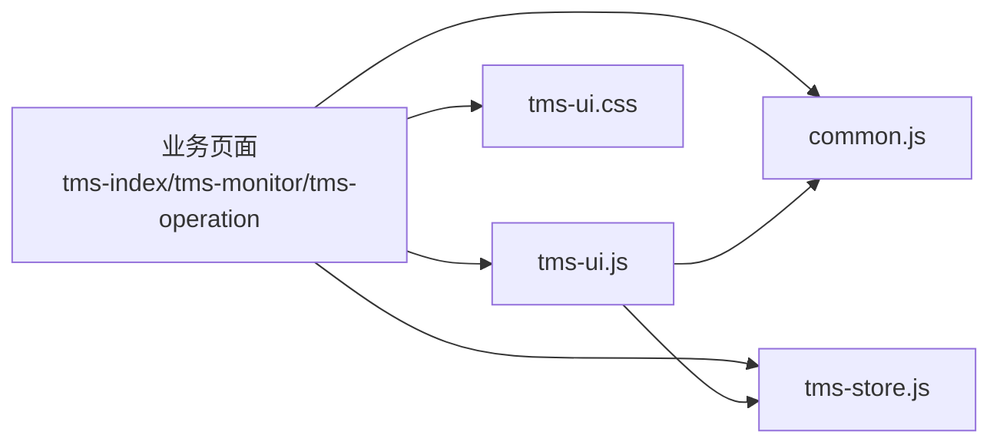

# UI组件库(TmsUI)

<cite>
**本文引用的文件**   
- [tms-ui.js](file://tms-ui.js)
- [tms-ui.css](file://tms-ui.css)
- [common.js](file://common.js)
- [tms-index.html](file://tms-index.html)
- [tms-monitor.html](file://tms-monitor.html)
- [tms-operation.html](file://tms-operation.html)
</cite>

## 目录
1. [简介](#简介)
2. [项目结构](#项目结构)
3. [核心组件](#核心组件)
4. [架构总览](#架构总览)
5. [详细组件分析](#详细组件分析)
6. [依赖关系分析](#依赖关系分析)
7. [性能与可维护性](#性能与可维护性)
8. [常见问题与排错](#常见问题与排错)
9. [结论](#结论)
10. [附录：API 速查](#附录api-速查)

## 简介
TmsUI 是 TMS 系统的共享 UI 组件库，提供表格、弹窗、表单弹窗、确认框、KPI 指标、SVG 图表（折线图、柱状图、环形图）、Toast 通知、详情展示、页面外壳等能力。所有样式类名统一使用 `tms-` 前缀，避免与业务页面自有样式冲突；逻辑层通过全局对象 `TmsUI` 暴露 API，便于各业务页面直接调用。

该文档面向初学者与有经验的开发者：既给出直观的使用示例和集成方式，也深入解释组件实现细节、数据流、事件处理、扩展点与性能优化建议。

## 项目结构
仓库中与 TmsUI 直接相关的核心文件如下：
- tms-ui.js：组件库 JavaScript 实现，对外暴露 `TmsUI` 命名空间
- tms-ui.css：组件库样式，全部以 `tms-` 前缀组织
- common.js：通用工具函数与登录/用户信息相关辅助方法
- tms-index.html / tms-monitor.html / tms-operation.html：典型业务页面，演示如何引入并使用 TmsUI

**图示来源**
- [tms-index.html:431-434](file://tms-index.html#L431-L434)
- [tms-monitor.html:409-412](file://tms-monitor.html#L409-L412)
- [tms-operation.html:507-509](file://tms-operation.html#L507-L509)

**章节来源**
- [tms-ui.js:1-10](file://tms-ui.js#L1-L10)
- [tms-ui.css:1-5](file://tms-ui.css#L1-L5)
- [tms-index.html:431-434](file://tms-index.html#L431-L434)
- [tms-monitor.html:409-412](file://tms-monitor.html#L409-L412)
- [tms-operation.html:507-509](file://tms-operation.html#L507-L509)

## 核心组件
TmsUI 的核心能力集中在 `TmsUI` 全局对象上，主要包含：
- 基础工具：`esc`、`fmt`、`uniqueId`
- 通知：`toast`
- 弹窗：`modal`、`confirm`、`formModal`、`detailModal`
- 列表与表格：`table`
- KPI 与图表：`kpis`、`charts.line`、`charts.bar`、`charts.donut`
- 状态徽章：`statusBadge`、`badge`
- 详情与时间线：`detailGrid`、`timeline`
- 页面外壳：`initShell`、`pageHeader`、`emptyState`

这些组件共同构成一个轻量、无框架依赖的共享 UI 层，适合在纯 HTML/JS 项目中快速搭建后台管理界面。

**章节来源**
- [tms-ui.js:756-779](file://tms-ui.js#L756-L779)

## 架构总览
TmsUI 采用“命名空间 + 函数式组件”的架构：
- 所有公共 API 挂载到 `window.TmsUI`
- 每个组件是一个独立函数，接收配置对象并返回实例或结果
- 样式通过 CSS 类名隔离，避免污染全局样式
- 与业务数据解耦：表格组件支持从 `TmsStore` 拉取数据，也支持传入本地数组或函数

**图示来源**
- [tms-ui.js:756-779](file://tms-ui.js#L756-L779)
- [tms-ui.js:573-678](file://tms-ui.js#L573-L678)

## 详细组件分析

### 表格组件（搜索、筛选、分页、排序）
表格组件是最复杂的 UI 组件之一，它封装了工具栏、搜索框、筛选下拉、列头排序、分页控件、行操作按钮、空状态等常见功能。

#### 配置项说明
- `entity`：当存在 `global.TmsStore` 时，按实体名称查询数据，自动订阅数据变化
- `rows`：可直接传入数组或函数，覆盖 `entity` 的数据源
- `columns`：定义列键、标签、渲染函数、宽度、是否可排序
- `actions`：每行动作按钮，支持显示条件与点击回调
- `search`：是否启用搜索；`searchFields` 指定搜索字段；`searchPlaceholder` 占位文本
- `filters`：筛选器数组，每项含 `key`、`label`、`options`
- `pageSize`：每页条数，设为 `0` 表示不分页
- `defaultSort`：默认排序键与方向
- `toolbar`：工具栏按钮数组，支持自定义文本、样式与点击回调
- `emptyText`：空数据提示文案
- `onRowClick`：整行点击回调
- `rowClass`：根据行数据动态添加行样式类

#### 行为与交互
- 搜索输入带防抖，避免频繁重绘
- 筛选改变后重置到第一页
- 列头点击切换升序/降序
- 分页按钮控制当前页码
- 行操作按钮通过 `data-row-action` 绑定，回调中可拿到行数据
- 若配置 `onRowClick`，行会获得可点击样式并触发回调
- 当使用 `entity` 且存在 `TmsStore` 时，组件订阅数据变更，自动刷新并修正页码

**图示来源**
- [tms-ui.js:301-542](file://tms-ui.js#L301-L542)

#### 实际使用示例
- 运营管理页面的“派送地址管理”表格：通过 `entity='deliveryAddresses'` 加载数据，提供新增、审核、编辑、删除等操作
- 统计分析中的多个指标表格：通过 `rows=function(){...}` 将 `dailyStats(7)` 转换为表格数据，关闭搜索，仅展示日期与指标值
- 考核管理与改单记录表格：结合 `filters`、`defaultSort`、`actions` 与 `confirm` 实现完整 CRUD 流程

**章节来源**
- [tms-ui.js:287-542](file://tms-ui.js#L287-L542)
- [tms-operation.html:614-800](file://tms-operation.html#L614-L800)

### 弹窗组件（模态框、确认框、表单弹窗）
TmsUI 提供三种弹窗：
- `modal`：基础模态框，支持标题、内容、底部按钮、宽度、ESC 关闭、遮罩点击关闭
- `confirm`：确认框，基于 `modal` 封装，返回 Promise，支持危险操作样式
- `formModal`：表单弹窗，支持多种字段类型、必填校验、错误提示、异步提交、成功 Toast

#### 表单字段类型
- 文本、数字、密码等原生 input 类型
- `select`：下拉选择，支持字符串或 `{value,label}` 选项
- `textarea`：多行文本，支持行数配置
- `checkbox`：复选框，支持自定义显示文案

#### 提交行为
- 先进行必填校验，失败则显示错误区域
- 若未提供 `onSubmit`，默认直接关闭弹窗
- 若 `onSubmit` 返回 Promise，则在成功时关闭并显示成功 Toast；失败则保留弹窗并显示错误
- 若 `onSubmit` 返回 `false`，则保持弹窗打开，用于业务侧自行处理错误

**图示来源**
- [tms-ui.js:158-285](file://tms-ui.js#L158-L285)

#### 实际使用示例
- 运营首页新建订单：通过 `formModal` 配置客户、联系人、电话、始发地、目的地、货物、重量、件数、运费等字段，提交后调用 `TmsStore.createOrder` 并刷新仪表盘
- 运营管理页面的地址审核与删除：通过 `confirm` 二次确认，再调用 `S.update` 或 `S.remove`

**章节来源**
- [tms-ui.js:105-285](file://tms-ui.js#L105-L285)
- [tms-index.html:554-577](file://tms-index.html#L554-L577)
- [tms-operation.html:636-654](file://tms-operation.html#L636-L654)

### 图表组件（折线图、柱状图、环形图）
TmsUI 使用 SVG 绘制轻量图表，无需第三方图表库：
- `charts.line`：折线图，支持多系列、面积填充、Y 轴刻度、X 轴标签、图例
- `charts.bar`：柱状图，支持分组柱状、圆角、图例
- `charts.donut`：环形图，支持多段比例、中心总计、右侧图例

#### 配置项
- `labels`：X 轴标签数组
- `series`：系列数组，每项含 `name`、`color`、`data`
- `data`：环形图专用，每项含 `label`、`value`、可选 `color`
- `height`：图表容器高度
- `area`：折线图是否开启面积填充

**图示来源**
- [tms-ui.js:573-678](file://tms-ui.js#L573-L678)

#### 实际使用示例
- 运营首页：折线图展示近 7 日新建订单与签收订单趋势；环形图展示订单状态分布
- 系统监控页：折线图展示近 7 日单量；环形图展示异常类型分布
- 运营管理页：折线图展示近 7 日签收率，并开启面积填充

**章节来源**
- [tms-index.html:490-502](file://tms-index.html#L490-L502)
- [tms-monitor.html:465-478](file://tms-monitor.html#L465-L478)
- [tms-operation.html:589-595](file://tms-operation.html#L589-L595)

### Toast 通知系统
Toast 提供右上角轻提示，支持成功、警告、错误等类型，自动出现与消失动画。

- `toast(message, type, duration)`：message 为提示文案，type 可为 `success`、`warning`、`error`、`info`，duration 为显示时长毫秒数
- 首次调用时创建容器 `tms-toast-container`，后续消息追加到容器中
- 通过 CSS 过渡实现滑入与淡出效果

**图示来源**
- [tms-ui.js:84-103](file://tms-ui.js#L84-L103)

#### 实际使用示例
- 运营首页刷新数据后显示成功提示
- 表单提交成功后显示保存成功提示
- 删除确认后显示删除成功提示

**章节来源**
- [tms-ui.js:84-103](file://tms-ui.js#L84-L103)
- [tms-index.html:442-445](file://tms-index.html#L442-L445)
- [tms-operation.html:636-654](file://tms-operation.html#L636-L654)

### 状态徽章与格式化
- `statusBadge(status, entity)`：根据状态映射到语义化颜色类，并从 `TmsStore.labels[entity]` 获取中文标签
- `badge(text, tone)`：通用徽章，tone 决定颜色
- `fmt.date/datetime/time/money/number/percent`：常用格式化工具

这些工具广泛用于表格列渲染、详情页展示与统计卡片。

**章节来源**
- [tms-ui.js:57-78](file://tms-ui.js#L57-L78)
- [tms-ui.js:25-55](file://tms-ui.js#L25-L55)

### 页面外壳与布局
- `initShell`：高亮当前导航、展开子菜单、绑定退出登录、显示异常待办角标、调用 `displayCurrentUser`
- `pageHeader`：生成页面头部标题与副标题、右侧动作区
- `emptyState`：空状态占位文案

这些方法帮助业务页面快速构建一致的页面骨架。

**章节来源**
- [tms-ui.js:699-754](file://tms-ui.js#L699-L754)
- [tms-index.html:437-440](file://tms-index.html#L437-L440)
- [tms-monitor.html:417-420](file://tms-monitor.html#L417-L420)
- [tms-operation.html:514-519](file://tms-operation.html#L514-L519)

## 依赖关系分析
TmsUI 与业务页面及数据层的依赖关系如下：
- 业务页面通过 `<script>` 引入 `common.js`、`tms-store.js`、`tms-ui.js`
- `tms-ui.js` 依赖 `window.TmsStore` 进行数据查询与订阅
- `tms-ui.js` 依赖 `common.js` 中的 `displayCurrentUser` 与 `logout`
- 样式由 `tms-ui.css` 提供，所有类名以 `tms-` 前缀隔离

**图示来源**
- [tms-index.html:431-434](file://tms-index.html#L431-L434)
- [tms-monitor.html:409-412](file://tms-monitor.html#L409-L412)
- [tms-operation.html:507-509](file://tms-operation.html#L507-L509)
- [tms-ui.js:725-743](file://tms-ui.js#L725-L743)

**章节来源**
- [tms-ui.js:725-743](file://tms-ui.js#L725-L743)
- [tms-index.html:431-434](file://tms-index.html#L431-L434)
- [tms-monitor.html:409-412](file://tms-monitor.html#L409-L412)
- [tms-operation.html:507-509](file://tms-operation.html#L507-L509)

## 性能与可维护性
- 表格搜索防抖：避免每次按键都触发重绘，提升输入流畅度
- 分页与本地过滤分离：当使用 `entity` 时，由 `TmsStore` 负责后端式分页；本地数据走前端过滤与排序
- 图表 SVG 轻量：无需重型图表库，减少依赖与体积
- 样式隔离：所有类名以 `tms-` 前缀，降低与业务样式冲突风险
- 可扩展点：
  - 表格列渲染：通过 `columns[].render` 自定义单元格内容
  - 表格工具栏：通过 `toolbar` 注入业务按钮
  - 图表系列：通过 `series` 配置多系列与颜色
  - 表单字段：通过 `fields` 灵活组合不同控件

建议：
- 大数据量场景优先使用 `entity` 模式，让 `TmsStore` 承担分页与过滤
- 复杂表格尽量复用列定义与渲染函数，减少重复代码
- 图表数据更新时注意控制频率，避免频繁重绘导致卡顿
- 表单校验逻辑应尽量简单明确，必要时拆分字段校验函数

[本节为通用指导，不直接分析具体文件]

## 常见问题与排错
- 表格不显示数据
  - 检查是否传入了 `rows` 或正确的 `entity`
  - 若使用 `entity`，确保 `TmsStore` 已加载且对应实体存在数据
  - 检查 `columns` 的 `key` 是否与数据字段一致
- 表单提交无效
  - 确认 `onSubmit` 是否为函数
  - 若返回 Promise，确保 resolve/reject 分支正确
  - 若返回 `false`，弹窗不会关闭，需检查业务逻辑
- 样式冲突
  - 避免在业务页面中使用与 `tms-*` 相同的类名
  - 如需覆盖样式，建议使用更具体的选择器或作用域包裹
- Toast 不显示
  - 确认 `tms-ui.css` 已引入
  - 检查 `document.body` 是否存在
- 弹窗无法关闭
  - 检查是否覆盖了默认的关闭按钮事件
  - 确认没有阻止冒泡或事件拦截

**章节来源**
- [tms-ui.js:301-542](file://tms-ui.js#L301-L542)
- [tms-ui.js:158-285](file://tms-ui.js#L158-L285)
- [tms-ui.js:84-103](file://tms-ui.js#L84-L103)
- [tms-ui.css:1-5](file://tms-ui.css#L1-L5)

## 结论
TmsUI 以极简的方式提供了 TMS 系统所需的共享 UI 能力。其优势在于：
- 零框架依赖，易于集成与维护
- 组件 API 清晰，配置项丰富
- 样式隔离，降低冲突风险
- 与 `TmsStore` 解耦，支持本地数据与业务数据两种模式
- 图表轻量，适合中小型后台系统

对于初学者，建议从 `toast`、`modal`、`formModal`、`kpis`、`charts.line` 入手；对于有经验开发者，可深入扩展表格列渲染、工具栏、表单字段与图表系列，以满足复杂业务需求。

[本节为总结性内容，不直接分析具体文件]

## 附录：API 速查
- `TmsUI.toast(message, type, duration)`
- `TmsUI.modal(options)`
- `TmsUI.confirm(options)`
- `TmsUI.formModal(options)`
- `TmsUI.table(container, config)`
- `TmsUI.kpis(container, items)`
- `TmsUI.charts.line(container, options)`
- `TmsUI.charts.bar(container, options)`
- `TmsUI.charts.donut(container, options)`
- `TmsUI.statusBadge(status, entity)`
- `TmsUI.badge(text, tone)`
- `TmsUI.detailModal(title, html, width)`
- `TmsUI.detailGrid(items)`
- `TmsUI.timeline(items)`
- `TmsUI.initShell(options)`
- `TmsUI.pageHeader(title, subtitle, actionsHtml)`
- `TmsUI.emptyState(text)`
- `TmsUI.uniqueId(prefix)`

**章节来源**
- [tms-ui.js:756-779](file://tms-ui.js#L756-L779)