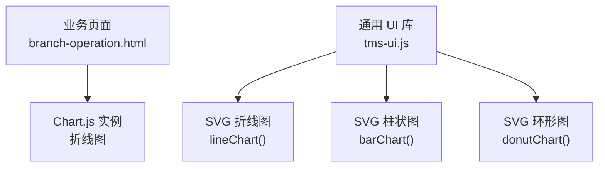
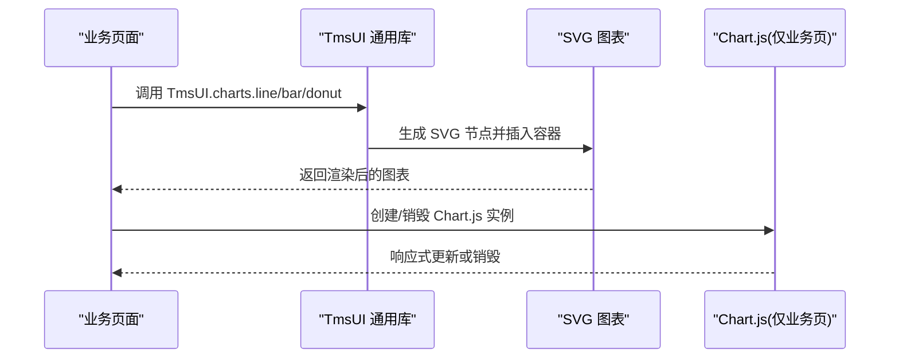
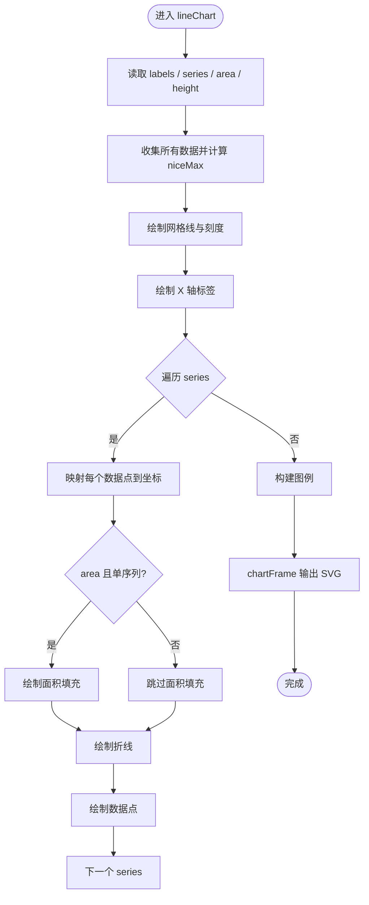
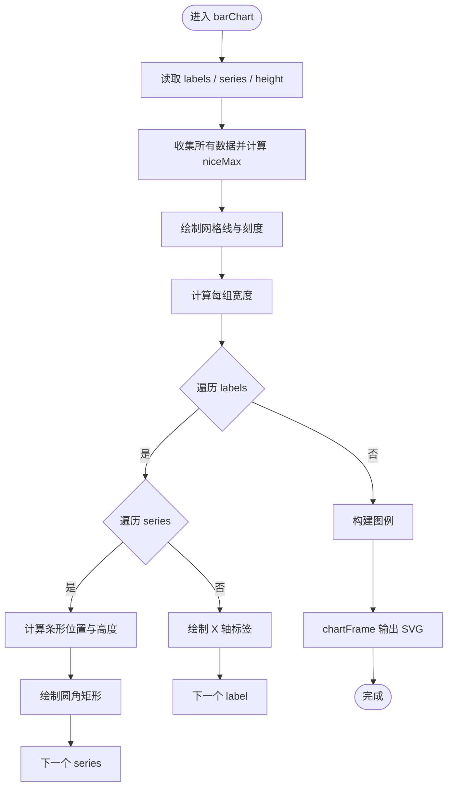
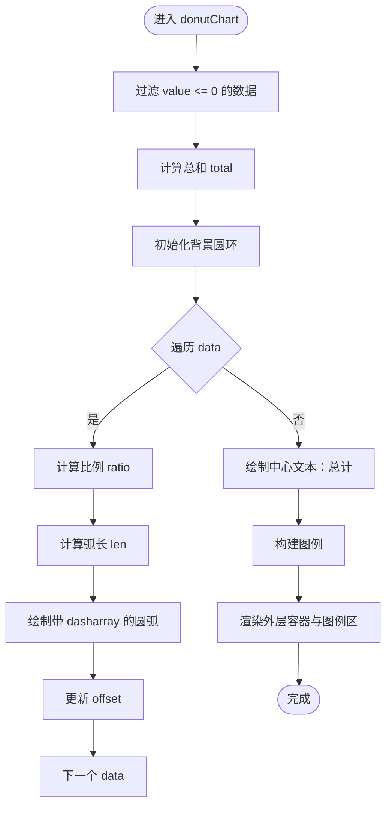
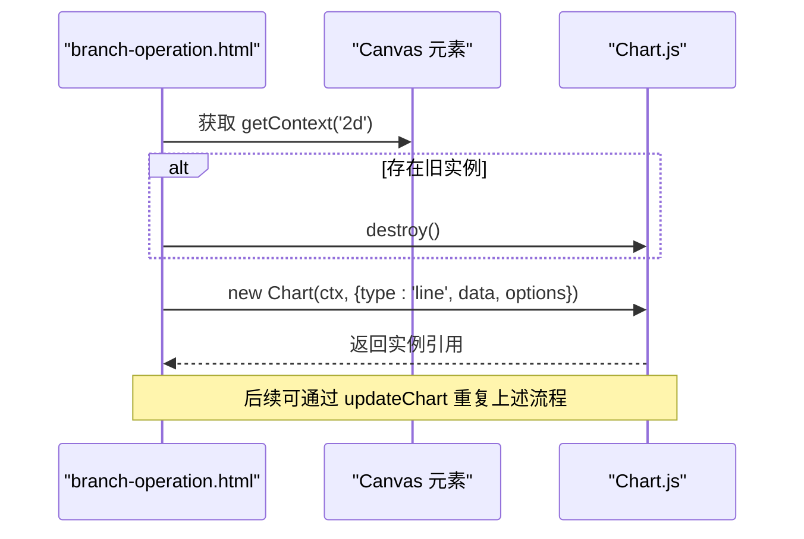
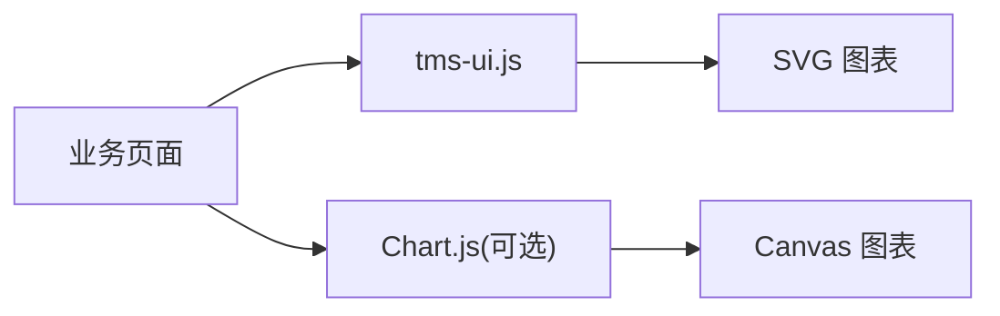

# 图表组件

<cite>
**本文引用的文件**   
- [tms-ui.js](file://tms-ui.js)
- [branch-operation.html](file://branch-operation.html)
</cite>

## 目录
1. [简介](#简介)
2. [项目结构](#项目结构)
3. [核心组件](#核心组件)
4. [架构总览](#架构总览)
5. [详细组件分析](#详细组件分析)
6. [依赖关系分析](#依赖关系分析)
7. [性能与移动端适配](#性能与移动端适配)
8. [故障排查指南](#故障排查指南)
9. [结论](#结论)
10. [附录：API 参考](#附录api-参考)

## 简介
本章节面向 TMS 系统中的“图表组件”，说明其实现方式、使用方式与扩展点。需要特别说明的是，当前仓库中的通用图表能力并非基于 Chart.js，而是由共享 UI 库 tms-ui.js 提供的轻量 SVG 图表封装；同时，部分业务页面（如 branch-operation.html）也直接使用了 Chart.js 进行折线图渲染。因此，本文分为两部分：
- 通用 SVG 图表封装：折线图、柱状图、环形图，统一通过 TmsUI.charts.* 暴露。
- 业务页内 Chart.js 用法：以 branch-operation.html 为例，展示如何创建、更新和销毁 Chart.js 实例。

## 项目结构
TMS 的图表相关代码主要分布在以下位置：
- 通用图表封装：tms-ui.js
- 业务示例：branch-operation.html（直接使用 Chart.js）

图示来源
- [tms-ui.js:575-680](file://tms-ui.js#L575-L680)
- [branch-operation.html:1013-1095](file://branch-operation.html#L1013-L1095)

章节来源
- [tms-ui.js:546-780](file://tms-ui.js#L546-L780)
- [branch-operation.html:1013-1095](file://branch-operation.html#L1013-L1095)

## 核心组件
通用图表组件由 TmsUI 统一暴露，提供三类图表：
- 折线图：TmsUI.charts.line(container, options)
- 柱状图：TmsUI.charts.bar(container, options)
- 环形图：TmsUI.charts.donut(container, options)

这些函数接收一个 DOM 容器与配置对象，内部使用 SVG 绘制图形，并附带基础图例。它们不依赖 Chart.js，适合在轻量场景下快速渲染数据。

章节来源
- [tms-ui.js:758-780](file://tms-ui.js#L758-L780)

## 架构总览
下图展示了通用 SVG 图表与业务页面的交互关系，以及 Chart.js 在特定页面中的独立使用方式。

图示来源
- [tms-ui.js:559-680](file://tms-ui.js#L559-L680)
- [branch-operation.html:1013-1095](file://branch-operation.html#L1013-L1095)

## 详细组件分析

### 通用 SVG 折线图
- 输入参数
  - container：用于挂载图表的 DOM 元素
  - options.labels：X 轴标签数组
  - options.series：多条序列，每项包含 name、color、data
  - options.area：是否填充区域（单序列时生效）
  - options.height：图表高度（默认 240px）
- 行为特性
  - 自动计算 Y 轴最大值并进行友好取整
  - 网格线、刻度值、X 轴标签、图例自动生成
  - 支持多序列对比，单序列时可启用面积填充
- 复杂度
  - 时间复杂度 O(N + S)，N 为数据点总数，S 为序列数
  - 空间复杂度 O(N + S)，用于构建 SVG 字符串与中间变量
- 适用场景
  - 趋势对比、时间序列、KPI 指标走势

图示来源
- [tms-ui.js:575-618](file://tms-ui.js#L575-L618)

章节来源
- [tms-ui.js:575-618](file://tms-ui.js#L575-L618)

### 通用 SVG 柱状图
- 输入参数
  - container：用于挂载图表的 DOM 元素
  - options.labels：X 轴分组标签数组
  - options.series：多条序列，每项包含 name、color、data
  - options.height：图表高度（默认 240px）
- 行为特性
  - 自动计算 Y 轴最大值并进行友好取整
  - 同组多序列并列显示，条形宽度自适应
  - 网格线、刻度值、X 轴标签、图例自动生成
- 复杂度
  - 时间复杂度 O(L × S)，L 为标签数量，S 为序列数
  - 空间复杂度 O(L × S)，用于构建 SVG 矩形元素
- 适用场景
  - 分类对比、多维度指标比较

图示来源
- [tms-ui.js:620-653](file://tms-ui.js#L620-L653)

章节来源
- [tms-ui.js:620-653](file://tms-ui.js#L620-L653)

### 通用 SVG 环形图
- 输入参数
  - container：用于挂载图表的 DOM 元素
  - options.data：[{label, value, color}]，value > 0 才会参与渲染
  - options.height：图表高度（默认 260px）
- 行为特性
  - 自动过滤无效数据项
  - 根据总值计算各段弧长，使用 stroke-dasharray 实现分段
  - 中心显示总计数值，底部显示图例
- 复杂度
  - 时间复杂度 O(D)，D 为数据项数量
  - 空间复杂度 O(D)，用于构建 SVG 圆形与图例
- 适用场景
  - 占比分析、构成分布

图示来源
- [tms-ui.js:655-680](file://tms-ui.js#L655-L680)

章节来源
- [tms-ui.js:655-680](file://tms-ui.js#L655-L680)

### 业务页 Chart.js 折线图
branch-operation.html 中演示了如何使用 Chart.js 创建、更新与销毁折线图实例：
- 获取 canvas 上下文
- 若存在旧实例则先销毁
- 新建 Chart 实例，配置 type、data、options（含 legend、tooltip、scales）
- 将实例缓存到变量以便后续更新

图示来源
- [branch-operation.html:1013-1095](file://branch-operation.html#L1013-L1095)

章节来源
- [branch-operation.html:1013-1095](file://branch-operation.html#L1013-L1095)

## 依赖关系分析
- tms-ui.js 内部自包含，不引入外部图表库，所有图表均为原生 SVG 实现。
- branch-operation.html 直接依赖 Chart.js（需页面已引入 Chart.js 资源），与 tms-ui.js 无耦合。
- 其他页面通过 <script src="tms-ui.js"> 引入通用 UI 库，从而获得 TmsUI.charts.* 能力。

图示来源
- [tms-ui.js:758-780](file://tms-ui.js#L758-L780)
- [branch-operation.html:1013-1095](file://branch-operation.html#L1013-L1095)

章节来源
- [tms-ui.js:758-780](file://tms-ui.js#L758-L780)
- [branch-operation.html:1013-1095](file://branch-operation.html#L1013-L1095)

## 性能与移动端适配
- 通用 SVG 图表
  - 优点：零依赖、体积小、渲染快，适合中小规模数据。
  - 优化建议：
    - 控制 labels 与 series 长度，避免一次性渲染过多数据点。
    - 对大数据集进行采样或分页展示。
    - 复用 chartFrame 容器，减少 DOM 重建。
  - 移动端适配：
    - 通过 options.height 调整图表高度以适应小屏。
    - 图例与文字字号较小，建议在样式层增加媒体查询放大关键信息。
- Chart.js 折线图
  - 优点：功能丰富，支持 tooltip、缩放、动画等。
  - 优化建议：
    - 合理设置 responsive 与 maintainAspectRatio。
    - 对大量数据点进行采样或使用插件限制可见范围。
    - 频繁更新时注意 destroy 旧实例，避免内存泄漏。
  - 移动端适配：
    - 开启 responsive，确保在不同视口下自适应。
    - 适当减小 pointRadius 与 borderWidth，提升触控体验。

[本节为通用指导，不涉及具体文件分析]

## 故障排查指南
- 通用 SVG 图表
  - 现象：图表未显示或高度异常
    - 检查传入的 container 是否存在且可访问
    - 检查 options.height 是否为有效数值
  - 现象：数据为空或图形异常
    - 检查 labels 与 series/data 的长度一致性
    - 检查 donut 的 data.value 是否大于 0
- Chart.js 折线图
  - 现象：多次更新后内存增长或报错
    - 确保每次更新前调用 destroy() 销毁旧实例
  - 现象：图表尺寸不正确
    - 检查父容器是否有明确高度，并确保 maintainAspectRatio 配置正确
  - 现象：tooltip 或 legend 不显示
    - 检查 plugins.legend 与 plugins.tooltip 的配置是否正确

章节来源
- [tms-ui.js:559-680](file://tms-ui.js#L559-L680)
- [branch-operation.html:1013-1095](file://branch-operation.html#L1013-L1095)

## 结论
- 通用图表组件采用轻量 SVG 实现，开箱即用，适合大多数后台管理场景。
- 对于需要丰富交互与高级特性的场景，可在业务页中使用 Chart.js，但需注意实例生命周期管理。
- 建议在项目中统一选择一种图表方案，避免混用导致维护成本上升。

[本节为总结性内容，不涉及具体文件分析]

## 附录：API 参考

### TmsUI.charts.line(container, options)
- 作用：渲染 SVG 折线图
- 参数
  - container：DOM 元素
  - options.labels：string[]，X 轴标签
  - options.series：Array<{name?: string, color?: string, data: number[]}>
  - options.area：boolean，是否启用面积填充（单序列时）
  - options.height：number，图表高度
- 返回值：无（直接渲染到 container）

章节来源
- [tms-ui.js:575-618](file://tms-ui.js#L575-L618)

### TmsUI.charts.bar(container, options)
- 作用：渲染 SVG 柱状图
- 参数
  - container：DOM 元素
  - options.labels：string[]，X 轴分组标签
  - options.series：Array<{name?: string, color?: string, data: number[]}>
  - options.height：number，图表高度
- 返回值：无（直接渲染到 container）

章节来源
- [tms-ui.js:620-653](file://tms-ui.js#L620-L653)

### TmsUI.charts.donut(container, options)
- 作用：渲染 SVG 环形图
- 参数
  - container：DOM 元素
  - options.data：Array<{label: string, value: number, color?: string}>
  - options.height：number，图表高度
- 返回值：无（直接渲染到 container）

章节来源
- [tms-ui.js:655-680](file://tms-ui.js#L655-L680)

### 业务页 Chart.js 折线图（示例）
- 步骤
  - 获取 canvas 上下文
  - 销毁旧实例（如有）
  - 创建新 Chart 实例，配置 type、data、options
  - 缓存实例以便后续更新
- 关键配置
  - type: 'line'
  - data.datasets[].borderColor、backgroundColor、fill、tension、point* 系列属性
  - options.plugins.legend.position
  - options.plugins.tooltip.callbacks.label
  - options.scales.y.ticks.callback

章节来源
- [branch-operation.html:1013-1095](file://branch-operation.html#L1013-L1095)