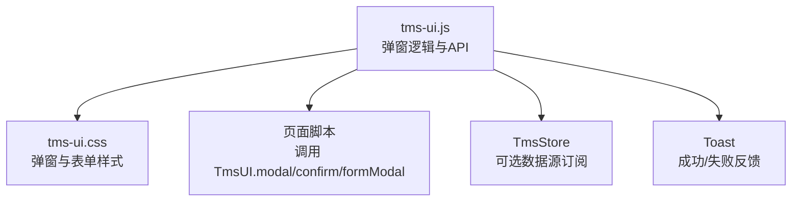
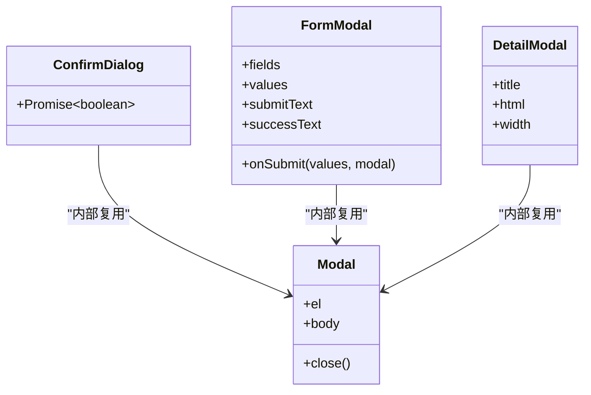
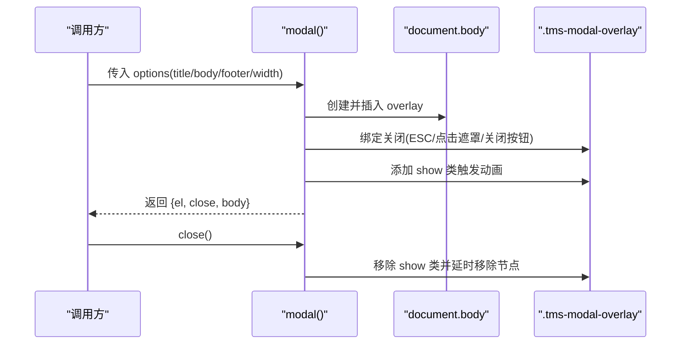
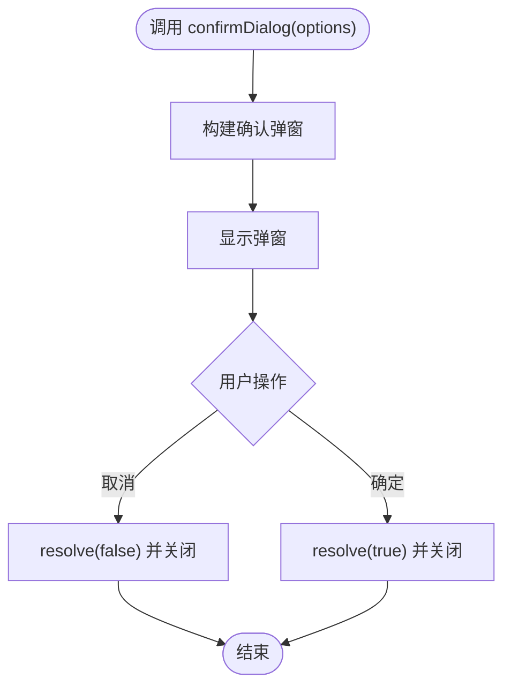
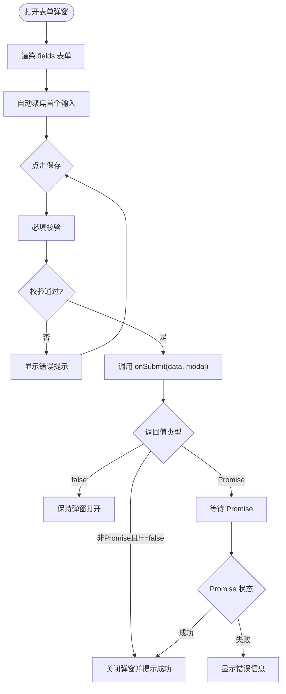
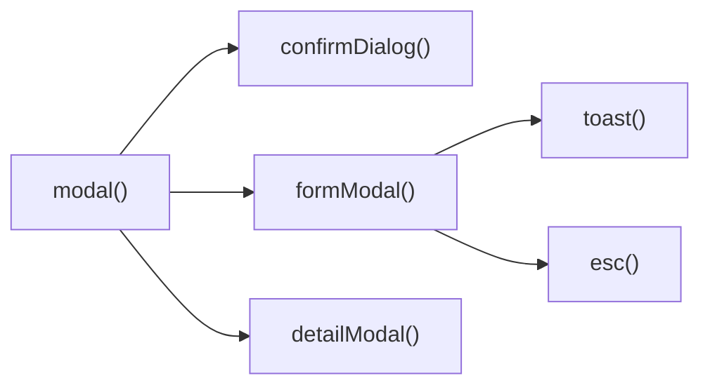

# 弹窗组件

<cite>
**本文引用的文件**   
- [tms-ui.js](file://tms-ui.js)
- [tms-ui.css](file://tms-ui.css)
</cite>

## 目录
1. [简介](#简介)
2. [项目结构](#项目结构)
3. [核心组件](#核心组件)
4. [架构总览](#架构总览)
5. [详细组件分析](#详细组件分析)
6. [依赖关系分析](#依赖关系分析)
7. [性能与可访问性](#性能与可访问性)
8. [故障排查指南](#故障排查指南)
9. [结论](#结论)
10. [附录：API 参考](#附录api-参考)

## 简介
本章节面向 TMS 系统中的弹窗能力，聚焦三类弹窗：基础模态框、确认框、表单弹窗。它们统一由共享 UI 库提供，具备一致的视觉风格、生命周期管理、键盘交互与无障碍支持。文档将说明弹窗的创建方式、配置项、事件处理、数据绑定、异步提交、样式定制方法，以及与页面其他组件（如表格、Toast）的协作模式。

## 项目结构
弹窗相关实现集中在两个文件中：
- tms-ui.js：弹窗逻辑、表单渲染、确认框 Promise 封装、详情弹窗等 API。
- tms-ui.css：弹窗遮罩、容器、头部、内容区、底部按钮、表单控件、错误提示、Toast 通知等样式。

图示来源
- [tms-ui.js:109-137](file://tms-ui.js#L109-L137)
- [tms-ui.js:139-158](file://tms-ui.js#L139-L158)
- [tms-ui.js:165-287](file://tms-ui.js#L165-L287)
- [tms-ui.js:758-781](file://tms-ui.js#L758-L781)
- [tms-ui.css:456-537](file://tms-ui.css#L456-L537)
- [tms-ui.css:539-615](file://tms-ui.css#L539-L615)

章节来源
- [tms-ui.js:107-287](file://tms-ui.js#L107-L287)
- [tms-ui.css:456-615](file://tms-ui.css#L456-L615)

## 核心组件
- 基础模态框 modal：通用弹窗容器，支持标题、自定义 body、可选 footer、宽度控制、ESC 关闭、点击遮罩关闭、动画显示。
- 确认框 confirmDialog：基于 modal 的轻量确认对话框，返回 Promise，支持危险操作高亮、自定义文案。
- 表单弹窗 formModal：声明式字段渲染，内置必填校验、错误提示、异步 onSubmit、自动聚焦首个输入框。
- 详情弹窗 detailModal：快速展示详情 HTML 的便捷封装。

章节来源
- [tms-ui.js:109-137](file://tms-ui.js#L109-L137)
- [tms-ui.js:139-158](file://tms-ui.js#L139-L158)
- [tms-ui.js:165-287](file://tms-ui.js#L165-L287)
- [tms-ui.js:684-686](file://tms-ui.js#L684-L686)

## 架构总览
弹窗体系以 modal 为基座，confirmDialog 和 formModal 在其之上组合业务语义；detailModal 提供常用场景的快速入口。所有弹窗通过 DOM 插入到 document.body，使用 CSS 类名控制外观与动画。

图示来源
- [tms-ui.js:109-137](file://tms-ui.js#L109-L137)
- [tms-ui.js:139-158](file://tms-ui.js#L139-L158)
- [tms-ui.js:165-287](file://tms-ui.js#L165-L287)
- [tms-ui.js:684-686](file://tms-ui.js#L684-L686)

## 详细组件分析

### 基础模态框 modal
- 功能要点
  - 动态创建 overlay 与 modal 容器，设置 role="dialog" 与 aria-modal="true"。
  - 支持 title、body、footer（footer=null 时隐藏）、width。
  - ESC 键关闭、点击遮罩关闭、关闭后移除节点并解绑键盘事件。
  - 打开时添加 show 类触发过渡动画。
  - 返回对象包含 el、close、body 引用，便于二次注入内容或手动关闭。
- 生命周期
  - 创建 → 挂载 → 动画显示 → 监听关闭事件 → 关闭动画 → 移除节点。
- 键盘与无障碍
  - 监听 Escape 关闭；提供 aria-modal 与关闭按钮 aria-label。
- 样式
  - 遮罩 z-index 固定，弹窗居中，最大高度限制，滚动区域在 body。

图示来源
- [tms-ui.js:109-137](file://tms-ui.js#L109-L137)
- [tms-ui.css:456-537](file://tms-ui.css#L456-L537)

章节来源
- [tms-ui.js:109-137](file://tms-ui.js#L109-L137)
- [tms-ui.css:456-537](file://tms-ui.css#L456-L537)

### 确认框 confirmDialog
- 功能要点
  - 基于 modal 构建，默认标题“操作确认”，可自定义 message、cancelText、okText、danger。
  - 返回 Promise，点击取消 resolve(false)，点击确定 resolve(true)。
  - danger=true 时确定按钮使用危险色。
- 使用建议
  - 适合删除、停用、批量操作等需要用户二次确认的场景。
  - 可在 then/catch 中执行后续逻辑，结合 Toast 反馈结果。

图示来源
- [tms-ui.js:139-158](file://tms-ui.js#L139-L158)

章节来源
- [tms-ui.js:139-158](file://tms-ui.js#L139-L158)

### 表单弹窗 formModal
- 字段定义 fields
  - key：字段标识，用于取值与命名。
  - label：标签文本。
  - type：text/number/select/textarea/checkbox 等。
  - options：select 下拉选项数组，元素可为字符串或 {value,label}。
  - required：是否必填。
  - placeholder：占位文本。
  - value：初始值（若 values[key] 不存在则回退）。
  - help：帮助说明。
  - min/max/step：数值型输入约束。
  - rows：textarea 行数。
  - full：跨列显示（整行）。
- 数据绑定与收集
  - 根据 fields 生成表单控件，name 使用 key。
  - 提交时收集数据：checkbox 取布尔值，number 类型空串转空值，其余取字符串。
- 验证与错误
  - 必填校验：未填写字段聚合提示。
  - 错误区域 .tms-form-error 显示错误信息。
- 提交流程
  - 点击保存触发 requestSubmit 或 dispatch submit。
  - 若未提供 onSubmit，直接关闭并提示成功。
  - 若 onSubmit 返回 Promise：
    - 成功：关闭弹窗并显示成功 Toast。
    - 失败：保持弹窗打开，显示错误信息。
  - 若 onSubmit 返回 false：保持弹窗打开，不关闭。
  - 若抛出异常：捕获异常并显示错误信息。
- 用户体验
  - 打开后自动聚焦第一个输入控件。
  - 提交过程中禁用保存按钮，避免重复提交。

图示来源
- [tms-ui.js:165-287](file://tms-ui.js#L165-L287)

章节来源
- [tms-ui.js:165-287](file://tms-ui.js#L165-L287)
- [tms-ui.css:539-615](file://tms-ui.css#L539-L615)

### 详情弹窗 detailModal
- 功能要点
  - 快捷封装 modal，传入 title、HTML 内容与可选 width。
  - 自带关闭按钮。
- 适用场景
  - 订单详情、工单详情、配置详情等只读信息展示。

章节来源
- [tms-ui.js:684-686](file://tms-ui.js#L684-L686)

## 依赖关系分析
- 模块内依赖
  - confirmDialog 与 formModal 均依赖 modal。
  - formModal 依赖 esc 进行 XSS 防护，依赖 toast 进行成功反馈。
  - detailModal 依赖 modal。
- 外部依赖
  - 可选依赖 global.TmsStore：列表组件会订阅数据变化，弹窗本身不直接依赖。
- 样式依赖
  - 所有弹窗样式来自 tms-ui.css，类名严格使用 tms- 前缀，避免与页面样式冲突。

图示来源
- [tms-ui.js:109-137](file://tms-ui.js#L109-L137)
- [tms-ui.js:139-158](file://tms-ui.js#L139-L158)
- [tms-ui.js:165-287](file://tms-ui.js#L165-L287)
- [tms-ui.js:684-686](file://tms-ui.js#L684-L686)

章节来源
- [tms-ui.js:109-287](file://tms-ui.js#L109-L287)
- [tms-ui.js:684-686](file://tms-ui.js#L684-L686)

## 性能与可访问性
- 性能
  - 弹窗 DOM 仅在打开时创建，关闭后及时移除，避免内存泄漏。
  - 表单提交期间禁用按钮，防止重复请求。
  - 列表组件对搜索与分页做了节流与局部更新，弹窗与之配合时不会阻塞主线程。
- 可访问性
  - 弹窗容器设置 role="dialog" 与 aria-modal="true"。
  - 关闭按钮提供 aria-label。
  - ESC 键关闭符合常见交互预期。
- 层级管理
  - 弹窗遮罩 z-index=3000，Toast 容器 z-index=5000，确保消息提示不被遮挡。
  - 如需多层弹窗，建议在业务层维护栈并递增 z-index。

章节来源
- [tms-ui.js:109-137](file://tms-ui.js#L109-L137)
- [tms-ui.js:165-287](file://tms-ui.js#L165-L287)
- [tms-ui.css:456-468](file://tms-ui.css#L456-L468)
- [tms-ui.css:681-729](file://tms-ui.css#L681-L729)

## 故障排查指南
- 弹窗无法关闭
  - 检查是否调用了返回对象的 close 方法。
  - 确认 ESC 键监听未被覆盖或提前移除。
- 表单提交无响应
  - 确认提供了 onSubmit 回调。
  - 检查必填字段是否正确标记 required。
  - 查看 .tms-form-error 是否有错误提示。
- 异步提交卡住
  - 确认 onSubmit 返回 Promise 或在成功分支返回 true。
  - 若返回 false，弹窗会保持打开，需调整返回值。
- 样式错乱
  - 确认引入了 tms-ui.css。
  - 检查是否存在同名类名覆盖 tms- 前缀样式。
- 键盘事件冲突
  - 若页面全局监听了 ESC，注意不要阻止弹窗关闭行为。

章节来源
- [tms-ui.js:109-137](file://tms-ui.js#L109-L137)
- [tms-ui.js:165-287](file://tms-ui.js#L165-L287)
- [tms-ui.css:456-537](file://tms-ui.css#L456-L537)
- [tms-ui.css:539-615](file://tms-ui.css#L539-L615)

## 结论
TMS 弹窗组件以 modal 为核心，向上扩展出确认框与表单弹窗，向下与 Toast、表格等组件协同工作。其设计强调简洁 API、清晰的职责边界、良好的可访问性与一致的用户体验。通过声明式字段配置与 Promise 化交互，开发者可以快速构建稳定可靠的弹窗场景。

## 附录：API 参考

### TmsUI.modal(options)
- 作用：创建基础模态框。
- 参数 options
  - title：字符串，弹窗标题。
  - body：字符串，弹窗主体 HTML。
  - footer：字符串或 null，底部按钮区域；null 表示隐藏。
  - width：数字，弹窗最大宽度（px）。
- 返回值
  - el：overlay 节点。
  - close：函数，关闭弹窗。
  - body：body 节点引用，可用于二次注入内容。
- 事件
  - ESC 键关闭。
  - 点击遮罩关闭。
  - 点击关闭按钮关闭。

章节来源
- [tms-ui.js:109-137](file://tms-ui.js#L109-L137)

### TmsUI.confirm(options)
- 作用：显示确认对话框，返回 Promise<boolean>。
- 参数 options
  - title：字符串，标题。
  - message：字符串，确认信息。
  - cancelText：字符串，取消按钮文案。
  - okText：字符串，确定按钮文案。
  - danger：布尔，危险操作高亮确定按钮。
- 返回值
  - Promise：点击取消 resolve(false)，点击确定 resolve(true)。

章节来源
- [tms-ui.js:139-158](file://tms-ui.js#L139-L158)

### TmsUI.formModal(options)
- 作用：创建表单弹窗，支持声明式字段与异步提交。
- 参数 options
  - title：字符串，标题。
  - width：数字，宽度。
  - fields：数组，字段定义。
  - values：对象，初始值映射。
  - submitText：字符串，保存按钮文案。
  - successText：字符串，成功后提示文案。
  - onSubmit(values, modal)：函数，提交回调。
- fields 字段定义
  - key：字符串，字段键。
  - label：字符串，标签。
  - type：字符串，input/select/textarea/checkbox 等。
  - options：数组，select 选项。
  - required：布尔，必填。
  - placeholder：字符串，占位符。
  - value：任意，初始值。
  - help：字符串，帮助文本。
  - min/max/step：数字，数值约束。
  - rows：数字，textarea 行数。
  - full：布尔，整行显示。
- 返回值
  - 同 modal 返回对象：el、close、body。
- 行为
  - 自动聚焦首个输入。
  - 必填校验失败显示错误。
  - onSubmit 返回 false 或抛错保持弹窗打开。
  - onSubmit 返回 Promise，成功关闭并提示成功，失败显示错误。

章节来源
- [tms-ui.js:165-287](file://tms-ui.js#L165-L287)

### TmsUI.detailModal(title, html, width)
- 作用：快速显示详情弹窗。
- 参数
  - title：字符串。
  - html：字符串，详情内容。
  - width：数字，可选宽度。
- 返回值
  - 同 modal 返回对象。

章节来源
- [tms-ui.js:684-686](file://tms-ui.js#L684-L686)

### 样式与主题定制
- 弹窗容器
  - .tms-modal-overlay：遮罩背景、居中、z-index、透明度与过渡。
  - .tms-modal：弹窗容器、圆角、阴影、最大高度、滚动区域。
  - .tms-modal-head/.tms-modal-body/.tms-modal-foot：头部、内容、底部布局。
- 表单
  - .tms-form：两列网格布局，移动端自适应一列。
  - .tms-field：字段容器，full 跨列。
  - .tms-check：复选框样式。
  - .tms-form-error：错误提示区域。
- 按钮
  - .tms-btn 系列：主色、成功、警告、危险、浅色、超小尺寸。
- Toast
  - .tms-toast-container：固定定位，z-index 高于弹窗。
  - .tms-toast-*：不同状态的左侧边框与点颜色。

章节来源
- [tms-ui.css:456-537](file://tms-ui.css#L456-L537)
- [tms-ui.css:539-615](file://tms-ui.css#L539-L615)
- [tms-ui.css:163-243](file://tms-ui.css#L163-L243)
- [tms-ui.css:681-729](file://tms-ui.css#L681-L729)