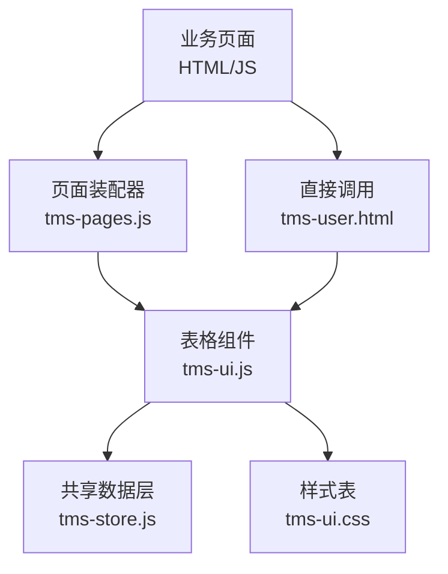
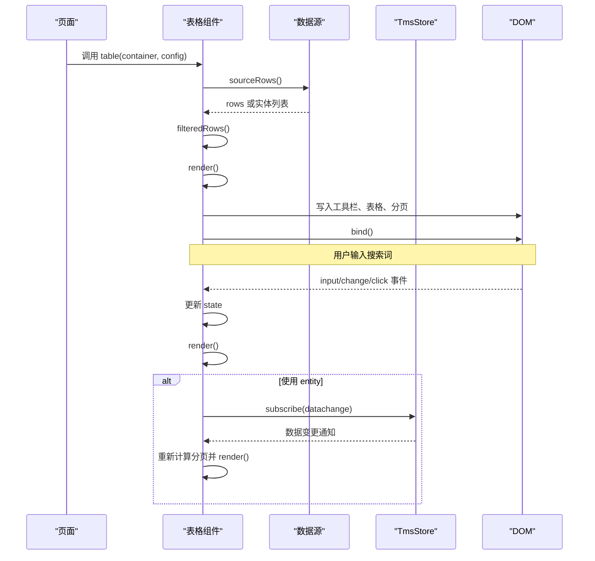
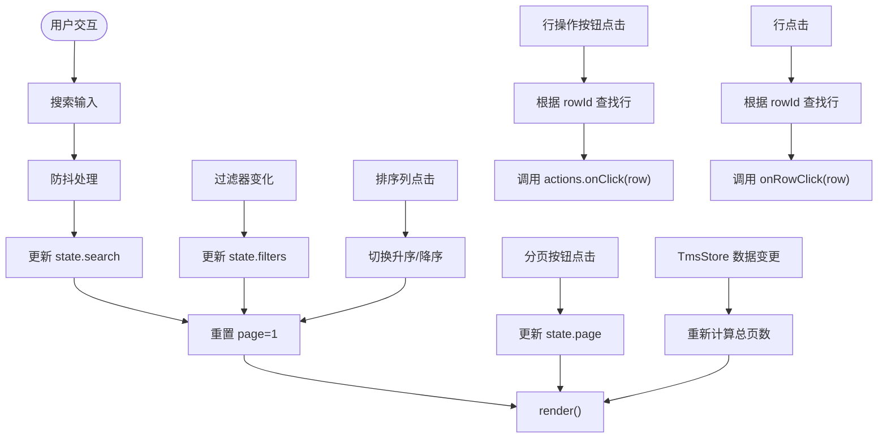
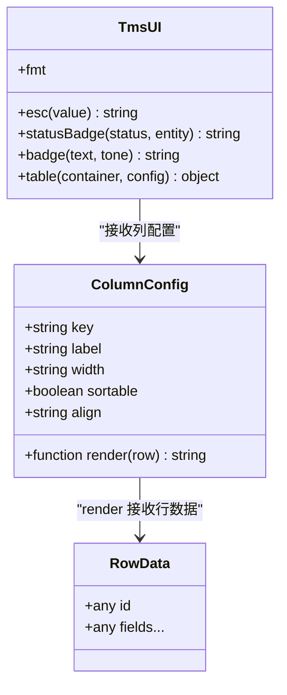
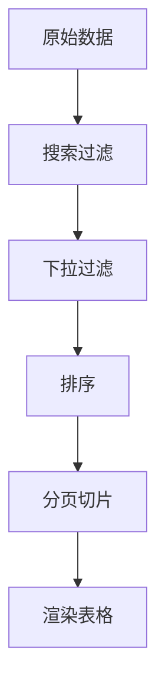
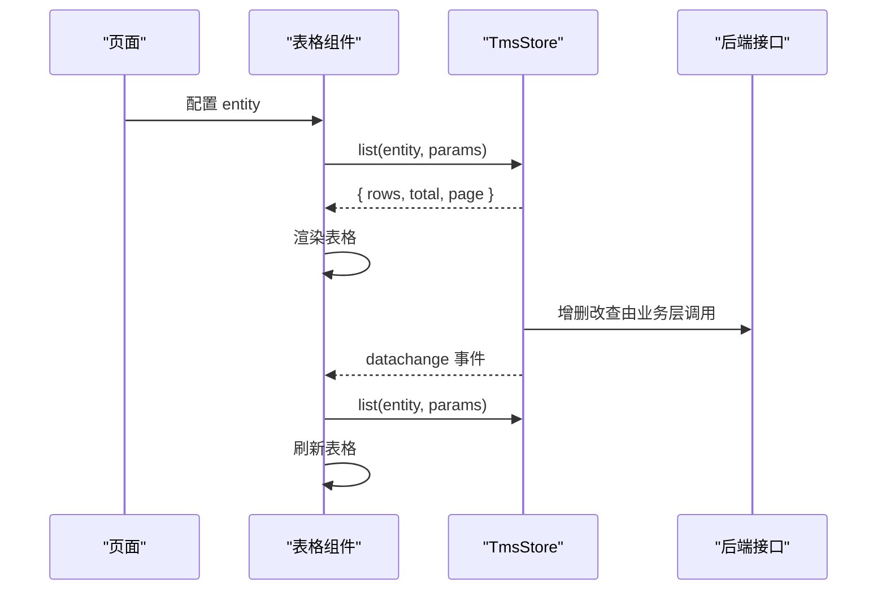

# 表格组件

<cite>
**本文引用的文件**   
- [tms-ui.js](file://tms-ui.js)
- [tms-store.js](file://tms-store.js)
- [tms-pages.js](file://tms-pages.js)
- [tms-user.html](file://tms-user.html)
- [tms-ui.css](file://tms-ui.css)
</cite>

## 目录
1. [简介](#简介)
2. [项目结构](#项目结构)
3. [核心能力总览](#核心能力总览)
4. [架构与数据流](#架构与数据流)
5. [配置选项详解](#配置选项详解)
6. [事件与交互模型](#事件与交互模型)
7. [列渲染与单元格格式化](#列渲染与单元格格式化)
8. [分页、搜索、过滤与排序](#分页搜索过滤与排序)
9. [批量操作与行级操作](#批量操作与行级操作)
10. [后端集成模式](#后端集成模式)
11. [大数据量性能优化](#大数据量性能优化)
12. [API 参考](#api-参考)
13. [常见使用场景与最佳实践](#常见使用场景与最佳实践)
14. [故障排除指南](#故障排除指南)
15. [结论](#结论)

## 简介
本章节面向 TMS 系统中的通用表格组件。该组件由 `TmsUI.table` 提供，负责在页面容器中渲染可搜索、可筛选、可排序、可分页的数据表格，并支持自定义列渲染、工具栏按钮、行操作按钮和行点击回调。它既可以渲染前端内存数据，也可以与共享数据层 `TmsStore` 联动，实现增删改查后的自动刷新。

该组件的设计目标是：
- 用声明式配置驱动表格展示；
- 将“数据源”“查询条件”“视图渲染”解耦；
- 通过统一的事件机制与状态管理，支撑复杂业务页面的表格需求；
- 在不引入重型框架的前提下，提供接近现代 UI 库的交互体验。

## 项目结构
表格组件及相关代码主要分布在以下文件中：
- `tms-ui.js`：定义 `table` 函数及 UI 辅助能力；
- `tms-store.js`：提供 `list`、`subscribe` 等数据访问与订阅能力；
- `tms-pages.js`：以页面维度组织多个表格配置示例；
- `tms-user.html`：管理员端用户、角色、权限、部门等表格的实际调用；
- `tms-ui.css`：表格、工具栏、分页、状态标签等样式。

**图表来源**
- [tms-ui.js:303-543](file://tms-ui.js#L303-L543)
- [tms-pages.js:108-135](file://tms-pages.js#L108-L135)
- [tms-user.html:566-601](file://tms-user.html#L566-L601)
- [tms-store.js:220-244](file://tms-store.js#L220-L244)
- [tms-ui.css:245-333](file://tms-ui.css#L245-L333)

**章节来源**
- [tms-ui.js:1-10](file://tms-ui.js#L1-L10)
- [tms-pages.js:1-12](file://tms-pages.js#L1-L12)
- [tms-user.html:560-780](file://tms-user.html#L560-L780)
- [tms-store.js:1-12](file://tms-store.js#L1-L12)
- [tms-ui.css:245-333](file://tms-ui.css#L245-L333)

## 核心能力总览
| 能力 | 说明 | 关键配置或行为 |
|---|---|---|
| 数据渲染 | 支持数组、函数、实体列表三种数据源 | `rows`、`entity` |
| 搜索 | 多字段模糊搜索，带防抖 | `search`、`searchFields`、`searchPlaceholder` |
| 过滤 | 下拉筛选，支持多条件组合 | `filters` |
| 排序 | 列头点击切换升序/降序 | `columns[].sortable`、`defaultSort` |
| 分页 | 客户端分页或服务端分页 | `pageSize` |
| 工具栏 | 自定义按钮组 | `toolbar` |
| 行操作 | 每行右侧操作按钮 | `actions` |
| 行点击 | 整行可点击跳转 | `onRowClick` |
| 自定义列 | 任意 HTML 或格式化值 | `columns[].render` |
| 空态提示 | 无数据时显示占位文本 | `emptyText` |
| 行样式 | 根据行数据动态添加类名 | `rowClass` |
| 实时同步 | 与 `TmsStore` 数据变更联动刷新 | `entity + TmsStore.subscribe` |

**章节来源**
- [tms-ui.js:291-302](file://tms-ui.js#L291-L302)
- [tms-ui.js:303-543](file://tms-ui.js#L303-L543)

## 架构与数据流
表格组件采用“配置驱动 + 状态驱动 + 事件驱动”的轻量架构：

1. **初始化阶段**：接收容器元素和配置对象，生成唯一 ID，创建内部状态。
2. **数据获取阶段**：根据 `rows` 或 `entity` 决定数据来源。
3. **过滤与排序阶段**：对数据进行搜索、过滤、排序。
4. **分页阶段**：计算总页数、当前页数据切片。
5. **渲染阶段**：生成工具栏、表头、表体、分页控件。
6. **绑定阶段**：为搜索框、过滤器、排序列、分页按钮、行操作按钮绑定事件。
7. **订阅阶段**：如果使用了 `entity`，则订阅 `TmsStore` 的数据变更事件，自动刷新。

**图表来源**
- [tms-ui.js:316-363](file://tms-ui.js#L316-L363)
- [tms-ui.js:365-451](file://tms-ui.js#L365-L451)
- [tms-ui.js:454-521](file://tms-ui.js#L454-L521)
- [tms-ui.js:525-537](file://tms-ui.js#L525-L537)
- [tms-store.js:237-244](file://tms-store.js#L237-L244)

**章节来源**
- [tms-ui.js:303-543](file://tms-ui.js#L303-L543)
- [tms-store.js:220-244](file://tms-store.js#L220-L244)

## 配置选项详解
`TmsUI.table(container, config)` 是表格组件的唯一入口。`container` 是 DOM 容器，`config` 是配置对象。

### 数据相关配置
| 配置项 | 类型 | 默认值 | 说明 |
|---|---|---|---|
| `rows` | 数组或函数 | 无 | 直接提供前端数据；若为函数，返回数组 |
| `entity` | 字符串 | 无 | 指定 `TmsStore` 中的实体名称，如 `orders`、`users` |
| `pageSize` | 数字 | `10` | 每页条数；设为 `0` 表示禁用分页 |
| `defaultSort` | 对象 | 无 | 初始排序 `{ key, dir }` |
| `emptyText` | 字符串 | `"暂无数据"` | 空数据时的提示文案 |
| `rowClass` | 函数 | 无 | 根据行数据返回类名字符串 |

### 列相关配置
| 配置项 | 类型 | 说明 |
|---|---|---|
| `columns` | 数组 | 列定义，每项包含 `key`、`label`、可选 `render`、`width`、`sortable`、`align` |
| `columns[].key` | 字符串 | 数据字段键 |
| `columns[].label` | 字符串 | 列标题 |
| `columns[].render` | 函数 | 自定义单元格内容，参数为行数据 |
| `columns[].width` | 字符串 | 列宽，例如 `"120px"` |
| `columns[].sortable` | 布尔值 | 是否允许按该列排序；未显式关闭时默认启用 |
| `columns[].align` | 字符串 | 单元格对齐方式 |

### 交互相关配置
| 配置项 | 类型 | 说明 |
|---|---|---|
| `search` | 布尔值 | 是否显示搜索框；设为 `false` 隐藏 |
| `searchFields` | 数组 | 搜索字段列表；未设置时默认使用首行数据的键 |
| `searchPlaceholder` | 字符串 | 搜索框占位文本 |
| `filters` | 数组 | 下拉过滤项，每项含 `key`、`label`、`options` |
| `toolbar` | 数组 | 工具栏按钮，每项含 `text`、`className`、`onClick` |
| `actions` | 数组 | 行操作按钮，每项含 `label`、`className`、`show`、`onClick` |
| `onRowClick` | 函数 | 行点击回调，参数为行数据 |

**章节来源**
- [tms-ui.js:291-302](file://tms-ui.js#L291-L302)
- [tms-ui.js:303-323](file://tms-ui.js#L303-L323)
- [tms-ui.js:400-429](file://tms-ui.js#L400-L429)
- [tms-ui.js:475-520](file://tms-ui.js#L475-L520)

## 事件与交互模型
表格组件内部维护一个 `state` 对象，用于保存当前搜索词、过滤条件、页码、排序信息和每页大小。所有用户交互都会更新这个状态，然后触发 `render()` 重新渲染。

主要交互流程如下：

**图表来源**
- [tms-ui.js:454-521](file://tms-ui.js#L454-L521)
- [tms-ui.js:525-537](file://tms-ui.js#L525-L537)

**章节来源**
- [tms-ui.js:306-313](file://tms-ui.js#L306-L313)
- [tms-ui.js:454-521](file://tms-ui.js#L454-L521)
- [tms-ui.js:525-537](file://tms-ui.js#L525-L537)

## 列渲染与单元格格式化
表格组件支持两种列渲染方式：
1. 默认渲染：使用 `columns[].key` 从行数据中取值，并进行安全转义；
2. 自定义渲染：使用 `columns[].render(row)` 返回任意 HTML 或字符串。

项目中还暴露了统一的格式化器和状态标签工具：
- `TmsUI.fmt.date` / `dateTime` / `time` / `money` / `number` / `percent`；
- `TmsUI.statusBadge(status, entity)`；
- `TmsUI.badge(text, tone)`；
- `TmsUI.esc(value)`。

这些工具常用于列渲染中，避免直接拼接原始数据，提升可读性和安全性。

**图表来源**
- [tms-ui.js:12-55](file://tms-ui.js#L12-L55)
- [tms-ui.js:57-80](file://tms-ui.js#L57-L80)
- [tms-ui.js:415-429](file://tms-ui.js#L415-L429)

**章节来源**
- [tms-ui.js:12-55](file://tms-ui.js#L12-L55)
- [tms-ui.js:57-80](file://tms-ui.js#L57-L80)
- [tms-ui.js:415-429](file://tms-ui.js#L415-L429)

## 分页、搜索、过滤与排序
### 分页
- 当 `pageSize` 大于 `0` 时启用分页；
- 前端数组模式下，组件会按当前页对结果进行切片；
- 后端实体模式下，分页由 `TmsStore.list` 返回的 `page`、`total`、`rows` 控制；
- 当数据总量变化时，组件会调整当前页码，防止出现空页。

### 搜索
- 搜索框默认开启，可通过 `search: false` 关闭；
- 搜索关键词会转为小写，并在指定字段中进行子串匹配；
- 搜索输入有 220 毫秒防抖，减少频繁重渲染；
- 搜索变化时自动回到第 1 页。

### 过滤
- 每个 `filters` 项会渲染为一个下拉选择框；
- 过滤值与字段值进行字符串相等比较；
- 多个过滤条件同时生效；
- 过滤变化时自动回到第 1 页。

### 排序
- 列头可点击排序；
- 同一列点击会在升序和降序之间切换；
- 数值类型优先按数值排序；
- 其他类型按中文本地化字符串比较；
- 排序变化时自动回到第 1 页。

**图表来源**
- [tms-ui.js:325-363](file://tms-ui.js#L325-L363)
- [tms-ui.js:365-373](file://tms-ui.js#L365-L373)
- [tms-ui.js:454-500](file://tms-ui.js#L454-L500)

**章节来源**
- [tms-ui.js:325-373](file://tms-ui.js#L325-L373)
- [tms-ui.js:454-500](file://tms-ui.js#L454-L500)

## 批量操作与行级操作
### 行级操作
行级操作通过 `actions` 配置。每条 action 可以：
- 控制显示：通过 `show(row)` 决定是否渲染；
- 处理点击：通过 `onClick(row)` 执行业务逻辑；
- 使用 `className` 控制按钮样式；
- 通过 `label` 控制按钮文案。

点击行操作按钮时，组件会根据按钮所在行的 `data-row-id` 找到对应行数据，再调用 `onClick(row)`。

### 批量操作
当前表格组件没有内置复选框批量选择功能。如果需要批量操作，推荐做法：
- 在 `toolbar` 中添加“批量删除”“批量导出”等按钮；
- 在页面侧维护一个选中集合；
- 在 `actions` 中保留单行操作；
- 在 `toolbar.onClick` 中读取选中集合，调用后端或 `TmsStore` 接口完成批量处理；
- 完成后调用表格实例的 `refresh()` 刷新视图。

这种方式更灵活，适合不同页面有不同的批量语义。

**章节来源**
- [tms-ui.js:421-429](file://tms-ui.js#L421-L429)
- [tms-ui.js:502-510](file://tms-ui.js#L502-L510)
- [tms-ui.js:539-543](file://tms-ui.js#L539-L543)

## 后端集成模式
表格组件支持两种数据集成模式：

### 前端内存模式
- 使用 `rows` 配置传入数组或函数；
- 搜索、过滤、排序、分页全部在前端完成；
- 适合数据量较小、不需要持久化的场景。

### 共享数据层模式
- 使用 `entity` 配置指定实体名称；
- 组件调用 `TmsStore.list(entity, params)` 获取数据；
- 组件订阅 `TmsStore.subscribe`，在数据变更后自动刷新；
- 适合基于 `localStorage` 或未来替换为真实后端的场景。

**图表来源**
- [tms-ui.js:316-363](file://tms-ui.js#L316-L363)
- [tms-ui.js:525-537](file://tms-ui.js#L525-L537)
- [tms-store.js:237-244](file://tms-store.js#L237-L244)

**章节来源**
- [tms-ui.js:316-363](file://tms-ui.js#L316-L363)
- [tms-ui.js:525-537](file://tms-ui.js#L525-L537)
- [tms-store.js:220-244](file://tms-store.js#L220-L244)

## 大数据量性能优化
对于大数据量场景，建议遵循以下原则：

1. **优先使用服务端分页**  
   不要把所有数据放在前端数组中。应通过 `entity` 模式让 `TmsStore.list` 返回分页结果。

2. **限制搜索字段**  
   明确设置 `searchFields`，避免对所有字段做全量模糊匹配。

3. **避免在 `render` 中执行昂贵计算**  
   列渲染函数应尽量只做简单转换；复杂计算应在数据层预处理。

4. **减少不必要的重渲染**  
   不要在高频事件中直接调用 `render()`；利用组件已有的防抖和状态更新机制。

5. **谨慎使用自定义列渲染**  
   大量 DOM 拼接会增加渲染成本；必要时可结合虚拟滚动方案扩展组件。

6. **合理设置 pageSize**  
   一般建议 10~50 条；过大影响首屏性能，过小影响用户体验。

7. **避免重复订阅**  
   每个表格实例只订阅一次数据变更；销毁表格时应调用 `destroy()`。

**章节来源**
- [tms-ui.js:325-363](file://tms-ui.js#L325-L363)
- [tms-ui.js:454-466](file://tms-ui.js#L454-L466)
- [tms-ui.js:525-543](file://tms-ui.js#L525-L543)

## API 参考

### 初始化方法
| 方法 | 参数 | 返回值 | 说明 |
|---|---|---|---|
| `TmsUI.table(container, config)` | `container`: DOM 容器；`config`: 配置对象 | 表格实例对象 | 在容器中渲染表格 |

表格实例对象包含：
| 属性/方法 | 类型 | 说明 |
|---|---|---|
| `refresh` | 函数 | 手动触发重新渲染 |
| `state` | 对象 | 当前搜索、过滤、分页、排序状态 |
| `destroy` | 函数 | 取消 `TmsStore` 订阅，释放资源 |

**章节来源**
- [tms-ui.js:303-543](file://tms-ui.js#L303-L543)

### 配置参数总表
| 分组 | 参数 | 类型 | 必填 | 默认值 | 说明 |
|---|---|---|---|---|---|
| 数据 | `rows` | 数组或函数 | 否 | 无 | 前端数据源 |
| 数据 | `entity` | 字符串 | 否 | 无 | 后端实体名 |
| 数据 | `pageSize` | 数字 | 否 | `10` | 每页大小 |
| 数据 | `defaultSort` | 对象 | 否 | 无 | 默认排序 |
| 数据 | `emptyText` | 字符串 | 否 | `"暂无数据"` | 空态文案 |
| 数据 | `rowClass` | 函数 | 否 | 无 | 行样式函数 |
| 列 | `columns` | 数组 | 是 | 无 | 列定义 |
| 列 | `columns[].key` | 字符串 | 是 | 无 | 字段键 |
| 列 | `columns[].label` | 字符串 | 是 | 无 | 列标题 |
| 列 | `columns[].render` | 函数 | 否 | 无 | 单元格渲染 |
| 列 | `columns[].width` | 字符串 | 否 | 无 | 列宽 |
| 列 | `columns[].sortable` | 布尔值 | 否 | 真 | 是否可排序 |
| 列 | `columns[].align` | 字符串 | 否 | 无 | 对齐方式 |
| 交互 | `search` | 布尔值 | 否 | 真 | 是否显示搜索 |
| 交互 | `searchFields` | 数组 | 否 | 首行键 | 搜索字段 |
| 交互 | `searchPlaceholder` | 字符串 | 否 | `"搜索关键字"` | 搜索占位 |
| 交互 | `filters` | 数组 | 否 | 无 | 过滤条件 |
| 交互 | `toolbar` | 数组 | 否 | 无 | 工具栏按钮 |
| 交互 | `actions` | 数组 | 否 | 无 | 行操作按钮 |
| 交互 | `onRowClick` | 函数 | 否 | 无 | 行点击回调 |

**章节来源**
- [tms-ui.js:291-302](file://tms-ui.js#L291-L302)
- [tms-ui.js:303-323](file://tms-ui.js#L303-L323)
- [tms-ui.js:400-429](file://tms-ui.js#L400-L429)
- [tms-ui.js:475-520](file://tms-ui.js#L475-L520)

### 常用工具方法
| 方法 | 说明 |
|---|---|
| `TmsUI.esc(value)` | 安全转义 HTML 特殊字符 |
| `TmsUI.fmt.date(value)` | 日期格式化 |
| `TmsUI.fmt.dateTime(value)` | 日期时间格式化 |
| `TmsUI.fmt.time(value)` | 时间格式化 |
| `TmsUI.fmt.money(value)` | 金额格式化 |
| `TmsUI.fmt.number(value)` | 数字格式化 |
| `TmsUI.fmt.percent(value, digits)` | 百分比格式化 |
| `TmsUI.statusBadge(status, entity)` | 根据实体字典渲染状态标签 |
| `TmsUI.badge(text, tone)` | 通用徽章标签 |

**章节来源**
- [tms-ui.js:12-55](file://tms-ui.js#L12-L55)
- [tms-ui.js:57-80](file://tms-ui.js#L57-L80)

## 常见使用场景与最佳实践

### 场景一：基础数据表格
适用于静态数据或少量演示数据。  
推荐做法：
- 使用 `rows` 传入数组；
- 使用 `columns` 定义列；
- 使用 `pageSize` 控制分页；
- 使用 `defaultSort` 设置默认排序。

**章节来源**
- [tms-ui.js:316-323](file://tms-ui.js#L316-L323)
- [tms-ui.js:365-373](file://tms-ui.js#L365-L373)

### 场景二：管理员端用户管理
适用于需要增删改查的管理页面。  
推荐做法：
- 使用 `entity: 'users'`；
- 使用 `searchFields` 限定搜索范围；
- 使用 `filters` 提供状态筛选；
- 使用 `toolbar` 添加“添加用户”按钮；
- 使用 `actions` 提供“编辑”“删除”；
- 使用 `formModal` 和 `confirm` 配合表单与确认弹窗。

实际调用位置：
- [tms-user.html:566-601](file://tms-user.html#L566-L601)

**章节来源**
- [tms-user.html:566-601](file://tms-user.html#L566-L601)

### 场景三：业务列表页统一装配
适用于管理员端多个业务页面统一结构。  
推荐做法：
- 在 `tms-pages.js` 中定义页面配置；
- 使用 `U.table(page.querySelector('#tms-table-panel'), cfg.table)` 渲染表格；
- 使用 `S.subscribe` 监听数据变更，刷新 KPI 和链接。

实际调用位置：
- [tms-pages.js:108-135](file://tms-pages.js#L108-L135)

**章节来源**
- [tms-pages.js:108-135](file://tms-pages.js#L108-L135)

### 场景四：复杂列渲染
适用于需要状态标签、金额、时间、进度条等富展示的场景。  
推荐做法：
- 使用 `columns[].render`；
- 使用 `TmsUI.fmt` 格式化数据；
- 使用 `TmsUI.statusBadge` 渲染状态；
- 使用 `TmsUI.badge` 渲染通用标签。

**章节来源**
- [tms-ui.js:415-429](file://tms-ui.js#L415-L429)
- [tms-ui.js:57-80](file://tms-ui.js#L57-L80)

## 故障排除指南

| 现象 | 可能原因 | 排查与解决 |
|---|---|---|
| 表格不显示 | 容器为空或未传入 | 检查 `container` 是否为有效 DOM 元素 |
| 表格无数据 | `rows` 为空或 `entity` 不存在 | 检查 `TmsStore` 中是否有对应实体数据 |
| 搜索无效 | 未设置 `searchFields` 且首行数据为空 | 显式设置 `searchFields` |
| 排序异常 | 字段类型不一致 | 在 `render` 中统一数据类型，或使用后端排序 |
| 分页页码错乱 | 数据总量变化后未重新计算 | 确保使用 `entity` 模式或手动调用 `refresh()` |
| 行操作找不到行 | 行数据缺少 `id` | 确保每行有稳定唯一 `id` |
| 表格不随数据变化刷新 | 未使用 `entity` 或未订阅数据变更 | 使用 `entity` 模式，或手动调用 `refresh()` |
| 删除后仍显示旧数据 | 未刷新表格 | 数据变更后调用 `refresh()` |
| 性能卡顿 | 前端渲染过多数据 | 改用服务端分页，减少 `render` 复杂度 |

**章节来源**
- [tms-ui.js:316-363](file://tms-ui.js#L316-L363)
- [tms-ui.js:400-429](file://tms-ui.js#L400-L429)
- [tms-ui.js:502-521](file://tms-ui.js#L502-L521)
- [tms-ui.js:525-543](file://tms-ui.js#L525-L543)

## 结论
TMS 表格组件是一个轻量、可配置、可扩展的前端表格解决方案。它通过 `TmsUI.table` 提供统一的数据渲染入口，结合 `TmsStore` 实现数据与视图的解耦，并通过列渲染、工具栏、行操作、分页、搜索、过滤、排序等能力覆盖大多数后台管理系统的需求。

在实际使用中，建议：
- 小数据量使用 `rows`；
- 中大数据量使用 `entity`；
- 始终明确 `searchFields`；
- 使用 `TmsUI.fmt` 和 `TmsUI.statusBadge` 保持展示一致性；
- 通过 `toolbar` 和 `actions` 表达业务操作；
- 通过 `pageSize` 控制性能与体验平衡；
- 在数据变更后调用 `refresh()` 或依赖 `TmsStore` 订阅机制。