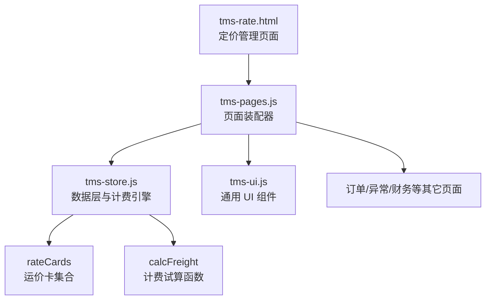
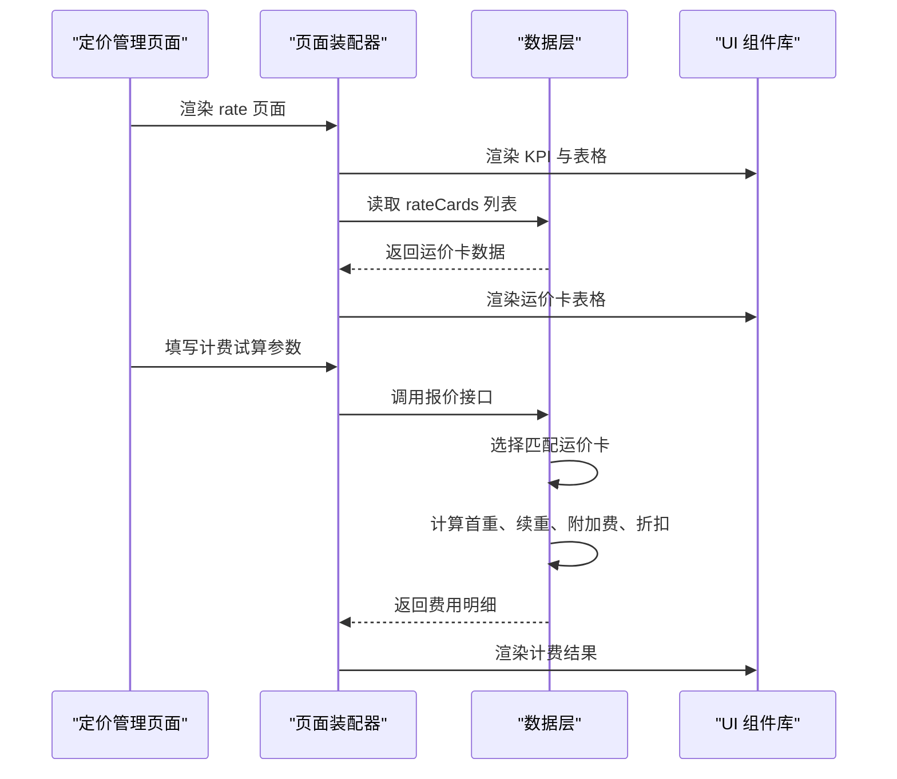
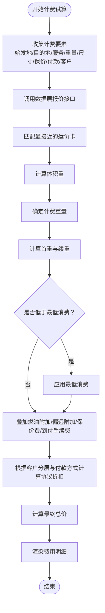
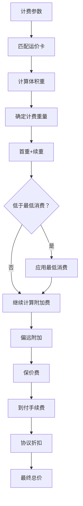
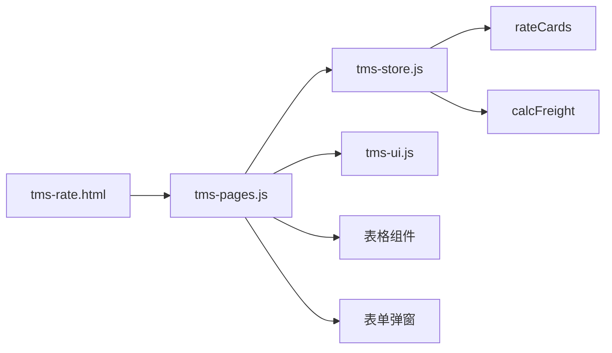

# 定价管理模块

<cite>
**本文引用的文件**   
- [tms-rate.html](file://tms-rate.html)
- [tms-pages.js](file://tms-pages.js)
- [tms-store.js](file://tms-store.js)
- [tms-ui.js](file://tms-ui.js)
</cite>

## 目录
1. [引言](#引言)
2. [项目结构定位](#项目结构定位)
3. [核心组件总览](#核心组件总览)
4. [架构总览](#架构总览)
5. [详细组件分析](#详细组件分析)
6. [依赖关系分析](#依赖关系分析)
7. [性能与扩展建议](#性能与扩展建议)
8. [故障排查指南](#故障排查指南)
9. [结论](#结论)

## 引言
本模块聚焦 TMS 系统中的“定价管理”，即运价卡管理与运费计费试算能力。它负责：
- 维护按线路与服务等级划分的运价卡；
- 根据重量、体积重、保价、到付、偏远地区、客户协议折扣等要素计算运费；
- 提供可视化的计费试算界面，并联动订单、应收结算、计费复核等上下游页面。

该模块由前端页面、页面装配器、共享 UI 组件库与本地数据层共同组成，采用轻量级前端架构，所有业务逻辑集中在浏览器端运行。

## 项目结构定位
定价管理在整体系统中属于运营后台的一个独立功能页，入口为 `tms-rate.html`，并通过统一页面装配器加载“运价管理 + 计费试算”两个子区域。

**图表来源**
- [tms-rate.html:256-261](file://tms-rate.html#L256-L261)
- [tms-pages.js:1832-1926](file://tms-pages.js#L1832-L1926)
- [tms-store.js:278-383](file://tms-store.js#L278-L383)
- [tms-ui.js:303-544](file://tms-ui.js#L303-L544)

**章节来源**
- [tms-rate.html:1-266](file://tms-rate.html#L1-L266)

## 核心组件总览
| 组件 | 职责 | 关键行为 | 主要文件位置 |
|---|---|---|---|
| 定价管理页面 | 承载运价卡列表与计费试算表单 | 初始化壳、渲染 rate 页面 | [tms-rate.html:256-261](file://tms-rate.html#L256-L261) |
| 页面装配器 | 将“运价管理”注册为可渲染页面 | 定义 KPI、表格、工具栏、操作按钮 | [tms-pages.js:1832-1926](file://tms-pages.js#L1832-L1926) |
| 数据层与计费引擎 | 维护运价卡、选择匹配规则、执行计费试算 | 构建种子数据、匹配运价卡、计算首重续重、附加费、折扣与总价 | [tms-store.js:278-383](file://tms-store.js#L278-L383) |
| 通用 UI 组件 | 提供表格、弹窗、表单、状态标签、金额格式化等 | 渲染表格、处理搜索筛选分页、提交表单回调 | [tms-ui.js:303-544](file://tms-ui.js#L303-L544) |

**章节来源**
- [tms-pages.js:1832-1926](file://tms-pages.js#L1832-L1926)
- [tms-store.js:278-383](file://tms-store.js#L278-L383)
- [tms-ui.js:303-544](file://tms-ui.js#L303-L544)

## 架构总览
定价管理模块采用“页面 → 装配器 → 数据层 → UI 组件”的单向依赖结构：
- 页面只负责挂载容器和调用装配器；
- 装配器负责声明表格列、过滤条件、新增运价卡表单以及计费试算交互；
- 数据层提供运价卡数据源与计费算法；
- UI 组件提供统一的表格、弹窗、状态展示与金额格式化。

**图表来源**
- [tms-rate.html:256-261](file://tms-rate.html#L256-L261)
- [tms-pages.js:1832-1926](file://tms-pages.js#L1832-L1926)
- [tms-store.js:278-383](file://tms-store.js#L278-L383)
- [tms-ui.js:303-544](file://tms-ui.js#L303-L544)

## 详细组件分析

### 定价管理页面
`tms-rate.html` 是定价管理的入口页面，主要职责包括：
- 引入公共样式与脚本；
- 初始化登录态校验；
- 调用 UI 壳初始化；
- 通过页面装配器渲染 `rate` 页面。

该页面本身不包含复杂业务逻辑，而是作为容器与导航入口存在。

**章节来源**
- [tms-rate.html:256-261](file://tms-rate.html#L256-L261)

### 页面装配器中的定价管理
页面装配器中定义了“运价管理 + 计费试算”组合页面，包含以下关键能力：

| 能力 | 说明 | 对应实现位置 |
|---|---|---|
| 计费试算表单 | 输入始发地、目的地、服务等级、付款方式、重量、尺寸、保价价值、客户名称 | [tms-pages.js:1873-1888](file://tms-pages.js#L1873-L1888) |
| 计费试算执行 | 调用数据层报价接口，并将结果渲染到结果区 | [tms-pages.js:1873-1888](file://tms-pages.js#L1873-L1888) |
| 运价卡表格 | 展示运价卡名称、线路、服务等级、首重价格、续重单价、抛比、最低消费、状态 | [tms-pages.js:1890-1907](file://tms-pages.js#L1890-L1907) |
| 新增运价卡 | 通过表单弹窗创建新运价卡，自动补全名称、基础字段与费率默认值 | [tms-pages.js:1908-1926](file://tms-pages.js#L1908-L1926) |
| 状态展示 | 使用统一状态标签显示运价卡生效或停用状态 | [tms-pages.js:1906-1906](file://tms-pages.js#L1906-L1906) |

#### 计费试算流程

**图表来源**
- [tms-pages.js:1873-1888](file://tms-pages.js#L1873-L1888)
- [tms-store.js:327-383](file://tms-store.js#L327-L383)

**章节来源**
- [tms-pages.js:1832-1926](file://tms-pages.js#L1832-L1926)

### 数据层与计费引擎
数据层承担定价相关的核心职责：
- 维护运价卡集合；
- 提供运价卡匹配策略；
- 实现完整计费试算逻辑；
- 生成种子数据，使系统首次访问时具备真实感演示数据。

#### 运价卡模型
运价卡用于描述一条线路或服务等级的计费规则，关键字段包括：
- 线路维度：始发地、目的地；
- 服务维度：服务等级；
- 计费维度：首重价格、续重单价、计抛比、最低消费；
- 附加维度：燃油费率、偏远附加、保价费率、到付手续费；
- 管理维度：状态、更新时间。

这些字段在种子数据构建与新增运价卡表单中保持一致，保证数据模型稳定。

#### 运价卡匹配策略
匹配优先级如下：
1. 精确线路 + 指定服务；
2. 精确线路 + 标准服务；
3. 全国 + 指定服务；
4. 全国 + 标准服务；
5. 回退到第一条可用运价卡。

这种设计允许系统在没有完全匹配规则时仍能给出合理估算。

#### 计费试算核心逻辑
计费试算的核心步骤包括：
- 解析计费要素；
- 选择匹配运价卡；
- 计算体积重；
- 比较实际重量与体积重，取较大者作为计费重量；
- 计算首重与续重；
- 检查最低消费；
- 计算燃油附加、偏远附加、保价费、到付手续费；
- 根据客户分层与付款方式计算协议折扣；
- 输出完整费用明细。

**图表来源**
- [tms-store.js:327-383](file://tms-store.js#L327-L383)

**章节来源**
- [tms-store.js:278-383](file://tms-store.js#L278-L383)

### 通用 UI 组件对定价管理的支持
定价管理页面大量依赖通用 UI 组件，主要体现在：
- 表格组件：支持搜索、筛选、排序、分页、工具栏按钮与行操作；
- 表单弹窗：支持必填校验、数字输入、下拉选择、复选框与异步提交；
- 状态标签：将 `active`、`inactive` 等状态映射为中文标签与颜色；
- 金额格式化：统一以人民币格式展示首重、续重、附加费与总价。

这些能力让定价管理页面的开发集中在业务配置上，而不是重复实现表格与表单逻辑。

**章节来源**
- [tms-ui.js:303-544](file://tms-ui.js#L303-L544)

## 依赖关系分析
定价管理模块的依赖关系如下：

**图表来源**
- [tms-rate.html:256-261](file://tms-rate.html#L256-L261)
- [tms-pages.js:1832-1926](file://tms-pages.js#L1832-L1926)
- [tms-store.js:278-383](file://tms-store.js#L278-L383)
- [tms-ui.js:303-544](file://tms-ui.js#L303-L544)

### 耦合与内聚
- 页面装配器与数据层耦合度适中：装配器通过数据层提供的查询与报价接口获取数据，不直接操作存储细节；
- 数据层内聚性强：计费逻辑、运价卡匹配、种子数据构建集中在同一模块；
- UI 组件与业务解耦：表格、弹窗、状态标签等通用能力被多个页面复用；
- 风险点：若数据层接口变更，需要同时调整页面装配器与相关页面。

### 外部依赖
- 浏览器本地存储：数据层基于本地存储持久化；
- DOM API：UI 组件直接操作 DOM；
- 事件机制：数据变更通过自定义事件通知订阅者。

**章节来源**
- [tms-store.js:1-12](file://tms-store.js#L1-L12)
- [tms-ui.js:1-10](file://tms-ui.js#L1-L10)

## 性能与扩展建议
### 性能考虑
- 表格渲染：当运价卡数量增长时，应关注分页与虚拟滚动；当前实现已支持分页，适合中小规模数据；
- 计费试算：每次试算都会遍历运价卡进行匹配，建议在运价卡较多时建立索引；
- 本地存储：频繁写入可能触发存储容量限制，建议批量更新与防抖保存；
- 事件监听：数据变更会触发全局事件，需避免过多订阅者造成重复渲染。

### 扩展建议
- 运价卡版本管理：增加生效时间、失效时间与版本号，支持历史价格追溯；
- 阶梯运价：支持按重量区间设置不同首重与续重价格；
- 促销规则：支持限时折扣、活动线路加价或减免；
- 客户专属运价：支持按客户维度覆盖默认运价卡；
- 审计日志：记录运价卡修改人、修改时间与变更前后差异；
- 后端集成：将本地存储替换为服务端接口，支持多端同步与权限控制。

[本节为通用指导，不直接分析具体代码文件]

## 故障排查指南
### 常见问题
| 问题 | 可能原因 | 排查建议 |
|---|---|---|
| 运价卡列表为空 | 数据未初始化或本地存储损坏 | 检查数据层初始化逻辑与本地存储键值 |
| 计费结果为 0 | 未匹配到有效运价卡或重量/体积输入异常 | 检查输入参数与运价卡匹配规则 |
| 最低消费未生效 | 基础运费低于最低消费但未正确应用 | 检查最低消费判断与赋值逻辑 |
| 折扣未生效 | 客户名称不在客户分层字典或付款方式不符合 | 检查客户分层配置与付款方式 |
| 表格无法刷新 | 数据变更事件未触发或订阅者未绑定 | 检查数据层事件发布与表格订阅逻辑 |

### 调试建议
- 打开浏览器控制台查看数据层事件；
- 检查本地存储中是否存在有效的数据库版本；
- 在计费试算前打印计费参数与匹配到的运价卡；
- 使用表格搜索与筛选快速定位异常数据；
- 通过新增运价卡表单验证字段校验逻辑。

**章节来源**
- [tms-store.js:220-244](file://tms-store.js#L220-L244)
- [tms-ui.js:239-286](file://tms-ui.js#L239-L286)

## 结论
定价管理模块以“运价卡 + 计费试算”为核心，提供了从规则维护到费用估算的完整闭环。其优势在于：
- 数据结构清晰，便于理解与维护；
- 计费逻辑透明，便于审计与复核；
- 页面装配模式降低重复开发成本；
- 通用 UI 组件提升一致性体验。

未来可在运价卡版本、阶梯运价、客户专属规则、审计日志与后端集成方面进一步演进，使其更贴近真实企业场景。

[本节为总结性内容，不直接分析具体代码文件]