# 数据管理层（TmsStore）

<cite>
**本文引用的文件**   
- [tms-store.js](file://tms-store.js)
- [common.js](file://common.js)
- [tms-pages.js](file://tms-pages.js)
</cite>

## 目录
1. [引言](#引言)
2. [项目结构定位](#项目结构定位)
3. [核心职责与架构总览](#核心职责与架构总览)
4. [存储策略与版本管理](#存储策略与版本管理)
5. [种子数据生成机制](#种子数据生成机制)
6. [CRUD 接口与查询能力](#crud-接口与查询能力)
7. [事件驱动与状态管理模式](#事件驱动与状态管理模式)
8. [订单全生命周期状态流转](#订单全生命周期状态流转)
9. [关联记录自动生成规则](#关联记录自动生成规则)
10. [统计聚合与报表能力](#统计聚合与报表能力)
11. [计费引擎、路由与轨迹](#计费引擎路由与轨迹)
12. [计数器机制与真实感数据算法](#计数器机制与真实感数据算法)
13. [与其他组件的关系](#与其他组件的关系)
14. [配置选项、参数与返回值规范](#配置选项参数与返回值规范)
15. [常见问题与排错指南](#常见问题与排错指南)
16. [性能与扩展建议](#性能与扩展建议)
17. [结论](#结论)

## 引言
TmsStore 是 TMS 系统的共享数据层，基于浏览器 localStorage 实现轻量级业务数据库。它承担以下职责：
- 首次访问时生成具备真实感的种子数据，覆盖订单、运单、运输、分拣、装卸、扫描、异常、财务、应收应付、账单、工单、理赔、员工、车辆、仓库、库存、运力、电子围栏、策略、路由、权限等实体。
- 提供统一的增删改查、搜索、筛选、排序、分页能力。
- 维护订单全生命周期状态流转，并在关键节点自动写入扫描、运输、财务等关联记录。
- 提供面向各页面的统计聚合能力，包括 KPI、趋势、分布、日报等。
- 通过事件驱动模式通知订阅者数据变更，支持跨标签页同步。

该模块对外暴露 `window.TmsStore`，所有管理员端页面通过该对象访问数据与业务方法。

## 项目结构定位
从仓库结构看，TmsStore 位于根目录的 `tms-store.js`，属于系统级基础设施；通用工具函数位于 `common.js`；管理员端页面装配逻辑位于 `tms-pages.js`。三者关系如下：

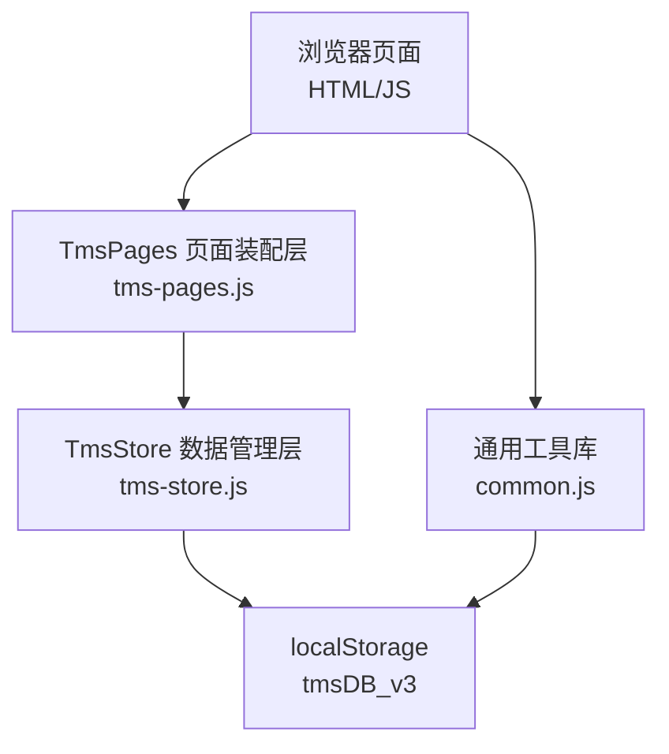

**图表来源**
- [tms-store.js:1-12](file://tms-store.js#L1-L12)
- [tms-pages.js:1-12](file://tms-pages.js#L1-L12)
- [common.js:1-10](file://common.js#L1-L10)

**章节来源**
- [tms-store.js:1-12](file://tms-store.js#L1-L12)
- [tms-pages.js:1-12](file://tms-pages.js#L1-L12)
- [common.js:1-10](file://common.js#L1-L10)

## 核心职责与架构总览
TmsStore 的核心职责可归纳为五类：
1. **数据初始化**：读取或生成 `tmsDB_v3` 数据结构。
2. **基础 CRUD**：对任意实体集合进行列表查询、详情获取、新增、更新、删除。
3. **业务动作**：创建订单、推进订单状态、取消订单、处理异常、创建工单、审批理赔、完成分拣/装卸、更新运输状态。
4. **统计聚合**：概览、趋势、分布、日报、车辆、仓库、财务、员工统计。
5. **事件与持久化**：每次写操作后持久化到 localStorage，并触发 `tms:datachange` 事件。

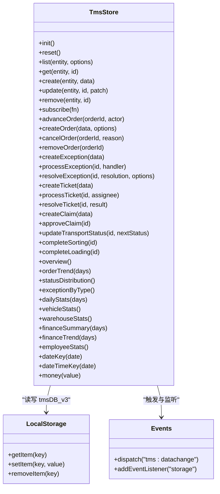

**图表来源**
- [tms-store.js:1944-1987](file://tms-store.js#L1944-L1987)
- [tms-store.js:220-244](file://tms-store.js#L220-L244)
- [tms-store.js:1991-1997](file://tms-store.js#L1991-L1997)

**章节来源**
- [tms-store.js:1944-1987](file://tms-store.js#L1944-L1987)
- [tms-store.js:220-244](file://tms-store.js#L220-L244)
- [tms-store.js:1991-1997](file://tms-store.js#L1991-L1997)

## 存储策略与版本管理
TmsStore 使用固定键名 `tmsDB_v3` 存储 JSON 序列化后的数据库对象。每次写操作都会调用 `persist()`，将内存中的 `db` 对象序列化为字符串写入 localStorage，并触发事件。

关键设计点：
- **版本号控制**：`DB_VERSION = 3`，读取时会校验 `parsed.version === DB_VERSION`，不匹配则视为无效数据，触发重新初始化。
- **容错读取**：`readDb()` 捕获 JSON 解析异常，返回 null，避免页面崩溃。
- **跨标签页同步**：监听 `storage` 事件，当其他标签页修改 `tmsDB_v3` 时，当前页刷新内存并触发事件，保证多标签页一致性。
- **重置机制**：`reset()` 会清空 localStorage 对应键，然后强制重新生成种子数据。

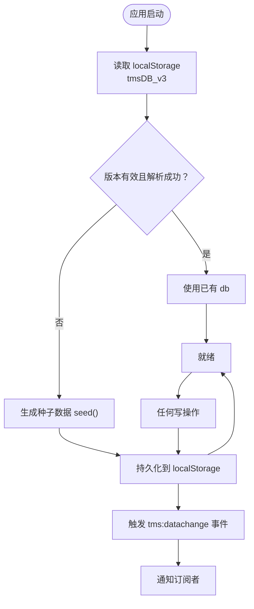

**图表来源**
- [tms-store.js:220-244](file://tms-store.js#L220-L244)
- [tms-store.js:1185-1193](file://tms-store.js#L1185-L1193)
- [tms-store.js:1991-1997](file://tms-store.js#L1991-L1997)

**章节来源**
- [tms-store.js:16-17](file://tms-store.js#L16-L17)
- [tms-store.js:220-244](file://tms-store.js#L220-L244)
- [tms-store.js:1185-1193](file://tms-store.js#L1185-L1193)
- [tms-store.js:1991-1997](file://tms-store.js#L1991-L1997)

## 种子数据生成机制
种子数据由 `seed()` 一次性生成，包含以下主要实体：
- 用户、角色、权限、部门、区域、员工、车辆、仓库、库存、运力、电子围栏、设备。
- 策略、路由规则、派送地址、时效规则、改单记录、考核指标。
- 订单、分拣任务、装卸任务、扫描记录、运输任务、异常、财务流水、应收、应付、账单、服务工单、理赔申请。
- 行政记录、绩效评估、员工绩效排名。

种子数据生成特点：
- **确定性随机数**：使用 `mulberry32(20260122)` 作为伪随机数生成器，保证同一浏览器中首次生成的演示数据稳定。
- **时间分布合理**：订单按过去 14 天分布，最近几天状态更靠后，历史订单更多已签收。
- **业务关联完整**：订单生成时同步计算运费、生成运单号、规划路由、生成轨迹、生成分拣/装卸/运输/异常/财务/应收应付/账单等关联记录。
- **ID 生成规则**：使用 `counterSeed()` 生成带日期前缀的稳定 ID，便于列表展示与审计。

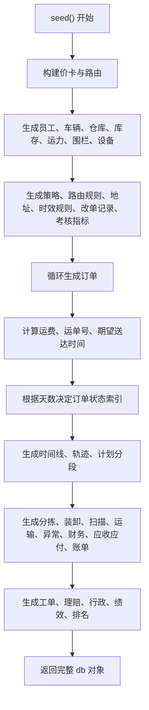

**图表来源**
- [tms-store.js:464-1152](file://tms-store.js#L464-L1152)

**章节来源**
- [tms-store.js:464-1152](file://tms-store.js#L464-L1152)

## CRUD 接口与查询能力
TmsStore 提供统一的基础 CRUD 接口：

| 方法 | 参数 | 返回值 | 说明 |
|---|---|---|---|
| `list(entity, options)` | `entity`: 实体名；`options`: `{ search, searchFields, filters, sort, page, pageSize }` | `{ rows, total, page, pageSize, pages }` | 支持模糊搜索、字段过滤、排序、分页 |
| `get(entity, id)` | `entity`: 实体名；`id`: 记录 ID | 记录对象或 null | 按 ID 查找单条记录 |
| `create(entity, data)` | `entity`: 实体名；`data`: 记录数据 | 新增后的记录对象 | 自动生成 ID、createdAt、updatedAt |
| `update(entity, id, patch)` | `entity`: 实体名；`id`: 记录 ID；`patch`: 要更新的字段 | 更新后的记录对象或 null | 合并字段并更新时间戳 |
| `remove(entity, id)` | `entity`: 实体名；`id`: 记录 ID | boolean | 删除记录，失败返回 false |

查询能力细节：
- **搜索**：`search` 为字符串，默认在所有字段中进行小写模糊匹配。
- **过滤**：`filters` 为键值对，支持数组值表示多选。
- **排序**：`sort.key` 指定字段，`sort.dir` 支持 `asc` 和降序。
- **分页**：`pageSize > 0` 时启用分页，返回总页数与当前页。

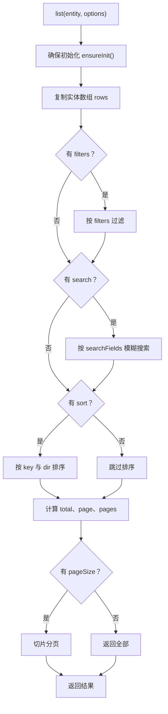

**图表来源**
- [tms-store.js:1208-1256](file://tms-store.js#L1208-L1256)

**章节来源**
- [tms-store.js:1208-1256](file://tms-store.js#L1208-L1256)

## 事件驱动与状态管理模式
TmsStore 采用“内存状态 + 持久化 + 事件广播”的模式：
- 所有写操作最终调用 `persist()`，写入 localStorage。
- `persist()` 同时触发 `document.dispatchEvent(new CustomEvent('tms:datachange'))`。
- 页面可通过 `subscribe(fn)` 注册监听器，在数据变化时接收最新 `db` 对象。
- 跨标签页通过 `storage` 事件同步，避免多窗口数据不一致。

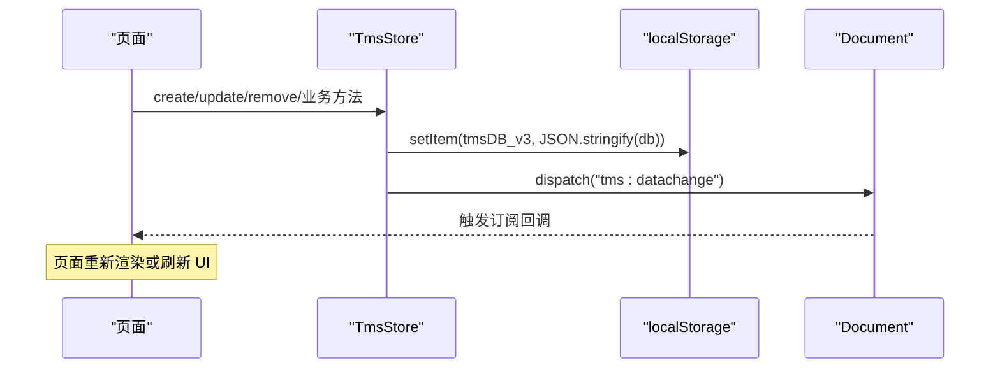

**图表来源**
- [tms-store.js:232-244](file://tms-store.js#L232-L244)
- [tms-store.js:1306-1311](file://tms-store.js#L1306-L1311)
- [tms-store.js:1991-1997](file://tms-store.js#L1991-L1997)

**章节来源**
- [tms-store.js:232-244](file://tms-store.js#L232-L244)
- [tms-store.js:1306-1311](file://tms-store.js#L1306-L1311)
- [tms-store.js:1991-1997](file://tms-store.js#L1991-L1997)

## 订单全生命周期状态流转
订单状态定义如下：
- 待入库 → 已入库 → 已分拣 → 运输中 → 已到达 → 派送中 → 已签收
- 已取消为独立终止状态

状态流转由 `applyOrderStatus()` 控制，每个状态变更会自动：
- 追加时间线记录。
- 写入扫描记录。
- 更新分拣、装卸、运输任务。
- 更新车辆状态。
- 在签收时生成收入流水。

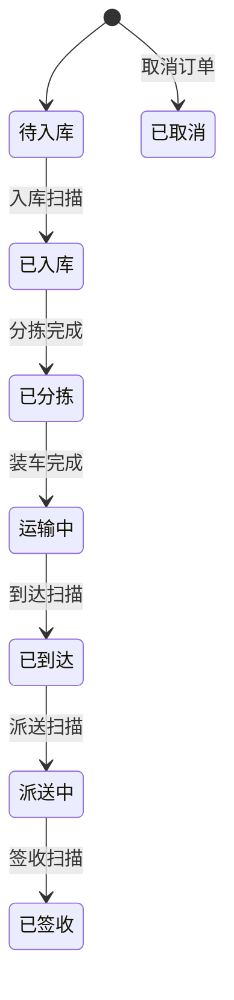

**图表来源**
- [tms-store.js:88-96](file://tms-store.js#L88-L96)
- [tms-store.js:1434-1493](file://tms-store.js#L1434-L1493)
- [tms-store.js:1495-1506](file://tms-store.js#L1495-L1506)

**章节来源**
- [tms-store.js:88-96](file://tms-store.js#L88-L96)
- [tms-store.js:1434-1493](file://tms-store.js#L1434-L1493)
- [tms-store.js:1495-1506](file://tms-store.js#L1495-L1506)

## 关联记录自动生成规则
订单状态推进时，TmsStore 会自动生成或更新以下关联记录：

| 订单状态 | 自动行为 |
|---|---|
| 已入库 | 写入入库扫描；创建或更新分拣任务为进行中 |
| 已分拣 | 标记分拣任务完成；写入分拣扫描与出库扫描；创建装卸任务 |
| 运输中 | 标记装卸任务完成；创建运输任务；设置发车时间；更新车辆状态为运输中 |
| 已到达 | 更新运输任务状态为已到达；写入到达扫描 |
| 派送中 | 更新运输任务状态为派送中；写入派送扫描 |
| 已签收 | 更新运输任务为已完成；写入签收扫描；生成收入流水；恢复车辆在线 |

此外，创建订单时若开启 `autoInbound`，会直接推进至已入库状态。

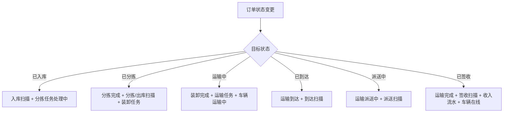

**图表来源**
- [tms-store.js:1434-1493](file://tms-store.js#L1434-L1493)

**章节来源**
- [tms-store.js:1434-1493](file://tms-store.js#L1434-L1493)

## 统计聚合与报表能力
TmsStore 提供多种统计接口，供仪表盘、报表页面使用：

| 方法 | 输出含义 |
|---|---|
| `overview()` | 今日订单数、待处理异常、在途运输、签收率、活跃用户、在线车辆、今日收入、总订单、已签收订单、待处理工单 |
| `orderTrend(days)` | 近 N 日每日创建订单数与签收数 |
| `statusDistribution()` | 订单状态分布 |
| `exceptionByType()` | 异常类型分布 |
| `dailyStats(days)` | 近 N 日日报，含应签、实签、签收率、入库扫描率、出库扫描率、派送扫描率、漏分、叉车作业量等 |
| `vehicleStats()` | 车辆总数与状态分布 |
| `warehouseStats()` | 仓库数量、物料种类、低库存数、库存总量、今日出入库量 |
| `financeSummary(days)` | 近 N 日收入、支出、利润、流水笔数 |
| `financeTrend(days)` | 近 N 日每日收入与支出趋势 |
| `employeeStats()` | 员工总数与在职、休假、离职人数 |

日报统计特别注意：
- 扫描口径按订单去重，仅在当日应作业订单范围内统计，避免指标失真超过 100%。
- 漏分率、叉车吨位等指标均经过四舍五入与边界保护。

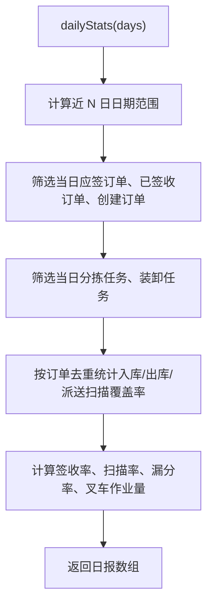

**图表来源**
- [tms-store.js:1830-1878](file://tms-store.js#L1830-L1878)

**章节来源**
- [tms-store.js:1740-1940](file://tms-store.js#L1740-L1940)

## 计费引擎、路由与轨迹
### 计费引擎
计费引擎 `calcFreight()` 根据以下要素计算费用：
- 起终点、服务等级、重量、体积或尺寸、保价金额、付款方式、客户等级。
- 匹配最合适的运价卡：精确线路+服务 > 精确线路标准 > 全国+服务 > 全国+标准。
- 计算首重费、续重费、最低消费、燃油附加费、偏远附加费、保保费、到付手续费。
- 应用客户协议折扣，月结大客户额外享受折扣提升。
- 返回完整费用明细，包括各项拆分与总金额。

### 路由与轨迹
- 路由由 `buildRoutes()` 生成，包含全国兵底线路与各城市间干线。
- `planRoute()` 根据订单起终点匹配路由，计算每段标准时长与截止时间。
- `buildTraces()` 根据订单阶段生成轨迹明细，包含节点、地点、截止时间、超时与偏差标记。

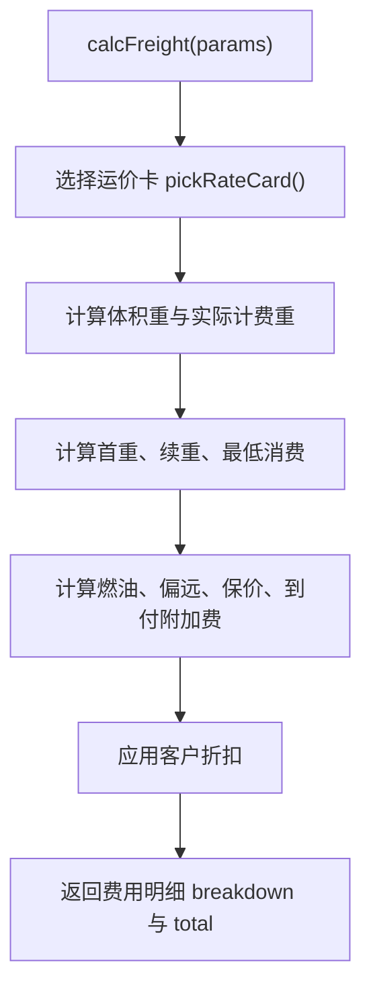

**图表来源**
- [tms-store.js:332-383](file://tms-store.js#L332-L383)
- [tms-store.js:312-325](file://tms-store.js#L312-L325)
- [tms-store.js:388-440](file://tms-store.js#L388-L440)
- [tms-store.js:443-460](file://tms-store.js#L443-L460)

**章节来源**
- [tms-store.js:278-383](file://tms-store.js#L278-L383)
- [tms-store.js:388-460](file://tms-store.js#L388-L460)

## 计数器机制与真实感数据算法
### 计数器机制
TmsStore 使用两类计数器：
1. **种子数据计数器**：`counterSeed()` 用于种子数据生成，ID 格式为 `前缀-YYYYMMDD-序号`，保证列表 ID 与业务时间一致。
2. **运行时计数器**：`counterNext()` 用于运行时新增记录，ID 格式为 `前缀-YYYYMMDD-三位序号`，按实体维护独立计数。

### 真实感数据算法
- **订单号生成**：`buildOrderId()` 结合发货城市缩写、时间戳、客户哈希与序列号，生成稳定且可读的订单号。
- **运单号生成**：`buildWaybill()` 基于订单号哈希生成 10 位唯一码加 4 位随机后缀。
- **伪随机数**：`mulberry32(20260122)` 提供确定性随机，保证演示数据稳定。
- **时间偏移**：`at(dayOffset, hour, minute)` 生成相对当前时间的 ISO 时间，用于模拟历史数据。
- **金额处理**：`money()` 统一保留两位小数，避免浮点误差。

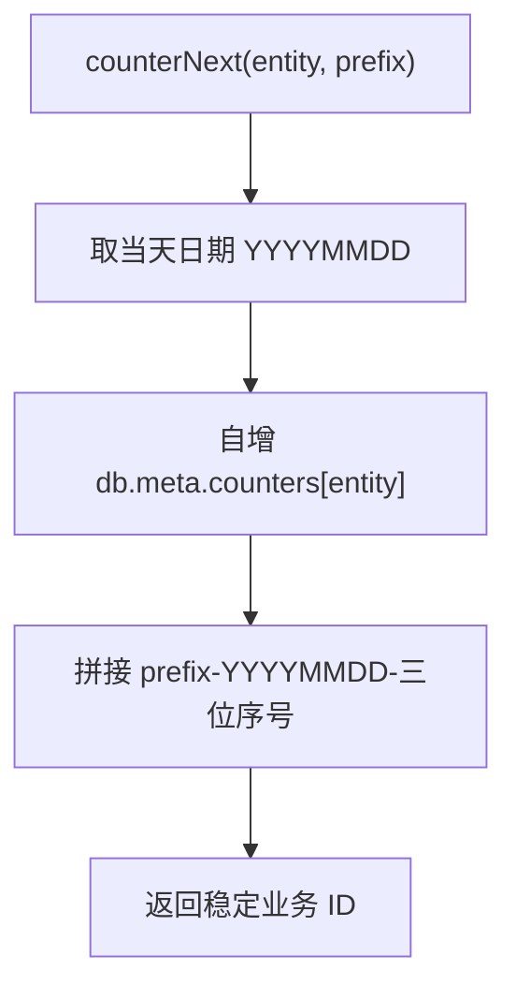

**图表来源**
- [tms-store.js:246-250](file://tms-store.js#L246-L250)
- [tms-store.js:252-261](file://tms-store.js#L252-L261)
- [tms-store.js:44-54](file://tms-store.js#L44-L54)
- [tms-store.js:1154-1162](file://tms-store.js#L1154-L1162)

**章节来源**
- [tms-store.js:246-261](file://tms-store.js#L246-L261)
- [tms-store.js:44-54](file://tms-store.js#L44-L54)
- [tms-store.js:1154-1162](file://tms-store.js#L1154-L1162)

## 与其他组件的关系
### 与 TmsPages 的关系
`tms-pages.js` 是管理员端页面装配层，内部引用 `global.TmsStore`，用于：
- 获取订单下拉选项。
- 渲染表格、图表、KPI。
- 调用 TmsStore 的 list、get、create、update、业务方法。

### 与 common.js 的关系
`common.js` 提供通用工具函数，如登录、用户信息、积分管理等，也直接使用 localStorage，但与 TmsStore 的数据模型分离。TmsStore 专注业务数据，common.js 专注通用交互与用户会话。

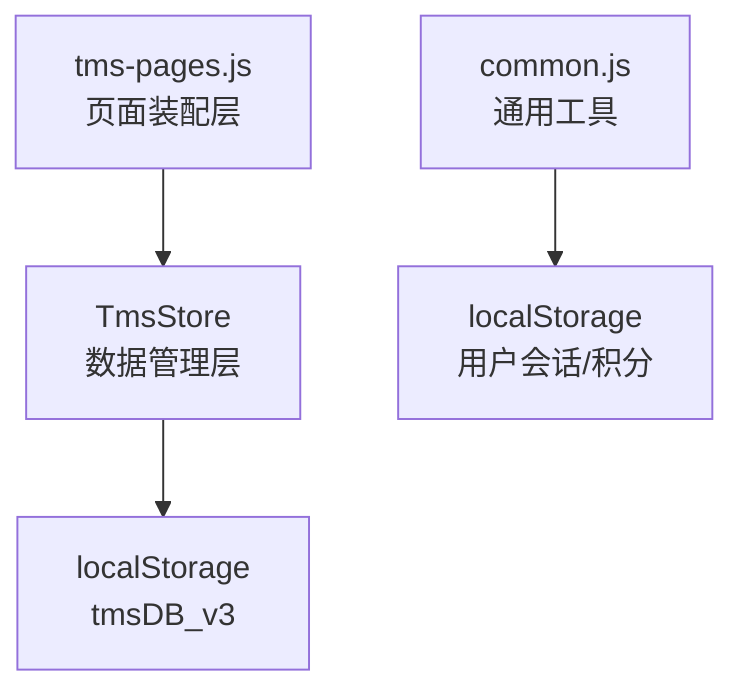

**图表来源**
- [tms-pages.js:10-12](file://tms-pages.js#L10-L12)
- [common.js:154-161](file://common.js#L154-L161)
- [tms-store.js:16-17](file://tms-store.js#L16-L17)

**章节来源**
- [tms-pages.js:10-12](file://tms-pages.js#L10-L12)
- [common.js:154-161](file://common.js#L154-L161)
- [tms-store.js:16-17](file://tms-store.js#L16-L17)

## 配置选项、参数与返回值规范
### 基础 CRUD
- `list(entity, options)`
  - `options.search`: 模糊搜索字符串
  - `options.searchFields`: 搜索字段数组，默认所有字段
  - `options.filters`: 过滤条件对象，支持数组值
  - `options.sort.key`: 排序字段
  - `options.sort.dir`: `asc` 或降序
  - `options.page`: 当前页
  - `options.pageSize`: 每页条数
  - 返回：`{ rows, total, page, pageSize, pages }`

### 业务动作
- `createOrder(data, options)`
  - `data.origin`, `destination`, `customer`, `contact`, `phone`, `goods`, `weight`, `pieces`, `freight`, `senderAddress`, `receiverAddress`, `expectedAt`, `remark`
  - `options.autoInbound`: 是否自动入库
  - 返回：订单对象

- `advanceOrder(orderId, actor)`
  - 返回：`{ ok, message, status, label, order }`

- `cancelOrder(orderId, reason)`
  - 返回：boolean

- `removeOrder(orderId)`
  - 返回：boolean

- `createException(data)` / `processException(id, handler)` / `resolveException(id, resolution, options)`
- `createTicket(data)` / `processTicket(id, assignee)` / `resolveTicket(id, result)`
- `createClaim(data)` / `approveClaim(id)`
- `updateTransportStatus(id, nextStatus)`
- `completeSorting(id)` / `completeLoading(id)`

### 统计接口
- `overview()` / `orderTrend(days)` / `statusDistribution()` / `exceptionByType()` / `dailyStats(days)` / `vehicleStats()` / `warehouseStats()` / `financeSummary(days)` / `financeTrend(days)` / `employeeStats()`

### 工具方法
- `dateKey(date)` / `dateTimeKey(date)` / `money(value)`

**章节来源**
- [tms-store.js:1208-1256](file://tms-store.js#L1208-L1256)
- [tms-store.js:1508-1570](file://tms-store.js#L1508-L1570)
- [tms-store.js:1572-1731](file://tms-store.js#L1572-L1731)
- [tms-store.js:1740-1940](file://tms-store.js#L1740-L1940)
- [tms-store.js:1984-1986](file://tms-store.js#L1984-L1986)

## 常见问题与排错指南
### 问题一：localStorage 数据损坏或版本不匹配
**现象**：页面加载后数据为空或报错。  
**原因**：`tmsDB_v3` 内容被手动修改或旧版本数据未迁移。  
**解决**：调用 `TmsStore.reset()` 重置数据，或删除浏览器 localStorage 中 `tmsDB_v3` 后刷新页面。

**章节来源**
- [tms-store.js:220-229](file://tms-store.js#L220-L229)
- [tms-store.js:1313-1318](file://tms-store.js#L1313-L1318)

### 问题二：多标签页数据不同步
**现象**：一个标签页修改数据，另一个标签页未更新。  
**原因**：未正确监听 `storage` 事件或浏览器限制。  
**解决**：确保 TmsStore 已初始化，检查是否被其他脚本覆盖全局事件监听。

**章节来源**
- [tms-store.js:1991-1997](file://tms-store.js#L1991-L1997)

### 问题三：订单状态无法推进
**现象**：调用 `advanceOrder()` 返回失败。  
**原因**：订单不存在、已取消或已签收。  
**解决**：先通过 `get('orders', orderId)` 检查订单状态，确认是否符合流转规则。

**章节来源**
- [tms-store.js:1495-1506](file://tms-store.js#L1495-L1506)

### 问题四：统计指标异常偏高
**现象**：日报扫描率超过 100%。  
**原因**：扫描记录未按订单去重或统计口径错误。  
**解决**：使用 `dailyStats()`，其内部已按订单去重并按应作业订单范围统计。

**章节来源**
- [tms-store.js:1817-1823](file://tms-store.js#L1817-L1823)
- [tms-store.js:1845-1878](file://tms-store.js#L1845-L1878)

## 性能与扩展建议
### 性能特征
- **本地存储**：所有数据驻留在浏览器 localStorage，无网络请求，适合演示与轻量场景。
- **内存缓存**：`db` 对象常驻内存，避免频繁解析 JSON。
- **批量写入**：种子数据一次性生成，减少多次持久化开销。
- **扫描记录上限**：扫描记录超过 500 条会截断，防止 localStorage 膨胀。

### 扩展建议
- **数据迁移**：如需升级 `DB_VERSION`，应在 `readDb()` 中增加迁移逻辑，将旧结构转换为新结构。
- **索引优化**：对于高频查询字段，可在内存中建立索引对象，提升 `get()` 与过滤性能。
- **事务封装**：可将多个写操作封装为事务，失败时回滚内存状态。
- **导出导入**：增加 `exportDb()` 与 `importDb()` 方法，支持数据备份与恢复。
- **权限控制**：在 `create`/`update`/`remove` 中加入当前用户权限校验。

**章节来源**
- [tms-store.js:1335-1346](file://tms-store.js#L1335-L1346)
- [tms-store.js:220-244](file://tms-store.js#L220-L244)

## 结论
TmsStore 是一个结构清晰、职责明确的轻量级业务数据层。它以 localStorage 为持久化载体，通过确定性种子数据生成、完善的 CRUD 接口、事件驱动架构、订单状态机与统计聚合能力，为 TMS 管理员端提供了完整的数据支撑。对于初学者，它可以作为理解前端数据层、状态管理与事件通信的良好示例；对于有经验的开发者，它提供了可扩展的架构基础，便于进一步接入权限、事务、索引与数据迁移等高级特性。