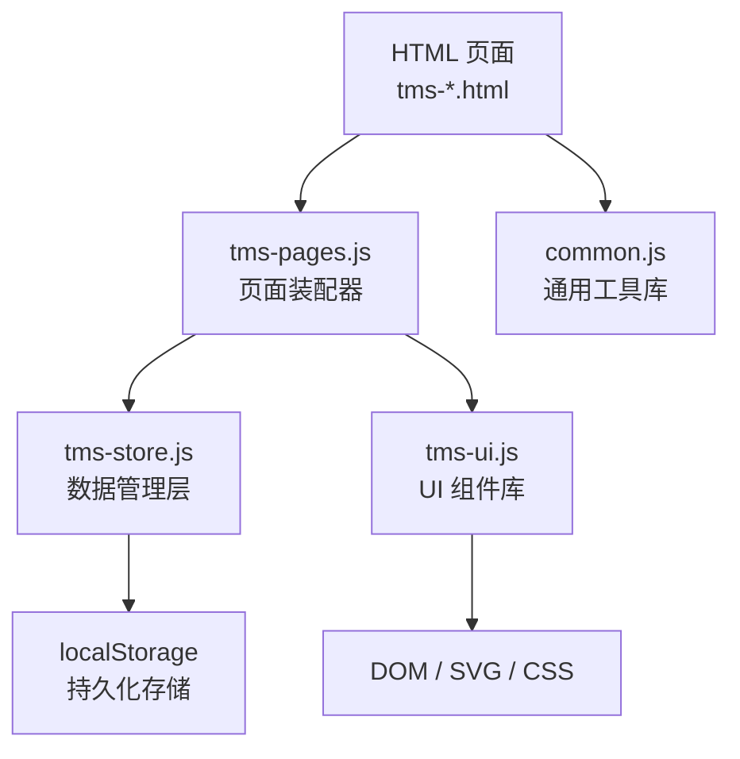
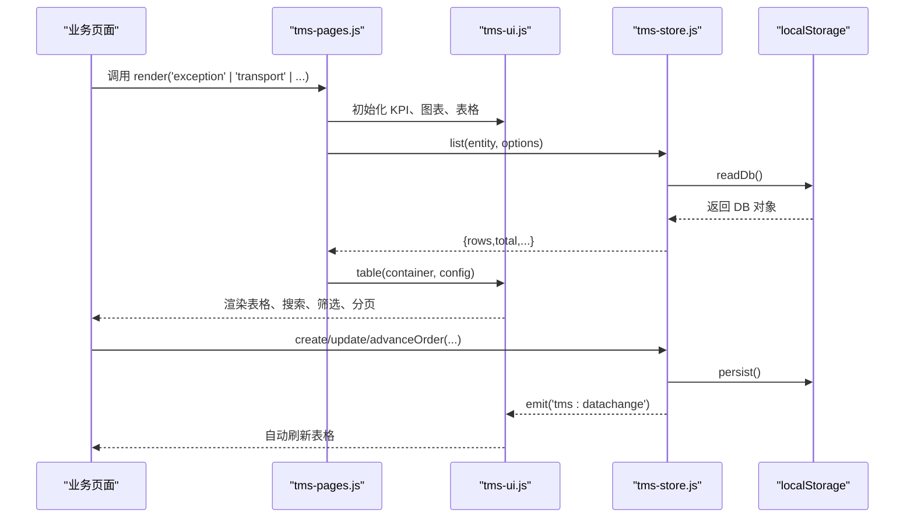
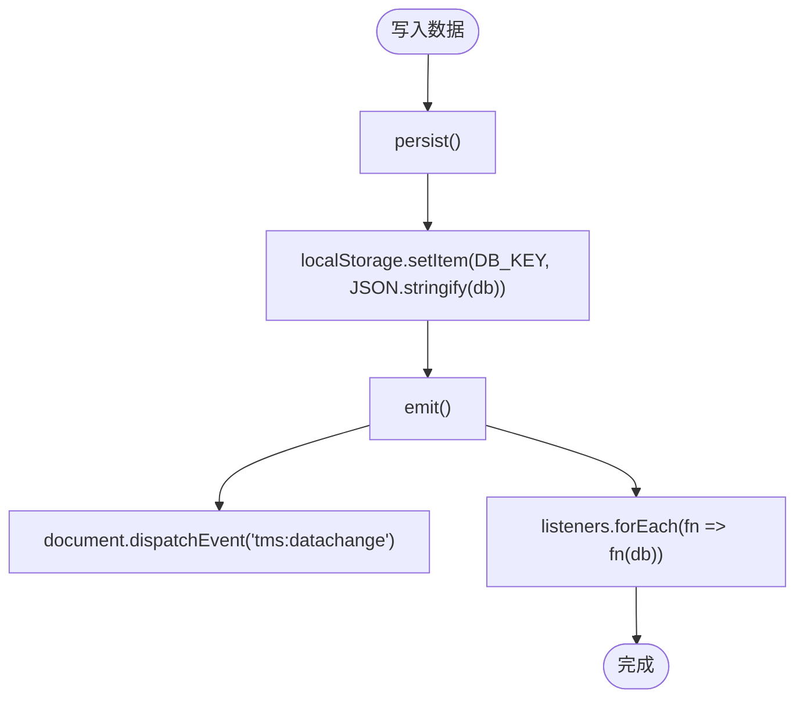
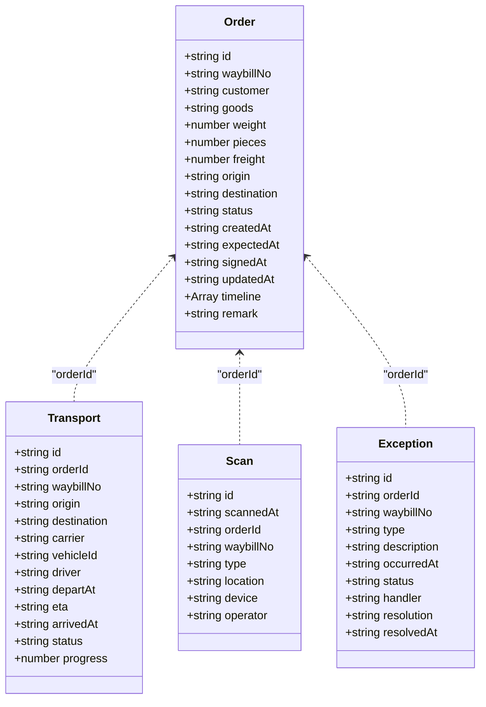
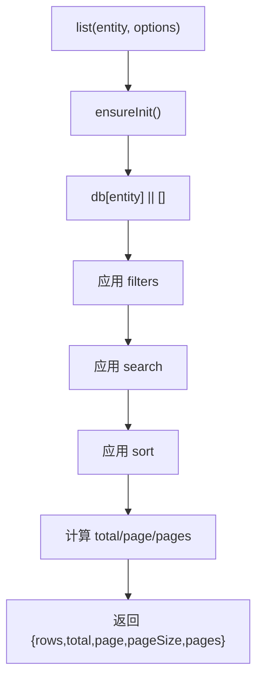
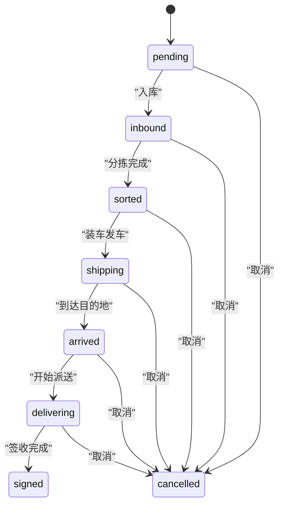
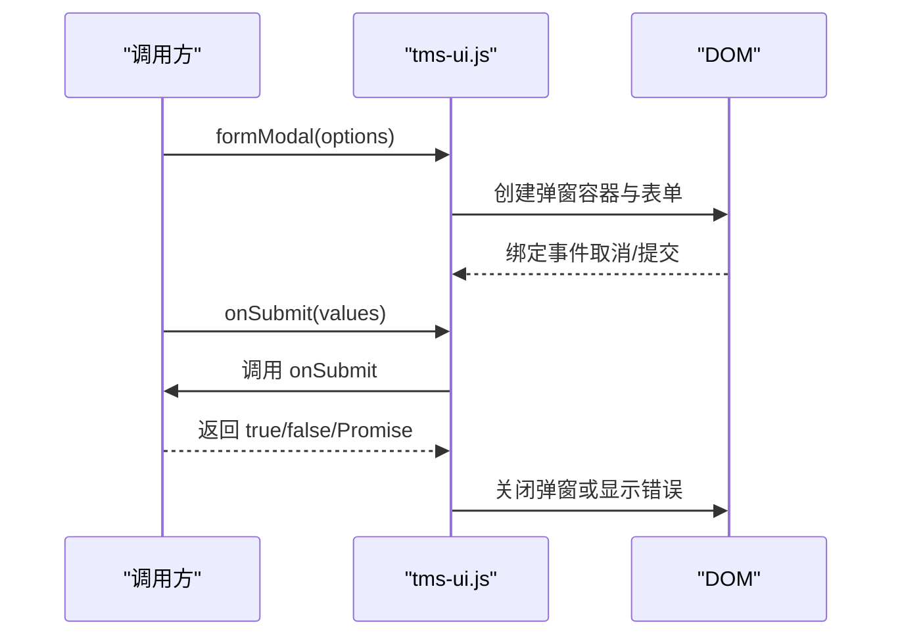
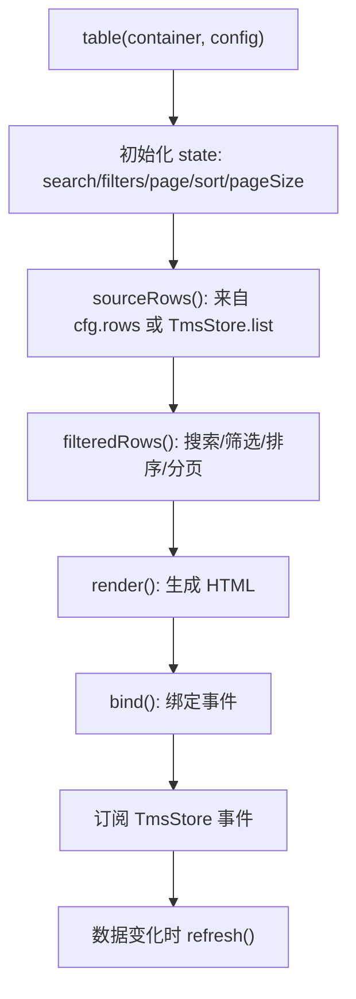
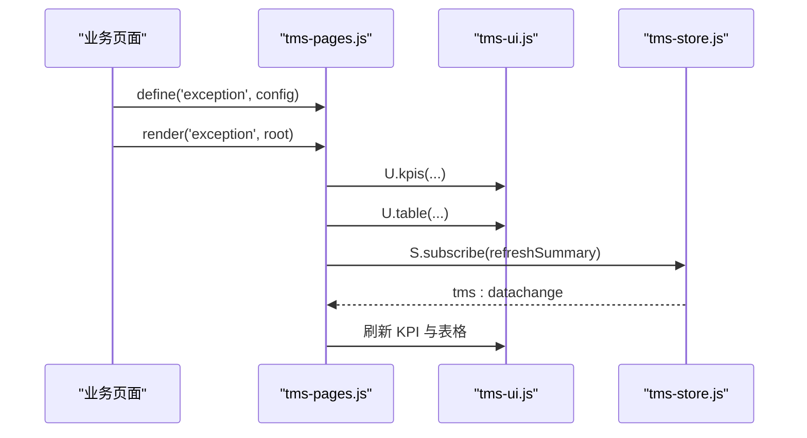
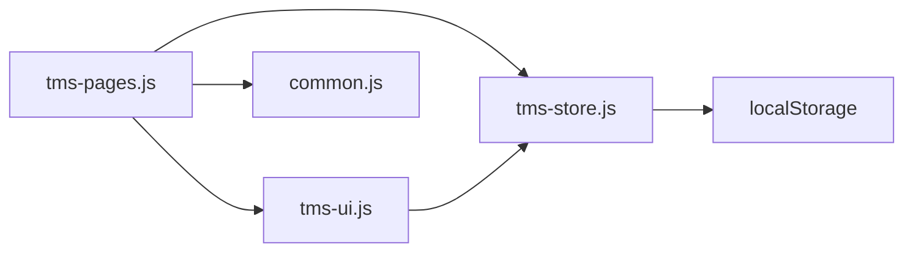

# 核心模块详解

<cite>
**本文引用的文件**   
- [tms-store.js](file://tms-store.js)
- [tms-ui.js](file://tms-ui.js)
- [common.js](file://common.js)
- [tms-pages.js](file://tms-pages.js)
</cite>

## 目录
1. [引言](#引言)
2. [项目结构](#项目结构)
3. [核心组件总览](#核心组件总览)
4. [架构总览](#架构总览)
5. [TmsStore 数据管理层详解](#tmsstore-数据管理层详解)
6. [TmsUI 组件库详解](#tmsui-组件库详解)
7. [CommonJS 通用工具库详解](#commonjs-通用工具库详解)
8. [页面装配与调用关系](#页面装配与调用关系)
9. [依赖关系分析](#依赖关系分析)
10. [性能与可扩展性](#性能与可扩展性)
11. [常见问题与排错指南](#常见问题与排错指南)
12. [结论](#结论)

## 引言
本文件面向 TMS（运输管理系统）前端原型的核心模块，重点解释以下三部分：
- TmsStore 数据管理层：基于 localStorage 的轻量业务数据库，负责种子数据、统一 CRUD、订单生命周期、关联记录联动、统计聚合和事件驱动。
- TmsUI 组件库：提供列表、搜索/筛选/分页、表单弹窗、确认框、Toast、SVG 图表、状态徽章、详情页等可复用 UI 能力。
- CommonJS 通用工具库：提供全局工具函数、登录鉴权、用户信息、积分等通用能力。

文档同时说明配置选项、参数与返回值，给出实际代码路径引用，并包含架构图、时序图、流程图和类图，帮助初学者快速上手，也为有经验的开发者提供足够技术深度。

## 项目结构
仓库采用“多 HTML 页面 + 少量 JS 公共模块”的前端原型结构。核心模块集中在以下文件：
- tms-store.js：共享数据层，维护所有业务实体、查询、变更、统计与事件。
- tms-ui.js：共享 UI 组件库，封装表格、弹窗、图表、状态展示等。
- common.js：通用工具库，提供 ID 生成、按钮样式注入、登录、用户信息、积分等。
- tms-pages.js：管理员端页面装配器，将各业务页统一为 KPI + 图表 + 表格 + CRUD 的结构。

**图示来源**
- [tms-pages.js:87-114](file://tms-pages.js#L87-L114)
- [tms-store.js:220-244](file://tms-store.js#L220-L244)
- [tms-ui.js:756-779](file://tms-ui.js#L756-L779)
- [common.js:366-382](file://common.js#L366-L382)

**章节来源**
- [tms-store.js:1-12](file://tms-store.js#L1-L12)
- [tms-ui.js:1-6](file://tms-ui.js#L1-L6)
- [common.js:1-10](file://common.js#L1-L10)
- [tms-pages.js:1-6](file://tms-pages.js#L1-L6)

## 核心组件总览
- TmsStore：暴露 window.TmsStore，提供 list/get/create/update/remove/subscribe/reset 等 API，以及 advanceOrder/createOrder/cancelOrder 等业务方法；内部维护 orders/transports/scans/exceptions/finances/serviceTickets/claims 等集合。
- TmsUI：暴露 window.TmsUI，提供 toast/modal/confirm/formModal/table/kpis/charts/statusBadge/detailModal/timeline/initShell/pageHeader/emptyState 等能力。
- CommonJS：暴露 window.hashCode/generateOrderId/generateWaybillNumber/login/checkLoginStatus/logout/getCurrentUser/displayCurrentUser/saveUserProfile/getUserProfile/updateUserProfile/initUserPoints/addUserPoints/deductUserPoints/getUserPointsHistory 等工具。

**章节来源**
- [tms-store.js:848-980](file://tms-store.js#L848-L980)
- [tms-ui.js:756-779](file://tms-ui.js#L756-L779)
- [common.js:366-382](file://common.js#L366-L382)

## 架构总览
TMS 前端采用“页面装配器 + 数据层 + UI 组件库 + 通用工具”的分层架构：
- 页面通过 tms-pages.js 定义业务视图，使用 TmsUI 渲染表格、弹窗、图表，使用 TmsStore 获取数据和执行操作。
- TmsStore 作为唯一数据源，所有写操作都会触发 tms:datachange 事件，订阅者自动刷新。
- CommonJS 提供跨页面通用的工具函数，如登录、用户信息、ID 生成等。

**图示来源**
- [tms-pages.js:87-114](file://tms-pages.js#L87-L114)
- [tms-store.js:220-244](file://tms-store.js#L220-L244)
- [tms-ui.js:301-542](file://tms-ui.js#L301-L542)

## TmsStore 数据管理层详解

### 设计目标与职责
- 首次访问自动生成真实感种子数据，覆盖订单、运单、运输、异常、扫描、财务、工单、理赔、员工、车辆、仓库、库存、运力、围栏、策略、路由、时效规则、改单记录、考核指标等。
- 提供统一的增删改查、搜索、筛选、排序、分页能力。
- 维护订单全生命周期状态流转，并自动写入扫描、运输、财务等关联记录。
- 提供各页面所需的统计聚合（KPI、趋势、分布、日报）。
- 所有页面通过 window.TmsStore 访问；数据变更会触发 tms:datachange 事件。

**章节来源**
- [tms-store.js:1-12](file://tms-store.js#L1-L12)

### 本地存储机制
- 存储键：DB_KEY = 'tmsDB_v3'，版本控制 DB_VERSION = 3。
- 读取：readDb 从 localStorage 解析 JSON，校验 version，失败返回 null。
- 持久化：persist 将 db 序列化后写入 localStorage，并触发事件。
- 事件：emit 派发 document CustomEvent('tms:datachange')，并调用 listeners 数组中的回调。

**图示来源**
- [tms-store.js:232-244](file://tms-store.js#L232-L244)

**章节来源**
- [tms-store.js:16-17](file://tms-store.js#L16-L17)
- [tms-store.js:220-244](file://tms-store.js#L220-L244)

### 种子数据与业务模型
- 城市字典、订单流程、状态标签、客户、货物、承运商、员工、部门、权限、角色、区域、偏远城市、服务等级、付款方式、客户分层、轨迹节点等常量用于构建种子数据。
- seed 函数生成大量演示数据，包括 employees、vehicles、warehouses、inventory、capacities、geofences、policies、routingRules、deliveryAddresses、timingRules、changeRecords、evalMetrics、orders、transports、sortingTasks、loadingTasks、scans、exceptions、finances、serviceTickets、claims、users、devices 等。
- 订单号与运单号生成逻辑：buildOrderId/buildWaybill，结合城市缩写、时间戳、哈希值与随机数。

**图示来源**
- [tms-store.js:475-647](file://tms-store.js#L475-L647)
- [tms-store.js:800-814](file://tms-store.js#L800-L814)

**章节来源**
- [tms-store.js:81-214](file://tms-store.js#L81-L214)
- [tms-store.js:265-814](file://tms-store.js#L265-L814)

### 通用 CRUD 接口
- list(entity, options)：支持 filters/search/searchFields/sort/page/pageSize，返回 {rows,total,page,pageSize,pages}。
- get(entity, id)：按 id 查找记录。
- create(entity, data)：自动分配 id、createdAt、updatedAt，插入到数组头部。
- update(entity, id, patch)：合并 patch，更新 updatedAt。
- remove(entity, id)：删除记录。
- subscribe(fn)：注册监听器，返回取消订阅函数。
- reset()：清空 localStorage 并重新初始化。

**图示来源**
- [tms-store.js:871-919](file://tms-store.js#L871-L919)

**章节来源**
- [tms-store.js:858-980](file://tms-store.js#L858-L980)

### 订单生命周期与关联联动
- applyOrderStatus(order, nextStatus, actor, time)：根据 ORDER_FLOW 顺序推进状态，并联动扫描、分拣、装卸、运输、财务、车辆状态。
- advanceOrder(orderId, actor)：按顺序推进到下一状态。
- createOrder(data, options)：创建订单，可选 autoInbound 自动入库。
- cancelOrder/removeOrder：取消或删除订单，清理关联记录。

**图示来源**
- [tms-store.js:984-1168](file://tms-store.js#L984-L1168)

**章节来源**
- [tms-store.js:984-1232](file://tms-store.js#L984-L1232)

### 统计聚合
- overview/orderTrend/statusDistribution/exceptionByType/dailyStats/vehicleStats/warehouseStats/financeSummary/financeTrend/employeeStats：提供多维度统计，供 KPI 与图表使用。

**章节来源**
- [tms-store.js:1395-1600](file://tms-store.js#L1395-L1600)

## TmsUI 组件库详解

### 基础工具与格式化
- esc：转义 HTML 特殊字符。
- fmt：日期、时间、金额、数字、百分比格式化。
- STATUS_CLASS：状态到样式的映射。
- statusBadge/badge：状态徽章与通用徽章。
- uniqueId：生成唯一 ID。

**章节来源**
- [tms-ui.js:12-82](file://tms-ui.js#L12-L82)

### Toast 与弹窗
- toast：显示提示消息，自动消失。
- modal：通用弹窗，支持标题、内容、底部按钮、ESC 关闭、点击遮罩关闭。
- confirmDialog：确认对话框，返回 Promise。
- formModal：表单弹窗，支持多种字段类型、必填校验、异步提交、错误提示。

**图示来源**
- [tms-ui.js:107-285](file://tms-ui.js#L107-L285)

**章节来源**
- [tms-ui.js:84-285](file://tms-ui.js#L84-L285)

### 通用数据表格
- table(container, config)：支持 entity 模式（直接绑定 TmsStore）或 rows 模式（本地数据），具备搜索、筛选、排序、分页、工具栏、行操作、行点击等功能。
- 当使用 entity 模式时，自动订阅 TmsStore 的事件，数据变化时自动刷新。

**图示来源**
- [tms-ui.js:301-542](file://tms-ui.js#L301-L542)

**章节来源**
- [tms-ui.js:287-542](file://tms-ui.js#L287-L542)

### KPI 与图表
- kpis：渲染关键指标卡片。
- lineChart/barChart/donutChart：基于 SVG 的折线图、柱状图、环形图。
- chartFrame：图表容器框架。

**章节来源**
- [tms-ui.js:544-678](file://tms-ui.js#L544-L678)

### 详情展示与页面外壳
- detailModal/detailGrid/timeline：详情弹窗、详情网格、时间线。
- initShell：页面导航高亮、子菜单展开、退出登录、当前用户显示、异常待办角标。
- pageHeader/emptyState：页面头部与空状态。

**章节来源**
- [tms-ui.js:680-779](file://tms-ui.js#L680-L779)

## CommonJS 通用工具库详解

### 工具函数
- hashCode：字符串哈希。
- generateOrderId：生成订单号（HL+省份首字母+时间戳+用户哈希+随机数）。
- generateWaybillNumber：生成运单号（WB+订单哈希+随机数）。
- injectButtonStyles：注入统一按钮样式。

**章节来源**
- [common.js:3-50](file://common.js#L3-L50)
- [common.js:52-133](file://common.js#L52-L133)

### 登录与用户管理
- login：验证输入、保存用户信息到 localStorage、跳转对应页面。
- checkLoginStatus：检查登录状态与角色权限。
- logout：清除用户信息并跳转登录页。
- getCurrentUser/displayCurrentUser：获取并显示当前用户。
- saveUserProfile/getUserProfile/updateUserProfile：用户个人信息存取。

**章节来源**
- [common.js:135-295](file://common.js#L135-L295)

### 积分系统
- initUserPoints：初始化积分数据。
- getUserPointsBalance/addUserPoints/deductUserPoints/getUserPointsHistory：余额查询、增加、扣除、历史记录。

**章节来源**
- [common.js:297-363](file://common.js#L297-L363)

## 页面装配与调用关系

### 页面装配器
- tms-pages.js 定义各业务页面（如 exception、transport、warehouse、vehicle、capacity、material、service 等），每个页面包含 title/subtitle/kpis/table/extraBefore/extraAfter。
- render(id, root) 统一渲染 KPI、图表、表格，并绑定 TmsStore 事件以刷新摘要与订单链接。

**图示来源**
- [tms-pages.js:87-114](file://tms-pages.js#L87-L114)
- [tms-pages.js:118-227](file://tms-pages.js#L118-L227)

**章节来源**
- [tms-pages.js:1-114](file://tms-pages.js#L1-L114)
- [tms-pages.js:118-227](file://tms-pages.js#L118-L227)

### 典型业务场景：异常管理
- 登记异常：调用 S.createException，弹出表单选择订单、类型、描述。
- 分派处理：调用 S.processException，选择处理人。
- 解决异常：调用 S.resolveException，可选择联动理赔。

**章节来源**
- [tms-pages.js:118-227](file://tms-pages.js#L118-L227)

### 典型业务场景：运输管理
- 调度发车：选择待发运订单、承运商、车辆，调用 S.create 创建运输任务，并推进订单状态。
- 到达/完成：调用 S.updateTransportStatus，联动订单状态。

**章节来源**
- [tms-pages.js:229-336](file://tms-pages.js#L229-L336)

## 依赖关系分析

**图示来源**
- [tms-pages.js:10-12](file://tms-pages.js#L10-L12)
- [tms-store.js:220-244](file://tms-store.js#L220-L244)
- [tms-ui.js:756-779](file://tms-ui.js#L756-L779)
- [common.js:366-382](file://common.js#L366-L382)

**章节来源**
- [tms-pages.js:10-12](file://tms-pages.js#L10-L12)
- [tms-store.js:220-244](file://tms-store.js#L220-L244)
- [tms-ui.js:756-779](file://tms-ui.js#L756-L779)
- [common.js:366-382](file://common.js#L366-L382)

## 性能与可扩展性

### 性能特性
- 本地存储：所有数据存储在 localStorage，适合演示与小型原型，不适合大数据量与高并发场景。
- 内存操作：list/filter/sort 均在内存中进行，数据量大时可能影响性能。
- 事件驱动：每次写操作触发一次事件，订阅者需避免重复渲染。

### 优化建议
- 分页与懒加载：对大列表启用 pageSize，减少 DOM 渲染压力。
- 索引优化：对高频查询字段建立内存索引（如 orderId、status）。
- 防抖与节流：搜索与筛选使用防抖，避免频繁重绘。
- 增量更新：在订阅回调中仅更新受影响区域，而非整表重绘。

**章节来源**
- [tms-store.js:871-919](file://tms-store.js#L871-L919)
- [tms-ui.js:301-542](file://tms-ui.js#L301-L542)

## 常见问题与排错指南

### 数据未持久化
- 现象：刷新页面后数据丢失。
- 原因：localStorage 被清空或浏览器禁用。
- 解决：检查 localStorage 是否可用，或使用 reset() 重新初始化。

**章节来源**
- [tms-store.js:220-244](file://tms-store.js#L220-L244)
- [tms-store.js:975-980](file://tms-store.js#L975-L980)

### 事件未触发
- 现象：修改数据后页面未刷新。
- 原因：未正确订阅 TmsStore 事件或订阅回调抛出异常。
- 解决：确保调用 S.subscribe(fn)，并在 fn 中安全刷新 UI。

**章节来源**
- [tms-store.js:968-973](file://tms-store.js#L968-L973)
- [tms-ui.js:523-535](file://tms-ui.js#L523-L535)

### 表单校验失败
- 现象：formModal 提交无效。
- 原因：必填字段为空或 onSubmit 返回 false/抛出异常。
- 解决：检查 fields.required 配置，确保 onSubmit 返回 true 或 Promise resolve。

**章节来源**
- [tms-ui.js:237-285](file://tms-ui.js#L237-L285)

### 登录状态异常
- 现象：登录后仍跳转到登录页。
- 原因：localStorage 中无用户信息或角色不匹配。
- 解决：检查 login/checkLoginStatus 逻辑，确保用户信息与角色正确。

**章节来源**
- [common.js:135-199](file://common.js#L135-L199)

## 结论
TMS 核心模块通过 TmsStore、TmsUI 与 CommonJS 三个层次实现了数据管理、UI 组件与通用工具的清晰分离。TmsStore 提供稳定的数据源与事件驱动，TmsUI 提供丰富的可复用组件，CommonJS 提供跨页面工具。该架构适合中小型前端原型，具备良好的可读性与扩展性。对于生产环境，建议引入后端 API、状态管理与更完善的错误处理机制。