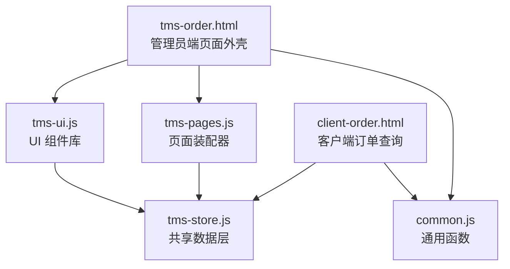
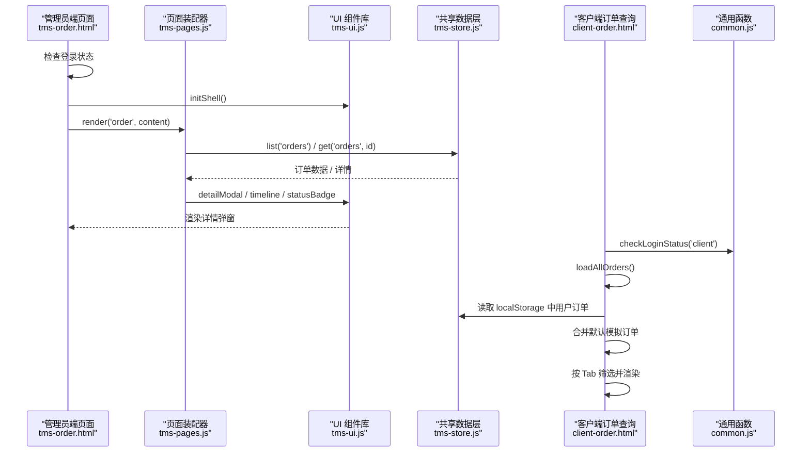
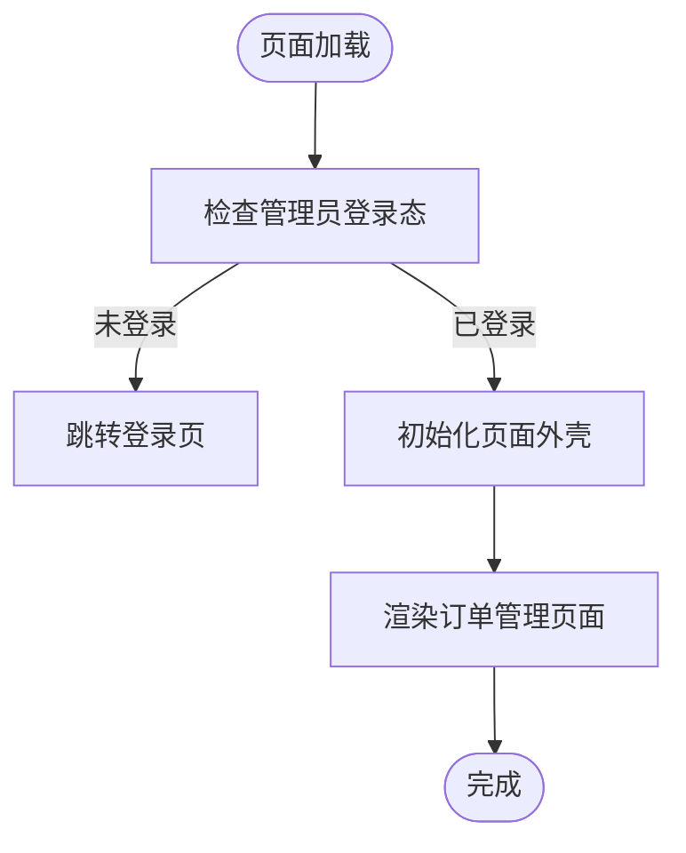
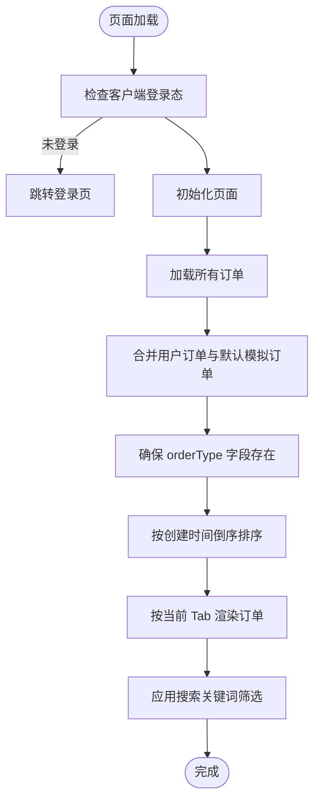
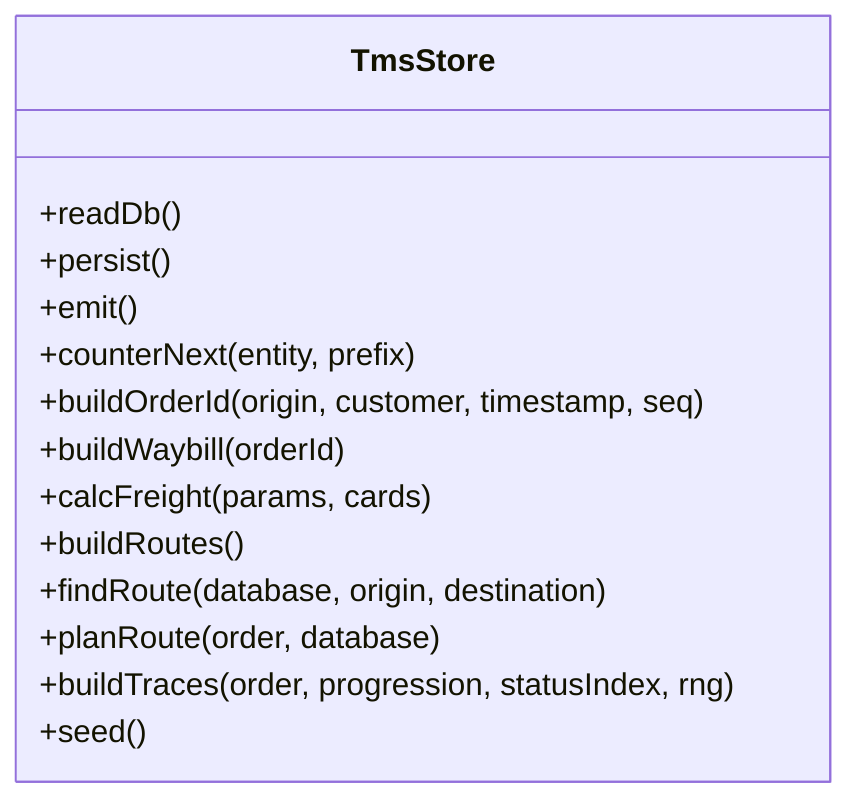
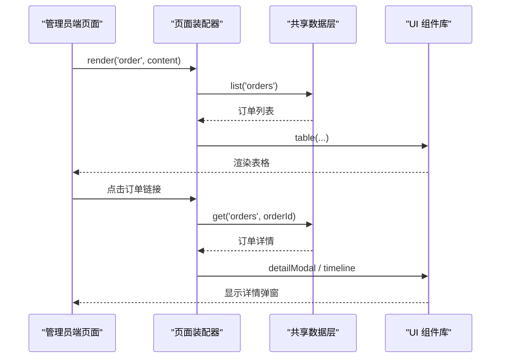
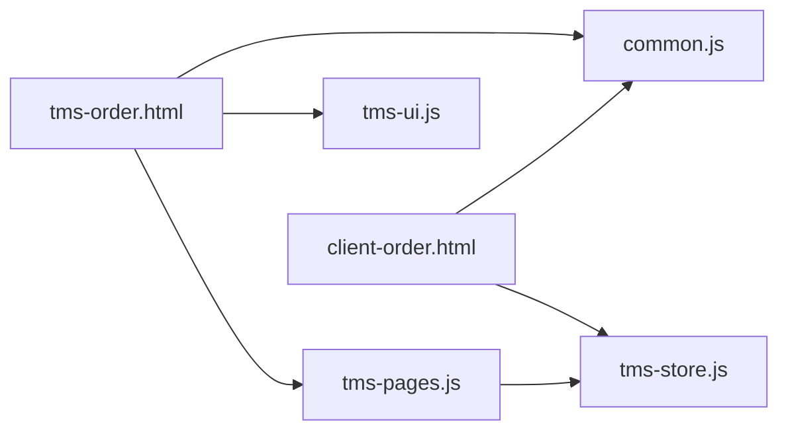

# 订单管理模块

<cite>
**本文引用的文件**   
- [tms-order.html](file://tms-order.html)
- [client-order.html](file://client-order.html)
- [tms-store.js](file://tms-store.js)
- [tms-pages.js](file://tms-pages.js)
- [tms-ui.js](file://tms-ui.js)
- [common.js](file://common.js)
- [tms-architecture.html](file://tms-architecture.html)
</cite>

## 目录
1. [引言](#引言)
2. [项目结构](#项目结构)
3. [核心组件](#核心组件)
4. [架构总览](#架构总览)
5. [详细组件分析](#详细组件分析)
6. [依赖关系分析](#依赖关系分析)
7. [性能与扩展性](#性能与扩展性)
8. [故障排查指南](#故障排查指南)
9. [结论](#结论)

## 引言
本模块聚焦于“订单管理”在 TMS 运输管理系统中的实现，覆盖管理员端与客户端两个视角：
- 管理员端：提供订单列表、筛选、分页、详情查看、状态联动等运营能力。
- 客户端：提供下单、订单查询、按发货/收货维度切换、搜索与基础状态展示。

系统采用前端本地存储作为轻量数据层，通过共享数据层统一维护订单主数据、轨迹、计费、路由等关联信息，并以 UI 组件库和页面装配器提供一致的交互体验。

## 项目结构
订单相关的主要文件职责如下：
- tms-order.html：管理员端“订单管理”页面外壳，负责导航、登录校验与页面内容注入。
- client-order.html：客户端“订单查询”页面，包含订单搜索、Tab 切换（发货/收货）、默认模拟订单与用户自创建订单合并渲染。
- tms-store.js：共享数据层，基于 localStorage 的轻量业务数据库，负责种子数据生成、订单全生命周期状态流转、计费引擎、路由与轨迹计划等。
- tms-pages.js：管理员端页面装配器，将各业务页统一装配为 KPI + 图表 + 表格 + CRUD 的结构，并定义订单详情页、订单链接点击行为等。
- tms-ui.js：共享 UI 组件库，提供表格、弹窗、表单、KPI、图表、时间线等通用能力。
- common.js：通用函数库，提供订单号/运单号生成、登录态检查、用户信息显示等。
- tms-architecture.html：系统架构文档，描述订单系统功能边界与数据库分库策略。

**图示来源**
- [tms-order.html:256-261](file://tms-order.html#L256-L261)
- [tms-pages.js:108-135](file://tms-pages.js#L108-L135)
- [tms-ui.js:758-781](file://tms-ui.js#L758-L781)
- [common.js:176-199](file://common.js#L176-L199)
- [client-order.html:364-416](file://client-order.html#L364-L416)
- [tms-store.js:220-244](file://tms-store.js#L220-L244)

**章节来源**
- [tms-order.html:1-266](file://tms-order.html#L1-L266)
- [client-order.html:1-800](file://client-order.html#L1-L800)
- [tms-store.js:1-800](file://tms-store.js#L1-L800)
- [tms-pages.js:1-800](file://tms-pages.js#L1-L800)
- [tms-ui.js:1-783](file://tms-ui.js#L1-L783)
- [common.js:1-383](file://common.js#L1-L383)
- [tms-architecture.html:1054-1213](file://tms-architecture.html#L1054-L1213)

## 核心组件
- 共享数据层（TmsStore）
  - 基于 localStorage 的轻量业务数据库，提供增删改查、搜索、筛选、排序、分页。
  - 维护订单全生命周期状态流转，自动写入扫描、运输、财务等关联记录。
  - 提供统计聚合（KPI、趋势、分布、日报）。
  - 暴露事件机制，数据变更触发 tms:datachange 事件，驱动界面刷新。
- 页面装配器（TmsPages）
  - 将业务页统一装配为 KPI + 图表 + 可筛选分页表格 + CRUD 操作。
  - 定义订单详情弹窗、订单链接点击打开详情等行为。
- UI 组件库（TmsUI）
  - 提供表格、表单弹窗、确认框、Toast、SVG 图表、时间线等通用能力。
  - 提供状态标签、金额格式化、日期时间格式化等工具。
- 通用函数库（common.js）
  - 提供订单号/运单号生成、登录态检查、用户信息显示、退出登录等。
- 管理员端订单页面（tms-order.html）
  - 负责登录校验、侧边栏导航、调用 TmsUI.initShell 与 TmsPages.render('order', ...) 渲染订单管理页面。
- 客户端订单查询页面（client-order.html）
  - 提供订单搜索、Tab 切换（发货/收货）、默认模拟订单与用户自创建订单合并渲染。

**章节来源**
- [tms-store.js:1-12](file://tms-store.js#L1-L12)
- [tms-store.js:220-244](file://tms-store.js#L220-L244)
- [tms-pages.js:108-135](file://tms-pages.js#L108-L135)
- [tms-ui.js:758-781](file://tms-ui.js#L758-L781)
- [common.js:176-199](file://common.js#L176-L199)
- [tms-order.html:256-261](file://tms-order.html#L256-L261)
- [client-order.html:364-416](file://client-order.html#L364-L416)

## 架构总览
订单管理模块的整体架构由“页面外壳 → 页面装配器 → UI 组件库 → 共享数据层”构成，同时客户端订单查询页面直接依赖通用函数与共享数据层。

**图示来源**
- [tms-order.html:256-261](file://tms-order.html#L256-L261)
- [tms-pages.js:39-85](file://tms-pages.js#L39-L85)
- [tms-ui.js:684-699](file://tms-ui.js#L684-L699)
- [tms-store.js:220-244](file://tms-store.js#L220-L244)
- [client-order.html:364-416](file://client-order.html#L364-L416)
- [common.js:176-199](file://common.js#L176-L199)

## 详细组件分析

### 管理员端订单管理页面（tms-order.html）
- 页面外壳职责
  - 加载通用脚本与 UI 脚本。
  - 检查管理员登录态。
  - 初始化页面外壳（侧边栏高亮、退出按钮绑定、用户名显示）。
  - 调用页面装配器渲染“订单”页面。
- 关键流程
  - DOMContentLoaded 后执行登录校验。
  - 调用 TmsUI.initShell() 初始化外壳。
  - 调用 TmsPages.render('order', document.querySelector('.content')) 渲染订单管理内容。

**图示来源**
- [tms-order.html:256-261](file://tms-order.html#L256-L261)

**章节来源**
- [tms-order.html:256-261](file://tms-order.html#L256-L261)

### 客户端订单查询页面（client-order.html）
- 页面职责
  - 检查客户端登录态。
  - 绑定退出登录、搜索按钮、回车键搜索。
  - 初始化页面并加载所有订单。
  - 支持 Tab 切换（发货订单/收货订单）。
  - 合并用户自创建订单与默认模拟订单，去重并按创建时间倒序排列。
  - 根据当前 Tab 与搜索关键词筛选并渲染订单列表。
- 关键流程
  - initPage 中调用 checkLoginStatus('client') 与 loadAllOrders。
  - loadAllOrders 从 localStorage 获取用户订单，构造默认模拟订单，合并去重，确保 orderType 字段存在，排序后按 Tab 渲染。
  - renderOrdersByTab 根据 currentTab 与搜索关键词过滤订单并渲染。

**图示来源**
- [client-order.html:364-416](file://client-order.html#L364-L416)
- [client-order.html:413-483](file://client-order.html#L413-L483)
- [client-order.html:765-783](file://client-order.html#L765-L783)
- [client-order.html:785-800](file://client-order.html#L785-L800)

**章节来源**
- [client-order.html:364-416](file://client-order.html#L364-L416)
- [client-order.html:413-483](file://client-order.html#L413-L483)
- [client-order.html:765-783](file://client-order.html#L765-L783)
- [client-order.html:785-800](file://client-order.html#L785-L800)

### 共享数据层（tms-store.js）
- 数据模型与字典
  - 城市、省份映射、订单状态流、轨迹节点、客户分层、服务等级、付款方式等字典。
  - 订单状态流包括待入库、已入库、已分拣、运输中、已到达、派送中、已签收、已取消。
- 计费引擎
  - 构建运价卡（全国兵底 + 主要干线 × 服务等级），选择最匹配运价卡。
  - 计算首重、续重、燃油附加、偏远附加、保价费、到付手续费、协议折扣与合计。
- 路由与轨迹
  - 构建多段路由（含全国兵底线路），按起终点匹配路由，写入 planSegments 与逐段 deadline。
  - 根据订单阶段生成轨迹明细（带节点、地点、超时/偏差标记）。
- 种子数据
  - 首次访问自动生成真实感种子数据（订单/运单/运输/异常/扫描等）。
  - 生成员工、车辆、仓库/库存、运力资源、电子围栏、运营策略、路由规则、时效规则、改单记录、考核指标等。
- 数据持久化与事件
  - 使用 localStorage 持久化数据，版本控制。
  - 数据变更触发 tms:datachange 事件，订阅者刷新界面。

**图示来源**
- [tms-store.js:220-244](file://tms-store.js#L220-L244)
- [tms-store.js:252-261](file://tms-store.js#L252-L261)
- [tms-store.js:332-383](file://tms-store.js#L332-L383)
- [tms-store.js:388-440](file://tms-store.js#L388-L440)
- [tms-store.js:443-460](file://tms-store.js#L443-L460)
- [tms-store.js:464-800](file://tms-store.js#L464-L800)

**章节来源**
- [tms-store.js:1-12](file://tms-store.js#L1-L12)
- [tms-store.js:88-120](file://tms-store.js#L88-L120)
- [tms-store.js:252-261](file://tms-store.js#L252-L261)
- [tms-store.js:332-383](file://tms-store.js#L332-L383)
- [tms-store.js:388-440](file://tms-store.js#L388-L440)
- [tms-store.js:443-460](file://tms-store.js#L443-L460)
- [tms-store.js:464-800](file://tms-store.js#L464-L800)

### 页面装配器（tms-pages.js）
- 订单详情
  - 根据订单 ID 获取订单详情，展示订单号、运单号、客户、订单类型、服务等级、货物、重量、运费、付款方式、应收状态、状态、始发地、目的地、下单时间、预计送达等。
  - 展示运费明细（运价卡、首重、续重、燃油附加、偏远附加、保价费、到付手续费、协议折扣、合计）。
  - 展示物流轨迹时间线。
- 订单链接点击
  - 在表格中点击订单号链接，打开订单详情弹窗。
- 页面装配
  - 统一装配 KPI、图表、表格、工具栏、操作按钮。
  - 订阅数据变化，刷新 KPI 与订单链接绑定。

**图示来源**
- [tms-pages.js:39-85](file://tms-pages.js#L39-L85)
- [tms-pages.js:108-135](file://tms-pages.js#L108-L135)

**章节来源**
- [tms-pages.js:39-85](file://tms-pages.js#L39-L85)
- [tms-pages.js:108-135](file://tms-pages.js#L108-L135)

### UI 组件库（tms-ui.js）
- 通用能力
  - 表格：支持搜索、筛选、分页、排序、工具栏、行操作。
  - 弹窗：模态框、确认框、表单弹窗。
  - 提示：Toast 通知。
  - 图表：折线图、柱状图、环形图。
  - 详情：详情网格、时间线。
  - 状态标签：根据实体类型与状态值渲染不同样式。
  - 格式化：日期、时间、金额、数字、百分比。
- 页面外壳
  - 初始化侧边栏高亮、子菜单展开、退出按钮绑定、用户名显示。
  - 异常待办角标更新。

**章节来源**
- [tms-ui.js:1-783](file://tms-ui.js#L1-L783)

### 通用函数库（common.js）
- 订单号/运单号生成
  - generateOrderId：HL + 发货省份首字母 + 时间戳 + 4位用户ID hash + 4位随机数。
  - generateWaybillNumber：WB + 10位订单号 hash + 4位随机数。
- 登录态管理
  - login：保存用户信息到 localStorage，根据角色跳转对应页面。
  - checkLoginStatus：检查登录态与角色权限，未登录或角色不匹配跳转登录页。
  - logout：清除用户信息并跳转登录页。
- 用户信息显示
  - displayCurrentUser：更新页面中用户名显示元素。

**章节来源**
- [common.js:23-50](file://common.js#L23-L50)
- [common.js:136-199](file://common.js#L136-L199)
- [common.js:220-270](file://common.js#L220-L270)

## 依赖关系分析
- 管理员端订单管理页面依赖：
  - common.js：登录态检查、用户信息显示。
  - tms-ui.js：页面外壳初始化。
  - tms-pages.js：订单页面装配。
  - tms-store.js：订单数据查询与详情。
- 客户端订单查询页面依赖：
  - common.js：登录态检查、订单号/运单号生成。
  - tms-store.js：读取用户订单（localStorage）。
- 共享数据层依赖：
  - 无外部依赖，纯前端逻辑，基于 localStorage。
- UI 组件库依赖：
  - 无外部依赖，纯前端逻辑。

**图示来源**
- [tms-order.html:252-261](file://tms-order.html#L252-L261)
- [client-order.html:363-416](file://client-order.html#L363-L416)
- [tms-pages.js:10-12](file://tms-pages.js#L10-L12)
- [tms-store.js:220-244](file://tms-store.js#L220-L244)

**章节来源**
- [tms-order.html:252-261](file://tms-order.html#L252-L261)
- [client-order.html:363-416](file://client-order.html#L363-L416)
- [tms-pages.js:10-12](file://tms-pages.js#L10-L12)
- [tms-store.js:220-244](file://tms-store.js#L220-L244)

## 性能与扩展性
- 性能特性
  - 共享数据层基于 localStorage，适合演示与小规模数据；大数据量时需考虑分页与索引优化。
  - 计费引擎与路由计划在种子数据生成时预计算，减少运行时开销。
  - UI 组件库提供虚拟滚动与分页能力，避免大量 DOM 操作。
- 扩展性建议
  - 将共享数据层迁移至后端 API，支持并发与事务。
  - 增加订单状态机校验，防止非法状态流转。
  - 引入缓存层（如 IndexedDB）提升大列表渲染性能。
  - 扩展计费引擎以支持更多服务等级与促销规则。

[本节为通用指导，不直接分析具体文件]

## 故障排查指南
- 登录态问题
  - 现象：页面未登录或角色不匹配跳转登录页。
  - 排查：检查 localStorage 中 tmsUser 是否存在且 role 正确。
  - 参考：checkLoginStatus 逻辑。
- 订单数据为空
  - 现象：订单列表无数据。
  - 排查：检查 localStorage 中 tmsDB_v3 是否存在且版本正确；检查种子数据是否生成。
  - 参考：readDb 与 seed 逻辑。
- 订单详情无法打开
  - 现象：点击订单链接无反应。
  - 排查：检查订单 ID 是否存在；检查 TmsPages.orderDetail 是否正确调用。
  - 参考：orderDetail 与 bindOrderLinks 逻辑。
- 客户端订单查询无结果
  - 现象：搜索订单无结果。
  - 排查：检查 localStorage 中 tmsOrders 是否存在；检查默认模拟订单是否加载；检查搜索关键词是否匹配。
  - 参考：loadAllOrders 与 renderOrdersByTab 逻辑。

**章节来源**
- [common.js:176-199](file://common.js#L176-L199)
- [tms-store.js:220-244](file://tms-store.js#L220-L244)
- [tms-pages.js:39-85](file://tms-pages.js#L39-L85)
- [client-order.html:413-483](file://client-order.html#L413-L483)
- [client-order.html:785-800](file://client-order.html#L785-L800)

## 结论
订单管理模块通过管理员端与客户端双视角，结合共享数据层与 UI 组件库，实现了订单创建、查询、详情查看、状态联动等核心功能。系统采用前端本地存储作为轻量数据层，适合演示与小规模业务场景。未来可扩展至后端 API，增强并发、事务与性能表现。

[本节为总结性内容，不直接分析具体文件]