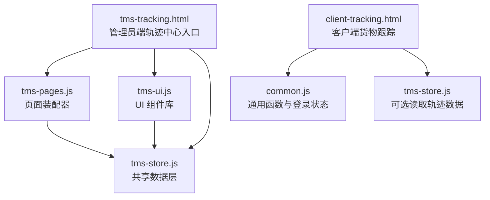
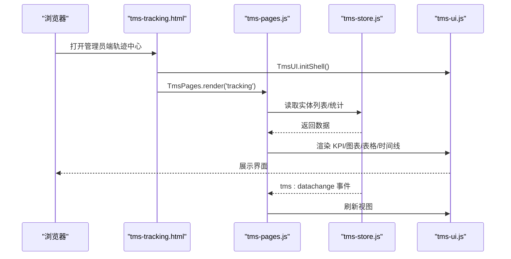
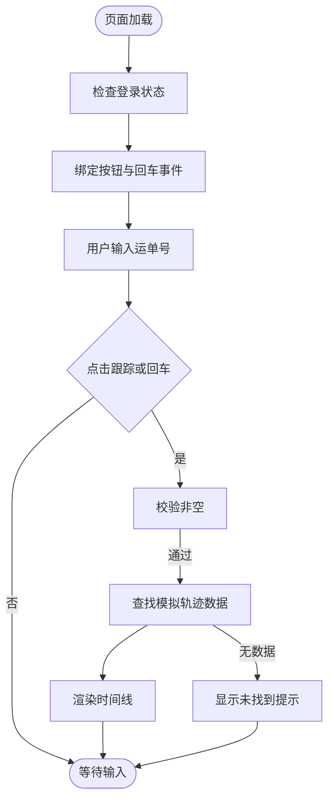
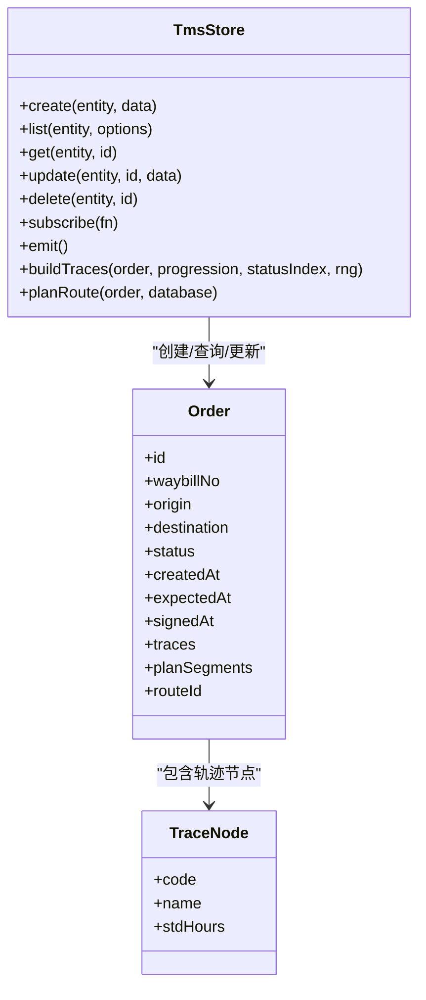
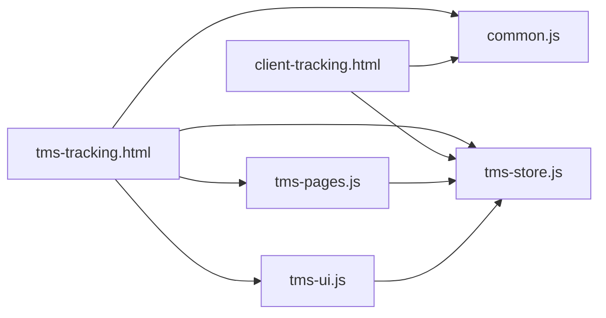

# 跟踪中心模块

<cite>
**本文引用的文件**   
- [tms-tracking.html](file://tms-tracking.html)
- [client-tracking.html](file://client-tracking.html)
- [common.js](file://common.js)
- [tms-ui.js](file://tms-ui.js)
- [tms-store.js](file://tms-store.js)
- [tms-pages.js](file://tms-pages.js)
</cite>

## 目录
1. [引言](#引言)
2. [项目结构](#项目结构)
3. [核心组件](#核心组件)
4. [架构总览](#架构总览)
5. [详细组件分析](#详细组件分析)
6. [依赖关系分析](#依赖关系分析)
7. [性能与可扩展性](#性能与可扩展性)
8. [故障排查指南](#故障排查指南)
9. [结论](#结论)

## 引言
本模块聚焦“跟踪中心”能力，覆盖两类使用场景：
- 管理员端轨迹中心：基于统一数据层 TmsStore 提供的订单、运单、扫描、异常等数据，提供轨迹检索、时间线展示、超时/偏差标记、统计聚合与可视化。
- 客户端货物跟踪：面向客户侧的轻量查询页面，支持按运单号查看物流节点时间线，便于用户自助查询包裹进度。

该模块以 HTML 页面为入口，通过通用脚本库 common.js、UI 组件库 tms-ui.js、共享数据层 tms-store.js 以及页面装配器 tms-pages.js 协同工作，形成“页面壳 + 业务页注册 + 数据订阅渲染”的统一模式。

## 项目结构
跟踪中心相关的关键文件如下：
- 管理员端入口：tms-tracking.html
- 客户端入口：client-tracking.html
- 通用登录与工具：common.js
- UI 组件与表格/弹窗/图表：tms-ui.js
- 共享数据层（含种子数据、计费、路由、轨迹生成）：tms-store.js
- 管理员端页面装配（含各业务页定义）：tms-pages.js

**图示来源**
- [tms-tracking.html:256-261](file://tms-tracking.html#L256-L261)
- [client-tracking.html:347-392](file://client-tracking.html#L347-L392)
- [tms-pages.js:108-135](file://tms-pages.js#L108-L135)
- [tms-ui.js:758-781](file://tms-ui.js#L758-L781)
- [tms-store.js:16-17](file://tms-store.js#L16-L17)

**章节来源**
- [tms-tracking.html:1-266](file://tms-tracking.html#L1-L266)
- [client-tracking.html:1-481](file://client-tracking.html#L1-L481)
- [common.js:1-383](file://common.js#L1-L383)
- [tms-ui.js:1-783](file://tms-ui.js#L1-L783)
- [tms-store.js:1-800](file://tms-store.js#L1-L800)
- [tms-pages.js:1-800](file://tms-pages.js#L1-L800)

## 核心组件
- 管理员端轨迹中心页面壳：负责加载公共样式、导航、退出登录、调用 TmsPages.render('tracking') 渲染业务内容。
- 客户端货物跟踪页面：提供运单号输入、回车触发查询、示例数据渲染与交互逻辑。
- 通用脚本库：提供登录校验、角色跳转、用户名显示、按钮样式注入等。
- UI 组件库：提供 Toast、Modal、表单弹窗、通用表格、KPI、SVG 折线/柱状/环形图、时间线等。
- 共享数据层：维护 localStorage 中的业务数据，提供增删改查、搜索筛选排序分页、订阅事件、统计聚合；内置订单生命周期、轨迹节点、路线计划与轨迹明细生成。
- 页面装配器：将各业务页（如异常管理、运输管理、仓储管理等）统一装配为 KPI+图表+表格+CRUD 的结构，并订阅数据变更自动刷新。

**章节来源**
- [tms-tracking.html:256-261](file://tms-tracking.html#L256-L261)
- [client-tracking.html:347-477](file://client-tracking.html#L347-L477)
- [common.js:135-270](file://common.js#L135-L270)
- [tms-ui.js:86-781](file://tms-ui.js#L86-L781)
- [tms-store.js:16-17](file://tms-store.js#L16-L17)
- [tms-pages.js:108-135](file://tms-pages.js#L108-L135)

## 架构总览
跟踪中心采用“页面壳 + 业务页注册 + 数据订阅渲染”的模式：
- 管理员端通过 tms-tracking.html 初始化外壳，再调用 TmsPages.render('tracking') 渲染轨迹中心页面。
- 业务页通过 tms-pages.js 中 define('tracking', {...}) 注册，配置 KPI、图表、表格列、操作按钮等。
- 数据层 tms-store.js 提供 list/get/create/update 等方法，并在数据变化时触发 tms:datachange 事件。
- UI 层 tms-ui.js 提供表格、弹窗、图表、时间线等组件，供业务页渲染。

**图示来源**
- [tms-tracking.html:256-261](file://tms-tracking.html#L256-L261)
- [tms-pages.js:108-135](file://tms-pages.js#L108-L135)
- [tms-ui.js:758-781](file://tms-ui.js#L758-L781)
- [tms-store.js:232-244](file://tms-store.js#L232-L244)

## 详细组件分析

### 管理员端轨迹中心页面壳
职责：
- 引入公共样式与脚本。
- 检查管理员登录态。
- 初始化外壳（高亮当前菜单、绑定退出登录）。
- 调用 TmsPages.render('tracking') 渲染轨迹中心。

关键点：
- 通过 checkLoginStatus('admin') 控制访问权限。
- 通过 TmsUI.initShell() 统一处理导航高亮与退出登录。
- 通过 TmsPages.render('tracking', document.querySelector('.content')) 将业务内容注入到主内容区。

**章节来源**
- [tms-tracking.html:256-261](file://tms-tracking.html#L256-L261)
- [common.js:176-199](file://common.js#L176-L199)
- [tms-ui.js:703-746](file://tms-ui.js#L703-L746)

### 客户端货物跟踪页面
职责：
- 提供运单号输入框与“跟踪”按钮。
- 监听点击与回车事件，触发 trackCargo()。
- 使用本地模拟数据渲染时间线，包括发货、分拣、运输、配送等节点。
- 根据运单号匹配不同示例轨迹数据。

交互流程：
- 用户输入运单号 → 点击“跟踪”或回车 → 从 mockTrackingData 获取对应轨迹数组 → 渲染时间线。
- 若未找到数据，显示“未找到该运单的跟踪信息”。

**图示来源**
- [client-tracking.html:347-477](file://client-tracking.html#L347-L477)

**章节来源**
- [client-tracking.html:347-477](file://client-tracking.html#L347-L477)

### 通用脚本库 common.js
职责：
- 提供订单号与运单号生成工具。
- 注入统一按钮样式。
- 实现登录、登出、登录态检查、当前用户显示。
- 提供用户信息与积分相关工具。

对跟踪中心的意义：
- 客户端页面依赖 checkLoginStatus('client') 进行权限校验。
- 管理员端页面依赖 checkLoginStatus('admin') 进行权限校验。
- 所有页面通过 displayCurrentUser() 显示当前用户名。

**章节来源**
- [common.js:1-383](file://common.js#L1-L383)

### UI 组件库 tms-ui.js
职责：
- 提供格式化、状态标签、Toast、Modal、表单弹窗、通用表格、KPI、SVG 图表、详情弹窗、时间线等。
- 暴露全局 TmsUI 对象，供页面与业务页装配器调用。

对跟踪中心的意义：
- 管理员端轨迹中心通过 TmsUI.initShell() 初始化外壳。
- 业务页通过 TmsUI.table() 渲染可搜索、筛选、分页、排序的数据表格。
- 通过 TmsUI.timeline() 渲染物流轨迹时间线。
- 通过 TmsUI.detailModal() 展示订单详情与运费明细。

**章节来源**
- [tms-ui.js:86-781](file://tms-ui.js#L86-L781)

### 共享数据层 tms-store.js
职责：
- 维护 localStorage 中的业务数据库（orders、transports、exceptions、scans、vehicles、warehouses、inventory、capacities、geofences、policies、routingRules、addresses、timingRules、changeRecords、evalMetrics 等）。
- 提供 create/list/get/update/delete 等 CRUD 方法。
- 提供搜索、筛选、排序、分页能力。
- 维护订单全生命周期状态流转，并自动生成扫描、运输、财务等关联记录。
- 提供统计聚合（KPI、趋势、分布、日报）。
- 在数据变更时触发 tms:datachange 事件。

对跟踪中心的意义：
- 轨迹中心依赖 orders.traces 与 tracePool 进行轨迹检索与展示。
- 通过 buildTraces() 生成带节点、地点、超时/偏差标记的轨迹明细。
- 通过 planRoute() 生成计划分段与截止时间，辅助时效分析与偏差检测。
- 通过 STATUS_LABELS 与 TRACE_NODE_MAP 提供标准状态与轨迹节点字典。

关键数据结构与流程：
- 轨迹节点字典 TRACE_NODE_MAP：包含揽收、入库、分拣、装车、发车、干线在途、到达、派送、签收、退回、拦截、超区、问题件等节点及标准时限。
- 订单阶段索引 STAGE_NODE：映射订单阶段到轨迹节点。
- 轨迹生成 buildTraces(order, progression, statusIndex, rng)：根据订单阶段与随机扰动生成 isOvertime/isDeviant 标记。
- 路由计划 planRoute(order, database)：根据起终点匹配路由，写入 planSegments 与 deadline。

**图示来源**
- [tms-store.js:194-213](file://tms-store.js#L194-L213)
- [tms-store.js:442-460](file://tms-store.js#L442-L460)
- [tms-store.js:426-440](file://tms-store.js#L426-L440)

**章节来源**
- [tms-store.js:16-17](file://tms-store.js#L16-L17)
- [tms-store.js:194-213](file://tms-store.js#L194-L213)
- [tms-store.js:426-460](file://tms-store.js#L426-L460)
- [tms-store.js:462-800](file://tms-store.js#L462-L800)

### 页面装配器 tms-pages.js
职责：
- 将各业务页统一装配为“KPI + 图表 + 可筛选分页表格 + CRUD 操作”的结构。
- 每个页面通过 define(id, config) 注册，并在 render(id, root) 中组装页面骨架与数据。
- 订阅 TmsStore 数据变更，自动刷新 KPI、图表与表格。

对跟踪中心的意义：
- 虽然 tracking 页面的具体定义未在已读范围内完整展示，但装配器提供了统一的渲染框架与数据订阅机制，轨迹中心可复用该框架进行 KPI、图表、表格与时间线的渲染。

**章节来源**
- [tms-pages.js:1-800](file://tms-pages.js#L1-L800)

## 依赖关系分析
- tms-tracking.html 依赖 common.js、tms-store.js、tms-ui.js、tms-pages.js。
- client-tracking.html 依赖 common.js，并可扩展读取 tms-store.js 数据。
- tms-pages.js 依赖 tms-store.js 与 tms-ui.js。
- tms-ui.js 不直接依赖业务数据，但通过 TmsStore 接口与数据层解耦。
- tms-store.js 独立维护数据与事件，被多个页面与组件复用。

**图示来源**
- [tms-tracking.html:252-255](file://tms-tracking.html#L252-L255)
- [client-tracking.html:344-345](file://client-tracking.html#L344-L345)
- [tms-pages.js:10-12](file://tms-pages.js#L10-L12)
- [tms-ui.js:758-781](file://tms-ui.js#L758-L781)
- [tms-store.js:16-17](file://tms-store.js#L16-L17)

**章节来源**
- [tms-tracking.html:252-255](file://tms-tracking.html#L252-L255)
- [client-tracking.html:344-345](file://client-tracking.html#L344-L345)
- [tms-pages.js:10-12](file://tms-pages.js#L10-L12)
- [tms-ui.js:758-781](file://tms-ui.js#L758-L781)
- [tms-store.js:16-17](file://tms-store.js#L16-L17)

## 性能与可扩展性
- 数据层基于 localStorage，适合演示与轻量级前端应用；在大数据量场景下建议引入 IndexedDB 或后端 API。
- 表格组件支持分页、搜索、筛选、排序，减少 DOM 渲染压力。
- 轨迹生成使用确定性随机数种子，保证首次生成的演示数据稳定，便于测试与复现。
- 可通过扩展 TRACE_NODES 与 STAGE_NODE 增加新的轨迹节点与阶段映射，提升轨迹表达的细粒度。
- 建议在轨迹中心增加“按运单号检索”、“按城市/承运商筛选”、“超时/偏差过滤”等功能，以提升运营效率。

[本节为通用指导，无需引用具体文件]

## 故障排查指南
常见问题与定位要点：
- 登录后无法进入轨迹中心：检查 checkLoginStatus('admin') 返回值与 localStorage.tmsUser 是否存在且 role 匹配。
- 轨迹数据为空：确认 tms-store.js 是否成功初始化数据，检查 DB_KEY 与 DB_VERSION 是否一致。
- 轨迹时间线未渲染：检查 TmsUI.timeline() 是否被正确调用，确认 order.timeline 或 order.traces 数据存在。
- 客户端跟踪无结果：确认 mockTrackingData 中是否包含输入的运单号，或扩展为读取 tms-store.js 的真实轨迹数据。

**章节来源**
- [common.js:176-199](file://common.js#L176-L199)
- [tms-store.js:220-244](file://tms-store.js#L220-L244)
- [tms-ui.js:694-699](file://tms-ui.js#L694-L699)
- [client-tracking.html:394-431](file://client-tracking.html#L394-L431)

## 结论
跟踪中心模块通过管理员端与客户端双视角，覆盖了物流轨迹的查询、展示与分析需求。管理员端依托统一数据层与 UI 组件库，提供强大的表格、图表与时间线能力；客户端则提供简洁的运单号查询体验。未来可在轨迹检索、筛选、统计与可视化方面进一步扩展，以满足更复杂的运营监控与客户服务场景。

[本节为总结性内容，无需引用具体文件]