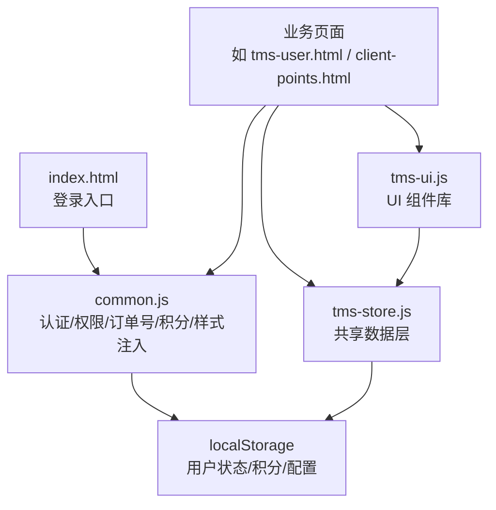
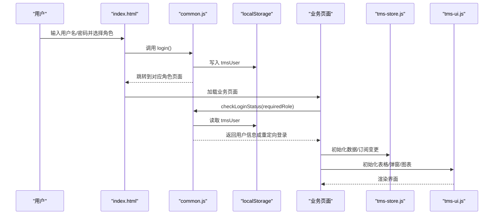
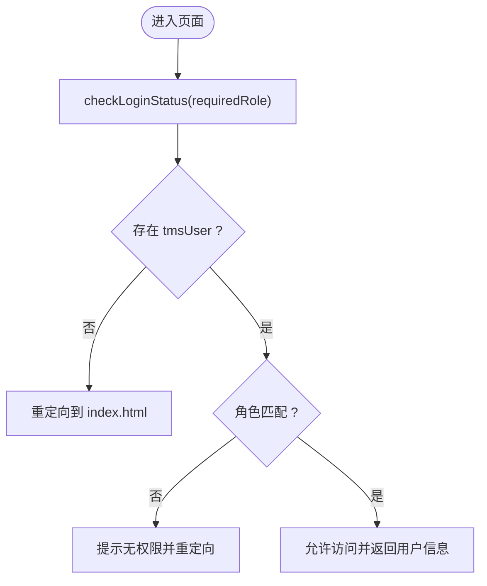
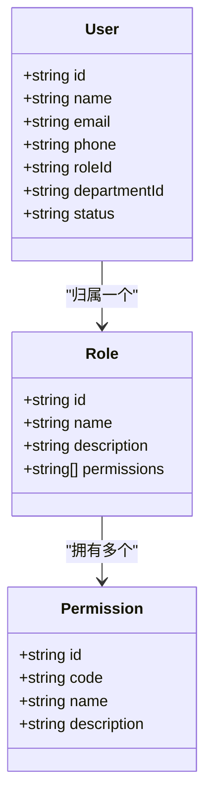
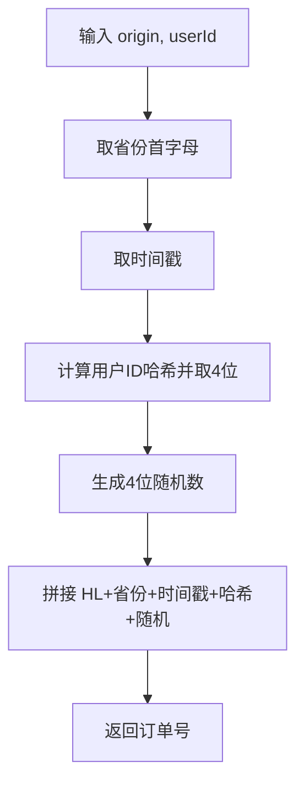
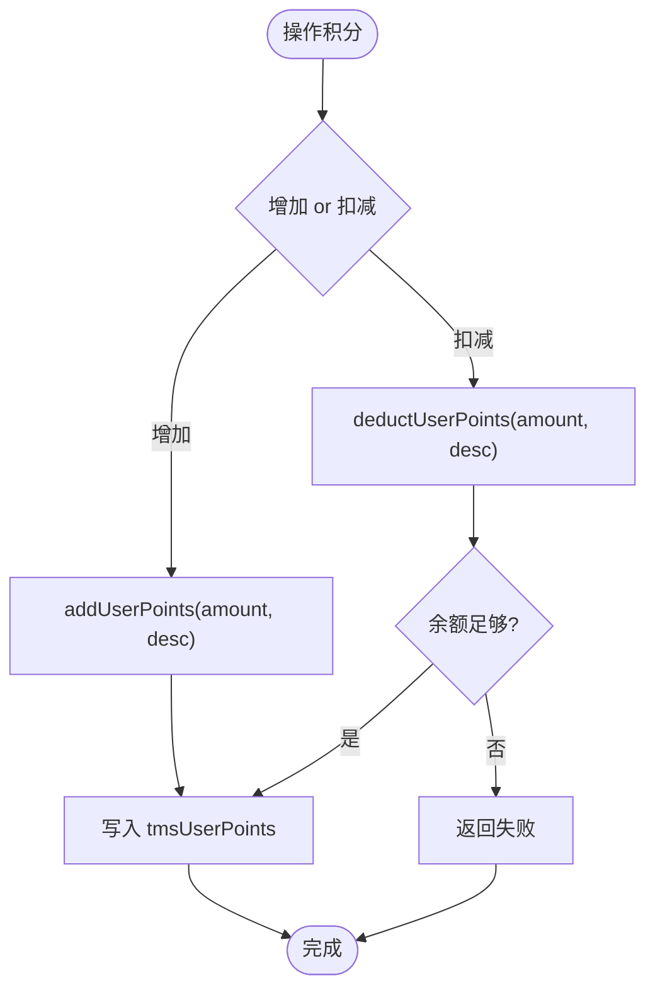
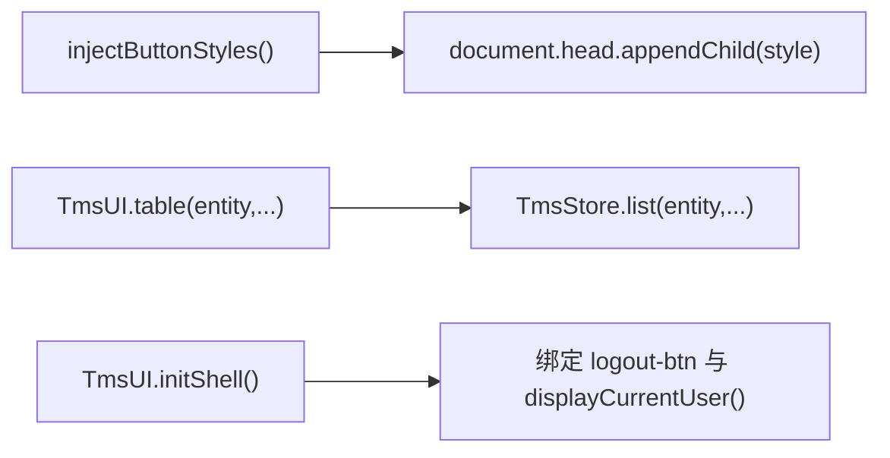
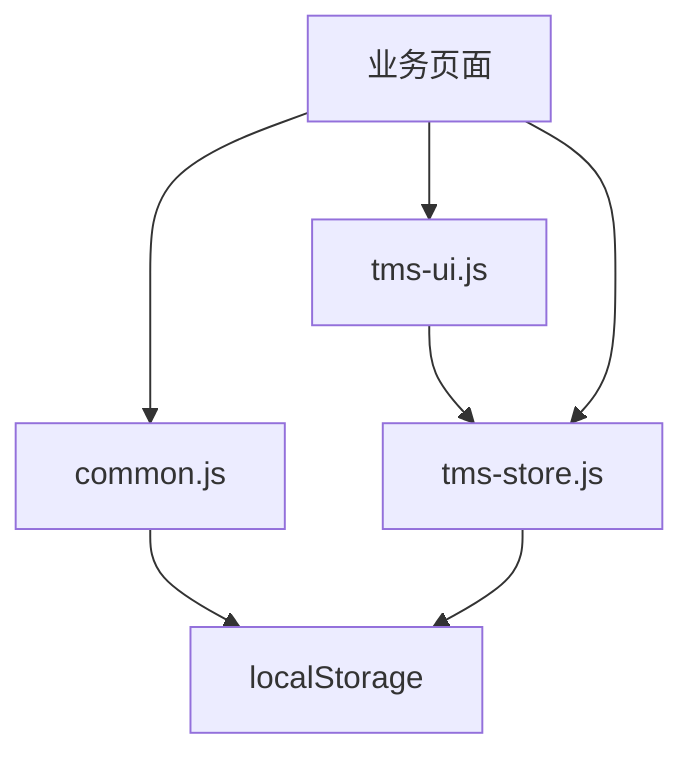

# 通用工具库(CommonJS)

<cite>
**本文引用的文件**   
- [common.js](file://common.js)
- [tms-ui.js](file://tms-ui.js)
- [tms-store.js](file://tms-store.js)
- [index.html](file://index.html)
- [tms-user.html](file://tms-user.html)
- [client-points.html](file://client-points.html)
</cite>

## 目录
1. [引言](#引言)
2. [项目结构](#项目结构)
3. [核心组件](#核心组件)
4. [架构总览](#架构总览)
5. [详细组件分析](#详细组件分析)
6. [依赖关系分析](#依赖关系分析)
7. [性能与可扩展性](#性能与可扩展性)
8. [故障排查指南](#故障排查指南)
9. [结论](#结论)
10. [附录：公共 API 参考](#附录公共-api-参考)

## 引言
本文件面向 TMS 系统的 CommonJS 通用工具库，聚焦以下能力：
- 用户认证与多角色登录流程
- 基于角色的权限控制模型
- 订单号与运单号生成算法
- 用户积分系统
- 样式注入与 UI 组件复用
- localStorage 中的用户状态管理
- 与业务模块的集成方式、安全注意事项与性能优化建议

该文档既适合初学者快速上手，也为有经验的开发者提供扩展与二次开发指南。

## 项目结构
仓库采用“页面 + 共享脚本”的前端模块化组织方式：
- common.js：通用工具函数（认证、权限检查、订单号生成、样式注入、积分等）
- tms-ui.js：共享 UI 组件库（表格、弹窗、图表、Toast、页面外壳等）
- tms-store.js：共享数据层（基于 localStorage 的业务数据库、种子数据、CRUD、事件总线）
- index.html：登录入口页，调用 common.js 的登录逻辑
- tms-user.html：管理员端用户/角色/权限/部门管理示例
- client-points.html：客户端积分展示与使用示例

图示来源
- [index.html:145-168](file://index.html#L145-L168)
- [common.js:135-218](file://common.js#L135-L218)
- [tms-ui.js:756-779](file://tms-ui.js#L756-L779)
- [tms-store.js:1-12](file://tms-store.js#L1-L12)

章节来源
- [index.html:145-168](file://index.html#L145-L168)
- [common.js:1-383](file://common.js#L1-L383)
- [tms-ui.js:1-781](file://tms-ui.js#L1-L781)
- [tms-store.js:1-244](file://tms-store.js#L1-L244)

## 核心组件
- 通用工具库（common.js）
  - 字符串哈希、订单号/运单号生成
  - 统一按钮样式注入
  - 用户登录、登出、当前用户获取与显示
  - 登录态校验与角色跳转
  - 用户个人信息存取
  - 用户积分余额、增减、历史记录
- UI 组件库（tms-ui.js）
  - Toast、Modal、Confirm、FormModal
  - 通用表格（搜索/筛选/排序/分页）
  - KPI、折线/柱状/环形图
  - 页面外壳初始化、导航高亮、异常角标
- 共享数据层（tms-store.js）
  - 基于 localStorage 的轻量数据库
  - 增删改查、搜索、筛选、排序、分页
  - 事件总线（tms:datachange）
  - 计费引擎、路由计划、轨迹生成、种子数据

章节来源
- [common.js:1-383](file://common.js#L1-L383)
- [tms-ui.js:1-781](file://tms-ui.js#L1-L781)
- [tms-store.js:1-244](file://tms-store.js#L1-L244)

## 架构总览
下图展示了从登录到权限校验、再到业务页面渲染的整体流程。

图示来源
- [index.html:145-168](file://index.html#L145-L168)
- [common.js:135-218](file://common.js#L135-L218)
- [tms-store.js:217-244](file://tms-store.js#L217-L244)
- [tms-ui.js:701-744](file://tms-ui.js#L701-L744)

## 详细组件分析

### 用户认证与多角色登录
- 登录流程
  - 用户在 index.html 中选择角色并点击登录
  - 调用 common.js 的 login()，将 username 与 role 写入 localStorage 的 tmsUser
  - 根据角色映射跳转到对应首页
- 登录态校验
  - 业务页面通过 checkLoginStatus(requiredRole) 校验是否已登录且角色匹配
  - 未登录或角色不匹配时，提示并重定向至登录页
- 登出
  - 调用 logout() 清除 tmsUser 并跳转登录页
- 当前用户显示
  - displayCurrentUser() 自动更新多个可能的用户名占位元素
  - initShell() 在页面外壳中绑定退出按钮并调用全局 logout()

图示来源
- [common.js:135-218](file://common.js#L135-L218)
- [index.html:145-168](file://index.html#L145-L168)

章节来源
- [common.js:135-218](file://common.js#L135-L218)
- [index.html:145-168](file://index.html#L145-L168)
- [tms-ui.js:717-725](file://tms-ui.js#L717-L725)

### 权限控制机制
- 权限模型
  - tms-store.js 定义了 PERMISSIONS、ROLES、DEPARTMENTS 等基础字典
  - ROLES 包含 permissions 数组，表示角色拥有的权限 ID 集合
  - 用户实体可关联 roleId，从而继承角色权限
- 权限管理界面
  - tms-user.html 提供角色与权限的增删改查，支持为角色勾选权限
  - 删除权限前会检查是否被角色引用，避免破坏一致性
- 前端权限检查
  - 当前 common.js 仅做角色级访问控制（checkLoginStatus）
  - 如需功能级权限控制，可在业务层结合 TmsStore.list('permissions') 与用户角色进行判断

图示来源
- [tms-store.js:144-164](file://tms-store.js#L144-L164)
- [tms-user.html:640-708](file://tms-user.html#L640-L708)

章节来源
- [tms-store.js:144-164](file://tms-store.js#L144-L164)
- [tms-user.html:640-708](file://tms-user.html#L640-L708)

### 订单号与运单号生成算法
- 通用工具库（common.js）
  - generateOrderId(origin, userId='guest')
    - 组成：HL + 省份首字母 + 时间戳 + 4位用户ID哈希 + 4位随机数
  - generateWaybillNumber(orderId)
    - 组成：WB + 10位订单号哈希 + 4位随机数
- 数据层（tms-store.js）
  - buildOrderId(origin, customer, timestamp, seq)
    - 组成：HL + 省份首字母 + 时间戳 + 4位用户哈希 + 4位序列哈希
  - buildWaybill(orderId)
    - 组成：WB + 10位订单号哈希 + 4位随机数
- 复杂度
  - 哈希计算 O(n)，n 为字符串长度；拼接为 O(1)
  - 整体生成复杂度低，适合高频调用

图示来源
- [common.js:23-38](file://common.js#L23-L38)
- [common.js:41-50](file://common.js#L41-L50)
- [tms-store.js:252-261](file://tms-store.js#L252-L261)

章节来源
- [common.js:23-50](file://common.js#L23-L50)
- [tms-store.js:252-261](file://tms-store.js#L252-L261)

### 用户积分系统
- 数据结构
  - tmsUserPoints：{ balance, history[] }
  - history 项包含 id、type、description、points、date
- 核心方法
  - initUserPoints()：首次初始化默认余额与空历史
  - getUserPointsBalance()：读取余额
  - addUserPoints(amount, description)：增加积分并记录历史
  - deductUserPoints(amount, description)：扣减积分（余额不足返回失败）
  - getUserPointsHistory()：返回历史列表
- 使用示例
  - client-points.html 演示了读取当前用户、初始化/填充积分数据、渲染余额与历史

图示来源
- [common.js:299-363](file://common.js#L299-L363)
- [client-points.html:483-567](file://client-points.html#L483-L567)

章节来源
- [common.js:299-363](file://common.js#L299-L363)
- [client-points.html:483-567](file://client-points.html#L483-L567)

### 样式注入与 UI 组件复用
- 样式注入
  - injectButtonStyles() 动态创建 style 节点，注入统一按钮样式
  - 页面加载时自动执行，确保所有页面具备一致按钮风格
- UI 组件
  - Toast：轻量消息提示
  - Modal/Confirm/FormModal：弹窗、确认框、表单弹窗（含校验与异步提交）
  - Table：通用表格（搜索/筛选/排序/分页），支持 entity 模式直接对接 TmsStore
  - Charts：折线/柱状/环形图
  - Shell：页面外壳初始化（导航高亮、退出按钮、异常角标）

图示来源
- [common.js:52-133](file://common.js#L52-L133)
- [tms-ui.js:86-135](file://tms-ui.js#L86-L135)
- [tms-ui.js:301-542](file://tms-ui.js#L301-L542)
- [tms-ui.js:701-744](file://tms-ui.js#L701-L744)

章节来源
- [common.js:52-133](file://common.js#L52-L133)
- [tms-ui.js:86-135](file://tms-ui.js#L86-L135)
- [tms-ui.js:301-542](file://tms-ui.js#L301-L542)
- [tms-ui.js:701-744](file://tms-ui.js#L701-L744)

## 依赖关系分析
- common.js 暴露全局函数供页面与 UI 组件调用
- tms-ui.js 依赖 window.TmsStore 以 entity 模式渲染表格
- tms-store.js 维护 localStorage 中的数据并提供事件通知
- 业务页面通过组合三者实现认证、权限、数据与 UI 的统一体验

图示来源
- [common.js:365-382](file://common.js#L365-L382)
- [tms-ui.js:756-779](file://tms-ui.js#L756-L779)
- [tms-store.js:217-244](file://tms-store.js#L217-L244)

章节来源
- [common.js:365-382](file://common.js#L365-L382)
- [tms-ui.js:756-779](file://tms-ui.js#L756-L779)
- [tms-store.js:217-244](file://tms-store.js#L217-L244)

## 性能与可扩展性
- 性能要点
  - 订单号/运单号生成均为 O(n) 哈希与 O(1) 拼接，开销极低
  - 表格渲染支持分页与延迟搜索（防抖），减少频繁 DOM 操作
  - 样式注入一次性执行，避免重复插入
- 可扩展建议
  - 将权限检查从角色级升级为功能级：在业务层结合 TmsStore.list('permissions') 与用户角色进行细粒度控制
  - 将积分系统与订单流程解耦：在订单完成后触发积分奖励回调
  - 对 localStorage 读写进行缓存与批量更新，降低频繁序列化/反序列化开销

[本节为通用指导，不涉及具体文件分析]

## 故障排查指南
- 登录后无法显示用户名
  - 检查 displayCurrentUser() 是否正确执行，以及目标元素是否存在
  - 确认 localStorage 中 tmsUser 是否已写入
- 权限不足被重定向
  - 检查 checkLoginStatus(requiredRole) 传入的角色是否与 tmsUser.role 匹配
- 积分余额不更新
  - 确认 addUserPoints/deductUserPoints 是否成功写入 tmsUserPoints
  - 检查 client-points.html 是否正确读取并渲染
- 表格数据不刷新
  - 确认 TmsStore 是否触发 tms:datachange 事件
  - 检查表格是否订阅了 store 变更

章节来源
- [common.js:211-270](file://common.js#L211-L270)
- [common.js:299-363](file://common.js#L299-L363)
- [tms-store.js:237-244](file://tms-store.js#L237-L244)

## 结论
通用工具库通过 common.js、tms-ui.js、tms-store.js 三件套，提供了从认证、权限、数据到 UI 的完整支撑。其设计简洁、职责清晰，便于初学者理解与扩展。建议在后续迭代中完善功能级权限控制、积分与业务流程的解耦，并对 localStorage 的使用进行更严格的错误处理与性能优化。

[本节为总结，不涉及具体文件分析]

## 附录：公共 API 参考

### common.js
- hashCode(str): number
  - 参数：str（string）
  - 返回：number（字符串哈希）
- generateOrderId(origin, userId='guest'): string
  - 参数：origin（string）、userId（string）
  - 返回：string（订单号）
- generateWaybillNumber(orderId): string
  - 参数：orderId（string）
  - 返回：string（运单号）
- injectButtonStyles(): void
  - 作用：注入统一按钮样式
- login(): void
  - 作用：读取表单并保存用户信息到 localStorage，按角色跳转
- checkLoginStatus(requiredRole?): object|null
  - 参数：requiredRole（可选，string）
  - 返回：用户对象或未登录时重定向
- logout(): void
  - 作用：清除用户信息并跳转登录页
- getCurrentUser(): object|null
  - 返回：当前用户或 null
- displayCurrentUser(): object|null
  - 作用：更新页面用户名显示
- saveUserProfile(profileData): void
  - 参数：profileData（object）
- getUserProfile(): object
  - 返回：用户个人资料
- updateUserProfile(updates): object
  - 参数：updates（object）
  - 返回：更新后的资料
- initUserPoints(): object
  - 返回：积分数据（balance/history）
- getUserPointsBalance(): number
  - 返回：积分余额
- addUserPoints(amount, description): number
  - 参数：amount（number）、description（string）
  - 返回：新余额
- deductUserPoints(amount, description): boolean
  - 参数：amount（number）、description（string）
  - 返回：是否扣减成功
- getUserPointsHistory(): array
  - 返回：积分历史列表

章节来源
- [common.js:1-383](file://common.js#L1-L383)

### tms-ui.js
- TmsUI.toast(message, type='info', duration=2600): void
- TmsUI.modal(options): object
- TmsUI.confirmDialog(options): Promise<boolean>
- TmsUI.formModal(options): object
- TmsUI.table(container, config): object
- TmsUI.kpis(container, items): void
- TmsUI.charts.line(container, options): void
- TmsUI.charts.bar(container, options): void
- TmsUI.charts.donut(container, options): void
- TmsUI.detailModal(title, html, width=680): object
- TmsUI.detailGrid(items): string
- TmsUI.timeline(items): string
- TmsUI.initShell(options): void
- TmsUI.pageHeader(title, subtitle='', actionsHtml=''): string
- TmsUI.emptyState(text='暂无数据'): string
- TmsUI.uniqueId(prefix='tms'): string

章节来源
- [tms-ui.js:86-135](file://tms-ui.js#L86-L135)
- [tms-ui.js:137-285](file://tms-ui.js#L137-L285)
- [tms-ui.js:301-542](file://tms-ui.js#L301-L542)
- [tms-ui.js:546-678](file://tms-ui.js#L546-L678)
- [tms-ui.js:682-779](file://tms-ui.js#L682-L779)

### tms-store.js
- 数据层对外提供：
  - list(entity, options): object|array
  - create(entity, data): object
  - update(entity, id, data): object
  - remove(entity, id): boolean
  - subscribe(fn): function
- 内部关键常量与函数：
  - PERMISSIONS、ROLES、DEPARTMENTS
  - buildOrderId/buildWaybill
  - calcFreight、planRoute、buildTraces
  - seed()

章节来源
- [tms-store.js:144-164](file://tms-store.js#L144-L164)
- [tms-store.js:252-261](file://tms-store.js#L252-L261)
- [tms-store.js:332-383](file://tms-store.js#L332-L383)
- [tms-store.js:417-460](file://tms-store.js#L417-L460)
- [tms-store.js:464-800](file://tms-store.js#L464-L800)