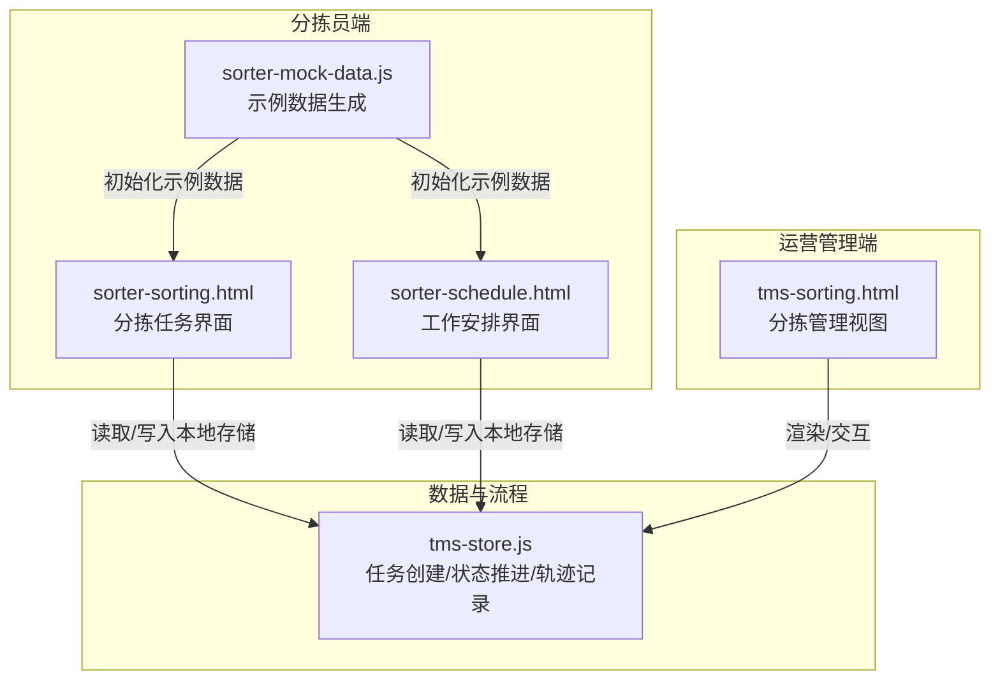
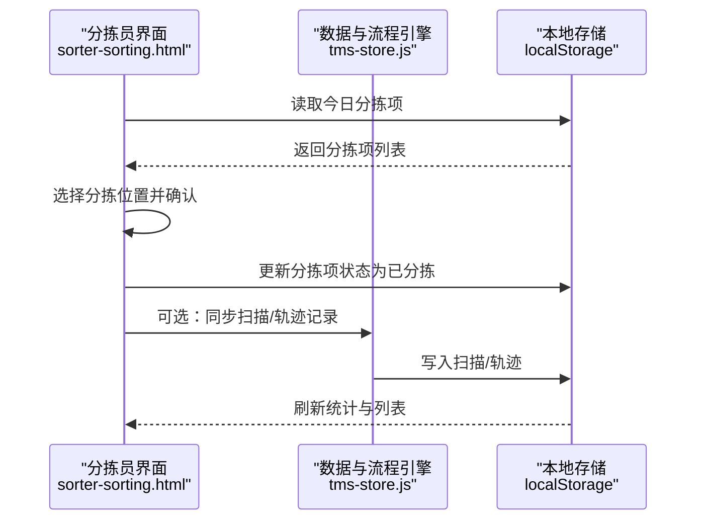
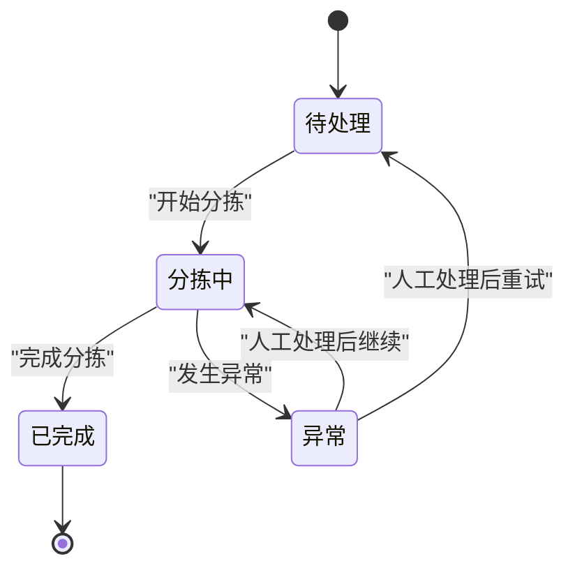
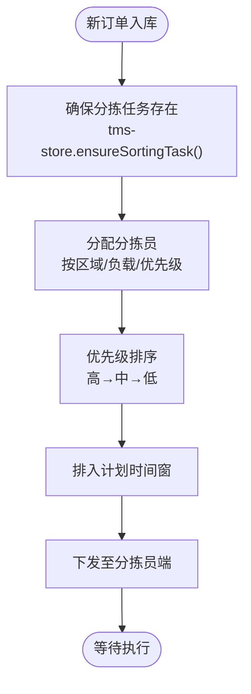
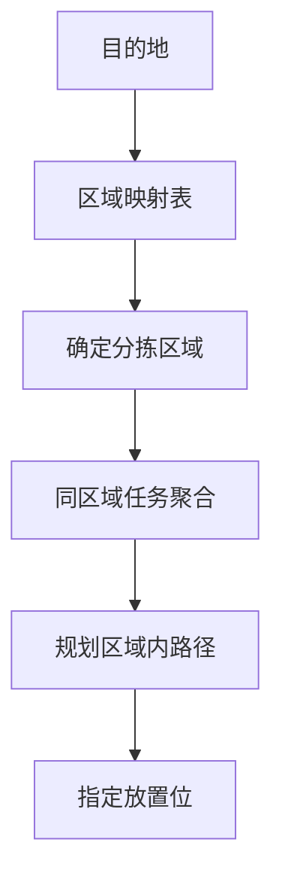
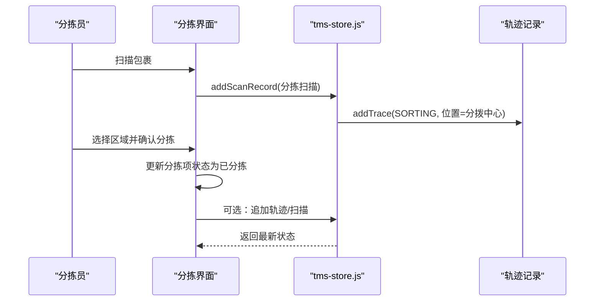
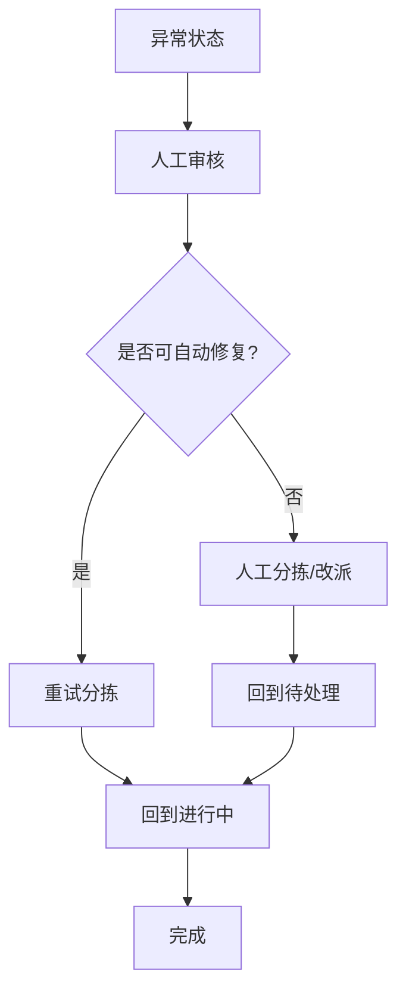
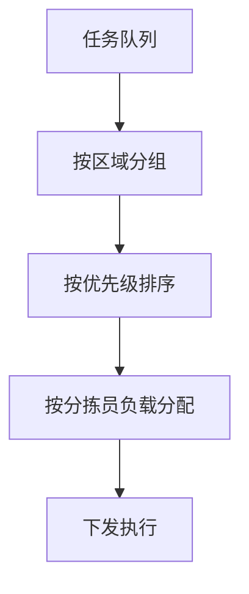
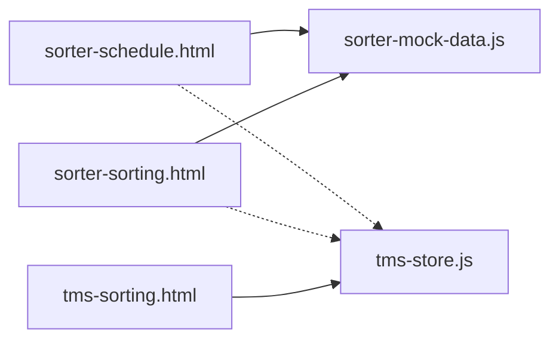

# 分拣任务管理

<cite>
**本文引用的文件**   
- [sorter-sorting.html](file://sorter-sorting.html)
- [sorter-schedule.html](file://sorter-schedule.html)
- [tms-sorting.html](file://tms-sorting.html)
- [sorter-mock-data.js](file://sorter-mock-data.js)
- [tms-store.js](file://tms-store.js)
</cite>

## 目录
1. [引言](#引言)
2. [项目结构](#项目结构)
3. [核心组件](#核心组件)
4. [架构总览](#架构总览)
5. [详细组件分析](#详细组件分析)
6. [依赖关系分析](#依赖关系分析)
7. [性能与扩展性](#性能与扩展性)
8. [故障排查指南](#故障排查指南)
9. [结论](#结论)

## 引言
本文件面向“分拣任务管理”模块，围绕分拣任务的分配算法、优先级排序、工作量均衡、状态流转、进度跟踪、完成确认、路径优化、区域划分、异常处理、重试机制、人工干预接口、调度策略、负载均衡与监控指标进行系统化说明。文档同时给出数据模型、状态机、并发处理建议以及大规模作业下的优化策略，帮助读者从业务到实现全面理解该模块。

## 项目结构
分拣相关功能由以下页面与脚本构成：
- 分拣员端
  - sorter-sorting.html：分拣任务列表、分拣操作、统计更新
  - sorter-schedule.html：工作安排（日/周/月）、任务优先级展示
  - sorter-mock-data.js：分拣员侧示例数据生成器
- 运营管理端
  - tms-sorting.html：分拣任务管理视图（待处理/进行中/已完成/异常）
- 数据与流程引擎
  - tms-store.js：订单-轨迹-扫描-任务等持久化与业务流转逻辑，包含分拣任务创建与状态推进

图表来源
- [sorter-sorting.html:500-783](file://sorter-sorting.html#L500-L783)
- [sorter-schedule.html:551-829](file://sorter-schedule.html#L551-L829)
- [tms-sorting.html:542-653](file://tms-sorting.html#L542-L653)
- [sorter-mock-data.js:327-354](file://sorter-mock-data.js#L327-L354)
- [tms-store.js:1350-1369](file://tms-store.js#L1350-L1369)

章节来源
- [sorter-sorting.html:500-783](file://sorter-sorting.html#L500-L783)
- [sorter-schedule.html:551-829](file://sorter-schedule.html#L551-L829)
- [tms-sorting.html:542-653](file://tms-sorting.html#L542-L653)
- [sorter-mock-data.js:327-354](file://sorter-mock-data.js#L327-L354)
- [tms-store.js:1350-1369](file://tms-store.js#L1350-L1369)

## 核心组件
- 分拣任务数据模型
  - 分拣任务实体：包含任务ID、关联订单号、运单号、来源地、目的地、分拣中心、分拣员、计划时间、是否漏分、状态、创建时间等字段
  - 分拣项实体（分拣员端）：包含运单号、订单号、目的地、包裹信息、状态、分拣位置、备注、分拣时间等字段
- 状态定义
  - 分拣任务：pending（待处理）、in-progress（分拣中）、completed（已完成）、error（异常）
  - 分拣项：pending（待分拣）、sorted（已分拣）
- 关键能力
  - 任务创建与分配：ensureSortingTask 负责为订单确保分拣任务并赋予初始状态
  - 状态推进：应用层提供开始/完成/异常处理按钮；store 提供状态推进与轨迹记录
  - 进度跟踪：扫描记录与轨迹节点联动，记录操作人、设备、位置与时间
  - 区域映射：根据目的地自动匹配分拣区域（A/B/C/D/E/F/G/H/I/J/K区）
  - 示例数据：SorterMockDataGenerator 批量生成今日/月度任务、排班、打卡、扫描与分拣项数据

章节来源
- [tms-store.js:1350-1369](file://tms-store.js#L1350-L1369)
- [sorter-sorting.html:552-783](file://sorter-sorting.html#L552-L783)
- [sorter-mock-data.js:108-178](file://sorter-mock-data.js#L108-L178)

## 架构总览
分拣任务管理采用“前端页面 + 本地存储 + 统一数据与流程引擎”的轻量架构：
- 分拣员端页面负责交互与本地数据读写
- 运营管理端页面负责全局任务视图与操作入口
- tms-store.js 作为统一的数据与流程引擎，负责任务创建、状态推进、轨迹与扫描记录

图表来源
- [sorter-sorting.html:590-783](file://sorter-sorting.html#L590-L783)
- [tms-store.js:1328-1348](file://tms-store.js#L1328-L1348)

## 详细组件分析

### 分拣任务数据模型与状态机
- 数据模型要点
  - 分拣任务：id、orderId、waybillNo、origin、destination、center、sorter、planAt、missed、status、createdAt
  - 分拣项：id、waybillNumber、orderId、destination、packageInfo、status、sortingLocation、sortingRemark、sortingTime
- 状态机
  - 分拣任务：pending → in-progress → completed；异常分支 error → resolve → pending/in-progress/completed
  - 分拣项：pending → sorted

图表来源
- [tms-sorting.html:470-529](file://tms-sorting.html#L470-L529)
- [sorter-sorting.html:600-783](file://sorter-sorting.html#L600-L783)

章节来源
- [tms-store.js:1350-1369](file://tms-store.js#L1350-L1369)
- [tms-sorting.html:470-529](file://tms-sorting.html#L470-L529)
- [sorter-sorting.html:600-783](file://sorter-sorting.html#L600-L783)

### 任务分配算法与优先级排序
- 分配策略
  - 基于订单来源地自动绑定分拣中心（origin + “分拨中心”）
  - 分拣员字段初始为“待分配”，可由运营或系统后续分配
- 优先级排序
  - 分拣员端任务卡片支持高/中/低优先级展示
  - 可按优先级与计划时间进行排序，优先处理高优先级与临近计划时间的任务
- 工作量均衡
  - 按分拣员当前待分拣数量与历史完成率动态分配
  - 结合区域负载（各区域待分拣量）进行均衡

图表来源
- [tms-store.js:1350-1369](file://tms-store.js#L1350-L1369)
- [sorter-schedule.html:680-718](file://sorter-schedule.html#L680-L718)

章节来源
- [tms-store.js:1350-1369](file://tms-store.js#L1350-L1369)
- [sorter-schedule.html:680-718](file://sorter-schedule.html#L680-L718)

### 分拣路径优化与区域划分策略
- 区域划分
  - 目的地到区域的映射表（如北京→A区、上海→B区、广州→C区、深圳→D区、杭州→E区、南京→F区、成都/重庆→G区、武汉/长沙→H区、西安→I区、郑州→J区、青岛→K区）
- 路径优化
  - 按区域聚合任务，减少跨区移动
  - 同区域任务合并批次，提升拣选效率
  - 结合包裹类型与重量，规划最优放置位

图表来源
- [sorter-mock-data.js:134-145](file://sorter-mock-data.js#L134-L145)
- [sorter-sorting.html:656-668](file://sorter-sorting.html#L656-L668)

章节来源
- [sorter-mock-data.js:134-145](file://sorter-mock-data.js#L134-L145)
- [sorter-sorting.html:656-668](file://sorter-sorting.html#L656-L668)

### 进度跟踪与完成确认
- 扫描记录
  - addScanRecord 将扫描事件写入全局扫描记录，包含时间、地点、设备、操作员
- 轨迹记录
  - addTrace 将轨迹节点写入订单与全局轨迹，标注超时与偏差标记
- 完成确认
  - 分拣员端确认分拣后更新分拣项状态为 sorted，并记录分拣位置、备注与时间
  - 运营管理端提供“开始/完成/处理异常”操作入口

图表来源
- [tms-store.js:1328-1348](file://tms-store.js#L1328-L1348)
- [sorter-sorting.html:681-723](file://sorter-sorting.html#L681-L723)

章节来源
- [tms-store.js:1328-1348](file://tms-store.js#L1328-L1348)
- [sorter-sorting.html:681-723](file://sorter-sorting.html#L681-L723)

### 异常任务处理、重试机制与人工干预接口
- 异常识别
  - 分拣任务状态可进入 error（异常），常见原因包括包裹信息不匹配、条形码无法识别、重量异常、目的地缺失、重复扫描等
- 重试机制
  - 人工处理后可将任务回退至 pending 或 in-progress，触发重试
- 人工干预接口
  - 运营管理端提供“处理异常”按钮，用于人工介入与恢复
  - 分拣员端可对异常包裹进行备注与二次分拣

图表来源
- [tms-sorting.html:514-529](file://tms-sorting.html#L514-L529)
- [sorter-mock-data.js:84-100](file://sorter-mock-data.js#L84-L100)

章节来源
- [tms-sorting.html:514-529](file://tms-sorting.html#L514-L529)
- [sorter-mock-data.js:84-100](file://sorter-mock-data.js#L84-L100)

### 任务调度策略与负载均衡算法
- 调度策略
  - 基于区域与优先级进行任务分组与排序
  - 结合计划时间与时效要求，动态调整调度顺序
- 负载均衡
  - 按分拣员当前工作量（待分拣数、历史完成率）进行分配
  - 按区域负载（各区域待分拣量）均衡分流
- 并发处理
  - 前端使用 localStorage 进行本地读写，需避免多标签页并发冲突
  - 建议在服务端引入队列与锁机制，保证任务分配的原子性与一致性

图表来源
- [sorter-schedule.html:680-718](file://sorter-schedule.html#L680-L718)
- [sorter-sorting.html:600-783](file://sorter-sorting.html#L600-L783)

章节来源
- [sorter-schedule.html:680-718](file://sorter-schedule.html#L680-L718)
- [sorter-sorting.html:600-783](file://sorter-sorting.html#L600-L783)

### 大规模分拣作业中的优化策略
- 批处理与分页
  - 对大量分拣项进行分批加载与分页显示，降低前端渲染压力
- 缓存与增量更新
  - 对区域负载与分拣员负载进行缓存，仅增量更新变化部分
- 异步与去抖
  - 对高频扫描与状态更新进行去抖与节流，避免频繁写盘
- 离线与断点续传
  - 在网络不可用时缓存操作，网络恢复后批量同步

[本节为通用优化建议，不直接分析具体文件]

## 依赖关系分析
- 页面依赖
  - sorter-sorting.html 与 sorter-schedule.html 依赖 sorter-mock-data.js 生成示例数据
  - tms-sorting.html 通过 tms-store.js 获取与更新任务数据
- 数据依赖
  - tms-store.js 统一管理订单、轨迹、扫描、任务等数据，并提供状态推进方法
- 外部依赖
  - 浏览器本地存储 localStorage 用于持久化示例数据与用户操作结果

图表来源
- [sorter-sorting.html:500-783](file://sorter-sorting.html#L500-L783)
- [sorter-schedule.html:551-829](file://sorter-schedule.html#L551-L829)
- [tms-sorting.html:542-653](file://tms-sorting.html#L542-L653)
- [tms-store.js:1328-1348](file://tms-store.js#L1328-L1348)

章节来源
- [sorter-sorting.html:500-783](file://sorter-sorting.html#L500-L783)
- [sorter-schedule.html:551-829](file://sorter-schedule.html#L551-L829)
- [tms-sorting.html:542-653](file://tms-sorting.html#L542-L653)
- [tms-store.js:1328-1348](file://tms-store.js#L1328-L1348)

## 性能与扩展性
- 性能考虑
  - 前端列表渲染应避免全量重绘，采用增量更新与虚拟滚动
  - 扫描与轨迹写入应限制长度（如 db.scans.length > 500 截断），防止内存增长
- 扩展性建议
  - 引入后端服务与消息队列，实现任务分配与状态推进的分布式处理
  - 增加监控指标：任务吞吐率、平均处理时长、异常率、区域负载分布、分拣员效率

[本节为通用指导，不直接分析具体文件]

## 故障排查指南
- 常见问题
  - 分拣项未更新：检查 localStorage 键名是否正确（如 sorterSortingItems_日期）
  - 统计数字不一致：确认 updateSortingStats 是否被调用且计数正确
  - 异常任务无法恢复：检查运营管理端的“处理异常”逻辑是否生效
- 定位步骤
  - 查看分拣员端控制台日志与本地存储内容
  - 核对 tms-store.js 中的扫描与轨迹记录是否写入成功
  - 验证状态机转换是否符合预期

章节来源
- [sorter-sorting.html:725-783](file://sorter-sorting.html#L725-L783)
- [tms-store.js:1328-1348](file://tms-store.js#L1328-L1348)

## 结论
分拣任务管理模块通过清晰的数据模型与状态机，结合区域划分与优先级排序，实现了高效的分拣作业流程。借助 tms-store.js 的统一数据与流程引擎，系统能够稳定地进行任务创建、状态推进与轨迹记录。在大规模作业场景下，建议引入后端服务与消息队列，完善监控与告警体系，进一步提升系统的可扩展性与稳定性。