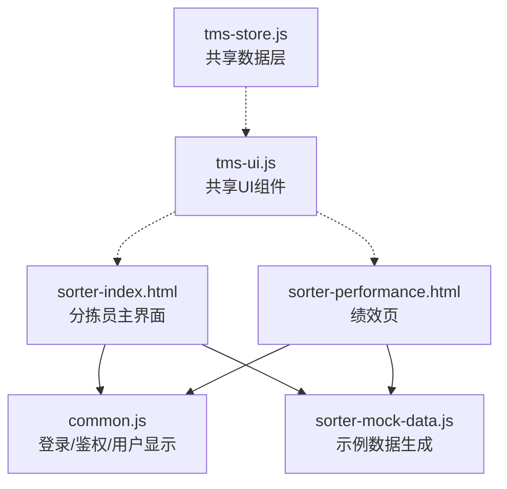
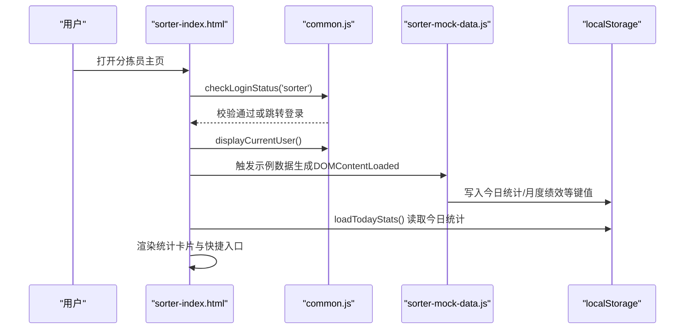
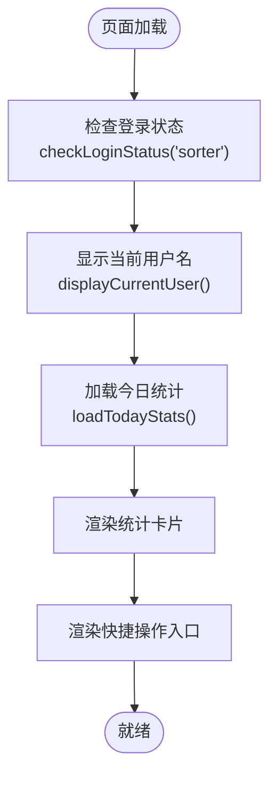
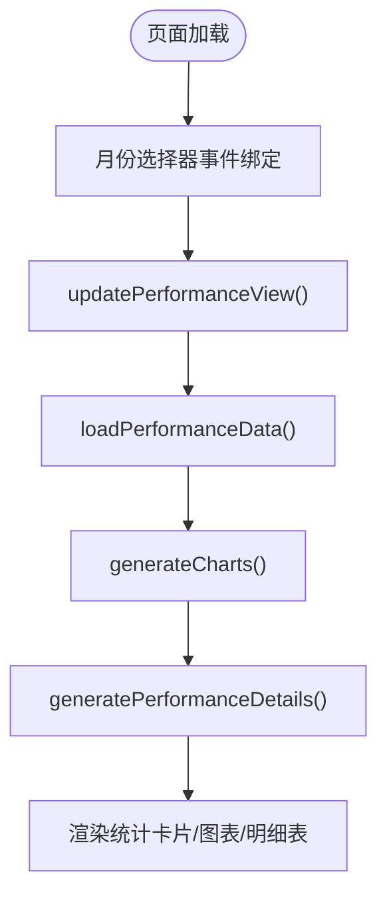
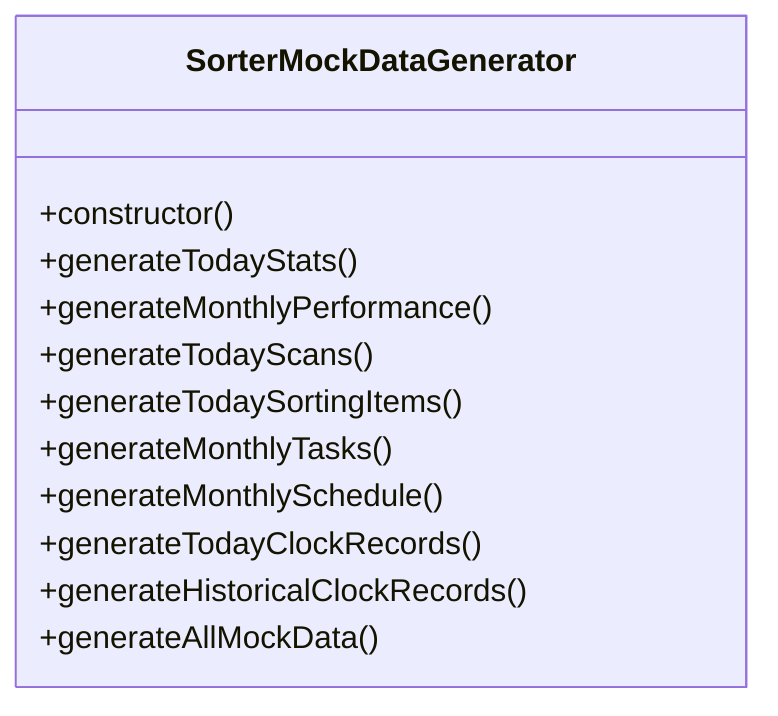
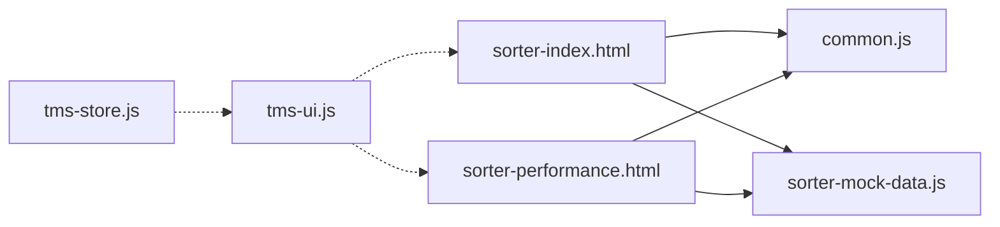

# 分拣员工作台

<cite>
**本文引用的文件**   
- [sorter-index.html](file://sorter-index.html)
- [sorter-performance.html](file://sorter-performance.html)
- [sorter-mock-data.js](file://sorter-mock-data.js)
- [common.js](file://common.js)
- [tms-ui.js](file://tms-ui.js)
- [tms-store.js](file://tms-store.js)
</cite>

## 目录
1. [引言](#引言)
2. [项目结构](#项目结构)
3. [核心组件](#核心组件)
4. [架构总览](#架构总览)
5. [详细组件分析](#详细组件分析)
6. [依赖关系分析](#依赖关系分析)
7. [性能与可维护性](#性能与可维护性)
8. [故障排查指南](#故障排查指南)
9. [结论](#结论)
10. [附录：使用流程与最佳实践](#附录使用流程与最佳实践)

## 引言
本文件面向分拣员工作台（首页、绩效页等）的界面设计、交互逻辑与数据流，重点说明以下方面：
- 主界面统计卡片、快捷操作入口、用户信息管理等核心组件的设计与实现。
- 今日工作统计数据的实时计算逻辑、绩效评分算法与异常件监控机制。
- 侧边栏导航交互、响应式布局适配与移动端优化方案。
- 数据绑定、事件处理与用户状态管理的具体实现路径。
- 与其他功能模块的集成方式、页面跳转逻辑与权限控制机制。
- 实际使用场景中的操作流程与最佳实践建议。

## 项目结构
分拣员工作台由多个 HTML 页面组成，配合通用脚本提供登录鉴权、UI 组件与示例数据生成能力。关键文件职责如下：
- sorter-index.html：分拣员主界面，包含顶部导航、侧边栏、统计卡片、快捷操作入口与基础样式。
- sorter-performance.html：分拣员绩效页，展示月度绩效指标、趋势图表与明细表。
- sorter-mock-data.js：为分拣员相关页面生成示例数据（今日统计、月度绩效、扫描记录、分拣任务、排班与打卡）。
- common.js：通用函数库，提供登录/登出、角色校验、当前用户显示、按钮样式注入等。
- tms-ui.js：共享 UI 组件库，提供 Toast、弹窗、表单、表格、KPI、图表等通用能力。
- tms-store.js：共享数据层，基于 localStorage 提供统一的数据增删改查、统计聚合与事件通知。

**图示来源**
- [sorter-index.html:1-330](file://sorter-index.html#L1-L330)
- [sorter-performance.html:1-681](file://sorter-performance.html#L1-L681)
- [sorter-mock-data.js:1-361](file://sorter-mock-data.js#L1-L361)
- [common.js:1-383](file://common.js#L1-L383)
- [tms-ui.js:1-783](file://tms-ui.js#L1-L783)
- [tms-store.js:1-800](file://tms-store.js#L1-L800)

**章节来源**
- [sorter-index.html:1-330](file://sorter-index.html#L1-L330)
- [sorter-performance.html:1-681](file://sorter-performance.html#L1-L681)
- [sorter-mock-data.js:1-361](file://sorter-mock-data.js#L1-L361)
- [common.js:1-383](file://common.js#L1-L383)
- [tms-ui.js:1-783](file://tms-ui.js#L1-L783)
- [tms-store.js:1-800](file://tms-store.js#L1-L800)

## 核心组件
- 顶部导航与用户信息管理
  - 显示当前用户名与退出登录按钮；通过通用函数检查登录状态并渲染用户信息。
- 侧边栏导航
  - 固定宽度侧边栏，包含“首页、包裹扫描、分拣任务、绩效评估、工作安排、打卡记录”等链接；在移动端切换为横向滚动导航。
- 统计卡片
  - 展示“今日已扫描、今日已分拣、今日异常件、本月绩效”四个关键指标；从本地存储读取当日统计与当月绩效。
- 快捷操作入口
  - 以卡片形式提供“打卡、扫描、分拣、绩效”快速跳转入口。
- 绩效页
  - 月份选择器、统计卡片（总扫描数、总分拣数、准确率、效率指数）、每日扫描/分拣趋势图、绩效明细表。

**章节来源**
- [sorter-index.html:201-276](file://sorter-index.html#L201-L276)
- [sorter-performance.html:338-437](file://sorter-performance.html#L338-L437)

## 架构总览
分拣员工作台采用“页面 + 通用脚本 + 示例数据”的前端架构：
- 页面负责结构与交互（HTML/CSS/内联JS）。
- common.js 提供统一的登录/鉴权与用户信息显示。
- sorter-mock-data.js 在页面加载时自动生成示例数据，确保演示效果。
- tms-ui.js 提供通用 UI 组件（Toast、弹窗、表格、图表等），供各页面复用。
- tms-store.js 作为共享数据层，提供统一的数据访问与事件通知（虽然分拣员页面主要使用本地存储键名，但整体系统遵循该模式）。

**图示来源**
- [sorter-index.html:282-326](file://sorter-index.html#L282-L326)
- [common.js:176-218](file://common.js#L176-L218)
- [sorter-mock-data.js:344-355](file://sorter-mock-data.js#L344-L355)

**章节来源**
- [sorter-index.html:282-326](file://sorter-index.html#L282-L326)
- [common.js:176-218](file://common.js#L176-L218)
- [sorter-mock-data.js:344-355](file://sorter-mock-data.js#L344-L355)

## 详细组件分析

### 分拣员主界面（sorter-index.html）
- 设计理念
  - 简洁直观：顶部导航突出品牌与用户信息，侧边栏集中功能入口，内容区聚焦当日统计与快捷操作。
  - 响应式友好：在小屏设备将侧边栏转为横向滚动列表，内容区域自适应。
- 关键实现要点
  - 登录状态检查与用户信息显示：调用通用函数完成鉴权与用户名渲染。
  - 今日统计数据加载：按日期键读取本地存储，更新统计卡片数值；同时读取当月绩效总分。
  - 快捷操作：通过锚点链接跳转到对应功能页（打卡、扫描、分拣、绩效）。
  - 响应式布局：通过媒体查询调整侧边栏宽度与导航排列方式。

**图示来源**
- [sorter-index.html:282-326](file://sorter-index.html#L282-L326)

**章节来源**
- [sorter-index.html:201-276](file://sorter-index.html#L201-L276)
- [sorter-index.html:282-326](file://sorter-index.html#L282-L326)

### 分拣员绩效页（sorter-performance.html）
- 设计理念
  - 以月为单位查看个人绩效，支持上/下月切换；通过统计卡片与柱状图展示扫描/分拣趋势，并提供明细表。
- 关键实现要点
  - 初始化与月份切换：根据当前年月更新视图，若当月无数据则生成模拟数据。
  - 数据加载与渲染：从本地存储读取当月绩效数据，更新统计卡片、生成图表与明细表。
  - 图表生成：简单柱状图通过动态创建 div 元素并按比例设置高度与位置。
  - 响应式布局：小屏下图表容器单列显示，统计卡片网格自适应。

**图示来源**
- [sorter-performance.html:444-677](file://sorter-performance.html#L444-L677)

**章节来源**
- [sorter-performance.html:338-437](file://sorter-performance.html#L338-L437)
- [sorter-performance.html:444-677](file://sorter-performance.html#L444-L677)

### 示例数据生成（sorter-mock-data.js）
- 作用
  - 为分拣员相关页面提供真实感示例数据，包括今日统计、月度绩效、扫描记录、分拣任务、排班与打卡记录。
- 关键方法
  - generateTodayStats：生成今日统计（扫描、分拣、异常件数量）并写入本地存储。
  - generateMonthlyPerformance：生成月度绩效（总量、准确率、效率、每日明细）并写入本地存储。
  - generateTodayScans / generateTodaySortingItems：生成今日扫描与分拣项目数据。
  - generateMonthlyTasks / generateMonthlySchedule：生成月度任务与排班数据。
  - generateTodayClockRecords / generateHistoricalClockRecords：生成今日与历史打卡记录。
  - generateAllMockData：批量生成所有示例数据，并在页面加载时自动执行。

**图示来源**
- [sorter-mock-data.js:4-342](file://sorter-mock-data.js#L4-L342)

**章节来源**
- [sorter-mock-data.js:1-361](file://sorter-mock-data.js#L1-L361)

### 通用脚本与UI组件（common.js, tms-ui.js, tms-store.js）
- common.js
  - 提供登录、登出、角色校验、当前用户显示、按钮样式注入等通用能力。
  - 分拣员页面通过 checkLoginStatus('sorter') 进行权限校验，未登录或角色不匹配将跳转至登录页。
- tms-ui.js
  - 提供 Toast、Modal、Form、Table、KPI、Chart 等通用 UI 组件，便于各页面复用。
  - initShell 用于统一侧边栏高亮、退出按钮绑定与异常待办角标展示。
- tms-store.js
  - 作为共享数据层，提供统一的数据增删改查、统计聚合与事件通知；分拣员页面虽主要使用本地存储键名，但整体系统遵循该模式。

**章节来源**
- [common.js:135-218](file://common.js#L135-L218)
- [tms-ui.js:703-746](file://tms-ui.js#L703-L746)
- [tms-store.js:1-800](file://tms-store.js#L1-L800)

## 依赖关系分析
- 页面依赖
  - sorter-index.html 依赖 common.js（鉴权与用户显示）与 sorter-mock-data.js（示例数据）。
  - sorter-performance.html 同样依赖 common.js 与 sorter-mock-data.js。
- 组件依赖
  - tms-ui.js 提供通用 UI 能力，被多页面引用（尽管分拣员页面多为内联样式与脚本，但整体系统使用该库）。
  - tms-store.js 作为数据层，为其他页面提供统一数据访问接口。

**图示来源**
- [sorter-index.html:280-281](file://sorter-index.html#L280-L281)
- [sorter-performance.html:442-443](file://sorter-performance.html#L442-L443)
- [tms-ui.js:1-783](file://tms-ui.js#L1-L783)
- [tms-store.js:1-800](file://tms-store.js#L1-L800)

**章节来源**
- [sorter-index.html:280-281](file://sorter-index.html#L280-L281)
- [sorter-performance.html:442-443](file://sorter-performance.html#L442-L443)
- [tms-ui.js:1-783](file://tms-ui.js#L1-L783)
- [tms-store.js:1-800](file://tms-store.js#L1-L800)

## 性能与可维护性
- 性能考虑
  - 示例数据在页面加载时一次性生成并写入本地存储，避免重复计算；统计卡片与图表渲染直接读取本地数据，减少网络请求。
  - 简单柱状图通过 DOM 操作生成，适合小规模数据；大数据量场景建议使用 SVG/Canvas 图表库以提升性能。
- 可维护性建议
  - 将分拣员页面的内联脚本逐步迁移到独立 JS 模块，提高可读性与可测试性。
  - 统一使用 tms-ui.js 的组件（如 KPI、图表）替代内联实现，提升一致性。
  - 对本地存储键名进行集中管理，避免硬编码分散在各页面。

[本节为通用指导，无需具体文件引用]

## 故障排查指南
- 登录后无法进入分拣员主页
  - 检查 common.js 中 checkLoginStatus 是否返回成功；确认 localStorage 中 tmsUser 是否存在且 role 为 sorter。
- 统计卡片数值为空或为 0
  - 确认 sorter-mock-data.js 是否已执行 generateAllMockData；检查 localStorage 中 sorterStats_YYYY-MM-DD 与 sorterPerformance_YYYY_MM 是否存在。
- 绩效页图表不显示
  - 检查 generateBarChart 是否正确获取容器尺寸；确认当月绩效数据 dailyDetails 是否为空。
- 侧边栏导航在小屏不可用
  - 检查 CSS 媒体查询是否生效；确认 .nav ul 在移动端是否切换为 flex 横向滚动。

**章节来源**
- [common.js:176-218](file://common.js#L176-L218)
- [sorter-mock-data.js:344-355](file://sorter-mock-data.js#L344-L355)
- [sorter-performance.html:613-641](file://sorter-performance.html#L613-L641)
- [sorter-index.html:173-197](file://sorter-index.html#L173-L197)

## 结论
分拣员工作台通过清晰的页面结构与通用脚本实现了开箱即用的分拣员主界面与绩效页。其核心优势在于：
- 直观的统计卡片与快捷操作入口，帮助分拣员快速掌握当日工作与绩效。
- 基于本地存储的示例数据生成机制，确保演示环境稳定可用。
- 响应式布局适配移动端，提升用户体验。
未来可进一步引入统一 UI 组件与数据层封装，提升一致性与可维护性。

[本节为总结，无需具体文件引用]

## 附录：使用流程与最佳实践
- 登录与权限控制
  - 使用 common.js 的 login 与 checkLoginStatus 完成角色校验；分拣员需确保 role 为 sorter。
- 数据绑定与事件处理
  - 主界面通过 loadTodayStats 读取本地存储并更新统计卡片；绩效页通过 updatePerformanceView 刷新视图。
- 用户状态管理
  - 使用 getCurrentUser 与 displayCurrentUser 获取并显示当前用户；logout 清除本地存储并跳转登录页。
- 页面跳转与模块集成
  - 快捷操作入口通过锚点链接跳转到对应功能页；侧边栏导航保持功能入口一致。
- 最佳实践
  - 优先使用 tms-ui.js 的组件进行 UI 构建，减少内联样式与脚本。
  - 对本地存储键名进行集中管理，避免硬编码。
  - 在大数据量场景下，使用更高效的图表库与分页策略。

**章节来源**
- [common.js:135-218](file://common.js#L135-L218)
- [sorter-index.html:282-326](file://sorter-index.html#L282-L326)
- [sorter-performance.html:444-677](file://sorter-performance.html#L444-L677)