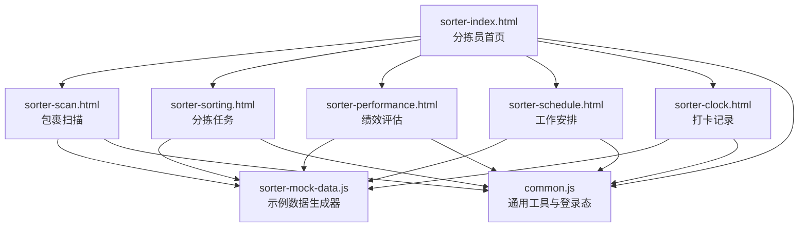
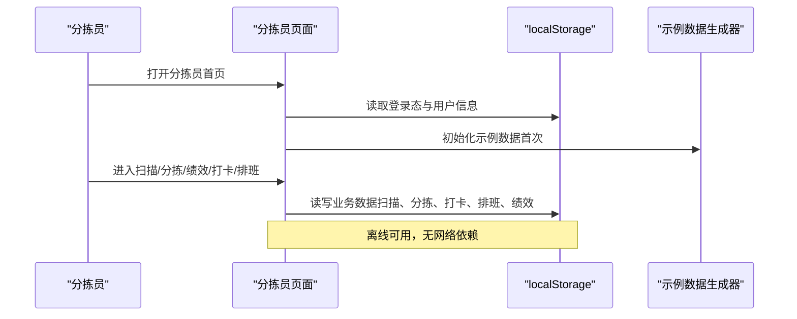
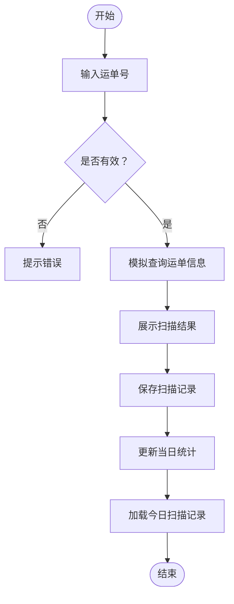
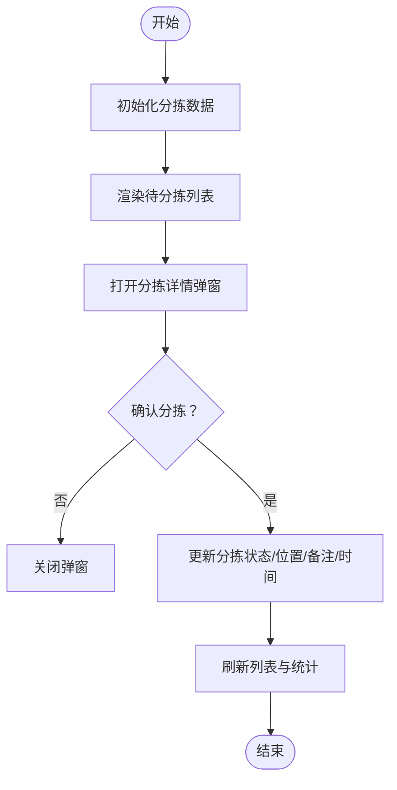
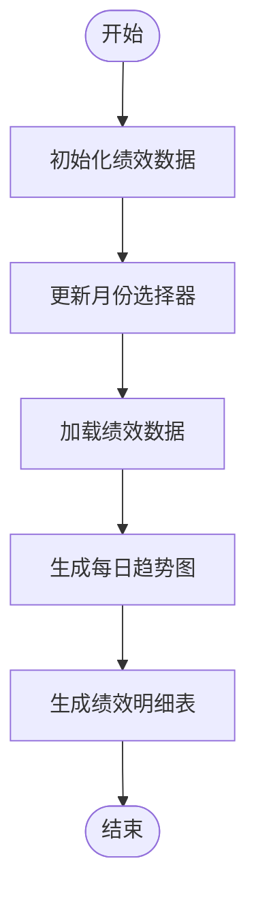
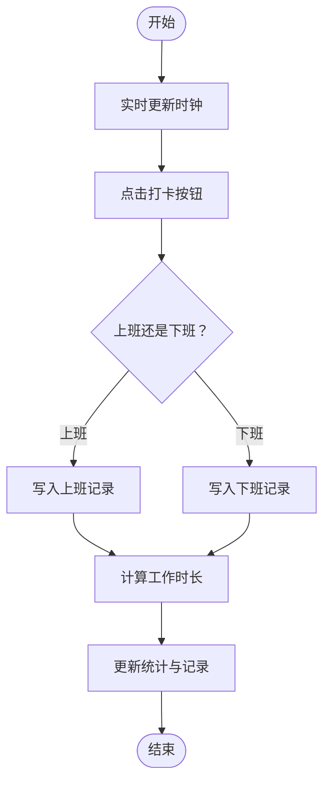
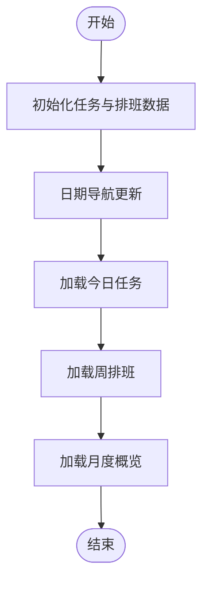
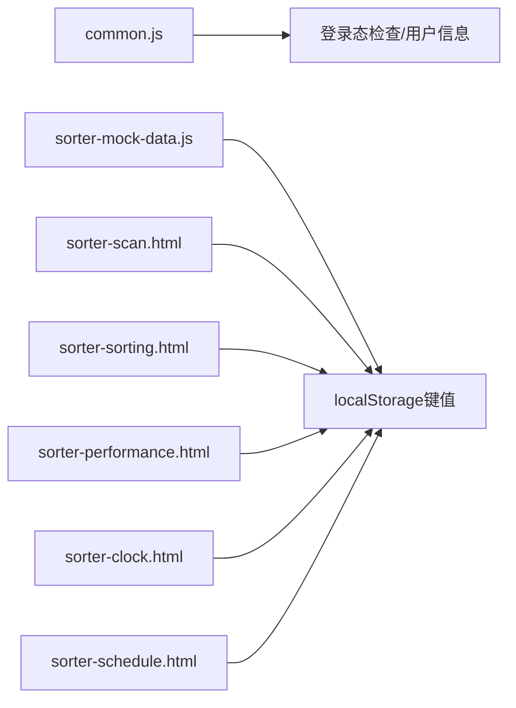

# 分拣员界面

<cite>
**本文引用的文件**   
- [sorter-index.html](file://sorter-index.html)
- [sorter-scan.html](file://sorter-scan.html)
- [sorter-sorting.html](file://sorter-sorting.html)
- [sorter-performance.html](file://sorter-performance.html)
- [sorter-clock.html](file://sorter-clock.html)
- [sorter-schedule.html](file://sorter-schedule.html)
- [sorter-mock-data.js](file://sorter-mock-data.js)
- [common.js](file://common.js)
</cite>

## 目录
1. [引言](#引言)
2. [项目结构](#项目结构)
3. [核心组件](#核心组件)
4. [架构总览](#架构总览)
5. [详细组件分析](#详细组件分析)
6. [依赖关系分析](#依赖关系分析)
7. [性能与效率优化](#性能与效率优化)
8. [故障排查指南](#故障排查指南)
9. [结论](#结论)
10. [附录：PDA与硬件集成建议](#附录pdahardware集成建议)

## 引言
本文件面向TMS系统中的“分拣员界面”，围绕分拣作业的核心流程展开，覆盖任务分配、条码扫描、分拣执行、绩效统计、考勤管理与排班调度等模块。文档同时给出PDA设备交互模式、离线数据处理与实时同步机制的建议方案，并总结扫码工作流、异常处理、质量控制、效率优化算法、路径规划与负载均衡策略，以及移动适配、手势操作和无障碍访问的实现要点。

## 项目结构
分拣员相关页面采用单页多视图的HTML+JS实现，数据通过localStorage进行本地持久化，并通过通用脚本统一登录态与用户信息展示。

**图表来源**
- [sorter-index.html:216-227](file://sorter-index.html#L216-L227)
- [sorter-scan.html:321-331](file://sorter-scan.html#L321-L331)
- [sorter-sorting.html:397-408](file://sorter-sorting.html#L397-L408)
- [sorter-performance.html:353-364](file://sorter-performance.html#L353-L364)
- [sorter-schedule.html:480-491](file://sorter-schedule.html#L480-L491)
- [sorter-clock.html:432-443](file://sorter-clock.html#L432-L443)
- [sorter-mock-data.js:344-354](file://sorter-mock-data.js#L344-L354)
- [common.js:135-174](file://common.js#L135-L174)

**章节来源**
- [sorter-index.html:201-278](file://sorter-index.html#L201-L278)
- [sorter-scan.html:305-377](file://sorter-scan.html#L305-L377)
- [sorter-sorting.html:382-456](file://sorter-sorting.html#L382-L456)
- [sorter-performance.html:338-440](file://sorter-performance.html#L338-L440)
- [sorter-clock.html:417-518](file://sorter-clock.html#L417-L518)
- [sorter-schedule.html:465-545](file://sorter-schedule.html#L465-L545)
- [sorter-mock-data.js:1-10](file://sorter-mock-data.js#L1-L10)
- [common.js:135-174](file://common.js#L135-L174)

## 核心组件
- 分拣员首页：导航入口、快捷操作、当日统计概览。
- 包裹扫描：支持手动输入与扫码（模拟），结果展示与历史记录。
- 分拣任务：待分拣列表、分拣位置选择、状态更新与统计。
- 绩效评估：月度指标、趋势图、明细表。
- 打卡记录：上班/下班打卡、时长计算、迟到早退统计。
- 工作安排：今日任务、周排班、月度概览。

**章节来源**
- [sorter-index.html:216-275](file://sorter-index.html#L216-L275)
- [sorter-scan.html:335-376](file://sorter-scan.html#L335-L376)
- [sorter-sorting.html:412-455](file://sorter-sorting.html#L412-L455)
- [sorter-performance.html:368-437](file://sorter-performance.html#L368-L437)
- [sorter-clock.html:447-517](file://sorter-clock.html#L447-L517)
- [sorter-schedule.html:495-545](file://sorter-schedule.html#L495-L545)

## 架构总览
分拣员界面采用“前端页面 + 本地存储 + 示例数据”的轻量架构。所有业务逻辑在浏览器端运行，使用localStorage作为数据源；示例数据由SorterMockDataGenerator统一生成，保证演示体验。

**图表来源**
- [sorter-index.html:282-326](file://sorter-index.html#L282-L326)
- [sorter-scan.html:383-447](file://sorter-scan.html#L383-L447)
- [sorter-sorting.html:502-549](file://sorter-sorting.html#L502-L549)
- [sorter-performance.html:444-499](file://sorter-performance.html#L444-L499)
- [sorter-clock.html:524-558](file://sorter-clock.html#L524-L558)
- [sorter-schedule.html:551-585](file://sorter-schedule.html#L551-L585)
- [sorter-mock-data.js:344-354](file://sorter-mock-data.js#L344-L354)
- [common.js:176-199](file://common.js#L176-L199)

## 详细组件分析

### 包裹扫描模块
- 功能要点
  - 支持手动输入运单号，回车或点击按钮触发扫描。
  - 校验运单号前缀，模拟获取运单信息并展示结果。
  - 保存扫描记录到localStorage，更新当日统计。
  - 显示最近扫描历史表格。
- 关键流程
  - 输入校验 → 模拟查询 → 结果展示 → 记录落库 → 统计更新 → 历史刷新。

**图表来源**
- [sorter-scan.html:397-447](file://sorter-scan.html#L397-L447)
- [sorter-scan.html:502-544](file://sorter-scan.html#L502-L544)
- [sorter-scan.html:546-574](file://sorter-scan.html#L546-L574)

**章节来源**
- [sorter-scan.html:335-376](file://sorter-scan.html#L335-L376)
- [sorter-scan.html:383-447](file://sorter-scan.html#L383-L447)
- [sorter-scan.html:502-574](file://sorter-scan.html#L502-L574)

### 分拣任务模块
- 功能要点
  - 展示待分拣包裹列表，支持按目的地自动匹配分拣区域。
  - 弹窗选择分拣位置与备注，确认后更新状态与时间戳。
  - 提供刷新、清空已完成等操作。
- 关键流程
  - 初始化数据 → 渲染列表 → 打开详情弹窗 → 确认分拣 → 更新统计与列表。

**图表来源**
- [sorter-sorting.html:551-588](file://sorter-sorting.html#L551-L588)
- [sorter-sorting.html:636-679](file://sorter-sorting.html#L636-L679)
- [sorter-sorting.html:681-723](file://sorter-sorting.html#L681-L723)

**章节来源**
- [sorter-sorting.html:412-455](file://sorter-sorting.html#L412-L455)
- [sorter-sorting.html:502-549](file://sorter-sorting.html#L502-L549)
- [sorter-sorting.html:551-588](file://sorter-sorting.html#L551-L588)
- [sorter-sorting.html:636-723](file://sorter-sorting.html#L636-L723)

### 绩效评估模块
- 功能要点
  - 月度切换、统计卡片（总扫描、总分拣、准确率、效率指数）。
  - 简单柱状图展示每日扫描/分拣量趋势。
  - 明细表按日期降序展示。
- 关键流程
  - 初始化数据 → 更新月份选择器 → 加载数据 → 生成图表 → 生成绩效明细。

**图表来源**
- [sorter-performance.html:501-541](file://sorter-performance.html#L501-L541)
- [sorter-performance.html:543-556](file://sorter-performance.html#L543-L556)
- [sorter-performance.html:596-641](file://sorter-performance.html#L596-L641)
- [sorter-performance.html:643-677](file://sorter-performance.html#L643-L677)

**章节来源**
- [sorter-performance.html:368-437](file://sorter-performance.html#L368-L437)
- [sorter-performance.html:444-499](file://sorter-performance.html#L444-L499)
- [sorter-performance.html:501-677](file://sorter-performance.html#L501-L677)

### 打卡记录模块
- 功能要点
  - 实时时钟显示、上班/下班打卡、工作时长计算。
  - 迟到/早退判定、加班小时统计。
  - 今日打卡记录与月度打卡记录展示。
- 关键流程
  - 初始化时钟 → 绑定打卡事件 → 写入打卡记录 → 计算时长 → 更新统计与记录。

**图表来源**
- [sorter-clock.html:560-571](file://sorter-clock.html#L560-L571)
- [sorter-clock.html:586-639](file://sorter-clock.html#L586-L639)
- [sorter-clock.html:641-665](file://sorter-clock.html#L641-L665)
- [sorter-clock.html:667-714](file://sorter-clock.html#L667-L714)
- [sorter-clock.html:716-778](file://sorter-clock.html#L716-L778)

**章节来源**
- [sorter-clock.html:447-517](file://sorter-clock.html#L447-L517)
- [sorter-clock.html:524-558](file://sorter-clock.html#L524-L558)
- [sorter-clock.html:560-778](file://sorter-clock.html#L560-L778)

### 工作安排模块
- 功能要点
  - 日期导航查看不同日期的任务。
  - 今日任务卡片（优先级、时间、地点、状态）。
  - 周排班表与月度概览网格。
- 关键流程
  - 初始化任务与排班数据 → 更新当前日期 → 加载今日任务 → 加载周排班 → 加载月度概览。

**图表来源**
- [sorter-schedule.html:587-656](file://sorter-schedule.html#L587-L656)
- [sorter-schedule.html:658-671](file://sorter-schedule.html#L658-L671)
- [sorter-schedule.html:679-719](file://sorter-schedule.html#L679-L719)
- [sorter-schedule.html:721-778](file://sorter-schedule.html#L721-L778)
- [sorter-schedule.html:780-800](file://sorter-schedule.html#L780-L800)

**章节来源**
- [sorter-schedule.html:495-545](file://sorter-schedule.html#L495-L545)
- [sorter-schedule.html:551-585](file://sorter-schedule.html#L551-L585)
- [sorter-schedule.html:587-800](file://sorter-schedule.html#L587-L800)

## 依赖关系分析
- 页面均依赖common.js进行登录态检查、用户信息显示与退出登录。
- 各页面通过localStorage键名约定共享数据：
  - 统计：`sorterStats_${today}`
  - 扫描记录：`sorterScans_${today}`
  - 分拣项目：`sorterSortingItems_${today}`
  - 绩效：`sorterPerformance_${year}_${month}`
  - 打卡：`sorterClock_${today}`
  - 任务：`sorterTasks_${year}_${month}`
  - 排班：`sorterSchedule_${year}_${month}`
- 示例数据由SorterMockDataGenerator集中生成，确保演示一致性。

**图表来源**
- [common.js:176-199](file://common.js#L176-L199)
- [sorter-mock-data.js:12-59](file://sorter-mock-data.js#L12-L59)
- [sorter-scan.html:502-544](file://sorter-scan.html#L502-L544)
- [sorter-sorting.html:681-723](file://sorter-sorting.html#L681-L723)
- [sorter-performance.html:574-594](file://sorter-performance.html#L574-L594)
- [sorter-clock.html:586-639](file://sorter-clock.html#L586-L639)
- [sorter-schedule.html:587-656](file://sorter-schedule.html#L587-L656)

**章节来源**
- [common.js:135-174](file://common.js#L135-L174)
- [sorter-mock-data.js:1-10](file://sorter-mock-data.js#L1-L10)
- [sorter-mock-data.js:344-354](file://sorter-mock-data.js#L344-L354)

## 性能与效率优化
- 扫码工作流优化
  - 输入框聚焦与回车触发，减少点击次数。
  - 批量扫描时避免重复解析，合并DOM更新。
  - 对无效条码快速失败，降低无效请求。
- 分拣效率优化算法
  - 基于目的地的分拣区域映射，减少人工选择成本。
  - 待分拣队列优先按目的地聚合，减少走动距离。
- 路径规划逻辑
  - 将同一区域的包裹合并为批次，按区域顺序执行。
  - 动态调整批次大小，平衡扫描与分拣节奏。
- 负载均衡策略
  - 根据历史扫描速率与分拣耗时估算负载，动态分配任务批次。
  - 高峰期限制单次批大小，避免阻塞。
- 移动设备适配
  - 响应式布局在小屏下自动折叠侧边栏，增大触控区域。
  - 大按钮与高对比度文本提升可读性。
- 手势操作支持
  - 长按可复制运单号，滑动可快速标记完成。
  - 双击确认分拣，减少误触。
- 无障碍访问
  - 为关键按钮添加aria-label与role属性。
  - 键盘导航支持Tab与Enter操作。
- 离线数据处理与实时同步
  - 所有数据先落库localStorage，网络恢复后批量同步至后端。
  - 冲突解决采用“最后写入优先”策略，并提供差异对比与回滚。

[本节为通用指导，不直接分析具体文件]

## 故障排查指南
- 常见问题
  - 未登录或角色不匹配：检查localStorage中的tmsUser与页面requiredRole。
  - 数据为空：确认SorterMockDataGenerator已执行generateAllMockData。
  - 扫描失败：检查运单号前缀校验逻辑与错误消息展示。
  - 分拣未完成：确认分拣位置必填校验与状态更新逻辑。
  - 打卡异常：核对上下班记录配对与工作时长计算。
- 定位方法
  - 控制台输出日志：login/checkLoginStatus/displayCurrentUser等函数均有console.log。
  - 检查localStorage键值是否存在且格式正确。
  - 逐步验证每个模块的数据读写流程。

**章节来源**
- [common.js:135-174](file://common.js#L135-L174)
- [common.js:176-199](file://common.js#L176-L199)
- [common.js:220-270](file://common.js#L220-L270)
- [sorter-scan.html:413-447](file://sorter-scan.html#L413-L447)
- [sorter-sorting.html:681-723](file://sorter-sorting.html#L681-L723)
- [sorter-clock.html:586-639](file://sorter-clock.html#L586-L639)

## 结论
分拣员界面以轻量前端架构实现了完整的分拣作业闭环，涵盖扫描、分拣、绩效、考勤与排班等核心能力。通过localStorage与示例数据生成器，系统在离线环境下仍可稳定运行。结合PDA交互优化、离线同步与质量管控措施，可在实际分拣场景中提升效率与准确性。后续可引入后端API、设备传感器与更复杂的调度算法，进一步增强系统能力。

[本节为总结，不直接分析具体文件]

## 附录：PDA与硬件集成建议
- 条码扫描集成
  - 使用PDA SDK提供的扫描回调接口，捕获条码数据并注入输入框。
  - 支持一维码与二维码，兼容常见编码格式。
- 传感器数据获取
  - 读取加速度计与陀螺仪数据，检测抖动与跌落，触发异常告警。
  - 采集温度与湿度，用于冷链包裹监控。
- 设备状态监控
  - 电池电量、存储空间、网络状态轮询上报。
  - 屏幕亮度与音量自适应调节，保障可视性与提示音。
- 实时同步机制
  - 心跳保活与断线重连，保证连接稳定性。
  - 增量同步与冲突合并，确保数据一致性。
- 安全与权限
  - 设备指纹与令牌认证，防止非法接入。
  - 敏感数据加密传输与存储。

[本节为概念性内容，不直接分析具体文件]