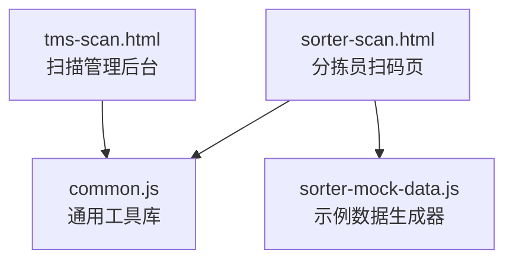
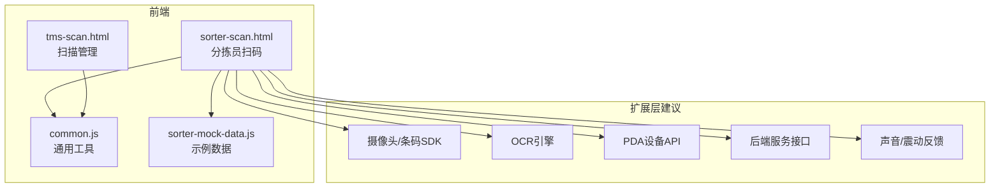
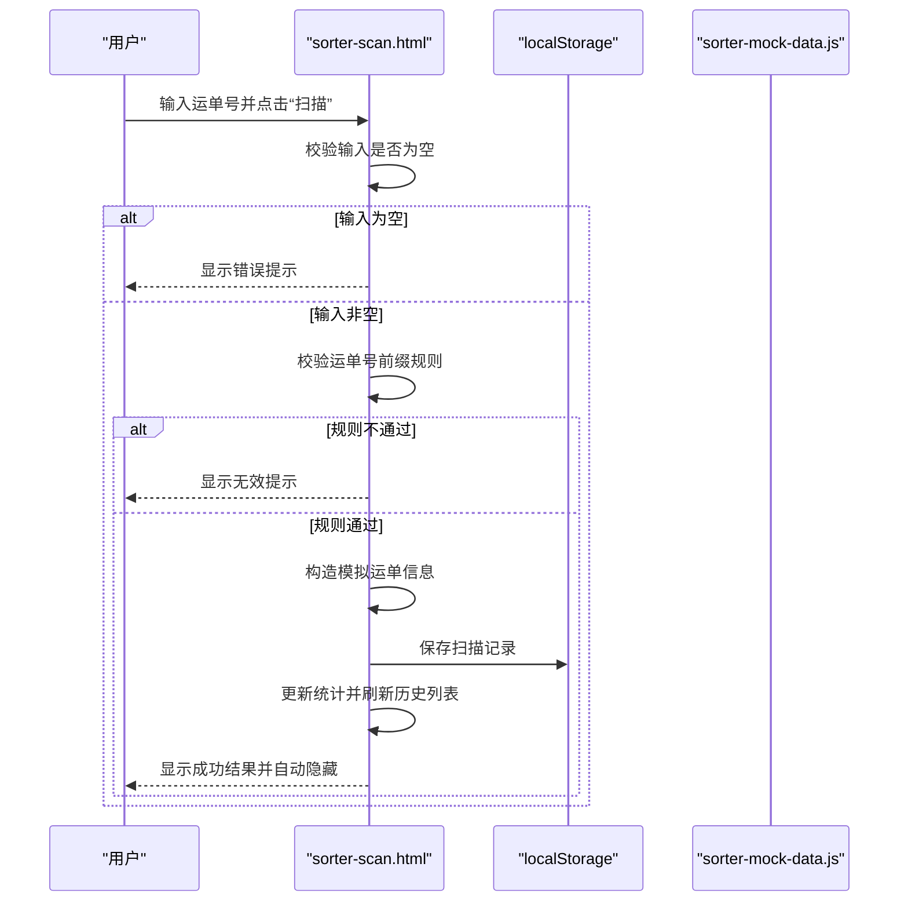
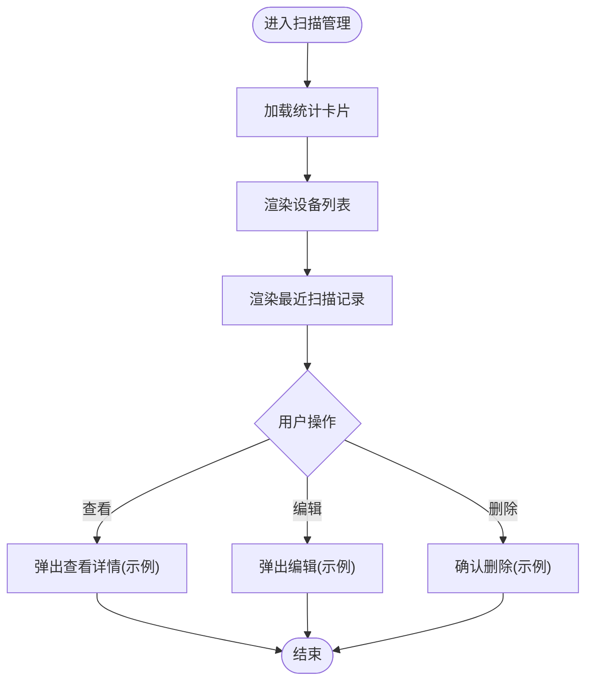
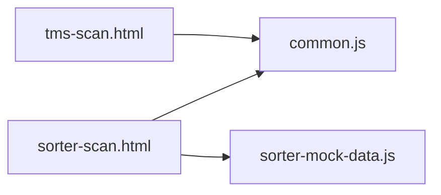

# 包裹扫描模块

<cite>
**本文引用的文件**   
- [tms-scan.html](file://tms-scan.html)
- [sorter-scan.html](file://sorter-scan.html)
- [common.js](file://common.js)
- [sorter-mock-data.js](file://sorter-mock-data.js)
</cite>

## 目录
1. [引言](#引言)
2. [项目结构](#项目结构)
3. [核心组件](#核心组件)
4. [架构总览](#架构总览)
5. [详细组件分析](#详细组件分析)
6. [依赖关系分析](#依赖关系分析)
7. [性能与优化](#性能与优化)
8. [故障排查指南](#故障排查指南)
9. [结论](#结论)
10. [附录：离线与同步、批量扫描与硬件集成建议](#附录离线与同步批量扫描与硬件集成建议)

## 引言
本章节面向“包裹扫描模块”的完整技术说明，聚焦条码扫描在分拣作业中的实现路径。当前仓库提供了两个关键页面：
- 分拣员侧的“包裹扫描”界面（sorter-scan.html）
- 运营侧的“扫描管理”界面（tms-scan.html）

同时包含通用工具库（common.js）与分拣员示例数据生成脚本（sorter-mock-data.js）。文档将围绕摄像头调用、条码识别、OCR文字识别、PDA设备集成、用户交互设计、错误处理、数据验证、离线缓存与网络恢复后的同步、批量扫描优化、声音/震动反馈、多格式兼容与复杂场景处理进行系统化阐述。

## 项目结构
仓库中与扫描相关的核心文件如下：
- tms-scan.html：扫描管理后台页面，展示设备状态、统计指标与最近扫描记录
- sorter-scan.html：分拣员扫码操作页，提供手动输入与模拟扫描流程
- common.js：通用函数库（登录、用户信息、ID生成等）
- sorter-mock-data.js：分拣员角色示例数据生成器（含扫描记录、统计、任务、排班等）

图表来源
- [tms-scan.html:455-590](file://tms-scan.html#L455-L590)
- [sorter-scan.html:335-376](file://sorter-scan.html#L335-L376)
- [common.js:1-50](file://common.js#L1-L50)
- [sorter-mock-data.js:1-10](file://sorter-mock-data.js#L1-L10)

章节来源
- [tms-scan.html:455-590](file://tms-scan.html#L455-L590)
- [sorter-scan.html:335-376](file://sorter-scan.html#L335-L376)
- [common.js:1-50](file://common.js#L1-L50)
- [sorter-mock-data.js:1-10](file://sorter-mock-data.js#L1-L10)

## 核心组件
- 扫描管理后台（tms-scan.html）
  - 展示扫描设备在线/离线/维护状态
  - 展示今日扫描量、在线设备数、准确率等统计卡片
  - 展示最近扫描记录表格（时间、订单号、运单号、类型、位置、设备、人员、操作）
- 分拣员扫码页（sorter-scan.html）
  - 提供“扫描区域”提示与“手动输入”框
  - 支持回车触发扫描
  - 显示扫描结果（成功/失败），并自动隐藏
  - 保存当日扫描记录到本地存储，更新统计并刷新历史列表
- 通用工具库（common.js）
  - 登录校验、用户信息显示、ID生成（订单号、运单号）
- 示例数据生成器（sorter-mock-data.js）
  - 生成今日扫描记录、统计数据、任务、排班、打卡等示例数据

章节来源
- [tms-scan.html:455-590](file://tms-scan.html#L455-L590)
- [sorter-scan.html:335-376](file://sorter-scan.html#L335-L376)
- [common.js:1-50](file://common.js#L1-L50)
- [sorter-mock-data.js:1-10](file://sorter-mock-data.js#L1-L10)

## 架构总览
从系统视角看，扫描模块由前端页面、通用工具与示例数据三部分组成；实际生产环境可在此基础上接入硬件SDK（摄像头、条码引擎、PDA SDK）、后端服务（订单查询、轨迹更新）与消息通道（声音/震动提示）。

图表来源
- [tms-scan.html:455-590](file://tms-scan.html#L455-L590)
- [sorter-scan.html:335-376](file://sorter-scan.html#L335-L376)
- [common.js:1-50](file://common.js#L1-L50)
- [sorter-mock-data.js:1-10](file://sorter-mock-data.js#L1-L10)

## 详细组件分析

### 分拣员扫码页（sorter-scan.html）
- 用户交互设计
  - 顶部标题与引导文案，明确“扫描运单条码或手动输入运单号”
  - “扫描区域”提供视觉提示，支持二维码和条形码
  - “手动输入”框绑定按钮点击与回车事件，统一触发扫描逻辑
- 扫描流程
  - 读取输入值并进行非空校验
  - 对运单号前缀进行简单规则校验（例如以特定前缀开头视为有效）
  - 构造模拟运单信息，渲染扫描结果，保存到本地存储，清空输入框
- 错误处理
  - 输入为空时提示错误
  - 运单号无效时提示重新输入
  - 扫描结果区域根据成功/失败切换样式，并在成功后自动隐藏
- 数据验证
  - 基于前缀的规则校验（示例中为“WB”前缀）
  - 本地存储键按日期分区，避免跨日数据污染
- 实时反馈
  - 结果区即时显示，3秒后自动隐藏
  - 可扩展声音提示与震动反馈（见附录）

图表来源
- [sorter-scan.html:398-447](file://sorter-scan.html#L398-L447)
- [sorter-scan.html:449-529](file://sorter-scan.html#L449-L529)
- [sorter-mock-data.js:61-106](file://sorter-mock-data.js#L61-L106)

章节来源
- [sorter-scan.html:335-376](file://sorter-scan.html#L335-L376)
- [sorter-scan.html:398-447](file://sorter-scan.html#L398-L447)
- [sorter-scan.html:449-529](file://sorter-scan.html#L449-L529)
- [sorter-mock-data.js:61-106](file://sorter-mock-data.js#L61-L106)

### 扫描管理后台（tms-scan.html）
- 功能要点
  - 统计卡片：设备数量、今日扫描量、在线设备数、准确率
  - 设备管理：展示设备编号、型号、所在网点、最后在线时间、扫描量
  - 扫描记录：时间、订单号、运单号、类型、位置、设备、人员、操作
- 交互逻辑
  - 查看/编辑/删除扫描记录的按钮绑定（示例中使用alert占位）
  - 退出登录与用户信息显示

图表来源
- [tms-scan.html:455-590](file://tms-scan.html#L455-L590)
- [tms-scan.html:648-692](file://tms-scan.html#L648-L692)

章节来源
- [tms-scan.html:455-590](file://tms-scan.html#L455-L590)
- [tms-scan.html:648-692](file://tms-scan.html#L648-L692)

### 通用工具库（common.js）
- 作用
  - 提供登录校验、用户信息显示、ID生成（订单号、运单号）等基础能力
- 与扫描模块的关系
  - 分拣员扫码页依赖登录校验与用户信息显示
  - ID生成可用于构造示例数据或后续真实业务数据

章节来源
- [common.js:135-218](file://common.js#L135-L218)
- [common.js:220-270](file://common.js#L220-L270)
- [common.js:22-50](file://common.js#L22-L50)

### 示例数据生成器（sorter-mock-data.js）
- 作用
  - 生成分拣员角色的示例数据，包括今日扫描记录、统计数据、任务、排班、打卡等
- 与扫描模块的关系
  - 为分拣员扫码页提供历史扫描记录与统计数据的初始填充
  - 便于演示与测试扫描流程

章节来源
- [sorter-mock-data.js:1-10](file://sorter-mock-data.js#L1-L10)
- [sorter-mock-data.js:61-106](file://sorter-mock-data.js#L61-L106)

## 依赖关系分析
- 页面与脚本依赖
  - sorter-scan.html 依赖 common.js 与 sorter-mock-data.js
  - tms-scan.html 依赖 common.js
- 运行时依赖
  - localStorage 用于本地持久化扫描记录与统计
  - DOM API 用于渲染结果与历史记录

图表来源
- [sorter-scan.html:381-383](file://sorter-scan.html#L381-L383)
- [tms-scan.html:596-600](file://tms-scan.html#L596-L600)

章节来源
- [sorter-scan.html:381-383](file://sorter-scan.html#L381-L383)
- [tms-scan.html:596-600](file://tms-scan.html#L596-L600)

## 性能与优化
- 本地存储读写
  - 使用按日期分区的键名（如 sortersScans_YYYY-MM-DD）减少数据冲突
  - 仅保留最近若干条记录，避免DOM与存储膨胀
- 渲染优化
  - 使用片段或虚拟列表渲染历史表，减少重排重绘
- 输入与校验
  - 防抖与节流：对高频扫描输入做节流，降低重复计算
  - 规则前置：在前端尽早进行格式校验，减少无效请求
- 扩展建议
  - 引入WebAssembly或原生插件加速条码解码
  - 使用增量更新与批处理提交，降低网络开销

[本节为通用指导，不涉及具体文件]

## 故障排查指南
- 常见问题
  - 输入为空导致扫描失败：检查输入框是否被清空或禁用
  - 运单号规则不匹配：确认前缀规则是否与业务一致
  - 本地存储异常：检查浏览器隐私模式或存储空间限制
  - 历史记录未更新：确认localStorage键名与序列化是否正确
- 定位方法
  - 打开控制台查看日志与错误堆栈
  - 检查localStorage中对应键的数据结构与内容
  - 逐步断点调试扫描流程的关键分支

章节来源
- [sorter-scan.html:414-447](file://sorter-scan.html#L414-L447)
- [sorter-scan.html:497-529](file://sorter-scan.html#L497-L529)

## 结论
当前仓库实现了分拣员扫码的基础流程与扫描管理后台的可视化展示。通过本地存储与示例数据生成器，能够快速演示与验证扫描逻辑。在生产环境中，应结合摄像头/条码SDK、OCR引擎、PDA设备API与后端服务，完善离线缓存、网络恢复同步、批量优化与多格式兼容能力，以满足复杂分拣作业的实际需求。

[本节为总结性内容，不涉及具体文件]

## 附录：离线与同步、批量扫描与硬件集成建议

### 摄像头调用与条码识别
- 推荐方案
  - 使用浏览器MediaDevices API获取摄像头流，结合Canvas捕获帧
  - 集成条码解码库（如ZXingJS）进行一维码/二维码识别
- 关键点
  - 权限申请与错误处理（无摄像头、权限拒绝）
  - 分辨率与帧率调优，提升识别速度与准确率
  - 多码并行时的去重与合并策略

章节来源
- [sorter-scan.html:342-346](file://sorter-scan.html#L342-L346)

### OCR文字识别
- 适用场景
  - 当条码不可读或需补充文本信息时，使用OCR提取面单关键字段
- 关键点
  - 图像预处理（灰度、二值化、降噪）
  - 区域裁剪与版面分析，提高识别精度
  - 与条码结果融合，形成最终结构化数据

章节来源
- [sorter-scan.html:342-346](file://sorter-scan.html#L342-L346)

### PDA设备集成
- 常见厂商SDK
  - Zebra、Honeywell、Motorola等PDA厂商提供的条码扫描SDK
- 集成方式
  - 通过WebView桥接或Native插件暴露扫描回调
  - 监听设备按键（硬触发）与软触发（屏幕按钮）
- 设备状态监控
  - 电量、信号强度、蓝牙/Wi-Fi连接状态
  - 设备在线/离线/维护状态上报至管理后台

章节来源
- [tms-scan.html:484-516](file://tms-scan.html#L484-L516)

### 传感器数据获取
- 可用传感器
  - 加速度计、陀螺仪、磁力计（用于姿态检测与防抖）
  - 光线传感器（自动调节屏幕亮度与对比度）
- 应用场景
  - 动态对焦与曝光补偿
  - 运动模糊检测与重试策略

章节来源
- [sorter-scan.html:342-346](file://sorter-scan.html#L342-L346)

### 扫描结果实时反馈
- 视觉反馈
  - 成功/失败结果区样式切换，自动隐藏
- 声音提示
  - 使用Web Audio API播放提示音
- 震动反馈
  - 使用Vibration API（移动端）提供触觉反馈

章节来源
- [sorter-scan.html:449-495](file://sorter-scan.html#L449-L495)

### 不同条码格式兼容性
- 支持的格式
  - 一维码（EAN-13、UPC-A、Code128等）
  - 二维码（QR Code、Data Matrix等）
- 兼容策略
  - 多解码器并行尝试，取最优结果
  - 结果校验与去重，避免重复扫描

章节来源
- [sorter-scan.html:342-346](file://sorter-scan.html#L342-L346)

### 扫描性能优化技巧
- 前端
  - 输入防抖/节流，减少无效处理
  - 结果缓存与快速命中
  - 列表虚拟化与增量渲染
- 后端
  - 批量接口与幂等设计
  - 异步任务队列与重试机制
  - 热点数据缓存（Redis）

章节来源
- [sorter-scan.html:497-529](file://sorter-scan.html#L497-L529)

### 离线扫描模式的数据缓存策略
- 本地缓存
  - 使用IndexedDB或LocalStorage存储待上传扫描记录
  - 按日期与设备ID分区，保证数据隔离
- 一致性保障
  - 每条记录携带唯一ID与版本号
  - 冲突检测与合并策略（以服务端为准）

章节来源
- [sorter-scan.html:502-529](file://sorter-scan.html#L502-L529)

### 网络恢复后的数据同步机制
- 触发条件
  - 网络状态变化监听（online/offline）
- 同步策略
  - 队列式上传，优先处理高优先级记录
  - 失败重试与退避算法
  - 断点续传与大文件分片

章节来源
- [tms-scan.html:484-516](file://tms-scan.html#L484-L516)

### 批量扫描优化方案
- 批量采集
  - 连续扫描时合并批次，减少UI更新频率
- 批量提交
  - 聚合多条记录后一次性提交
  - 服务端返回批量结果，前端局部更新

章节来源
- [sorter-scan.html:502-529](file://sorter-scan.html#L502-L529)

### 复杂扫描场景处理方案
- 弱光/反光环境
  - 自动补光与曝光调整
  - 图像增强与多次采样
- 破损/污损条码
  - OCR辅助识别与人工复核入口
- 多码同框
  - 区域分割与独立解码
  - 结果排序与优先级选择

章节来源
- [sorter-scan.html:342-346](file://sorter-scan.html#L342-L346)